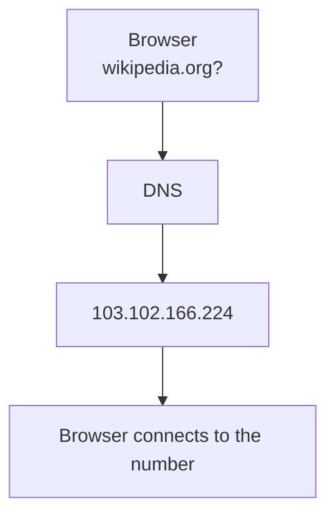
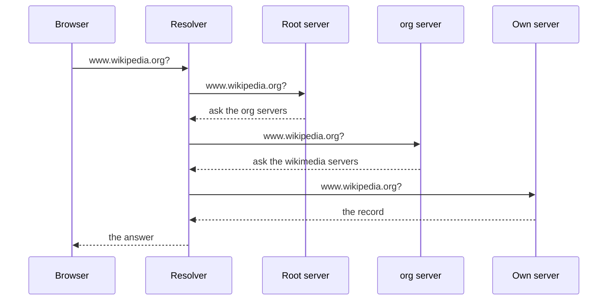
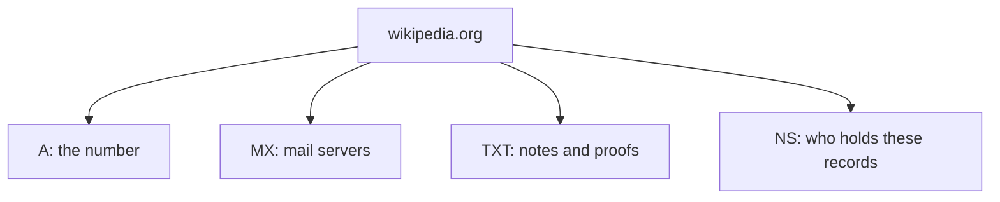
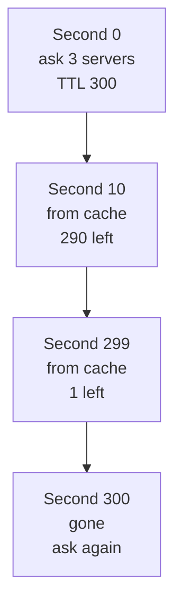
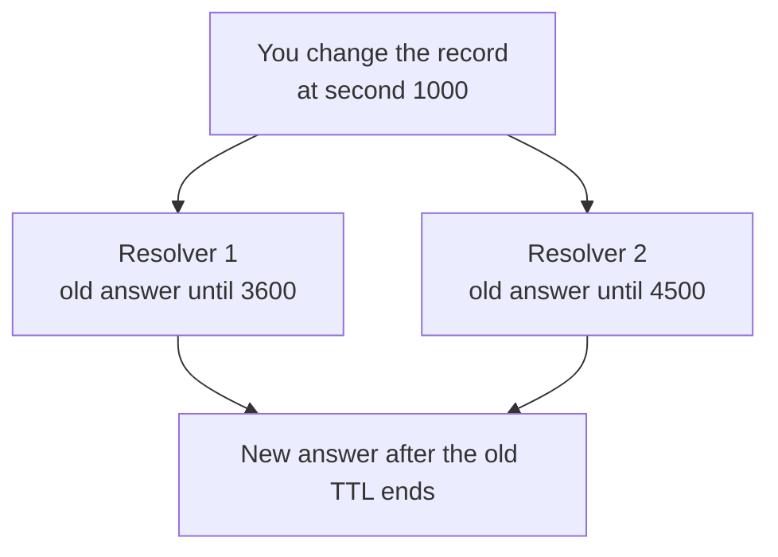
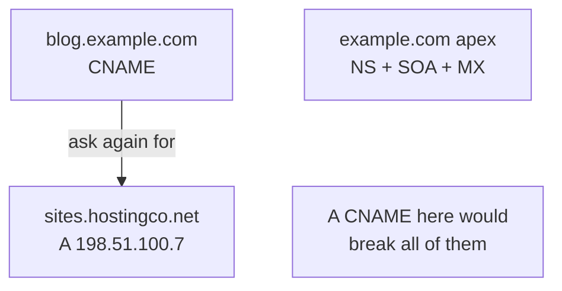
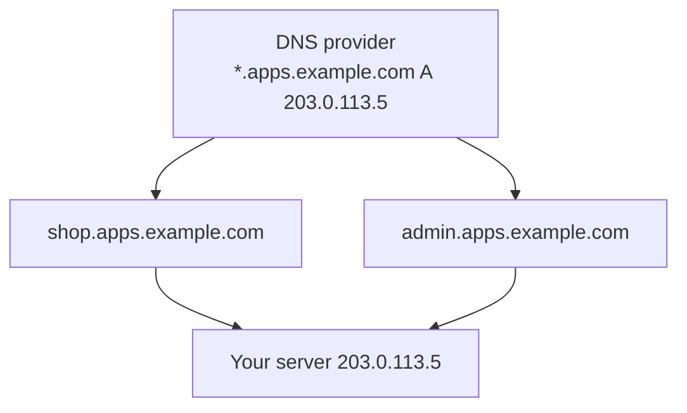
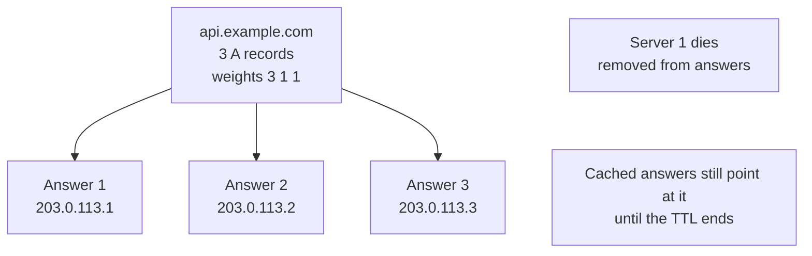

# 02. DNS: how a name becomes an IP address

> **Subject:** Networking · **Lesson:** 02 · **Made:** 2026-11-21 · **Status:** ready
>
> **You will be able to:** say why DNS exists, follow one lookup from the browser through the resolver, the root, the `.com` server and the domain's own server, read the main record types (A, AAAA, CNAME, MX, TXT, NS), say what a TTL does and why a DNS change "takes time", explain why a CNAME cannot sit on the apex and what Route 53 alias and Cloudflare flattening do about it, say what the CapRover wildcard record does, and say what DNS load balancing can and cannot do.
>
> **Before this:** [The layers: OSI and TCP/IP](01-the-layers-osi-and-tcp-ip.md) · **Also read:** [What happens when you type a URL](networking-url-to-page-step-by-step.md) and [HTTPS and certificates in practice](../devops-cloud/19-https-and-certificates-in-practice.md) · **Next:** TCP vs UDP (planned, lesson 03)
>
> **How to read it:** one card is one idea. Look at the picture, guess, then press the orange bar to check. The blue bars (📖 More detail) hold the longer explanation. Skip them on the first read. **What I ran for real:** `dig` and `dig +trace` against live servers, a small model of a resolver (the practice code and the stepper page). **What I did not run:** Route 53, Cloudflare and CapRover. Those are marked "from the docs, not run here". Facts and links were checked on 2026-11-21. About 25 minutes for the cards.

<!-- quick-summary:start -->
## Quick summary

> Short on time? Read only this. These are the "Remember" lines from the cards below, so you can read the whole lesson in one minute.

- DNS turns a name into an IP address, before the connection starts. It is split into many small books, not one big one.
- Resolver asks root, then the TLD server, then the domain's own server. Two referrals, then the answer.
- A and AAAA give addresses, CNAME gives another name, MX gives mail servers, TXT gives notes, NS says who holds the records.
- A TTL is how many seconds an answer may be kept. The resolver serves it from the cache until the time runs out. Short TTL: fresh but more lookups. Long TTL: fast and calm but slow to change.
- A DNS change is only as fast as the old TTL. Lower the TTL one full old TTL before a move. Raise it again after.
- A CNAME must be the only record on its name, so never on the apex. Alias (Route 53) and flattening (Cloudflare) are provider tricks that get around it.
- The CapRover wildcard record `*.apps.example.com` makes every app name resolve to your server. It does not make a certificate.
- DNS can spread load and skip dead servers, but only as fast as the TTL. For fine control, put a real load balancer behind one stable name.
<!-- quick-summary:end -->

## 1. The problem: computers need numbers, people use names

You type `www.wikipedia.org`. The network can only send packets to a number, an **IP address** like `103.102.166.224`. Something must turn the name into the number, every time, for every site, in a few milliseconds. That is **DNS** (the Domain Name System): a worldwide phone book that is split into many small books, so no single company runs it all.



Notice: DNS runs before any connection. If it fails, nothing else starts.

Analogy: a phone book. You know the name and need the number. Where it stops: nobody holds one big book. The book is split, and each part is kept by a different owner.

<details class="guess"><summary>🤔 Guess: the site is up and the server is fine, but DNS is broken. What does the user see? Press to check.</summary>

**The site looks down.** The browser has no number to connect to, so it never reaches the server. Many "the site is down" incidents are DNS problems.

</details>

> **Remember:** DNS turns a name into an IP address, before the connection starts. It is split into many small books, not one big one.

<details class="more"><summary>📖 More detail: four new words, and what else DNS holds</summary>

**Four new words in this lesson:** **resolver** (the helper that looks names up for you, card 2), **authoritative server** (the server that holds the real records of a domain, card 2), **TTL** (how long an answer may be remembered, card 4), **CNAME** (a record that says "this name is another name for that one", card 6).

**DNS holds more than addresses.** It also says where the mail goes (MX) and holds text notes that prove you own a domain (TXT). Card 3 lists them.

**Where it fits.** In [the URL to page guide](networking-url-to-page-step-by-step.md) DNS is step 1 of a page load. In the [layers lesson](01-the-layers-osi-and-tcp-ip.md), DNS is an application layer job: it uses UDP port 53 (and TCP port 53 for big answers).

</details>

## 2. Who answers: resolver, root, TLD, own server

Your browser does not walk the book itself. It asks one helper, the **resolver** (your internet provider's, or `1.1.1.1`, or `8.8.8.8`). The resolver asks three kinds of servers, one after the other. The **root** knows who runs each ending (`.com`, `.org`). The **TLD** server (top level domain, the ending) knows who runs each domain under it. The **authoritative server** holds the real records. Each one only points to the next. The last one knows the answer.



Notice: the first two answers are not answers. They are "ask them" (a **referral**). Only the last one is the record.

<details class="guess"><summary>🤔 Guess: does the root server know the IP address of www.wikipedia.org? Press to check.</summary>

**No.** The root only knows who runs `.org`. I asked a root server myself (see the blue bar): it answered with a list of `.org` servers and no address.

</details>

> **Remember:** resolver asks root, then the TLD server, then the domain's own server. Two referrals, then the answer.

<details class="more"><summary>📖 More detail: a real trace, the step by step table, and the stepper</summary>

**A real trace** (`dig +trace +nodnssec www.wikipedia.org A`, run on 2026-11-21, shortened):

```
.                518400  IN NS  j.root-servers.net.
 ... (13 root servers)
;; Received 823 bytes from 192.168.1.1#53

org.             172800  IN NS  v0n0.pir-ns.org.
 ... (6 servers)
;; Received 431 bytes from 192.203.230.10#53(e.root-servers.net) in 55 ms

wikipedia.org.   3600    IN NS  ns0.wikimedia.org.
 ... (3 servers)
;; Received 242 bytes from 199.19.56.1#53(v0n0.pir-ns.org) in 183 ms

www.wikipedia.org. 86400 IN CNAME dyna.wikimedia.org.
;; Received 75 bytes from 198.35.27.27#53(ns2.wikimedia.org) in 28 ms
```

Read it from top to bottom: the root says "ask `org`", the `org` server says "ask `wikimedia`", the Wikimedia server answers. `dig +trace` plays the resolver's role, so you see each hop. (The last answer is a CNAME, card 6.)

**The root does not give the address** (`dig +norecurse www.wikipedia.org A @a.root-servers.net`, same day): status `NOERROR`, `ANSWER: 0`, an authority section with the `org.` servers, and no `aa` flag (the root is not the authority for that name).

**The trace as a table** (stepper tab 1, the model code `createResolver`):

| Step | What happens | Cache after |
|---|---|---|
| 1 | Browser asks the resolver | empty |
| 2 | Resolver asks root, gets the `.com` server | empty |
| 3 | Resolver asks the `.com` server, gets the domain's own server | empty |
| 4 | Resolver asks the own server, gets the records | empty |
| 5 | Resolver saves them, answers the browser | records with their TTLs |

**See it move:** [the stepper page](visuals/02-dns.html), tab 1.

**Where my model is simpler:** it has one root, one TLD server, one name server, and takes the domain as the last two labels (so no `co.uk`). Real DNS has 13 root server names with hundreds of machines behind them, and many names per zone.

</details>

## 3. The records: what a domain says about itself

A domain keeps a small list of **records**. Each has a name, a type, a TTL and a value. The type says what the value means. You will meet six.

| Type | Value is | Use |
|---|---|---|
| **A** | an IPv4 address | the website's number |
| **AAAA** | an IPv6 address | the same, for IPv6 |
| **CNAME** | another name | "this name is that name" |
| **MX** | a mail server and a priority | where email goes |
| **TXT** | free text | proofs of ownership, email rules (SPF) |
| **NS** | a name server | who answers for this domain |



Notice: one name can hold many records of different types.

<details class="guess"><summary>🤔 Guess: you add a TXT record to prove to a service that you own your domain. Does it change where your website points? Press to check.</summary>

**No.** A TXT record is only a note. It does not change where `A` or `MX` point. That is why services ask you for TXT records: it is safe to add.

</details>

> **Remember:** A and AAAA give addresses, CNAME gives another name, MX gives mail servers, TXT gives notes, NS says who holds the records.

<details class="more"><summary>📖 More detail: real records from dig (2026-11-21)</summary>

```
$ dig +noall +answer wikipedia.org MX
wikipedia.org.  300  IN MX  10 mx-in1001.wikimedia.org.
wikipedia.org.  300  IN MX  10 mx-in2001.wikimedia.org.

$ dig +noall +answer wikipedia.org TXT      (3 of the lines)
wikipedia.org.  600  IN TXT "v=spf1 include:_cidrs.wikimedia.org ~all"
wikipedia.org.  600  IN TXT "google-site-verification=AMHkgs-4Vi..."

$ dig +noall +answer example.com AAAA
example.com.    1    IN AAAA 2606:4700:10::ac42:93f3

$ dig +noall +answer wikipedia.org NS
wikipedia.org.  3359 IN NS  ns0.wikimedia.org.   (and ns1, ns2)
```

An **MX** value has a priority number first. The lowest number is tried first. `example.com` has `MX 0 .`, called a "null MX": it means "this domain accepts no mail". **TXT** `v=spf1 ...` lists the servers allowed to send mail for the domain (SPF). A domain also has an **SOA** record (the zone's own details, with a serial number and the time to cache a "no such name" answer). **PTR** records go the other way, from an IP to a name: `dig -x 1.1.1.1` gave `one.one.one.one.`.

**One name, many records.** `wikipedia.org` itself holds A, NS, MX, TXT and SOA at the same time. This matters in card 6.

</details>

## 4. TTL: the answer is kept for a while

Asking three servers every time would be slow, and the servers would drown. So every record carries a **TTL** (time to live): the number of seconds others may keep the answer. The resolver saves the answer in its cache. Until the TTL runs out, it answers from the cache and asks nobody. The number counts down.



Notice: the cache is why DNS is fast. It is also why old answers can live on.

<details class="guess"><summary>🤔 Guess: you ask the same resolver for the same name twice, three seconds apart. The TTL in the second answer is... Press to check.</summary>

**About three smaller.** The resolver does not reset the TTL. It shows what is left. I saw this for real (blue bar): 247, then 244.

</details>

> **Remember:** a TTL is how many seconds an answer may be kept. The resolver serves it from the cache until the time runs out. Short TTL: fresh but more lookups. Long TTL: fast and calm but slow to change.

<details class="more"><summary>📖 More detail: the real countdown, a missing name, and the model trace</summary>

**The real countdown** (`dig +noall +answer example.com A @8.8.8.8`, run twice, 3 seconds apart, 2026-11-21):

```
example.com.  247  IN A  172.66.147.243
sleep 3
example.com.  244  IN A  172.66.147.243
```

The authoritative server said 300 (I saw `example.com. 300 IN A` in the trace). The resolver had already kept it for 53 seconds.

**A missing name is cached too.** I asked for a name that does not exist (`dig nonexistent-zzz-12345.wikipedia.org A @1.1.1.1`): status `NXDOMAIN` (no such name) and an SOA record in the authority part. [RFC 2308](https://www.rfc-editor.org/rfc/rfc2308) says resolvers remember this, for the lower of the SOA minimum field and the SOA's own TTL. Here the SOA TTL was 3600. So if you add a record right after someone asked for it, that resolver may say "no" for a while.

**The trace** (stepper tab 2, the model code `createResolver`):

| Step | Time | Result |
|---|---|---|
| 1 | second 0 | miss, 3 servers asked, saved with TTL 300 |
| 2 | second 10 | hit, 0 servers asked, 290 left |
| 3 | second 299 | hit, 1 left |
| 4 | second 300 | gone: miss, 3 servers asked |
| 5 | second 400 and 600 | a missing name is remembered 300 seconds |

**Browsers and phones** keep their own small cache too, and some resolvers keep answers longer or shorter than the TTL. The TTL is a rule most follow, not a guarantee.

</details>

## 5. Why a DNS change "takes time"

You move your site to a new server and change the `A` record. Your own DNS server gives the new number at once. But a resolver that saved the old answer keeps giving the old one until its copy runs out. Nobody pushes the new answer to anyone. Each resolver just waits for its own copy to end. People call this **propagation**, and it is the wrong picture: nothing travels. Different people see different answers for a while.



Notice: the longest wait is the time of the change plus the old TTL.

<details class="guess"><summary>🤔 Guess: the record has a TTL of 86400 (a day). You want to move in 5 minutes. When must you lower the TTL? Press to check.</summary>

**At least a day before.** Old copies can live for up to the old TTL. Lower it to 60, wait a full day, then change the IP. Every cache is then on 60 seconds, and the move shows within a minute.

</details>

> **Remember:** a DNS change is only as fast as the old TTL. Lower the TTL one full old TTL before a move. Raise it again after.

<details class="more"><summary>📖 More detail: the two step plan, why a flush is not yours, and the model trace</summary>

**The two step plan** (this is what `earliestSafeMove` computes):

| Time | You do | Caches hold |
|---|---|---|
| Day 0 | lower the TTL from 86400 to 60 | the old IP, for up to 86400 s |
| Day 1 | change the IP | all caches now on 60 s |
| Day 1 plus 1 minute | done | the new IP |
| After it works | raise the TTL again | |

**Why you cannot flush everybody.** Public resolvers such as `1.1.1.1` and `8.8.8.8` offer a page to flush one name, but your visitors use thousands of other resolvers, plus the cache in each browser and phone. The only tool you control is the TTL you set before.

**Route 53 says the same** (from the [FAQ](https://aws.amazon.com/route53/faqs/), not run here): Route 53 pushes a change to its own servers "within 60 seconds under normal conditions", and its INSYNC status "refers only to the state of Route 53's authoritative DNS servers". Resolver caches are outside its control. Cloudflare TTL values go from 60 seconds (30 on Enterprise) to a day, and its Auto setting is 300 seconds ([docs](https://developers.cloudflare.com/dns/manage-dns-records/reference/ttl/)).

**The trace** (stepper tab 4):

| Step | Second | Auth server | Resolver 1 | Resolver 2 |
|---|---|---|---|---|
| 1 | 900 | old IP | cached at 0 | cached at 900 |
| 2 | 1000 | you change it: new IP | old IP, 1600 left (at 2000) | old IP, 2500 left |
| 3 | 3600 | new IP | asks again: new IP | old IP, 900 left |
| 4 | 4500 | new IP | new IP | asks again: new IP |

</details>

## 6. CNAME, and why the apex cannot have one

A **CNAME** says "this name is only another name for that one". A resolver that meets it asks again for the new name, from the start if it lives somewhere else. You use it so a host can change its own IP without you doing anything: `blog.example.com CNAME sites.hostingco.net`. The rule: a name with a CNAME cannot hold any other record. The **apex** (`example.com` itself, no `www`) always holds NS and SOA records, so it can never be a CNAME.



Notice: a CNAME costs one more lookup, and it must be alone on its name.

<details class="guess"><summary>🤔 Guess: your host tells you "point example.com at app.host.io with a CNAME". Your DNS panel refuses. What now? Press to check.</summary>

**Use a provider feature, or an A record.** Route 53 has an **alias** record. Cloudflare has **CNAME flattening**. Both let a name at the apex follow a target and answer with plain IP addresses. Without them, use an A record with the host's IP, or send the apex to `www` with a redirect.

</details>

> **Remember:** a CNAME must be the only record on its name, so never on the apex. Alias (Route 53) and flattening (Cloudflare) are provider tricks that get around it.

<details class="more"><summary>📖 More detail: the real chain, the rule, the provider docs, and the trace</summary>

**A real CNAME chain** (`dig +noall +answer www.wikipedia.org A @1.1.1.1`, 2026-11-21):

```
www.wikipedia.org.   86387  IN CNAME dyna.wikimedia.org.
dyna.wikimedia.org.  167    IN A     103.102.166.224
```

Two records, two different TTLs. The resolver returns both. The browser only uses the last one.

**The rule** ([RFC 1912](https://www.rfc-editor.org/rfc/rfc1912)): a CNAME "is not allowed to coexist with any other data", and a CNAME next to the NS records of the apex makes the other hosts unreachable. The usual breakage: someone adds a CNAME at the apex and their mail (MX) stops working.

**Route 53** (from the [docs](https://docs.aws.amazon.com/Route53/latest/DeveloperGuide/resource-record-sets-choosing-alias-non-alias.html), not run here): "You can't create a CNAME record for example.com, but you can create an alias record." Alias records point at selected AWS things (CloudFront, load balancers, S3 website buckets) or another record in the same zone. Route 53 does not charge for alias queries to AWS resources, and you cannot set the TTL of an alias to an AWS resource (the FAQ says it is fixed at 60 seconds).

**Cloudflare** (from the [docs](https://developers.cloudflare.com/dns/cname-flattening/), not run here): "CNAME flattening ... allows you to use a CNAME record at your zone apex".

**Other traps.** A CNAME loop gives an error (the resolver stops after a fixed number of jumps, 8 in my model). Long chains cost one lookup per jump. A CNAME answers for every type, so `A` and `AAAA` both follow it.

**The trace** (stepper tab 3, the model code `followCname` and `createResolver`):

| Step | What happens |
|---|---|
| 1 | Ask root, `.com`, your server: it gives `CNAME sites.hostingco.net` |
| 2 | Ask again for the new name: root, `.net`, the host's server: `A 198.51.100.7` |
| 3 | Browser gets both records and uses the IP. 6 questions in all |
| 4 | Second lookup: from the cache, 0 questions |

**Wildcard and apex in the stepper:** tab 5, the model code `validateZone` and `recordTypeFor`.

</details>

## 7. DNS in my stack: CapRover, Route 53, Cloudflare

Your **DNS provider** (where the records live) is the authoritative server for your domain. Cloudflare, Route 53 and your registrar's panel are all this. CapRover needs one record: a **wildcard** `A` record, `*.apps.example.com`, that points at your server's IP. The star means "every name under `apps.example.com` that has no record of its own". So every new app, `shop.apps.example.com`, resolves at once without a DNS change.



Notice: many names, one IP. The server tells the apps apart by the name in the request (the Host header).

<details class="guess"><summary>🤔 Guess: you add the wildcard DNS record for CapRover. Do you get a wildcard HTTPS certificate with it? Press to check.</summary>

**No.** The CapRover docs say wildcard DNS "does not create a wildcard TLS certificate". Each hostname needs its own certificate handling (see [HTTPS in practice](../devops-cloud/19-https-and-certificates-in-practice.md), card 5).

</details>

> **Remember:** the CapRover wildcard record `*.apps.example.com` makes every app name resolve to your server. It does not make a certificate.

<details class="more"><summary>📖 More detail: the CapRover docs, Route 53 vs Cloudflare, and a wildcard trap (checked 2026-11-21)</summary>

**CapRover** (from the [get started](https://caprover.com/docs/get-started.html) and [domains](https://caprover.com/docs/domains.html) docs, not run here): the guide uses `apps.example.com` as the root domain and asks for an `A` record named `*.apps` with the server's public IPv4 address as the value. The wildcard covers `captain.apps.example.com` and `my-first-app.apps.example.com`. The root name `apps.example.com` needs its own record only if you use it directly. The docs say to keep proxied DNS (such as Cloudflare's orange cloud) on "DNS only" during setup, and to keep the wildcard pointing at CapRover for app domains and certificate renewal. For a custom domain, "point the hostname to the CapRover server, then attach it to the app". For an apex domain, they suggest an `A` record or "a DNS provider's supported alias mechanism".

**The two providers at a glance** (from the docs above, not run here):

| | Route 53 | Cloudflare |
|---|---|---|
| Apex pointing at a name | alias record (to AWS things or another record) | CNAME flattening |
| TTL | you set it on every record, no default. Alias to an AWS thing: fixed by AWS | 60 s up to a day. Auto is 300 s, and proxied records are always Auto |
| Routing policies | simple, weighted, latency, failover, geolocation and more | basic records (load balancing is a separate product, not checked here) |
| Change reaches its own servers | within about 60 seconds | not checked here |

**A wildcard is not a catch all for names with records.** An own record wins over the wildcard (`captain.apps.example.com` keeps its own IP). Under [RFC 4592](https://www.rfc-editor.org/rfc/rfc4592), a wildcard can also answer for several labels (`a.b.apps.example.com`) when the names in between do not exist, and it never answers for `apps.example.com` itself. A TLS wildcard is stricter: it covers exactly one label. The DNS record and the certificate follow different rules.

**The trace** (stepper tab 5): the zone with its wildcard, a new app name gets the wildcard IP, `captain` keeps its own record, a name two labels deep also matches, then the rule that a CNAME must stand alone, and `recordTypeFor`.

</details>

## 8. DNS for load balancing and failover

A name can have several `A` records, and the DNS server decides which to put in each answer. A **weighted** record set gives some servers more answers. A **health check** removes a dead server from the answers. This spreads load across regions or data centers for little money. But DNS never sees how busy a server is, and every resolver keeps its answer for the TTL, so everyone behind one resolver gets the same IP for that time.



Notice: failover through DNS is only as fast as the TTL.

<details class="guess"><summary>🤔 Guess: DNS removes a dead server from its answers. TTL is 3600. How long can some users still reach the dead server? Press to check.</summary>

**Up to an hour.** Resolvers that saved the old answer keep giving it until it runs out. That is why failover records use a short TTL (the Route 53 FAQ says 60 seconds or less).

</details>

> **Remember:** DNS can spread load and skip dead servers, but only as fast as the TTL. For fine control, put a real load balancer behind one stable name.

<details class="more"><summary>📖 More detail: Route 53 policies, the limits, and the trace</summary>

**Route 53 routing policies** (from the [docs](https://docs.aws.amazon.com/Route53/latest/DeveloperGuide/routing-policy.html), not run here): simple, failover (active and passive), geolocation, geoproximity, latency, IP based, multivalue answer (up to eight healthy records chosen at random), weighted, and AZ affinity. The [FAQ](https://aws.amazon.com/route53/faqs/) says weights run from 0 to 255, and with weights 3 and 1 the first record is returned about 75% of the time.

**What DNS does not do.** It does not see load or open connections. It does not move a user who is already connected. Browsers may try another address when the first fails, but that is the client's choice, not a promise. A big office behind one resolver can land on one server.

**Normal setup.** A common design is one stable name that points (alias or A record) at a real load balancer, which spreads requests across servers and checks them every few seconds. DNS then only picks a region. See [Load balancers](../system-design/03-load-balancers.md).

**The trace** (stepper tab 6, the model code `pickWeighted`):

| Step | What happens |
|---|---|
| 1 | Records with weights 3, 1, 1 |
| 2 | Rolls 0.1, 0.7, 0.9 give server 1, 2, 3 |
| 3 | Two resolvers keep two different answers for the TTL |
| 4 | Server 1 marked unhealthy: the same rolls give 2 and 3 |
| 5 | The cache keeps the old answer: failover time is about the TTL |

</details>

## 9. Watch and play

Links were checked on 2026-11-21: I opened each page, and for the videos I read the title and channel from YouTube oEmbed data. I did not watch the videos. If a link is broken, tell me and I will replace it.

- **Play with it:** [the stepper in this folder](visuals/02-dns.html) - guess first, then press Next. Six tabs: a first lookup, cache and TTL, a CNAME chain, why a change is slow, apex and wildcard, and DNS load balancing.
- **Video:** [Everything You Need to Know About DNS: Crash Course System Design #4](https://www.youtube.com/watch?v=27r4Bzuj5NQ) - ByteByteGo. Title and channel checked only. Compare it with cards 2 and 4, and the system design angle in card 8.
- **Video:** [DNS Records](https://www.youtube.com/watch?v=7lxgpKh_fRY) - the roadmap (roadmap.sh). Title and channel checked only. Compare it with card 3.
- **Play with DNS for real:** [Mess with DNS](https://messwithdns.net/) - you get your own subdomain, add records and watch a live log of the requests. A safe place to try an A record and a CNAME.
- **Pictures:** [How DNS works (comic)](https://dnsimple.com/comics/how-dns-works/) - an illustrated story of a lookup (the page loads and lists the episodes, I did not see the panels). The old address `howdns.works` redirects here.
- **Run it yourself:** in a terminal, `dig +trace www.wikipedia.org` shows card 2 live, and `dig example.com @8.8.8.8` twice shows the TTL going down.
- **Read:** [RFC 1912, common DNS mistakes](https://www.rfc-editor.org/rfc/rfc1912) - the CNAME rules in the original words.

<details><summary>Go deeper (optional)</summary>

**More pages I opened.** [RFC 4592 (wildcards)](https://www.rfc-editor.org/rfc/rfc4592). [RFC 2308 (negative caching)](https://www.rfc-editor.org/rfc/rfc2308). [Route 53 alias or CNAME](https://docs.aws.amazon.com/Route53/latest/DeveloperGuide/resource-record-sets-choosing-alias-non-alias.html). [Route 53 routing policies](https://docs.aws.amazon.com/Route53/latest/DeveloperGuide/routing-policy.html). [Route 53 FAQ](https://aws.amazon.com/route53/faqs/). [Cloudflare CNAME flattening](https://developers.cloudflare.com/dns/cname-flattening/). [Cloudflare TTL](https://developers.cloudflare.com/dns/manage-dns-records/reference/ttl/). [CapRover get started](https://caprover.com/docs/get-started.html). [CapRover domains](https://caprover.com/docs/domains.html).

**Checked on 2026-11-21** with Node v26.5.0 and `dig` 9.10.6 (macOS). The practice code has 80 tests. On the empty stub 76 fail (the other 4 only check that your function does not change its inputs). I also made 53 wrong versions of the answer (for example a name check that ignores letter case, a cache that keeps the answer one second too long, a shared cache between resolvers, weights that are ignored), and the tests caught every one that changed behavior. The stepper uses the same functions, and I ran every step of every tab through a script that looks for missing values.

**What I did not test.** Route 53, Cloudflare and CapRover (all from the docs). A real DNS change across the internet. The stepper was not clicked in a real browser by me; only its step data was checked.

**Where the model is simpler than the real thing.** One root, one TLD server and one name server. A domain is the last two labels. No DNSSEC, no EDNS, no UDP and TCP, no retries, no timeouts. My cache keeps a whole answer until its shortest TTL ends, where real resolvers keep each record on its own (the stepper shows each record's own countdown, but re-asks the whole chain). Real resolvers may also change the TTL they keep (for example a minimum or maximum). Real DNS wildcards have more rules (for example for names that exist only as parents of other names, which my `wildcardLookup` does handle, and for CNAME records at a wildcard, which it does not).

**Not covered here.** DNSSEC, DNS over HTTPS, split horizon DNS inside a company network, Kubernetes service discovery (see the [Kubernetes objects](../devops-cloud/04-kubernetes-objects.md) lesson), anycast, and how a registrar sets the NS records of a domain.

</details>

## 10. Practice

**A. Predict the output** (write your answer before opening)

```js
const world = {
  root: { com: "a" },
  tld: { a: { "example.com": "ns1" } },
  auth: { ns1: [
    { name: "example.com", type: "A", ttl: 300, value: "1.2.3.4" },
  ] },
};
const r = createResolver(world);
console.log(r.resolve("example.com", "A", 0).asked);
console.log(r.resolve("example.com", "A", 100).answers[0].ttl);
console.log(r.resolve("example.com", "A", 300).fromCache);
console.log(r.resolve("nope.example.com", "A", 300).rcode);
console.log(earliestSafeMove(1000, 3600));
```

Then answer: why is the third line `false` and not `true`?

<details><summary>Answer</summary>

```
[ 'root', 'a', 'ns1' ]
200
false
NXDOMAIN
4600
```

The first lookup is a miss, so the resolver asks root, the TLD server `a` and the own server `ns1`. At second 100 the answer comes from the cache with 300 - 100 = 200 seconds left. At second 300 the TTL has just run out, so the answer is gone and the resolver asks again (`fromCache` is `false`). A name with no record gives `NXDOMAIN`. If you lower a TTL at second 1000 and the old TTL was 3600, no old copy can live past 1000 + 3600 = 4600. (Run on 2026-11-21 with Node v26.5.0.)

</details>

**B. Fix the bug**

Someone moved a site to a host that says "use a CNAME" and changed the apex. Now mail to the domain bounces. Find the cause.

```js
const zone = [
  { name: "example.com", type: "CNAME", ttl: 300, value: "my-app.herokuapp.com" },
  { name: "example.com", type: "MX", ttl: 300, value: "10 mail.example.com" },
];
console.log(validateZone(zone, "example.com"));
```

<details><summary>Answer</summary>

`validateZone` prints `[ { name: 'example.com', problem: 'cname at apex' } ]` (I ran it). A CNAME must be the only record on its name, and the apex also holds the MX (and NS and SOA) records. A resolver that sees the CNAME follows it and ignores the rest, so the MX is lost. **Fix:** remove the CNAME at the apex. Use an `A` record with the host's IP, or a provider alias or flattening record (`recordTypeFor("my-app.herokuapp.com", { apex: true })` says `ALIAS`), and put the CNAME on `www` instead. Keep the MX record.

</details>

**C. Write it yourself**

Open `learn/networking/practice/02-dns.js`. It has eight empty pieces: `lookupRecord`, `followCname`, `wildcardLookup`, `validateZone`, `createResolver`, `earliestSafeMove`, `pickWeighted` and `recordTypeFor`. The comments at the top say exactly what each must do. Write them, then run this from the repo root and make all the tests pass:

```
node --test learn/networking/practice/02-dns.test.js
```

`createResolver` is the one to think about. Build `lookupRecord` and `followCname` first, and let the resolver use them. Draw the cache on paper: what is stored, and when does it run out?

<details><summary>One possible answer</summary>

```js
const MAX_HOPS = 8;

const norm = (name) => String(name).trim().toLowerCase().replace(/\.$/, "");
const copy = (r) => ({ name: norm(r.name), type: r.type, ttl: r.ttl, value: r.value });

function lookupRecord(zone, name, type) {
  const n = norm(name);
  return zone.filter((r) => norm(r.name) === n && r.type === type).map(copy);
}

function followCname(zone, name, type) {
  let cur = norm(name);
  const answers = [];
  const seen = new Set([cur]);
  for (;;) {
    const direct = lookupRecord(zone, cur, type);
    if (direct.length > 0) return { ok: true, answers: answers.concat(direct) };
    const cn = lookupRecord(zone, cur, "CNAME")[0];
    if (!cn) {
      if (answers.length === 0) return { ok: false, reason: "no record" };
      return { ok: true, answers, next: cur };
    }
    answers.push(cn);
    if (answers.length > MAX_HOPS) return { ok: false, reason: "too many hops" };
    const target = norm(cn.value);
    if (seen.has(target)) return { ok: false, reason: "loop" };
    seen.add(target);
    cur = target;
  }
}

function nameExists(zone, name) {
  return zone.some((r) => {
    const n = norm(r.name);
    return n === name || n.endsWith("." + name);
  });
}

function wildcardLookup(zone, host, type) {
  const h = norm(host);
  if (nameExists(zone, h)) return lookupRecord(zone, h, type);
  const labels = h.split(".");
  for (let i = 1; i < labels.length; i++) {
    const ancestor = labels.slice(i).join(".");
    const wild = lookupRecord(zone, "*." + ancestor, type);
    if (wild.length > 0) return wild.map((r) => ({ ...r, name: h }));
    if (nameExists(zone, ancestor)) return [];
  }
  return [];
}

function validateZone(zone, origin) {
  const apex = norm(origin);
  const names = [...new Set(zone.map((r) => norm(r.name)))].sort();
  const problems = [];
  for (const name of names) {
    const here = zone.filter((r) => norm(r.name) === name);
    const cnames = here.filter((r) => r.type === "CNAME");
    if (cnames.length === 0) continue;
    if (cnames.length > 1) problems.push({ name, problem: "more than one cname" });
    else if (name === apex) problems.push({ name, problem: "cname at apex" });
    else if (here.length > 1) problems.push({ name, problem: "cname with other records" });
  }
  return problems;
}

function createResolver(world, options = {}) {
  const negativeTtl = options.negativeTtl === undefined ? 300 : options.negativeTtl;
  const cache = new Map();

  function go(name, type, now, depth) {
    const n = norm(name);
    const key = n + "/" + type;
    const hit = cache.get(key);
    if (hit && hit.expires > now) {
      const answers = hit.answers.map((r) => ({ name: r.name, type: r.type, value: r.value, ttl: r.expiresAt - now }));
      return { rcode: hit.rcode, answers, fromCache: true, asked: [] };
    }
    if (depth > MAX_HOPS) return { rcode: "SERVFAIL", answers: [], fromCache: false, asked: [] };

    const store = (rcode, answers, ttl) => {
      const kept = answers.map((r) => ({ name: r.name, type: r.type, value: r.value, expiresAt: now + r.ttl }));
      cache.set(key, { rcode, answers: kept, expires: now + ttl });
    };
    const nxdomain = (asked) => {
      store("NXDOMAIN", [], negativeTtl);
      return { rcode: "NXDOMAIN", answers: [], fromCache: false, asked };
    };

    const labels = n.split(".");
    const asked = ["root"];
    const tldServer = world.root[labels[labels.length - 1]];
    if (!tldServer) return nxdomain(asked);
    asked.push(tldServer);
    const domain = labels.slice(-2).join(".");
    const authServer = (world.tld[tldServer] || {})[domain];
    if (!authServer) return nxdomain(asked);
    asked.push(authServer);

    const r = followCname(world.auth[authServer] || [], n, type);
    if (!r.ok) {
      if (r.reason === "no record") return nxdomain(asked);
      return { rcode: "SERVFAIL", answers: [], fromCache: false, asked };
    }
    let answers = r.answers;
    let rcode = "NOERROR";
    if (r.next) {
      const sub = go(r.next, type, now, depth + 1);
      asked.push(...sub.asked);
      answers = answers.concat(sub.answers);
      rcode = sub.rcode;
    }
    if (rcode === "NOERROR") store(rcode, answers, Math.min(...answers.map((a) => a.ttl)));
    return { rcode, answers, fromCache: false, asked };
  }

  return { resolve: (name, type, now) => go(name, type, now, 0) };
}

function earliestSafeMove(lowerTtlAt, oldTtl) {
  if (!Number.isFinite(lowerTtlAt) || !Number.isFinite(oldTtl) || oldTtl < 0) throw new Error("need numbers, and a TTL of 0 or more");
  return lowerTtlAt + oldTtl;
}

function pickWeighted(records, roll) {
  if (!(roll >= 0 && roll < 1)) throw new Error("roll must be 0 or more and less than 1");
  const live = [];
  for (const r of records) {
    const weight = r.weight === undefined ? 1 : r.weight;
    if (typeof weight !== "number" || !(weight >= 0)) throw new Error("weight must be a number of 0 or more");
    if (r.healthy !== false && weight > 0) live.push({ value: r.value, weight });
  }
  if (live.length === 0) return null;
  const total = live.reduce((sum, r) => sum + r.weight, 0);
  const target = roll * total;
  let running = 0;
  for (const r of live) {
    running += r.weight;
    if (target < running) return r.value;
  }
  return live[live.length - 1].value;
}

function recordTypeFor(target, options = {}) {
  if (typeof target !== "string" || target.trim() === "") throw new Error("target must be text");
  const t = target.trim();
  if (/^\d{1,3}(\.\d{1,3}){3}$/.test(t)) {
    if (t.split(".").some((part) => Number(part) > 255)) throw new Error("bad IPv4 address");
    return "A";
  }
  if (t.includes(":") && /^[0-9a-f:.]+$/i.test(t)) return "AAAA";
  return options.apex ? "ALIAS" : "CNAME";
}

module.exports = { lookupRecord, followCname, wildcardLookup, validateZone, createResolver, earliestSafeMove, pickWeighted, recordTypeFor };
```

Checked with Node v26.5.0: 76 of the 80 tests fail on the empty stub (the other 4 only check that your function does not change its inputs), and all 80 pass with this answer. The stepper page uses these same functions.

</details>

## 11. Interview question

**Q:** "What happens when you type a URL? Go deep on the DNS part." or "I changed a DNS record an hour ago and some users still see the old site. Why?"

A common follow-up: "Why can't you put a CNAME on the root domain, and what do you do instead?"

<details><summary>A strong answer, in four parts</summary>

1. **Problem:** Computers connect to IP addresses, but people use names, and the mapping changes (servers move). One central list would be too big, too slow and a single point of failure.
2. **How it works:** The browser asks a resolver. On a cache miss, the resolver asks a root server (which points to the TLD server), then the TLD server (which points to the domain's own server), then the authoritative server, which holds the records (A, AAAA, CNAME, MX, TXT, NS). Every record has a TTL, and the resolver caches the answer for that time, and it caches "no such name" too. A CNAME is followed with a new lookup. A change is not pushed to anyone: each resolver keeps its old copy until the TTL ends, so the wait is up to the old TTL.
3. **Tradeoff:** A long TTL means fast, cheap lookups and a calm system, but slow changes and slow failover. A short TTL means fast changes but more lookups. So I lower the TTL one old TTL before a planned move. A CNAME lets a host change its own IP, but it costs a lookup and cannot sit on the apex, so I use an alias or flattening there (Route 53 and Cloudflare), or an A record. DNS load balancing is cheap and good for regions, but it is only as fast as the TTL and it cannot see load.
4. **My example:**
   - **Fact:** my profile lists CapRover, Docker and a little AWS. The CapRover docs ask for one wildcard A record (`*.apps.example.com`) pointing at the server, so every app name resolves without more DNS changes.
   - **Fact (from this lesson):** I ran `dig` and `dig +trace` against live servers and a small model of a resolver here. I did not run Route 53, Cloudflare or CapRover.
   - **Idea, not a fact:** I do not know which DNS provider or TTL my past projects used, so I should not claim it. A good next step is to run `dig` on a domain I manage, read its TTLs, and say what I would lower before a migration.

</details>

## 12. Explain it back

Close this file. Explain DNS out loud like to a new junior, in 4 parts (problem, how, tradeoff, my example). Use the story of the site that was moved to a new server, where half of the users still saw the old one for an hour. Say who is asked (resolver, root, TLD, own server) and what each one answers, what a TTL does, why nothing is "pushed", what you should do before a move, why a CNAME cannot sit on the apex, and what DNS load balancing cannot do. Write your best version below and run `/explain-check dns` or ask the `explain-coach` agent to review it.

### My explanation

<write here>

### Coach feedback

<the explain-coach agent writes here>

## 13. Review questions (day 1, 3, 7, 21)

1. Draw a first lookup from memory. Who is asked, in what order, and what does each one answer?
2. What is a TTL, and what does the resolver do before and after it runs out?
3. You changed an A record that had a TTL of 3600 and some users still see the old IP. Why, and what should you have done before?
4. What is the difference between A, AAAA, CNAME, MX, TXT and NS?
5. Why can a CNAME not sit on the apex? Name two ways to point the apex at a hostname.
6. What does the CapRover wildcard record do, and what does it not do?
7. What can DNS do for load balancing and failover, and what is its main limit?

<details><summary>Answers</summary>

1. Browser asks the resolver. The resolver asks a root server (answer: ask the `.com` server), then the `.com` server (answer: ask the domain's own server), then the authoritative server (answer: the record). The resolver saves it and answers the browser.
2. A TTL is the number of seconds an answer may be kept. Before it runs out, the resolver answers from the cache and asks nobody, and the TTL counts down. When it runs out, the resolver asks again.
3. Each resolver keeps its old copy until its own TTL ends. Nothing is pushed. The wait is up to 3600 seconds. Before the move, lower the TTL to about 60, wait one full old TTL, then change the IP.
4. A: IPv4 address. AAAA: IPv6 address. CNAME: another name. MX: mail servers with a priority. TXT: free text (proofs, SPF). NS: the servers that hold the domain's records.
5. A CNAME must be the only record on its name, and the apex always holds NS and SOA records (and often MX). Use a provider alias or flattening (Route 53 alias, Cloudflare CNAME flattening), or an A record with an IP.
6. `*.apps.example.com A <server IP>` makes every app name under it resolve to the server, with no DNS change per app. It does not create a wildcard TLS certificate.
7. It can give several IPs, weight them, and drop unhealthy ones, cheaply and across regions. The limit is the TTL: resolvers keep old answers, so failover takes about the TTL, and DNS cannot see load or move connected users.

</details>

## Connected lessons

- [The layers: OSI and TCP/IP](01-the-layers-osi-and-tcp-ip.md) - DNS is an application layer job on top of UDP and TCP.
- [What happens when you type a URL](networking-url-to-page-step-by-step.md) - DNS is step 1 of the whole page load.
- [HTTPS and certificates in practice](../devops-cloud/19-https-and-certificates-in-practice.md) - DNS-01 proves control of a name with a TXT record, and a wildcard record is not a wildcard certificate.
- [What CapRover does for you](../devops-cloud/21-what-caprover-does-for-you.md) - the wildcard record in context.
- [Reverse proxy and Nginx](../devops-cloud/08-reverse-proxy-and-nginx.md) - what the server does with the name after DNS got the visitor there.
- [Load balancers](../system-design/03-load-balancers.md) - the real thing, behind one stable name.
- [Networking for system design](networking-for-system-design.md) - DNS as a design tool.
- TCP vs UDP (planned, lesson 03) - next: what happens after DNS gives the number.
