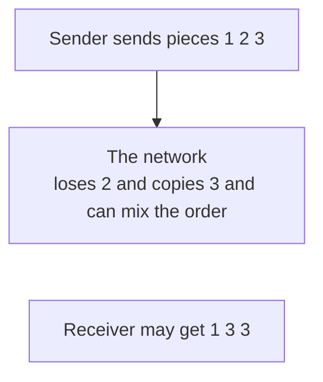
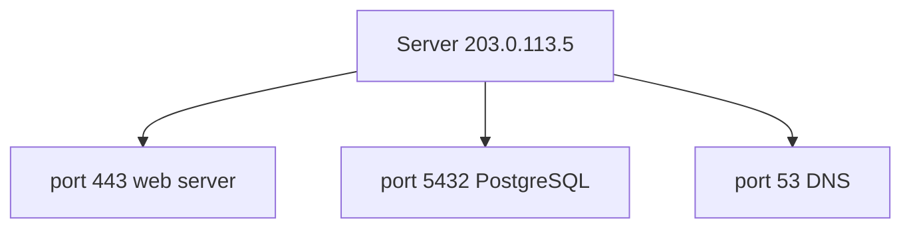
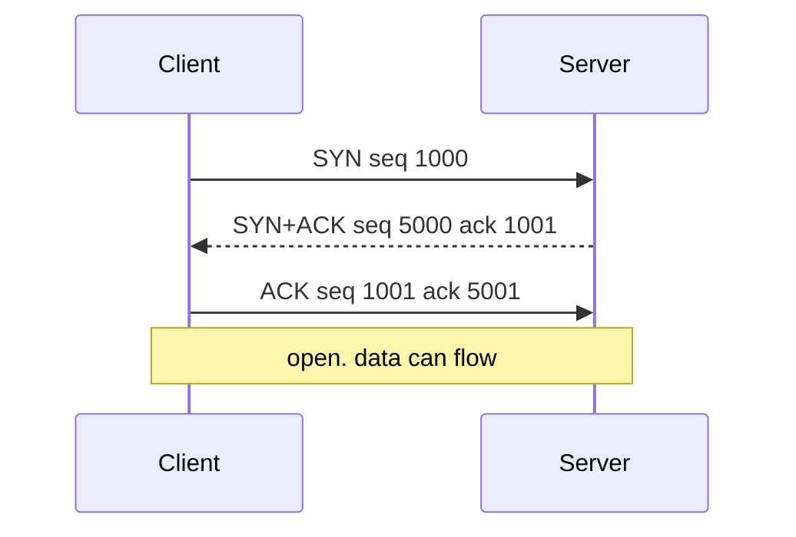
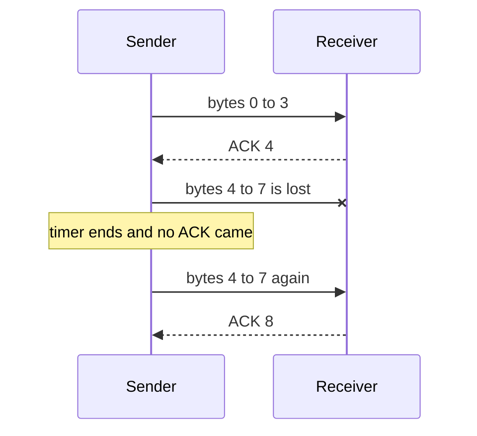
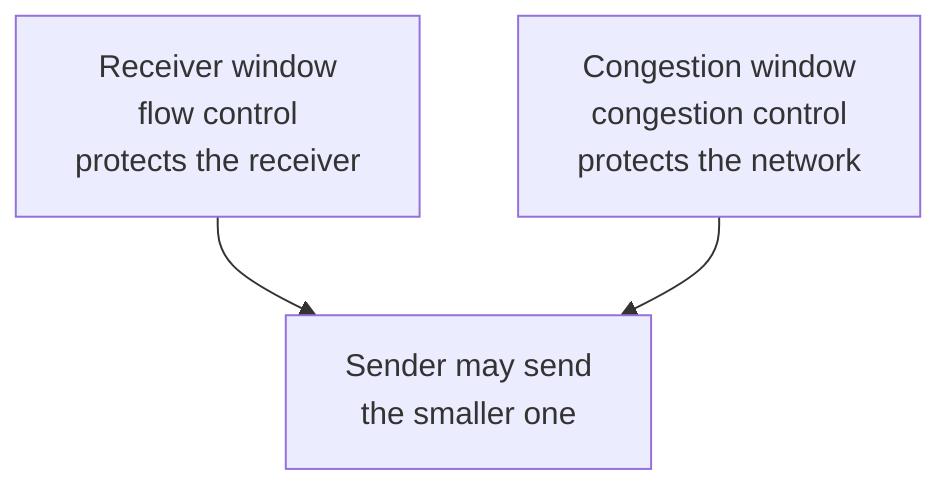
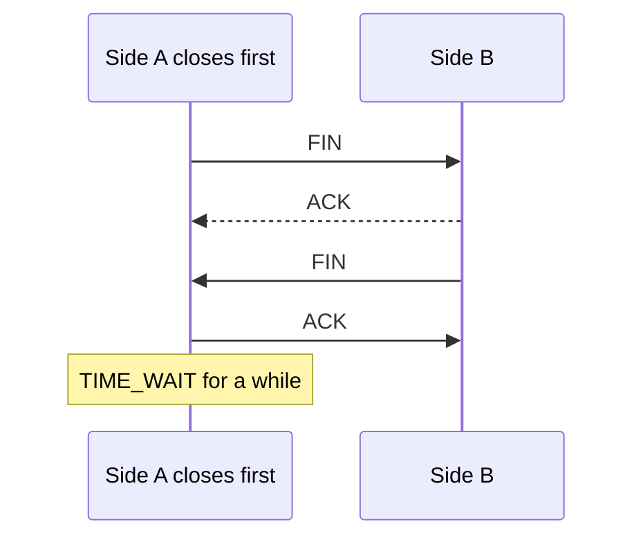
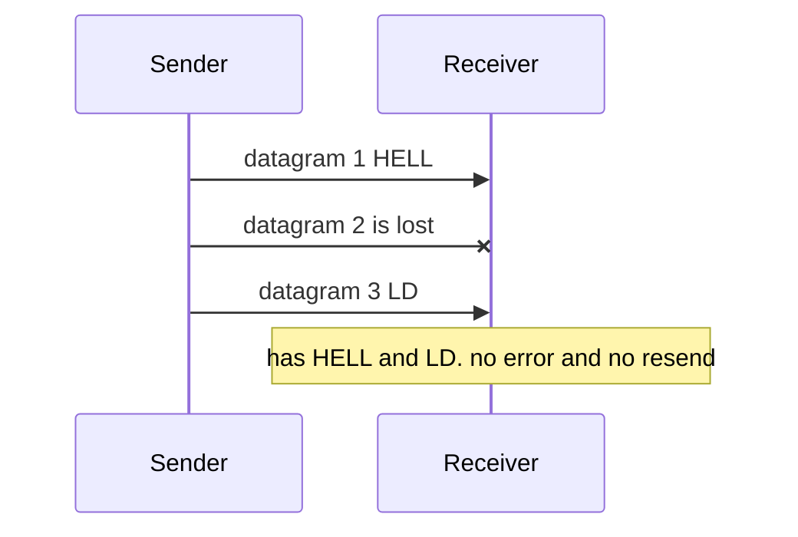
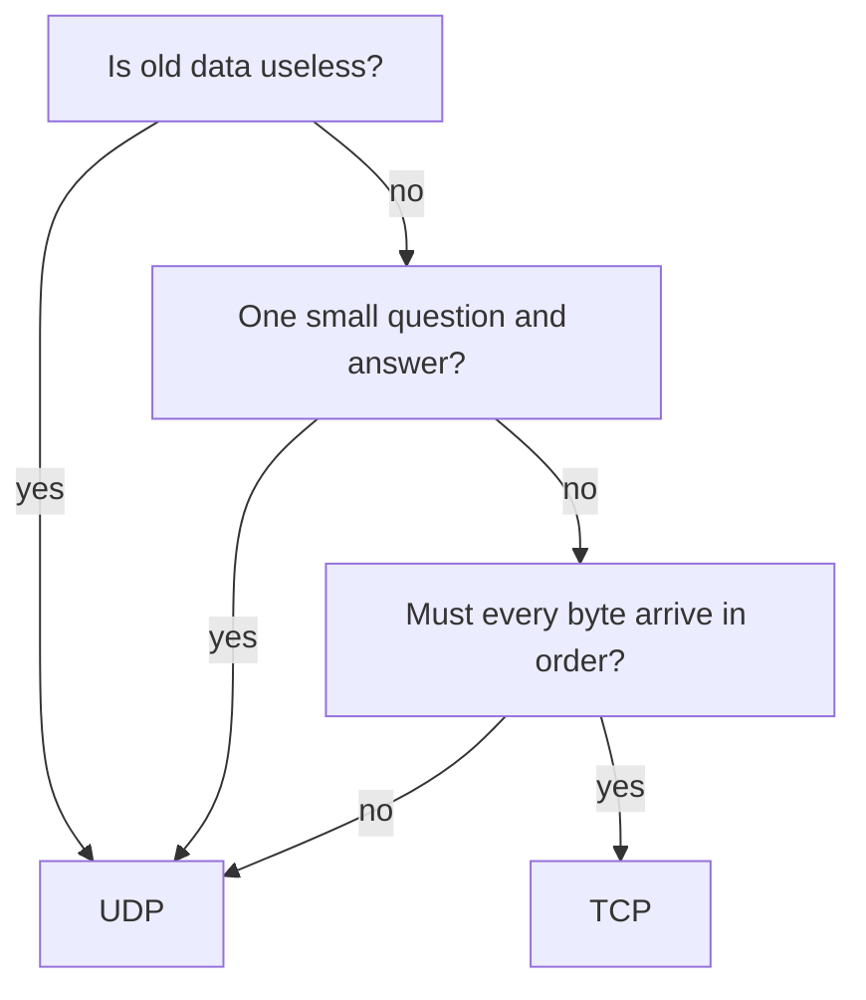

# 03. TCP vs UDP

> **Subject:** Networking · **Lesson:** 03 · **Made:** 2026-11-21 · **Status:** ready
>
> **You will be able to:** say why TCP and UDP exist on top of IP, explain what a port is and what names a connection, follow the three way handshake, explain how TCP keeps data whole and in order (numbers, receipts, resending), say what flow control and congestion control protect, follow the four messages that close a connection and say why TIME_WAIT is normal, say what UDP gives and does not give, and pick TCP or UDP for DNS, video, games and QUIC.
>
> **Before this:** [The layers: OSI and TCP/IP](01-the-layers-osi-and-tcp-ip.md) and [DNS](02-dns.md) · **Also read:** [What happens when you type a URL](networking-url-to-page-step-by-step.md) · **Next:** TLS and HTTPS (planned, lesson 04)
>
> **How to read it:** one card is one idea. Look at the picture, guess, then press the orange bar to check. The blue bars (📖 More detail) hold the longer explanation. Skip them on the first read. **What I ran for real:** small Node programs with `net` (TCP) and `dgram` (UDP) on my own computer, `netstat`, `dig`, `curl`, and the practice code. **What I did not run:** a packet capture, and anything over a bad network. Loss on the real network is shown only in the model. Facts and links were checked on 2026-11-21. About 25 minutes for the cards.

<!-- quick-summary:start -->
## Quick summary

> Short on time? Read only this. These are the "Remember" lines from the cards below, so you can read the whole lesson in one minute.

- IP only tries its best: pieces can be lost, repeated or mixed up. TCP fixes this for you. UDP does not.
- The IP address finds the computer, the port finds the program. A TCP connection is named by 4 numbers: both IPs and both ports.
- The handshake is 3 messages (SYN, SYN+ACK, ACK) that agree the start numbers. It costs one round trip before the data.
- TCP numbers every byte. The receiver says which byte it wants next (ACK). No ACK in time means the sender sends it again.
- Flow control protects the receiver. Congestion control protects the network. The sender may send only the smaller of the two windows.
- Closing takes four messages (FIN, ACK, FIN, ACK). The side that closes first waits in TIME_WAIT. A pile of TIME_WAIT is normal, not a bug.
- UDP sends separate datagrams: no handshake, no resend, no order, but each datagram arrives whole or not at all. TCP is a stream with no message edges.
- Use TCP when every byte must arrive in order. Use UDP when old data is useless, or when you want to do your own recovery. QUIC (HTTP/3) is built on UDP.
<!-- quick-summary:end -->

## 1. The problem: the network does not keep promises

Your computer sends 3 pieces of a file. The network under it, **IP**, only tries its best. It can lose a piece, deliver one twice, or deliver them in another order. IP makes no promise and sends no receipt. A file with a missing middle piece is broken. So a layer on top has to decide: fix this, or leave it. **TCP** fixes it. **UDP** leaves it.



Notice: nothing in the middle checks the pieces. Whoever sits on the ends must.

Analogy: IP is a postman who tries his best and gives no receipt. TCP is registered mail with a receipt for every letter. UDP is a postcard. Where it stops: TCP does not send letters again by a person, the sender computer does it by itself.

<details class="guess"><summary>🤔 Guess: you send 3 pieces over plain IP and piece 2 is lost. Who finds out? Press to check.</summary>

**Nobody.** IP does not count and does not send receipts. Only a layer on top that numbers the pieces can notice the hole. That is TCP's whole job.

</details>

> **Remember:** IP only tries its best: pieces can be lost, repeated or mixed up. TCP fixes this for you. UDP does not.

<details class="more"><summary>📖 More detail: where TCP and UDP sit, and four new words</summary>

**Four new words in this lesson:** **port** (the number of a program on a computer, card 2), **ACK** (a receipt: "I got everything up to here", card 4), **datagram** (one UDP message that travels alone, card 7), **TIME_WAIT** (the short wait of the side that closes first, card 6). Other names (SYN, FIN, window) are explained where they appear.

**Where they sit.** TCP and UDP are the **transport layer**, between IP below and your app above (lesson 01 draws all layers). The standards: [RFC 9293](https://datatracker.ietf.org/doc/html/rfc9293) is today's TCP (August 2022, it replaces the old RFC 793). [RFC 768](https://datatracker.ietf.org/doc/html/rfc768) is UDP, from 1980, and it is only about 3 pages.

**What "pieces" are called.** TCP pieces are **segments**. UDP pieces are **datagrams**. In daily talk both are called packets. The practice code writes text for bytes: one character is one byte.

**The two protocols in one table:**

| | TCP | UDP |
|---|---|---|
| Handshake first | yes | no |
| Lost data sent again | yes | no |
| Order kept | yes | no |
| Message edges kept | no, a stream | yes, each datagram whole |
| Header size | 20 bytes or more | 8 bytes |
| Used by | web, APIs, databases, email | DNS, calls, games, QUIC |

</details>

## 2. Ports: which program gets the piece

An IP address finds a computer. But one computer runs many programs. So every piece also carries a **port**: a number from 0 to 65535 that says which program should get it. A web server listens on 443, PostgreSQL on 5432, DNS on 53. Your browser gets a random port too (above 1024 in my runs) so the answers find their way back.



Notice: one address, many doors. The port picks the door.

Analogy: an apartment block. The street address is the IP. The flat number is the port. Where it stops: a program can choose its own flat number, and you can only pick one that nobody else uses.

<details class="guess"><summary>🤔 Guess: 1000 browser tabs all talk to the same server port 443. How does the server tell the connections apart? Press to check.</summary>

**By 4 numbers:** client IP, client port, server IP, server port. The server port is the same, but each tab has its own client port, so each connection has its own 4 numbers.

</details>

> **Remember:** the IP address finds the computer, the port finds the program. A TCP connection is named by 4 numbers: both IPs and both ports.

<details class="more"><summary>📖 More detail: TCP 53 and UDP 53, and a real run</summary>

**TCP and UDP have separate port lists.** TCP port 53 and UDP port 53 are two different doors, so DNS can use both. The practice function `canBind` is this rule.

**I ran this** (Node v26.5.0, 2026-11-21). The server picks a free port (`0` means "any free port"). The client gets its own port:

```js
const net = require("node:net");
const server = net.createServer((s) => s.end("hi"));
server.listen(0, "127.0.0.1", () => {
  const port = server.address().port;
  const c = net.connect(port, "127.0.0.1", () => {
    console.log(c.remotePort === port);
    console.log(c.localPort !== port);
    console.log(c.localPort > 1024);
    c.destroy();
    server.close();
  });
});
```

```
true
true
true
```

**Well known numbers.** 80 and 443 for the web, 22 for SSH, 53 for DNS, 5432 for PostgreSQL. Ports under 1024 usually need a special right to listen on, on Linux and macOS (from general knowledge, not run here).

</details>

## 3. The three way handshake

Before TCP sends any data, the two sides must agree on start numbers. This takes three short messages. **SYN** means "hello, please connect, my start number is X". The server answers **SYN+ACK**: "I got yours, the next number I want is X+1, and here is my own start number Y". The client ends with **ACK**: "I got yours too." Then the connection is open.



Notice: the client waits for one full round trip (messages 1 and 2) before it can send data.

<details class="guess"><summary>🤔 Guess: the client sends SYN with number 100. What number does the server put in its ack field? Press to check.</summary>

**101.** An ack number means "the next byte I want". The SYN itself counts as one number, so the server wants 101. The practice function `handshake` does exactly this.

</details>

> **Remember:** the handshake is 3 messages (SYN, SYN+ACK, ACK) that agree the start numbers. It costs one round trip before the data.

<details class="more"><summary>📖 More detail: why 3, the cost, no listener, and the trace</summary>

**Why 3 and not 4.** Each side must send its own number and get a receipt for it. That would be 4 messages. The middle message does two jobs (receipt and own SYN), so it is 3. [RFC 9293](https://datatracker.ietf.org/doc/html/rfc9293) says the numbers are not tied to a global clock, so the handshake lets each side check that a SYN is fresh and not an old copy.

**The cost, with real numbers** (one `curl` to example.com on my Wi-Fi, 2026-11-21): the DNS answer was cached (3 ms), and the TCP connection was ready at 26 ms, so about 23 ms for the handshake. HTTPS then needs more round trips for TLS (lesson 04). A new connection for every request wastes this. That is why browsers and database pools keep connections open and reuse them.

**What if nobody listens?** The other computer answers right away with a reset (RST). I ran a connect to a port with no server:

```js
const net = require("node:net");
const s = net.createServer();
s.listen(0, "127.0.0.1", () => {
  const port = s.address().port;
  s.close(() => {
    net.connect(port, "127.0.0.1").on("error", (e) => console.log(e.code));
  });
});
```

```
ECONNREFUSED
```

**Seen in real life.** `ECONNREFUSED` means: the computer is there, but no program listens on that port. A timeout instead means: no answer at all, often a firewall.

**The trace** (stepper tab 1, model code `handshake`):

| Step | Client | On the wire | Server |
|---|---|---|---|
| 0 | CLOSED | nothing | LISTEN |
| 1 | SYN_SENT | SYN seq 1000 | LISTEN |
| 2 | SYN_SENT | SYN+ACK seq 5000 ack 1001 | SYN_RECEIVED |
| 3 | ESTABLISHED | ACK seq 1001 ack 5001 | SYN_RECEIVED |
| 4 | ESTABLISHED | data can flow | ESTABLISHED |

[Open the stepper](visuals/03-tcp-vs-udp.html) and press Next.

</details>

## 4. Numbers, receipts and resending

TCP numbers every byte. The receiver sends back an **ACK**: a receipt with the number of the **next byte it wants**. If a piece is lost, the receiver keeps asking for the same byte. If the sender gets no receipt in time, it sends the piece again. Pieces that come in the wrong order wait until the hole is filled, then go to your app in the right order. So your app always sees a whole, ordered stream.



Notice: the receiver says "I want 4" until byte 4 arrives. The ACK is always the next missing byte.

<details class="guess"><summary>🤔 Guess: pieces for bytes 4 to 7 and 8 to 11 arrive, but bytes 0 to 3 have not. What ACK number does the receiver send? Press to check.</summary>

**0.** The receiver still wants byte 0. It keeps the other two pieces in a waiting room and gives the app nothing until the hole is filled. This is why one lost piece can make TCP data late.

</details>

> **Remember:** TCP numbers every byte. The receiver says which byte it wants next (ACK). No ACK in time means the sender sends it again.

<details class="more"><summary>📖 More detail: the trace, the practice model, and what real TCP adds</summary>

**The trace** (stepper tab 2, model code `sendReliably("HELLOWORLD", 4, [2])`: send number 2 is lost):

| Step | Sender does | On the wire | Receiver has, and ACK |
|---|---|---|---|
| 1 | sends bytes 0 to 3 | HELL arrives | HELL, ACK 4 |
| 2 | sends bytes 4 to 7 | OWOR is lost | HELL, ACK 4 (no news) |
| 3 | timer ends, sends bytes 4 to 7 again (attempt 2) | OWOR arrives | HELLOWOR, ACK 8 |
| 4 | sends bytes 8 to 9 | LD arrives | HELLOWORLD, ACK 10 |

4 sends for 3 pieces: 1 extra send. Stepper tab 3 shows pieces arriving in the wrong order with a hole.

**The model is simpler than real TCP.** My `sendReliably` sends one piece at a time and waits. Real TCP sends many pieces before the first ACK (the window, card 5). Real receivers send the same ACK again for each piece that arrives after a hole, and three of the same ACK make the sender resend at once without waiting for its timer (fast retransmit, from the RFCs, not run here). Real timers also grow after each loss.

**The sizes.** One segment holds at most an MSS (maximum segment size). On a normal Ethernet it is about 1460 bytes (1500 minus 40 bytes of headers, from general knowledge, not run here). The practice code uses 4 so you can see it.

**Checksum.** TCP and UDP both carry a checksum, so a piece damaged on the way is dropped, and for TCP then sent again.

</details>

## 5. Two limits: the receiver's room and the network's room

TCP must not send too fast, for two different reasons. The **receiver** may be slow, and its buffer can fill up. So the receiver tells the sender how much room it has: that is **flow control**. The **network** may be full, and then routers drop pieces. The sender cannot see that, so it tests: it starts with 1 piece, doubles every round trip, and when a loss shows, it halves and then grows slowly. That is **congestion control**. The sender uses the smaller of the two limits.



Notice: two different protections, one rule: take the smaller number.

| Round | 1 | 2 | 3 | 4 | 5 | 6 (loss after 5) | 7 | 8 |
|---|---|---|---|---|---|---|---|---|
| Pieces sent | 1 | 2 | 4 | 8 | 16 | 8 | 9 | 10 |

<details class="guess"><summary>🤔 Guess: the receiver window is 8000 bytes, the network window is 3000, and 1000 bytes are still in flight. How much more may the sender send? Press to check.</summary>

**2000.** The smaller window is 3000. Then take away what is already out: 3000 minus 1000. The practice function `sendLimit` is this.

</details>

> **Remember:** flow control protects the receiver. Congestion control protects the network. The sender may send only the smaller of the two windows.

<details class="more"><summary>📖 More detail: the real names, the model, and what UDP does here</summary>

**Real names.** The receiver window is `rwnd`. The congestion window is `cwnd`. The doubling part is **slow start**. The careful part (add 1 each round) is **congestion avoidance**. The limit where doubling stops is `ssthresh`. My `congestionWindows(10, [5])` gives `[1, 2, 4, 8, 16, 8, 9, 10, 11, 12]`. Stepper tab 6 shows it as bars.

**The model is simpler than real TCP.** Real stacks do not wait for whole rounds, and they use more elaborate rules (Linux uses an algorithm called CUBIC by default, and others like BBR exist; not checked today). Real loss can also be detected by repeated ACKs, and then the window is cut less than on a timeout.

**Why it matters for you.** A new connection starts with a small window, so the first seconds are slower than later. This is one reason to reuse connections.

**UDP has none of this.** UDP sends as fast as your program says. If you flood the network with UDP, nothing slows you down, and you can hurt others. Apps that use UDP for big data must add their own rate control (QUIC does, card 8).

</details>

## 6. Closing, and why TIME_WAIT is normal

Closing takes four messages, because each direction is closed on its own. **FIN** means "I have no more data to send". The other side answers ACK, later sends its own FIN, and the first side sends the last ACK. The side that sent the **last ACK** cannot know if it arrived, so it waits a while in **TIME_WAIT**. It is the side that closed first. If that ACK was lost, the other side sends FIN again, and someone must still be there to answer.



Notice: only side A waits. Side B is finished as soon as it gets the last ACK.

<details class="guess"><summary>🤔 Guess: you see 5000 sockets in TIME_WAIT on a server. Is that a bug? Press to check.</summary>

**Not by itself.** It is normal for the side that closes first. It becomes a problem only if a busy computer makes so many connections that it runs out of free ports. Then the fix is to reuse connections (keep alive, pools), not to hunt a bug.

</details>

> **Remember:** closing takes four messages (FIN, ACK, FIN, ACK). The side that closes first waits in TIME_WAIT. A pile of TIME_WAIT is normal, not a bug.

<details class="more"><summary>📖 More detail: how long, a real run, and the trace</summary>

**How long.** The standard says 2 times the maximum segment lifetime, where [RFC 9293](https://datatracker.ietf.org/doc/html/rfc9293) takes that lifetime as 2 minutes. Real systems use less. On Linux it is fixed at one minute in the kernel source ([Vincent Bernat's article](https://vincent.bernat.ch/en/blog/2014-tcp-time-wait-state-linux), which says it is not tunable). On my Mac the setting `net.inet.tcp.msl` is 15000 ms, so 30 seconds.

**What TIME_WAIT protects.** The wait lets old, late pieces die out so they cannot mix into a new connection that reuses the same 4 numbers. It also covers a lost last ACK.

**I ran this** (a Node server that closes first, then `netstat -an -p tcp` on my Mac, 2026-11-21):

```
tcp4  0  0  127.0.0.1.51574  *.*                LISTEN
tcp4  0  0  127.0.0.1.51574  127.0.0.1.51575    TIME_WAIT
```

The side with port 51574 is the server. It closed first, so it holds the TIME_WAIT. (Two lines of the real output, extra spaces removed.)

**Half closed.** After a FIN, the other side may still send. That is a half closed connection. Messages 2 and 3 are often sent as one FIN+ACK in real life.

**The trace** (stepper tab 4, model code `closeConnection("server")`):

| Step | Server | On the wire | Client |
|---|---|---|---|
| 1 | FIN_WAIT_1 | FIN | ESTABLISHED |
| 2 | FIN_WAIT_2 | ACK | CLOSE_WAIT |
| 3 | FIN_WAIT_2 | FIN | LAST_ACK |
| 4 | TIME_WAIT | ACK | CLOSED |
| 5 | CLOSED after the wait | nothing | CLOSED |

</details>

## 7. UDP: separate letters, no promises

UDP skips almost everything. No handshake. No numbers. No receipts. No resending. Your program sends a **datagram**: one message that travels alone. It arrives whole or not at all, and nobody tells the sender which. The gain: no waiting, a tiny header, and the newest data goes first. TCP is a stream with no message edges. UDP keeps every message whole.



Notice: the receiver does not even know a piece is missing.

<details class="guess"><summary>🤔 Guess: a TCP client writes "ab", then "cd", then "ef" very fast. How many times does the server's data event fire? Press to check.</summary>

**Usually once, with "abcdef".** TCP keeps the order of the bytes, but not the cut points of your writes. If you need messages over TCP, add your own edge: a length at the front, or a line break. A UDP server gets "ab" and "cd" as two separate messages.

</details>

> **Remember:** UDP sends separate datagrams: no handshake, no resend, no order, but each datagram arrives whole or not at all. TCP is a stream with no message edges.

<details class="more"><summary>📖 More detail: three Node runs and what UDP does not tell you</summary>

**TCP stream** (run 20 times on my computer, same result each time, but not guaranteed):

```js
const net = require("node:net");
const server = net.createServer((s) => {
  s.on("data", (c) => console.log(JSON.stringify(c.toString())));
  s.on("end", () => server.close());
});
server.listen(0, "127.0.0.1", () => {
  const c = net.connect(server.address().port, "127.0.0.1", () => {
    c.write("ab");
    c.write("cd");
    c.end("ef");
  });
});
```

```
"abcdef"
```

**UDP datagrams** (run 3 times, the same):

```js
const dgram = require("node:dgram");
const server = dgram.createSocket("udp4");
const client = dgram.createSocket("udp4");
const got = [];
server.on("message", (msg) => {
  got.push(msg.toString());
  if (got.length === 2) { console.log(got); server.close(); client.close(); }
});
server.bind(0, "127.0.0.1", () => {
  const { port } = server.address();
  client.send("ab", port, "127.0.0.1");
  client.send("cd", port, "127.0.0.1");
});
```

```
[ 'ab', 'cd' ]
```

On the same computer nothing is lost or mixed, so this shows the edges, not the loss. Loss shows only in the model (stepper tab 5).

**UDP says nothing about arrival.** I sent a datagram to a port where nobody listened:

```js
const dgram = require("node:dgram");
const probe = dgram.createSocket("udp4");
probe.bind(0, "127.0.0.1", () => {
  const port = probe.address().port;
  probe.close(() => {
    const c = dgram.createSocket("udp4");
    c.send("anyone?", port, "127.0.0.1", (err) => {
      console.log("error:", err);
      c.close();
    });
  });
});
```

```
error: null
```

The [Node docs](https://nodejs.org/api/dgram.html) say the callback only tells you that the datagram was sent, and that a datagram that is too big "will get silently dropped". [RFC 768](https://datatracker.ietf.org/doc/html/rfc768) says "delivery and duplicate protection are not guaranteed".

**What the practice model says.** `udpDeliver(["a","b","c"], [2, 0])` gives received `["c","a"]`, lost `[1]`, inOrder `false`.

**The trace** (stepper tab 5, TCP and UDP with the same lost piece): piece 1 arrives on both, piece 2 is lost on both, TCP's timer sends it again and UDP does nothing, piece 3 arrives. TCP has `HELLOWORLD`. UDP has `HELLLD`.

</details>

## 8. When UDP wins

TCP is the safe default. It is right when every byte must arrive, in order: web pages, APIs, databases, files, email. UDP wins in three cases. First, **old data is useless**: a late video frame, an old game position. Waiting for a resend makes it worse. Second, **one small question and one small answer**, like DNS: a handshake would cost more than the data, and the app can just ask again. Third, **you want your own rules**: QUIC, the base of HTTP/3, builds its own streams and resending on top of UDP.



Notice: the practice function `chooseProtocol` checks in this order.

| Use | Choice | Why |
|---|---|---|
| Web page, API call, file | TCP | every byte, in order |
| PostgreSQL connection | TCP | a lost byte breaks a query |
| DNS lookup | UDP first | tiny question, tiny answer |
| Live call or video | UDP | a late frame is worthless |
| Online game positions | UDP | the newest position wins |
| HTTP/3 | UDP with QUIC | own streams and resending |

<details class="guess"><summary>🤔 Guess: "UDP is faster than TCP." Is that the right reason to pick it? Press to check.</summary>

**Not alone.** UDP skips waiting, so the newest data can go first, and a single lost piece does not hold the rest back. But it also skips the safety. If you need every byte, you would have to build resending yourself, and that is what TCP and QUIC already do. Pick by what the data needs, not by speed.

</details>

> **Remember:** use TCP when every byte must arrive in order. Use UDP when old data is useless, or when you want to do your own recovery. QUIC (HTTP/3) is built on UDP.

<details class="more"><summary>📖 More detail: DNS, QUIC, games, and what I measured</summary>

**DNS.** [RFC 1035](https://datatracker.ietf.org/doc/html/rfc1035) (section 4.2) says normal queries go over UDP on port 53, with answers up to 512 bytes. A longer answer is cut, and the client asks again over TCP. The client must also do its own resending, because a UDP query can be lost. I ran `dig` for example.com on 2026-11-21: 34 ms over UDP and 81 ms over TCP (`dig +tcp`), one run on my network, not a benchmark. Modern DNS can send bigger UDP answers and also uses TCP more than 1980s rules say (from general knowledge, not checked today).

**QUIC.** [RFC 9000](https://datatracker.ietf.org/doc/html/rfc9000) (May 2021) says QUIC packets are carried in UDP datagrams. QUIC gives flow controlled streams and built in encryption, on top of UDP. A new network path (Wi-Fi to mobile) does not break the connection. One lost piece does not block every stream, as it would on one TCP connection. Lesson 05 covers HTTP/3.

**Games and calls.** They send the newest state many times a second. A lost one is replaced by the next one. A few things that must arrive (a purchase, a chat message) get their own light resending on top. This is "UDP plus my own rules".

**A lesson for your own apps.** Browsers and WebSocket servers use TCP, so your Express app, GraphQL and PostgreSQL connections all sit on TCP. You will rarely write UDP by hand, but you should know why the things around you use it.

**The model.** `chooseProtocol({ oldDataUseless: true })` gives `udp`. `chooseProtocol({ mustArrive: true, oneSmallExchange: true })` gives `udp`. It is a teaching rule, not law: DNS also uses TCP, and some games use TCP for menus.

</details>

## 9. Watch and play

Links were checked on 2026-11-21: I opened each page. For the two videos I read the title and channel from YouTube oEmbed data, and I did not watch them or check their length. If a link is broken, tell me and I will replace it.

- **Play with it:** [the stepper in this folder](visuals/03-tcp-vs-udp.html) - guess first, then press Next. Six tabs: the handshake, a lost piece, out of order, closing, TCP and UDP with the same loss, and the two windows.
- **Play with a real simulator:** [TCP 3-Way Handshake Explained: SYN, SYN-ACK, ACK Simulator](https://toolkit-v2.pages.dev/tools/simulators/tcp-handshake) - step through the handshake, send data, close, and use "Lose the next segment" to watch the timer send it again.
- **Video:** [TCP vs UDP Comparison](https://www.youtube.com/watch?v=uwoD5YsGACg) - PowerCert Animated Videos. Title and channel checked only. An animated start. Compare with cards 1, 7 and 8.
- **Video:** [Why Games Choose the Unreliable Protocol - TCP vs UDP](https://www.youtube.com/watch?v=OuijfuDaKSk) - LearnThatStack. Title and channel checked only. Why a game wants UDP (card 8).
- **Pictures:** [TCP vs. UDP, What's the Difference and Which Protocol is Faster?](https://www.freecodecamp.org/news/tcp-vs-udp) - freeCodeCamp. A handshake diagram and TCP and UDP side by side.
- **Read, short:** [RFC 768, User Datagram Protocol](https://datatracker.ietf.org/doc/html/rfc768) - the whole UDP standard, about 3 pages.

<details><summary>Go deeper (optional)</summary>

**More pages I opened.** [RFC 9293, TCP](https://datatracker.ietf.org/doc/html/rfc9293). [RFC 9000, QUIC](https://datatracker.ietf.org/doc/html/rfc9000). [RFC 1035, DNS, section 4.2](https://datatracker.ietf.org/doc/html/rfc1035). [Node net module](https://nodejs.org/api/net.html). [Node dgram module](https://nodejs.org/api/dgram.html). [Coping with the TCP TIME-WAIT state on busy Linux servers](https://vincent.bernat.ch/en/blog/2014-tcp-time-wait-state-linux).

**Checked on 2026-11-21** with Node v26.5.0 on macOS. The practice code has 64 tests. On the empty stub 62 fail (the other 2 only check that your function does not change its inputs). I also made 34 wrong versions of the answer (for example a handshake that acks the wrong number, a receiver that skips the gap rule, a retry count that is off by one, TIME_WAIT on the wrong side, a window that takes the larger limit), and the tests caught every one that changed behavior. The stepper uses the same functions, and I ran every step of every tab through a script that looks for missing values.

**What I did not test.** A packet capture (Wireshark or tcpdump) of a real handshake. Real loss, delay or reordering: loopback on one computer has none, so all loss is in the model. Linux behavior: my runs were on macOS, and the Linux TIME_WAIT number comes from the article above. Real congestion control algorithms. The two videos and the simulator page were not watched or used by me. The numbers from `curl` and `dig` are one run each.

**Where the model is simpler than the real thing.** One piece at a time (no window of many pieces), a fixed timer, no real ACK per piece after a hole, no checksum, no reset (RST), no SYN flood, no options, start numbers chosen by hand, text for bytes.

**Not covered here.** TLS (lesson 04), HTTP/2 and HTTP/3 details (lesson 05), SYN floods, TCP Fast Open, selective acknowledgements, and MTU and fragmentation.

</details>

## 10. Practice

**A. Predict the output** (write your answer before opening)

```js
console.log(handshake(100, 300)[1]);
console.log(reassemble([{ seq: 4, data: "OWOR" }, { seq: 0, data: "HELL" }]));
console.log(sendReliably("abcd", 2, [1]).retransmissions);
console.log(udpDeliver(["a", "b", "c"], [2, 0]).lost);
console.log(chooseProtocol({ mustArrive: true, oneSmallExchange: true }));
console.log(congestionWindows(6, [4]));
```

Then answer: why is the second line `HELLOWOR` and not `HELLOWORLD`, and why does the last list drop from 8 to 4?

<details><summary>Answer</summary>

```
{ from: 'server', flags: [ 'SYN', 'ACK' ], seq: 300, ack: 101 }
{ data: 'HELLOWOR', ack: 8 }
1
[ 1 ]
udp
[ 1, 2, 4, 8, 4, 5 ]
```

The server answers with SYN+ACK and wants byte 101. The pieces come in the wrong order, but both are there, so the receiver builds `HELLOWOR` and wants byte 8. There is no piece for `LD`, so the text stops there. With 2 pieces and send 1 lost, 1 extra send is needed. UDP lost position 1 (the "b"). DNS is a small exchange, so UDP wins even if it must arrive. In the windows, the loss after round 4 (window 8) sets the new limit to 4, so round 5 is 4, and then it adds 1. (Run on 2026-11-21 with Node v26.5.0.)

</details>

**B. Fix the bug**

This receiver should say it wants byte 4 (the piece at byte 8 is behind a hole), but it says 6. Find the bug.

```js
function ack(segments) {
  return segments.reduce((n, s) => n + s.data.length, 0);
}

console.log(ack([{ seq: 0, data: "HELL" }, { seq: 8, data: "LD" }]));
```

<details><summary>Answer</summary>

It adds up all bytes that arrived, even the ones behind a hole. An ACK means "the next byte I want", and that is the first missing byte. **Fix:** only count the bytes that are joined with no gap from byte 0, which is what `reassemble` does. I ran the buggy version and it printed `6`. `reassemble(...)` gives `{ data: 'HELL', ack: 4 }`.

</details>

**C. Write it yourself**

Open `learn/networking/practice/03-tcp-vs-udp.js`. It has ten empty pieces: `handshake`, `splitIntoSegments`, `reassemble`, `sendReliably`, `udpDeliver`, `closeConnection`, `chooseProtocol`, `sendLimit`, `congestionWindows` and `canBind`. The comments at the top say exactly what each must do. Write them, then run this from the repo root and make all the tests pass:

```
node --test learn/networking/practice/03-tcp-vs-udp.test.js
```

`reassemble` and `sendReliably` are the two to think about. In `reassemble`, sort the pieces, then take a piece only if it starts at or before the next byte you want.

<details><summary>One possible answer</summary>

```js
function isCount(n) {
  return Number.isInteger(n) && n >= 0;
}

function handshake(clientSeq, serverSeq) {
  if (!isCount(clientSeq) || !isCount(serverSeq)) throw new Error("sequence numbers must be whole numbers of 0 or more");
  return [
    { from: "client", flags: ["SYN"], seq: clientSeq },
    { from: "server", flags: ["SYN", "ACK"], seq: serverSeq, ack: clientSeq + 1 },
    { from: "client", flags: ["ACK"], seq: clientSeq + 1, ack: serverSeq + 1 },
  ];
}

function splitIntoSegments(text, mss) {
  if (!Number.isInteger(mss) || mss < 1) throw new Error("mss must be a whole number of 1 or more");
  const out = [];
  for (let i = 0; i < text.length; i += mss) out.push({ seq: i, data: text.slice(i, i + mss) });
  return out;
}

function reassemble(segments) {
  const sorted = [...segments].sort((a, b) => a.seq - b.seq);
  let data = "";
  for (const seg of sorted) {
    if (seg.seq > data.length) break;
    if (seg.seq + seg.data.length > data.length) data += seg.data.slice(data.length - seg.seq);
  }
  return { data, ack: data.length };
}

function sendReliably(text, mss, lostSends, maxAttempts = 5) {
  const lost = new Set(lostSends);
  const log = [];
  const arrived = [];
  let n = 0;
  let ok = true;
  for (const piece of splitIntoSegments(text, mss)) {
    let delivered = false;
    for (let attempt = 1; attempt <= maxAttempts && !delivered; attempt++) {
      n += 1;
      const wasLost = lost.has(n);
      log.push({ n, seq: piece.seq, attempt, lost: wasLost });
      if (!wasLost) {
        arrived.push(piece);
        delivered = true;
      }
    }
    if (!delivered) {
      ok = false;
      break;
    }
  }
  return {
    ok,
    data: reassemble(arrived).data,
    log,
    retransmissions: log.filter((entry) => entry.attempt >= 2).length,
  };
}

function udpDeliver(sent, arrivalOrder) {
  const received = arrivalOrder.map((i) => sent[i]);
  const seen = new Set(arrivalOrder);
  const lost = [];
  for (let i = 0; i < sent.length; i++) if (!seen.has(i)) lost.push(i);
  let inOrder = true;
  for (let i = 1; i < arrivalOrder.length; i++) if (arrivalOrder[i] <= arrivalOrder[i - 1]) inOrder = false;
  return { received, lost, inOrder };
}

function closeConnection(first) {
  if (first !== "client" && first !== "server") throw new Error("first must be client or server");
  const other = first === "client" ? "server" : "client";
  return {
    steps: [
      { from: first, flags: ["FIN"] },
      { from: other, flags: ["ACK"] },
      { from: other, flags: ["FIN"] },
      { from: first, flags: ["ACK"] },
    ],
    timeWait: first,
  };
}

function chooseProtocol(need) {
  if (need === null || typeof need !== "object" || Array.isArray(need)) throw new Error("need must be an object");
  if (need.oldDataUseless) return "udp";
  if (need.oneSmallExchange) return "udp";
  if (need.mustArrive || need.inOrder) return "tcp";
  return "udp";
}

function sendLimit(rwnd, cwnd, inFlight) {
  return Math.max(0, Math.min(rwnd, cwnd) - inFlight);
}

function congestionWindows(rounds, lossRounds) {
  const out = [];
  let window = 1;
  let ssthresh = Infinity;
  for (let round = 1; round <= rounds; round++) {
    out.push(window);
    if (lossRounds.includes(round)) {
      ssthresh = Math.max(2, Math.floor(window / 2));
      window = ssthresh;
    } else if (window < ssthresh) {
      window *= 2;
    } else {
      window += 1;
    }
  }
  return out;
}

function canBind(table, proto, port) {
  if (proto !== "tcp" && proto !== "udp") throw new Error("proto must be tcp or udp");
  if (!Number.isInteger(port) || port < 0 || port > 65535) throw new Error("port must be a whole number from 0 to 65535");
  if (port === 0) return true;
  return !table.some((entry) => entry.proto === proto && entry.port === port);
}

module.exports = { handshake, splitIntoSegments, reassemble, sendReliably, udpDeliver, closeConnection, chooseProtocol, sendLimit, congestionWindows, canBind };
```

Checked with Node v26.5.0: 62 of the 64 tests fail on the empty stub (the other 2 only check that your function does not change its inputs), and all 64 pass with this answer. The stepper page uses these same functions.

</details>

## 11. Interview question

**Q:** "What is the difference between TCP and UDP, and when would you pick UDP?"

A common follow-up: "What happens when a TCP connection starts and when it closes?" Cards 3 and 6 are the answer. Another one: "Why do I see many TIME_WAIT sockets?" Card 6.

<details><summary>A strong answer, in four parts</summary>

1. **Problem:** IP only tries its best. Pieces can be lost, repeated or arrive in another order. Something on top must decide whether to fix that.
2. **How it works:** TCP opens a connection with a three way handshake (SYN, SYN+ACK, ACK), numbers every byte, and the receiver sends ACKs for the next byte it wants. No ACK in time means the sender sends it again, and the receiver puts pieces back in order. Flow control (the receiver's window) protects the receiver. Congestion control (starts small, doubles, halves on loss) protects the network. Closing takes four messages (FIN, ACK, FIN, ACK), and the side that closes first waits in TIME_WAIT. UDP sends separate datagrams with no handshake, no resending and no order, each one whole or not at all.
3. **Tradeoff:** TCP gives you complete, ordered data, but costs a round trip to start, and one lost piece can delay everything behind it. UDP has no wait and no head of line delay, but you must handle loss yourself. I pick TCP when every byte matters (APIs, databases, files). I pick UDP when old data is useless (calls, games), for one small question and answer (DNS), or when I need my own rules (QUIC, which HTTP/3 uses).
4. **My example:**
   - **Fact:** my profile lists Express, GraphQL and PostgreSQL. A PostgreSQL connection is a TCP connection to port 5432, and an HTTP request to an Express app also runs on TCP.
   - **Fact (from this lesson):** I ran small Node `net` and `dgram` programs here on one computer, and saw `ECONNREFUSED` for a port with no listener, and TIME_WAIT in `netstat` on the side that closed first. I did not capture a real packet trace.
   - **Idea, not a fact:** I do not know how my past projects handled connections, so I should not claim it. A good next step is to check whether my Node apps reuse database connections (a pool) and HTTP connections (keep alive), because every new connection pays the handshake.

</details>

## 12. Explain it back

Close this file. Explain TCP and UDP out loud like to a new junior, in 4 parts (problem, how, tradeoff, my example). Use the story of one file where the second piece is lost: what TCP does, what UDP does, and what the app sees. Say what a port is, what the handshake costs, what an ACK says, what flow control and congestion control each protect, why the side that closes first waits in TIME_WAIT, and when you would pick UDP. Write your best version below and run `/explain-check tcp vs udp` or ask the `explain-coach` agent to review it.

### My explanation

<write here>

### Coach feedback

<the explain-coach agent writes here>

## 13. Review questions (day 1, 3, 7, 21)

1. What problem do TCP and UDP sit on top of IP to handle? What does each one do about it?
2. What names a TCP connection? Why can one server port talk to thousands of clients?
3. Draw the three way handshake from memory. What number does the server ack if the client's SYN has number 100, and what does the handshake cost?
4. A piece is lost. Draw what TCP does, with the ACK numbers. What does the app see?
5. What does flow control protect, and what does congestion control protect? How much may the sender send?
6. Draw the four messages that close a connection. Who waits in TIME_WAIT, and is a pile of them a bug?
7. When would you pick UDP, and why is "it is faster" not enough?

<details><summary>Answers</summary>

1. IP loses, repeats and mixes pieces, and gives no receipt. TCP adds a handshake, numbers, ACKs and resending, so the app gets whole, ordered data. UDP adds almost nothing: no handshake, resend or order.
2. 4 numbers: client IP, client port, server IP, server port. Every client has its own client port, so the 4 numbers differ.
3. Client: SYN 100. Server: SYN+ACK with ack 101 and its own number. Client: ACK. It costs one round trip before data.
4. Sender sends bytes 4 to 7, they are lost, the receiver keeps saying ACK 4, the timer ends, the sender sends again, the receiver says ACK 8. The app sees the whole stream, only later.
5. Flow control protects the receiver (its window). Congestion control protects the network (the sender's own window, doubling and halving). The sender may send the smaller of the two, minus what is already in flight.
6. FIN, ACK, FIN, ACK. The side that closed first waits in TIME_WAIT. A pile is normal. It is a problem only if all ports are used up.
7. When old data is useless (calls, games), for one small question and answer (DNS), or when you build your own rules (QUIC). Speed alone is not enough, because you lose receipts, order and resending.

</details>

## Connected lessons

- [The layers: OSI and TCP/IP](01-the-layers-osi-and-tcp-ip.md) - where the transport layer sits.
- [What happens when you type a URL](networking-url-to-page-step-by-step.md) - the TCP step inside a page load.
- [Networking for system design](networking-for-system-design.md) - timeouts, connections and latency from a designer's view.
- [Reverse proxy and Nginx](../devops-cloud/08-reverse-proxy-and-nginx.md) - a proxy holds many TCP connections open.
- TLS and HTTPS (planned, lesson 04) - the handshake that runs on top of TCP.
- HTTP/1.1 vs HTTP/2 vs HTTP/3 (planned, lesson 05) - head of line blocking and QUIC.
