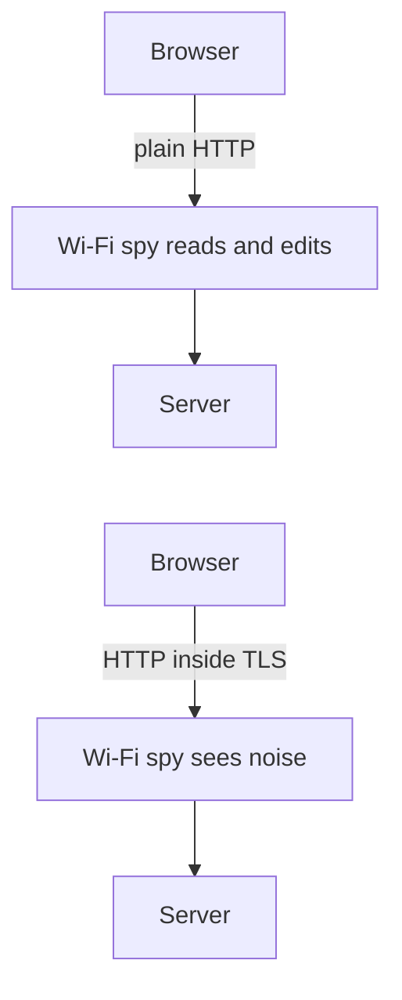
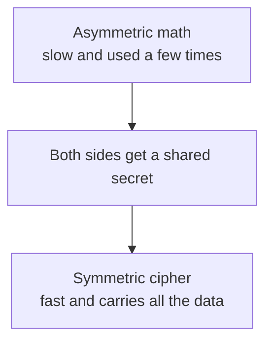
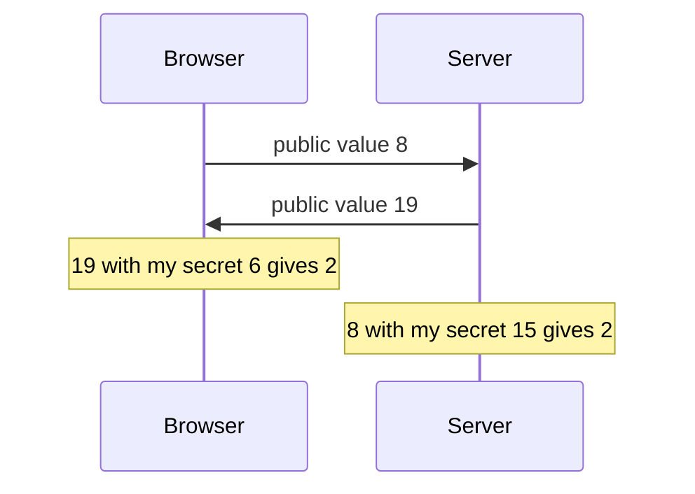
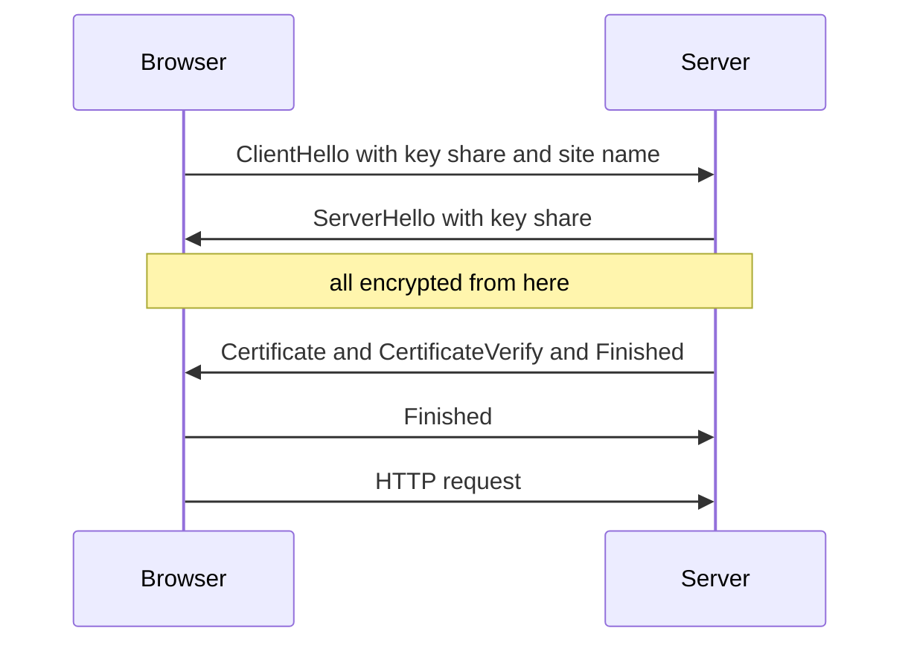
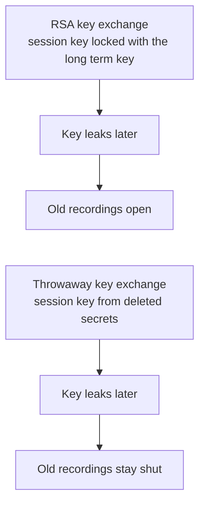
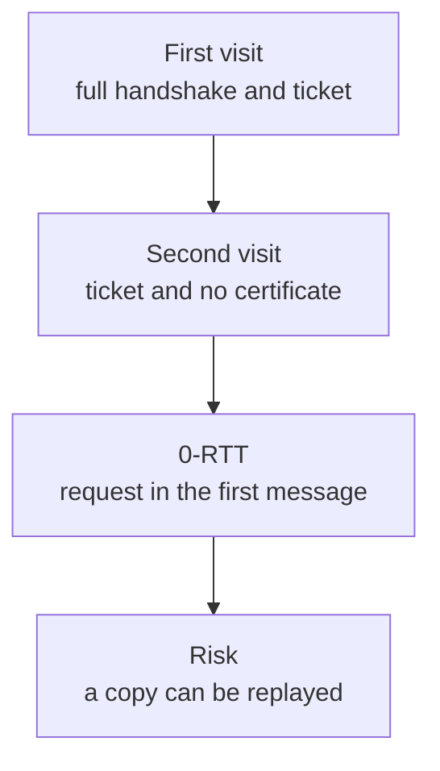
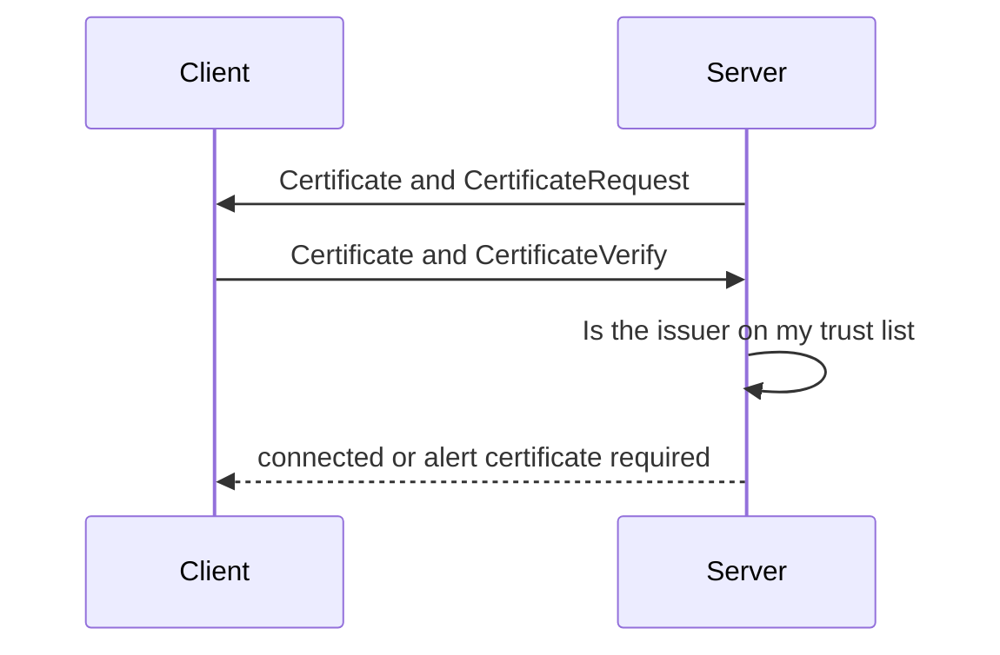

# 04. TLS and HTTPS

> **Subject:** Networking · **Lesson:** 04 · **Made:** 2026-11-21 · **Status:** ready
>
> **You will be able to:** say what TLS gives you (private, unchanged, right server), tell the fast lock (symmetric) from the slow lock (asymmetric), explain a key exchange with a paint story and with small numbers, follow the TLS 1.3 handshake message by message, say what a spy on the network can and cannot see (SNI, IP, sizes), explain forward secrecy, say what a ticket and 0-RTT do and why 0-RTT can be replayed, and explain mutual TLS (mTLS).
>
> **Before this:** [TCP vs UDP](03-tcp-vs-udp.md) · **Also read:** [HTTPS and certificates in practice](../devops-cloud/19-https-and-certificates-in-practice.md) (it covers certificates, Let's Encrypt and renewal, so this lesson does not repeat them) · **Next:** HTTP/1.1 vs HTTP/2 vs HTTP/3 (planned, lesson 05) and [Cookies, CORS and same origin](06-cookies-cors-and-same-origin.md)
>
> **How to read it:** one card is one idea. Look at the picture, guess, then press the orange bar to check. The blue bars (📖 More detail) hold the longer explanation. Skip them on the first read. **What I ran for real (2026-11-21):** `openssl s_client` against example.com and against a small local server with a demo certificate I made, a small recorder that sat between them, and the practice code. **What I did not run:** a packet capture tool, nginx, a browser, and TLS 1.2 servers other than one connection to example.com. About 25 minutes for the cards.

<!-- quick-summary:start -->
## Quick summary

> Short on time? Read only this. These are the "Remember" lines from the cards below, so you can read the whole lesson in one minute.

- HTTPS is HTTP inside TLS. TLS promises privacy, no changes, and the right server. It does not promise an honest site.
- Slow asymmetric math makes a shared secret once. A fast symmetric cipher then protects the data.
- A key exchange sends only public values. Both sides mix the other's public value with their own secret and get the same number. Nobody sends it.
- TLS 1.3 handshake: hello with a key share, hello with a key share, then encrypted certificate, proof and Finished. One round trip.
- HTTPS hides the content. The IP, the site name (SNI), the sizes and the timing stay visible. ECH can hide the name.
- Forward secrecy means a later key leak cannot open old recordings, because each session key came from deleted throwaway secrets.
- A ticket makes the next visit cheaper (no certificate). 0-RTT is fastest but can be replayed, so only safe requests may use it.
- MTLS means both sides show a certificate. A server that requires it refuses clients without a valid one.
<!-- quick-summary:end -->

## 1. The problem: a plain line can be read and changed

You open a page on a cafe Wi-Fi. With plain **HTTP** every router and every person on the Wi-Fi can read your request and change the answer. **HTTPS** is the same HTTP, sent inside a protected tunnel made by **TLS** (Transport Layer Security). TLS gives three promises: nobody can read it, nobody can change it, and you talk to the real server. HTTPS uses port 443. HTTP uses port 80. The name "SSL" is the old name. People still say it, but only TLS is in use.



Notice: the messages are the same. Only the second path wraps them in TLS.

Analogy: a postcard against a sealed envelope with a stamp from the real shop. Where it stops: an envelope hides the address too, and TLS does not hide the server address (card 5).

<details class="guess"><summary>🤔 Guess: a page shows a padlock. Does that mean the site is honest? Press to check.</summary>

**No.** The padlock means: the line is private and the server owns the name in the address bar. A bad site can own a bad name. (The [DevOps HTTPS lesson](../devops-cloud/19-https-and-certificates-in-practice.md), card 1, covers this.)

</details>

> **Remember:** HTTPS is HTTP inside TLS. TLS promises privacy, no changes, and the right server. It does not promise an honest site.

<details class="more"><summary>📖 More detail: four new words, HTTP against HTTPS, and versions</summary>

**Four new words in this lesson:** **handshake** (the opening talk that sets up the secret, card 4), **key exchange** (how two sides make the same secret in the open, card 3), **forward secrecy** (a later leak cannot open old recordings, card 6), **SNI** (the site name inside the first message, card 5). Other names (ECDHE, 0-RTT, mTLS) are explained once where they appear.

| | HTTP | HTTPS |
|---|---|---|
| Default port | 80 | 443 |
| Can a spy read the page | yes | no (card 5 shows what stays visible) |
| Can a spy change the answer | yes | no, the change is detected |
| Is the server's name checked | no | yes, through its certificate |
| Where the talk happens | straight on the TCP connection | inside a TLS layer on the TCP connection |

`describeLeg("https")` in the practice file returns exactly this row for the port and for what is proved.

**Where it sits.** TCP ([lesson 03](03-tcp-vs-udp.md)) opens the connection first. TLS starts on top of it. Then HTTP runs inside. In the [layers lesson](01-the-layers-osi-and-tcp-ip.md) TLS is "between" the transport and the application. The [URL to page guide](networking-url-to-page-step-by-step.md) shows the TLS step in the whole page load.

**Versions.** MDN says TLS 1.3 is the current version and the most widely used, TLS 1.2 is still used by some sites, and TLS 1.1 and 1.0 should no longer be used. The TLS 1.3 spec is now RFC 9846 (July 2026). It replaces RFC 8446 (2018).

</details>

## 2. Two locks: a fast one and a slow one

There are two kinds of encryption. **Symmetric** uses one shared secret key to lock and to unlock. It is very fast, so it carries the page. But both sides need the same key first. **Asymmetric** uses a pair: a public key that anyone may have, and a private key that stays home. It solves the "how do we share a secret" problem but is slow. TLS uses the slow kind only to set things up, and the fast kind for all the data.



Notice: the slow part runs once per connection. The fast part runs for every byte.

Analogy: a mailbox with a slot. Anyone can drop a letter in (public key). Only the owner has the key to open it (private key). Where it stops: in TLS the pair is mostly used to agree on a secret and to sign, not to mail the page itself.

<details class="guess"><summary>🤔 Guess: why not use the slow, strong lock for the whole page? Press to check.</summary>

**It is too slow and too costly for a big page or a video.** The symmetric cipher can run at huge speeds, with help from the CPU. So TLS uses the slow math for a short moment, then switches.

</details>

> **Remember:** slow asymmetric math makes a shared secret once. A fast symmetric cipher then protects the data.

<details class="more"><summary>📖 More detail: the table, real names, and what asymmetric does in TLS 1.3</summary>

| | Symmetric | Asymmetric |
|---|---|---|
| Keys | one shared secret | a public key and a private key |
| Speed | very fast | slow |
| Problem | how do two sides get the secret | none of that, but slow |
| In TLS | the cipher for the page (for example AES-GCM) | key exchange and signatures |
| Real name in my run | `TLS_AES_256_GCM_SHA384` | an elliptic curve pair, a signature of type `ecdsa_secp256r1_sha256` |

**What asymmetric does in TLS 1.3, in two jobs.** First, **key exchange** (card 3): make a shared secret. Second, **signatures**: the server signs with its private key to show it owns the certificate (card 4). TLS 1.3 does not lock a secret with the server's key any more (card 6).

**The cipher name** `TLS_AES_256_GCM_SHA384` in my run reads: AES with a 256 bit key in GCM mode for the data, and SHA-384 for the key making steps. In TLS 1.3 the cipher name does not say how keys are exchanged, because that part is separate.

</details>

## 3. Key exchange: the same secret, made in the open

How do two strangers make the same secret while a spy listens? **Paint story:** both start with the same yellow paint, which everyone can see. The browser secretly adds its own colour and sends the mix. The server secretly adds its own colour and sends the mix. Each then adds its own secret colour to the other's mix. Both end with the same final colour. The spy has the yellow and both mixes, but cannot take a colour out of a mix. In real TLS the "mixing" is math that is easy to do and hard to undo. The real name is **ECDHE**: Diffie-Hellman on an elliptic curve, with a new pair each time.



Notice: 2 is never sent. Each side works it out.

<details class="guess"><summary>🤔 Guess: the spy sees both public values, 8 and 19. Can the spy simply read the shared secret off the wire? Press to check.</summary>

**No.** Only 8 and 19 travel. The shared secret 2 is made on each side from a private number that never leaves. To find it, the spy must undo the mixing. With real sizes that takes far longer than anyone has.

</details>

> **Remember:** a key exchange sends only public values. Both sides mix the other's public value with their own secret and get the same number. Nobody sends it.

<details class="more"><summary>📖 More detail: the numbers, real code, and a toy trace</summary>

**The small numbers** (run with Node, it prints `8 19` and then `2 2`):

```js
const p = 23, g = 5;
const a = 6, b = 15;
const A = g ** a % p;
const B = g ** b % p;
console.log(A, B);
console.log(B ** a % p, A ** b % p);
```

`g ** a % p` means g to the power a, then the remainder after dividing by p. The browser's secret is `a`. The server's secret is `b`. Both end with 2. **Why it works:** `(g^b)^a` and `(g^a)^b` are both `g^(a*b)`. The remainder keeps the numbers small and makes the way back hard.

**Why this toy is not safe.** The spy can try every secret from 1 to 22. With a real 256 bit curve there are too many to try. Real TLS never uses small numbers.

**The real thing in Node** (X25519 is the curve most browsers offer first). It printed `32 true`: a 32 byte shared secret, and both sides got the same one.

```js
const c = require("node:crypto");
const a = c.generateKeyPairSync("x25519");
const b = c.generateKeyPairSync("x25519");
const s1 = c.diffieHellman({ privateKey: a.privateKey, publicKey: b.publicKey });
const s2 = c.diffieHellman({ privateKey: b.privateKey, publicKey: a.publicKey });
console.log(s1.length, s1.equals(s2));
```

**The trace** (stepper, tab 1, the model code `dhPublic` and `dhShared`):

| Step | What happens | What a spy sees |
|---|---|---|
| 1 | Both know p = 23 and g = 5 | 23 and 5 |
| 2 | Browser picks 6. Server picks 15 | nothing new |
| 3 | Browser makes `5^6 mod 23 = 8`. Server makes `5^15 mod 23 = 19` | nothing new |
| 4 | They swap 8 and 19 | 8 and 19 |
| 5 | Browser: `19^6 mod 23 = 2`. Server: `8^15 mod 23 = 2` | nothing new |
| 6 | The spy tries every secret for `5^x mod 23 = 8` and finds 6 in 6 tries | too easy here, impossible for real sizes |

**Man in the middle.** The exchange alone does not say who is on the other end. A spy who can change messages could do one exchange with each side. That is why the server also signs (card 4), and why the certificate matters ([DevOps lesson 19](../devops-cloud/19-https-and-certificates-in-practice.md)).

</details>

## 4. The handshake, message by message

The **handshake** is the opening talk. In TLS 1.3 it needs one round trip. **1.** The browser sends **ClientHello**: what it can do, the site name, and its key exchange half (a key share). **2.** The server sends **ServerHello** with its own key share. Now both sides can make keys. **3.** From here it is all encrypted: the server sends its certificate, a signature that proves it holds the key (**CertificateVerify**), and **Finished**. **4.** The browser checks all that, sends its own Finished, and the data starts.



Notice: the key share goes in the first message. That is why one round trip is enough.

<details class="guess"><summary>🤔 Guess: after the connection is open, how many round trips does a full TLS 1.3 handshake take before the browser can send the HTTP request? Press to check.</summary>

**One.** TLS 1.2 needed two. In 1.3 the browser guesses the key exchange and sends its half at once.

</details>

> **Remember:** TLS 1.3 handshake: hello with a key share, hello with a key share, then encrypted certificate, proof and Finished. One round trip.

<details class="more"><summary>📖 More detail: my real run, the step by step trace, and what each check proves</summary>

**A real run** (2026-11-21, OpenSSL 4.1.0, against example.com, with the plain message order only. OpenSSL also prints small compatibility records that I left out):

```
echo | openssl s_client -connect example.com:443 \
  -servername example.com -tls1_3 -groups X25519 -msg

>>> TLS 1.3, Handshake [length 00fa], ClientHello
<<< TLS 1.3, Handshake [length 007a], ServerHello
<<< TLS 1.3, Handshake [length 000a], EncryptedExtensions
<<< TLS 1.3, Handshake [length 0e66], Certificate
<<< TLS 1.3, Handshake [length 0050], CertificateVerify
<<< TLS 1.3, Handshake [length 0034], Finished
>>> TLS 1.3, Handshake [length 0034], Finished
```

The lengths are in hex: ClientHello 250 bytes, ServerHello 122, EncryptedExtensions 10, Certificate 3,686 (the whole chain), CertificateVerify 80, Finished 52. The summary lines said `Protocol: TLSv1.3`, `Cipher is TLS_AES_256_GCM_SHA384`, `Peer signature type: ecdsa_secp256r1_sha256` and `Verification: OK`. The handshake read about 3,980 bytes and wrote 335.

**The trace** (stepper, tab 2):

| Step | Message | Encrypted | What it does |
|---|---|---|---|
| 1 | ClientHello | no | Versions, ciphers, site name (SNI), key share |
| 2 | ServerHello | no | The chosen cipher and the server's key share. Both sides now make the handshake keys |
| 3 | EncryptedExtensions, Certificate, CertificateVerify, Finished | yes | The server shows who it is |
| 4 | (browser checks) | yes | Chain, name and dates. Signature. Finished |
| 5 | Finished (browser) | yes | Both sides switch to the application keys |
| 6 | HTTP request | yes | The page travels inside |

**What each check proves.** The **certificate chain** says a trusted issuer vouches for the name. **CertificateVerify** is a signature with the server's private key over the whole talk so far. Only the owner of the key can make it. **Finished** is a check value over everything said. If a spy had changed a byte, it would not match.

**Why the order matters.** The practice function `validateHandshake` checks the order for three kinds of handshake: full, resumed (card 7) and mutual (card 8).

**TLS 1.3 against TLS 1.2** (the handshake part):

| | TLS 1.2 | TLS 1.3 |
|---|---|---|
| Round trips before data | 2 | 1 |
| Is the certificate encrypted | no | yes |
| Key exchange without forward secrecy allowed | yes (RSA key exchange) | no, removed |
| Messages after ServerHello encrypted | no | yes (RFC: "All handshake messages after the ServerHello are now encrypted") |

My one TLS 1.2 test to example.com (`-tls1_2`) worked and used `ECDHE-ECDSA-CHACHA20-POLY1305`, so servers still accept 1.2.

**The cost of the check on a phone.** Hello, hello, then the server's flight is the only wait. After that, the data flows.

</details>

## 5. What is encrypted, and what a spy still sees

TLS hides what you say, not who you talk to. A spy on the Wi-Fi still sees the **server's IP address** and port, because packets need them. The spy also sees the **site name** (**SNI**, Server Name Indication) in the plain ClientHello. And the spy sees **how big** each message is and **when** it was sent. The spy does not see the path, the headers, the cookies or the body.

| | A spy sees it |
|---|---|
| Server IP and port | yes |
| Site name in the ClientHello (SNI) | yes, unless ECH is used |
| The certificate | no in TLS 1.3, yes in TLS 1.2 |
| The path, for example `/secret-page` | no |
| Headers, cookies, body | no |
| Message sizes and timing | yes |

Notice: the site name is visible, the page you read on that site is not.

<details class="guess"><summary>🤔 Guess: someone records your HTTPS request to shop.example.test/secret-page. Which part of the address can they read? Press to check.</summary>

**The site name (and the IP), not `/secret-page`.** The name is in the first message, in plain text. The path is inside the encrypted data.

</details>

> **Remember:** HTTPS hides the content. The IP, the site name (SNI), the sizes and the timing stay visible. ECH can hide the name.

<details class="more"><summary>📖 More detail: my recorder test, ECH, and sizes</summary>

**What I measured** (2026-11-21). I started a local `openssl s_server` with a demo certificate for `shop.example.test`, put a small Node program between it and `openssl s_client` that saved every byte, and sent `GET /secret-page`. Then I searched the saved bytes:

```
bytes client->server: 416   server->client: 6475
"shop.example.test"    in client->server: true   in server->client: false
"secret-page"          in client->server: false  in server->client: false
```

The site name was in the browser's bytes (the SNI). It was **not** in the server's bytes, although the certificate holds that name, because the certificate is encrypted in TLS 1.3. The path was nowhere.

**Sizes and timing.** 416 bytes up and 6,475 down are plain to see. Researchers have shown that sizes and timing can hint at which page or video you open. TLS does not pad messages by itself.

**ECH (Encrypted Client Hello).** The browser sends an outer hello with a shared name, and puts the real name in an inner hello that only the server side can open. The Cloudflare docs say its shared name is `cloudflare-ech.com`, and ECH is on by default for its Free zones. The spec is RFC 9849 (March 2026, a Proposed Standard). The spy still sees the IP, so on a small site that has its own IP, the name is easy to guess. My `openssl s_client` run to example.com printed `ECH: NOT CONFIGURED`, so I did not see ECH work.

**Not hidden by TLS at all.** The earlier DNS lookup is a separate message. See [DNS](02-dns.md).

**The practice function** `whatObserverSees({ tlsVersion, ech })` returns this list for a spy, and the stepper (tab 3) builds the boxes from it.

</details>

## 6. Forward secrecy: a leaked key cannot open old recordings

A spy can **record** encrypted traffic today and wait. In a year the server's private key may leak. **Old way (RSA key exchange):** the browser makes the session key and sends it locked with the server's long term public key. One leaked private key then opens every recorded session. **New way (throwaway keys):** each connection makes new secrets for the key exchange and deletes them afterwards. The long term key only signs. A leak later opens nothing old. This is **forward secrecy**.



Notice: the only difference is what protected the session key.

<details class="guess"><summary>🤔 Guess: a spy recorded your traffic a year ago. Today the server's key leaks. Can the spy read the old recording if the sessions used throwaway keys? Press to check.</summary>

**No.** The secrets that made the session key were deleted a year ago. The leaked key only signs. It never protected a session key.

</details>

> **Remember:** forward secrecy means a later key leak cannot open old recordings, because each session key came from deleted throwaway secrets.

<details class="more"><summary>📖 More detail: TLS 1.3, the cost, and the one exception</summary>

**TLS 1.3 made it the rule.** Every full handshake uses a throwaway key exchange, and RSA key exchange was removed. In TLS 1.2 it was your choice, so old servers could still use RSA key exchange.

**What it still does not stop.** If a spy gets into the server while it runs, the live secrets are in memory. Forward secrecy is about leaks of the long term key later.

**The cost.** A little extra math per connection. Modern CPUs do it fast, so most sites pay almost nothing.

**The exception.** 0-RTT early data (card 7) does not have forward secrecy. The RFC says the protocol "does not provide any forward secrecy guarantees for this data".

**Practice code:** `canReadRecordedTraffic("rsa", true)` is `true`. `canReadRecordedTraffic("ecdhe", true)` is `false`.

**The trace** (stepper, tab 4): a spy records, the RSA way leaks everything, the throwaway way leaks nothing, and the TLS 1.3 rule.

</details>

## 7. A ticket for next time, and 0-RTT

A full handshake sends a big certificate. For the next visit that is wasteful. So after the handshake the server gives the browser a **ticket**: a small token that lets both sides restart without the certificate. This is **resumption**. In my test a full handshake read 740 bytes and the resumed one read 269. **0-RTT** goes further: the browser puts its request in the very first message, encrypted with the ticket's key, and the server answers with no waiting. The catch: an attacker can copy that first message and send it again, so the server may run the request twice.



Notice: each step is faster than the one before, and the last one has a risk.

<details class="guess"><summary>🤔 Guess: a browser sends POST /pay as 0-RTT early data. An attacker copies the first message and sends it again. What may happen? Press to check.</summary>

**The server may take the payment twice.** The RFC says there are no guarantees of non-replay between connections. Early data is only safe for requests that do no harm when repeated, like a GET of a page.

</details>

> **Remember:** a ticket makes the next visit cheaper (no certificate). 0-RTT is fastest but can be replayed, so only safe requests may use it.

<details class="more"><summary>📖 More detail: my real runs, the rule, and the trace</summary>

**What I ran** (local `openssl s_server` with a demo certificate, and `openssl s_client` with `-sess_out` and `-sess_in`, 2026-11-21):

```
full handshake:   handshake has read 740 bytes, written 341
                  TLS session ticket lifetime hint: 7200 (seconds)
resumed:          handshake has read 269 bytes, written 436
                  Reused, TLSv1.3
0-RTT, 1st use:   Early data was accepted
0-RTT, same ticket again:  Early data was rejected
```

The ticket lifetime hint was 2 hours. With early data on, the second use of the same ticket was refused by this test server, so the connection carried on with a normal handshake. I did not look into why. Servers differ, and the RFC does not make every server remember used tickets.

**The rule in the practice code.** `acceptEarlyData("GET", false)` is `true`. `acceptEarlyData("POST", false)` is `false`. `acceptEarlyData("GET", true)` (the ticket was used before) is `false`.

**What the Cloudflare overview says** (Sept 2016): a server cannot know whether it already saw a 0-RTT packet, so for requests that must not repeat it should make the client do a full 1 round trip handshake. It also says the early data key does not give forward secrecy against a stolen ticket key.

**The trace** (stepper, tab 5, the model code `validateHandshake` and `acceptEarlyData`):

| Step | Messages | Result |
|---|---|---|
| 1 | Full handshake with the certificate | 740 bytes read |
| 2 | Server sends a ticket | Browser keeps it |
| 3 | Resumed: no Certificate message | 269 bytes read. `validateHandshake(..., "resumed")` is ok |
| 4 | 0-RTT: request in the first flight | Early data accepted |
| 5 | An attacker replays it | A safe server refuses or ignores it |
| 6 | Rule: only safe, fresh requests | GET yes, POST no |

</details>

## 8. mTLS: the client shows a certificate too

In normal HTTPS only the server shows a certificate. The server does not learn who the client is at this level. With **mTLS** (mutual TLS) the server adds one message, **CertificateRequest**: "show me a certificate too". The client sends its certificate and a signature that proves it holds the key. Now both sides know who the other is. A client with no certificate is refused. This is common between services inside a company and rare between a browser and a public website.



Notice: the client now does what the server always did.

<details class="guess"><summary>🤔 Guess: a server requires a client certificate and the client has none. What happens? Press to check.</summary>

**The handshake ends with an alert: certificate required.** In my test it was `SSL alert number 116`. The page never loads.

</details>

> **Remember:** mTLS means both sides show a certificate. A server that requires it refuses clients without a valid one.

<details class="more"><summary>📖 More detail: my real run, where it is used, and the cost</summary>

**What I ran** (a local `openssl s_server -Verify 1` with a demo CA that I made, 2026-11-21):

```
client with no certificate:
  tlsv13 alert certificate required   SSL alert number 116
client with a certificate from the demo CA:
  HTTP/1.0 200 ok
server log (no certificate case):
  peer did not return a certificate
```

The practice function `checkClientCert(true, null, ["Demo Root"])` gives `{ ok: false, alert: "certificate_required" }`. An issuer that is not on the trust list gives `alert: "unknown_ca"`. The order of messages for a mutual handshake is checked by `validateHandshake(..., "mutual")`.

**Where it is used.** Service to service calls, partner APIs, devices that call a cloud, and "zero trust" setups where each service proves its identity with a certificate and not with a password. The MDN page says client authentication is rare on the web outside special apps.

**The cost.** You must hand out, renew and cancel many certificates, and most teams use a tool for it. Compare with [Config and secrets](../devops-cloud/09-config-and-secrets.md): a client certificate and its private key are secrets too.

**The trace** (stepper, tab 6): normal TLS, the CertificateRequest, the client answer, the server check, a refused client, where it is used.

</details>

## 9. Watch and play

Links were checked on 2026-11-21. For the videos I read the title and channel from YouTube oEmbed data. I did not watch them and I did not check their length. For the pages I opened each one and read the part named below. If a link is broken, tell me and I will replace it.

- **Play with it:** [the stepper in this folder](visuals/04-tls-and-https.html) - guess first, then press Next. Six tabs: key exchange, the handshake, what a spy sees, forward secrecy, resume and 0-RTT, and mTLS.
- **See every byte:** [The Illustrated TLS 1.3 Connection](https://tls13.xargs.org/) - a whole handshake where the client sends "ping" and the server answers "pong", with each field of ClientHello and ServerHello decoded. Open ClientHello and find Server Name and Key Share.
- **Video:** [Secret Key Exchange (Diffie-Hellman) - Computerphile](https://www.youtube.com/watch?v=NmM9HA2MQGI) - Computerphile. Title and channel checked only. A search listing says about 9 minutes, not checked. Compare with card 3.
- **Video:** [TLS Handshake Explained - Computerphile](https://www.youtube.com/watch?v=86cQJ0MMses) - Computerphile. Title and channel checked only. I do not know which TLS version it covers, so compare it with card 4.
- **Video:** [SSL, TLS, HTTPS Explained](https://www.youtube.com/watch?v=j9QmMEWmcfo) - ByteByteGo. Title and channel checked only. A short overview for card 1.
- **Try it yourself:** run `echo | openssl s_client -connect example.com:443 -servername example.com -tls1_3 -msg` in a terminal and find the seven messages of card 4.
- **Read:** [MDN: Transport Layer Security](https://developer.mozilla.org/en-US/docs/Web/Security/Transport_Layer_Security) - a short page on what TLS gives and how the versions are chosen.

<details><summary>Go deeper (optional)</summary>

**More pages I opened.** [RFC 9846, TLS 1.3 (July 2026)](https://www.rfc-editor.org/rfc/rfc9846.html) - section 2.3 on 0-RTT is the source of the replay and forward secrecy quotes. [RFC 9849, Encrypted Client Hello (March 2026)](https://www.rfc-editor.org/info/rfc9849). [Cloudflare: ECH](https://developers.cloudflare.com/ssl/edge-certificates/ech). [Cloudflare: An overview of TLS 1.3 and Q&A](https://blog.cloudflare.com/tls-1-3-overview-and-q-and-a) (2016). **One more video** (title and channel checked only): [What are Cipher Suites? - Practical TLS](https://www.youtube.com/watch?v=P1v6QA0W7Xw) - Practical Networking.

**Post-quantum.** My OpenSSL 4.1.0 offered a hybrid group by default (`X25519MLKEM768`), and example.com chose it. The handshake then read 5,054 bytes, against about 3,980 with plain X25519. The hybrid mixes a classic curve with a post-quantum method so a future quantum computer cannot read recordings made today. I only saw the group name and the sizes. I did not study the method.

**Common mistakes** (each one is also a guess bar above):

| Mistake | Fix |
|---|---|
| "The padlock means the site is safe" | It means a private line to the owner of the name (card 1) |
| "HTTPS hides which site I visit" | The IP and the site name (SNI) stay visible, unless ECH (card 5) |
| "Asymmetric encryption carries the page" | It only sets up the secret and signs. Symmetric carries the page (card 2) |
| "The shared secret is sent, but encrypted" | It is never sent (card 3) |
| "A stolen server key opens old recordings" | Not with throwaway keys (card 6) |
| "0-RTT is just faster, no downside" | It can be replayed and has no forward secrecy (card 7) |

**Where it fits with the rest.** HTTP/2 is used by browsers only over TLS, and HTTP/3 runs TLS 1.3 inside QUIC. I did not check this on a page for this lesson, and the next lesson (planned) covers it. For certificates, renewal, HSTS and where the HTTPS ends (the proxy), see the [DevOps HTTPS lesson](../devops-cloud/19-https-and-certificates-in-practice.md) and [Reverse proxy and Nginx](../devops-cloud/08-reverse-proxy-and-nginx.md).

**Checked on 2026-11-21** with Node v26.5.0 and OpenSSL 4.1.0. The practice code has 63 tests. On the empty stub 61 fail (the other 2 only check that your function does not change its inputs). I also made 46 wrong versions of the answer. The tests caught 44. The other 2 are not really wrong: one skips a step that BigInt math already does, and one sets `same: true` where it is always true. The stepper uses the same functions, and I clicked through every step of every tab with a fake page and found no missing values.

**What I did not test.** A packet capture tool (my recorder sat between `openssl s_client` and `openssl s_server` on my own computer), a browser, ECH working, a TLS 1.2 handshake in detail, and HTTP/2 or HTTP/3. The 0-RTT replay result is from one test server. The numbers for sizes come from my runs and will differ for other servers and certificates.

**Where the model is simpler than the real thing.** The toy key exchange uses numbers a child can multiply. `validateHandshake` knows three fixed orders and ignores optional messages (for example HelloRetryRequest, NewSessionTicket and post-handshake messages). `whatObserverSees` is a short list, not a full analysis. Real TLS also has key schedules, transcripts and many extensions that this lesson does not touch.

</details>

## 10. Practice

**A. Predict the output** (write your answer before opening)

```js
console.log(sessionKeySteps(4, 9, 5, 23));
console.log(validateHandshake(["ClientHello", "ServerHello", "Certificate"], "full"));
console.log(whatObserverSees({ tlsVersion: "1.3", ech: true }));
console.log(acceptEarlyData("post", false), acceptEarlyData("GET", false), acceptEarlyData("GET", true));
console.log(canReadRecordedTraffic("rsa", true), canReadRecordedTraffic("ecdhe", true));
console.log(checkClientCert(true, null, ["Demo Root"]));
```

Then answer: why is the second line not ok, and why can the spy not see the site name in the third line?

<details><summary>Answer</summary>

```
{
  clientPublic: 4,
  serverPublic: 11,
  clientShared: 13,
  serverShared: 13,
  same: true
}
{
  ok: false,
  reason: 'unexpected Certificate after ServerHello',
  at: 2
}
[
  'destination ip',
  'destination port',
  'message sizes',
  'message timing'
]
false true false
true false
{ ok: false, alert: 'certificate_required' }
```

With p = 23 and g = 5, the client's secret 4 gives `5^4 mod 23 = 4`, and the server's secret 9 gives `5^9 mod 23 = 11`. Both sides then get 13. The second list stops at index 2 because after ServerHello the server must send EncryptedExtensions, not Certificate. With ECH on, the site name is hidden, so the list has only the IP, the port, the sizes and the timing. A POST is never allowed as early data, a GET is allowed only with a fresh ticket. Only RSA key exchange plus a leaked key opens an old recording. A server that requires a client certificate refuses a client with none. (Run on 2026-11-21 with Node v26.5.0.)

</details>

**B. Fix the bug**

Both sides should get the same shared number. They do not. Find the bug.

```js
const p = 23, g = 5;
const A = g ** 6 % p;
const B = g ** 4 % p;
const browserShared = A ** 6 % p;
const serverShared = B ** 4 % p;
console.log(browserShared, serverShared);
```

<details><summary>Answer</summary>

Each side mixes **its own public value** with **its own secret**. That is not a key exchange. Each side must use the **other** side's public value: the browser uses `B ** 6 % p` and the server uses `A ** 4 % p`. Both give 2. The buggy version printed `13 3`. The fixed one printed `2 2`.

</details>

**C. Write it yourself**

Open `learn/networking/practice/04-tls-and-https.js`. It has ten empty pieces: `modPow`, `dhPublic`, `dhShared`, `validateHandshake`, `whatObserverSees`, `canReadRecordedTraffic`, `acceptEarlyData`, `checkClientCert`, `sessionKeySteps` and `describeLeg`. The comments at the top say exactly what each one must do. Write them, then run this from the repo root and make all the tests pass:

```
node --test learn/networking/practice/04-tls-and-https.test.js
```

`modPow` is the one to think about: plain `**` on big numbers loses digits, so use BigInt inside. `validateHandshake` needs the first problem, not all of them.

<details><summary>One possible answer</summary>

```js
const has = (obj, key) => Object.prototype.hasOwnProperty.call(obj, key);

function modPow(base, exp, mod) {
  let result = 1n;
  let b = BigInt(base) % BigInt(mod);
  let e = BigInt(exp);
  const m = BigInt(mod);
  while (e > 0n) {
    if (e & 1n) result = (result * b) % m;
    b = (b * b) % m;
    e >>= 1n;
  }
  return Number(result % m);
}

function dhPublic(g, secret, p) {
  return modPow(g, secret, p);
}

function dhShared(theirPublic, mySecret, p) {
  return modPow(theirPublic, mySecret, p);
}

const ORDERS = {
  full: ["ClientHello", "ServerHello", "EncryptedExtensions", "Certificate", "CertificateVerify", "Finished", "Finished"],
  mutual: ["ClientHello", "ServerHello", "EncryptedExtensions", "CertificateRequest", "Certificate", "CertificateVerify", "Finished", "Certificate", "CertificateVerify", "Finished"],
  resumed: ["ClientHello", "ServerHello", "EncryptedExtensions", "Finished", "Finished"],
};

function validateHandshake(types, mode) {
  if (!has(ORDERS, mode)) throw new Error("mode must be full, mutual or resumed");
  const want = ORDERS[mode];
  if (types.length === 0) return { ok: false, reason: "no messages", at: 0 };
  if (types[0] !== "ClientHello") return { ok: false, reason: "must start with ClientHello", at: 0 };
  for (let i = 1; i < types.length; i++) {
    if (i >= want.length) return { ok: false, reason: "unexpected " + types[i] + " after the handshake", at: i };
    if (types[i] !== want[i]) return { ok: false, reason: "unexpected " + types[i] + " after " + types[i - 1], at: i };
  }
  if (types.length < want.length) return { ok: false, reason: "handshake not finished", at: types.length };
  return { ok: true };
}

function whatObserverSees({ tlsVersion, ech }) {
  const seen = ["destination ip", "destination port", "message sizes", "message timing"];
  if (!ech) seen.push("server name (SNI)");
  if (tlsVersion === "1.2") seen.push("server certificate");
  return seen.sort();
}

function canReadRecordedTraffic(keyExchange, serverKeyLeaked) {
  if (keyExchange === "rsa") return serverKeyLeaked === true;
  if (keyExchange === "ecdhe") return false;
  throw new Error("keyExchange must be rsa or ecdhe");
}

function acceptEarlyData(method, ticketUsedBefore) {
  const m = String(method).toUpperCase();
  return (m === "GET" || m === "HEAD") && !ticketUsedBefore;
}

function checkClientCert(requireClientCert, clientCertIssuer, trustedIssuers) {
  if (!requireClientCert) return { ok: true };
  if (clientCertIssuer === null) return { ok: false, alert: "certificate_required" };
  if (!trustedIssuers.includes(clientCertIssuer)) return { ok: false, alert: "unknown_ca" };
  return { ok: true };
}

function sessionKeySteps(clientSecret, serverSecret, g, p) {
  const clientPublic = dhPublic(g, clientSecret, p);
  const serverPublic = dhPublic(g, serverSecret, p);
  const clientShared = dhShared(serverPublic, clientSecret, p);
  const serverShared = dhShared(clientPublic, serverSecret, p);
  return { clientPublic, serverPublic, clientShared, serverShared, same: clientShared === serverShared };
}

function describeLeg(scheme) {
  const s = String(scheme).toLowerCase();
  if (s === "http") return { port: 80, encrypted: false, proves: "nothing" };
  if (s === "https") return { port: 443, encrypted: true, proves: "who you talk to" };
  throw new Error("scheme must be http or https");
}

module.exports = { modPow, dhPublic, dhShared, validateHandshake, whatObserverSees, canReadRecordedTraffic, acceptEarlyData, checkClientCert, sessionKeySteps, describeLeg };
```

Checked on 2026-11-21 with Node v26.5.0: 61 of the 63 tests fail on the empty stub (the other 2 only check that your function does not change its inputs), and all 63 pass with this answer. I also tried 46 wrong versions of the answer (for example a handshake check that does not stop an extra message, a key exchange that uses the wrong side's value, an early data check that lets a POST through, a mask that shows the SNI with ECH on). The tests caught 44 of them. The other 2 do not change any result. The stepper page uses these same functions.

</details>

## 11. Interview question

**Q:** "Walk me through the TLS handshake. Why is HTTPS still private if someone records all the traffic?"

A common follow-up: "What can a network observer still see?" Card 5 is the answer.

<details><summary>A strong answer, in four parts</summary>

1. **Problem:** On a shared network anyone can read and change plain HTTP. The two sides have never met, so they need a shared secret without sending it, and the browser must know it talks to the real owner of the name.
2. **How it works:** In TLS 1.3 the browser sends a ClientHello with its supported ciphers, the site name and a key share (an ECDHE public value). The server answers with a ServerHello and its own key share. Both sides mix the other's public value with their own secret and get the same shared secret, which becomes the keys. From then on everything is encrypted: the server sends its certificate, a CertificateVerify signature that proves it holds the private key, and Finished. The browser checks the chain and the name, sends Finished, and both switch to application keys. It takes one round trip. The data then goes through a fast symmetric cipher such as AES-GCM. Because the key exchange uses throwaway keys that are deleted, a later leak of the server key cannot open old recordings. That is forward secrecy.
3. **Tradeoff:** TLS 1.3 gives a faster handshake and removes weak options, but old clients may still need TLS 1.2. A spy still sees the IP, the port, the site name in the ClientHello (unless ECH is used), and the sizes and timing of messages. A ticket makes later visits cheaper, but 0-RTT early data can be replayed and has no forward secrecy, so only safe requests like GET should use it. mTLS gives strong identity for services, but you must manage many certificates.
4. **My example:**
   - **Fact:** my profile lists Docker, CapRover and a little AWS. From the DevOps HTTPS lesson, CapRover puts nginx in front of an app and ends the HTTPS there.
   - **Fact (from this lesson, not from my projects):** I ran `openssl s_client` and `s_server` on my own computer, and read the handshake messages, the resume and the mTLS alert. I did not use mTLS in a real project.
   - **Idea, not a fact:** I do not know how my past services talk to each other inside the server. A good next step is to run two small Node services with mutual TLS and a demo CA, and to see what the client gets when its certificate is missing.

</details>

## 12. Explain it back

Close this file. Explain TLS and HTTPS out loud like to a new junior, in 4 parts (problem, how, tradeoff, my example). Use the story of the cafe Wi-Fi spy who records everything. Say what the key exchange does with the paint or the small numbers, then the handshake messages in order, what the spy still sees, why a leaked key a year later cannot open the recording, and what 0-RTT risks. Write your best version below and run `/explain-check tls and https` or ask the `explain-coach` agent to review it.

### My explanation

<write here>

### Coach feedback

<the explain-coach agent writes here>

## 13. Review questions (day 1, 3, 7, 21)

1. What three things does TLS promise, and what does the padlock not promise?
2. What is the difference between symmetric and asymmetric encryption, and which one carries the page?
3. How do two sides make the same secret in the open? Say it with the paint story or with the numbers 23, 5, 6 and 15.
4. Draw the TLS 1.3 handshake from memory. Which messages are plain text and which are encrypted?
5. A spy records your HTTPS request. Name three things the spy sees and three things the spy does not see.
6. What is forward secrecy, and what makes it work? What is the replay risk of 0-RTT, and what does mTLS add?

<details><summary>Answers</summary>

1. Private (nobody can read it), unchanged (changes are detected) and the right server (its certificate names the site). The padlock does not say the site is honest.
2. Symmetric: one shared key, very fast, carries the page. Asymmetric: a public and a private key, slow, used for the key exchange and for signatures.
3. Each side sends a public value and keeps a secret. Browser: `5^6 mod 23 = 8`. Server: `5^15 mod 23 = 19`. They swap. Browser: `19^6 mod 23 = 2`. Server: `8^15 mod 23 = 2`. The shared number is never sent. The real name is ECDHE.
4. ClientHello (key share and site name) and ServerHello (key share) are plain. Then EncryptedExtensions, Certificate, CertificateVerify and the server Finished are encrypted, then the browser Finished and the HTTP request. One round trip. The picture is the sequence diagram in card 4.
5. Sees: IP, port, site name (SNI, unless ECH), message sizes, timing. Does not see: the path, the headers and cookies, the body (and the certificate in TLS 1.3).
6. A later leak of the server's long term key cannot open old recordings. It works because the session keys come from throwaway secrets that were deleted, and the long term key only signs. A copied 0-RTT message can be sent again and the server may run it twice, so only safe requests like GET may use it. mTLS makes the client show a certificate too, so the server knows who the client is, and refuses clients without a valid one.

</details>

## Connected lessons

- [TCP vs UDP](03-tcp-vs-udp.md) - the connection that TLS runs on top of.
- [DNS](02-dns.md) - the lookup that happens before the TLS connection, and is not hidden by TLS.
- [The layers: OSI and TCP/IP](01-the-layers-osi-and-tcp-ip.md) - where TLS sits.
- [Cookies, CORS and same origin](06-cookies-cors-and-same-origin.md) - what runs inside the tunnel, and `Secure` cookies need HTTPS.
- [HTTPS and certificates in practice](../devops-cloud/19-https-and-certificates-in-practice.md) - certificates, the chain of trust, Let's Encrypt, renewal, HSTS and where the HTTPS ends.
- [Reverse proxy and Nginx](../devops-cloud/08-reverse-proxy-and-nginx.md) - the proxy that usually ends the TLS.
- [The URL to page guide](networking-url-to-page-step-by-step.md) - the TLS step inside a whole page load.
- HTTP/1.1 vs HTTP/2 vs HTTP/3 (planned, lesson 05) - next: what runs inside TLS, and QUIC.
