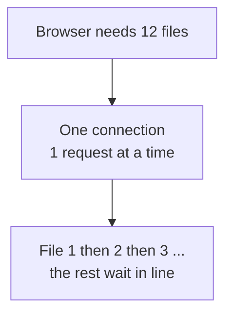
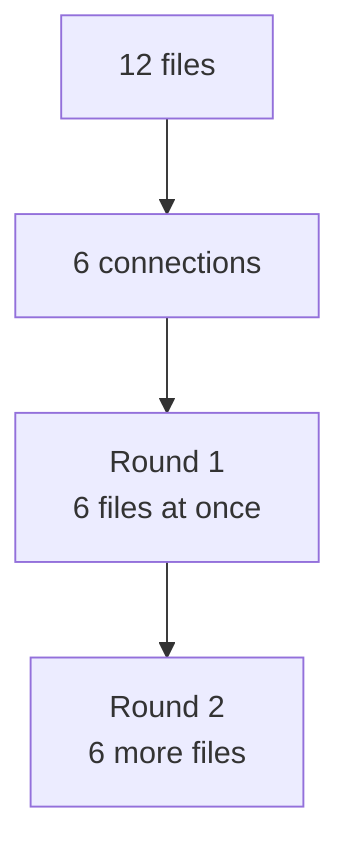
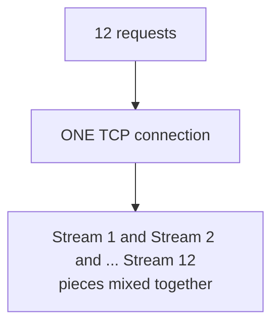
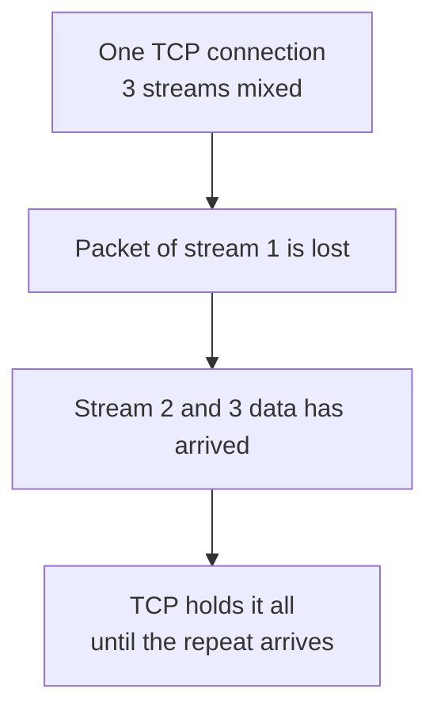
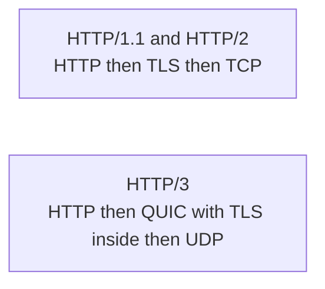
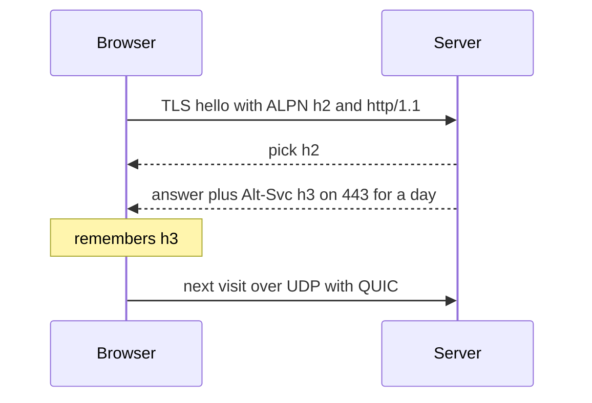
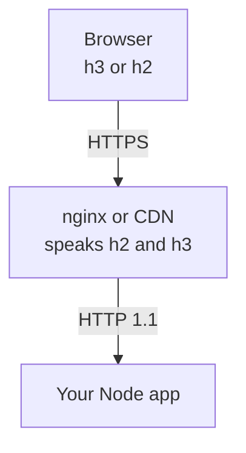
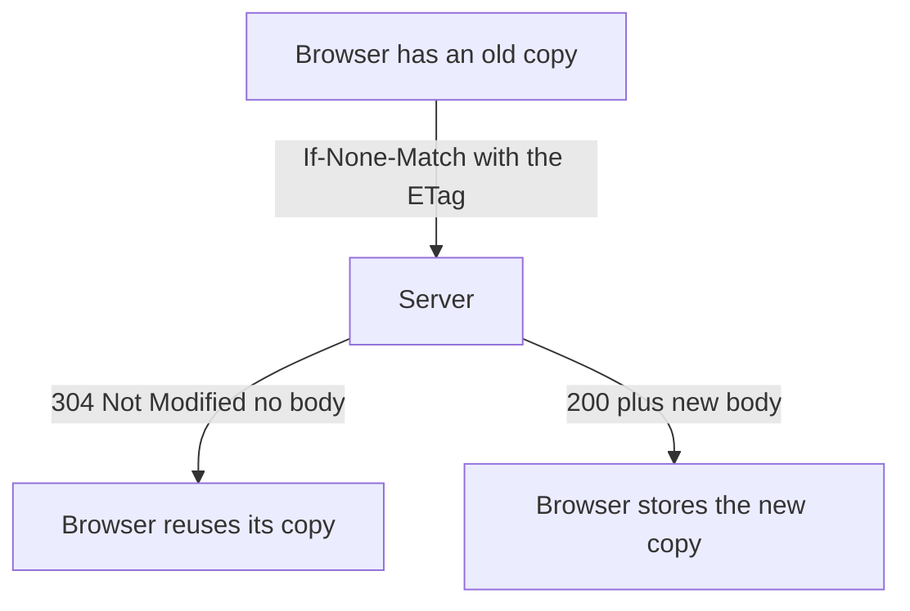

# 05. HTTP/1.1 vs HTTP/2 vs HTTP/3

> **Subject:** Networking · **Lesson:** 05 · **Made:** 2026-11-21 · **Status:** ready
>
> **You will be able to:** say why HTTP/1.1 needs six connections, explain multiplexing and header compression in HTTP/2, explain why one lost packet still stalls HTTP/2 (TCP head-of-line blocking), say what QUIC changes in HTTP/3 (UDP, 1 round trip, 0-RTT, connection migration), explain how a browser picks a version (ALPN and Alt-Svc), say what to switch on in nginx or a CDN, and answer the basic questions on methods, status codes and caching headers.
>
> **Before this:** [TLS and HTTPS](04-tls-and-https.md) and [TCP vs UDP](03-tcp-vs-udp.md) · **Next:** [Cookies, CORS and same origin](06-cookies-cors-and-same-origin.md)
>
> **How to read it:** one card is one idea. Look at the picture, guess, then press the orange bar to check. The blue bars (📖 More detail) hold the longer explanation. Skip them on the first read. **What I ran for real:** `curl --http2 -v` and `curl --http1.1 -v` against live sites, and a small Node test of 18 requests over HTTP/1.1 and HTTP/2, plus the practice code. **What I did not run:** HTTP/3. The curl on this Mac (8.7.1) has no HTTP/3 support, and I did not install nginx. Those parts are marked "from the docs, not run here". Facts and links were checked on 2026-11-21. About 25 minutes for the cards.

<!-- quick-summary:start -->
## Quick summary

> Short on time? Read only this. These are the "Remember" lines from the cards below, so you can read the whole lesson in one minute.

- Keep-alive reuses a connection. It does not run two requests at the same time.
- Six connections is a patch for one-request-at-a-time. It costs handshakes and memory, and each line can still block.
- HTTP/2 = same HTTP, but many streams on one connection, with compressed headers. It fixes the line at the HTTP level.
- HTTP/2 fixed the line in HTTP, but TCP still holds all streams when one packet is lost.
- HTTP/3 = HTTP over QUIC over UDP. A loss stops one stream, and a new connection needs 1 round trip.
- ALPN picks h2 or http/1.1 in the TLS hello. Alt-Svc tells the browser that h3 exists for next time.
- Turn HTTP/2 and HTTP/3 on at the proxy or CDN. Open UDP 443, keep TCP 443, and check the Protocol column.
- Safe = only reads. Idempotent = same result if repeated. no-store forbids keeping a copy. no-cache means ask the server first.
<!-- quick-summary:end -->

## 1. The problem: a page is many files

A page is not one file. It is HTML, then scripts, styles, images, fonts and API calls. Often 50 or more requests. HTTP/1.1 sends them over a **connection** (a TCP line between browser and server). One connection answers one request at a time. **Keep-alive** means the connection stays open after an answer, so the next request does not pay for a new handshake. It is the default in HTTP/1.1.



Notice: the files do not run together. They stand in a queue.

<details class="guess"><summary>🤔 Guess: 12 files, 100 ms each, all on one HTTP/1.1 connection with keep-alive. How long? Press to check.</summary>

**1200 ms.** Keep-alive saves handshakes, but each file still waits for the one before it.

</details>

> **Remember:** keep-alive reuses a connection. It does not run two requests at the same time.

<details class="more"><summary>📖 More detail: pipelining, the real curl, and what keep-alive costs</summary>

**Four new words in this lesson:** **head-of-line blocking** (card 2), **multiplexing** (card 3), **QUIC** (card 5), **ALPN** (card 6).

**Pipelining** sent several requests without waiting, but answers still had to come back in order. MDN says it "is subject to the head-of-line blocking", is not on by default in modern browsers, and was replaced by multiplexing in HTTP/2 ([connection management](https://developer.mozilla.org/en-US/docs/Web/HTTP/Guides/Connection_management_in_HTTP_1.x), opened 2026-11-21).

**Real curl, HTTP/1.1** (`curl --http1.1 -sv https://example.com/`, 2026-11-21):

```
* ALPN: curl offers http/1.1
* ALPN: server accepted http/1.1
* using HTTP/1.x
> GET / HTTP/1.1
< HTTP/1.1 200 OK
< alt-svc: h3=":443"; ma=86400
```

**Keep-alive costs memory.** MDN says idle connections "consume server resources", and under heavy load a short idle timeout can be better. In HTTP/1.1 persistence is the default, so the old `Connection: keep-alive` header is no longer needed.

**Where the HTTP is text.** HTTP/1.1 messages are readable text: a request line, header lines and a body. HTTP/2 and HTTP/3 send the same ideas as binary frames (cards 3 and 5).

</details>

## 2. Six connections, and why that is a patch

Browsers fight the queue by opening **six connections** to each site. Six files run together, then six more. Old teams also split files over several host names ("domain sharding") to get 18 or 24. This helps, but each connection costs a handshake, memory and a slow start. A slow answer at the front of a line still holds back everything behind it. That is **head-of-line blocking**: the first item in the line blocks the rest.



Notice: 12 files take two rounds. 13 files would take three.

<details class="guess"><summary>🤔 Guess: the same 12 files of 100 ms, now on 6 connections. How long? Press to check.</summary>

**200 ms.** Two rounds of 100 ms. Six times faster than one connection, but still twice as slow as HTTP/2 (next card).

</details>

> **Remember:** six connections is a patch for one-request-at-a-time. It costs handshakes and memory, and each line can still block.

<details class="more"><summary>📖 More detail: my timing test, the step by step trace, and the old tricks</summary>

**A real test** (Node, one machine, 18 requests, the server waits 100 ms before each answer, run twice on 2026-11-21):

| Setup | Time |
|---|---|
| HTTP/1.1, 1 connection | 1863 ms and 1862 ms |
| HTTP/1.1, 6 connections | 313 ms and 309 ms |
| HTTP/2, 1 connection | 112 ms and 115 ms |

The extra 10 to 60 ms is setup and Node itself. The sum matches: 18 × 100 = 1800, 3 rounds × 100 = 300, 1 round = 100. This used plain HTTP/2 without TLS (h2c) on one machine, so it shows the queue, not a real internet path.

**The trace** (stepper, tab 1, the model `h1Schedule`, 12 files of 100 ms):

| Step | What happens | State |
|---|---|---|
| 1 | Page needs 12 files | Nothing sent yet |
| 2 | One connection, t = 300 ms | 3 done, 9 waiting in line |
| 3 | One connection, t = 1200 ms | All done. Total 1200 ms |
| 4 | Six connections, t = 100 ms | 6 done, 6 started now |
| 5 | Six connections, t = 200 ms | All done. Total 200 ms |

**The old tricks** (MDN calls domain sharding deprecated: "switch to HTTP/2 instead"): bundle all scripts into one file, glue small images into one sprite, spread files over `www1`, `www2`, `www3`. All three were made to fight the queue. In HTTP/2 they often hurt, because small separate files can be cached one by one.

**Read the picture yourself.** Open DevTools, Network tab, and look at the Waterfall: the thin line before each bar is the time spent waiting, and the thick part is the download ([Chrome docs](https://developer.chrome.com/docs/devtools/network/reference)).

</details>

## 3. HTTP/2: many streams, one connection

HTTP/2 keeps the same meaning (same methods, headers, status codes) but changes how it travels. All requests go over **one connection**, each as its own **stream**. The pieces of different streams are mixed on the wire, like cars from several lanes on one road. This is **multiplexing**. Headers are also **compressed** (HPACK), because every request repeats the same cookie and user-agent lines.



Notice: one connection, so one handshake, and nobody waits in line.

<details class="guess"><summary>🤔 Guess: 12 files of 100 ms on HTTP/2, plenty of bandwidth. How long? And is six connections still needed? Press to check.</summary>

**About 100 ms, and no.** All streams run together on one connection. (With a tiny pipe they would share it, so the gain is smaller. The model ignores that.)

</details>

> **Remember:** HTTP/2 = same HTTP, but many streams on one connection, with compressed headers. It fixes the line at the HTTP level.

<details class="more"><summary>📖 More detail: real curl, HPACK, stream limits, and server push (removed)</summary>

**Real curl, HTTP/2** (`curl --http2 -sv https://example.com/`, 2026-11-21):

```
* ALPN: curl offers h2,http/1.1
* ALPN: server accepted h2
* using HTTP/2
> GET / HTTP/2
< HTTP/2 200
< alt-svc: h3=":443"; ma=86400
```

**Notice:** the request line says `HTTP/2` and header names are lower case. HTTP/2 does not send text lines. It sends binary frames, and curl shows them as text for you. I did not capture the frames.

**Header compression.** RFC 9113 says "HTTP fields are often repetitive and verbose" and gives each side an HPACK encoder and decoder ([RFC 9113](https://www.rfc-editor.org/rfc/rfc9113.html)). After the first request, a repeated header can be sent as a small number from a shared table. HPACK was designed so that it cannot be attacked the way the older zlib header compression was ([High Performance Browser Networking](https://hpbn.co/http2/)).

**Stream limit.** The same RFC recommends allowing at least 100 streams at once (`SETTINGS_MAX_CONCURRENT_STREAMS`). The model's `h2LoadTime` uses this: 150 files of 10 ms take 20 ms, not 10 ms.

**Server push is gone.** Push let the server send files the browser had not asked for yet. In practice it was rarely used (1.25% of HTTP/2 sites, then 0.7%) and hard to get right. Chrome turned it off by default in Chrome 106, and recommends 103 Early Hints or preload instead ([Chrome](https://developer.chrome.com/blog/removing-push)). nginx removed it in 1.25.1, per its ticket (from the ticket, not run here). So do not use it, and know it for the interview.

**Prioritising.** Browsers tell the server which streams matter more (CSS before images). This is how HTTP/2 stays fast with many streams.

**The trace** (stepper, tab 1, step 6): `h2LoadTime` gives 100 ms, because all 12 streams start at t = 0.

</details>

## 4. The leftover problem: one lost packet

HTTP/2 runs on **TCP**. TCP gives data to the app strictly in order, and it knows nothing about streams. If one packet is lost, TCP holds back everything after it until the lost packet is sent again. Every stream waits, even ones whose data already arrived. This is head-of-line blocking again, one level lower, at TCP. On a clean network you never notice. On a weak mobile network it can make HTTP/2 slower than six HTTP/1.1 connections.



Notice: nothing is wrong with streams 2 and 3. TCP just cannot tell.

<details class="guess"><summary>🤔 Guess: the CSS file arrived whole, but a packet of the big script on the same HTTP/2 connection was lost. Can the page use the CSS now? Press to check.</summary>

**No, not until the lost packet is sent again.** That takes at least one round trip. With six HTTP/1.1 connections, a loss would only hold one connection.

</details>

> **Remember:** HTTP/2 fixed the line in HTTP, but TCP still holds all streams when one packet is lost.

<details class="more"><summary>📖 More detail: the model, the trace, and what the docs say</summary>

**What the docs say.** RFC 9113 states: "TCP head-of-line blocking is not addressed by this protocol." Daniel Stenberg's page says at 2% packet loss, HTTP/1 users often do better, because a loss only stops one of their six connections ([TCP head of line blocking](https://http3-explained.haxx.se/en/why-quic/why-tcphol)).

**My model** (`deliveryTimes`): three streams, big.js has 6 chunks, style.css and icon.svg have 1 each. The sender sends one chunk per tick in turns. Chunk 1 of big.js is lost and arrives 8 ticks late (tick 9).

| Protocol | Finish tick of big.js, style.css, icon.svg |
|---|---|
| Either, no loss | 8, 2, 3 |
| HTTP/2 over TCP, with the loss | 9, 9, 9 |
| HTTP/3 over QUIC, with the loss | 9, 2, 3 |

**Why the total does not change.** The big file ends at tick 9 in both cases. What TCP hurts is the small files that were already done. That is also what a real page feels: a small CSS file blocks rendering.

**The trace** (stepper, tab 2):

| Step | Tick | HTTP/2 over TCP | HTTP/3 over QUIC |
|---|---|---|---|
| 2 | 1 | Chunk 1 of big.js lost | Same |
| 3 | 3 | style.css and icon.svg arrived but held | Both done |
| 4 | 8 | Everyone still waits | Only big.js waits |
| 5 | 9 | The repeat arrives. All three finish | big.js finishes |

**What I did not test.** I did not break a real network. HTTP/1.1 with six connections is not in this model, since each of its connections is separate.

</details>

## 5. HTTP/3 and QUIC: streams that do not hold each other

HTTP/3 keeps HTTP's meaning again, but runs on **QUIC**, a transport built on **UDP**. QUIC does what TCP and TLS did, in one piece: it repairs lost packets, it encrypts (TLS 1.3 is built in), and it knows about streams. A lost packet only stops the stream it belongs to. It also joins the connection and encryption handshakes, so a new connection needs **1 round trip** instead of 2 or 3.



Notice: TLS is now inside the transport, not a separate layer.

<details class="guess"><summary>🤔 Guess: UDP does not repair lost packets. So who does it in HTTP/3? Press to check.</summary>

**QUIC does, on top of UDP.** UDP is only the postal van. QUIC adds numbers, repeats, order inside each stream and encryption.

</details>

> **Remember:** HTTP/3 = HTTP over QUIC over UDP. A loss stops one stream, and a new connection needs 1 round trip.

<details class="more"><summary>📖 More detail: why UDP, round trips, 0-RTT, migration, QPACK, and my numbers</summary>

**Why UDP.** RFC 9000: "QUIC packets are carried in UDP datagrams to better facilitate deployment in existing systems and networks." TCP lives in operating systems and middle boxes, which are hard to change. QUIC lives in the app. And it says "QUIC does not provide any means of ensuring ordering between bytes on different streams." That is the fix for card 4 ([RFC 9000](https://www.rfc-editor.org/rfc/rfc9000.html)).

**Round trips before the first request** (my model `setupRoundTrips`, with a 50 ms round trip; stepper tab 4):

| Setup | Round trips | Time |
|---|---|---|
| HTTP/2, TLS 1.2 | 3 (1 TCP and 2 TLS) | 150 ms |
| HTTP/2, TLS 1.3 | 2 (1 TCP and 1 TLS) | 100 ms |
| HTTP/3, first visit | 1 | 50 ms |
| HTTP/3, repeat visit with 0-RTT | 0 | 0 ms |

**0-RTT.** On a repeat visit the client can send the request in its first packet. RFC 9000: "0-RTT provides no protection against replay attacks". Cloudflare says it always rejects obviously non-idempotent requests (like POST), and a server can answer 425 Too Early so the client retries after the handshake ([Cloudflare blog](https://blog.cloudflare.com/even-faster-connection-establishment-with-quic-0-rtt-resumption/)). So: 0-RTT for safe GET requests only. For TCP, 0-RTT in TLS 1.3 saves only the TLS part, since TCP's own round trip stays.

**Connection migration.** A TCP connection is named by four numbers: source and destination address and port. Change Wi-Fi to mobile data and the name changes, so the connection dies. A QUIC connection is named by a connection ID. RFC 9000: "Connection migration uses connection identifiers to allow connections to transfer to a new network path", and only clients migrate in this version. Real QUIC also uses a new ID on each path, so that an observer cannot link them (RFC 9000 section 9.5). My model uses one ID to stay simple. CloudFront says it supports HTTP/3 connection migration ([CloudFront docs](https://docs.aws.amazon.com/AmazonCloudFront/latest/DeveloperGuide/DownloadDistValuesGeneral.html)).

**Header compression in HTTP/3** is called **QPACK**, a version of HPACK made to work when streams arrive in any order. I did not open its RFC for this lesson.

**Version names and numbers.** HTTP/3 is RFC 9114 and QUIC is RFC 9000 (from the RFC index, I opened only RFC 9000 and 9113 for this lesson). On 2026-11-21 W3Techs showed HTTP/3 on 41.2% of all websites ([W3Techs](https://w3techs.com/technologies/details/ce-http3)). Numbers move, so look them up before you quote them.

**Not free.** QUIC uses more CPU than TCP on many servers, and some networks block or slow UDP. That is why browsers fall back (card 6).

**What I could not run.** My curl has no HTTP/3. Running `curl --http3 -sI https://example.com` printed: `curl: option --http3: the installed libcurl version doesn't support this`. To try it, use a curl built with HTTP/3 or the tools in "Watch and play".

**The trace** (stepper, tab 4, steps 2 to 7).

</details>

## 6. How the browser picks a version: ALPN and Alt-Svc

Over TCP, the browser says in the TLS hello what it speaks: `h2, http/1.1`. This list is **ALPN**. The server picks one and answers. HTTP/3 uses a different road (UDP), so the browser cannot know about it yet. The server tells it with a header on its normal answers: `Alt-Svc: h3=":443"; ma=86400`. It means: I also speak h3 on port 443, remember it for 86400 seconds (one day). Next visit the browser tries QUIC. If UDP is blocked, it keeps using TCP.



Notice: the first visit is always TCP. HTTP/3 starts on the second.

<details class="guess"><summary>🤔 Guess: you turn on HTTP/3 and open your site once. The DevTools Protocol column shows h2. Is HTTP/3 broken? Press to check.</summary>

**Not necessarily.** The first visit learns about h3 from Alt-Svc. Reload, and it can show h3. If it never does, check that UDP 443 is open.

</details>

> **Remember:** ALPN picks h2 or http/1.1 in the TLS hello. Alt-Svc tells the browser that h3 exists for next time.

<details class="more"><summary>📖 More detail: real headers, the RFC rules, the DNS shortcut, and the trace</summary>

**Real headers** (`curl --http2 -sI`, 2026-11-21): `www.cloudflare.com` returned `alt-svc: h3=":443"; ma=86400`, and `nghttp2.org` returned `alt-svc: h3=":443"; ma=3600`. Both curl runs said `ALPN: server accepted h2`.

**The rules** (RFC 7838, opened 2026-11-21): without `ma`, the alternative is fresh for 24 hours. The value `clear` cancels all alternatives. If the alternative does not speak the expected protocol, the connection to it "MUST be considered to have failed", and the client may fall back to the origin. The model's `parseAltSvc` and `nextVisitProtocol` follow these rules: no `ma` means 86400, `ma=0` withdraws the offer, blocked UDP stays on TCP.

**The DNS shortcut.** Amazon Route 53 can publish HTTPS records so a client learns about h2 or h3 during the DNS lookup, before any connection ([CloudFront docs](https://docs.aws.amazon.com/AmazonCloudFront/latest/DeveloperGuide/DownloadDistValuesGeneral.html), from the docs, not run here). I did not test this.

**Who picks in ALPN.** The model lets the server's order win. That is how it normally works, but a server can be set another way.

**The trace** (stepper, tab 3):

| Step | What happens | Result |
|---|---|---|
| 2 | Client offers h2, http/1.1 | `pickProtocol` gives h2 |
| 3 | Answer has `alt-svc: h3=":443"; ma=86400` | `parseAltSvc` gives port 443, 86400 s |
| 4 | Next visit | `nextVisitProtocol` gives h3 |
| 5 | Same, but UDP blocked | Stays on h2 |
| 6 | Old client offers only http/1.1 | `pickProtocol` gives http/1.1 |

</details>

## 7. What to turn on, and what goes wrong

Your app does not speak HTTP/2 or HTTP/3 itself. The proxy or CDN in front does (see [Reverse proxy and Nginx](../devops-cloud/08-reverse-proxy-and-nginx.md)). Your Node app can stay on plain HTTP/1.1 behind it. On nginx: add `http2 on;`, and for HTTP/3 add a `quic` listener and an `Alt-Svc` header. On a CDN: one switch. Then **open UDP 443** and check that TCP 443 still works.



Notice: only the front leg gets the new protocols.

<details class="guess"><summary>🤔 Guess: you turned on HTTP/3 in nginx. Users on an office network never get h3, but the site works. Why? Press to check.</summary>

**Their network blocks UDP.** The browser falls back to HTTP/2 over TCP. This is by design, and it is why you keep TCP on.

</details>

> **Remember:** turn HTTP/2 and HTTP/3 on at the proxy or CDN. Open UDP 443, keep TCP 443, and check the Protocol column.

<details class="more"><summary>📖 More detail: the nginx lines, CDN switches, common mistakes and a checklist</summary>

**nginx HTTP/2** (from the docs, [ngx_http_v2_module](https://nginx.org/en/docs/http/ngx_http_v2_module.html), not run here): the `http2 on;` directive appeared in version 1.25.1.

```
server {
    listen 443 ssl;
    http2 on;
    ssl_certificate     server.crt;
    ssl_certificate_key server.key;
}
```

**nginx HTTP/3** (from [ngx_http_v3_module](https://nginx.org/en/docs/http/ngx_http_v3_module.html), not run here; I did not install nginx). The module is "available as of 1.25.0", is not built by default (`--with-http_v3_module`) and needs OpenSSL 1.1.1 or higher. The docs example:

```
listen 8443 quic reuseport;
listen 8443 ssl;
add_header Alt-Svc 'h3=":8443"; ma=86400';
```

Use port 443 in real life. The docs say the same port for both is better for compatibility. 0-RTT needs `ssl_early_data` and a newer OpenSSL (3.5.1 or higher, per the docs).

**CDNs** (from the docs, not run here). Cloudflare: Speed, Settings, Protocol Optimization, HTTP/3 toggle, all plans. It applies between the user and Cloudflare only. HTTP/3 to your origin is not supported. CloudFront: the "Supported HTTP versions" setting on the distribution. HTTP/3 needs viewers with TLS 1.3 and SNI.

**Common mistakes** (problem, then fix):

| Problem | Fix |
|---|---|
| UDP 443 blocked in a firewall or security group | Open UDP 443 as well as TCP 443 |
| TCP turned off "to save ports" | Keep TCP. Some networks drop UDP |
| Still bundling and sharding for HTTP/1.1 | Not needed on HTTP/2. Smaller files cache better |
| Using server push | Removed. Use `103 Early Hints` or `<link rel=preload>` |
| Cloudflare says HTTP/3 on but your origin is still HTTP/1.1 | That is normal. Only the front leg changes |
| No `Alt-Svc` header | Browsers never learn about h3 |

**Check it.** Browser: DevTools, Network, right-click the table header, tick Protocol. It shows `h2` or `h3`. Command line: `curl --http2 -v` (ALPN line), and with an HTTP/3 curl, `curl --http3 -I`. The tool [http3check.net](https://http3check.net/) has a host field and a Check button (I did not read its result).

**Where it fits for you.** My profile says I deploy with Docker and CapRover. CapRover runs nginx in front of apps (see [HTTPS in practice](../devops-cloud/19-https-and-certificates-in-practice.md), card 3). I did not run CapRover, so I do not know which HTTP versions its nginx speaks. That is an idea to check, not a fact.

</details>

## 8. Interview basics: methods, status codes, caching

Interviewers often add a quick round on plain HTTP. **Methods:** GET reads, POST creates or does an action, PUT replaces, PATCH changes part, DELETE removes. **Safe** means it only reads (GET, HEAD, OPTIONS). **Idempotent** means doing it twice has the same result as once (also PUT and DELETE, not POST). **Status codes:** 2xx worked, 3xx go elsewhere, 4xx you made a mistake, 5xx the server failed. **Caching:** `Cache-Control: max-age=60` keeps a copy fresh for 60 seconds.



Notice: a 304 is a very small answer, so revalidating is cheap.

<details class="guess"><summary>🤔 Guess: a client times out on a POST /pay and a proxy retries it automatically. Why is that dangerous, and which methods are safe to retry? Press to check.</summary>

**POST is not idempotent, so a retry can charge twice.** GET, HEAD, OPTIONS, PUT and DELETE are safe to repeat. For a POST, use an idempotency key.

</details>

> **Remember:** safe = only reads. Idempotent = same result if repeated. no-store forbids keeping a copy. no-cache means ask the server first.

<details class="more"><summary>📖 More detail: the tables an interviewer expects</summary>

**Methods**

| Method | Meaning | Safe | Idempotent |
|---|---|---|---|
| GET | Read | yes | yes |
| HEAD | Read headers only | yes | yes |
| OPTIONS | Ask what is allowed (CORS preflight) | yes | yes |
| PUT | Replace the whole thing | no | yes |
| DELETE | Remove | no | yes |
| POST | Create or run an action | no | no |
| PATCH | Change part | no | no |

(From RFC 9110, which I did not open for this lesson. The model `methodProps` follows this table.)

**Status codes to know**

| Code | Meaning | Use |
|---|---|---|
| 200 / 201 / 204 | OK / created / no body | Normal success |
| 301 / 302 / 304 | Moved for good / found / not modified | Redirects and cache |
| 400 / 401 / 403 / 404 / 409 / 429 | Bad request / not logged in / not allowed / not found / conflict / too many | Client mistakes |
| 500 / 502 / 503 / 504 | Server error / bad gateway / unavailable / gateway timeout | Server and proxy problems |
| 103 | Early Hints, before the real answer | Saw it from `www.cloudflare.com` in my curl run |

**Caching headers** (from [MDN caching](https://developer.mozilla.org/en-US/docs/Web/HTTP/Guides/Caching), opened 2026-11-21):

| Header | Meaning |
|---|---|
| `max-age=N` | Fresh while younger than N seconds. Then stale, and it must be revalidated |
| `no-cache` | May be stored, but must be revalidated before reuse |
| `no-store` | Do not store it anywhere |
| `immutable` | Never changes, so no revalidation, even on reload. Often `max-age=31536000, immutable` for hashed file names |
| `ETag` and `If-None-Match` | A version label. The browser sends it back, the server answers 304 if it is the same |

**Real header** (`curl --http2 -sI https://nghttp2.org/`, 2026-11-21): the answer had `etag: "6ae88a68-196e"`, `content-length: 6510` and `strict-transport-security: max-age=31536000`.

**HTTP/2 and these:** none of this changes in HTTP/2 or 3. Methods, status codes and caching headers are the same. Only the way they travel differs. The model `cacheState` and `statusClass` follow the table.

</details>

## 9. Watch and play

Links were checked on 2026-11-21: I opened each page, and for the videos I read the title and channel from YouTube oEmbed data. I did not watch the videos or check their length. If a link is broken, tell me and I will replace it.

- **Play with it:** [the stepper in this folder](visuals/05-http-1-1-vs-http-2-vs-http-3.html) - guess first, then press Next. Four tabs: lines and one road, a lost packet, which protocol, setup and moving.
- **Video:** [HTTP/2 Critical Limitation that led to HTTP/3 & QUIC (Explained by Example)](https://www.youtube.com/watch?v=GriONb4EfPY) - Hussein Nasser. Title and channel checked only. Compare it with card 4.
- **Video:** [Horrible, Helpful, http3 Hack (Quic Protocol) - Computerphile](https://www.youtube.com/watch?v=wV9FSyFB8tk) - Computerphile. Title and channel checked only. A search listing says about 21 minutes, so it is longer than the other.
- **Video:** [Everything You Need to Know About QUIC and HTTP3](https://www.youtube.com/watch?v=_QQX0Ezpq8U) - NGINX. Title and channel checked only. Goes with card 7.
- **Try it in your browser:** open DevTools, Network tab, tick the Protocol column ([how](https://developer.chrome.com/docs/devtools/network/reference)) and load a site you use. Look for `h2` and `h3`, and read the Waterfall.
- **Check a site:** [http3check.net](https://http3check.net/) - type a host name and press Check.
- **Pictures:** [TCP head of line blocking (HTTP/3 explained)](https://http3-explained.haxx.se/en/why-quic/why-tcphol) - four small diagrams of card 4.
- **Pictures:** [High Performance Browser Networking: HTTP/2](https://hpbn.co/http2/) - multiplexing, header compression and push, with figures.

<details><summary>Go deeper (optional)</summary>

**More pages I opened.** [Connection management in HTTP/1.x](https://developer.mozilla.org/en-US/docs/Web/HTTP/Guides/Connection_management_in_HTTP_1.x). [RFC 9000 (QUIC)](https://www.rfc-editor.org/rfc/rfc9000.html). [RFC 9113 (HTTP/2)](https://www.rfc-editor.org/rfc/rfc9113.html). [RFC 7838 (Alt-Svc)](https://www.rfc-editor.org/rfc/rfc7838.html). [Chrome: removing push](https://developer.chrome.com/blog/removing-push). [nginx HTTP/2 module](https://nginx.org/en/docs/http/ngx_http_v2_module.html). [nginx HTTP/3 module](https://nginx.org/en/docs/http/ngx_http_v3_module.html). [Cloudflare 0-RTT blog](https://blog.cloudflare.com/even-faster-connection-establishment-with-quic-0-rtt-resumption/). [Cloudflare HTTP/3 setting](https://developers.cloudflare.com/speed/optimization/protocol/http3/). [CloudFront distribution settings](https://docs.aws.amazon.com/AmazonCloudFront/latest/DeveloperGuide/DownloadDistValuesGeneral.html). [MDN HTTP caching](https://developer.mozilla.org/en-US/docs/Web/HTTP/Guides/Caching). [MDN Evolution of HTTP](https://developer.mozilla.org/en-US/docs/Web/HTTP/Guides/Evolution_of_HTTP) (the page loaded, I did not read it).

**Checked on 2026-11-21** with Node v26.5.0 and curl 8.7.1 (nghttp2 1.67.1, no HTTP/3). The practice code has 70 tests. On the empty stub 68 fail (the other 2 only check that your function does not change its inputs). I also made 73 wrong versions of the answer (for example a tie that picks the highest connection, a lock-step TCP model used for QUIC, a 0-RTT that works without a resumed session, a `no-cache` that is ignored). The tests caught 71. The other 2 behave the same as the correct code, so no test can tell them apart. The stepper uses the same code. I clicked every step of every tab with a fake page and found no missing value, and I checked that the page's chunk-by-chunk helper gives the same finish times as `deliveryTimes` on 600 random cases.

**What I did not test.** HTTP/3 and QUIC on a real connection (my curl cannot), nginx and its HTTP/3 module, Cloudflare and CloudFront settings, the DNS HTTPS record, 0-RTT, connection migration, and a lossy network. All of those come from the RFCs, the docs and the vendor pages above. The W3Techs number is the page's figure on the day I opened it. RFC 9110, 9111, 9114, 9204 and 7541 were not opened. The method and status tables come from common knowledge of RFC 9110.

**Where the model is simpler than the real thing.** The load-time model has no bandwidth sharing and no slow start. The lost-packet model has one loss, a fixed delay and no congestion control. The QUIC connection ID does not change between paths. HTTP/1.1 connections never lose packets in the model.

**Not covered here.** HTTP/2 Rapid Reset and other attacks, flow control, congestion control, QPACK details, WebTransport, connection coalescing, `Vary`, `s-maxage`, `stale-while-revalidate`, and CORS (next lesson).

</details>

## 10. Practice

**A. Predict the output** (write your answer before opening)

```js
const d = Array(12).fill(100);
console.log(h1LoadTime(d, { connections: 1 }));
console.log(h1LoadTime(d));
console.log(h2LoadTime(d));
console.log(deliveryTimes([6, 1, 1], "h2", { stream: 0, chunk: 0 }));
console.log(deliveryTimes([6, 1, 1], "h3", { stream: 0, chunk: 0 }));
console.log(nextVisitProtocol("h2", 'h3=":443"; ma=86400', true));
console.log(setupRoundTrips("h3", { resumed: true, zeroRtt: true }));
```

Then answer: why do the two `deliveryTimes` lines differ, and why is the sixth line `h2`?

<details><summary>Answer</summary>

```
1200
200
100
[ 9, 9, 9 ]
[ 9, 2, 3 ]
h2
0
```

One connection does 12 requests in a row (1200). Six connections do two rounds (200). HTTP/2 starts all 12 together (100). The lost chunk is chunk 1 of the first stream, sent again at tick 9. Over TCP every stream waits for it, so all finish at 9. Over QUIC only the first stream waits, and the small ones finish at 2 and 3. The sixth line: the header offers h3, but UDP is blocked, so the browser stays on the first protocol, h2. The last line: a repeat visit with 0-RTT needs no round trip. (Run on 2026-11-21 with Node v26.5.0.)

</details>

**B. Fix the bug**

This function should say 12 files of 100 ms take 200 ms on 6 connections. It says 100.

```js
function h1Time(durations, connections) {
  const lanes = new Array(connections).fill(0);
  for (const ms of durations) {
    const i = lanes.indexOf(Math.min(...lanes));
    lanes[i] = ms;
  }
  return Math.max(...lanes);
}

console.log(h1Time(Array(12).fill(100), 6));
```

<details><summary>Answer</summary>

`lanes[i] = ms` throws away the time the lane has already used. The second round should start where the first ended. **Fix:** `lanes[i] += ms`. Then each lane adds up its requests, and the answer is 200. I ran the buggy version and it printed 100.

</details>

**C. Write it yourself**

Open `learn/networking/practice/05-http-1-1-vs-http-2-vs-http-3.js`. It has twelve empty pieces: `h1Schedule`, `h1LoadTime`, `h2LoadTime`, `deliveryTimes`, `pickProtocol`, `parseAltSvc`, `nextVisitProtocol`, `setupRoundTrips`, `survivesNetworkChange`, `methodProps`, `statusClass` and `cacheState`. The comments at the top say exactly what each one must do. Write them, then run this from the repo root and make all the tests pass:

```
node --test learn/networking/practice/05-http-1-1-vs-http-2-vs-http-3.test.js
```

`deliveryTimes` is the one to think about. First work out when each chunk arrives. Then, for TCP, nothing is given over before the chunk before it. For QUIC, only chunks of the same stream wait for each other.

<details><summary>One possible answer</summary>

```js
function h1Schedule(durations, options = {}) {
  const { connections = 6, connectMs = 0, keepAlive = true } = options;
  if (!Number.isInteger(connections) || connections < 1) throw new Error("connections must be a whole number of 1 or more");
  const freeAt = new Array(connections).fill(0);
  const used = new Array(connections).fill(false);
  const out = [];
  for (const ms of durations) {
    let c = 0;
    for (let i = 1; i < connections; i++) if (freeAt[i] < freeAt[c]) c = i;
    const needsConnect = !used[c] || !keepAlive;
    const start = freeAt[c] + (needsConnect ? connectMs : 0);
    const end = start + ms;
    freeAt[c] = end;
    used[c] = true;
    out.push({ conn: c, start, end });
  }
  return out;
}

function h1LoadTime(durations, options) {
  const schedule = h1Schedule(durations, options);
  return schedule.length === 0 ? 0 : Math.max(...schedule.map((r) => r.end));
}

function h2LoadTime(durations, options = {}) {
  const { connectMs = 0, maxStreams = 100 } = options;
  if (durations.length === 0) return 0;
  return connectMs + h1LoadTime(durations, { connections: maxStreams, connectMs: 0 });
}

function deliveryTimes(chunkCounts, protocol, lost, retransmitDelay = 8) {
  if (protocol !== "h2" && protocol !== "h3") throw new Error("protocol must be h2 or h3");
  const sends = [];
  const longest = Math.max(0, ...chunkCounts);
  for (let k = 0; k < longest; k++) {
    for (let s = 0; s < chunkCounts.length; s++) {
      if (k < chunkCounts[s]) sends.push({ stream: s, chunk: k });
    }
  }
  const finish = new Array(chunkCounts.length).fill(0);
  const lastOf = new Array(chunkCounts.length).fill(0);
  let lastAll = 0;
  sends.forEach((c, i) => {
    const isLost = lost && lost.stream === c.stream && lost.chunk === c.chunk;
    const arrives = i + 1 + (isLost ? retransmitDelay : 0);
    const before = protocol === "h2" ? lastAll : lastOf[c.stream];
    const delivered = Math.max(before, arrives);
    lastAll = Math.max(lastAll, delivered);
    lastOf[c.stream] = delivered;
    finish[c.stream] = Math.max(finish[c.stream], delivered);
  });
  return finish;
}

function pickProtocol(clientOffers, serverSupports) {
  for (const p of serverSupports) {
    if (clientOffers.includes(p)) return p;
  }
  return "http/1.1";
}

function parseAltSvc(header) {
  const text = String(header || "").trim();
  if (text === "" || text.toLowerCase() === "clear") return [];
  const entries = [];
  for (const part of text.split(",")) {
    const m = /^\s*([^=\s]+)\s*=\s*"([^"]*)"/.exec(part);
    if (!m) continue;
    const at = m[2].lastIndexOf(":");
    const age = /;\s*ma\s*=\s*(\d+)/.exec(part);
    entries.push({
      protocol: m[1],
      host: m[2].slice(0, at),
      port: Number(m[2].slice(at + 1)),
      maxAge: age ? Number(age[1]) : 86400,
    });
  }
  return entries;
}

function nextVisitProtocol(firstProtocol, altSvcHeader, udpBlocked) {
  const offersH3 = parseAltSvc(altSvcHeader).some((e) => e.protocol === "h3" && e.maxAge > 0);
  return offersH3 && !udpBlocked ? "h3" : firstProtocol;
}

function setupRoundTrips(protocol, options = {}) {
  const { tls = "1.3", resumed = false, zeroRtt = false } = options;
  if (tls !== "1.2" && tls !== "1.3") throw new Error("tls must be 1.2 or 1.3");
  const early = resumed && zeroRtt;
  if (protocol === "h1" || protocol === "h2") {
    const tlsTrips = tls === "1.3" ? (early ? 0 : 1) : resumed ? 1 : 2;
    return 1 + tlsTrips;
  }
  if (protocol === "h3") return early ? 0 : 1;
  throw new Error("protocol must be h1, h2 or h3");
}

function survivesNetworkChange(protocol, before, after) {
  if (protocol === "h3") return before.connectionId === after.connectionId;
  if (protocol === "h1" || protocol === "h2") {
    const key = (p) => [p.srcIp, p.srcPort, p.dstIp, p.dstPort].join("|");
    return key(before) === key(after);
  }
  throw new Error("protocol must be h1, h2 or h3");
}

const METHODS = {
  GET: { safe: true, idempotent: true },
  HEAD: { safe: true, idempotent: true },
  OPTIONS: { safe: true, idempotent: true },
  PUT: { safe: false, idempotent: true },
  DELETE: { safe: false, idempotent: true },
  POST: { safe: false, idempotent: false },
  PATCH: { safe: false, idempotent: false },
};

function methodProps(method) {
  const props = METHODS[String(method).toUpperCase()];
  if (!props) throw new Error("unknown method: " + method);
  return { ...props };
}

function statusClass(code) {
  if (!Number.isInteger(code) || code < 100 || code > 599) throw new Error("status must be a whole number from 100 to 599");
  return ["informational", "success", "redirect", "client error", "server error"][Math.floor(code / 100) - 1];
}

function cacheState(cacheControl, ageSeconds) {
  const directives = String(cacheControl || "").toLowerCase().split(",").map((d) => d.trim());
  if (directives.includes("no-store")) return "no-store";
  if (directives.includes("no-cache")) return "revalidate";
  const found = directives.map((d) => /^max-age=(\d+)$/.exec(d)).find(Boolean);
  if (found && ageSeconds < Number(found[1])) return "fresh";
  return "stale";
}

module.exports = { h1Schedule, h1LoadTime, h2LoadTime, deliveryTimes, pickProtocol, parseAltSvc, nextVisitProtocol, setupRoundTrips, survivesNetworkChange, methodProps, statusClass, cacheState };
```

Checked on 2026-11-21 with Node v26.5.0: 68 of the 70 tests fail on the empty stub (the other 2 only check that your function does not change its inputs), and all 70 pass with this answer. I also tried 73 wrong versions of the answer, and the tests caught 71. The other 2 give the same results as the right code. The stepper page uses these same functions.

</details>

## 11. Interview question

**Q:** "What is the difference between HTTP/1.1, HTTP/2 and HTTP/3? Why was each one made?"

A common follow-up: "HTTP/2 has multiplexing. So why do we need HTTP/3?" Card 4 is the answer.

<details><summary>A strong answer, in four parts</summary>

1. **Problem:** A page needs many files. HTTP/1.1 answers one request at a time per connection, so the line behind a slow answer waits (head-of-line blocking). Browsers open six connections to work around it, and that costs handshakes and memory.
2. **How it works:** HTTP/2 keeps the same meaning but sends many streams over one TCP connection, with compressed headers (HPACK). That removes the line at the HTTP level. But TCP gives bytes in order, so one lost packet holds every stream. HTTP/3 runs on QUIC over UDP. QUIC repairs losses per stream, has TLS 1.3 inside (1 round trip for a new connection, 0-RTT for a repeat visit of safe requests), and names a connection by an ID so it survives a change from Wi-Fi to mobile. The browser picks with ALPN (h2 or http/1.1 in the TLS hello), and learns about h3 from the Alt-Svc header.
3. **Tradeoff:** HTTP/2 can be worse than six HTTP/1.1 connections on a very lossy network. HTTP/3 needs UDP 443 open, uses more CPU, and some networks block UDP, so TCP stays as the fallback. 0-RTT can be replayed, so it is for safe requests only. Server push was removed because it was rarely useful. I turn HTTP/2 and HTTP/3 on at the proxy or CDN, and keep the Node app on HTTP/1.1 behind it.
4. **My example:**
   - **Fact:** my profile says I work with Express and deploy with Docker and CapRover. An Express app is usually behind a proxy.
   - **Fact (from this lesson, not from my projects):** I ran `curl --http2 -v` and a small Node timing test here (18 requests: about 1860 ms on one HTTP/1.1 connection, 310 ms on six, 112 ms on HTTP/2). I did not run HTTP/3, because my curl has no support.
   - **Idea, not a fact:** I do not know which HTTP versions the proxy of my past projects spoke. A good next step is to open DevTools on a site I built, read the Protocol column, and check which version my CDN or nginx serves.

</details>

## 12. Explain it back

Close this file. Explain HTTP/1.1, HTTP/2 and HTTP/3 out loud like to a new junior, in 4 parts (problem, how, tradeoff, my example). Use the story of a page with 12 files and one lost packet. Say what happens on one connection, on six connections and on HTTP/2. Then say why the lost packet still stalls HTTP/2 and what QUIC changes. End with how the browser finds out that HTTP/3 exists. Write your best version below and run `/explain-check http versions` or ask the `explain-coach` agent to review it.

### My explanation

<write here>

### Coach feedback

<the explain-coach agent writes here>

## 13. Review questions (day 1, 3, 7, 21)

1. What does keep-alive do and not do? What is head-of-line blocking in HTTP/1.1, and why do browsers open six connections?
2. What do multiplexing and header compression change in HTTP/2? What was server push, and what happened to it?
3. A packet is lost on an HTTP/2 connection. What happens to all the streams, and why? Draw the picture from memory: three streams, one lost packet, TCP against QUIC.
4. What does QUIC change in HTTP/3? Say what it does about round trips, 0-RTT, and a phone that changes network.
5. How does a browser know to use HTTP/2, and how does it learn about HTTP/3? What if UDP is blocked?
6. What do you switch on in nginx or a CDN to get HTTP/3? Say what is the difference between safe and idempotent, and between no-cache and no-store.

<details><summary>Answers</summary>

1. Keep-alive keeps the connection open for the next request. It does not run two requests at once. Head-of-line blocking means a request waits behind the one in front on the same connection. Browsers open six connections so six requests run together.
2. HTTP/2 sends many streams over one connection, so nothing waits in line at the HTTP level, and it compresses repeated headers. Server push let the server send files before they were asked. It was rarely used and Chrome and nginx removed it. Use 103 Early Hints or preload.
3. TCP gives data in order and does not know about streams, so every stream waits until the lost packet is sent again. The picture: three streams on one pipe, a lost packet, and everything behind it held. Under QUIC only the stream that owned the packet waits.
4. HTTP/3 runs on QUIC over UDP. QUIC has TLS 1.3 inside, so a new connection needs 1 round trip. On a repeat visit 0-RTT sends the request in the first packet, for safe requests only because it can be replayed. A QUIC connection is named by an ID, so it survives a change from Wi-Fi to mobile data. A TCP connection is named by the addresses and ports, so it breaks.
5. ALPN in the TLS hello: the client lists h2 and http/1.1, and the server picks. The server's Alt-Svc header (for example `h3=":443"; ma=86400`) tells the browser about HTTP/3 for next time. If UDP is blocked, the browser stays on TCP.
6. nginx: `http2 on;` and a `listen 443 quic reuseport;` line plus an `Alt-Svc` header. On a CDN, use the HTTP/3 switch. Open UDP 443 and keep TCP. Safe means it only reads. Idempotent means doing it twice has the same result as once. no-cache means keep it but ask the server before reuse. no-store means do not keep it.

</details>

## Connected lessons

- [TCP vs UDP](03-tcp-vs-udp.md) - why TCP holds data in order and why QUIC uses UDP.
- [TLS and HTTPS](04-tls-and-https.md) - the handshake that ALPN rides in, and why QUIC has TLS 1.3 inside.
- [Cookies, CORS and same origin](06-cookies-cors-and-same-origin.md) - next: the browser rules on top of HTTP.
- [DNS](02-dns.md) - the HTTPS record is a DNS shortcut to learn about h3.
- [Reverse proxy and Nginx](../devops-cloud/08-reverse-proxy-and-nginx.md) - the place where HTTP/2 and HTTP/3 are switched on.
- [HTTPS and certificates in practice](../devops-cloud/19-https-and-certificates-in-practice.md) - the certificate that HTTP/2 and HTTP/3 both need.
- [Networking for system design](networking-for-system-design.md) - the wider picture of connections and timeouts.
- [What happens when you type a URL](networking-url-to-page-step-by-step.md) - where these steps sit inside a page load.
