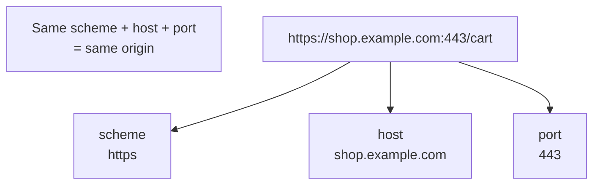
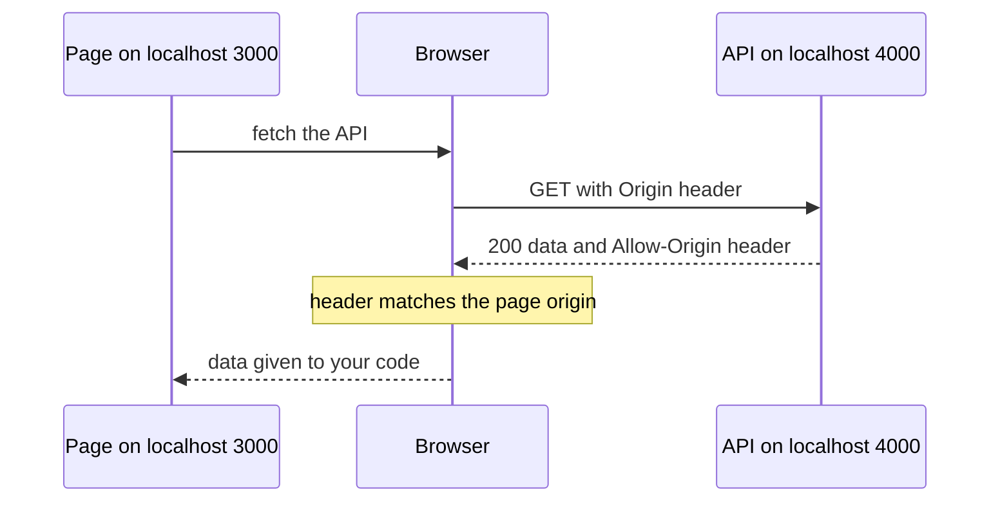
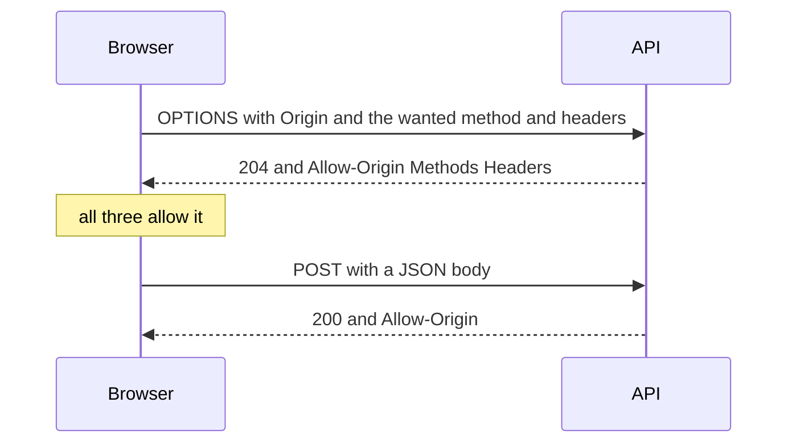
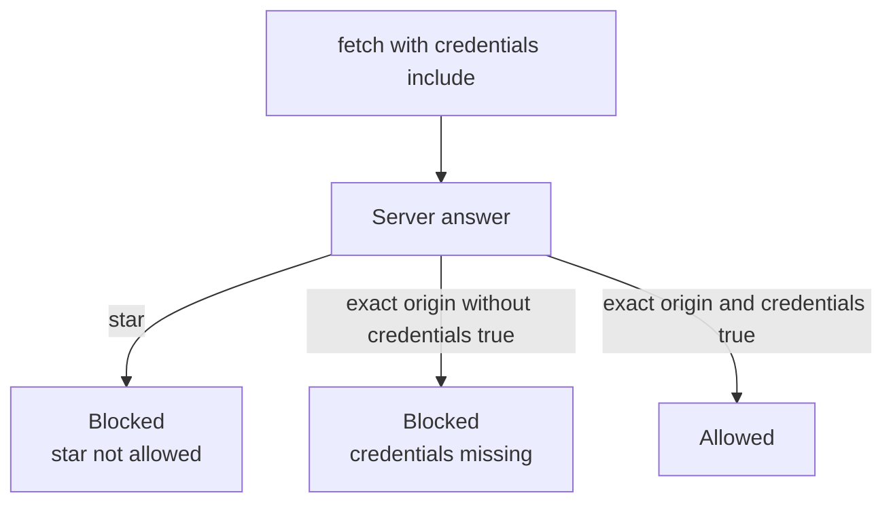
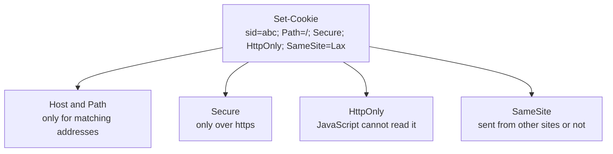
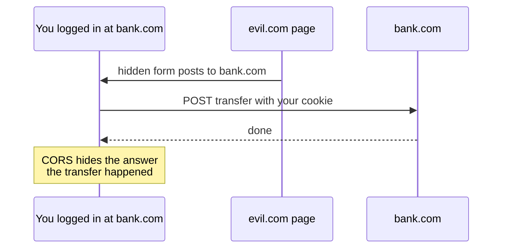
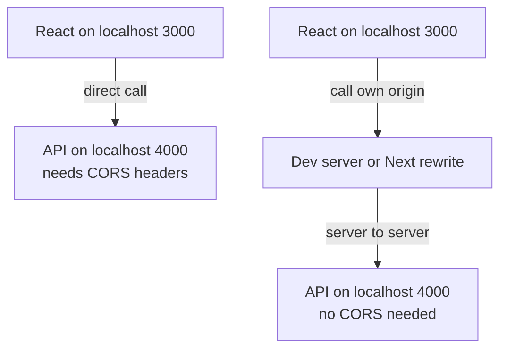

# 06. Cookies, CORS and same origin

> **Subject:** Networking · **Lesson:** 06 · **Made:** 2026-11-21 · **Status:** ready
>
> **You will be able to:** say what an origin is, explain why the browser blocks reading answers from other origins, say what CORS adds and who enforces it, tell a simple request from a preflight, explain why `*` fails with cookies, name what each cookie flag does, say how SameSite and CSRF fit in, and set up CORS in Express, Next.js and a React dev server.
>
> **Before this:** [TLS and HTTPS](04-tls-and-https.md) · **Also read:** [Express middleware](../backend-api/03-express-middleware.md) and [Sessions vs JWT](../backend-api/06-authentication-sessions-vs-jwt.md) · **Next:** [WebSockets and server sent events](07-websockets-and-server-sent-events.md)
>
> **How to read it:** one card is one idea. Look at the picture, guess, then press the orange bar to check. The blue bars (📖 More detail) hold the longer explanation. Skip them on the first read. **What I ran for real:** an Express 5.3.0 server with the `cors` package 2.8.6, two small page servers, and Google Chrome 157 in headless mode, on 2026-11-21. I read the server log to see which requests really arrived. **What I did not run:** Firefox, Safari, Next.js and Hasura (from the docs, not run here). Facts and links were checked on 2026-11-21. About 25 minutes for the cards.

<!-- quick-summary:start -->
## Quick summary

> Short on time? Read only this. These are the "Remember" lines from the cards below, so you can read the whole lesson in one minute.

- An origin is scheme + host + port. By default the browser lets a page send to another origin but not read the answer.
- CORS is enforced by the browser. The server only sends headers. A blocked answer was still made by the server.
- DELETE, JSON bodies, Authorization and custom headers trigger a preflight. If the preflight is refused, the real request is never sent.
- Cookies across origins need three things: `credentials: "include"` in the page, one exact origin, and `Access-Control-Allow-Credentials: true`.
- Secure = https only. HttpOnly = hidden from JavaScript. SameSite = may it go along on a cross-site request. Domain and Path = which addresses get it.
- CORS decides who may read the answer. SameSite and tokens stop the forged request. Do not use CORS as CSRF protection.
- Put `cors` first in Express, list exact origins, add `credentials: true` for cookies. Or avoid CORS with a proxy that makes the call same-origin.
<!-- quick-summary:end -->

## 1. The problem, and what an origin is

You are logged in to your bank in one tab. In another tab you open a strange site. The browser would send your bank cookie to the bank if that strange page asked. If the page could also **read** the answer, it could read your account. So the browser has one rule: a page may **send** to another origin, but it may not **read** the answer. This is the **same-origin policy**.

An **origin** is three things: scheme, host and port. The path does not count.



Notice: all three must match. The path `/cart` is not in the picture.

| Compare with `https://shop.example.com` | Same origin? |
|---|---|
| `https://shop.example.com/api/items` | yes, only the path differs |
| `http://shop.example.com` | no, scheme |
| `https://shop.example.com:8443` | no, port |
| `https://api.shop.example.com` | no, host |

<details class="guess"><summary>🤔 Guess: your React app is on localhost:3000 and your API is on localhost:4000. Same origin? Press to check.</summary>

**No.** The port is different. This is why CORS errors appear the first day you split a front end and an API.

</details>

> **Remember:** an origin is scheme + host + port. By default the browser lets a page send to another origin but not read the answer.

<details class="more"><summary>📖 More detail: four new words, what is blocked, what is allowed</summary>

**Four new words in this lesson:** **origin** (this card), **CORS** (card 2), **preflight** (card 3), **CSRF** (card 6). The cookie flag names are explained in card 5, where they appear.

**What the policy blocks and allows** (from [web.dev](https://web.dev/articles/same-origin-policy)): cross-origin things can usually be **embedded** (an image, a script tag, an iframe), but not **read**. An iframe can show, but your JavaScript cannot look inside it. An image can show, but your script cannot read its bytes. The same applies to `fetch` and `XMLHttpRequest`: the request may go out, the answer is hidden.

**Real result.** From a page at `http://localhost:3000`, `fetch("http://localhost:4000/early-crash")` is cross-origin because of the port. That route sent no CORS headers. Chrome 157 showed `TypeError: Failed to fetch`, and the Express log showed the `GET` had arrived.

**Site is not origin.** A **site** is the registrable name, for example `example.com`. `api.example.com` and `www.example.com` are different origins but the same site. SameSite cookies (card 5) use the site, not the origin. The port is not part of a site.

**Where it fits.** The TLS lesson covers `https`. Here only the scheme matters: `http` and `https` are different origins.

**The trace** (stepper, tab 1, the model code `originOf`, `sameOrigin`, `sameSite`): one page address is compared with five others.

</details>

## 2. CORS: the server gives permission

A real app often needs cross-origin reads: your React app on one origin, your API on another. **CORS** (Cross-Origin Resource Sharing) is a way for the **server** to say "this origin may read my answers". The server adds a header. The **browser** reads it and decides. The server cannot block a request with CORS. It only sends a note.



Notice: the check is in the browser, in the middle.

<details class="guess"><summary>🤔 Guess: curl gets your API data, but the browser shows a CORS error. Is the server broken? Press to check.</summary>

**No.** The server works. curl does not check CORS. Only browsers do. The fix is to send the right headers, or to avoid the cross-origin call (card 7).

</details>

> **Remember:** CORS is enforced by the browser. The server only sends headers. A blocked answer was still made by the server.

<details class="more"><summary>📖 More detail: what I measured, the main headers, and the wrong belief</summary>

**What I ran.** An Express API with `cors({ origin: ["http://localhost:3000"] })`, called from a Chrome page, and from curl (2026-11-21):

| Caller | Origin sent | Server log | Result |
|---|---|---|---|
| Chrome page on `localhost:3000` | `http://localhost:3000` | `GET` arrived | data readable |
| Chrome page on `127.0.0.1:3000` | `http://127.0.0.1:3000` | `GET` arrived | blocked, `Failed to fetch` |
| curl with `-H "Origin: http://evil.com"` | `http://evil.com` | `GET` arrived | **200 and the data** |

The third row is the wrong-belief killer: even with a bad origin, the server answered and sent the data. Only the browser refuses to hand it to your script.

**The headers** ([MDN CORS](https://developer.mozilla.org/en-US/docs/Web/HTTP/Guides/CORS)):

| Header | Who sends it | Meaning |
|---|---|---|
| `Origin` | browser | where the page came from |
| `Access-Control-Allow-Origin` | server | which origin may read: one origin or `*` |
| `Access-Control-Allow-Methods` | server, in a preflight answer | allowed methods |
| `Access-Control-Allow-Headers` | server, in a preflight answer | allowed request headers |
| `Access-Control-Allow-Credentials` | server | `true` lets cookies and logins count (card 4) |
| `Access-Control-Max-Age` | server | how many seconds the browser may remember a preflight answer. MDN says the default is 5 |
| `Vary: Origin` | server | the answer depends on the Origin header. Caches must keep a copy per origin |

**The wrong belief: "CORS is a server bug."** Two truths: (1) the browser enforces it, so curl, Postman, mobile apps and server code are not affected; (2) it protects the **user** in the browser, not your server. It does not stop an attacker who calls your API with their own tool.

**The trace** (stepper, tab 2, the model code `browserFetch`): the browser sends the GET with Origin, the server runs and answers, the browser checks, then the same call from an unlisted origin is blocked even though the server ran, and last curl reads the data.

</details>

## 3. Simple request or preflight?

Some requests could change data on the server, like `DELETE`. Some are old kinds a server may never expect from another site. For these the browser asks first with an **OPTIONS** request, called a **preflight**. It says which method and headers it wants to use. Only if the answer says yes does it send the real request. A **simple request** (plain GET, HEAD or POST with a few safe headers) is sent without asking.



Notice: two round trips. The first one carries no data and no cookie.

<details class="guess"><summary>🤔 Guess: a page sends fetch with Content-Type application/json to another origin. Preflight or not? Press to check.</summary>

**Preflight.** `application/json` is not on the safe list. Only `application/x-www-form-urlencoded`, `multipart/form-data` and `text/plain` are. An `Authorization` header and any custom header also cause a preflight.

</details>

> **Remember:** DELETE, JSON bodies, Authorization and custom headers trigger a preflight. If the preflight is refused, the real request is never sent.

<details class="more"><summary>📖 More detail: the safe list, what I saw, caching and redirects</summary>

**A simple request** ([MDN](https://developer.mozilla.org/en-US/docs/Web/HTTP/Guides/CORS)) uses only `GET`, `HEAD` or `POST`, and only the safe headers `Accept`, `Accept-Language`, `Content-Language`, `Content-Type` (with one of the three values above) and `Range` (one range only).

**What I saw in the server log** (Chrome 157, API allows `GET,POST,DELETE` and headers `Content-Type,Authorization`):

| Fetch from the allowed page | Requests the server saw |
|---|---|
| `GET /data` | `GET` |
| `POST` with `application/json` | `OPTIONS`, then `POST` |
| `DELETE` | `OPTIONS`, then `DELETE` |
| `PUT` (not in the methods list) | `OPTIONS` only |
| `GET` with header `X-Foo` (not in the headers list) | `OPTIONS` only |

Row four and five are the only cases where CORS keeps a request away from the server. A cross-origin `POST` with `text/plain` from the unlisted page `127.0.0.1` arrived at the server with no `OPTIONS` at all (card 6 uses this).

**With the `cors` package** ([README](https://github.com/expressjs/cors)): it answers the `OPTIONS` itself with status 204 and the permission headers, so your route does not run. If you do not set `allowedHeaders`, it copies back what the browser asked for.

**Caching.** `Access-Control-Max-Age` lets the browser skip the next preflight for the same URL and method. Browsers cap this value, so a huge number does not mean much (MDN does not give the caps).

**Redirects.** MDN says not all browsers follow a redirect after a preflighted request, so a redirect on an API route can look like a CORS error. Avoid redirecting API routes.

**The trace** (stepper, tab 3): the browser sees JSON and asks first, OPTIONS goes out, the server answers, the browser checks, the real POST goes out, and then a server that forgot `Content-Type` stops the flow after OPTIONS.

</details>

## 4. Cookies, credentials and why * fails

By default a cross-origin `fetch` sends **no cookies**. You must ask: `credentials: "include"`. Then the server must say yes in two ways: name **one exact origin** (not `*`) and send `Access-Control-Allow-Credentials: true`. If the server used `*`, any website could use your cookie and read your data. So the browser refuses `*` here.



Notice: only the last answer passes.

<details class="guess"><summary>🤔 Guess: the API says Allow-Origin * and Allow-Credentials true. Your fetch uses credentials include. What happens? Press to check.</summary>

**Blocked.** The browser says a wildcard is not allowed with credentials. The server still ran the request (I saw it in the log). Fix: send the exact origin, with `Vary: Origin`.

</details>

> **Remember:** cookies across origins need three things: `credentials: "include"` in the page, one exact origin, and `Access-Control-Allow-Credentials: true`.

<details class="more"><summary>📖 More detail: real run, the same rule for other headers, and third party cookies</summary>

**Real result** (Chrome 157, 2026-11-21), page on `http://localhost:3000`, API on `http://localhost:4000`:

| Setup | Result |
|---|---|
| `cors()` default (`*`) and `credentials: "include"` | blocked, the log shows the `GET` arrived |
| `cors({ origin: [...], credentials: true })` and `credentials: "include"` | allowed, the server saw the cookie |
| same server, but no `credentials` option in the page | allowed, the server saw **no** cookie |

**Same rule for more headers.** MDN says that for a credentialed request the `*` is also not allowed in `Allow-Headers`, `Allow-Methods` and `Expose-Headers`. And `*` in `Allow-Headers` never covers `Authorization`: you must write it by name. Also, a `Set-Cookie` in a response with `Allow-Origin: *` will not set a cookie.

**Another rule that still applies.** CORS permission is not enough. The browser's cookie rules (card 5) and its third-party cookie settings still decide if the cookie travels. MDN: "the policy is always enforced regardless of any setup on the server and the client". Some browsers block third-party cookies by default, so the exact result can differ by browser. I only ran Chrome.

**The trace** (stepper, tab 4, the model code `corsHeaders`, `checkCors`, `browserFetch`): fetch with credentials, server answers `*`, the browser refuses, then the fix with a list and `credentials: true`, then a server that forgot `credentials`.

</details>

## 5. Cookies and their flags

A **cookie** is a small note the server asks the browser to keep (`Set-Cookie`). The browser then attaches it to later requests by itself (`Cookie`). That is how login sessions work. Each flag is a rule about where or how the note travels.



Notice: Secure, HttpOnly and SameSite are three different protections. None replaces the others.

<details class="guess"><summary>🤔 Guess: the cookie has HttpOnly. Can a script on your page read it with document.cookie? Can the browser still send it with requests? Press to check.</summary>

**The script cannot read it. The browser still sends it.** HttpOnly stops a script from stealing the cookie (for example from an XSS bug). It does not stop the browser from attaching it.

</details>

> **Remember:** Secure = https only. HttpOnly = hidden from JavaScript. SameSite = may it go along on a cross-site request. Domain and Path = which addresses get it.

<details class="more"><summary>📖 More detail: the flags, real results on SameSite, and the prefixes</summary>

**The flags** (from [MDN Cookies](https://developer.mozilla.org/en-US/docs/Web/HTTP/Guides/Cookies)):

| Flag | What it does |
|---|---|
| `Domain=example.com` | goes to that domain and its subdomains. Without it, only the exact host, not subdomains |
| `Path=/admin` | goes only when the request path starts with that path |
| `Secure` | only over https (MDN: not over http, "except on localhost", and Safari does not do that exception) |
| `HttpOnly` | not readable by `document.cookie` |
| `SameSite=Strict / Lax / None` | when it is sent on a cross-site request. `None` needs `Secure` |
| `Max-Age=3600` | lives for that many seconds. Without it, it is a session cookie and ends with the session |

If no SameSite is set, MDN says "some browsers" treat the cookie as `Lax`. Chrome does (I did not test the default here). Do not rely on it. Write `SameSite=Lax` yourself.

**Real result: SameSite** (Chrome 157, 2026-11-21). The API at `http://localhost:4001` set three HttpOnly cookies: `lax`, `strict` and `none` (Secure). Then I called `/me`, which lists the cookies that arrived:

| Caller page | Request | Cookies that arrived |
|---|---|---|
| `http://localhost:3000` (same site, other port) | fetch with credentials | lax, none, strict |
| `http://127.0.0.1:3000` (another site) | fetch with credentials | **none** only |
| `http://127.0.0.1:3000` links to the API (top level GET) | navigation | lax, none |

So: the port does not make a different site, so even `Strict` is sent from `localhost:3000` to `localhost:4000`. CORS is still needed there. `127.0.0.1` and `localhost` are different sites. A link click lets `Lax` through.

**Prefixes.** `__Secure-` cookies need `Secure`. `__Host-` cookies need `Secure`, no `Domain`, and `Path=/`, so a subdomain cannot overwrite them. The browser refuses a cookie that breaks the rule. The practice function `setCookieHeader` checks these.

**Lifetime and session type** are in [Sessions vs JWT](../backend-api/06-authentication-sessions-vs-jwt.md). A cookie holding a session id is the common choice for a web app. See also [Login systems compared](../backend-api/20-login-systems-compared.md).

**The trace** (stepper, tab 5, the model code `setCookieHeader`, `cookieSent`): three cookies are tested against a same-site call, a cross-site POST form, a link click, a cross-site fetch and a plain http call.

</details>

## 6. CSRF: the attack that CORS does not stop

**CSRF** (cross-site request forgery): a bad site makes your browser send a request to your bank, and the browser adds your login cookie. Example: a hidden form on `evil.com` posts to `bank.com/transfer`. A form post is a **simple request**, so there is no preflight. The server runs it. CORS only hides the **answer**. The money has already moved.



Notice: the server cannot tell this request from a real one, unless the cookie is not sent or a token is checked.

<details class="guess"><summary>🤔 Guess: the bank has CORS allowed only for https://bank.com. Does that stop the hidden form? Press to check.</summary>

**No.** A form post is not read by JavaScript and needs no permission. The bank must stop the cookie going along (`SameSite=Lax` or `Strict`) or check a secret token that evil.com cannot know.

</details>

> **Remember:** CORS decides who may read the answer. SameSite and tokens stop the forged request. Do not use CORS as CSRF protection.

<details class="more"><summary>📖 More detail: what I saw, the fixes, and CORS versus CSRF in one table</summary>

**What I saw.** From the unlisted page on `127.0.0.1:3000`, a `POST` with `Content-Type: text/plain` to the API reached the server with no `OPTIONS`. A `POST` with `application/json` sent `OPTIONS` only. So a "simple" request really reaches the server.

**The fixes**, from the strongest to the weakest alone:

| Fix | How it helps |
|---|---|
| `SameSite=Lax` (or `Strict`) on the session cookie | the browser does not attach the cookie to a cross-site POST |
| A CSRF token | a secret the page must send in a header or hidden field. evil.com cannot read it |
| Check `Origin` on state changing routes | reject a POST from an origin you do not know |
| Needing JSON and a custom header | forces a preflight, which evil.com fails (but do not rely on this alone) |

**CORS versus CSRF:**

| | CORS | CSRF |
|---|---|---|
| What it is | a browser rule with a way to loosen it | an attack |
| Protects | who may read an answer | nothing; it abuses a logged in user |
| Stops forged POST forms? | no | the fixes above do |

**With a token instead of a cookie.** If your API takes a token in the `Authorization` header (for example from `localStorage`), the browser does not attach it by itself, so CSRF does not apply. The cost is that a script can read the token, so XSS matters more. See [Sessions vs JWT](../backend-api/06-authentication-sessions-vs-jwt.md).

**The trace** (stepper, tab 5, steps 3 to 5): a hidden form from evil.com, a link click, and a cross-site fetch against three cookies.

</details>

## 7. Setting it up in your stack

Three common places: an **Express** API, a **Next.js** app, and a **React** dev server. Pick one: either allow the origin on the server, or make the browser call the **same origin** through a proxy so CORS is not needed.



Notice: in the second path the browser never leaves its own origin.

```js
const cors = require("cors");
// allow only the sites you know
app.use(cors({
  origin: ["http://localhost:3000",
           "https://shop.example.com"],
  credentials: true,
  methods: ["GET", "POST", "DELETE"],
  allowedHeaders: ["Content-Type", "Authorization"],
  maxAge: 600,
}));
```

<details class="guess"><summary>🤔 Guess: you put app.use(cors()) after your routes. Do your routes get the CORS headers? Press to check.</summary>

**No.** Express runs middleware in order. A route that answers before `cors()` never gets the headers. Put `cors` first, before the routes. I also saw that a route placed before `cors()` that returns 500 gives a browser CORS error, not the 500.

</details>

> **Remember:** put `cors` first in Express, list exact origins, add `credentials: true` for cookies. Or avoid CORS with a proxy that makes the call same-origin.

<details class="more"><summary>📖 More detail: Express options, Next.js, React dev, Hasura, and what I ran</summary>

**Express** (the `cors` package, [README](https://github.com/expressjs/cors), run with Express 5.3.0 and cors 2.8.6). The default `cors()` sends `Access-Control-Allow-Origin: *` and allows `GET,HEAD,PUT,PATCH,POST,DELETE`. `origin` can be a string, a list, a regular expression or a function. `cors` answers the preflight with 204. My run of the config above: from `http://localhost:3000` it answered the preflight with `Access-Control-Allow-Origin: http://localhost:3000`, `Vary: Origin`, `Access-Control-Allow-Credentials: true`, `Access-Control-Allow-Methods: GET,POST,DELETE`, `Access-Control-Allow-Headers: Content-Type,Authorization` and `Access-Control-Max-Age: 600`. For an unlisted origin it sent no `Allow-Origin` at all. Careful with a regular expression: `/example\.com$/` also matches `https://evilexample.com`. Anchor it, or use an exact list.

**Express 5 note.** In Express 5 a route path like `/strict/*` is an error (I got it). Use `app.use("/strict", cors(...))`, which also covers `OPTIONS`.

**Next.js** (from the [route.js docs](https://nextjs.org/docs/app/api-reference/file-conventions/route), updated 2026-11-18, not run here). For one route, set the headers on the `Response` in the handler. The docs add that for many routes you can use `Proxy` (which the docs now name for this) or the `headers` option of `next.config.js`. A browser preflight needs the CORS headers on the `OPTIONS` answer. The docs say Next.js adds a default `OPTIONS` that sets `Allow`, but they do not say it adds the CORS headers, so export your own `OPTIONS` function that returns them. The [Vercel guide](https://vercel.com/kb/guide/how-to-enable-cors) shows a static way and a way with a list of allowed origins and `Vary: Origin`. If the frontend and the Route Handlers live in the **same** Next app, there is no cross-origin call and no CORS to set.

**React dev.** A dev server proxy (Vite `server.proxy`, Next `rewrites`) sends `/api` to the API server. The browser sees only its own origin. In production use the same idea with a reverse proxy, see [Reverse proxy and Nginx](../devops-cloud/08-reverse-proxy-and-nginx.md). I did not run Vite or Next here.

**Hasura** (from the [docs](https://hasura.io/docs/2.0/deployment/graphql-engine-flags/reference/), not run here). `HASURA_GRAPHQL_CORS_DOMAIN` takes a comma separated list of domains **with scheme and port**, for example `http://localhost:3000`. The default is `null` for the open source and Enterprise editions and `*` on Hasura Cloud. An empty value blocks all other domains. Port wildcards are not supported.

**Common mistakes:**

| Mistake | What you see | Fix |
|---|---|---|
| `cors()` after the routes | no headers on some routes | put it first |
| `origin: "*"` with cookies | blocked, `*` with credentials | exact list and `credentials: true` |
| Forgot `credentials: "include"` | login works in Postman, not the page | set it in `fetch` |
| `localhost` and `127.0.0.1` mixed | allowed in one, blocked in the other | list both, or use one |
| Server crashes or 502 from a gateway | looks like a CORS error | read the server log |
| Authorization header, `*` in headers | preflight fails | list `Authorization` by name |
| Trailing slash in the origin | no match | write `http://localhost:3000`, no slash |

**My Express test setup.** An API with `cors`, a page server, and Chrome 157 headless. Twelve calls from the allowed page and from `127.0.0.1`. Every row above that says "I saw" comes from that run.

</details>

## 8. Watch and play

Links were checked on 2026-11-21: I opened each page, and for the videos I read the title and channel from YouTube oEmbed data. I did not watch the videos. If a link is broken, tell me and I will replace it.

- **Play with it:** [the stepper in this folder](visuals/06-cookies-cors-and-same-origin.html) - guess first, then press Next. Five tabs: same origin, a simple request, a preflight, credentials and `*`, and cookies with CSRF.
- **Try it yourself:** open your browser DevTools, Network tab, and call any API from another origin. Look for the `OPTIONS` row and read the response headers. I did not find a working online CORS tester, so use your own page.
- **Video:** [CORS in 100 Seconds](https://www.youtube.com/watch?v=4KHiSt0oLJ0) - Fireship. Title and channel checked (a mirror lists it at about 2.5 minutes). The quick version of cards 1 to 3.
- **Video:** [Stop Copying CORS Headers - CORS Explained](https://www.youtube.com/watch?v=cGg7aRcIm8o) - LearnThatStack. Title and channel checked only. About why, not just copy and paste.
- **Video:** [CSRF and CORS Explained](https://www.youtube.com/watch?v=hjTY1Lf21W0) - Tejas Kumar. Title and channel checked only. Compare with card 6.
- **Pictures:** [CS Visualized: CORS](https://dev.to/lydiahallie/cs-visualized-cors-5b8h) - Lydia Hallie. Animated diagrams of the request and the preflight (the page loaded, I could not read what each picture shows).
- **Read:** [MDN: Cross-Origin Resource Sharing](https://developer.mozilla.org/en-US/docs/Web/HTTP/Guides/CORS) - the reference for every header in this lesson.

<details><summary>Go deeper (optional)</summary>

**More pages I opened.** [MDN: Using HTTP cookies](https://developer.mozilla.org/en-US/docs/Web/HTTP/Guides/Cookies). [web.dev: Same-origin policy](https://web.dev/articles/same-origin-policy). [expressjs/cors](https://github.com/expressjs/cors). [Next.js route.js](https://nextjs.org/docs/app/api-reference/file-conventions/route). [Vercel: How to enable CORS](https://vercel.com/kb/guide/how-to-enable-cors). [Hasura server flags](https://hasura.io/docs/2.0/deployment/graphql-engine-flags/reference/).

**Checked on 2026-11-21** with Node v26.5.0, Express 5.3.0, cors 2.8.6 and Google Chrome 157.0.8103.79 (headless). The practice code has 102 tests. On the empty stub 97 fail (the other 5 only check that your function does not change its inputs). I made 60 wrong versions of the answer (for example a preflight that ignores headers, `*` accepted with credentials, a path check that matches `/administrator` for `/admin`, a Lax cookie sent on a cross-site POST) and the tests caught 59. The one that survived changes nothing, because `new URL` already makes the host lower case. The stepper uses the same functions, and I ran every step of every tab through a script that looks for missing values.

**What I did not test.** Firefox and Safari (they may differ, especially for third party cookies), Next.js, Vite, Hasura, a real CSRF token flow, `Access-Control-Expose-Headers`, and a preflight cache across calls.

**Where the model is simpler than the real thing.** `sameSite` knows only five public suffixes (the real list has thousands). `unsafeHeaders` ignores the size limits of the safe headers and the `Range` header. The model's `corsHeaders` sends only `Vary` for an unlisted origin. The real `cors` package also adds `Access-Control-Allow-Credentials: true` there (I saw it), but the browser ignores it without `Allow-Origin`. The model has no cookie expiry, no cookie size limits and no `Expose-Headers`.

**Not covered here.** `Access-Control-Expose-Headers`, `no-cors` mode (an opaque response: I saw status 0 and type opaque), `Cross-Origin-Resource-Policy` and `Cross-Origin-Opener-Policy`, `postMessage`, CORS for WebSockets, private network access, and the third party cookie plans of each browser.

</details>

## 9. Practice

**A. Predict the output** (write your answer before opening)

```js
console.log(sameOrigin("https://shop.com/a", "https://shop.com:443/b"));
console.log(sameSite("http://localhost:3000", "http://localhost:4000"));
console.log(needsPreflight({ method: "POST", headers: { "Content-Type": "application/json" } }));
console.log(browserFetch({ pageUrl: "http://localhost:3000/", url: "http://localhost:4000/me", method: "GET", credentials: true }, { allowedOrigins: "*", credentials: true }));
console.log(setCookieHeader({ name: "sid", value: "1", httpOnly: true, secure: true, sameSite: "Lax", path: "/" }));
console.log(cookieSent({ host: "bank.com", sameSite: "Lax" }, { url: "https://bank.com/pay", pageUrl: "https://evil.com/", method: "POST", navigation: true }));
```

Then answer: in line 4, did the server run the request?

<details><summary>Answer</summary>

```
true
true
true
{
  sent: [ 'GET' ],
  serverRan: true,
  jsCanRead: false,
  reason: '* is not allowed with credentials'
}
sid=1; Path=/; Secure; HttpOnly; SameSite=Lax
{ sent: false, reason: 'blocked by SameSite=Lax' }
```

Line 1: the default port written out is the same origin. Line 2: the port does not count for a site. Line 3: JSON needs a preflight. Line 4: **yes, the server ran it** (`serverRan: true`). Only the read was blocked. Line 6: `Lax` lets a link click (GET) through, but not a form POST. (Run on 2026-11-21 with Node v26.5.0.)

</details>

**B. Fix the bug**

The page uses cookies. The server uses this. The login works in Postman, but the page shows a CORS error. Find the bug.

```js
app.use(cors({ origin: "*", credentials: true }));
// page
fetch("http://localhost:4000/me", { credentials: "include" });
```

<details><summary>Answer</summary>

`origin: "*"` with `credentials: true`. The browser refuses `*` for a credentialed request (I saw it in Chrome 157, and the server log shows the `GET` still arrived). **Fix:** `cors({ origin: ["http://localhost:3000"], credentials: true })`. Postman works because it does not enforce CORS.

</details>

**C. Write it yourself**

Open `learn/networking/practice/06-cookies-cors-and-same-origin.js`. It has nine empty pieces: `originOf`, `sameOrigin`, `sameSite`, `needsPreflight`, `corsHeaders`, `checkCors`, `browserFetch`, `setCookieHeader` and `cookieSent`. The comments at the top say exactly what each must do. Write them, then run this from the repo root and make all the tests pass:

```
node --test learn/networking/practice/06-cookies-cors-and-same-origin.test.js
```

`browserFetch` is the one to think about: it is the whole story in one function. Use the other pieces inside it.

<details><summary>One possible answer</summary>

The full answer is long (about 150 lines). The idea in each piece:

- `originOf`: `new URL(url)`, with the default port 80 or 443.
- `sameOrigin`: compare scheme, host and port. `sameSite`: compare scheme and `siteOf(host)`.
- `needsPreflight`: not GET, HEAD or POST, or `unsafeHeaders(...)` is not empty.
- `corsHeaders`: no `Origin` gives `{}`. `*` gives `*`. A listed origin is copied back with `Vary: Origin`. An unlisted one gets only `Vary`. Add credentials. On `OPTIONS` add methods, headers and max age.
- `checkCors`: check in order: no Allow-Origin, `*` with credentials, credentials flag, origin match. For a preflight also check the method and each unsafe header.
- `browserFetch`: same origin is free. Preflight first if needed (the server does not run the real request if it fails). Then the real request: the server always runs it, and only the read may be blocked.
- `setCookieHeader`: validate SameSite and the prefixes, then join the parts in the fixed order.
- `cookieSent`: host, path, Secure, same site, then the SameSite word.

The finished version is checked: 97 of the 102 tests fail on the empty stub (the other 5 only check that your function does not change its inputs), and all 102 pass with my answer. The stepper page uses these same functions, so you can open its source to see the full answer.

</details>

## 10. Interview question

**Q:** "A React app on one domain calls your API on another. The browser blocks it with a CORS error. What is going on, and how do you fix it?"

A common follow-up: "Why does it work in Postman? And why does `*` not work with cookies?" Cards 2 and 4 are the answer.

<details><summary>A strong answer, in four parts</summary>

1. **Problem:** The browser lets a page send to another origin (scheme + host + port) but hides the answer from its JavaScript, so a strange site cannot read my logged in data. My React app and API are different origins, so the browser hides the API answer. Postman and curl do not enforce this, which is why it works there.
2. **How it works:** The server opts in with `Access-Control-Allow-Origin`. For a simple request the browser sends it and checks the answer. For a DELETE, a JSON body or an `Authorization` header, the browser first sends an `OPTIONS` preflight, and the server must allow the method and headers. With cookies, the page uses `credentials: "include"`, and the server must name one exact origin and send `Access-Control-Allow-Credentials: true`. `*` is refused. In Express I put `cors` first with a list of origins. A dev proxy can also make the call same-origin.
3. **Tradeoff:** An exact list is safe but must be kept up to date. Reflecting any origin with credentials is a security hole. A proxy removes CORS but adds a hop. `Max-Age` saves preflights, but browsers cap it. CORS does not protect against CSRF: a form post is a simple request, so I use `SameSite` cookies or a token as well.
4. **My example:**
   - **Fact:** my profile lists React, Next.js, Express and authentication work, and the CMS plus mobile app shape of DBO.
   - **Fact (from this lesson):** I ran an Express API with `cors` and Chrome 157 here, and saw the server log show that a blocked request still reached the server.
   - **Idea, not a fact:** I do not know how CORS was set up in DBO or my other projects, so I should not claim it. A good next step is to look at the `cors` or Hasura CORS setting in one of my apps, and check whether it uses `*` with cookies.

</details>

## 11. Explain it back

Close this file. Explain cookies, CORS and the same-origin policy out loud like to a new junior, in 4 parts (problem, how, tradeoff, my example). Use the story of the API that works in Postman but fails in the browser. Say what an origin is, who enforces CORS, why a preflight exists, why `*` fails with cookies, what Secure, HttpOnly and SameSite do, and why CORS does not stop CSRF. Write your best version below and run `/explain-check cors` or ask the `explain-coach` agent to review it.

### My explanation

<write here>

### Coach feedback

<the explain-coach agent writes here>

## 12. Review questions (day 1, 3, 7, 21)

1. What is an origin? Is `http://localhost:3000` the same origin as `http://localhost:4000`? Same site?
2. Who enforces CORS, the browser or the server? Why does the request work in curl?
3. Which requests need a preflight, and what happens if the preflight is refused?
4. Your page uses `credentials: "include"` and the API sends `Allow-Origin: *`. What happens, and what is the fix?
5. What do `Secure`, `HttpOnly` and `SameSite` each stop?
6. A hidden form on another site posts to your API. Does CORS stop it? What does?

Then draw from memory: the page, the browser, and the server for a JSON POST, with the OPTIONS before the POST.

<details><summary>Answers</summary>

1. Scheme + host + port. The ports differ, so different origins. They are the same site (the port does not count for a site).
2. The browser. The server only sends headers. curl and Postman do not check them.
3. DELETE, PUT, PATCH, JSON bodies, `Authorization` and custom headers. If it is refused, the real request is never sent.
4. The browser blocks the read. The server still ran the request. Fix: an exact origin and `Access-Control-Allow-Credentials: true`.
5. `Secure`: the cookie is sent only over https. `HttpOnly`: JavaScript cannot read it. `SameSite`: controls if it is sent on cross-site requests.
6. No. A form post is a simple request, so it is sent and the server runs it. `SameSite=Lax` or `Strict`, a CSRF token or an `Origin` check stops it.

</details>

## Connected lessons

- [TLS and HTTPS](04-tls-and-https.md) - the `Secure` flag and the scheme in an origin.
- [HTTP/1.1, HTTP/2 and HTTP/3](05-http-1-1-vs-http-2-vs-http-3.md) - the same headers on faster connections.
- [WebSockets and server sent events](07-websockets-and-server-sent-events.md) - next: another way for a page to talk to a server.
- [Express middleware](../backend-api/03-express-middleware.md) - why `cors` must come first.
- [Sessions vs JWT](../backend-api/06-authentication-sessions-vs-jwt.md) - the cookie that holds a session.
- [Login systems compared](../backend-api/20-login-systems-compared.md) - cookie or token, and what each means for CSRF.
- [Hasura: when and when not](../backend-api/14-hasura-when-and-when-not.md) - the Hasura CORS setting in context.
- [Reverse proxy and Nginx](../devops-cloud/08-reverse-proxy-and-nginx.md) - the production version of a dev proxy.
- [HTTPS and certificates in practice](../devops-cloud/19-https-and-certificates-in-practice.md) - HSTS and `Secure` cookies need working https.
- [The URL to page guide](networking-url-to-page-step-by-step.md) - where the browser fits in a page load.
