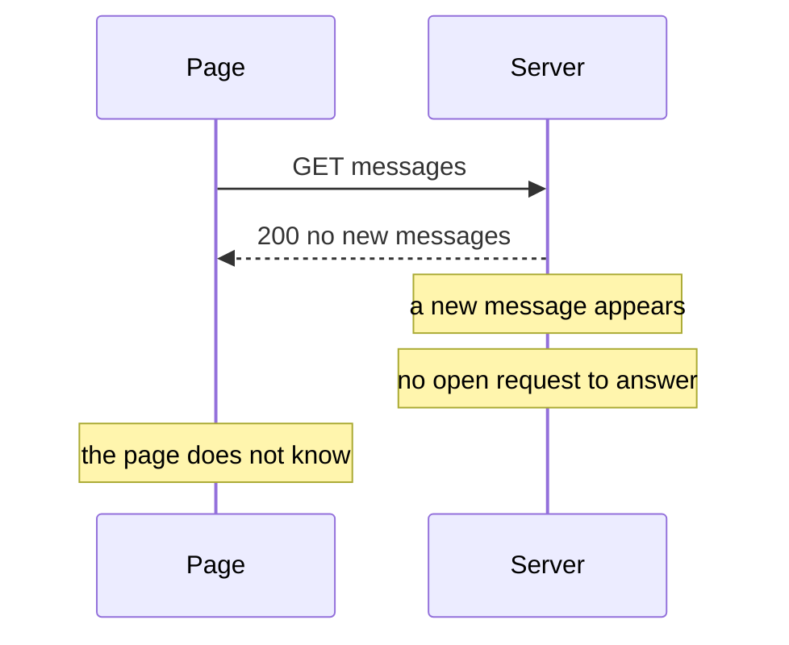
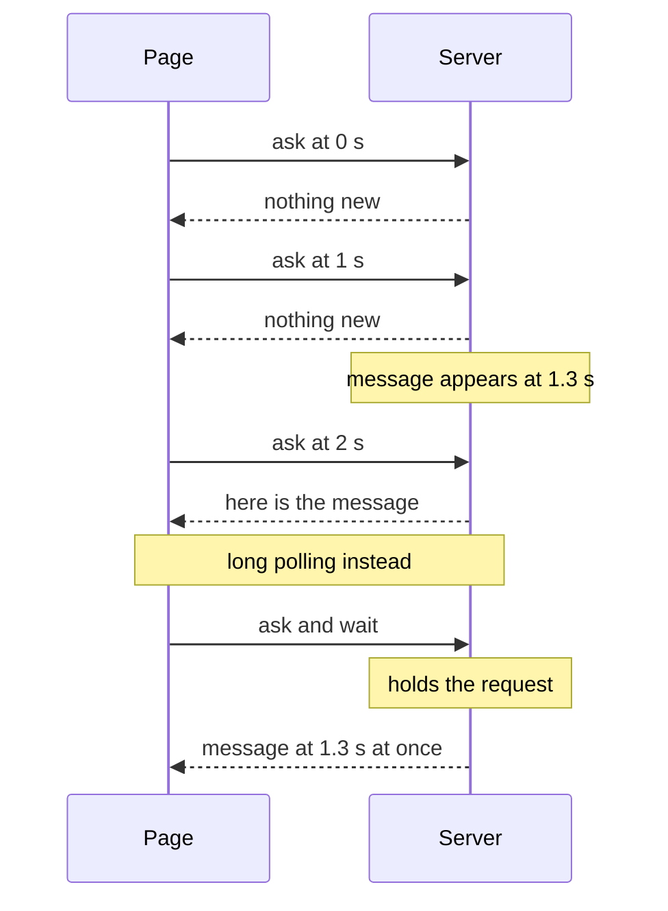
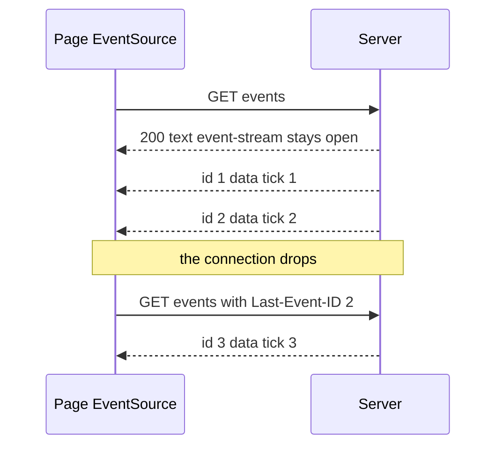
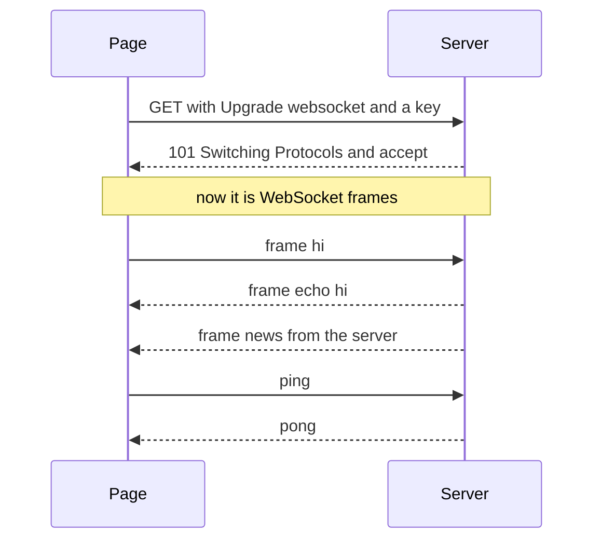
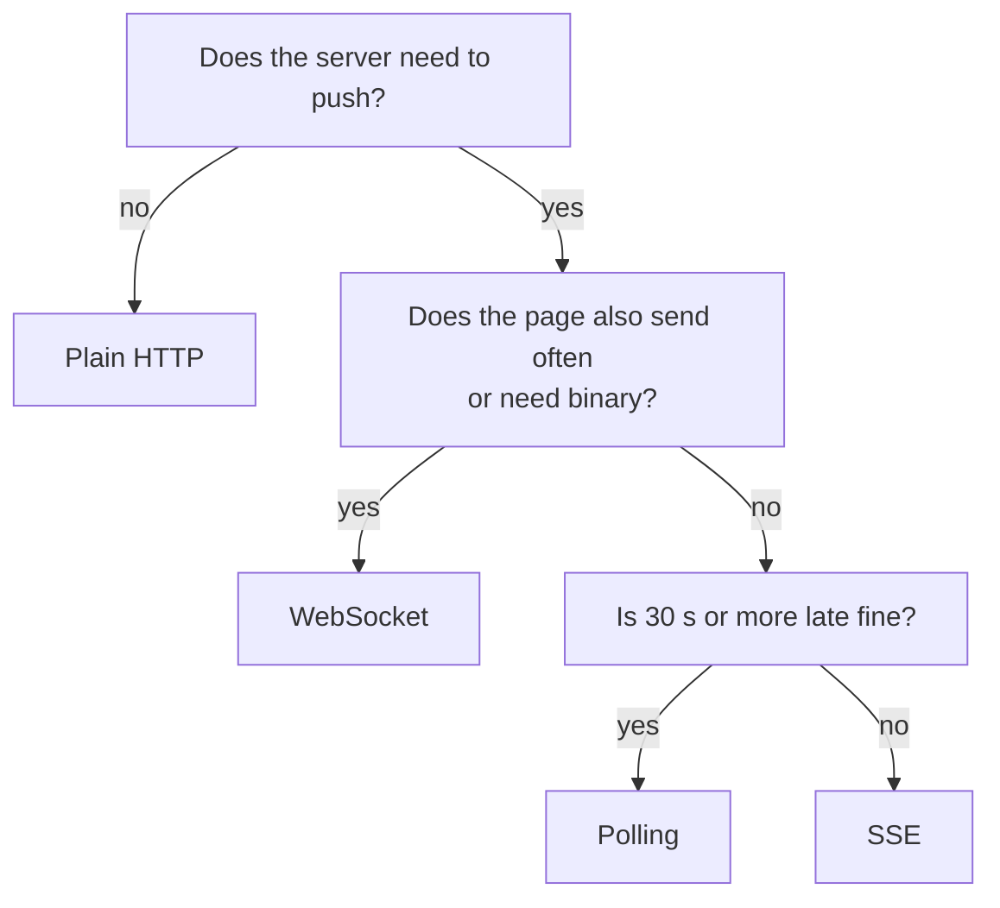
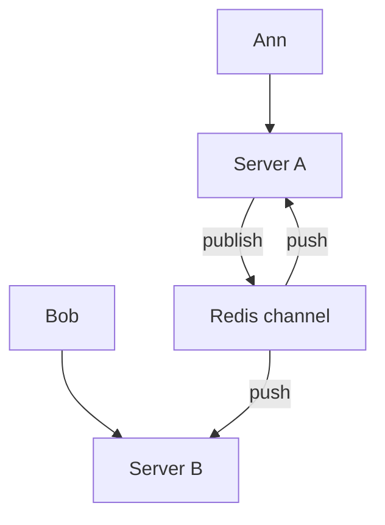
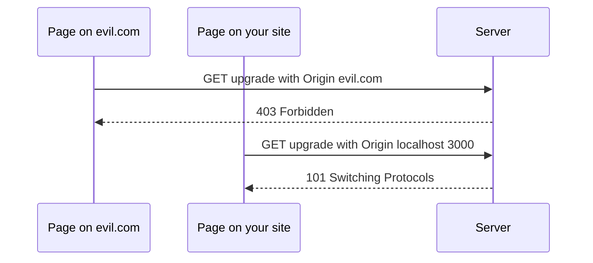
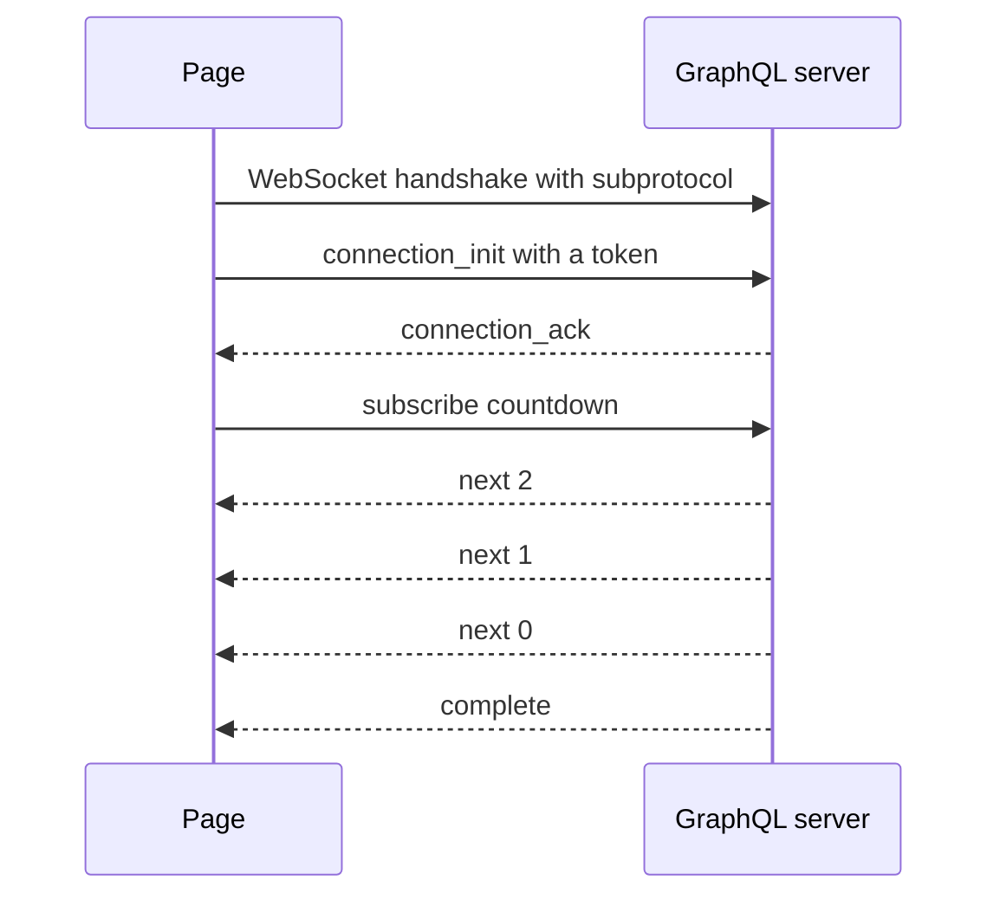

# 07. WebSockets and server sent events

> **Subject:** Networking · **Lesson:** 07 · **Made:** 2026-11-21 · **Status:** ready
>
> **You will be able to:** say why plain HTTP cannot push, tell polling, long polling, Server-Sent Events and WebSockets apart, read an event stream and a WebSocket frame byte by byte, follow the 101 handshake, say what reconnects by itself and what does not, pick the right tool for an app, explain why many servers need pub/sub, say why a WebSocket server must check Origin, and describe how GraphQL subscriptions travel.
>
> **Before this:** [Cookies, CORS and same origin](06-cookies-cors-and-same-origin.md) · **Also read:** [WebSockets and Server-Sent Events (the API side, with code)](../backend-api/17-websockets-and-server-sent-events.md). This lesson looks at the wire: the bytes, the handshake, proxies and Origin. · **Next:** How the browser renders a page (planned)
>
> **How to read it:** one card is one idea. Look at the picture, guess, then press the orange bar to check. The blue bars (📖 More detail) hold the longer explanation. Skip them on the first read. **What I ran for real (2026-11-21):** Node v26.5.0 with the `ws` package 8.23.0 and `graphql-ws` 6.4.3, curl, and Google Chrome 157 in headless mode. I read the server logs to see what really arrived. **What I did not run:** Redis, nginx, an AWS load balancer, Hasura, Firefox and Safari (from the docs, not run here). Facts and links were checked on 2026-11-21. About 25 minutes for the cards.

## 1. The problem: the server cannot speak first

You ask a friend a question and they answer. That is HTTP. The page **asks**, the server **answers**, and the talk is over. Now a new chat message arrives on the server. The server has no open question to answer. It has no way to tap the page on the shoulder.



Notice: the new message exists, but nothing can carry it to the page.

<details class="guess"><summary>🤔 Guess: can a Node server call a function in your page when it has news? Press to check.</summary>

**No.** The server can only answer a request that the page already sent. To get news to the page, the page must ask, or the answer must stay open. The next cards show three ways.

</details>

> **Remember:** in plain HTTP the page asks first. A server cannot start the talk.

<details class="more"><summary>📖 More detail: the four new words, and where this shows up</summary>

**Four new words in this lesson:** **SSE** (card 3), **WebSocket** (card 4), **handshake** (card 4) and **pub/sub** (card 6). Polling and frame are explained where they appear.

**Where you meet this.** Chat, a live price board, an order status screen, a progress bar for a long job, a shared document, and notifications.

**Why not just call the page?** The page is behind the user's router and has no public address. Only the browser can start a connection out. So every method here starts with the page connecting to the server.

**How this fits the other lessons.** [TCP vs UDP](03-tcp-vs-udp.md) gave the connection. [HTTP/1.1, 2 and 3](05-http-1-1-vs-http-2-vs-http-3.md) gave the request and answer shape. This lesson keeps one connection open for a long time.

</details>

## 2. Polling and long polling: ask again, or wait with the question

First fix: **polling**. The page asks again and again on a timer ("anything new?"). Most answers are "no". News arrives late, up to one timer. Second fix: **long polling**. The page asks once and the server **keeps the question open** until it has news. Then the page asks again at once.



Notice: polling saw the message at 2.0 s. Long polling saw it at 1.3 s.

<details class="guess"><summary>🤔 Guess: a page polls every second for 6 seconds. How many requests does it send, and what does long polling need for the same time? Press to check.</summary>

**Polling: 6 requests. Long polling: 4** in my run, with two messages. Polling saw each message about 0.8 s late. Long polling saw them on time. Both are still question and answer.

</details>

> **Remember:** polling asks on a timer and is late. Long polling holds the question open and is on time. Both send a new request each round.

<details class="more"><summary>📖 More detail: my real run, and when polling is still the right tool</summary>

**What I ran** (Node v26.5.0, a message at 1.3 s and another at 4.1 s, run for 6 s):

```
LONG POLL   saw version 1 at 1.3s
POLLING     saw version 1 at 2.1s
LONG POLL   saw version 2 at 4.1s
POLLING     saw version 2 at 5.1s
requests in 6s: polling = 6  long polling = 4
```

The long poll server held each request for at most 2.5 s, and then answered "nothing new" so the connection never looks dead. That is why long polling used 4 requests, not 2.

**Costs.** Each request sends all the headers again (and cookies). The server must keep a parked request for every user. A message that arrives between two long polls can be lost unless the page sends "what I saw last" (the `seen` number in my code).

**When polling is fine.** A page where "a minute late" is okay, for example a nightly report status. It works with any proxy and any old browser, and it is easy to cache and to test. The practice function `chooseTransport` returns `"polling"` when a late update is fine (30 seconds or more).

**The trace** (stepper, tab 1): polling asks three times, the message appears and nobody can send it, then a long poll answers on time.

</details>

## 3. Server-Sent Events (SSE): one answer that never ends

**Server-Sent Events** (SSE) is the browser's built in tool for one way news. The page runs `new EventSource("/events")`. The server answers with `Content-Type: text/event-stream` and **does not finish the answer**. When it has news it writes one more block of text. A blank line ends each block. If the connection breaks, the **browser reconnects by itself**.



Notice: the page does not ask for each message. It asks once, and again only after a drop.

<details class="guess"><summary>🤔 Guess: the connection drops after event 2. What does the page code have to do to get event 3? Press to check.</summary>

**Nothing.** The browser reconnects and sends `Last-Event-ID: 2` by itself. But your **server** must read that header and send what was missed. The browser cannot invent messages the server forgot.

</details>

> **Remember:** SSE is one way, text only, and the browser reconnects and sends `Last-Event-ID` for you. The server keeps the history.

<details class="more"><summary>📖 More detail: the format, real output, limits and the code</summary>

**The format** ([MDN](https://developer.mozilla.org/en-US/docs/Web/API/Server-sent_events/Using_server-sent_events)). UTF-8 text. Fields are `data`, `id`, `event` and `retry`. Several `data:` lines are joined with a line break. A line starting with `:` is a comment, and a comment every 15 seconds or so keeps old proxies from dropping the connection ([HTML spec](https://html.spec.whatwg.org/multipage/server-sent-events.html)). The practice functions `parseSse` and `formatSse` do this.

**A real server, 10 lines** (run on Node v26.5.0). Each new connection starts counting after `Last-Event-ID`:

```js
const http = require("http");
http.createServer((req, res) => {
  const last = req.headers["last-event-id"] || "0";
  res.writeHead(200, { "Content-Type": "text/event-stream" });
  let n = Number(last);
  const timer = setInterval(() => res.write(`id: ${++n}\ndata: tick ${n}\n\n`), 200);
  req.on("close", () => clearInterval(timer));
}).listen(4801);
```

curl pretending to be a browser that saw event 7 (`curl -N -H "Last-Event-ID: 7" http://localhost:4801/`):

```
id: 8
data: tick 8

id: 9
data: tick 9

id: 10
data: tick 10
```

**Reconnect behavior** (Node v26.5.0's own `EventSource`, not a browser. It still needs `--experimental-eventsource`). The server ended the stream after event 3, with a first connection that had no `Last-Event-ID`. The client printed `error, readyState 0 (connecting)`, then `open`, then ticks 4 to 9. The server log showed the second request with `Last-Event-ID=3`. The stream also began with `retry: 500`.

**Limits** (from [MDN](https://developer.mozilla.org/en-US/docs/Web/API/Server-sent_events/Using_server-sent_events)).
- Over HTTP/1.1 a browser allows only **6** connections per site, shared by all tabs. HTTP/2 allows about 100 streams by default.
- Text only. For binary data use a WebSocket.
- A response with status 204 tells the browser to stop reconnecting. A wrong status or content type also fails the connection for good ([HTML spec](https://html.spec.whatwg.org/multipage/server-sent-events.html)).
- Cross-origin `EventSource` follows **CORS** (card 7). In Chrome 157, without an `Access-Control-Allow-Origin` header the stream failed with `readyState 2`. With the header it worked. It does not send cookies unless you pass `withCredentials: true`.

**The trace** (stepper, tab 2): the stream opens, events 1 to 3 arrive, the connection drops, events 4 and 5 are made while offline, the browser reconnects with `Last-Event-ID: 3`, and the server replays what was missed. The model code is `formatSse`, `parseSse` and `missedEvents`.

</details>

## 4. WebSocket: one connection, both ways

A **WebSocket** is a two way pipe between the page and the server. It begins as a normal HTTP request that asks "can we switch?" This first step is the **handshake**. The server says `101 Switching Protocols`. After that the same connection carries small packets called **frames**, either way, at any time.



Notice: the third frame comes from the server **without a request**. That is the new power.

<details class="guess"><summary>🤔 Guess: the WebSocket connection drops. Does the browser reconnect, like EventSource does? Press to check.</summary>

**No.** You get `onclose` and the socket stays closed. You write the retry, and you wait longer each time. Nothing is saved for you either. After you reconnect you must ask what you missed.

</details>

> **Remember:** a WebSocket starts as HTTP, switches with a 101, then sends frames both ways. It does not reconnect for you.

<details class="more"><summary>📖 More detail: the step by step trace with real bytes, the code, and what to remember</summary>

**The trace** (a real run with the `ws` package and a hand written client, 2026-11-21; stepper tab 3):

| Step | What happens | State after |
|---|---|---|
| 1 | Page runs `new WebSocket(url)`. The browser sends `GET /chat` with `Upgrade: websocket`, `Connection: Upgrade`, `Sec-WebSocket-Key: dGhlIHNhbXBsZSBub25jZQ==`, `Sec-WebSocket-Version: 13` and `Origin` | `readyState` 0 |
| 2 | Server adds the fixed text `258EAFA5-E914-47DA-95CA-C5AB0DC85B11` to the key, runs SHA-1, writes base64 | accept is `s3pPLMBiTxaQ9kYGzzhZRbK+xOo=` |
| 3 | Server answers `101 Switching Protocols` with that accept value. My run gave the same text. It proves the server speaks WebSocket. It is **not** a password | `readyState` 1, no more HTTP |
| 4 | Page runs `ws.send("hi")`. Bytes on the wire: `81 82 01 02 03 04 69 6b` | server holds the bytes |
| 5 | Server reads `81` (end of message, type text), `82` (masked, length 2), the mask `01 02 03 04`, then XORs `69 6b` with the mask to get `68 69` = "hi" | server has "hi" |
| 6 | Server sends `echo: hi`. Bytes: `81 08 65 63 68 6f 3a 20 68 69`. **No mask** | page `onmessage` fires |
| 7 | A ping `89 01 70` gets the pong `8a 01 70` with the same payload | still open |
| 8 | The connection breaks. Page gets `onclose` with code 1006. | `readyState` 3. **You** reconnect |

**The code** (Node v26.5.0 has a global `WebSocket` client; the server uses the `ws` package):

```js
const { WebSocketServer } = require("ws");
const wss = new WebSocketServer({ port: 4800 });
wss.on("connection", (socket) => {
  socket.on("message", (text) => socket.send("echo: " + text));
});
const ws = new WebSocket("ws://localhost:4800");
ws.onopen = () => ws.send("hi");
ws.onmessage = (e) => { console.log(e.data); ws.close(); };
```

Output: `echo: hi`

**The frame, in one table** ([MDN](https://developer.mozilla.org/en-US/docs/Web/API/WebSockets_API/Writing_WebSocket_servers)):

| Part | Meaning |
|---|---|
| first byte | `0x80` = last piece of a message, plus a type: `1` text, `2` binary, `8` close, `9` ping, `10` pong |
| second byte | `0x80` = masked, plus the length. A length of 126 means two more length bytes follow |
| mask, 4 bytes | only from the browser. Each payload byte is XOR with the mask |
| payload | your message |

Masking is not a secret. RFC 6455 says the key must be unpredictable, so that a bad page cannot choose the exact bytes on the wire. It applies even over `wss://`. The practice functions `encodeFrame` and `decodeFrame` write and read these bytes. I compared my unmasked `encodeFrame` with the frames made by the `ws` package for 6 messages (text, binary, ping, pong, 200 bytes and 65,535 bytes), and the bytes were equal. The masked bytes match my captured client frame and the MDN example.

**More facts.**
- `ws://` is plain and `wss://` runs inside TLS (lesson 04). Use `wss://` on a real site.
- MDN says the browser `WebSocket` has **no backpressure**: if messages come faster than your code can handle, memory or the CPU can run out. `WebTransport` is named as the newer way to fix this.
- A WebSocket on a page can stop the browser's back and forward cache. Close it when the user leaves.
- Subprotocols: the page can ask for a named one, `new WebSocket(url, ["graphql-transport-ws"])`. The server picks one (card 8).
- **Heartbeat:** the `ws` README shows a server that pings every 30 seconds and terminates a client that did not answer the last ping.

</details>

## 5. Which one should I use?

Start from what the app needs. Many apps need **none** of these: a normal request is enough. If the server must push, ask who talks. If only the server talks, SSE is the simplest. If both sides talk a lot, or you send binary data, use a WebSocket. If a late update is fine, polling is the easiest of all.



Notice: WebSocket is not the default. It is for two way or binary.

<details class="guess"><summary>🤔 Guess: a page shows live prices and never sends anything back. Which one? Press to check.</summary>

**SSE.** One way news, a built in reconnect, and plain HTTP that every proxy understands. A WebSocket would also work, but you would write the reconnect and the heartbeat yourself.

</details>

> **Remember:** plain HTTP first. SSE for one way feeds. WebSocket for two way or binary. Polling when late is fine.

<details class="more"><summary>📖 More detail: side by side, and what the practice rule leaves out</summary>

| | Polling | Long polling | SSE | WebSocket |
|---|---|---|---|---|
| Who talks | page asks | page asks | server only | both |
| Connection | new each time | new each round | one, open | one, open |
| Start | normal GET | normal GET | normal GET | GET then 101 |
| Reconnect | not needed | next ask | **browser does it** | **you write it** |
| Replay what was missed | you | you | **`Last-Event-ID`** (server keeps history) | you |
| Data | any | any | text | text or binary |
| Cross-origin rule | CORS | CORS | CORS | **Origin check by the server** |
| Browser limit | normal | normal | 6 per site on HTTP/1.1 | not the SSE limit |
| Proxies | fine | fine | fine, needs no buffering | need the Upgrade headers (card 6) |

**The practice function `chooseTransport` is a simple rule for learning.** It sends "the client sends often" to WebSocket. Real teams often use **SSE plus normal POST requests**. That works for many chats. Choose a WebSocket when you need very low delay both ways, binary data, or many small messages up.

**Do not forget the ordinary tools.** If the user refreshes the page and loads the data again, you may need no push at all. And a message that must never be lost needs a database or a queue under the push (card 6).

**The trace** (stepper, tab 5, last step): `chooseTransport` on four apps.

</details>

## 6. Many servers, and proxies that close quiet connections

Your app grows to three servers behind a load balancer. A WebSocket lives in the memory of **one** server. Ann is on server A, Bob on server B. Ann writes a chat message. Server A knows only its own sockets, so Bob never sees it. The fix is **pub/sub** (publish and subscribe): every server subscribes to a shared channel, for example in Redis. A server publishes the message once, and each server hands it to its own sockets.



Notice: the message goes up to Redis and comes back to **every** server.

<details class="guess"><summary>🤔 Guess: nothing shared, Ann (server A) writes. Who gets it? And a line goes quiet for 60 seconds. What may happen? Press to check.</summary>

**Only people on server A get the message** (in my two server run, only Ann's side). And a **proxy or load balancer may close the quiet connection**: nginx and an AWS Application Load Balancer both default to 60 seconds. Send a ping every 30 seconds, or an SSE comment every 15.

</details>

> **Remember:** a socket lives on one server, so servers share messages through pub/sub. Send pings, because proxies close quiet connections.

<details class="more"><summary>📖 More detail: my two server run, timeouts, sticky sessions, and the mistakes table</summary>

**What I ran** (two `ws` servers in one Node process). A plain `EventEmitter` stood in for Redis, because Redis was not installed here:

```
NO shared bus:
  Ann(on A) got [A: hi]
WITH shared bus:
  Ann(on A) got [A: hi]
  Bob(on B) got [A: hi]
```

The practice function `deliver(connections, sender, usePubSub)` does the same sums.

**Redis pub/sub** ([docs](https://redis.io/docs/latest/develop/pubsub/), not run here): `SUBSCRIBE` and `PUBLISH`. Delivery is **at most once**. If a subscriber is not connected at that moment, the message is lost for good. For messages that must not be lost, the docs point to Redis Streams (see [Streams vs queues](../system-design/21-streams-vs-queues.md)). Socket.IO's docs call this job an **adapter**, and list Redis among several.

**Timeouts** (from the docs, not run here).
- nginx: the connection closes after **60 seconds** with no data from the server, and you raise `proxy_read_timeout` or have the server send ping frames. It also needs `proxy_set_header Upgrade $http_upgrade;` and `proxy_set_header Connection "upgrade";`, because `Upgrade` is not passed on by default ([nginx docs](https://nginx.org/en/docs/http/websocket.html)). See [Reverse proxy and Nginx](../devops-cloud/08-reverse-proxy-and-nginx.md).
- AWS Application Load Balancer: the idle timeout is **60 seconds** by default and can be 1 to 4000 ([AWS docs](https://docs.aws.amazon.com/elasticloadbalancing/latest/application/edit-load-balancer-attributes.html)). The same page says to set your app's idle timeout higher than the load balancer's. See [Load balancers](../system-design/03-load-balancers.md).

**Sticky sessions** send one user to the same server each time. A pure WebSocket does not need them after the handshake. Socket.IO's docs say they are needed when long polling is used, because each request is new. The same is true of your own long polling.

**Common mistakes:**

| Mistake | What you see | Fix |
|---|---|---|
| No ping | connections vanish after about 60 s of quiet | ping every 30 s |
| Messages only on one server | some users miss messages | pub/sub between servers |
| Redis pub/sub as the only copy | offline servers lose messages | store in a database or a stream too |
| Retry at once, forever | a restart gets a flood of reconnects | wait 1 s, 2 s, 4 s ... to a limit, with a random part (`backoffDelay` has the doubling part) |
| Nginx without the Upgrade headers | the handshake fails | add the two `proxy_set_header` lines |
| Only 6 SSE tabs on HTTP/1.1 | the 7th tab hangs | use HTTP/2 |

**The trace** (stepper, tab 4): four people on three servers, no shared bus, then pub/sub, then the idle timeout and sticky sessions.

</details>

## 7. Who may connect? Origin, cookies and tokens

A WebSocket has **no CORS**. A page on any site can open a WebSocket to your server. The browser sends an `Origin` header and still lets it through. If your server does not check, a page on `evil.com` can connect while the visitor is logged in. This attack is called cross-site WebSocket hijacking. The fix is on the server: look at `Origin` in the handshake and answer `403`.



Notice: the check happens before the upgrade, in the first HTTP request.

<details class="guess"><summary>🤔 Guess: a script run by an attacker, not a browser, connects to your server. Does the Origin check stop it? Press to check.</summary>

**No.** A script can send any `Origin`, or none. The check only stops other websites from using a visitor's browser. You must still check **who the user is**: a session cookie, or a token.

</details>

> **Remember:** WebSockets skip CORS, so the server checks Origin. Origin is not a login: also check the user.

<details class="more"><summary>📖 More detail: real results, how to log in, and the code</summary>

**What I saw in Chrome 157** (a page on `http://localhost:3000`, an API on `localhost:4300`, 2026-11-21):

| Test | Result |
|---|---|
| WebSocket, server with **no** Origin check | connected. The server log showed `Origin=http://localhost:3000` and the cookie `sid=abc123` |
| WebSocket from a page on `127.0.0.1:3001`, server **with** the check | server answered 403. The page saw `onerror`, then close code **1006** |
| `EventSource` to the same API, **without** CORS headers | failed (`readyState 2`) |
| `EventSource`, **with** `Access-Control-Allow-Origin` | worked |

So the same page could open a WebSocket across origins but not an `EventSource`. That is the difference between "no CORS" and "CORS".

**The check, 12 lines** (run with Node v26.5.0 and `ws` 8.23.0 and a real handshake):

```js
const http = require("http");
const { WebSocketServer } = require("ws");
const allowed = ["http://localhost:3000"];
const wss = new WebSocketServer({ noServer: true });
const server = http.createServer();
server.on("upgrade", (req, socket, head) => {
  const origin = req.headers.origin;
  if (origin && !allowed.includes(origin)) {
    socket.write("HTTP/1.1 403 Forbidden\r\n\r\n");
    return socket.destroy();
  }
  wss.handleUpgrade(req, socket, head, (ws) => ws.send("welcome"));
});
```

Output for the two origins: `http://localhost:3000 -> HTTP/1.1 101 Switching Protocols` and `http://evil.com -> HTTP/1.1 403 Forbidden`. The practice function `handshake(request, { allowedOrigins })` is this same check.

**How does the server know the user?** The `WebSocket` constructor takes only a URL and subprotocols, so a page cannot add an `Authorization` header.
- **Cookie.** The browser adds it to the handshake. My run showed it arriving. SameSite rules from [lesson 06](06-cookies-cors-and-same-origin.md) still apply, and CSRF-like attacks are why the Origin check matters.
- **Token in the URL.** It works, but URLs end up in logs. Use a token that lives a few seconds.
- **Token in the first message.** GraphQL does this (card 8). The server closes the socket if it is wrong.

Look up the user **before** you do anything for them, and check again when the token expires. MDN's server guide adds that non-browser clients can fake `Origin`, which is why it is not a full login ([MDN](https://developer.mozilla.org/en-US/docs/Web/API/WebSockets_API/Writing_WebSocket_servers)).

**The trace** (stepper, tab 5): the handshake from your page, from `evil.com` and from curl, then the three ways to log in.

</details>

## 8. GraphQL subscriptions: your stack uses a WebSocket

In GraphQL a **subscription** is a query that **keeps running**. The server pushes a new result each time the data changes. Most servers carry it over a WebSocket, with a small message protocol on top. The usual one is `graphql-transport-ws`, from the `graphql-ws` library. Hasura uses WebSockets for its subscriptions.



Notice: the token travels in the first message, not in a header.

<details class="guess"><summary>🤔 Guess: the client sends `subscribe` before it got `connection_ack`. What does the server do? Press to check.</summary>

**It closes the socket** with code `4401 Unauthorized`, from the protocol text. The server must accept the login first. In my run I waited for the ack, as the protocol asks.

</details>

> **Remember:** a GraphQL subscription is a long running query over a WebSocket. Log in with `connection_init`, then `subscribe`, then `next` messages until `complete`.

<details class="more"><summary>📖 More detail: my real run, Hasura, and the trade with SSE</summary>

**What I ran** (`graphql-ws` 6.4.3 with `ws` 8.23.0 and `graphql`; a subscription `countdown(from: 2)`):

```
RAW  protocol: graphql-transport-ws
SERVER connection_init payload: {"token":"abc"}
RAW  server says: {"type":"connection_ack"}
RAW  server says: {"id":"1","type":"next","payload":{"data":{"countdown":2}}}
RAW  server says: {"id":"1","type":"next","payload":{"data":{"countdown":1}}}
RAW  server says: {"id":"1","type":"next","payload":{"data":{"countdown":0}}}
RAW  server says: {"id":"1","type":"complete"}
```

Then the `graphql-ws` client printed `next` twice and `complete` for a `from: 1` countdown.

**The protocol** ([graphql-ws PROTOCOL.md](https://github.com/enisdenjo/graphql-ws/blob/master/PROTOCOL.md)): `connection_init` (with an optional payload, often the token), `connection_ack`, `subscribe`, `next`, `complete` and `ping`/`pong`. A second `connection_init` closes with 4429. If `connection_init` does not come in time the server closes with 4408. I did not run those two cases. The old protocol, `subscriptions-transport-ws`, is a different one, so a client and a server must use the same.

**Hasura** ([docs](https://hasura.io/docs/2.0/subscriptions/postgres/livequery/execution/), not run here). Live queries run over the WebSocket. Hasura **re-runs the query on a timer**: the docs give a default refetch interval of **1 second**, and it merges similar subscriptions into one SQL query, sends results only when they changed. So the push you see is polling inside the server, with the database as the source. See [Hasura: when and when not](../backend-api/14-hasura-when-and-when-not.md).

**SSE is also possible.** A subscription needs only one way push, so the SSE tools are an option (a library called `graphql-sse` exists, which I did not open or run). The usual reasons people still choose WebSockets are the ready libraries and the ping and ack in the protocol.

**What to ask on a real project:** where does the token go (`connection_init`), who checks it, what happens when it expires, how many servers run (card 6), and what the load balancer timeout is (card 6). See [GraphQL basics](../backend-api/04-graphql-basics.md) for the subscription idea.

</details>

## 9. Watch and play

Links were checked on 2026-11-21: I opened each page, and for the videos I read the title and channel from YouTube oEmbed data. I did not watch the videos. The length of a video comes from a mirror page, not from YouTube. If a link is broken, tell me and I will replace it.

- **Play with it:** [the stepper in this folder](visuals/07-websockets-and-server-sent-events.html) - guess first, then press Next. Five tabs: polling, SSE, WebSocket, many servers, and Origin with the choice.
- **Try it yourself:** [echo.websocket.org/.ws](https://echo.websocket.org/.ws) - a page with a console where you can connect to an echo server. Open DevTools, Network tab, filter **WS**, and click the connection to see the frames. I loaded the page but did not click through it.
- **Video:** [WebSockets in 100 Seconds & Beyond with Socket.io](https://www.youtube.com/watch?v=1BfCnjr_Vjg) - Fireship. Title and channel checked. A mirror lists it at about 8.5 minutes. Card 4 in short.
- **Video:** [Server-Sent Events Crash Course](https://www.youtube.com/watch?v=4HlNv1qpZFY) - Hussein Nasser. Title and channel checked. A mirror lists it at about 30 minutes, so it is long. Card 3 and the comparison with WebSockets.
- **Video:** [WebSockets Crash Course - Handshake, Use-cases, Pros & Cons and more](https://www.youtube.com/watch?v=2Nt-ZrNP22A) - Hussein Nasser. Title and channel checked only. The handshake and the load balancing problems from cards 4 and 6.
- **Read:** [MDN: Writing WebSocket servers](https://developer.mozilla.org/en-US/docs/Web/API/WebSockets_API/Writing_WebSocket_servers) - the handshake, the frame table and ping and pong, with a worked example of the key and the mask.
- **Read:** [MDN: Using server-sent events](https://developer.mozilla.org/en-US/docs/Web/API/Server-sent_events/Using_server-sent_events) - the stream format and the limits.

<details><summary>Go deeper (optional)</summary>

**More pages I opened.** [RFC 6455, the WebSocket protocol](https://www.rfc-editor.org/rfc/rfc6455) (I read only the first part of the page). [HTML spec: server-sent events](https://html.spec.whatwg.org/multipage/server-sent-events.html). [MDN: WebSockets API](https://developer.mozilla.org/en-US/docs/Web/API/WebSockets_API). [web.dev: Stream updates with server-sent events](https://web.dev/articles/eventsource-basics) (loaded, not read in full). [roadmap.sh: How Real-Time Updates Work](https://roadmap.sh/videos/how-real-time-updates-work) (the page loaded, but I could not confirm a playable video on it). [nginx: WebSocket proxying](https://nginx.org/en/docs/http/websocket.html). [AWS: ALB attributes](https://docs.aws.amazon.com/elasticloadbalancing/latest/application/edit-load-balancer-attributes.html). [Redis pub/sub](https://redis.io/docs/latest/develop/pubsub/). [Socket.IO: using multiple nodes](https://socket.io/docs/v4/using-multiple-nodes/). [the `ws` package](https://github.com/websockets/ws). [graphql-ws](https://the-guild.dev/graphql/ws). [Hasura: live query execution](https://hasura.io/docs/2.0/subscriptions/postgres/livequery/execution/). [Hussein Nasser: Load balancing WebSockets Streams efficeintly](https://www.youtube.com/watch?v=ugAZsDdmwJQ) (title and channel checked only).

**Checked on 2026-11-21** with Node v26.5.0, `ws` 8.23.0, `graphql-ws` 6.4.3, curl and Google Chrome 157.0.8103.79 (headless, driven through the DevTools protocol). The practice code has 94 tests. On the empty stub 89 fail (the other 5 only check that your function does not change its inputs). I made 58 wrong versions of the answer (for example data lines joined with no line break, a missing space rule, `Last-Event-ID` compared as a number, the key and the fixed text added the other way round, a mask that always uses the first byte, a length that drops the second byte). The tests caught 54 of them. 4 were left standing and none of them changes the result (two were no-op edits, one removes a line that the next line makes unnecessary, one removes a length check that a later check repeats). The stepper runs the same rules, written for the browser, and I checked its accept key, its frame bytes and its event stream results against the Node answer and the `ws` package.

**What I did not test.** Redis (a plain `EventEmitter` stood in), nginx and the AWS load balancer timeouts, Hasura and `graphql-sse`, Firefox and Safari, a real browser `EventSource` reconnect (I ran Node's own `EventSource`, and in Chrome only the CORS case), WebSocket close codes other than 1005 and 1006, `WebTransport`, `permessage-deflate` compression, and a WebSocket over HTTP/2 or HTTP/3 (there is a separate standard for it that I did not read).

**Where the model is simpler than the real thing.**
- `handshake` accepts only version 13 and answers 426 for the rest, as the RFC says. The real `ws` package also accepts version 8 and answers 400 for others (I tried 7).
- The model lets a request with no `Origin` header through, as most servers do. A strict server can refuse it.
- `parseSse` leaves out a leading byte order mark, and it ignores an `id` that has a null character. `retry` and `id` rules follow the spec text I read, but I did not test every edge.
- `encodeFrame` and `decodeFrame` stop at 65,535 bytes, do not join pieces of a long message and do not handle extensions.
- `deliver` has no rooms, no ordering and no lost messages.

**Not covered here.** Socket.IO (it has its own protocol on top of WebSockets), `permessage-deflate`, close codes, WebSocket over HTTP/2, WebTransport, long lived connections and file descriptors on a server, load testing, and cleaning up a socket that did not close.

</details>

## 10. Practice

**A. Predict the output** (write your answer before opening)

```js
console.log(parseSse("id: 1\ndata: a\ndata: b\n\ndata: c\n\ndata: d"));
console.log(missedEvents([{ id: 1 }, { id: 2 }, { id: 3 }], "1"));
console.log(missedEvents([{ id: 1 }, { id: 2 }], "9"));
console.log(handshake({ method: "GET", headers: { Upgrade: "websocket", Connection: "Upgrade", "Sec-WebSocket-Key": "k", "Sec-WebSocket-Version": "13", Origin: "http://evil.com" } }, { allowedOrigins: ["http://localhost:3000"] }));
console.log(encodeFrame({ opcode: 1, payload: "hi" }));
console.log(backoffDelay(3), backoffDelay(9));
```

Then answer: why is the second event's `id` still `"1"`, and why does the third line print `null`?

<details><summary>Answer</summary>

```
{
  events: [
    { event: 'message', data: 'a\nb', id: '1' },
    { event: 'message', data: 'c', id: '1' }
  ],
  retry: null
}
[ { id: 2 }, { id: 3 } ]
null
{ status: 403, reason: 'origin not allowed', headers: {} }
<Buffer 81 02 68 69>
8000 30000
```

The `id` stays set until another `id` line comes, so `c` carries `1`. The last text `data: d` has no blank line after it, so it is not a finished event and makes nothing. Line 3 is `null` because id 9 is not in the history: it is too old, so the server must tell the page to start again. Line 4: the origin is not in the list, so the answer is 403 before any upgrade. Line 5: `81` is text plus end of message, `02` is length 2 with no mask, `68 69` is "hi". Line 6: 1000 x 2 x 2 x 2 = 8000, and 30000 is the cap. (Run on 2026-11-21 with Node v26.5.0.)

</details>

**B. Fix the bug**

Users on your chat sometimes miss messages, and only when the app runs on two servers. The code is:

```js
wss.on("connection", (socket) => {
  socket.on("message", (text) => {
    wss.clients.forEach((c) => c.send(String(text)));
  });
});
```

Find the bug and say what you would add. Then say what else you would add so users stay connected behind a load balancer.

<details><summary>Answer</summary>

`wss.clients` holds only the sockets of **this** server. Users on the other server never get the message (my two server run showed this). **Fix:** publish the message to a shared channel (for example Redis pub/sub), and have every server subscribe and send to its own `wss.clients`. For the load balancer, send a ping about every 30 seconds so the 60 second idle timeout does not close quiet connections, and make sure the proxy passes the `Upgrade` and `Connection` headers. If a message must never be lost, also store it in a database, because Redis pub/sub does not keep messages.

</details>

**C. Write it yourself**

Open `learn/networking/practice/07-websockets-and-server-sent-events.js`. It has ten empty pieces: `parseSse`, `formatSse`, `missedEvents`, `acceptKey`, `handshake`, `encodeFrame`, `decodeFrame`, `backoffDelay`, `chooseTransport` and `deliver`. The comments at the top say exactly what each must do. Write them, then run this from the repo root and make all the tests pass:

```
node --test learn/networking/practice/07-websockets-and-server-sent-events.test.js
```

Start with `acceptKey` (one line), then `parseSse`. `encodeFrame` and `decodeFrame` are the ones to think about: draw the bytes first.

<details><summary>One possible answer</summary>

The full answer is about 130 lines. The idea in each piece:

- `parseSse`: split into lines, keep a list of `data` lines, the name and the last id. A blank line makes an event only if there is data. Drop a comment. Drop one space after the colon.
- `formatSse`: write `id`, `event`, `retry`, then one `data:` line for each line of data, and one more blank line.
- `missedEvents`: nothing for a new visitor, `null` if the id is not in the history, else the items after it.
- `acceptKey`: `crypto.createHash("sha1").update(key + WS_GUID).digest("base64")`.
- `handshake`: check in order: method, upgrade headers, key, version, origin. Then 101 and the accept key.
- `encodeFrame`: first byte is `0x80 + opcode`. The length goes in the second byte, or two more bytes from 126. XOR the payload with the mask when there is one.
- `decodeFrame`: the same in reverse. Return `null` when the buffer is too short, and `size` so you can find the next frame.
- `backoffDelay`: `Math.min(max, base * 2 ** attempt)`.
- `chooseTransport`: four checks in order. `deliver`: filter by server, unless pub/sub is on.

The finished version is checked: 89 of the 94 tests fail on the empty stub (the other 5 only check that your function does not change its inputs), and all 94 pass with my answer. The stepper page has the same rules written for the browser, so you can open its source to see them.

</details>

## 11. Interview question

**Q:** "You need live updates in a web app, for example an order status or a chat. How do you pick between polling, SSE and WebSockets, and what changes when you run several servers?"

A common follow-up: "Why does a WebSocket need an Origin check, and what happens when the connection drops?" Cards 4 and 7 are the answer.

<details><summary>A strong answer, in four parts</summary>

1. **Problem:** Plain HTTP is question and answer, so a server cannot send news by itself. I need a way to keep a channel open, or to ask often.
2. **How it works:** Polling asks on a timer: simple, but late and wasteful. Long polling parks the request until there is news. SSE is one long HTTP answer of text: one way, and the browser reconnects and sends `Last-Event-ID` by itself, so my server must keep a short history. A WebSocket switches the connection with a 101 handshake and then sends frames both ways. It does not reconnect, so I write a retry with a growing wait, and I send pings because proxies close quiet connections (nginx and the AWS load balancer default to 60 seconds). A WebSocket has no CORS, so my server checks `Origin` in the handshake and also checks the user. With several servers, a socket lives on one server, so I share messages with pub/sub such as Redis. Redis pub/sub does not keep messages, so important ones also go to a database.
3. **Tradeoff:** SSE is simplest and works with plain HTTP, but it is one way and text only. A WebSocket is more flexible (two way, binary, low delay) but I own the reconnect, the heartbeat, the Origin and login checks and the scaling. Polling costs more requests but is the easiest to run and cache. For an order status I would start with SSE, or polling if a short delay is fine.
4. **My example:**
   - **Fact:** my profile lists GraphQL, Hasura, Express, React, React Native and authentication, and the CMS plus mobile app shape of DBO.
   - **Fact (from this lesson):** I ran a `ws` server, an SSE server, a two server chat and a `graphql-ws` subscription here, and saw that a chat on two servers without a shared channel reaches only one side, and that a page on another origin could open a WebSocket until the server checked `Origin`.
   - **Idea, not a fact:** I do not know if DBO, Unloan or ZWS used a WebSocket, SSE or Hasura subscriptions, so I should not claim it. A good next step is to look at how order or loan status reaches the screen in one of my apps, and say which of the four tools it is.

</details>

## 12. Explain it back

Close this file. Explain how a server can send news to a web page, out loud like to a new junior, in 4 parts (problem, how, tradeoff, my example). Use the story of the chat that works on one server and loses messages on two. Say why plain HTTP cannot push, what polling, SSE and a WebSocket each do, what the 101 handshake is, what reconnects by itself and what does not, why a WebSocket server checks Origin, and why many servers need pub/sub. Write your best version below and run `/explain-check websockets` or ask the `explain-coach` agent to review it.

### My explanation

<write here>

### Coach feedback

<the explain-coach agent writes here>

## 13. Review questions (day 1, 3, 7, 21)

1. Why can a normal HTTP server not send a message to a page by itself?
2. What is the difference between polling and long polling? Which is later, and which sends more requests?
3. What does `EventSource` do for you after a drop, and what must your server do?
4. What are the steps of a WebSocket handshake, and what does the first byte of a frame tell you?
5. A WebSocket drops. What does the browser do, and what do you write?
6. A page on another site opens a WebSocket to your API. Does the browser stop it? What does?
7. A chat works on one server and loses messages on two. Why, and what is the fix? What does Redis pub/sub not do?

Then draw from memory: the page and the server, the GET with Upgrade, the 101, and two frames, one from each side.

<details><summary>Answers</summary>

1. In HTTP the page asks and the server answers. With no open request, the server has nothing to answer.
2. Polling asks on a timer, so news is late by up to one timer and most requests are empty. Long polling holds the request until there is news, so it is on time and uses fewer requests. Both still send a new request each round.
3. The browser reconnects and sends `Last-Event-ID`. Your server must read it and send what was missed, so it keeps a short history. The page code does nothing.
4. The browser sends a GET with `Upgrade: websocket` and a key. The server answers `101` with an accept value (SHA-1 of the key plus a fixed text, in base64). Then frames flow. The first byte holds "last piece" and the type (1 text, 2 binary, 8 close, 9 ping, 10 pong).
5. It fires `onclose` and stays closed. You write the retry with a growing wait, and ask for what you missed.
6. No, WebSockets have no CORS. Only your server stops it, when it checks `Origin` in the handshake and answers 403. It must also check who the user is.
7. Each socket lives on one server, so a message reaches only that server's users. Use pub/sub between the servers. Redis pub/sub keeps no copy: a subscriber that is offline at that moment loses the message.

</details>

## Connected lessons

- [Cookies, CORS and same origin](06-cookies-cors-and-same-origin.md) - the Origin header and the CORS rule that `EventSource` follows and WebSockets do not.
- [TCP vs UDP](03-tcp-vs-udp.md) - the connection that stays open.
- [TLS and HTTPS](04-tls-and-https.md) - `wss://` is a WebSocket inside TLS.
- [HTTP/1.1, HTTP/2 and HTTP/3](05-http-1-1-vs-http-2-vs-http-3.md) - why SSE has a 6 connection limit on HTTP/1.1 and not on HTTP/2.
- [WebSockets and Server-Sent Events (API side)](../backend-api/17-websockets-and-server-sent-events.md) - the same tools with more code, reconnect with jitter and choosing an API style.
- [GraphQL basics](../backend-api/04-graphql-basics.md) - where a subscription fits.
- [Hasura: when and when not](../backend-api/14-hasura-when-and-when-not.md) - Hasura subscriptions in context.
- [Reverse proxy and Nginx](../devops-cloud/08-reverse-proxy-and-nginx.md) - the Upgrade headers and the 60 second timeout.
- [Load balancers](../system-design/03-load-balancers.md) - idle timeouts and sticky sessions.
- [Streams vs queues](../system-design/21-streams-vs-queues.md) - what to use when a message must not be lost.
- [The URL to page guide](networking-url-to-page-step-by-step.md) - where a long lived connection fits in a page load.
