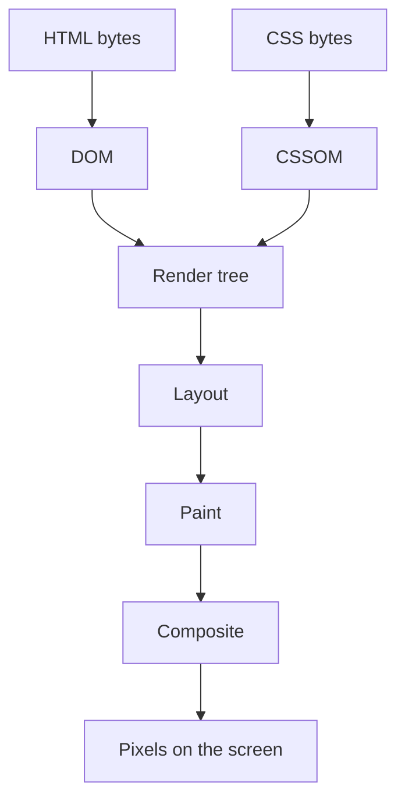
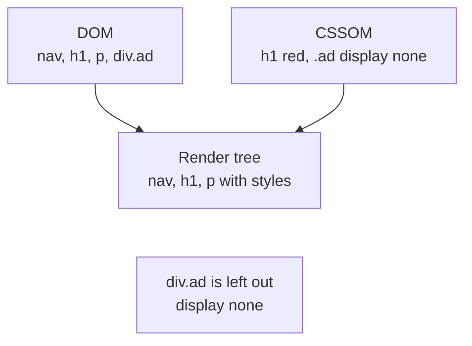
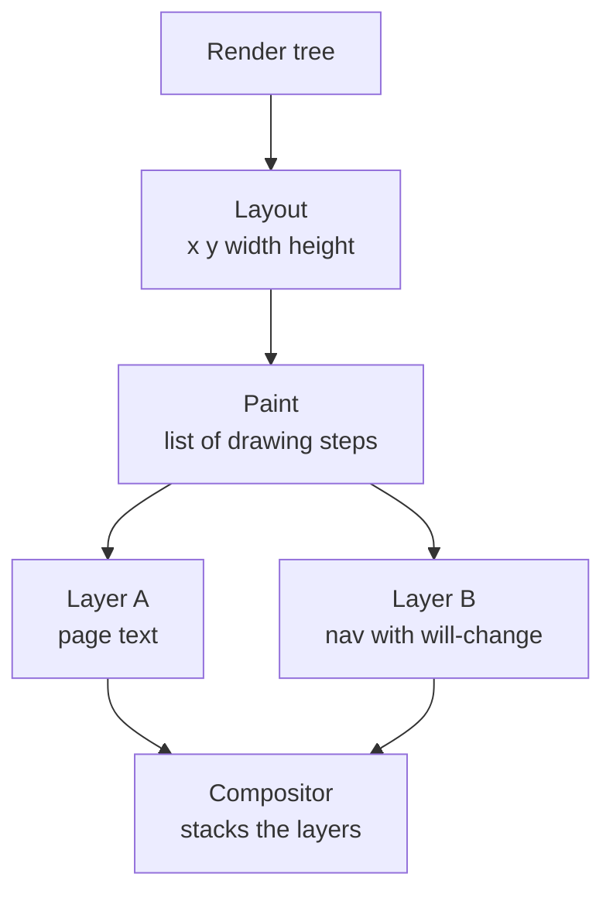
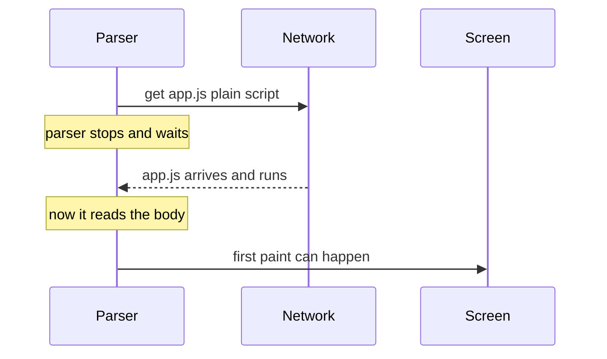
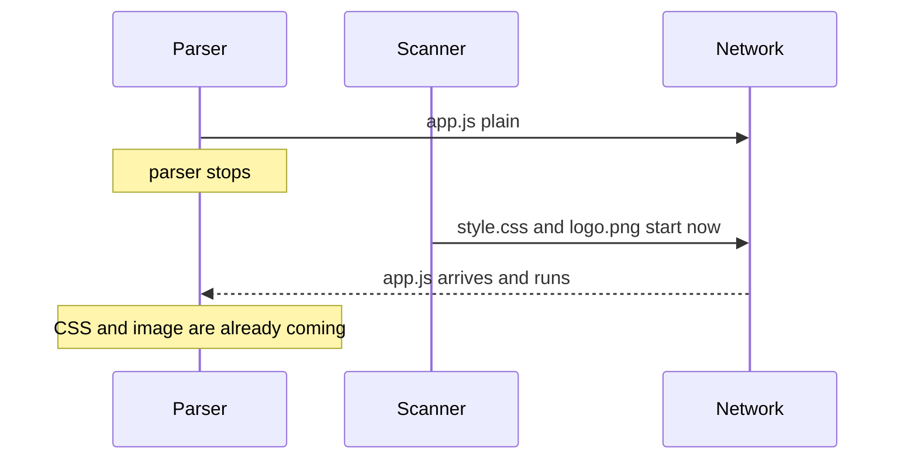
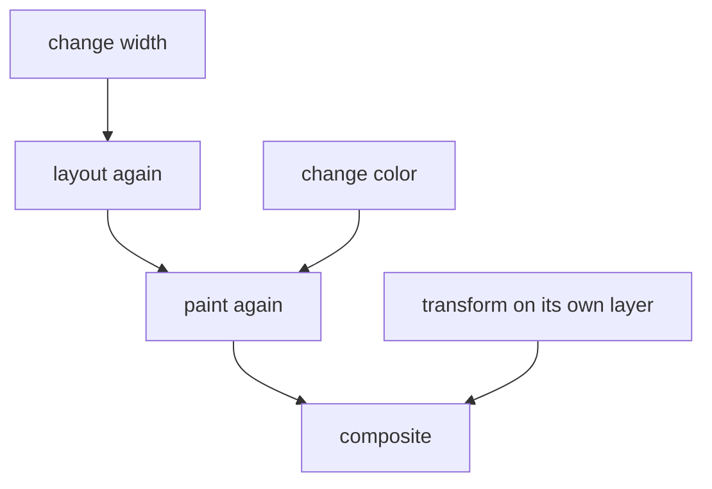
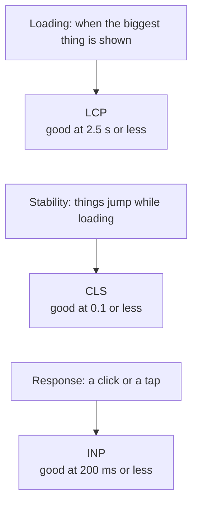
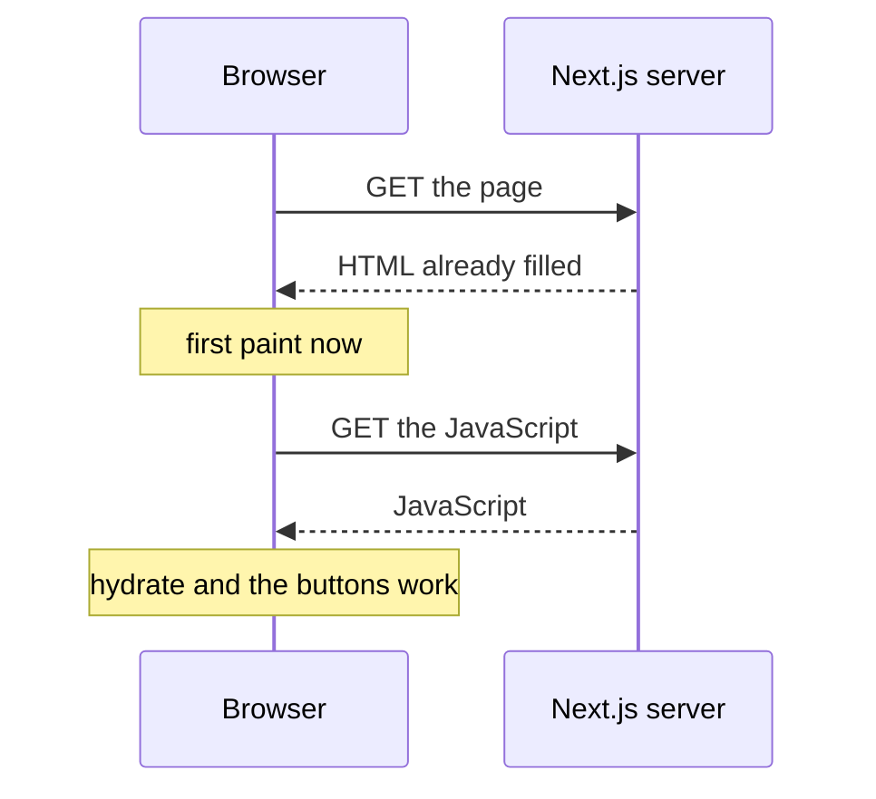

# 08. How the browser renders a page

> **Subject:** Networking · **Lesson:** 08 · **Made:** 2026-11-21 · **Status:** ready
>
> **You will be able to:** follow HTML and CSS through the DOM, the render tree, layout, paint and compositing, say what blocks the first paint and what blocks the parser, choose between plain, `defer`, `async` and module scripts, say what the preload scanner does, tell a reflow from a repaint from a composite-only change, name the three Core Web Vitals, and explain what the server sends in a Next.js page and what hydration adds.
>
> **Before this:** [HTTP/1.1, HTTP/2 and HTTP/3](05-http-1-1-vs-http-2-vs-http-3.md) and [Cookies, CORS and same origin](06-cookies-cors-and-same-origin.md) · **Also read:** [The URL to page guide](networking-url-to-page-step-by-step.md), which lists render as one step (step 12). This lesson opens that step. · **Next:** [WebSockets and server sent events](07-websockets-and-server-sent-events.md)
>
> **How to read it:** one card is one idea. Look at the picture, guess, then press the orange bar to check. The blue bars (📖 More detail) hold the longer explanation. Skip them on the first read. **What I ran for real:** Google Chrome 157.0.8103.79 in headless mode, driven through its DevTools protocol, against a small Node v26.5.0 server that delays each file on purpose, on 2026-11-21. I read first paint times from the browser, request times from the server log, and layout counts from Chrome's own counters. **What I did not run:** Firefox, Safari, a real Next.js app, hydration, and real user data for the Core Web Vitals (from the docs, not run here). Facts and links were checked on 2026-11-21. About 25 minutes for the cards.

<!-- quick-summary:start -->
## Quick summary

> Short on time? Read only this. These are the "Remember" lines from the cards below, so you can read the whole lesson in one minute.

- The browser builds the page piece by piece: DOM, render tree, layout, paint, composite. It does not wait for the last byte.
- DOM = the tags. CSSOM = the style rules. Render tree = what is drawn. `display: none`, `head` and `script` are not in it.
- Layout = sizes and places. Paint = the list of drawing steps. Compositing = stacking the layers. Layout and paint run on the main thread. Compositing runs on another thread.
- CSS blocks the first paint. A plain script blocks the parser. `defer`, `async` and module scripts do not.
- Put important files in the HTML so the scanner finds them early. Files that JavaScript, CSS `@import` or CSS backgrounds create start late.
- Layout costs the most, paint less, composite least. Never read a layout value (like `offsetWidth`) between writes. Read first, then write.
- LCP = when the biggest thing is shown (2.5 s). CLS = how much the page jumps (0.1). INP = how fast it reacts to input (200 ms).
- Server HTML is painted at once. Hydration makes it live. A gap exists between the two. Less client JavaScript makes the gap smaller.
<!-- quick-summary:end -->

## 1. The problem: the server sent text, the screen needs pixels

The server sent you letters: HTML and CSS. The screen needs coloured dots. Between them the browser runs a fixed chain of steps. The [URL guide](networking-url-to-page-step-by-step.md) calls the whole chain "render". It starts when the first bytes arrive, so it begins where lessons 04 and 05 (TLS, HTTP) end.



Notice: two inputs (HTML and CSS) join into one render tree. Everything after that is one line.

<details class="guess"><summary>🤔 Guess: the HTML comes in two pieces, 800 ms apart. Does the browser wait for both before it draws? Press to check.</summary>

**No.** The browser works on each piece as it arrives. In my real run the first piece was painted after 36 ms. The whole answer ended after about 805 ms.

</details>

> **Remember:** the browser builds the page piece by piece: DOM, render tree, layout, paint, composite. It does not wait for the last byte.

<details class="more"><summary>📖 More detail: four new words, the real streaming run, and the threads</summary>

**Four new words in this lesson:** **DOM** (card 2), **render tree** (card 2), **reflow** (card 6) and **hydration** (card 8). Other names (CSSOM, preload scanner, LCP, CLS, INP) get one line where they first appear.

**Real result** (Chrome 157, 2026-11-21). My server sent a head with one `h1` and some text, waited 800 ms, then sent the end of the page. Chrome's first paint time was **36 ms**. The navigation response ended at about **805 ms**. So the user saw the first piece 770 ms before the page was complete.

**Two kinds of thread.** Chrome's rendering notes ([RenderingNG](https://developer.chrome.com/docs/chromium/renderingng-architecture), from the docs, not run here) list the steps: animate, style, layout, pre-paint, scroll, paint, commit, layerize, raster, activate, draw. The main thread runs scripts, parsing, style, layout and paint. The compositor thread handles scrolling and animations, so they can stay smooth when the main thread is busy. That is why card 3 and card 6 matter.

**The trace** (stepper, tab 1): the same small page goes through every step. You see the DOM grow, the CSSOM appear, a hidden element drop out, layout numbers, the paint list and two layers.

</details>

## 2. Two trees become one: DOM, CSSOM, render tree

The parser reads HTML and builds the **DOM** (Document Object Model): a tree with one node for every tag and piece of text. The CSS becomes the **CSSOM**: a tree of style rules. The browser joins them into the **render tree**: only the things that will be drawn, each with its final style.



Notice: `div.ad` is in the DOM but not in the render tree.

<details class="guess"><summary>🤔 Guess: which stays in the render tree, display: none or visibility: hidden? Press to check.</summary>

**visibility: hidden stays.** The box is invisible but still takes space, so layout needs it. `display: none` removes the element completely.

</details>

> **Remember:** DOM = the tags. CSSOM = the style rules. Render tree = what is drawn. `display: none`, `head` and `script` are not in it.

<details class="more"><summary>📖 More detail: DOM is built bit by bit, CSSOM all at once, and why</summary>

**The DOM is built step by step.** The parser can add nodes as bytes arrive. **The CSSOM is built from the whole CSS.** A rule at the end can override one at the start, so the browser cannot draw anything with half the CSS (from [MDN: critical rendering path](https://developer.mozilla.org/en-US/docs/Web/Performance/Guides/Critical_rendering_path)). This is why CSS holds back the first paint (card 4).

**What the DOM does not know.** The DOM has structure and text. It does not know colours or sizes. That is the job of the CSSOM and then layout.

**Render tree rule** (from [web.dev, Ilya Grigorik](https://web.dev/articles/critical-rendering-path/render-tree-construction)): the tree has the visible nodes with their computed styles. `display: none` is left out with all its children. `visibility: hidden` is kept as an empty box.

**Bad HTML** is repaired by the rules of the HTML standard, so the DOM can differ from what you typed (a missing `</p>` is added).

**The trace** (stepper, tab 1, steps 1 to 4): DOM so far, the full DOM, the CSSOM, and the render tree with `div.ad` crossed out.

</details>

## 3. Layout, paint and layers

Now the browser knows what to draw. **Layout** works out the size and place of every box. **Paint** writes a list of drawing steps ("draw red text here"). It does not make pixels yet. Some elements get their own **layer**. A helper called the **compositor** draws each layer as a picture and stacks the pictures on the screen.



Notice: the compositor is the last box. If layer B only moves, nothing above it has to run again.

<details class="guess"><summary>🤔 Guess: an element with will-change: transform moves across the screen. Does the browser run layout and paint for each frame? Press to check.</summary>

**No.** The finished picture of that layer is moved by the compositor. In my real run a transform change on a layer element needed no layout and no paint. Card 6 has the numbers.

</details>

> **Remember:** layout = sizes and places. Paint = the list of drawing steps. Compositing = stacking the layers. Layout and paint run on the main thread. Compositing runs on another thread.

<details class="more"><summary>📖 More detail: raster, tiles, and the names in Chrome</summary>

**Raster.** Before the compositor can stack a layer, the layer must be turned into pixels. Chrome cuts a layer into tiles and draws them in graphics memory ([Inside look at modern web browser, part 3](https://developer.chrome.com/blog/inside-browser-part3), Mariko Kosaka, which has 18 diagrams of these threads).

**Why layers.** One layer for everything means any change repaints everything. Many layers cost memory. `will-change: transform` is a hint that this element will move, so give it a layer. Do not put it on everything. This is from [web.dev: compositor-only properties](https://web.dev/articles/stick-to-compositor-only-properties-and-manage-layer-count) (Paul Lewis).

**Layout also has a "tree".** Chrome keeps a layout tree of boxes with sizes. Paint and layerize read it. You do not need those names for an interview. The picture order is enough.

**The trace** (stepper, tab 1, steps 5 to 7): layout numbers, the paint list in order, then two layers drawn together.

</details>

## 4. What holds things back: CSS and scripts

The browser must wait for two kinds of file. **CSS blocks the first paint**: showing the page with half the style would flash. A plain `<script>` **blocks the parser**: the script may change the page, so the parser stops until the script has downloaded and run. Three attributes remove the stop.



Notice: nothing in the body is read, so nothing is drawn, until the script has run.

| Script | Downloads | Runs | Stops the parser? |
|---|---|---|---|
| plain | when found | at once | **yes** |
| `defer` | in the background | after the parse, in order | no |
| `async` | in the background | when it arrives, any order | no |
| `type="module"` | in the background | after the parse, like defer | no |

<details class="guess"><summary>🤔 Guess: a 500 ms script in the head. What is the first paint with a plain tag, and with defer? Press to check.</summary>

**Plain: about 532 ms. With defer: about 24 ms.** Real Chrome 157, same page, only the attribute changed.

</details>

> **Remember:** CSS blocks the first paint. A plain script blocks the parser. `defer`, `async` and module scripts do not.

<details class="more"><summary>📖 More detail: my real run, the model next to it, and the rules</summary>

**Real result** (Chrome 157, each file delayed by my server). First paint is Chrome's `first-contentful-paint`. The model is `loadPage` from the practice code, with script run time set to 0.

| Page | Model first paint | Real first paint | Real DOMContentLoaded |
|---|---|---|---|
| no CSS, no script | 0 | 32 ms | 17 ms |
| CSS that takes 400 ms | 400 | 420 ms | 8 ms |
| plain script, 500 ms, in the head | 500 | 532 ms | 519 ms |
| same script with `defer` | 0 | 24 ms | 515 ms |
| same script with `async` | 0 | 24 ms | 11 ms |
| same script as `type="module"` | 0 | 28 ms | 514 ms |
| plain script, 500 ms, at the end of the body | 0 | 28 ms | 515 ms |
| `media="print"` CSS, 400 ms | 0 | 24 ms | 10 ms |

Look at the DOMContentLoaded column: `defer` and module wait for the script (515), `async` does not (11). The model does not know Chrome's own start cost of about 20 to 30 ms, so every real number is a little higher.

**A script waits for the CSS before it.** CSS 400 ms, then a plain script that downloads in 100 ms. The script ran at **about 420 ms**, not at 100. The browser holds a script until earlier stylesheets are ready, because the script may ask for a style. The model does the same.

**Rules from [MDN: script](https://developer.mozilla.org/en-US/docs/Web/HTML/Reference/Elements/script):** `defer` scripts run in document order after the parse and before `DOMContentLoaded`. `async` scripts run as soon as they arrive, so the order is not fixed. Module scripts are deferred by default. If both `async` and `defer` are written, `async` wins. `defer` and `async` do nothing on an inline script (one without `src`).

**Non-blocking CSS.** A stylesheet with a `media` value that does not match, such as `print`, does not hold the first paint ([web.dev](https://web.dev/learn/performance/understanding-the-critical-path)). Real result above: 24 ms.

**Which to choose.** `defer` for scripts that need the DOM or each other. `async` for independent scripts like analytics. A script at the end of the body also works, but `defer` lets the download start earlier (card 5).

**The trace** (stepper, tab 2): six rows are added one at a time, each with the download bar, the red "parser stopped" bar, the first paint and DOMContentLoaded.

</details>

## 5. The preload scanner: read ahead while the parser waits

A stopped parser could waste time. So a second, fast reader, the **preload scanner**, reads the rest of the HTML text while the main parser waits. It starts downloads for the images, CSS and scripts it sees. It reads only the HTML text. It cannot see a file that a script or the CSS creates.



Notice: the scanner works while the parser is stopped.

<details class="guess"><summary>🤔 Guess: a script makes an image with new Image() after it runs. Another image is written in the HTML. Which one starts first? Press to check.</summary>

**The one in the HTML.** Real Chrome: an image in the HTML after a slow script was requested after **20 ms**. An image made by the 500 ms script was requested after **517 ms**. This is the common mistake: moving important files out of the HTML into JavaScript.

</details>

> **Remember:** put important files in the HTML so the scanner finds them early. Files that JavaScript, CSS `@import` or CSS backgrounds create start late.

<details class="more"><summary>📖 More detail: the real server log, what the scanner misses, and the critical rendering path</summary>

**Real server log** (Chrome 157, times in ms after the page request). Page: a plain script (500 ms), then a CSS link, and an image in the body.

| File | Requested at |
|---|---|
| page | 7 |
| script | 19 |
| CSS | 20 |
| image in the HTML | 20 |

The CSS and image were asked for while the script was still loading. A second page where the script itself ran `new Image()`: the script at 10 ms, the **image at 517 ms**.

**What the scanner misses** ([web.dev](https://web.dev/articles/preload-scanner)): resources a script adds to the page, `data-src` lazy images, CSS `background-image` files, and markup that JavaScript builds on the client. The web.dev learn module adds: CSS loaded with `@import` is hidden from it, so use a `<link>`.

**The critical rendering path** is the name for the whole chain in card 1: the files and steps between the first byte and the first pixels. To make a page paint sooner you shorten that chain: fewer and smaller blocking files, files found early, and the first HTML small. Two tools: `<link rel="preload">` (fetch a file you know you need) and `preconnect` (open the connection early). See the [URL guide](networking-url-to-page-step-by-step.md) step 12.

**The trace** (stepper, tab 3): the same page without the scanner (the CSS and image start at 520 ms), with it (all start at 0), and what it cannot see.

</details>

## 6. What does your change cost: reflow, repaint or composite only

After the first paint, JavaScript and CSS change the page. How much work follows depends on **what** you change. A change to size or place runs **layout** again, called a **reflow**, and then paint and composite. A change to colour needs only a **repaint**. A move on its own layer needs only compositing.



Notice: each change joins the line at a different place. The later it joins, the less work follows.

<details class="guess"><summary>🤔 Guess: a loop writes el.style.width and then reads el.offsetWidth for each of 2000 elements. How many layouts? Press to check.</summary>

**2000.** Reading a layout number after a write forces a layout right now. Real Chrome: 2000 layouts, about **1070 ms**. Reading everything first and writing after made **1 layout in about 9 ms**. This is called layout thrashing.

</details>

> **Remember:** layout costs the most, paint less, composite least. Never read a layout value (like `offsetWidth`) between writes. Read first, then write.

<details class="more"><summary>📖 More detail: real counts per change, the surprise with transform, and common mistakes</summary>

**Real counts** (Chrome 157, one change on a fresh page, counters from `Performance.getMetrics`, paint events from a trace; the same in two runs):

| Change | Layout | Style recalc | Paint events |
|---|---|---|---|
| nothing (control) | 0 | 0 | 0 |
| `width` | 1 | 1 | 2 |
| `color` | **0** | 1 | 2 |
| `transform`, first change on a plain element | 1 | 1 | 2 |
| `opacity`, first change on a plain element | 1 | 1 | 2 |
| `transform` on an element with `will-change: transform` | **0** | 1 | **0** |
| `transform` on an element that already had a transform | 0 | 1 | 0 |
| `opacity` on an element with `will-change: opacity` | 0 | 1 | 0 |
| `transform`, second change on a plain element | 0 | 1 | 0 |

**The surprise.** Many articles say "transform and opacity are free". In Chrome 157 that was true only when the element **already had its own layer**. The very first change on a plain element ran layout and paint, because Chrome had to make the layer. The second change was cheap. So for an animation: give the element its layer before it moves (`will-change`, or an existing transform).

**Forced layout** (`offsetWidth`, `getBoundingClientRect` and similar). A write marks the layout as old. A read that needs a true number makes the browser do the layout now. Real result, 2000 boxes, three runs: write-read loop 1072, 1066 and 1068 ms and 2000 layouts. Read-all then write-all: 8 to 10 ms and 1 layout. The practice function `forcedLayouts` counts this.

**Common mistakes:**

| Mistake | Cost | Fix |
|---|---|---|
| read `offsetWidth` inside a write loop | one layout per item | read first, then write |
| animate `left` or `width` | layout every frame | animate `transform` or `opacity` on a layer |
| `will-change` on everything | memory for every layer | only on things that will move |
| `display: none` then measure it | a layout to get the number | measure with `visibility` or hide after |

**Where to look up a property:** [csstriggers.com](https://csstriggers.com) lists, per property, whether a change needs layout, paint or composite. Treat it as a guide, since the engines change. My own numbers above are Chrome 157 only.

**The trace** (stepper, tab 4): four changes with the four steps lighting up, then a write-read loop and a batched loop with the forced layouts marked L.

</details>

## 7. Three numbers: Core Web Vitals

How do you say "fast" with numbers? Google picked three, measured on real users at the 75th percentile (three out of four visits are at least this good).



Notice: one number for loading, one for jumping, one for reacting.

<details class="guess"><summary>🤔 Guess: which of the three is made worse by a script that runs for 400 ms right after a click? Press to check.</summary>

**INP.** The page cannot paint the answer while the main thread is busy. LCP and CLS are about loading and jumping.

</details>

> **Remember:** LCP = when the biggest thing is shown (2.5 s). CLS = how much the page jumps (0.1). INP = how fast it reacts to input (200 ms).

<details class="more"><summary>📖 More detail: the thresholds, what each one links to in this lesson</summary>

**Thresholds** (the "good" limits and the 75th percentile are from [web.dev: Web Vitals](https://web.dev/articles/vitals), updated 2024-10-31, which I opened. The "needs improvement" limits of 4 s, 500 ms and 0.25 come from search summaries of web.dev and corewebvitals.io, and I did not read them on the page itself):

| Metric | Measures | Good | Needs improvement | Poor |
|---|---|---|---|---|
| **LCP** Largest Contentful Paint | when the biggest visible element appears | 2.5 s or less | up to 4 s | above 4 s |
| **INP** Interaction to Next Paint | how fast the page reacts to clicks, taps and keys | 200 ms or less | up to 500 ms | above 500 ms |
| **CLS** Cumulative Layout Shift | how much visible things move | 0.1 or less | up to 0.25 | above 0.25 |

INP is the successor of the old First Input Delay ([web.dev: INP](https://web.dev/articles/inp)).

**Link to the cards.** LCP depends on cards 4 and 5: no blocking script or CSS in front, and the biggest image found early by the scanner. CLS is layout (card 6) running again after something loaded late, like an image with no size. INP is a long task on the main thread (card 3) that stops the next paint. I did not measure these three here: they need real users or a lab tool. This card is from the docs, not run here.

**The first paint number** I measured in this lesson is First Contentful Paint (FCP), the first time any text or image is drawn. It is not a Core Web Vital, but it is the first thing the chain in card 1 delivers.

</details>

## 8. React and Next.js: HTML that arrives painted, then hydration

A React app that builds the page in the browser sends an empty page and a big script. The user sees nothing until the script has run. **Server rendering** sends HTML that is already filled, so it paints at once. But buttons do not work yet. React then downloads its JavaScript and does **hydration**: it attaches the click handlers to the HTML that is already there.



Notice: between the two notes the page looks ready, but a click may do nothing.

<details class="guess"><summary>🤔 Guess: how can you make that gap between "looks ready" and "buttons work" smaller? Press to check.</summary>

**Send less JavaScript to the browser.** Server Components render on the server and send no component code, only a result. Only the parts that need clicks (Client Components) are sent as JavaScript and hydrated.

</details>

> **Remember:** server HTML is painted at once. Hydration makes it live. A gap exists between the two. Less client JavaScript makes the gap smaller.

<details class="more"><summary>📖 More detail: the model, what the docs say, and the cost of a mismatch</summary>

**The model** (`pageTimeline`, made-up numbers: HTML 100 ms, JavaScript 300, data 200, drawing 50, hydration 80):

| | Content shown | Buttons work | Dead time |
|---|---|---|---|
| client rendering | 650 ms | 650 ms | 0 |
| server rendering | **350 ms** | 730 ms | **380 ms** |

Server rendering shows the content sooner but can become interactive later, so it does not win everywhere. The numbers are a model, not a measurement. I did not run React or Next.js here.

**From the docs, not run here.** [Next.js: Server and Client Components](https://nextjs.org/docs/app/getting-started/server-and-client-components) (updated 2026-10-05): layouts and pages are Server Components by default. On the first load, the HTML is used "to immediately show a fast non-interactive preview", the RSC payload (a compact record of the rendered Server Component tree) is used to match the trees, and JavaScript is used to "hydrate Client Components and make the application interactive". The docs also list "improve the First Contentful Paint" and "reduce the amount of JavaScript sent to the browser" as reasons to use Server Components. [React: hydrateRoot](https://react.dev/reference/react-dom/client/hydrateRoot): React attaches to HTML that already exists. The browser render must produce the same output as the server render. A difference is a bug, and React may warn or run slower.

**Streaming** (from the [URL guide](networking-url-to-page-step-by-step.md), step 11): the server can send the HTML in pieces. Card 1 showed that the browser paints each piece as it comes.

**The trace** (stepper, tab 5): the same page with client rendering and server rendering as two timelines, and the dead time marked.

</details>

## 9. Watch and play

Links were checked on 2026-11-21: I opened each page, and for the videos I read the title and channel from YouTube oEmbed data. I did not watch the videos. If a link is broken, tell me and I will replace it.

- **Play with it:** [the stepper in this folder](visuals/08-how-the-browser-renders-a-page.html) - guess first, then press Next. Five tabs: bytes to pixels, what blocks, the preload scanner, what a change costs, and server rendering with hydration.
- **Try it yourself:** open Chrome DevTools on any page, go to the **Performance** tab and record a reload. Find the first paint marker and the Layout and Paint rows in the main thread. Then in the Console run `document.body.style.width = "500px"` with the recording on and find the new Layout row. ([DevTools Performance docs](https://developer.chrome.com/docs/devtools/performance), the page loaded; I did not click through the panel for this lesson.)
- **Video (long, optional):** [Jake Archibald: In The Loop](https://www.youtube.com/watch?v=cCOL7MC4Pl0) - JSConf Asia, 35 minutes. Title and channel checked. Shows where rendering fits into the browser's event loop. Watch it after lesson [11 of JavaScript](../javascript/11-the-event-loop.md).
- **Video:** [Introduction to the Critical Rendering Path in the Browser - Website Speed](https://www.youtube.com/watch?v=a7qRCKWsZtE) - Leela Web Dev. Title and channel checked only. A smaller channel, and I did not check its length. Compare with cards 1 to 4.
- **Pictures:** [Inside look at modern web browser, part 3](https://developer.chrome.com/blog/inside-browser-part3) - Mariko Kosaka. The page loaded and has 18 figures of the main thread, layers and the compositor. I looked at the figure list, not each picture.
- **Pictures:** [Render-tree construction, layout and paint](https://web.dev/articles/critical-rendering-path/render-tree-construction) - Ilya Grigorik. The page loaded. It has diagrams of the two trees joining into the render tree.
- **Look up:** [CSS Triggers](https://csstriggers.com) - the page loaded. Pick a property and see if a change needs layout, paint or composite.

<details><summary>Go deeper (optional)</summary>

**More pages I opened.** [MDN: Critical rendering path](https://developer.mozilla.org/en-US/docs/Web/Performance/Guides/Critical_rendering_path) (text only, no diagram). [MDN: Populating the page, how browsers work](https://developer.mozilla.org/en-US/docs/Web/Performance/Guides/How_browsers_work) (loaded, I did not read it in full). [web.dev: Don't fight the preload scanner](https://web.dev/articles/preload-scanner). [web.dev: Understand the critical path](https://web.dev/learn/performance/understanding-the-critical-path). [web.dev: Stick to compositor-only properties](https://web.dev/articles/stick-to-compositor-only-properties-and-manage-layer-count). [RenderingNG architecture](https://developer.chrome.com/docs/chromium/renderingng-architecture). [web.dev: Web Vitals](https://web.dev/articles/vitals). [web.dev: INP](https://web.dev/articles/inp). [Next.js: Server and Client Components](https://nextjs.org/docs/app/getting-started/server-and-client-components). [React: hydrateRoot](https://react.dev/reference/react-dom/client/hydrateRoot). Deep video: [Life of a Pixel](https://www.youtube.com/watch?v=K2QHdgAKP-s) by BlinkOn, a talk from Chromium engineers (title and channel checked, one commenter says about 42 minutes, not checked by me).

**Checked on 2026-11-21** with Node v26.5.0 and Google Chrome 157.0.8103.79 (headless, driven through the DevTools protocol over a small Node server with delays). The practice code has 85 tests. On the empty stub 80 fail (the other 5 pass for a weak reason: three only check that your function does not change its inputs, and two compare results that are both empty). I made 46 wrong versions of the answer (for example CSS that blocks the parser, a script that ignores earlier CSS, `defer` and `async` swapped, a read that always forces a layout, an `opacity` layer rule that ignores the layer) and the tests caught all 46. The stepper uses the same functions. I ran every step of every tab in Chrome at 375 px wide and found no sideways scroll and no script error.

**What I did not test.** Firefox and Safari (they may differ, for example in how they handle layers), a real Next.js or React app, hydration and mismatches, streaming with Suspense, the real LCP, CLS and INP numbers, paint timing on a slow phone, the DevTools Performance panel itself, `content-visibility`, `contain`, and what a `font` that loads late does to layout.

**Where the model is simpler than the real thing.** `loadPage` has all the HTML at time 0 and no bandwidth limit, so parallel downloads never slow each other. An `async` script that runs while the parser is working would really delay the parser a little. The model does not do that. It treats every stylesheet and script as the same size of work, ignores inline `<style>`, fonts, images that hold the paint, `@import`, and CSS in the body. `firstPaint` is the time the body starts, not the real First Contentful Paint. `stagesFor` knows about 18 properties. The `transform` and `opacity` rule is what I measured in Chrome 157 only. The real CLS is the worst burst of shifts in a visit, not a plain sum, and the model does not compute it. `pageTimeline` leaves out streaming, the preload scanner and the time a server needs before it can answer.

**Not covered here.** Fonts and `font-display`, `<link rel="modulepreload">`, `fetchpriority`, lazy loading, `content-visibility`, the Speculation Rules API, Suspense and streaming SSR in detail, partial prerendering, island architecture, View Transitions, WebGL and canvas, and how a phone GPU differs from a laptop.

</details>

## 10. Practice

**A. Predict the output** (write your answer before opening)

```js
const html = '<head><script src="/a.js"></script></head><body><h1>Hi</h1></body>';
const net = { "/a.js": { download: 500, run: 20 } };
console.log(loadPage(html, net).firstPaint);
console.log(loadPage(html.replace("<script", "<script defer"), net).firstPaint);
console.log(stagesFor("transform", { ownLayer: true }));
console.log(forcedLayouts(["write", "read", "write", "read"]));
console.log(vitalRating("LCP", 3100));
console.log(pageTimeline("ssr", { htmlMs: 100, jsMs: 300, dataMs: 200, renderMs: 50, hydrateMs: 80 }));
```

Then answer: in the last line, how long is the page "ready to look at but not ready to click"?

<details><summary>Answer</summary>

```
520
0
[ 'style', 'composite' ]
2
needs improvement
{ firstContent: 350, interactive: 730, deadTime: 380 }
```

Line 1: the plain script holds the parser for 500 + 20 ms, so the body is read at 520. Line 2: with `defer` the body is read at 0. Line 3: on its own layer, a transform skips layout and paint. Line 4: each read after a write forces a layout. Line 5: 3100 ms is above 2500 and not above 4000. Line 6: the content shows at 350 and the buttons work at 730, so the dead time is **380 ms**. (Run on 2026-11-21 with Node v26.5.0.)

</details>

**B. Fix the bug**

Users see a white page for two seconds on a slow network. The head looks like this. Find the cause and fix it.

```html
<head>
  <script src="/analytics.js"></script>
  <script src="/app.js"></script>
  <link rel="stylesheet" href="/site.css">
</head>
```

<details><summary>Answer</summary>

Two plain scripts in the head. The parser stops at each one, and (card 4) a plain script also waits for the CSS before it, so the body is not read until both scripts and the earlier CSS are done. **Fix:** `<script defer src="/app.js">` because it needs the DOM and should run in order, and `<script async src="/analytics.js">` because it is independent. Keep the CSS link in the head: the page needs its style for the first paint. The scanner (card 5) will start all three downloads early. Check with `loadPage` from the practice file.

</details>

**C. Write it yourself**

Open `learn/networking/practice/08-how-the-browser-renders-a-page.js`. It has eight empty pieces: `scanHtml`, `scriptMode`, `isRenderBlocking`, `loadPage`, `stagesFor`, `forcedLayouts`, `vitalRating` and `pageTimeline`. The comments at the top say exactly what each must do. Write them, then run this from the repo root and make all the tests pass:

```
node --test learn/networking/practice/08-how-the-browser-renders-a-page.test.js
```

`loadPage` is the one to think about: it is the whole story of cards 4 and 5 in one function. Use `scanHtml`, `scriptMode` and `isRenderBlocking` inside it.

<details><summary>One possible answer</summary>

The full answer is about 130 lines. The idea in each piece:

- `scanHtml`: one regular expression for `link`, `script`, `img` and `body` tags, and a small attribute reader.
- `scriptMode`: module first, then no `src` means blocking, then `async`, then `defer`.
- `isRenderBlocking`: a stylesheet whose media is not `print`.
- `loadPage`: a clock `t` for the parser. Start times are 0 with the scanner, or `t` without it. A plain script runs at the largest of `t`, its ready time and the ready time of the CSS before it. Async runs when ready. Deferred scripts run in order after the parse. `firstPaint` is the later of the body start and the last blocking stylesheet.
- `stagesFor`: three lists of property names, and the `ownLayer` rule for `transform` and `opacity`.
- `forcedLayouts`: a "dirty" flag. A read of a dirty layout counts one. Count one more at the end if it is still dirty.
- `vitalRating`: a table of two limits per metric.
- `pageTimeline`: two formulas, and the dead time is the difference.

The finished version is checked: 80 of the 85 tests fail on the empty stub, and all 85 pass with my answer. The stepper page uses these same functions, so you can open its source to see the full answer.

</details>

## 11. Interview question

**Q:** "What happens in the browser between receiving the HTML and seeing pixels? How would you make a slow page paint sooner?"

A common follow-up: "What is the difference between reflow and repaint? Why is `transform` better for animation? What does hydration cost?" Cards 6 and 8 are the answer.

<details><summary>A strong answer, in four parts</summary>

1. **Problem:** The server sends text, and the screen needs pixels. A page that shows nothing for seconds feels broken, and a page that jumps or reacts late feels bad.
2. **How it works:** The parser turns HTML into the DOM while the bytes arrive, and the CSS becomes the CSSOM. They make the render tree of visible things. Layout gives each box a size and place. Paint writes the drawing steps. The compositor stacks the layers on another thread. CSS holds back the first paint. A plain script stops the parser, so I use `defer` or `async`. The preload scanner finds images, CSS and scripts in the HTML early, so I keep important files in the HTML. For changes after load: width needs layout (reflow), colour needs repaint, and `transform` and `opacity` on their own layer need only compositing. I read layout values before I write, not between writes. I measure with LCP, CLS and INP.
3. **Tradeoff:** `will-change` makes smooth animation but costs memory for every layer. Server rendering paints sooner but adds a gap until hydration, and a mismatch between server and client is a bug. Inlining critical CSS helps the first paint but grows the HTML and weakens caching. `async` runs sooner but in any order, so it is wrong for scripts that depend on each other.
4. **My example:**
   - **Fact:** my profile lists React and Next.js, so server rendering and hydration are part of my stack.
   - **Fact (from this lesson):** I ran Chrome 157 here and saw a 500 ms script in the head move the first paint from 24 ms (with `defer`) to 532 ms, and a write and read loop make 2000 layouts in about 1070 ms against 1 in about 9 ms when batched.
   - **Idea, not a fact:** I do not know the Web Vitals of my own apps. A good next step is to open one Next.js app in DevTools, find the LCP element and check if a script or CSS holds it back.

</details>

## 12. Explain it back

Close this file. Explain out loud, to a new junior, how the browser turns the HTML and CSS into pixels, in 4 parts (problem, how, tradeoff, my example). Use the story of the page that stays white for two seconds. Say what the DOM, CSSOM and render tree are, what blocks the first paint and what blocks the parser, what `defer` and `async` change, what the preload scanner does, why width is more expensive than `transform`, and what hydration is. Write your best version below and run `/explain-check browser rendering` or ask the `explain-coach` agent to review it.

### My explanation

<write here>

### Coach feedback

<the explain-coach agent writes here>

## 13. Review questions (day 1, 3, 7, 21)

1. Name the steps from the HTML bytes to the pixels, in order. Which two trees join?
2. What does `display: none` do to the render tree? What does `visibility: hidden` do?
3. What blocks the first paint? What blocks the parser? How do `defer`, `async` and `type="module"` differ?
4. What is the preload scanner, and what can it not see?
5. Which costs more, changing `width`, changing `color`, or changing `transform` on a layer? Why does reading `offsetWidth` inside a write loop hurt?
6. What do LCP, CLS and INP measure? What is hydration, and where is the dead time?

Then draw from memory: the pipeline from HTML and CSS to pixels, and mark where `width`, `color` and `transform` join it.

<details><summary>Answers</summary>

1. Bytes, DOM (and CSS to CSSOM), render tree, layout, paint, composite. The DOM and the CSSOM join into the render tree.
2. `display: none` removes the element from the render tree. `visibility: hidden` keeps an invisible box that still takes space.
3. CSS blocks the first paint. A plain script blocks the parser. `defer` runs after the parse in order. `async` runs when it arrives in any order. A module script is deferred like `defer`.
4. A fast second reader of the HTML text that starts downloads while the parser is stopped. It cannot see files that a script, CSS `@import` or a CSS background creates.
5. `width` costs the most (layout, paint, composite). `color` needs paint and composite. `transform` on its own layer needs only composite. A read after a write forces a layout right then, so a loop makes one layout per item.
6. LCP: when the biggest element appears (good at 2.5 s). CLS: how much the page jumps (0.1). INP: how fast it reacts to input (200 ms). Hydration attaches click handlers to the server HTML. The dead time is between the first paint and the end of hydration.

</details>

## Connected lessons

- [TLS and HTTPS](04-tls-and-https.md) - how the bytes arrive safely. Rendering starts when the first bytes arrive.
- [HTTP/1.1, HTTP/2 and HTTP/3](05-http-1-1-vs-http-2-vs-http-3.md) - why many files on one connection make the scanner's early downloads cheap.
- [Cookies, CORS and same origin](06-cookies-cors-and-same-origin.md) - a font or a module script from another origin needs CORS.
- [WebSockets and server sent events](07-websockets-and-server-sent-events.md) - next: another way for a page to talk to a server after it has loaded.
- [The URL to page guide](networking-url-to-page-step-by-step.md) - this lesson opens step 12 of that guide.
- [The event loop](../javascript/11-the-event-loop.md) - rendering is one task in the loop, which is why a long script delays the next paint.
- [CDN](../system-design/05-cdn.md) and [Caching](../system-design/04-caching.md) - the first HTML and the static files should be fast and near the user.
- [The frontend design round](../system-design/31-the-frontend-design-round.md) - where render speed and Core Web Vitals come up in an interview.
