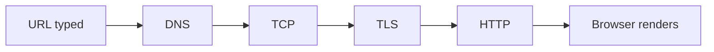

# Networking

What happens between the browser and the server: DNS, TCP, TLS, HTTP and the browser.

**Why it matters in interviews:** "What happens when you type a URL" is a classic. Senior rounds go deeper into TLS, HTTP/2 and HTTP/3, and CORS.

## The map

How the lessons connect. Learn left to right.

## Lessons, one concept per file

Each lesson is one small file made from [the lesson template](../../templates/lesson-template.md): picture first, a code trace, practice, links to watch and play, and an explain it back section.

Status: `planned` (not written yet), `ready` (written, not studied), `learning`, `can explain` (passed explain-check).

### Lessons

| # | Lesson | You will understand | Status |
|---|---|---|---|
| 01 | The layers: OSI and TCP/IP `01-the-layers-osi-and-tcp-ip.md` | what each layer does, in one picture | planned |
| 02 | DNS `02-dns.md` | how a name becomes an IP, caching, TTL | planned |
| 03 | TCP vs UDP `03-tcp-vs-udp.md` | handshake, reliability, when UDP wins | planned |
| 04 | TLS and HTTPS `04-tls-and-https.md` | the handshake, certificates, what is encrypted | planned |
| 05 | HTTP/1.1 vs HTTP/2 vs HTTP/3 `05-http-1-1-vs-http-2-vs-http-3.md` | multiplexing, head of line blocking, QUIC | planned |
| 06 | Cookies, CORS and same origin `06-cookies-cors-and-same-origin.md` | why the browser blocks requests, and how CORS allows them | planned |
| 07 | WebSockets and server sent events `07-websockets-and-server-sent-events.md` | real time options | planned |
| 08 | How the browser renders a page `08-how-the-browser-renders-a-page.md` | HTML parse, CSS, layout, paint | planned |

**To make the next lesson:** in a chat with this folder open, say `/learn networking 01` to learn it live with Claude, or ask "make lesson networking 01" and the `research-material` agent writes the file. When a lesson file exists, its row becomes a link and the status changes to `ready`.

## Guides already here

Longer guides that cover many concepts at once. Good for revision after the lessons.

- [What happens when you type a URL, step by step](networking-url-to-page-step-by-step.md)

## Visual cheatsheets

Open in the browser. Everything visible on one page.

- [Networking visual cheatsheet](networking-url-to-page-step-by-step-cheatsheet.html)

## Watch and play

Trusted places to see the ideas, not only read them. Each lesson adds its own checked video and visualizer links.

- [How DNS Works (comic)](https://howdns.works/) - DNS as an illustrated story
- [The Illustrated TLS 1.3 Connection](https://tls13.xargs.org/) - every byte of a TLS handshake, explained
- [High Performance Browser Networking](https://hpbn.co/) - free book, deep and clear
