# Networking for System Design

- **Written:** 2026-10-16
- **Level:** Beginner to Senior (each part is tagged)
- **Why this note exists:** In a system design interview you draw boxes and arrows. This note explains what each arrow costs, where each box should sit, and what breaks when the network misbehaves.
- **Read with:** [What happens when you type a URL](networking-url-to-page-step-by-step.md) (DNS lookup, TCP, TLS and HTTP step by step), [Load balancers and microservices](../system-design/load-balancers-microservices-online-shop.md), [Caching and CDN in depth](../system-design/caching-and-cdn-in-depth.md), [Distributed systems and reliability patterns](../system-design/distributed-systems-and-reliability-patterns.md), [System design roadmap](../system-design/system-design-roadmap-beginner-to-senior.md)
- **Visual version:** [networking-for-system-design-cheatsheet.html](networking-for-system-design-cheatsheet.html)
- **How links were checked:** opened or found in web search on 2026-10-16.

---

## TL;DR

- **Every arrow on your diagram costs time and can fail.** Inside one building a trip is under a millisecond. Across the world it is 150 ms or more. Light in a cable cannot go faster.
- **Fewer trips beat faster servers.** Reuse open connections, batch calls, and put copies of data near users.
- **Each box has a job.** DNS points users to a place. A CDN answers from nearby. A load balancer spreads work. An API gateway checks the request at the door.
- **Real time is a choice:** polling, server sent events, WebSockets, or push notifications for phones. Pick the simplest one that fits.
- **In the cloud, keep the database in a private part of the network.** Only the load balancer faces the internet. Traffic between zones costs money.
- **The network will fail.** Put a timeout on every call, retry at one layer only, and make retries safe to repeat.

---

## The map

Read top to bottom. Each part builds on the one above it.

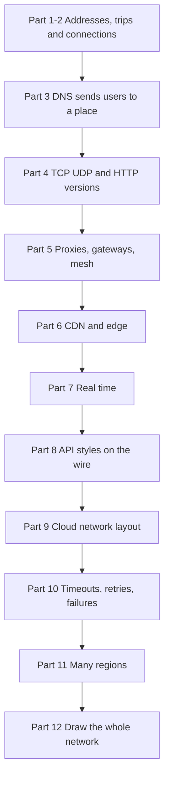

What to notice: the first parts are about one arrow. The last parts are about the whole picture.

| Part | Level | You will be able to |
|---|---|---|
| 1. Addresses, packets, latency | Beginner | say why distance matters, with real numbers |
| 2. Client, server, hops, connections | Beginner | explain why reusing connections and pools matter |
| 3. DNS as a design tool | Mid | use TTL, GeoDNS and anycast, and say why DNS failover is slow |
| 4. TCP, UDP, HTTP versions | Mid | say what HTTP/2 and HTTP/3 change for your system |
| 5. Proxies, load balancers, gateways | Mid | place a reverse proxy, a gateway and a sidecar, and say what each does |
| 6. CDN and the edge | Mid | say what runs near users and what must stay near the database |
| 7. Real time | Mid | choose polling, SSE, WebSockets or push, and scale WebSockets |
| 8. API styles on the wire | Mid | choose REST, GraphQL, gRPC or webhooks for each link |
| 9. Cloud network layout | Senior | draw a VPC with public and private subnets for Express and Postgres |
| 10. Timeouts, retries, failures | Senior | set timeouts per hop and stop retry storms |
| 11. Many regions | Senior | compare active-passive and active-active from the network side |
| 12. Draw the network | All | draw the full network for a design, step by step |

---

## Part 1: Addresses, packets and latency [Beginner]

**Words you will hear:**
- **IP address:** the number that finds one machine on a network, like a street address.
- **Port:** a number that picks one program on that machine, like a flat number in a building.
- **Packet:** a small piece of your data, about 1,500 bytes, that travels on its own.
- **Round trip:** a message goes to the other machine and the answer comes back.

### 1.1 What is inside an arrow

**The problem.** You draw "App -> Database" in an interview. The arrow looks free. It is not. The interviewer wants to know how far apart the boxes are and how many times the arrow is crossed.

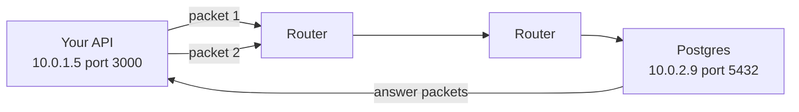

What to notice: one request becomes several packets. Each packet hops through routers. The answer comes back the same way.

- Your API sends a query to `10.0.2.9:5432`. The IP finds the machine. The port finds Postgres on it.
- The operating system cuts the data into packets. Routers pass each packet along.
- TCP, a set of rules on top of IP, puts the packets back in order and resends lost ones.
- One question and one answer is one round trip. Designers count round trips.

### 1.2 Latency, bandwidth and throughput

**The problem.** People say "the network is slow". Slow can mean three different things. Each one has a different fix.

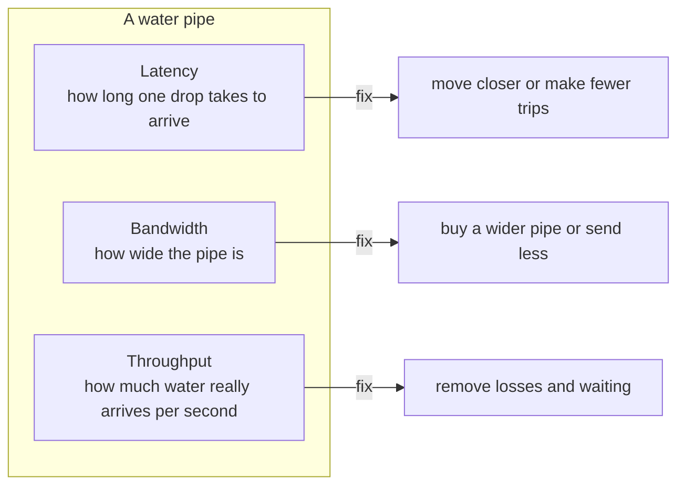

What to notice: a wider pipe does not make one drop arrive sooner.

- **Latency** is time for one trip. Distance and the number of trips decide it.
- **Bandwidth** is the most data the link can carry per second.
- **Throughput** is what you really get. Lost packets and waiting make it lower than bandwidth.
- Most web requests are small. So for APIs, **latency matters more than bandwidth**.
- Where the analogy stops: real networks also have queues. A full queue adds latency too.

### 1.3 Latency numbers every designer should know

Rules of thumb for a round trip in 2026. Measure your own system before you trust any number.

| Trip | Rough round trip | What it means for design |
|---|---|---|
| Same machine, one process to another | well under 0.1 ms | almost free |
| Same data center or same zone | about 0.1 to 0.5 ms | 100 database calls is still fast |
| Between zones in one cloud region | about 1 to 2 ms (AWS says single digit ms) | fine, but it adds up and costs money |
| Same continent, for example Jakarta to Singapore | about 10 to 50 ms | users feel many trips |
| Across the world, for example California to the Netherlands | about 150 ms | every trip hurts; use a CDN and fewer trips |

- A **region** is a cloud city area. A **zone** (availability zone) is one or more data centers in that region, with its own power. A **CDN** keeps copies of your files in many cities (Part 6).
- Light in a fiber cable travels about **200 km per millisecond**.
- So each 1,000 km of distance adds at least 10 ms to a round trip.
- Jakarta to Sydney is about 5,500 km. A round trip there can never be under about 55 ms.
- No faster server fixes this. Only moving closer or making fewer trips helps.

**The cost.** Moving closer to users means more places to run, more copies of data, and harder updates.

**Say this in the interview:** "Same zone calls are under a millisecond, cross-continent calls are about 150 ms. So I count round trips on the user's path and put the chatty parts close together."

<details><summary>Go deeper (optional)</summary>

- The classic list "Latency numbers every programmer should know" came from Jeff Dean and was updated by Colin Scott. The version in the System Design Primer lists "round trip within same datacenter 500 us" and "send packet CA to Netherlands to CA 150 ms". Modern cloud zones are often faster than 500 us inside one zone.
- AWS says zones in a region are up to about 100 km apart, close enough for synchronous copying with single digit millisecond latency.
- Try the interactive version at samwho.dev/numbers (link in Watch and play).

</details>

---

## Part 2: Client, server, hops and connections [Beginner]

**Words you will hear:**
- **Hop:** one network trip from one box to the next box.
- **Keep-alive:** keeping a connection open so the next request can use it.
- **Connection pool:** a small set of open connections that many requests share.

### 2.1 Request and response

**The problem.** HTTP works one way: the client asks, the server answers. The server cannot start a talk on its own. Remember this for Part 7.

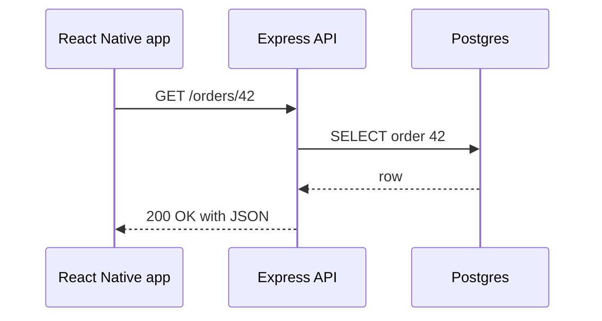

What to notice: one user action caused two round trips, one on each hop.

### 2.2 What a hop costs

**The problem.** Microservices turn one function call into a network call. A function call takes nanoseconds. A network call takes a millisecond, can time out, and can fail.

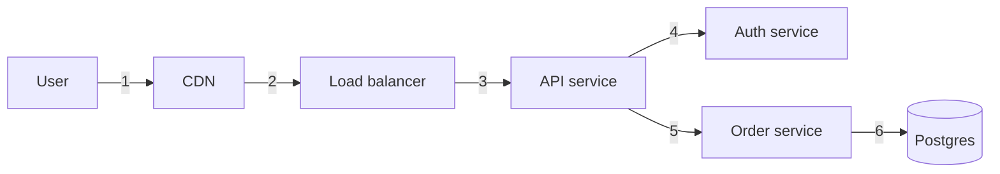

What to notice: six hops. Each one adds time, a place to fail, and a log to search.

- Each hop adds: network time, the box's own work, and one more chance to fail.
- A chatty pattern is worse than a long hop. 50 calls in a loop at 1 ms is 50 ms. The same loop across regions at 80 ms is 4 seconds.
- Fix: batch calls, fetch in parallel, or keep the two boxes in the same zone.

**Say this:** "Every service split adds a network hop. I only split when the gain is worth one more thing that can be slow or fail."

### 2.3 Keep-alive and connection reuse

**The problem.** Before the first byte of a request, a new HTTPS connection needs a TCP handshake and a TLS handshake (TLS is the encryption behind HTTPS). That is about 2 round trips. At 150 ms, that is 300 ms of waiting before any work. Deep version: [the URL guide, steps 6 and 7](networking-url-to-page-step-by-step.md).

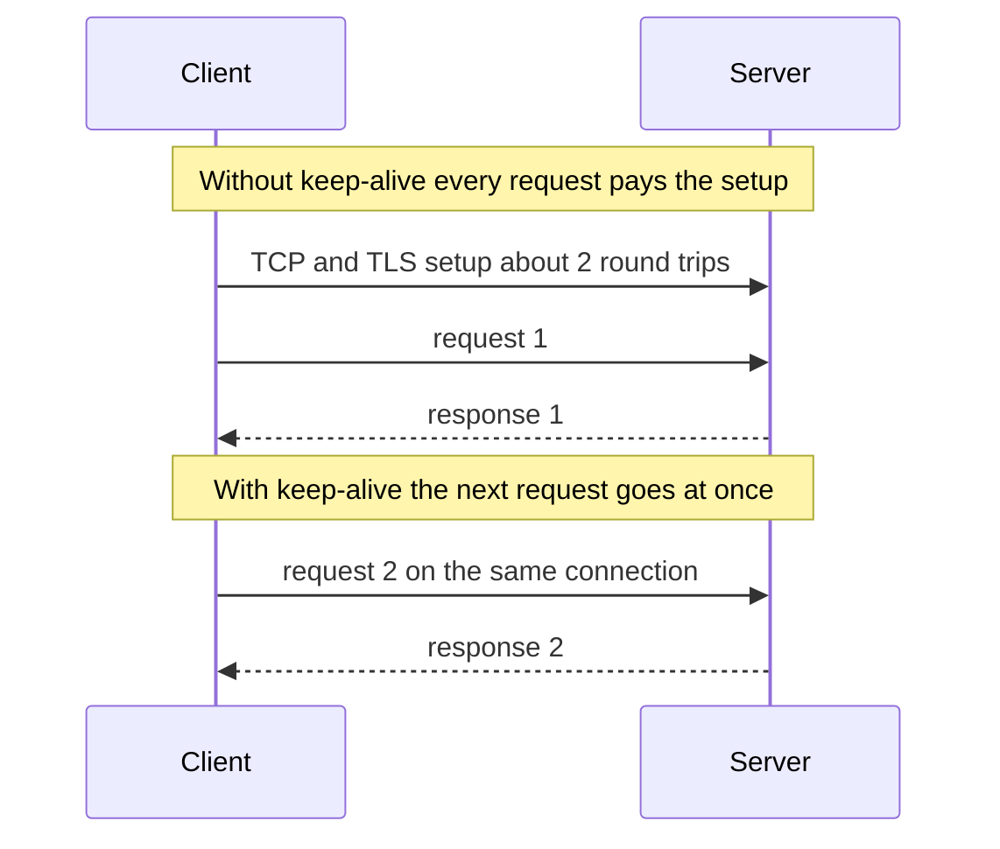

What to notice: the setup is paid once. Every later request saves those round trips.

- Browsers keep connections open on their own.
- Your **server-to-server** calls also need it. Use one shared client for the whole app.
- Node's built in `fetch` reuses connections by default. For the `https` module, pass an agent:

```ts
import { Agent } from "node:https";

// One agent for the whole app: it keeps sockets open and reuses them.
export const agent = new Agent({ keepAlive: true, maxSockets: 50 });
// https.request(url, { agent }, onResponse)
```

**The cost.** Open connections use memory on both sides. A long-lived connection also sticks to one backend, so load can become uneven.

### 2.4 Connection pools

**The problem.** Postgres starts a whole process for each connection. By default it allows only 100 connections (`max_connections`). If every request opened its own connection, a busy API would run out fast.

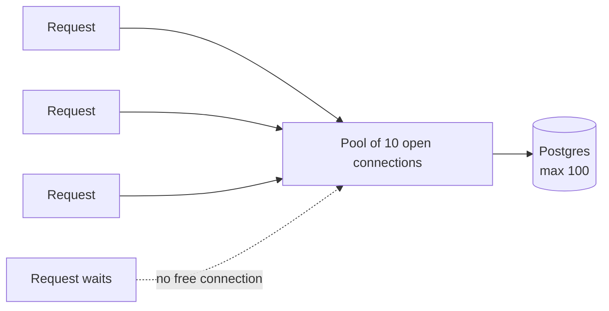

What to notice: requests borrow a connection and give it back. A request waits when all are busy.

- Prisma and `pg` keep a pool for you. You choose the size.
- **Do the math across all copies.** 6 API copies with a pool of 20 each want 120 connections. Postgres allows 100. The seventh deploy breaks.
- Fix: smaller pools, or a pooler like PgBouncer between the app and Postgres. Deep version: [Scaling a database](../database/database-scaling-and-correctness.md).
- HTTP clients pool too. `maxSockets` above is the pool size for calls to one host.

```ts
import { Pool } from "pg";

const pool = new Pool({
  max: 10,                        // at most 10 open connections from this copy
  idleTimeoutMillis: 30_000,      // close idle ones after 30 s
  connectionTimeoutMillis: 2_000, // fail fast if none is free for 2 s
});
```

**Say this:** "I size pools from the database limit down: database max connections, divided by the number of app copies, with room left for admin and workers."

<details><summary>Go deeper (optional): the keep-alive 502</summary>

- A load balancer keeps idle connections to your Node app open, for example for 60 seconds.
- Node closes idle connections after `server.keepAliveTimeout`, which defaults to 5 seconds.
- If Node closes first, the load balancer may send a request on a connection Node just closed. The user sees a random 502.
- Fix: set Node's `keepAliveTimeout` a little longer than the load balancer's idle timeout.

</details>

---

## Part 3: DNS as a design tool [Mid]

**Words you will hear:**
- **TTL (time to live):** how many seconds others may keep a DNS answer before asking again.
- **GeoDNS:** DNS that gives different answers depending on where the asker is.
- **Anycast:** many machines in many places share one IP, and the internet sends you to the nearest.

How one lookup works, step by step, is in the [URL guide, step 4](networking-url-to-page-step-by-step.md). Here we use DNS to steer users.

### 3.1 Records and TTL

**The problem.** Users type a name. Your servers have IP addresses that change. Something must connect the two, and every answer gets copied into many caches.

| Record | Points a name to | Example |
|---|---|---|
| A | an IPv4 address | `api.shop.com -> 203.0.113.10` |
| AAAA | an IPv6 address | `api.shop.com -> 2001:db8::10` |
| CNAME | another name | `www.shop.com -> shop.cdn-provider.net` |

- A CNAME is how you hand a name to a CDN or a load balancer. Their IPs can change and you never edit your record.
- A CNAME cannot sit on the bare domain (`shop.com`). Cloud DNS offers an "alias" record for that.
- **TTL is a promise about staleness.** TTL 300 means a resolver may keep the old answer for 5 minutes.

### 3.2 GeoDNS and latency routing

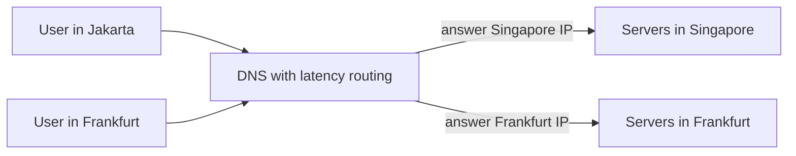

What to notice: the same name gives different answers. Each user goes to the closest servers.

- The DNS provider looks at where the question comes from. It also uses a health check, a regular "are you alive" request, to skip regions that are down. It answers with the closest or fastest region.
- Cloud DNS calls this geolocation routing or latency routing.
- Where it stops working: DNS sees the user's resolver (the DNS server their phone or internet provider uses), not the user. A user with a far away resolver may get a far away answer.

### 3.3 DNS failover and why TTL limits it

**The problem.** A region dies. You change DNS to point to the healthy region. Many users still go to the dead one.

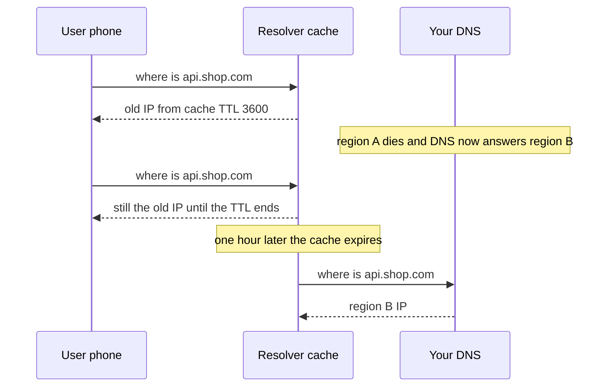

What to notice: your change was instant. The world saw it an hour later, because of the TTL.

- Failover speed is about **the TTL plus the health check time**.
- Short TTL, like 60 seconds, gives faster failover. The cost is more DNS lookups and a little more latency.
- Some clients keep answers longer than the TTL. Long-running apps may look a name up once and keep it.
- Common plan: TTL of 60 to 300 seconds for records you may need to move. Lower the TTL a day before a planned move.

### 3.4 Anycast

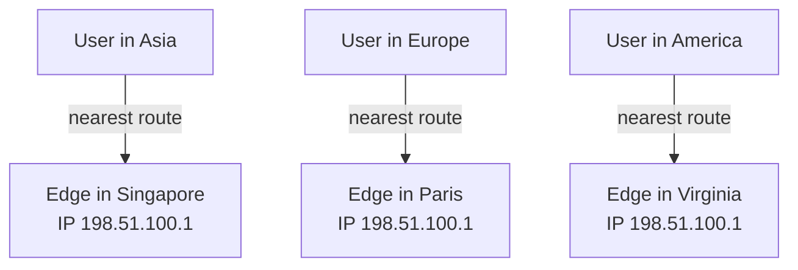

What to notice: all three edges have the same IP. The internet's routing picks the nearest one.

- CDNs and big DNS providers use anycast.
- If one site goes down, its routes are removed. Traffic moves to the next nearest site in seconds or minutes, with no DNS cache to wait for.
- The cost: you need your own IP range and routing setup. You usually rent this from a CDN or cloud provider.

**Say this:** "DNS steers users by place, but failover through DNS is only as fast as the TTL. For fast failover I prefer anycast or a global load balancer with a fixed IP."

---

## Part 4: TCP, UDP and the HTTP versions [Mid]

**Words you will hear:**
- **UDP:** a way to send packets with no order and no resend. Fast and simple.
- **Multiplexing:** many requests share one connection at the same time.
- **Head of line blocking:** one lost or slow item makes everything behind it wait.
- **QUIC:** a newer protocol on top of UDP that HTTP/3 uses.

Deep version of this part: [the URL guide, step 8](networking-url-to-page-step-by-step.md). Here is only what changes your design.

### 4.1 TCP or UDP

| | TCP | UDP |
|---|---|---|
| Order and resend | yes, the system does it | no, your app decides |
| Setup | a handshake first | none |
| A lost packet | everything after it waits | only that packet is gone |
| Used for | HTTP/1.1, HTTP/2, Postgres, Redis | DNS, video calls, games, QUIC |

- Pick UDP when old data is useless. A late video frame is worse than a missing one.
- For almost everything else in web apps, you use TCP or QUIC through HTTP.

### 4.2 What each HTTP version changes

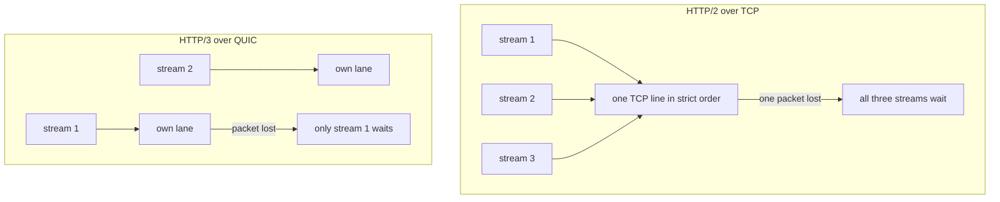

What to notice: HTTP/2 shares one ordered line, so one loss stalls all. HTTP/3 gives each stream its own lane.

| Version | What it changes for your system |
|---|---|
| HTTP/1.1 | one request at a time per connection; browsers open about 6 per site |
| HTTP/2 | many requests on one connection; fewer connections per user; one lost packet still stalls all |
| HTTP/3 | QUIC on UDP; a loss stalls only its stream; one round trip setup; survives Wi-Fi to 4G switches |

- **Mobile networks lose packets often.** That is where HTTP/3 helps most. Uber saw 10 to 30% lower slow-tail latency after moving its apps to QUIC (2019).
- Usually only the edge speaks HTTP/3: the CDN or the load balancer. Behind it, plain HTTP/1.1 or HTTP/2 is normal.
- The cost: QUIC uses more CPU, and some networks block UDP. Clients fall back to TCP.

**Say this:** "HTTP/2 removed the many-connections problem. HTTP/3 removes the lost-packet stall, which matters most on mobile. I turn it on at the CDN and keep TCP as a fallback."

---

## Part 5: Proxies, load balancers and gateways [Mid]

**Words you will hear:**
- **Reverse proxy:** a server in front of your servers that receives requests for them.
- **TLS termination:** the place where HTTPS encryption ends and plain traffic begins.
- **API gateway:** a reverse proxy with API jobs: auth checks, rate limits and routing.
- **Sidecar:** a small proxy that runs next to each service and handles its network calls.

### 5.1 Forward proxy and reverse proxy

**The problem.** Both are called "proxy". They sit on opposite sides and protect different people.

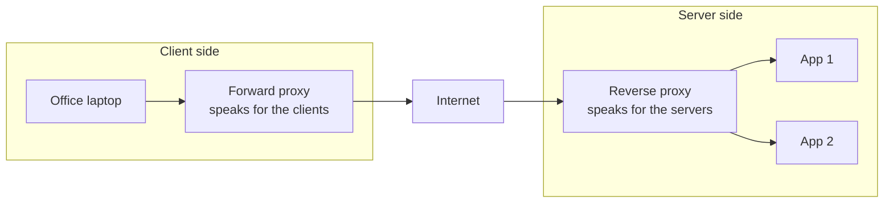

What to notice: a forward proxy hides the clients. A reverse proxy hides the servers.

- **Forward proxy:** company filters, VPN-like tools, and your NAT gateway in Part 9 work this way.
- **Reverse proxy:** nginx, a cloud load balancer, or a CDN. The client thinks it talks to your app.
- A load balancer is a reverse proxy whose main job is spreading work.

### 5.2 TLS termination

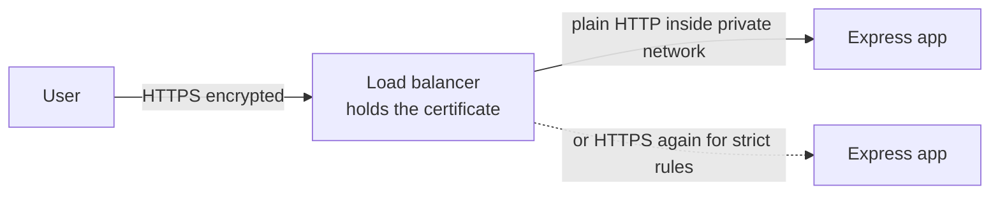

What to notice: encryption ends at the load balancer. Inside, you choose plain or encrypted again.

- Ending TLS at the edge is simpler: one place holds certificates and does the heavy math.
- Banks and health systems often encrypt again inside. That is safer, with more setup.
- **L4 or L7:** an L4 balancer moves connections and cannot read HTTP. An L7 balancer reads the URL and headers and can route by path. Deep version: [Load balancers guide](../system-design/load-balancers-microservices-online-shop.md).

### 5.3 API gateway

**The problem.** Every service checks tokens, limits abusers and logs requests in its own way. Bugs differ in each copy. A gateway does the shared door work once.

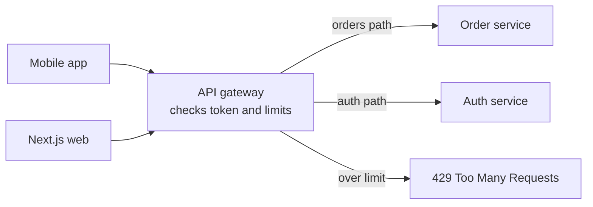

What to notice: the gateway decides who may enter and where they go. It does not do business work.

- **Do at the gateway:** TLS, check the token signature, rate limits, routing by path, request IDs, body size limits, timeouts.
- **Do not do at the gateway:** business rules or joining data from many services. That turns it into a second app.
- A small gateway can be nginx:

```nginx
limit_req_zone $binary_remote_addr zone=perip:10m rate=10r/s;

server {
  listen 443 ssl;                 # certificate lines left out
  location /api/ {
    limit_req zone=perip burst=20;  # 10 per second, short bursts up to 20
    proxy_set_header X-Request-Id $request_id;
    proxy_read_timeout 10s;         # do not wait forever for the app
    proxy_pass http://api_upstream;
  }
}
```

**A question to ask yourself about DBO:** the DBO case study notes that its gateway is likely CapRover's built-in nginx doing routing and TLS. Which of the gateway jobs above does it do today, and which would you add first?

### 5.4 Service mesh and sidecars (short)

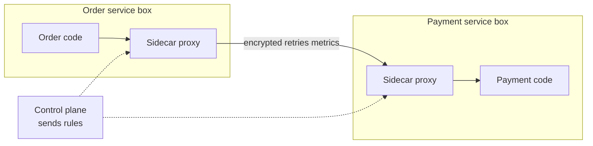

What to notice: the code talks to its own sidecar. The sidecars do encryption, retries and metrics for every service the same way.

- Tools: Istio, Linkerd, Envoy-based meshes.
- Worth it with many services and many teams that need the same security and metrics.
- The cost: one more proxy on every call, more moving parts, and a steep learning curve. For a few services, a good HTTP client library is enough.

**Say this:** "A reverse proxy hides my servers, a load balancer spreads work, and a gateway does the shared door jobs like auth and rate limits. I add a service mesh only when many services need the same network rules."

---

## Part 6: CDN and the edge [Mid]

**Words you will hear:**
- **Edge:** servers owned by a CDN in many cities, close to users.
- **Edge function:** small code that runs on those edge servers.

How caching rules, cache keys and invalidation work is in [Caching and CDN in depth](../system-design/caching-and-cdn-in-depth.md). Here we only place the boxes.

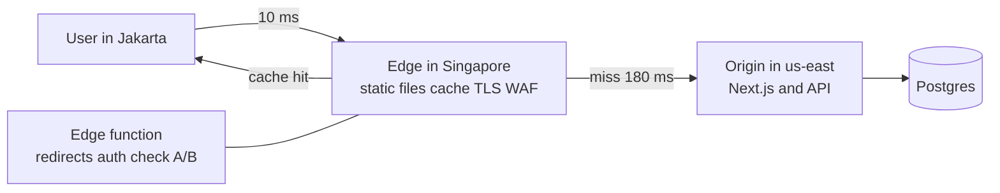

What to notice: most requests stop at the edge. Only misses travel the long way.

**What sits at the edge:**
- Static files: JS, CSS, images, video.
- TLS setup close to the user, so handshakes are short.
- Protection: blocking floods of traffic and bad requests (a WAF, a web application firewall).
- Edge functions: redirects, checking a cookie or token, picking a language, A/B tests.

**The cost and the trap:**
- An edge function is near the user, but your database is in one region.
- If the edge function calls the database three times, each call crosses the world. It becomes slower than running in the region.
- Rule: run at the edge only what needs no database, or reads from a nearby cache.

**Say this:** "I put static files, TLS and simple checks at the edge. Anything that talks to the database many times stays next to the database."

---

## Part 7: Real time [Mid]

**Words you will hear:**
- **SSE (server sent events):** one long HTTP response where the server keeps sending small messages.
- **WebSocket:** one long two-way connection where both sides can send at any time.
- **Fan out:** sending one message to many receivers.
- **Push notification:** a message sent through Apple or Google to wake a phone app.

### 7.1 The problem

HTTP is "client asks, server answers". But the order status changed on the server. How does the app learn it without the user pressing refresh?

### 7.2 Four ways

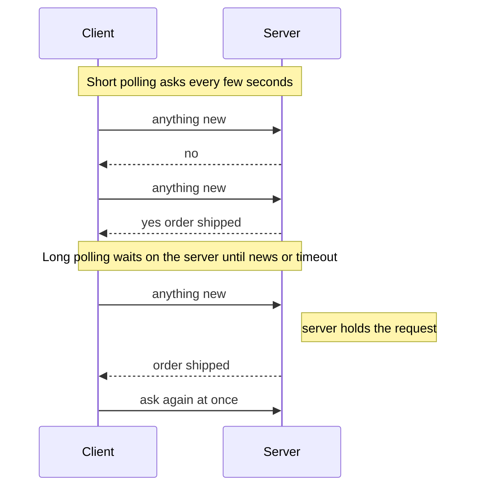

What to notice: short polling wastes many empty answers. Long polling waits on the server, so answers come quickly with fewer requests.

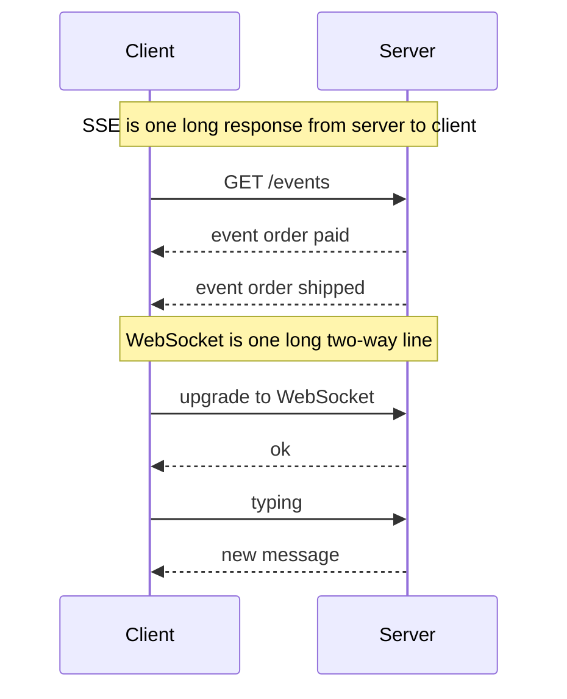

What to notice: SSE only goes server to client. A WebSocket goes both ways.

| Option | Direction | Good for | Watch out |
|---|---|---|---|
| Short polling | client asks | admin dashboards, updates every 30 s or more | wasted requests, delay up to the interval |
| Long polling | client asks, server waits | fallback when nothing else works | many open requests, reconnect logic |
| SSE | server to client | notifications, order status, AI text streaming | one direction; plain HTTP so proxies like it |
| WebSocket | both ways | chat, live collaboration, games | stateful servers, harder to scale and deploy |
| WebTransport | both ways, on HTTP/3 | games, live media, many streams | new; keep a WebSocket fallback |

**WebTransport in 2026:** Safari 26.4 added it in March 2026. MDN now marks it Baseline 2026, which means "newly available" in all major browsers. Older browsers lack it. Many servers and proxies do not support it yet. So it is not the default answer.

### 7.3 Scaling WebSockets

**The problem.** User A is connected to server 1. User B is connected to server 2. A sends B a message. Server 1 does not hold B's connection.

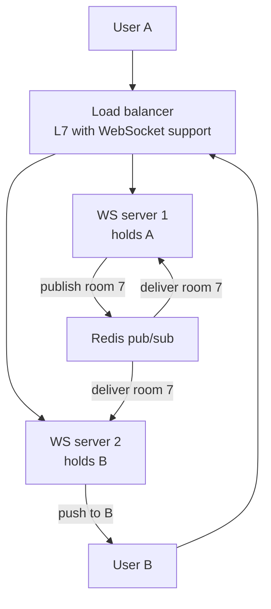

What to notice: servers do not talk to each other directly. They all listen to Redis, and each pushes to its own users.

- **Fan out with pub/sub.** Every server subscribes to the rooms its users are in. Redis delivers each message to every server that cares.
- **Sticky connections.** A WebSocket is one long connection, so it stays on one server by nature. Stickiness matters if the library falls back to long polling, like Socket.IO can.
- **Connections per server.** Each open connection uses memory and a file handle. One server can hold many thousands. Load test to find your number, then add servers.
- **Deploys drop connections.** All clients reconnect at once. Clients must wait a random time before reconnecting (jitter), or they flood the new servers.
- **Idle timeouts.** Load balancers close quiet connections. Send a small ping every 20 to 30 seconds.

### 7.4 Mobile and React Native realities

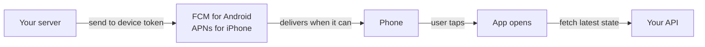

What to notice: the push only says "something changed". The app then asks your API for the truth.

- Phones switch between Wi-Fi and mobile data. Connections break all the time.
- When the app goes to the background, the phone's system closes its sockets. Your WebSocket is gone.
- So for "your order shipped" while the app is closed, use **push notifications**: FCM (Firebase Cloud Messaging) on Android and APNs (Apple Push Notification service) on iPhone.
- Push is not guaranteed and can be late. Never put the only copy of important data in a push. The app should fetch the latest state when it opens.
- In the foreground, use SSE or WebSockets for live screens. Reconnect with backoff, and refetch after reconnecting.

**A question to ask yourself about DBO:** the DBO app shows order history and shipping status, and Manager sends webhooks with order updates. How does the store owner's phone learn about a new status: by polling, by push, or only when they open the screen?

**Say this:** "I start with the simplest option: SSE for server-to-client updates, WebSockets only when the client sends often too. I scale WebSockets with pub/sub between servers, and on mobile I use push notifications when the app is closed."

<details><summary>Go deeper (optional): numbers and details</summary>

- Slack's clients connect by WebSocket to an Envoy proxy in the nearest edge region. Gateway servers, which hold user connections, run in many regions. Channel servers keep channel data and are picked by consistent hashing (source: Slack engineering, Real-time messaging).
- WebSockets over HTTP/2 (RFC 8441) lets many WebSockets share one HTTP/2 connection between proxies. Support across proxies varies.
- Redis pub/sub does not store messages. If a server is down during a message, that message is lost for its users. Use Redis Streams or a database if you need replay.

</details>

---

## Part 8: API styles on the wire [Mid]

**Words you will hear:**
- **Protobuf (Protocol Buffers):** a compact binary format with a shared schema file, used by gRPC.
- **Webhook:** an HTTP call that another system makes to your server when something happens.

**The problem.** Each arrow in your design needs a format and a direction. Picking the same style everywhere is easy, but not always right.

```mermaid
graph LR
    APP["Mobile and web"] -->|REST or GraphQL over HTTPS| GW["Gateway"]
    GW --> API["API service"]
    API -->|gRPC over HTTP/2| SVC["Pricing service"]
    PAY["Payment provider"] -->|webhook POST| API
    API -->|REST call| PAY
```

What to notice: different arrows use different styles. Public clients get REST or GraphQL. Inside, gRPC is common. Outsiders call you with webhooks.

| Style | On the wire | Fits when | Network cost to remember |
|---|---|---|---|
| REST with JSON | many URLs, GET and POST, JSON | public APIs, simple CRUD, CDN caching | many round trips for nested data |
| GraphQL | usually one `POST /graphql` | clients need flexible shapes, many screens | POST is hard to cache at a CDN; limit query depth |
| gRPC | HTTP/2, binary protobuf | service to service, strict contracts, streaming | browsers need gRPC-Web or a proxy; harder to read |
| Webhooks | the other side POSTs to you | third parties tell you about events | must check signatures, answer fast, handle repeats |

**Webhook rules** (they cross the internet, so they fail):
- Check the signature first. Anyone can POST to your URL.
- Save the event, put a job in the queue, answer 200 quickly. Slow answers cause the sender to retry.
- The same event can arrive twice. Store the event ID and skip repeats.
- Webhooks get lost. Also ask the provider's API now and then to fill gaps.

**The cost.** More styles means more tools to learn and debug. A small team often uses one style plus webhooks, and that is a fine answer.

**Say this:** "For public clients I use REST or GraphQL over HTTPS. Between my own services, gRPC if they talk a lot. For third parties, webhooks with signature checks, a queue, and a skip for duplicate event IDs."

---

## Part 9: Cloud network layout [Senior]

**Words you will hear:**
- **VPC (virtual private cloud):** your own private network inside the cloud.
- **Subnet:** a slice of the VPC that lives in one zone. Public subnets can reach the internet directly. Private ones cannot.
- **NAT gateway:** lets private servers call out to the internet, while nobody can call in.
- **Security group:** a firewall on each server that lists who may connect, and on which port.

Reminder from Part 1: a region is a cloud city area, and a zone (AZ) is one or more data centers inside it. AWS keeps zones in a region within about 100 km of each other.

### 9.1 The problem

If your Postgres has a public IP, anyone on the internet can try to log in to it. Bots scan the whole internet for open database ports. You want only your app to reach the database.

### 9.2 A typical AWS layout for Express and Postgres

```mermaid
graph TB
    U["Users"] --> IGW["Internet gateway"]
    subgraph vpc["VPC 10.0.0.0/16 in one region"]
        subgraph pub["Public subnets in AZ a and AZ b"]
            ALB["Load balancer"]
            NAT["NAT gateway"]
        end
        subgraph app["Private app subnets in AZ a and AZ b"]
            E1["Express copy in AZ a"]
            E2["Express copy in AZ b"]
        end
        subgraph data["Private data subnets in AZ a and AZ b"]
            PG[("Postgres primary in AZ a")]
            PG2[("Postgres standby in AZ b")]
        end
    end
    IGW --> ALB
    ALB --> E1
    ALB --> E2
    E1 --> PG
    E2 --> PG
    PG -.->|copy| PG2
    E1 -->|outbound only| NAT
    NAT --> IGW
```

What to notice: only the load balancer can be reached from the internet. The app and the database have no public door.

**The security groups, as a chain:**

| Security group | Allows in | From |
|---|---|---|
| `alb-sg` | port 443 | anywhere on the internet |
| `app-sg` | port 3000 | only `alb-sg` |
| `db-sg` | port 5432 | only `app-sg` |

- Each group points at the group before it, not at IP addresses. New app copies get access by joining `app-sg`.
- Security groups remember allowed connections, so answers flow back without extra rules.
- The app calls Stripe or an email API out through the NAT gateway.
- For AWS services like S3, a **VPC endpoint** keeps the traffic inside AWS. For a partner's service, **PrivateLink** does the same. Traffic then skips the NAT gateway and the internet.

### 9.3 The costs designers forget

```mermaid
graph LR
    A["App in AZ a"] -->|free inside one AZ| C["Redis in AZ a"]
    A -->|0.01 USD per GB each way| B["Postgres in AZ b"]
    A -->|0.045 USD per GB plus hourly| N["NAT gateway"]
```

What to notice: the same call can be free or cost money, depending on where the boxes sit.

- **Cross-zone traffic:** AWS charges $0.01 per GB in each direction between zones in one region. A chatty service across zones pays twice per GB.
- **NAT gateway:** about $0.045 per hour plus $0.045 per GB processed, in AWS's own example. Prices vary by region. Pulling large files through NAT gets expensive. A free S3 gateway endpoint avoids that charge.
- **Latency:** cross-zone adds about 1 to 2 ms per trip. That is small, but a loop of 200 calls adds a third of a second.
- **The tradeoff:** two zones keep you alive when one zone fails. That safety costs cross-zone traffic. Most teams pay it. They keep very chatty pairs, like an app and its cache, in the same zone where they can.

**Say this:** "I put only the load balancer in public subnets. The app and database sit in private subnets across two zones, with security groups that chain load balancer to app to database. I watch cross-zone and NAT traffic because they show up on the bill."

<details><summary>Go deeper (optional)</summary>

- Network ACLs are a second, subnet-level firewall. They do not remember connections, so you must allow both directions. Most teams use security groups and leave ACLs open.
- Each NAT gateway lives in one zone. For high availability, run one per zone, so a zone failure does not cut outbound traffic for the others.
- On CapRover or plain Docker Swarm the same ideas exist: an overlay network is the private network, and only nginx publishes ports 80 and 443.

</details>

---

## Part 10: Timeouts, retries and failures [Senior]

**Words you will hear:**
- **Retry storm:** retries from many layers and clients pile up and crush a service that was only a little slow.
- **Idempotent:** doing it twice has the same result as doing it once.
- **Network partition:** two parts of your system are both running but cannot reach each other.
- **Circuit breaker:** code that stops calling a failing service for a short time.

### 10.1 Timeouts at every hop

**The problem.** The database gets slow. With no timeout, each request waits forever. Requests pile up, hold connections, use memory, and the API falls over. A slow part became a dead whole.

```mermaid
graph LR
    C["Client gives up at 10 s"] --> G["Gateway 8 s"]
    G --> A["API 5 s"]
    A --> D["DB query 2 s"]
    A --> X["Partner API 3 s"]
```

What to notice: each inner timeout is shorter than the one outside it. The inner part gives up first and can still send a clear error.

- Put a timeout on **every** network call: database, HTTP, Redis, queues.
- Inner hops get shorter timeouts than outer hops. If the gateway gives up at 8 s, an API still working at 9 s wastes effort.
- Better: pass a deadline down. "You have 4 seconds left" travels with the request.
- Choose the value from data, for example a little above the slowest 0.1% of normal calls. AWS describes this method in the Builders' Library.

### 10.2 Where retries multiply

```mermaid
graph LR
    C["Client<br/>3 tries"] -->|3 calls| G["Gateway<br/>3 tries each"]
    G -->|9 calls| A["API<br/>3 tries each"]
    A -->|27 calls| D[("Database<br/>already slow")]
```

What to notice: one user click became 27 database calls. The database was slow. Now it is crushed.

**Rules:**
- **Retry at one layer only**, usually the one closest to the caller who cares.
- **Wait longer each time, plus a random part** (exponential backoff with jitter). Clients then do not all retry at the same moment.
- **Limit retries overall**, for example "retries may be at most 10% of calls". This is a retry budget.
- **Retry only what is safe to repeat.** GET is safe. "Charge the card" is safe only with an idempotency key.
- **Stop calling a dead service** for a while with a circuit breaker. Deep version: [Distributed systems and reliability patterns](../system-design/distributed-systems-and-reliability-patterns.md).

```ts
async function getWithRetry(url: string, tries = 3): Promise<Response> {
  for (let i = 1; i <= tries; i++) {
    try {
      const res = await fetch(url, { signal: AbortSignal.timeout(2000) });
      if (res.status < 500 || i === tries) return res; // 4xx: retrying will not help
    } catch (err) {
      if (i === tries) throw err;                       // timeout or network error
    }
    const waitMs = Math.random() * 200 * 2 ** i;         // backoff with jitter
    await new Promise((r) => setTimeout(r, waitMs));
  }
  throw new Error("unreachable");
}
```

### 10.3 A timeout does not mean "it did not happen"

```mermaid
sequenceDiagram
    participant A as Your API
    participant P as Payment provider
    A->>P: charge 50 USD key order-42
    Note over P: charge succeeds
    P--xA: answer lost on the network
    Note over A: timeout so the result is unknown
    A->>P: retry charge 50 USD key order-42
    P-->>A: already done here is the same result
```

What to notice: the first charge worked, but the answer was lost. The idempotency key stops a double charge.

- After a timeout you do not know the result. The work may be done, half done, or not started.
- So the receiver must treat repeats as one: an idempotency key, a unique constraint, or a check of current state.

### 10.4 Network partitions and the fallacies

**The problem.** Your app servers can reach users but not the database. Both sides are "up". Health checks that only ping the server say everything is fine.

The **fallacies of distributed computing** are eight false beliefs, listed by Peter Deutsch and others at Sun in the 1990s:

| False belief | What goes wrong | What you design instead |
|---|---|---|
| The network is reliable | calls fail or hang | timeouts, retries, idempotency |
| Latency is zero | chatty calls get slow | batch calls, keep chatty parts close |
| Bandwidth is infinite | big payloads clog links | paginate, compress, send less |
| The network is secure | traffic can be read or faked | TLS, private subnets, signed webhooks |
| Topology does not change | IPs and routes change | use names, a live list of where services run, short TTL |
| There is one administrator | rules differ per team and provider | clear owners, network rules kept in code |
| Transport cost is zero | bills for cross-zone and NAT traffic | place boxes with cost in mind |
| The network is the same everywhere | mobile is not office Wi-Fi | test on slow, lossy networks |

**Say this:** "Every call gets a timeout, shorter on the inside. I retry at one layer with backoff and jitter, only for idempotent calls, and I design for the case where a call timed out but the work happened."

---

## Part 11: Many regions [Senior]

**Words you will hear:**
- **Active-passive:** one region serves users. A second region waits, ready to take over.
- **Active-active:** two or more regions serve users at the same time.
- **Global load balancer:** a service that sends each user to a healthy region, often using a fixed anycast IP.

**The problem.** One region can fail, as AWS us-east-1 did in October 2025 (see the [URL guide cases](networking-url-to-page-step-by-step.md)). Users far away also pay a long round trip on every request.

```mermaid
graph TB
    subgraph ap["Active-passive"]
        U1["Users"] --> D1["DNS failover record"]
        D1 -->|normal| R1["Region A serves all"]
        D1 -.->|only when A fails| R2["Region B waits"]
        R1 -.->|async copy| R2
    end
    subgraph aa["Active-active"]
        U2["Users"] --> GLB["Global load balancer"]
        GLB --> RA["Region A serves Asia"]
        GLB --> RB["Region B serves Europe"]
        RA -.->|copy both ways| RB
    end
```

What to notice: active-passive is simple, but the standby sits idle. Active-active uses both, but now two places write data.

| | Active-passive | Active-active |
|---|---|---|
| Network routing | DNS failover, limited by TTL | latency routing or anycast global load balancer |
| Failover time | minutes, with DNS TTL and promoting the database | seconds for routing; data rules still matter |
| Data | one writer; the copy lags behind | writes in both places: conflicts to solve |
| Data lost on failover | what the copy had not received yet | depends on the design |
| Cost | standby costs money while idle | full cost in each region, plus cross-region traffic |

- The network part is the easy part. The data part is hard. Each write must go somewhere, and copies across regions lag by at least one long round trip.
- A common middle way: each user has a home region. All their writes go there. Reads can be served nearby.
- Anycast-based global load balancers switch in seconds. DNS-based ones wait for the TTL.

**Say this:** "I start in one region with two zones. I add a passive second region when the business needs to survive a region outage. I go active-active only when users far away need low latency, and I solve where each user's writes go first."

---

## Part 12: Draw the network for a design [All levels]

### The checklist, in order

1. **Who are the clients?** Mobile app, web, partners. Where are they in the world?
2. **How do they find you?** DNS name, TTL, latency routing if you have many regions.
3. **What can be answered near them?** CDN for static files and cacheable pages. Edge checks only if they need no database.
4. **What is the front door?** Load balancer plus gateway: TLS, auth check, rate limits, routing.
5. **Which services, and how do they talk?** Keep sync hops few. Use a queue for slow work.
6. **Where does data live?** Database, cache and queue in private subnets, across two zones.
7. **How do servers reach the outside?** NAT gateway or private endpoints. How do outsiders reach you? Webhooks through the gateway.
8. **Real time?** SSE or WebSockets with pub/sub, and push notifications for phones.
9. **Timeouts and retries per arrow.** Write the number on the arrow.
10. **What if a zone or region dies?** Point to the copy and say how fast traffic moves.

### The full picture

```mermaid
graph TB
    MA["React Native app"] --> DNS["DNS"]
    WB["Next.js web"] --> DNS
    DNS --> CDN["CDN edge<br/>static files TLS WAF"]
    CDN --> LB["Load balancer and API gateway<br/>public subnet"]
    subgraph priv["Private subnets across 2 zones"]
        API["API service"]
        WS["Realtime service<br/>SSE or WebSocket"]
        WK["Workers"]
        PG[("Postgres primary and standby")]
        RD[("Redis cache and pub/sub")]
        Q["Queue"]
    end
    LB --> API
    LB --> WS
    API --> PG
    API --> RD
    API --> Q
    Q --> WK
    WK -->|push| PUSH["FCM and APNs"]
    PUSH -.-> MA
```

What to notice: everything below the load balancer is private. Phones get updates by push when the app is closed, and by the realtime service when it is open.

**Say this when you draw it:** "Clients find us by DNS and hit the CDN first. Only misses reach the load balancer, which is the only public box. Behind it, everything is private and spread over two zones. Slow work goes through a queue, and phones hear about it by push."

---

## Practice

Try each one before you open the answer.

**1. Predict.** A page in Jakarta calls your API in us-east (round trip 200 ms). It makes 5 calls one after another. Each call opens a new HTTPS connection: 2 round trips of setup plus 1 for the request. How long is the network wait? What if you reuse one connection?

<details><summary>Answer</summary>

- New connection each time: 5 calls x 3 round trips x 200 ms = 3,000 ms.
- One reused connection: 2 round trips of setup once, then 5 round trips = 7 x 200 = 1,400 ms.
- Run the 5 calls in parallel on HTTP/2: about 2 + 1 = 3 round trips = 600 ms. A CDN edge in Singapore would cut each round trip much further.

</details>

**2. Spot the bug in the design.** Postgres is in a public subnet. Its security group allows port 5432 from `0.0.0.0/0` "so the developers can connect from home".

<details><summary>Answer</summary>

- The whole internet can try to log in. Bots scan for open database ports all day.
- Fix: move Postgres to a private data subnet. Allow 5432 only from `app-sg`. Developers connect through a small locked-down jump server, a VPN, or a cloud session manager.

</details>

**3. Spot the bug.** Mobile app timeout 5 s. Gateway timeout 30 s. API timeout to the database 60 s. Retries: app 3 times, gateway 3 times.

<details><summary>Answer</summary>

- The timeouts are upside down. The app gives up at 5 s, but the gateway and API keep working for 30 to 60 s on a request nobody waits for.
- Retries stack: 3 x 3 = 9 calls for one tap, during a slow period.
- Fix: database 2 s, API 4 s, gateway 6 s, app 8 s. Retry in one place only, with backoff and jitter.

</details>

**4. Choose.** A dashboard shows live order status. The browser never sends data back on this screen. SSE or WebSockets?

<details><summary>Answer</summary>

- SSE. Data only flows from server to client. SSE is plain HTTP, so proxies and load balancers handle it easily, and the browser reconnects by itself.
- Pick WebSockets when the client also sends often, like chat or live editing.

</details>

**5. Predict.** Your DNS record for `api.shop.com` has TTL 86,400 (one day). The region dies at 09:00. You switch DNS at 09:05. When are most users back?

<details><summary>Answer</summary>

- Some users only at about 09:05 the next day, when their resolver's cache expires. Some clients may hold the answer even longer.
- Fix ahead of time: TTL 60 to 300 seconds on records you may need to move, or a fixed anycast IP from a global load balancer.

</details>

**6. Count.** Client 4 tries, gateway 4 tries, API 4 tries. The database is down. How many database calls for one tap?

<details><summary>Answer</summary>

- 4 x 4 x 4 = 64 calls. With 1,000 users tapping, that is 64,000 calls to a database that is already in trouble.

</details>

**7. Pool math.** 8 API copies, each with a Prisma pool of 20. Postgres `max_connections` is 100. What happens, and what are two fixes?

<details><summary>Answer</summary>

- 8 x 20 = 160 wanted, 100 allowed. Under load, new connections fail with "too many connections".
- Fix 1: pool of 10 per copy (80 total, room left for workers and admin).
- Fix 2: put PgBouncer in front and let many app connections share fewer real ones.

</details>

**8. Draw it.** Draw the network for a React Native shop app with an Express API, Postgres, Redis and order-status push. Mark public and private subnets, and write a timeout on each arrow.

<details><summary>Answer</summary>

- Compare with the Part 12 picture. Check: only the load balancer is public; database and Redis are private across two zones; a worker sends push through FCM and APNs; every arrow has a timeout, shorter on the inside.

</details>

---

## Likely interview questions

**Q1. Users in Indonesia say the app is slow. The servers are in us-east-1. What do you do?**

<details><summary>Answer</summary>

- **Problem:** each round trip from Jakarta to us-east is about 200 ms. Many trips per screen add up to seconds.
- **How it works:** measure first: count trips per screen and time each stage. Then cut trips (reuse connections, batch calls, HTTP/2 or 3), add a CDN edge near them for static and cacheable data, and move chatty server-to-server calls into one zone.
- **Tradeoff:** a second region near Indonesia gives the biggest win, but brings data copies and failover work. Try the cheap fixes first.
- **My example (idea):** Skyworx builds loan systems for Indonesian banks. A good question to ask there: where do the servers run, and how many round trips does one screen make?

</details>

**Q2. How do you scale WebSockets to a million connections?**

<details><summary>Answer</summary>

- **Problem:** one server cannot hold all connections, and users in one chat room sit on different servers.
- **How it works:** many WebSocket servers behind an L7 load balancer. Each server subscribes to its users' rooms in Redis pub/sub (or a similar broker). A message is published once and each server pushes it to its own users. Load test to know connections per server. Clients reconnect with jitter after deploys. Pings keep idle connections alive.
- **Tradeoff:** servers hold state, so deploys and failures drop connections. Redis pub/sub does not store messages, so missed messages need a refetch from the database.
- **My example (idea):** for a live order screen in a commerce app like DBO, I would first ask if SSE is enough, because it is simpler to run.

</details>

**Q3. Polling, SSE, WebSockets: which one for order status updates?**

<details><summary>Answer</summary>

- **Problem:** HTTP only lets the client ask. The server has news.
- **How it works:** short polling asks on a timer. Long polling holds the request until news. SSE streams server-to-client events on one HTTP response. WebSockets are a two-way long connection.
- **Tradeoff:** polling is simplest but wastes requests and adds delay. SSE is simple and one way. WebSockets are two way but harder to scale and deploy.
- **My example (idea):** order status only flows server to client, so SSE when the app is open, and push notifications when it is closed.

</details>

**Q4. What is the difference between a load balancer, a reverse proxy and an API gateway?**

<details><summary>Answer</summary>

- **Problem:** many services need one safe front door.
- **How it works:** a reverse proxy receives requests for your servers. A load balancer is a reverse proxy that spreads load and checks health. An API gateway adds API jobs: token checks, rate limits, routing by path, request IDs.
- **Tradeoff:** a gateway removes repeated code but is one more hop. If it grows business logic, it becomes a second app.
- **My example (fact plus idea):** the DBO case study notes the gateway is likely CapRover's nginx doing routing and TLS. Adding rate limits on login and OTP routes would be my first step.

</details>

**Q5. Why does DNS failover take so long, and what is faster?**

<details><summary>Answer</summary>

- **Problem:** after you change a record, users still go to the dead region.
- **How it works:** resolvers and clients cache answers for the TTL. Some keep them longer. Failover time is about health check time plus TTL.
- **Tradeoff:** a short TTL fails over faster but adds DNS lookups. Anycast or a global load balancer with fixed IPs switch in seconds, but cost more and add a vendor.
- **My example (idea):** for any app I run, I would lower TTLs before a planned server move.

</details>

**Q6. Draw a typical AWS network for an Express and Postgres app. Why is the database private?**

<details><summary>Answer</summary>

- **Problem:** a database with a public IP is attacked by internet scanners.
- **How it works:** a VPC with public subnets for the load balancer and NAT gateway, and private subnets for the app and the database, in two zones. Security groups chain: internet to load balancer on 443, load balancer to app on 3000, app to database on 5432.
- **Tradeoff:** two zones survive a zone failure but add cross-zone traffic cost and about 1 to 2 ms per trip. NAT gateways cost per hour and per GB.
- **My example (idea):** my AWS experience is light. I would explain how a CapRover setup maps to this: nginx is the only public part and the overlay network is the private part.

</details>

**Q7. How do you set timeouts and retries across services?**

<details><summary>Answer</summary>

- **Problem:** without timeouts, one slow part freezes everything. With retries at every layer, a slow part gets crushed.
- **How it works:** timeouts on every call, shorter on the inside, or a deadline passed down. Retries at one layer, with exponential backoff and jitter, a retry budget, and only for idempotent calls. A circuit breaker stops calls to a dead service.
- **Tradeoff:** short timeouts cause false failures. Long ones hold resources. Pick from real latency data.
- **My example (idea):** for a third party like DBO's WhatsApp OTP provider Jatis, a short timeout keeps a slow provider from freezing the login flow.

</details>

**Q8. REST, GraphQL or gRPC between your services?**

<details><summary>Answer</summary>

- **Problem:** each style has different network costs.
- **How it works:** REST uses many URLs and caches well. GraphQL uses one endpoint and lets clients pick fields. gRPC uses HTTP/2 and binary protobuf with a strict contract.
- **Tradeoff:** gRPC is fast and typed but harder to debug and not native in browsers. GraphQL is flexible for clients but harder to cache at a CDN. REST is simple but can need many round trips.
- **My example (fact plus idea):** DBO's API serves GraphQL (Nexus and Prisma) to the app and the CMS. Between internal services, I would only add gRPC if they talk very often.

</details>

**Q9. A React Native app must show a new order status, even when the app is closed. How?**

<details><summary>Answer</summary>

- **Problem:** the phone closes sockets for background apps. A WebSocket cannot reach a closed app.
- **How it works:** the server sends a push through FCM (Android) and APNs (iPhone) using the device token. When the user opens the app, it fetches the latest state from the API. While the app is open, SSE or WebSockets keep the screen live.
- **Tradeoff:** push can be late or dropped. Never make it the only copy of important data.
- **My example (idea):** for ZWS, the React Native store with subscriptions, a "your subscription renews tomorrow" push would follow this pattern.

</details>

**Q10. Our AWS bill shows a big data transfer cost. Where do you look?**

<details><summary>Answer</summary>

- **Problem:** network traffic is billed, and the fallacy "transport cost is zero" hides it.
- **How it works:** check cross-zone traffic ($0.01 per GB each way), NAT gateway processing ($0.045 per GB in AWS's example), and traffic out to the internet. Look for chatty services across zones, and large downloads through NAT.
- **Tradeoff:** keeping everything in one zone is cheaper but loses zone failure safety. Use VPC endpoints for S3, and keep chatty pairs in one zone.
- **My example (idea):** a question to ask on any project: does the app pull images or backups through a NAT gateway?

</details>

**Q11. What does a network partition do to your system?**

<details><summary>Answer</summary>

- **Problem:** two parts are both running but cannot reach each other.
- **How it works:** calls time out. Each side must decide: refuse work to stay correct, or keep serving with possibly old data. Health checks must test real dependencies, not only "is the process up".
- **Tradeoff:** refusing keeps data correct but users see errors. Serving keeps the app up but data may disagree for a while.
- **My example (idea):** for money-like flows such as points redemption, I would refuse and retry later rather than guess.

</details>

---

## What's current (2026)

- **HTTP/3 is common at the edge, less common in requests.** W3Techs shows about 38 to 39% of websites supporting HTTP/3 in early 2026 pages. The [URL guide](networking-url-to-page-step-by-step.md) recorded 40.7% in September 2026. One Q1 2026 analysis of Cloudflare Radar data puts real HTTP/3 requests near 21%. Sites support it, but many requests still use HTTP/2.
- **WebTransport reached all major browsers in March 2026.** Safari 26.4 added it. MDN marks WebTransport as Baseline 2026, meaning newly available. Chrome has had it since version 97 and Firefox since 114. Plan a WebSocket fallback for older browsers and servers.
- **AWS cross-zone traffic is still $0.01 per GB in each direction** (2026 sources). NAT gateway pricing in AWS's own example is $0.045 per hour and $0.045 per GB. Prices vary by region.
- **AWS zones are up to about 100 km apart**, with single digit millisecond latency between them (AWS Fault Isolation Boundaries whitepaper).
- **WebSockets remain the default two-way choice** in 2026. SSE has become popular again because AI chat apps stream text with it.

---

## Real-world cases to cite

- **Slack, real-time messaging (2023):** clients open a WebSocket to an Envoy proxy in the nearest edge region. Gateway servers hold user connections in many regions. Channel servers are picked by consistent hashing, a way to map each channel ID to one server. Cite it for "how to scale WebSockets with fan out". [Slack engineering: Real-time messaging](https://slack.engineering/real-time-messaging/)
- **Slack, moving WebSockets from HAProxy to Envoy:** they moved millions of live WebSocket connections to a new proxy without downtime. Cite it for "proxies in front of long-lived connections". [Slack engineering](https://slack.engineering/migrating-millions-of-concurrent-websockets-to-envoy/)
- **Slack outage, 4 January 2021:** on the first workday after the holidays, clients with cold caches pulled more data than usual. Slack's post-mortem describes how the cloud network between their servers struggled with the surge, and how adding servers fast hit its own limits. Cite it for "the network is not infinite" and "scaling up needs room to grow". [Slack engineering post-mortem](https://slack.engineering/a-terrible-horrible-no-good-very-bad-day-at-slack/)
- **Uber, QUIC for mobile apps (2019):** HTTP/2 over TCP did poorly on lossy mobile networks. Moving to QUIC cut slow-tail latency by 10 to 30% in the rider and driver apps. Cite it for "why HTTP/3 matters on mobile". [Uber blog](https://www.uber.com/blog/employing-quic-protocol/)
- **Amazon, timeouts, retries and backoff with jitter:** Amazon's Builders' Library explains choosing timeouts from latency data, retrying with capped backoff and jitter, and how retries at many layers multiply load. Cite it for retry storms. [Amazon Builders' Library](https://aws.amazon.com/builders-library/timeouts-retries-and-backoff-with-jitter)

---

## Watch and play

- [Latency Numbers Every Programmer Should Know (samwho.dev)](https://samwho.dev/numbers): interactive. Compare a same-data-center trip with a cross-world trip.
- [Long Polling vs SSE vs WebSockets vs Webhooks (YouTube, AlgoMaster)](https://www.youtube.com/watch?v=-3rFgUiKKG4): the four real time options side by side. Pause after each and draw it.
- [Proxy vs Reverse Proxy (ByteByteGo guide)](https://bytebytego.com/guides/proxy-vs-reverse-proxy/): one clear picture of the two sides.
- [HTTP/1 to HTTP/2 to HTTP/3 (ByteByteGo guide)](https://bytebytego.com/guides/http1-http2-http3/): one picture of what each version changed.
- [System Design 101 (GitHub)](https://github.com/ByteByteGoHq/system-design-101): visual guides on CDN, API gateway, gRPC, polling vs webhooks, NAT and DNS records.
- [WebTransport support (Can I use)](https://caniuse.com/webtransport): check live browser support before you suggest it.
- [Timeouts, retries and backoff with jitter (Amazon Builders' Library)](https://aws.amazon.com/builders-library/timeouts-retries-and-backoff-with-jitter): read the retry section, then redo Practice 6.

---

## Explain it back

Close this file. Draw the Part 12 picture from memory. Then explain out loud, in about 2 minutes, why only the load balancer is public and what happens when the database gets slow. Use `/explain-check networking for system design` or the `explain-coach` agent.

### My explanation

### Coach feedback

---

## Review questions (day 1, 3, 7, 21)

**Day 1. Why is a cross-world round trip about 150 ms or more, even with fast servers?**

<details><summary>Answer</summary>

Light in fiber travels about 200 km per millisecond. Across the world and back is tens of thousands of km, and real cables do not run straight. No server speed fixes distance. Only moving closer or fewer trips helps.

</details>

**Day 3. Why does DNS failover take time, and what is faster?**

<details><summary>Answer</summary>

Resolvers keep old answers until the TTL ends, and some keep them longer. Use a short TTL for records you may move, or an anycast global load balancer with fixed IPs.

</details>

**Day 7. How do you send a chat message from a user on server 1 to a user on server 2?**

<details><summary>Answer</summary>

Server 1 publishes the message to a pub/sub channel, for example in Redis. Every WebSocket server subscribed to that room gets it, and server 2 pushes it to its user.

</details>

**Day 21. Draw the AWS layout for Express and Postgres from memory, with the three security groups.**

<details><summary>Answer</summary>

Internet gateway, then a load balancer in public subnets in two zones. Express in private app subnets. Postgres primary and standby in private data subnets. NAT gateway in a public subnet for outbound calls. Security groups: `alb-sg` allows 443 from anywhere, `app-sg` allows 3000 from `alb-sg`, `db-sg` allows 5432 from `app-sg`.

</details>

---

## Sources

- [Availability Zones, AWS Fault Isolation Boundaries whitepaper](https://docs.aws.amazon.com/whitepapers/latest/aws-fault-isolation-boundaries/availability-zones.html) (accessed 2026-10-16): zones up to about 100 km apart, single digit ms latency.
- [AWS Regions and Availability Zones](https://aws.amazon.com/about-aws/global-infrastructure/regions_az/) (accessed 2026-10-16)
- [Amazon VPC pricing](https://aws.amazon.com/en/vpc/pricing/) (accessed 2026-10-16): NAT gateway $0.045 per hour and per GB in AWS's example.
- [How much does AWS data transfer cost between AZs in the same region? (Last Week in AWS)](https://www.lastweekinaws.com/blog/aws-cross-az-data-transfer-costs-more-than-aws-says) (accessed 2026-10-16): $0.01 per GB each direction.
- [Timeouts, retries and backoff with jitter (Amazon Builders' Library)](https://aws.amazon.com/builders-library/timeouts-retries-and-backoff-with-jitter) (accessed 2026-10-16)
- [System Design Primer (GitHub)](https://github.com/donnemartin/system-design-primer) (opened 2026-10-16): latency table, RPC vs REST.
- [System Design 101 (GitHub)](https://github.com/ByteByteGoHq/system-design-101) (opened 2026-10-16)
- [WebKit Features for Safari 26.4](https://webkit.org/?p=17862) (March 2026, accessed 2026-10-16): WebTransport in Safari.
- [WebTransport API, MDN](https://developer.mozilla.org/docs/Web/API/WebTransport_API) (accessed 2026-10-16): Baseline 2026.
- [Can I use: WebTransport](https://caniuse.com/webtransport) (accessed 2026-10-16)
- [W3Techs HTTP/3 breakdown by content delivery](https://w3techs.com/technologies/breakdown/ce-http3/content_delivery) (pages dated February and March 2026, accessed 2026-10-16)
- [We analyzed HTTP protocol adoption in 2026 (technologychecker.io)](https://technologychecker.io/blog/http-protocol-adoption) (Q1 2026, accessed 2026-10-16): about 21% of requests on HTTP/3 per Cloudflare Radar. Secondary source.
- [Slack engineering: Real-time messaging](https://slack.engineering/real-time-messaging/) (2023, accessed 2026-10-16)
- [Slack engineering: Migrating millions of concurrent WebSockets to Envoy](https://slack.engineering/migrating-millions-of-concurrent-websockets-to-envoy/) (accessed 2026-10-16)
- [Slack engineering: A terrible, horrible, no-good, very bad day at Slack](https://slack.engineering/a-terrible-horrible-no-good-very-bad-day-at-slack/) (2021, accessed 2026-10-16)
- [Slack status, 4 January 2021](https://status.slack.com/2021-01-04) (accessed 2026-10-16)
- [Uber: Employing QUIC protocol to optimize Uber's app performance](https://www.uber.com/blog/employing-quic-protocol/) (May 2019, accessed 2026-10-16)
- [Latency Numbers Every Programmer Should Know (samwho.dev)](https://samwho.dev/numbers) (accessed 2026-10-16)
- [Long Polling vs SSE vs WebSockets vs Webhooks (YouTube, AlgoMaster)](https://www.youtube.com/watch?v=-3rFgUiKKG4) (accessed 2026-10-16)
- [ByteByteGo: Proxy vs Reverse Proxy](https://bytebytego.com/guides/proxy-vs-reverse-proxy/) and [HTTP/1 to HTTP/2 to HTTP/3](https://bytebytego.com/guides/http1-http2-http3/) (accessed 2026-10-16)
- [How to Scale WebSocket Connections (OneUptime)](https://oneuptime.com/blog/post/2026-01-26-websocket-scaling/view) (January 2026, accessed 2026-10-16)
- Fallacies of distributed computing: the well known list by Peter Deutsch and colleagues at Sun Microsystems (1994, with the eighth added later). No link was checked for this.
- Workspace: [DBO case study](../../interview/my-projects/dbo-b2b-platform-system-design-case-study.md) (facts used: React Native app, GraphQL with Nexus and Prisma, CapRover with nginx, Manager webhooks, Jatis OTP).
