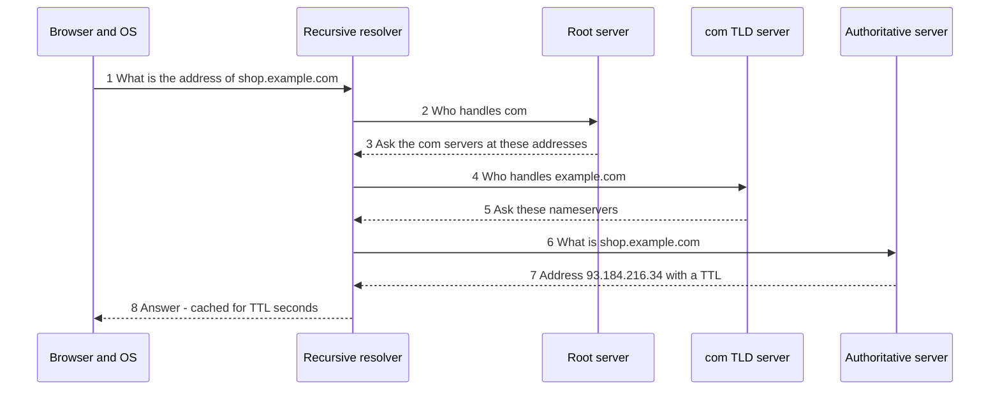
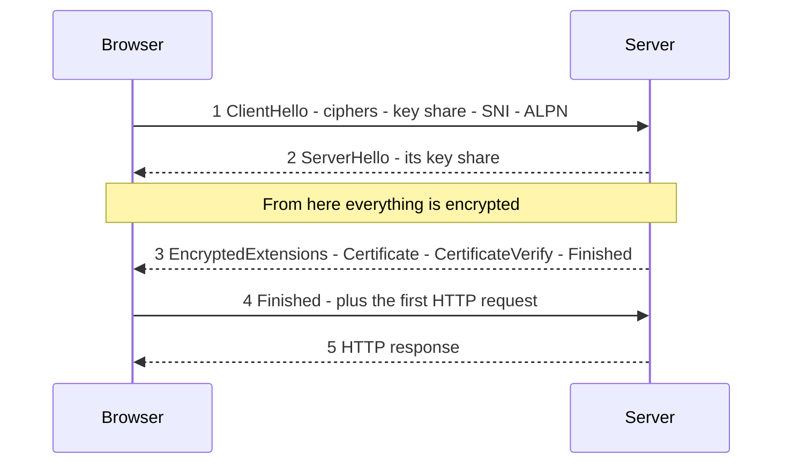
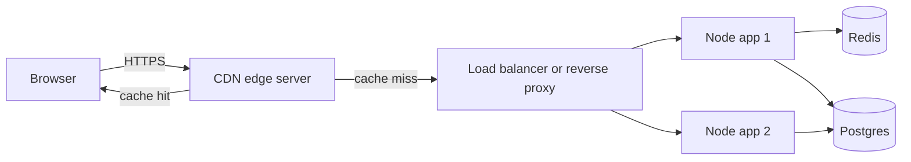
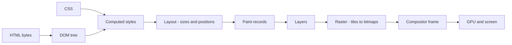

# What Happens When You Type a URL — The Full Network Journey, Step by Step

- **Researched:** 2026-09-21
- **Target:** Software Engineer / Senior Software Engineer, international companies (networking depth questions)
- **Sources freshness:** protocol facts are stable (RFCs). Current-state numbers are from 2025–2026 and dated where used.
- **Companion:** [system-design-step-by-step-walkthrough.md](../system-design/system-design-step-by-step-walkthrough.md) uses these numbers in step 2 (estimation). The short version of this topic is in `.claude/skills/advanced-interview/references/networking-deep.md`.
- **Visual version:** [networking-url-to-page-step-by-step-cheatsheet.html](networking-url-to-page-step-by-step-cheatsheet.html)

## TL;DR

- Typing a URL starts **13 steps**. The network part is DNS, then TCP, then TLS, then HTTP. Each step can cost **one round trip** (the time for a message to go to the server and come back).
- On a cold connection you pay about **3 round trips** before the first byte of HTML arrives, plus DNS. At 180 ms round trip (Indonesia to the US East Coast) that is more than **half a second of waiting**. At 20 ms (a nearby CDN server) it is **60 ms**.
- **Distance is the enemy, not bandwidth.** Light in a fiber cable travels about 200 km per millisecond. Jakarta to New York is roughly 16,000 km, so the round trip can never be shorter than about 160 ms.
- Almost every speed trick is one idea: **do fewer round trips, or make each one shorter.** Reuse connections, use TLS 1.3, use HTTP/3, and put a cache near the user.
- Interviewers want two things: the **ordered list**, and **what breaks at each step** with the error name you would see.

---

## Key Concepts

### The map — 13 steps and what each one costs

**The problem:** you type `https://shop.example.com/cart` and a page appears. Between those two moments, your computer talks to at least four different kinds of machine. If you cannot say what each one does, you cannot debug a slow page.

**Analogy:** sending a letter to a company you have never written to.
- Look up the street address (DNS).
- Knock on the door and wait for someone to open it (TCP).
- Agree on a secret code before you talk (TLS).
- Hand over your request (HTTP).
- Wait for the answer, then read it (rendering).

Caption: read left to right. Every arrow that crosses the network costs at least one round trip.

```mermaid
graph LR
    A["1-2 Type and parse URL"] --> B["3 Local checks - HSTS cache service worker"]
    B --> C["4 DNS lookup"]
    C --> D["5 Route packets to the server"]
    D --> E["6 TCP handshake"]
    E --> F["7 TLS handshake"]
    F --> G["8-9 HTTP version and request"]
    G --> H["10 CDN - load balancer - app - database"]
    H --> I["11 Response and commit"]
    I --> J["12 Render the page"]
    J --> K["13 Reuse the connection"]
```



| # | Step | Network cost | Who does the work |
|---|---|---|---|
| 1–2 | Type and parse the URL | none | Browser UI |
| 3 | Local checks (HSTS, service worker, cache) | none, and can skip everything below | Browser |
| 4 | DNS lookup | 0 ms if cached, tens to hundreds of ms if not | Resolver and DNS servers |
| 5 | Routing packets | included in every round trip | Your router, ISP, the internet |
| 6 | TCP handshake | **1 round trip** | Operating systems |
| 7 | TLS 1.3 handshake | **1 round trip** | Browser and server |
| 8–9 | HTTP request | **1 round trip** for the first response | Browser and server |
| 10 | Server work | server time | CDN, load balancer, app, database |
| 11 | Response and commit | streaming | Browser network thread |
| 12 | Render and load subresources | many more requests | Renderer process |
| 13 | Keep the connection | saves the round trips next time | Browser |

---

### Step 1 — You type: the address bar

**The problem:** the address bar accepts both web addresses and search words. The browser must decide which one you meant.

**What happens:**
- Chrome's **UI thread** (the part of the browser that handles the window and input) decides: is this a URL or a search query? If it is a search, it builds a search-engine URL.
- While you type, autocomplete suggests pages from history. When Chrome is confident which site you mean, it can start DNS and connection work **before you press Enter**. This is called preconnecting.
- If you type a host with no `https://`, Chrome tries HTTPS first.

**What is new in 2026:** Chrome is making HTTPS the default. The rollout is in phases. Chrome 147 (April 2026) enabled it for users with Enhanced Safe Browsing. Chrome 154 (October 2026) enables it for everyone. Chrome asks permission before opening a **public** site that does not support HTTPS. Private sites, such as a router page, are treated differently. See [BleepingComputer](https://www.bleepingcomputer.com/news/google/google-chrome-to-warn-users-before-opening-insecure-http-sites/).

**Why it matters:** your users' first request is now almost always HTTPS. A site that still serves plain HTTP will show a warning.

---

### Step 2 — The browser parses the URL

**The problem:** a URL is one string with many parts. Each part is used by a different step.

One URL, six parts: `https` (scheme), `shop.example.com` (host), `:443` (port), `/cart` (path), `?item=42` (query), `#reviews` (fragment).

| Part | Used by | Note |
|---|---|---|
| scheme (`https`) | Chooses TLS or not, and the default port | `https` means port 443, `http` means port 80 |
| host | **DNS** (step 4) and the **SNI** field in TLS (step 7) | Non-English names are converted to ASCII (Punycode) |
| port | TCP (step 6) | Usually left out |
| path and query | The **HTTP request** (step 9) | Sent to the server |
| fragment (`#reviews`) | Only the browser | **Never sent to the server** |

**Why it matters:** an interview trap. If someone asks "can the server see the `#` part?", the answer is no. That is why single-page apps used it for routing without a server round trip.

---

### Step 3 — The browser checks itself first

**The problem:** the fastest network request is the one you never make. Before touching the network, the browser asks three questions.

**3a — HSTS (HTTP Strict Transport Security).**
- Definition: a rule that says "this site must only be used over HTTPS."
- The browser has a built-in **preload list** of such sites. It also remembers sites that sent a `Strict-Transport-Security` header earlier.
- If the host is on the list, the browser changes `http://` to `https://` **inside the browser**. DevTools shows this as an internal redirect (status 307). No packet is sent.
- Why it matters: it stops an attacker from tampering with the very first plain-HTTP request.

**3b — Service worker.**
- Definition: a JavaScript file the site installed earlier. It sits between the page and the network and can answer requests from its own cache.
- If one is registered for this address, it gets the request first. It may return a response without any network use. This is how offline web apps work.

**3c — HTTP cache.**
- The browser looks for a saved copy. The response headers of the earlier visit decide what happens:

| Situation | What the browser does | Cost |
|---|---|---|
| Copy is still fresh (`Cache-Control: max-age` not expired) | Uses it directly | **0 ms, no network** |
| Copy is stale but has an `ETag` | Sends a request with `If-None-Match`. The server can answer `304 Not Modified` with no body | 1 round trip, tiny |
| No copy, or `no-store` | Full request | Full cost |

**Why it matters:** a hashed JavaScript bundle with `Cache-Control: max-age=31536000, immutable` is never fetched again. An HTML page is usually `no-cache` so it is always revalidated. This split is the standard caching design for Next.js and any single-page app.

---

### Step 4 — DNS: turning a name into an address

**The problem:** computers route by IP address (`93.184.216.34`). People use names. Something must translate.

**Analogy:** a phone book. You know the company name. You need the number.

**The lookup order** (each step is only tried if the one before had no answer):

1. **Browser cache.** Chrome keeps recent answers (viewable at `chrome://net-internals/#dns`).
2. **Operating system.** The OS checks its own cache and the `hosts` file (a local file with manual name–address pairs).
3. **Recursive resolver.** A server run by your router, your ISP, or a public service such as 1.1.1.1 or 8.8.8.8. It does the real work and caches results for many users.
4. If the resolver has no cached answer, it asks the **DNS hierarchy**:



Caption: the browser asks once. The resolver asks up to three more servers, then remembers the answer.

**Numbers (checked 2026-09-21):** there are **13 root server names** (A through M), run by 12 independent organizations. Because of anycast (see step 5), they are served from **2,045 physical instances** worldwide. Source: [root-servers.org](https://root-servers.org/).

**Details worth knowing:**
- **TTL** (time to live): the number of seconds a record may be cached. A short TTL (60 s) means fast changes and more lookups. A long TTL (1 day) means fewer lookups and slow failover.
- **Record types:** `A` (IPv4 address), `AAAA` (IPv6 address), `CNAME` (an alias to another name), `HTTPS` (service hints, see step 8).
- **Transport:** DNS normally uses **UDP port 53**. It falls back to TCP if the answer is too large for one packet.
- **Encrypted DNS:** classic DNS is plain text. Anyone on the path can read which sites you look up. **DoH** (DNS over HTTPS) and **DoT** (DNS over TLS) encrypt it. Chrome's Secure DNS runs in automatic mode by default. It upgrades to DoH **only if your current DNS provider supports it**, and falls back to plain DNS if the encrypted lookup fails. Source: [Chromium DoH docs](https://www.chromium.org/developers/dns-over-https/).
- **CDNs use DNS to pick a nearby server.** `shop.example.com` is a CNAME to a CDN name. The CDN's DNS answers with the address of the server nearest to the **resolver** that asked.

**4b — Choosing between IPv6 and IPv4 (Happy Eyeballs).**
- The problem: a host may have both an IPv6 and an IPv4 address. If IPv6 is broken on your network, waiting for it to time out would freeze the page.
- The solution, from [RFC 8305](https://www.rfc-editor.org/rfc/rfc8305.html): ask for `AAAA` first, then `A` right after. If the `A` answer arrives first, **wait up to 50 ms** for the `AAAA` answer. Then start connecting to IPv6. If it has not succeeded after **250 ms** (the recommended delay, allowed range 100 ms to 2 s), start an IPv4 attempt **in parallel**. Use whichever connects first.
- Why it matters: this is why a broken IPv6 setup makes sites feel slow by a quarter of a second, not fail.

**In your stack (Node):** `dns.lookup()` (used by default by `http` and `fetch`) calls the operating system and runs in libuv's **thread pool of 4 threads**. Many slow DNS lookups can queue behind other thread-pool work such as `bcrypt` or file reads. `dns.resolve()` uses a separate library (c-ares) and does not use the pool.

**What breaks:** `ENOTFOUND` (the name does not exist), `EAI_AGAIN` (the resolver did not answer, a temporary failure). In Chrome: `ERR_NAME_NOT_RESOLVED`.

---

### Step 5 — Getting packets out of your house and across the world

**The problem:** you now have a destination IP address. Your laptop must get packets to it through many networks it does not control.

**Analogy:** the postal system. You put the letter in your local mailbox. It goes through sorting offices. Each office only knows the next best office, not the whole route.

**5a — Your local network.**
- Your laptop has a **private** address (such as `192.168.1.20`). Private addresses are not routable on the internet.
- It checks the **routing table**: is the destination on my local network, or must it go to the **default gateway** (your router)? A web server is not local, so it goes to the router.
- To send a frame to the router, the laptop needs the router's **MAC address** (the hardware address of the network card). It asks with **ARP** (Address Resolution Protocol): a broadcast to `FF:FF:FF:FF:FF:FF` saying "who has 192.168.1.1?" The router replies with its MAC. The laptop caches the answer. (IPv6 uses a similar protocol called NDP.)
- Data is split into packets. A normal Ethernet **MTU** (maximum size of one packet) is **1500 bytes**.

**5b — NAT at your router.**
- Definition: **Network Address Translation.** The router replaces your private address with its one public address, and remembers which internal device and port each connection belongs to.
- Why it exists: there are not enough IPv4 addresses for every device.
- Why it matters: NAT devices forget idle connections after a timeout. That is one cause of "connection reset" errors on long-idle connections.

**5c — The internet.**
- Your ISP hands the packet to other networks. The internet is thousands of independent networks called **autonomous systems (AS)**. They exchange routes using **BGP** (Border Gateway Protocol). Each network announces "I can reach these addresses" to its neighbours.
- Traffic changes networks at **internet exchange points (IXPs)** or through direct agreements.
- Each router decrements a **TTL** (hop counter) field. If it reaches zero, the packet is dropped. This prevents endless loops. `traceroute` uses this to show you each hop.

**5d — Anycast.**
- Definition: the same IP address is announced from **many places at once**. BGP sends each user to the nearest one.
- Used by: root DNS servers, public resolvers like 1.1.1.1, and CDNs. It is how one address can be close to everyone.

**The physics limit (worked example):**

| | Value |
|---|---|
| Speed of light in fiber | about 200 km per ms |
| Jakarta to New York distance | roughly 16,000 km |
| One way, minimum | 16,000 ÷ 200 = **80 ms** |
| Round trip, minimum | **160 ms** |
| Real routes are longer than a straight line | expect **180–250 ms** in practice |

No software change can beat this. Only moving the data closer can.

---

### Step 6 — TCP: opening a reliable connection

**The problem:** the network can lose, duplicate, or reorder packets. HTTP needs a stream of bytes that arrives complete and in order.

**Analogy:** a phone call. You say "hello, can you hear me?", they say "yes, can you hear me?", you say "yes." Now you can talk.

**The three-way handshake** (destination port 443 for HTTPS):

1. Client sends **SYN** with a random starting sequence number.
2. Server replies **SYN-ACK** with its own number and an acknowledgment of the client's.
3. Client sends **ACK**. The connection is open.

The client can send data with the third message. So the cost is **1 round trip** before the first byte of your request.

**What TCP gives you:** numbered bytes, acknowledgments, retransmission of lost data, and **congestion control**.

**Slow start — why a small page still takes several round trips:**
- The sender does not know how fast the network is. It starts cautiously.
- The starting **congestion window** is **10 segments, about 14,600 bytes** ([RFC 6928](https://www.rfc-editor.org/rfc/rfc6928.html)). That is roughly 14 KB.
- After each round trip in which everything arrives, the window **doubles**: about 14 KB, 28 KB, 56 KB, 112 KB.
- Practical result: a 200 KB file needs about 4 round trips **no matter how fast your bandwidth is**. This is where the "keep the first HTML under about 14 KB" advice comes from.
- Linux uses the **CUBIC** algorithm by default. **BBR** (from Google) estimates bandwidth and delay instead of reacting to loss. It helps on long or lossy links.

**Head-of-line blocking:** TCP delivers bytes in order. If one packet is lost, **everything behind it waits** for the retransmission. This is the main reason HTTP/3 exists (step 8).

**Closing:** a `FIN` from each side. The side that closes first keeps the socket in `TIME_WAIT` (about 60 seconds on Linux) to catch late packets. A service making thousands of short outgoing connections can run out of ports. The fix is connection reuse, not a shorter timeout.

**What breaks:**

| Error | Meaning |
|---|---|
| `ECONNREFUSED` | The machine answered with `RST`: nothing is listening on that port |
| `ETIMEDOUT` | No answer at all. A firewall dropped the packets, or the host is down |
| `ECONNRESET` | The other side closed the connection abruptly |

---

### Step 7 — TLS: encrypting the connection

**The problem:** the packets cross networks you do not trust. Anyone on the path could read or change them. You also need proof that you are talking to the real `shop.example.com` and not an attacker.

**Analogy:** two people meet in a public square. They must agree on a secret language while everyone listens, then check the other person's ID.

**TLS 1.3 handshake** ([RFC 8446](https://www.rfc-editor.org/rfc/rfc8446.html)):



Caption: the browser can send its first HTTP request after **one** round trip. TLS 1.2 needed two.

**What each message does:**
- **ClientHello** contains:
  - the TLS versions and **cipher suites** (encryption methods) the browser supports;
  - a **key share**: the browser's half of a key exchange (see below);
  - **SNI** (Server Name Indication): the hostname, so a server with many sites picks the right certificate;
  - **ALPN**: the list of protocols it can speak on top (`h2`, `http/1.1`).
- **ServerHello** picks the cipher and returns the server's half of the key exchange. Both sides now compute the **same secret key** without ever sending it. Everything after this message is encrypted.
- **Certificate + CertificateVerify** prove identity: the server sends its certificate chain and signs the handshake with the certificate's private key.
- **Finished** on each side is a check that nothing was tampered with.

**How the browser decides the certificate is real:**
1. The chain leads from the site's certificate, through an **intermediate**, to a **root** certificate that is already trusted in your operating system or browser.
2. The hostname must match a name in the certificate (`subjectAltName`).
3. Today's date must be inside the validity period.
4. The certificate should carry **Certificate Transparency** proof, a public log entry that makes secret issuance detectable.
5. **Revocation** (is this certificate cancelled?). Chrome does **not** check live with OCSP. It uses **CRLSets**, a small list Google ships to browsers. Firefox uses **CRLite**, a compact data structure covering many certificates. Let's Encrypt shut down its OCSP service on **6 August 2025**. See [SSL.com](https://www.ssl.com/blogs/how-do-browsers-handle-revoked-ssl-tls-certificates/).

**Forward secrecy:** the key exchange uses fresh temporary keys each time (ECDHE). If the server's private key is stolen next year, **old recordings cannot be decrypted.**

**Post-quantum key exchange (current in 2026):**
- The problem: a future quantum computer could break today's key exchange. An attacker can record traffic now and decrypt it later. This is called **harvest now, decrypt later**.
- The solution: a **hybrid** key exchange named **X25519MLKEM768**. It combines the classic X25519 with ML-KEM-768, a post-quantum method. An attacker must break **both**.
- It is on by default in Chrome 131+, Firefox 132+ (desktop), and Safari 26+ ([Cloudflare docs](https://developers.cloudflare.com/ssl/post-quantum-cryptography/pqc-support/)). One analysis reports that more than two-thirds of human TLS traffic to Cloudflare used it by April 2026.
- Cost: the key share is larger, so the ClientHello grows by more than a kilobyte. Some old middleboxes mishandle large ClientHellos.

**Encrypted Client Hello (ECH):**
- The problem: the **SNI hostname is sent in plain text** in the ClientHello, so a network observer sees which site you visit even though the content is encrypted.
- The solution: ECH encrypts the ClientHello using a public key published in DNS.
- Reality in 2026: Chrome, Firefox, and others support it and enable it when encrypted DNS is used. It needs the site to publish ECH settings in an `HTTPS` DNS record. In practice, Cloudflare is the main operator. Most sites still expose SNI. Source: [Cloudflare blog](https://blog.cloudflare.com/announcing-encrypted-client-hello/).

**0-RTT (resumption):** on a repeat visit the browser can send data in its very first message. The RFC warns that 0-RTT data **can be replayed by an attacker** and is **not forward secret**. Use it only for requests that are safe to repeat, such as `GET`.

**What breaks** (Node error → meaning):
- `CERT_HAS_EXPIRED` → the certificate date has passed.
- `UNABLE_TO_VERIFY_LEAF_SIGNATURE` → the server did **not send its intermediate certificate**. Browsers often hide this by caching intermediates. Node and `curl` fail. This is a top production surprise.
- `ERR_TLS_CERT_ALTNAME_INVALID` → the hostname is not in the certificate.
- `DEPTH_ZERO_SELF_SIGNED_CERT` → a self-signed certificate.
- In Chrome: `ERR_CERT_DATE_INVALID`, `ERR_CERT_COMMON_NAME_INVALID`.

---

### Step 8 — Choosing the HTTP version

**The problem:** HTTP has three versions in use. The browser must pick one that both sides support, without wasting a round trip.

| | HTTP/1.1 | HTTP/2 | HTTP/3 |
|---|---|---|---|
| Runs on | TCP | TCP | **QUIC over UDP** |
| Requests at once | One per connection (browsers open about 6) | Many streams on **one** connection | Many streams on one connection |
| Header size | Plain text, repeated | Compressed (HPACK) | Compressed (QPACK) |
| Blocked by one lost packet | Yes | **Yes** (TCP level) | **No** (only that stream) |
| Setup round trips (after DNS) | TCP 1 + TLS 1 = 2 | 2 | **1** (transport and crypto together) |

**How the browser picks HTTP/2 vs 1.1:** through **ALPN** inside the TLS handshake (step 7). No extra round trip.

**How the browser learns a site supports HTTP/3:**
1. **`HTTPS` DNS record** ([RFC 9460](https://datatracker.ietf.org/doc/html/rfc9460), 2023). The record lists supported protocols (`h3`, `h2`) and can carry IP hints and ECH keys. The browser learns this **before its first connection**, in the same DNS step.
2. **`Alt-Svc` response header.** The server, over HTTP/2, says "I also speak HTTP/3 on UDP 443." The browser remembers it and uses HTTP/3 **next time**. The first visit is always slower.
3. The browser tries HTTP/3 and keeps TCP as a fallback, because UDP is sometimes blocked.

**What QUIC is:**
- A transport protocol built on **UDP** that puts TCP-like reliability and TLS 1.3 **inside one protocol**. It handles streams itself, so a lost packet only delays its own stream.
- **Connection IDs** let a connection survive a change of network. A phone moving from Wi-Fi to mobile data keeps its connection.
- Cost: it runs in user space, so it uses more CPU than kernel TCP. Some networks throttle or block UDP.

**How common is it (2026)?** Two numbers that are often confused:
- **40.7% of websites** serve HTTP/3 ([W3Techs, September 2026](https://w3techs.com/technologies/details/ce-http3)). This counts sites that advertise it.
- About **20% of requests** on Cloudflare's network in July 2026, per one analysis of [Cloudflare Radar](https://radar.cloudflare.com/adoption-and-usage) data. This is a request count, and it reflects Cloudflare's customers. Treat it as an estimate.

---

### Step 9 — The HTTP request

**What the browser sends** (shown as HTTP/1.1 text. HTTP/2 and HTTP/3 carry the same fields in binary frames):

```http
GET /cart?item=42 HTTP/1.1
Host: shop.example.com
Accept: text/html
Accept-Encoding: gzip, br, zstd
Cookie: session=abc123
If-None-Match: "v17"
```

| Field | Purpose |
|---|---|
| Method + path | What to do and to which resource |
| `Host` (`:authority` in HTTP/2) | Which site. One IP address can host many sites |
| `Accept-Encoding` | Which compression the browser can decode |
| `Cookie` | Sent only if the cookie's domain, path, and `SameSite` rules match |
| `If-None-Match` | The cache revalidation from step 3c |

**HTTP/2 detail:** each request is a **stream** with a number. The request is split into **frames** (`HEADERS`, `DATA`). Frames from many streams are mixed on one connection. That is **multiplexing**.

**Why it matters:** with HTTP/1.1 people used tricks such as domain sharding and image sprites. With HTTP/2 and 3 those tricks **hurt**, because they prevent connection reuse.

---

### Step 10 — The server side

**The problem:** the request reaches the internet edge of the company. Something must decide which machine handles it.



Caption: on a cache hit the request stops at the edge. Only misses reach your servers.

**In order:**
1. **CDN edge.** A nearby cache. If it has a fresh copy it replies immediately. This is the step that turns a 180 ms trip into a 20 ms trip.
2. **Load balancer or reverse proxy** (nginx, an AWS ALB, or on CapRover the nginx it configures). It often **terminates TLS**: it is the end of the encrypted connection. Behind it, traffic may be plain HTTP or re-encrypted. It picks a backend using round robin, least connections, or hashing, and does health checks.
3. **Application** (Express, Next.js). Parses the request, checks the session or JWT, runs the route.
4. **Data.** Redis for cached data. Postgres for the truth. A slow query here becomes a slow page. Use `EXPLAIN ANALYZE` (see your database notes).
5. The app builds the response.

**Where time goes:** the visible **TTFB** (time to first byte) equals the network round trips plus the server's own time. If TTFB is high, `curl` timing (below) tells you which part.

**In your stack on CapRover:** the request arrives at the nginx container CapRover manages. nginx forwards it over the Swarm overlay network to your service. Swarm's routing mesh picks a running replica.

**What breaks:**

| Status | Meaning | Usual cause |
|---|---|---|
| `502 Bad Gateway` | The proxy got an invalid answer or the connection closed | App crashed, restarting, or closed a kept-alive connection |
| `503 Service Unavailable` | No healthy backend | All instances failing health checks, or overloaded |
| `504 Gateway Timeout` | The proxy waited too long | App or database too slow |

The rule of thumb: **502 means the backend broke the connection. 504 means it was too slow.**

---

### Step 11 — The response comes back

**What is sent:** a status line, headers, a blank line, and the body.

```http
HTTP/2 200
content-type: text/html; charset=utf-8
content-encoding: br
cache-control: no-cache
etag: "v18"
set-cookie: session=abc123; HttpOnly; Secure; SameSite=Lax
strict-transport-security: max-age=31536000; includeSubDomains
alt-svc: h3=":443"; ma=86400
```

**What Chrome's network thread does with it** (from [Chrome's own architecture notes](https://developer.chrome.com/blog/inside-browser-part2)):
1. Looks at the first bytes to decide the data type. If the `Content-Type` header is missing or wrong, it **sniffs** the content.
2. If it is a redirect (`301`, `302`, `307`), it tells the UI thread to start again from step 3 with the new URL.
3. Runs a **Safe Browsing** check against known malicious sites.
4. Runs a **CORB** check (Cross-Origin Read Blocking) so sensitive cross-site data never reaches the renderer process.
5. Tells the UI thread the data is ready. The UI thread picks a **renderer process** (Chrome often started one earlier, in parallel).
6. **Commit navigation:** the response data is handed to the renderer. The address bar and lock icon update **now**, not before.

**Streaming:** the body arrives in pieces. The browser does **not** wait for the whole HTML. It starts parsing the first chunk immediately. This is why streaming server rendering in Next.js improves perceived speed.

---

### Step 12 — Rendering: from bytes to pixels

**The problem:** the response is text. The screen needs colored pixels.

**Analogy:** building a house from a plan. Read the plan, decide where everything goes, then paint.



Caption: the first five boxes run on the **main thread**. Raster and compositing run on other threads, so scrolling and CSS animations stay smooth even if JavaScript is busy.

**Steps** (from [Chrome's rendering notes](https://developer.chrome.com/blog/inside-browser-part3)):
1. **Parse HTML into the DOM** (Document Object Model, a tree of page elements). Bad HTML is repaired by rules in the HTML standard.
2. **Preload scanner.** While the parser works, a helper scans ahead for ``, `<link>`, `<script>` and starts those downloads early. It only sees what is in the HTML text.
3. **JavaScript blocks parsing.** When the parser meets a normal `<script>`, it stops, because the script might change the page. Use `defer` or `async`, or put the script at the end.
4. **CSS blocks rendering.** The browser will not paint until the CSS it needs is loaded. Otherwise you would see unstyled content flash.
5. **Style calculation.** Work out the final CSS values of every element.
6. **Layout.** Compute the size and position of each box. `display: none` elements are left out. `visibility: hidden` elements still take space.
7. **Paint records.** A list of drawing steps in order (background, then text, then borders), respecting `z-index`.
8. **Layers and compositing.** Some elements get their own layer (for example with `will-change`). Raster threads turn tiles into bitmaps in GPU memory. The compositor assembles them and hands them to the GPU.

**Subresources:** every image, stylesheet, script, and font starts its **own** trip through steps 3 to 11.
- New hostnames need new DNS lookups and connections. Same-host requests reuse the open HTTP/2 connection.
- **Hints** help: `<link rel="preconnect">` opens DNS + TCP + TLS early. `<link rel="preload">` fetches a key file early.

**Then JavaScript runs.** In a React or Next.js page, the browser downloads the JavaScript, executes it, and **hydrates**: React attaches event listeners to the server-rendered HTML. Until then, buttons may not respond.

**How the result is measured (Core Web Vitals, 75th percentile of real users):**

| Metric | Measures | "Good" is |
|---|---|---|
| **LCP** Largest Contentful Paint | When the biggest visible element appears | 2.5 s or less |
| **INP** Interaction to Next Paint | How fast the page reacts to clicks and keys | 200 ms or less |
| **CLS** Cumulative Layout Shift | How much the page jumps around | 0.1 or less |

Source: [corewebvitals.io summary](https://www.corewebvitals.io/core-web-vitals).

---

### Step 13 — After the page: reusing the connection

**The problem:** the cost of steps 4 to 7 is large. Paying it for every request would be wasteful.

**The solution:**
- **Keep-alive.** HTTP/1.1 and later keep the TCP connection open for more requests. HTTP/2 and 3 put everything on one connection.
- **Connection pool.** The browser keeps recent connections ready. A repeat visit skips DNS (cached), TCP, and TLS. It costs about **1 round trip** for the first byte.
- **TLS session resumption** makes a new connection to a known host cheaper.

**In your stack (Node):** since Node 19 the default HTTP agent uses keep-alive. `fetch` in Node also pools connections. If your service calls another service, **reuse the connection** rather than opening a new one per request. On a cross-region call this saves 2 round trips each time.

**A trap with load balancers:** an HTTP/2 connection is long-lived and stays on **one** backend. Requests are balanced per **connection**, not per request, unless the load balancer works at layer 7 and splits requests. This is why a fresh deploy can leave one new instance idle.

---

## The time budget — where the milliseconds go

**Illustrative round trip times** (RTT = round trip time). 20 ms represents a CDN server in your city. 180 ms represents a far origin, such as Jakarta to the US East Coast. The physical minimum for that route is about 160 ms.

| Scenario | Round trips before the first response byte | At 20 ms | At 180 ms |
|---|---|---|---|
| Cold connection, TLS 1.2 over TCP | 1 TCP + 2 TLS + 1 request = **4** | 80 ms | 720 ms |
| Cold connection, TLS 1.3 over TCP | 1 + 1 + 1 = **3** | 60 ms | 540 ms |
| Cold connection, HTTP/3 (QUIC) | 1 handshake + 1 request = **2** | 40 ms | 360 ms |
| Warm connection (reused) | **1** | 20 ms | 180 ms |
| HTTP/3 with 0-RTT resumption | **1** | 20 ms | 180 ms |

Add to each: **DNS** (0 ms if cached, tens to hundreds of ms if not) and the **server's own time**.

**What this teaches:**
- Moving the server from 180 ms away to 20 ms away saves **480 ms** on a cold visit. No code change can do this.
- TLS 1.3 saves one round trip over TLS 1.2. HTTP/3 saves another.
- The cheapest request is the one that reuses a connection.

**Latency numbers to keep in mind** (order of magnitude): memory read 100 ns · SSD random read about 100 µs · same-datacenter round trip about 0.5 ms · indexed Postgres query about 1 ms · cross-region round trip 70–90 ms · Jakarta to US East 160+ ms.

---

## See it yourself — commands and tools

```bash
# 1. DNS - the full walk from the root down
dig +trace shop.example.com

# 2. Does the site advertise HTTP/3 in DNS?
dig HTTPS example.com

# 3. Timing of every stage in one line
curl -o /dev/null -s -w 'dns:%{time_namelookup}  tcp:%{time_connect}  tls:%{time_appconnect}  ttfb:%{time_starttransfer}  total:%{time_total}\n' https://example.com

# 4. Which protocol was used, and is HTTP/3 advertised?
curl -sI --http2 https://example.com | grep -iE '^(HTTP|alt-svc)'

# 5. TLS version, certificate chain, and cipher
openssl s_client -connect example.com:443 -servername example.com -tls1_3 -showcerts </dev/null

# 6. The route packets take
mtr -rw example.com        # or: traceroute example.com

# 7. Watch the handshake packets (needs sudo)
sudo tcpdump -i any -n 'tcp port 443 and host example.com'
```

- **How to read the curl line:** each value is the **cumulative** time from the start. `tcp - dns` is the TCP handshake. `tls - tcp` is the TLS handshake. `ttfb - tls` is the request plus the server's time.
- **Chrome DevTools, Network tab, Timing panel** shows the same breakdown per request: Queueing, Stalled, DNS Lookup, Initial connection, SSL, Request sent, Waiting for server response (TTFB), Content Download.
- **Wireshark** shows the handshake as real packets. Open a capture and follow one TLS connection. This is the best way to make the steps stick.

---

## When each step breaks — the errors you will see

| Step | Symptom in Node | Symptom in Chrome | Usual cause |
|---|---|---|---|
| DNS | `ENOTFOUND`, `EAI_AGAIN` | `ERR_NAME_NOT_RESOLVED` | Wrong name, resolver down, record not created yet |
| TCP refused | `ECONNREFUSED` | `ERR_CONNECTION_REFUSED` | Nothing listening on that port |
| TCP no answer | `ETIMEDOUT` | `ERR_CONNECTION_TIMED_OUT` | Firewall or security group drops packets |
| Connection cut | `ECONNRESET` | `ERR_CONNECTION_RESET` | Idle timeout mismatch, crash, proxy closed it |
| TLS | `CERT_HAS_EXPIRED`, `UNABLE_TO_VERIFY_LEAF_SIGNATURE` | `ERR_CERT_DATE_INVALID` | Expired certificate, missing intermediate |
| Gateway | `502`, `503`, `504` | error page | Backend down, unhealthy, or too slow |
| Render | none | blank page or console errors | JavaScript error, blocked resource, CORS |

**The strongest debugging habit:** do not guess. Find **which step** failed by looking at the error name, then use the matching command above.

---

## What's Current (2026)

- **Chrome makes HTTPS the default.** Chrome 147 (April 2026) for Enhanced Safe Browsing users. Chrome 154 (October 2026) for everyone. Warnings for public sites without HTTPS. Source: [BleepingComputer](https://www.bleepingcomputer.com/news/google/google-chrome-to-warn-users-before-opening-insecure-http-sites/).
- **Post-quantum TLS is the default.** X25519MLKEM768 in Chrome 131+, Firefox 132+, Safari 26+. Over two-thirds of human traffic to Cloudflare by April 2026 (one analysis).
- **HTTP/3:** 40.7% of sites (W3Techs, September 2026). About a fifth of requests on Cloudflare (July 2026, one analysis). Growth has slowed.
- **HTTPS DNS records (RFC 9460):** browsers learn about HTTP/3 and ECH **before** connecting.
- **ECH is available but rarely deployed.** It needs encrypted DNS and a published `HTTPS` record. Cloudflare is the main provider.
- **Revocation moved away from live OCSP.** Let's Encrypt ended OCSP on 6 August 2025. Chrome uses CRLSets. Firefox uses CRLite.
- **Root DNS:** 13 names, 2,045 instances, 12 operators (root-servers.org, 2026-09-21).

---

## Likely Interview Questions

### Q: What happens when you type a URL and press Enter?
**The 60-second answer:**
- The browser parses the URL, checks HSTS and its caches. If nothing is cached, it does a **DNS lookup**, opens a **TCP connection** (1 round trip), does a **TLS 1.3 handshake** (1 round trip), and sends an **HTTP request**.
- The request passes a **CDN, a load balancer, the app, and the database**. The response comes back and the browser **parses the HTML, loads CSS and JS, and paints**.
- The cost is about 3 round trips plus DNS on a cold connection.

**Then go deeper on whichever step they pick.** Have one fact ready for each: DNS TTL and the four-server walk · TCP slow start and the 14 KB window · TLS forward secrecy and certificate chain · HTTP/2 multiplexing · preload scanner and render-blocking CSS.

### Q: A page is slow for users in Indonesia but fast in the US. How do you find out why and fix it?
- **Measure first.** Run the `curl` timing line from an Indonesian location. The stage that is large is the problem.
- If **TCP + TLS + TTFB** are large: distance. Add a **CDN** with an Indonesian or Singapore edge. Cache HTML where safe. Serve static files from the edge.
- Use **TLS 1.3 and HTTP/3** to cut round trips. Enable **keep-alive**. Add `preconnect` for third-party hosts.
- If **TTFB** is large but TCP/TLS are small: the server is slow. Look at queries (`EXPLAIN ANALYZE`) and caching.
- If **DNS** is large: check TTLs and the DNS provider's coverage.

### Q: How does HTTPS keep data private, and how does the browser know the server is real?
- **Key exchange** (ECDHE) produces a shared secret without sending it. Traffic is then encrypted with a fast symmetric cipher.
- **Certificate chain** to a trusted root proves identity. The hostname must match. The browser checks dates and Certificate Transparency.
- **Forward secrecy:** past traffic stays safe if the key is stolen later.
- Mention the **hybrid post-quantum** exchange as the 2026 detail.

### Q: Why does HTTP/3 use UDP?
- TCP delivers bytes strictly in order, so **one lost packet stalls every stream** on that connection, even HTTP/2's independent ones.
- TCP is built into operating system kernels and is slow to change, and middleboxes depend on its exact behavior.
- QUIC builds reliability, streams, and TLS 1.3 **on top of UDP in user space**. A lost packet only delays its own stream. Setup takes 1 round trip. Connections survive network changes.
- Cost: more CPU, and some networks block UDP, so browsers keep TCP as a fallback.

### Q: What is the difference between a 502 and a 504? Where do you look?
- **502:** the proxy reached the backend but the connection failed or the reply was invalid. Look at crashes, restarts, and idle keep-alive timeouts.
- **504:** the proxy waited and gave up. Look at slow queries, slow dependencies, and the proxy's timeout setting.
- Both are logged by the proxy. Check the **proxy log first**, then the app log.

### Q: How does DNS caching affect a deploy or a failover?
- Every resolver caches the answer for the **TTL**. If you move to a new IP, some users keep the old one until the TTL ends.
- Before a planned change, **lower the TTL** in advance. After it is stable, raise it again.
- A long-lived process (a Node server) may resolve a name once and never again. For failover you need it to re-resolve, or use a load balancer with a stable address.
- **Real example:** the October 2025 AWS outage started with a DNS record that became empty (see cases).

### Q: What does a CDN do, and how does it pick a nearby server?
- It caches responses at many locations. It picks a location by **DNS** (answering with the nearest edge for the resolver that asked) or by **anycast** (one address announced everywhere, and BGP routes you to the nearest).
- The **cache key** (URL plus chosen headers) decides what counts as the same object. `Vary` headers change it. A wrong `Vary: Cookie` destroys the hit rate.

### Q: What blocks rendering, and how do you make the page appear sooner?
- **CSS blocks rendering.** **Normal scripts block HTML parsing.**
- Fixes: inline critical CSS or keep it small, `defer` or `async` on scripts, `preload` for the LCP image, compress and size images, stream the HTML from the server, ship less JavaScript.
- Measure with **LCP, INP, CLS**.

### Q: Why can a website work in Chrome but fail in `curl` or Node with a certificate error?
- The server did not send its **intermediate certificate**. Browsers remember intermediates from other sites and fill the gap. Node and `curl` do not.
- Fix on the server: serve the full chain. Confirm with `openssl s_client -showcerts`.

---

## Tradeoffs to Be Ready For

- **Short vs long DNS TTL:** short gives fast failover and more lookups. Long gives fewer lookups and slow change. Lower it before planned moves.
- **HTTP/2 vs HTTP/3:** HTTP/3 removes TCP head-of-line blocking and saves a round trip. It costs more CPU and can be blocked. Serve both.
- **TLS termination at the edge vs at the origin:** the edge is faster and simpler. Origin-level termination keeps traffic encrypted end to end. Regulated systems (health data, banks) often re-encrypt to the origin.
- **0-RTT resumption:** fastest possible start, but replayable. Allow only for safe requests.
- **Long-lived connections vs even load:** reuse saves round trips but pins traffic to one backend. Use a layer-7 balancer.
- **Preconnect and prefetch:** speeds the next step but wastes sockets and bandwidth if the guess is wrong.
- **Encrypted DNS (DoH):** protects privacy from the network, but hides lookups from corporate filters and moves trust to the DoH provider.
- **Cache more at the CDN vs freshness:** longer cache means faster and cheaper, but stale content and harder invalidation.

---

## Real-World Cases to Cite

- **AWS us-east-1, 19–20 October 2025 — DNS.** A race between two automation systems left an **empty DNS record** for the DynamoDB regional endpoint. Services could not find DynamoDB, and the failure spread to many other AWS services. The DNS fault was fixed in about three hours, but full recovery took about **15 hours**. Lesson: DNS is a dependency of everything, and a bad record is an outage. Sources: [The Register](https://www.theregister.com/2025/10/23/amazon_outage_postmortem/), [ThousandEyes](https://www.thousandeyes.com/blog/aws-outage-analysis-october-20-2025).
- **Cloudflare 1.1.1.1, 14 July 2025 — BGP and anycast.** A configuration error in a test service accidentally included the 1.1.1.1 address ranges. A later refresh **withdrew those routes** from every data center. The resolvers were healthy, but nothing could reach them. The outage lasted **62 minutes**. Lesson: the network layer can fail while the servers are fine. Source: [Cloudflare's post-mortem](https://blog.cloudflare.com/cloudflare-1-1-1-1-incident-on-july-14-2025).
- **Facebook, 4 October 2021 — BGP and DNS.** During maintenance a command disconnected the backbone. Facebook's DNS servers were designed to **withdraw their own BGP routes** when they lost contact with the data centers, so the whole internet lost the way to Facebook's name servers. The outage lasted over seven hours. Lesson: a health check that removes DNS from the internet turns a partial failure into a total one. Source: [Meta engineering](https://engineering.fb.com/2021/10/05/networking-traffic/outage-details/).
- **Let's Encrypt — ending OCSP, 6 August 2025.** The largest certificate authority stopped live revocation checks. Lesson: browsers had already moved to CRLSets and CRLite, so live OCSP was not on the critical path any more.
- **Cloudflare and browsers — post-quantum TLS.** X25519MLKEM768 became the default in Chrome, Firefox, and Safari. Over two-thirds of human traffic to Cloudflare used it by April 2026. Lesson: "harvest now, decrypt later" drove deployment years before quantum computers exist.

---

## Cheatsheet

> **Visual version:** open [networking-url-to-page-step-by-step-cheatsheet.html](networking-url-to-page-step-by-step-cheatsheet.html) in your browser. Concept cards, five diagrams with the sentence to say, the numbers, decision cards, real cases, and progress ticks. Nothing is hidden.

**The order** (say it in one breath): parse → local checks → **DNS** → route → **TCP** → **TLS** → **HTTP** → CDN and server → response → **render** → reuse.

**One-liners:**

- **DNS** — turns a name into an IP address. Cached by TTL at every layer.
- **Recursive resolver** — the server that does the DNS walk for you and remembers answers.
- **Anycast** — one IP address announced from many places. BGP sends you to the nearest.
- **BGP** — how independent networks tell each other which addresses they can reach.
- **NAT** — the router swaps your private address for its public one.
- **ARP** — asks "who has this IP?" on the local network to learn a MAC address.
- **TCP handshake** — SYN, SYN-ACK, ACK. One round trip.
- **Slow start** — a new connection begins with about 14 KB in flight and doubles each round trip.
- **TLS 1.3** — one round trip to set up encryption. Forward secrecy by default.
- **SNI** — the hostname in the ClientHello, so the server picks the right certificate. Visible unless ECH is used.
- **ALPN** — inside TLS, picks `h2` or `http/1.1`.
- **HSTS** — "only use HTTPS for this site." Preloaded in browsers.
- **QUIC / HTTP/3** — reliability and TLS on UDP. Lost packets stall only one stream.
- **TTFB** — time to first byte: network round trips plus server time.
- **Preload scanner** — a helper that finds resources in the HTML early.

**Snippet — where does the time go?**

```bash
curl -o /dev/null -s -w 'dns:%{time_namelookup} tcp:%{time_connect} tls:%{time_appconnect} ttfb:%{time_starttransfer} total:%{time_total}\n' https://example.com
```

**Memory hooks** (idioms are allowed in this section, each is explained):

- **"Distance is the tax."** Bandwidth is what you can pay. Distance is a fee you cannot avoid. Only moving closer reduces it.
- **"3 round trips to say hello."** TCP + TLS + first request. Everything you do to speed a first visit removes one of them.
- **"The cheapest request never leaves the browser."** A cache hit or an HSTS upgrade costs no network at all.
- **"CSS blocks paint, JS blocks parse."** Two render blockers to name in any performance answer.
- **"502 broke, 504 slow."** The backend broke the connection, or it was too slow.

---

## Sources

- [Inside look at modern web browser, part 2 — Chrome for Developers](https://developer.chrome.com/blog/inside-browser-part2) — navigation, network thread, commit (read 2026-09-21)
- [Inside look at modern web browser, part 3 — Chrome for Developers](https://developer.chrome.com/blog/inside-browser-part3) — rendering pipeline (read 2026-09-21)
- [What happens when — alex/what-happens-when (GitHub)](https://github.com/alex/what-happens-when) — the classic full sequence, including ARP and DNS order (read 2026-09-21)
- [Root Server Technical Operations](https://root-servers.org/) — 13 names, 2,045 instances, 12 operators (read 2026-09-21)
- [RFC 8305 — Happy Eyeballs Version 2](https://www.rfc-editor.org/rfc/rfc8305.html) — 2017. Resolution delay 50 ms, connection attempt delay 250 ms.
- [RFC 6928 — Increasing TCP's Initial Window](https://www.rfc-editor.org/rfc/rfc6928.html) — 2013. 10 segments, about 14,600 bytes.
- [RFC 8446 — TLS 1.3](https://www.rfc-editor.org/rfc/rfc8446.html) — 2018. One round trip, 0-RTT replay warning.
- [RFC 9460 — SVCB and HTTPS DNS records](https://datatracker.ietf.org/doc/html/rfc9460) — November 2023.
- [The Illustrated TLS 1.3 Connection](https://tls13.xargs.org/) — byte-by-byte handshake.
- [W3Techs — HTTP/3 usage](https://w3techs.com/technologies/details/ce-http3) — 40.7% of sites, September 2026.
- [Cloudflare Radar — adoption and usage](https://radar.cloudflare.com/adoption-and-usage) — request-level HTTP/3 share (secondary analysis quoted, July 2026).
- [Cloudflare docs — post-quantum support](https://developers.cloudflare.com/ssl/post-quantum-cryptography/pqc-support/) — X25519MLKEM768, browser versions, 2026.
- [Cloudflare blog — Encrypted Client Hello](https://blog.cloudflare.com/announcing-encrypted-client-hello/) — ECH explained.
- [BleepingComputer — Chrome to warn before opening insecure HTTP sites](https://www.bleepingcomputer.com/news/google/google-chrome-to-warn-users-before-opening-insecure-http-sites/) — Chrome 147 and 154 timeline, 2025.
- [Chromium — DNS over HTTPS](https://www.chromium.org/developers/dns-over-https/) — Secure DNS automatic mode.
- [SSL.com — How browsers handle revoked certificates](https://www.ssl.com/blogs/how-do-browsers-handle-revoked-ssl-tls-certificates/) — CRLSets, CRLite, end of OCSP.
- [Core Web Vitals thresholds — corewebvitals.io](https://www.corewebvitals.io/core-web-vitals) — 2026 (secondary source).
- [The Register — AWS outage post-mortem](https://www.theregister.com/2025/10/23/amazon_outage_postmortem/) — 23 October 2025.
- [ThousandEyes — AWS outage analysis, 20 October 2025](https://www.thousandeyes.com/blog/aws-outage-analysis-october-20-2025)
- [Cloudflare — 1.1.1.1 incident on 14 July 2025](https://blog.cloudflare.com/cloudflare-1-1-1-1-incident-on-july-14-2025)
- [Meta Engineering — More details about the October 4 outage](https://engineering.fb.com/2021/10/05/networking-traffic/outage-details/) — 5 October 2021.
