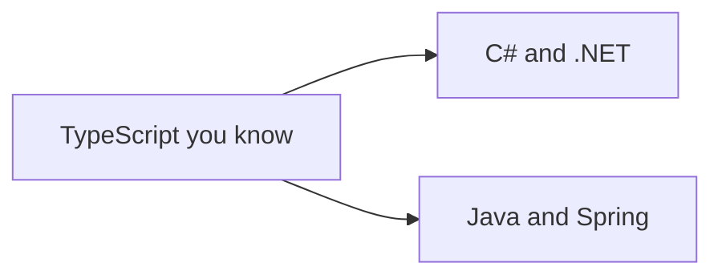

# Other Stacks

.NET and Java Spring, explained from what you already know in TypeScript.

**Why it matters in interviews:** Some roles (banks especially) use C# or Java. The goal is to map each idea to Express and Prisma so you can talk about it confidently.

## The map

How the lessons connect. Learn left to right.

## Lessons, one concept per file

Each lesson is one small file made from [the lesson template](../../templates/lesson-template.md): picture first, a code trace, practice, links to watch and play, and an explain it back section.

Status: `planned` (not written yet), `ready` (written, not studied), `learning`, `can explain` (passed explain-check).

### C# and .NET

| # | Lesson | You will understand | Status |
|---|---|---|---|
| 01 | C# basics for a TypeScript developer `01-c-basics-for-a-typescript-developer.md` | types, classes, async, LINQ | planned |
| 02 | ASP.NET Core request pipeline `02-asp-net-core-request-pipeline.md` | middleware and controllers vs Express | planned |
| 03 | Entity Framework Core `03-entity-framework-core.md` | models and migrations vs Prisma | planned |
| 04 | Dependency injection in .NET `04-dependency-injection-in-net.md` | lifetimes: singleton, scoped, transient | planned |

### Java and Spring

| # | Lesson | You will understand | Status |
|---|---|---|---|
| 05 | Java basics for a TypeScript developer `05-java-basics-for-a-typescript-developer.md` | types, classes, interfaces, streams | planned |
| 06 | Spring Boot structure `06-spring-boot-structure.md` | controllers, services, repositories | planned |
| 07 | JPA and Hibernate `07-jpa-and-hibernate.md` | entities and repositories vs Prisma | planned |

**To make the next lesson:** in a chat with this folder open, say `/learn other-stacks 01` to learn it live with Claude, or ask "make lesson other-stacks 01" and the `research-material` agent writes the file. When a lesson file exists, its row becomes a link and the status changes to `ready`.

## Guides already here

Longer guides that cover many concepts at once. Good for revision after the lessons.

- [.NET basics for a TypeScript developer](dotnet-basics-for-typescript-devs.md)
- [Java and Spring basics for a TypeScript developer](java-spring-basics-for-typescript-devs.md)

## Visual cheatsheets

Open in the browser. Everything visible on one page.

- [.NET visual cheatsheet](dotnet-basics-for-typescript-devs-cheatsheet.html)
- [Java Spring visual cheatsheet](java-spring-basics-for-typescript-devs-cheatsheet.html)

## Watch and play

Trusted places to see the ideas, not only read them. Each lesson adds its own checked video and visualizer links.

- [Microsoft Learn: C#](https://learn.microsoft.com/en-us/dotnet/csharp/) - official C# docs
- [Spring Guides](https://spring.io/guides) - short official tutorials
