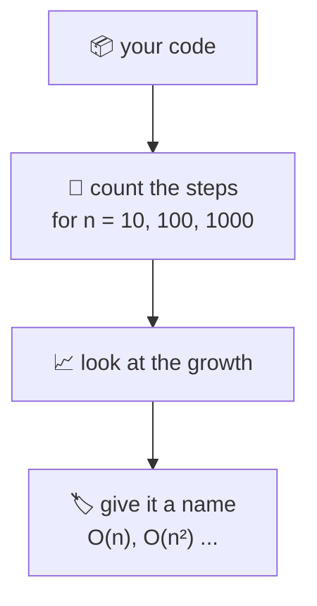

# 01. Big O: time and space

> **Subject:** Problem solving · **Lesson:** 01 · **Made:** 2026-11-03 · **Status:** ready
>
> **You will be able to:** look at a piece of code, say how its work grows when the input grows (O(1), O(log n), O(n), O(n²)), name the hidden slow parts in JavaScript, and say it out loud the way an interviewer wants to hear it.
>
> **Before this:** [Problem solving map](README.md) · **Next:** [Hash maps and sets](02-hash-maps-and-sets.md)
>
> **How to read it:** one card is one idea. Look at the picture, guess, then press the orange bar to check. The blue bars (📖 More detail) hold the longer explanation. Skip them on the first read, open them when you want more. About 20 minutes for the cards.

## 1. The idea: count the steps, not the seconds

Seconds change with the computer. **Steps** do not. Big O asks one question: *when the input gets bigger, how fast does the number of steps grow?*



Here are four loops, counted by running them for real (steps for each input size n):

| n | O(1) | O(log n) | O(n) | O(n²) |
|---|---|---|---|---|
| 10 | 1 | 3 | 10 | 100 |
| 100 | 1 | 6 | 100 | 10,000 |
| 1,000 | 1 | 9 | 1,000 | 1,000,000 |

Look at the last column. The input got 10 times bigger, and the steps got **100 times** bigger.

<details class="guess"><summary>🤔 Guess: a function takes 1 second for 1,000 items and it is O(n²). About how long for 10,000 items? Press to check.</summary>

About **100 seconds**. The input is 10 times bigger, so the steps are 10 × 10 = 100 times bigger. If it were O(n), it would be about 10 seconds.

</details>

> **Remember:** Big O is how the steps grow when the input grows. It is not the time.

<details class="more"><summary>📖 More detail: what "O" means and what we ignore</summary>

**O(n)** is said "order n" or "big O of n". Two rules make it simple:

- **Drop the constants.** 3n steps and 100n steps are both O(n). The shape of the growth is what counts.
- **Keep only the biggest part.** n² + n + 5 is O(n²). When n is big, the smaller parts do not matter.

The "log" in O(log n) means: how many times can you cut n in half before you reach 1? For 1,000 that is about 10 times. For 1,000,000 it is about 20 times. (My table rounds down, so it shows 9 for 1,000.)

Big O is usually about the **worst case**: the slowest the code can be for an input of size n.

</details>

## 2. Reading code: what does each shape look like?

You do not need maths. You look for **loops** and ask: how many times does it run, compared with n?

```js
// O(1): one step, any size
const first = list[0];

// O(n): one loop over the list
let sum = 0;
for (const x of list) sum += x;

// O(n²): a loop inside a loop
for (const a of list)
  for (const b of list) pairs++;

// O(log n): cut the work in half
for (let m = n; m > 1; m = m >> 1)
  steps++;
```

Two loops one after the other are **added**: O(n) + O(n) = O(2n), which is still O(n). A loop **inside** a loop is **multiplied**: n × n.

<details class="guess"><summary>🤔 Guess: what is the Big O? <code>for (i of a) {}</code> then <code>for (j of b) {}</code>, where a has n items and b has m items. Press to check.</summary>

**O(n + m).** The loops run one after the other, so you add them. It is not O(n²), because the second loop does not run once per item of the first.

</details>

> **Remember:** loop after loop = add. Loop inside loop = multiply. Cut in half each time = log.

<details class="more"><summary>📖 More detail: the common growth shapes, from fast to slow</summary>

| Name | Example | 1,000 items |
|---|---|---|
| O(1) | read `a[5]`, `map.get(key)` | 1 |
| O(log n) | binary search | about 10 |
| O(n) | one loop, `array.includes` | 1,000 |
| O(n log n) | a good sort | about 10,000 |
| O(n²) | a loop inside a loop | 1,000,000 |
| O(2ⁿ) | try every subset | more than the atoms in the universe, for n = 300 |

Interviewers often hope you reach O(n) or O(n log n) from an O(n²) first answer. Lesson 06 shows O(log n) and sorting. Lesson 08 shows O(2ⁿ) and how to avoid it.

</details>

## 3. The same question, two ways: real time

Question: *does this list have a duplicate?* Way 1 compares every pair. Way 2 remembers what it has seen in a `Set` (a collection that answers "is this in here?" in about one step).

```js
// Way 1: O(n²)
function hasDupSlow(a) {
  for (let i = 0; i < a.length; i++)
    for (let j = i + 1; j < a.length; j++)
      if (a[i] === a[j]) return true;
  return false;
}

// Way 2: O(n)
function hasDupFast(a) {
  const seen = new Set();
  for (const x of a) {
    if (seen.has(x)) return true;
    seen.add(x);
  }
  return false;
}
```

I ran both on lists with no duplicate (the worst case), so each had to do all its work:

| n | Way 1 (nested) | Way 2 (Set) |
|---|---|---|
| 1,000 | 2.6 ms | 0.16 ms |
| 10,000 | 38.9 ms | 1.47 ms |
| 100,000 | **3,899 ms** | 7.84 ms |

<details class="guess"><summary>🤔 Guess: at 100,000 items Way 1 needs about 5 billion comparisons. Why did it "only" take 4 seconds? Press to check.</summary>

n × n ÷ 2 = 100,000 × 100,000 ÷ 2 = **5 billion** comparisons, and a modern computer can do over a billion simple steps a second, so 4 seconds is believable. At 1,000,000 items it would be 100 times more: about 6 or 7 minutes. Way 2 at the same size would still take well under a second. Big O predicts exactly this jump.

</details>

> **Remember:** a fast `Set` lookup turns "loop inside a loop" into "one loop".

<details class="more"><summary>📖 More detail: how I measured it</summary>

Node 26.12.1 on one laptop, one run each (timings change from run to run, the shape does not). The lists were `[0, 1, 2, ...]`. **Step through it yourself:** [Big O stepper](visuals/01-big-o-time-and-space.html). It counts the comparisons for 5 numbers: 10 against 5.

The Set is not free. It takes **memory**: up to n items (card 4).

</details>

## 4. Space: how much extra memory?

Big O also counts **space**: the extra memory your code needs as n grows.

| Code | Extra space |
|---|---|
| `hasDupSlow` (two loops, two counters) | O(1) |
| `hasDupFast` (a Set that can hold every item) | O(n) |
| a recursive function that goes n calls deep | O(n) (the call stack) |

This is the usual **trade**: we spent O(n) memory to save a lot of time. Say it out loud in interviews: *"I trade memory for speed."*

<details class="guess"><summary>🤔 Guess: can you find a duplicate with O(1) extra space and still be faster than O(n²)? Press to check.</summary>

Yes, with a different trade: **sort first** (O(n log n) time), then look at neighbours (they sit next to each other). Sorting in place needs little extra memory. So there is a three way choice: O(n²) time with O(1) space, O(n) time with O(n) space, O(n log n) time with about O(1) space. In an interview, name the options and ask what matters more.

</details>

> **Remember:** most speed-ups spend memory. Always say both: the time and the space.

<details class="more"><summary>📖 More detail: what counts as "extra" space</summary>

The input itself is not counted. Only what **you** create: new arrays, Sets, Maps, strings, and the call stack when you use recursion. My test showed the call stack is real: a recursive function that calls itself without stopping crashed at about 10,387 calls deep on Node 26.12.1 (`RangeError: Maximum call stack size exceeded`). The limit depends on the engine and the function.

</details>

## 5. Hidden costs in JavaScript

The code looks like one step, but it is not. These five show up in many interview answers:

| Looks small | Really is | Measured |
|---|---|---|
| `arr.includes(x)` inside a loop | O(n) inside a loop = O(n²) | see card 3 |
| `[...acc, x]` in `reduce` | copies the list each time: O(n²) | 50,000 items: **3,069 ms** vs 1.7 ms with `push` |
| `arr.shift()` in a loop | moves every item left: O(n) | 100,000 items: **1,049 ms** vs 0.2 ms with a head index |
| `arr.unshift(x)` in a loop | moves every item right: O(n) | 100,000 items: **1,035 ms** vs 0.65 ms with `push` |
| `str.split('')`, `slice`, `concat` | a new copy: O(n) | (copies, so count them) |

<details class="guess"><summary>🤔 Guess: <code>list.shift()</code> on a list of 10,000 items took 1.2 ms for ALL items. Is shift fine? Press to check.</summary>

For **small** lists, yes. At 10,000 items the whole loop took 1.2 ms. At 100,000 it took about 1,000 ms: 10 times more items, about 900 times more time. That is the O(n²) shape (n shifts, each costing up to n). The engine has tricks for small arrays, and they stop helping on big ones. Always test with a big input.

</details>

> **Remember:** a method call can hide a loop. `includes`, `indexOf`, `shift`, `unshift`, `slice` and spread all walk the array.

<details class="more"><summary>📖 More detail: the fixes</summary>

- `includes` in a loop: build a `Set` first (lesson 02).
- `[...acc, x]`: use `acc.push(x)` and return `acc`.
- `shift`: keep a `head` number and move it forward, or use a linked list (lesson 03).
- `unshift`: `push` then `reverse` once at the end.

</details>

## 6. How to say it in an interview

A calm script that works for almost every problem:

1. **Brute force first.** "The simple way is two loops. That is O(n²) time and O(1) space."
2. **Say what repeats.** "It looks at the same items again and again."
3. **Improve.** "If I keep a Set of what I have seen, each check is O(1). Now it is one loop: O(n) time, O(n) space."
4. **Say the trade.** "I spend memory to save time."

<details class="guess"><summary>🤔 Guess: the interviewer asks "can you do better?". What do you NOT say? Press to check.</summary>

"No." Even if you cannot, say what you would try: sort first, use a Set, use two pointers. Also ask about the input: "How big can n be? Is the list sorted? Can there be duplicates?" Those questions are part of the answer.

</details>

> **Remember:** brute force, say the cost, find the repeated work, improve, say the new cost.

<details class="more"><summary>📖 More detail: what size of n needs which answer</summary>

A rough rule many people use (an idea, not a law): a computer does about 100 million to 1 billion simple steps in a second. So **n = 1,000** can be O(n²) (1 million steps). **n = 100,000** needs O(n log n) or better (n² is 10 billion). **n = 20** can even be O(2ⁿ). Ask for the size of n. It tells you which answers are allowed.

</details>

## 7. Why it matters and what it costs

Interview words: *time complexity*, *space complexity*, *worst case*, *amortized*, *trade-off*, *brute force*.

- **Without it:** you write code that works on 10 items and freezes on 100,000. You also cannot explain *why* your fast answer is fast.
- **With it:** you can compare two answers before you run them, and say which one you picked and why.
- **The cost:** Big O hides the constants. An O(n) answer with a big constant can lose to an O(n²) answer for tiny n. Real work needs real measurements too (like card 3).

## 8. Watch and play

Links checked on 2026-11-03. Each page loaded (HTTP 200). For the video, the title and channel were confirmed through YouTube's oEmbed data. The video length was not checked.

- **Play with it:** [The Big O stepper](visuals/01-big-o-time-and-space.html) in this folder. Guess first, then press Next and count.
- **Video:** [Complete Beginner's Guide to Big O Notation](https://www.youtube.com/watch?v=kS_gr2_-ws8) from the channel Colt Steele. Cards 1 and 2.
- **Read:** [Big-O Cheat Sheet](https://bigocheatsheet.com/). The growth curves, and a table for common data structures. Use it to check the cards later.
- **Play with it:** [Python Tutor for JavaScript](https://pythontutor.com/javascript.html). Paste `hasDupSlow` and step through it, and count the lines that run.

<details><summary>More links (optional)</summary>

- **Play with it:** [VisuAlgo](https://visualgo.net/en). Many algorithms drawn step by step. Pick the one you are studying.
- **Roadmap:** [NeetCode roadmap](https://neetcode.io/roadmap). A popular order for practice problems. I only checked that the page loads.

</details>

## 9. Practice

**A. Predict.** What is the Big O of each? Say time first.

```js
// 1
function f1(a) { return a[0] + a[a.length - 1]; }
// 2
function f2(a) {
  for (const x of a)
    for (let i = 0; i < 10; i++) total += x;
}
// 3
function f3(a) {
  for (const x of a)
    if (a.includes(x + 1)) count++;
}
// 4
function f4(n) { while (n > 1) n = n >> 1; }
```

<details class="guess"><summary>🤔 Press to see the answer</summary>

1. **O(1).** Two reads, no loop.
2. **O(n).** The inner loop always runs 10 times. 10 is a constant, so 10n is O(n).
3. **O(n²).** `includes` is a hidden loop, so it is a loop inside a loop.
4. **O(log n).** n is cut in half each time.

</details>

**B. What would you check?** Your API endpoint takes 50 ms with 1,000 users in the list, and 5 seconds with 10,000 users. The code has a `.map` and, inside it, a `.find`. What is going on, and what is the fix?

<details class="guess"><summary>🤔 Press to see the answer</summary>

`.find` inside `.map` is a loop inside a loop: O(n²). 10 times more users gives about 100 times more time (50 ms to 5 s matches). Fix: build a `Map` from id to user **once**, outside the loop, then use `map.get(id)` inside. It turns O(n²) into O(n), at the cost of a Map in memory. (This is the same idea as the N+1 problem in [database lesson 12](../database/12-n-plus-1-queries-and-orms.md).)

</details>

**C. Write it yourself**

Open [`practice/01-big-o.js`](practice/01-big-o.js). It has three functions (`hasDuplicate`, `commonItems`, `firstRepeated`) with a comment on what each must do. Write them, then run the tests:

```bash
cd learn/problem-solving
node --test practice/01-big-o.test.js
```

Some tests use big inputs, so a slow answer fails with "Too slow". Fill in the [solve log](solve-log.md) when you are done.

<details><summary>One possible answer</summary>

```js
function hasDuplicate(nums) {
  const seen = new Set();
  for (const x of nums) {
    if (seen.has(x)) return true;
    seen.add(x);
  }
  return false;
}

function commonItems(a, b) {
  const inB = new Set(b);
  const out = new Set();
  for (const x of a) if (inB.has(x)) out.add(x);
  return [...out];
}

function firstRepeated(nums) {
  const seen = new Set();
  for (const x of nums) {
    if (seen.has(x)) return x;
    seen.add(x);
  }
  return undefined;
}
```

All 6 tests pass with this code (checked on 2026-11-03), and all 6 fail with the empty file. Costs: `hasDuplicate` O(n) time and O(n) space. `commonItems` O(n + m) time and O(n + m) space. `firstRepeated` O(n) time and O(n) space.

</details>

## 10. Interview question

**Q:** "What is the time and space complexity of your solution? Can you do better?"

<details><summary>A strong answer, in four parts</summary>

1. **Problem:** the first solution compares every pair, so the work grows with n × n. At 100,000 items it took about 4 seconds in my test.
2. **How it works:** the repeated work is "have I seen this number?". A Set answers that in O(1), so one loop is enough: O(n) time. It took 8 ms at the same size.
3. **Tradeoff:** the Set costs O(n) memory. If memory is tight, I can sort first: O(n log n) time and little extra space.
4. **My example:** *This is an idea, not a fact. Replace it with a real story from DBO, Unloan, ZWS or Skyworx.* A page that was slow because a `.find` ran inside a `.map`. I built a Map of ids once and the page became fast.

</details>

## 11. Explain it back

Close this file. Press the **Record my explanation** button under this heading and explain Big O to a new junior, in 4 parts: problem, how it works, tradeoff, my example. Use these numbers: 10 times more items gives 100 times more steps for n², and 3,899 ms against 8 ms at 100,000 items.

### My explanation

<write here>

### Coach feedback

<the explain-coach agent writes here>

## 12. Review questions (day 1, 3, 7, 21)

1. What does Big O measure? Is it seconds?
2. What is the Big O of a loop inside a loop? Of two loops one after the other?
3. What do you drop when you write Big O? Why is n² + n + 5 written O(n²)?
4. Why is `arr.includes(x)` inside a loop slow?
5. What does a Set cost in memory, and what does it save?
6. Name two JavaScript calls that hide a loop and their fixes.
7. What do you say first when an interviewer asks for a solution?

<details><summary>Answers</summary>

1. How the number of steps grows when the input grows. Not seconds: seconds change with the computer.
2. Multiply: O(n²). One after the other: add, so O(n + m), or O(n) if both are over the same list.
3. Constants and the smaller parts. When n is big, the biggest part decides how it grows.
4. `includes` walks the list, so it is O(n) per call, so O(n²) in a loop.
5. O(n) extra memory. It saves the inner loop: each check is about one step.
6. `shift` (use a head index) and `[...acc, x]` in reduce (use push). Also `includes` (use a Set).
7. The brute force and its cost, then what repeats, then the improvement and its cost.

</details>

## 13. Go deeper (optional)

None of this is needed for the cards above.

<details><summary>Amortized O(1): why array push is "fast"</summary>

`push` is O(1) on average, but sometimes the engine has to move the array to a bigger place, which costs O(n). Spread over many pushes it averages out to O(1). That is what "amortized" means. I did not look at how V8 grows its arrays.

</details>

<details><summary>Big O, Big Omega, Big Theta</summary>

Big O is an upper limit ("no worse than"). Theta is "exactly this shape". In interviews, people say "Big O" and usually mean the worst case. You can ignore Omega and Theta until someone asks.

</details>

<details><summary>Make the numbers yourself</summary>

The card 3 and card 5 numbers came from a short Node script that times each function with `process.hrtime.bigint()`. Run it for 1,000, 10,000 and 100,000 and look at the growth, not the exact milliseconds.

</details>

## Connected lessons

- [02. Hash maps and sets](02-hash-maps-and-sets.md): the Set and Map that make most of these speed-ups.
- [06. Binary search and sorting](06-binary-search-and-sorting.md): O(log n) and O(n log n).
- [08. Recursion, backtracking and dynamic programming](08-recursion-backtracking-and-dynamic-programming.md): O(2ⁿ) and how to avoid it.
- [Database lesson 12: N+1 queries](../database/12-n-plus-1-queries-and-orms.md): the same "loop inside a loop" problem, with queries.
- [Problem solving map](README.md): the practice folders (two sum, sliding window and more).
