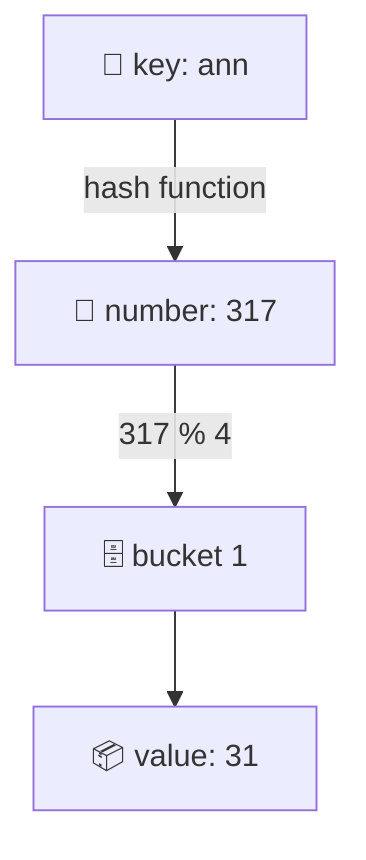

# 02. Hash maps and sets

> **Subject:** Problem solving · **Lesson:** 02 · **Made:** 2026-11-03 · **Status:** ready
>
> **You will be able to:** say how a hash map finds a value in one step, say what a collision is, pick `Map`, `Set` or a plain object in JavaScript, and use them for the three jobs that fill interviews: "seen before?", counting, and grouping.
>
> **Before this:** [Big O](01-big-o-time-and-space.md) · **Next:** [Arrays, linked lists, stacks and queues](03-arrays-linked-lists-stacks-and-queues.md)
>
> **How to read it:** one card is one idea. Look at the picture, guess, then press the orange bar to check. The blue bars (📖 More detail) hold the longer explanation. Skip them on the first read, open them when you want more. About 25 minutes for the cards.

## 1. The idea: a wall of mailboxes

A hash map is like a wall of mailboxes. You do not search every box. A rule turns the name into a **box number**, and you walk straight to that box.



The rule is the **hash function**. In the picture it adds the letter codes of "ann" (97 + 110 + 110 = 317). Then it takes `317 % 4 = 1`, so the value lives in **bucket 1**. A real hash function is better mixed, but the idea is the same.

<details class="guess"><summary>🤔 Guess: the table has 1,000,000 boxes. To find "ann", how many boxes do we open? Press to check.</summary>

**One.** We work out the number, jump to that bucket, and look inside. We never walk the other 999,999 boxes. That is why a hash map is O(1) on average, however big it is.

</details>

> **Remember:** a hash map turns the key into a bucket number, then jumps straight there.

<details class="more"><summary>📖 More detail: new words</summary>

- **Hash function:** turns a key into a number. The same key must always give the same number.
- **Bucket:** one slot of the table. The number picks the bucket.
- **Map (hash map, hash table, dictionary):** key to value. In JavaScript: `Map`.
- **Set:** only keys, no values. It answers "is this in here?".

**Step through it yourself:** [Hash map stepper](visuals/02-hash-maps-and-sets.html). Press Next to put four names in a table of 4 buckets.

</details>

## 2. Collisions: two keys, one box

What if two keys give the same bucket number? That is a **collision**. In my stepper, "ann" (317) and "kim" (321) both give bucket 1.

| Bucket | What is inside |
|---|---|
| 0 | cy |
| 1 | ann, kim (a collision) |
| 2 | (empty) |
| 3 | bob |

The table keeps both in bucket 1, one after the other. To find "kim", we jump to bucket 1 and check the few items inside until the key matches.

<details class="guess"><summary>🤔 Guess: what if every key landed in the same bucket? How fast is a lookup then? Press to check.</summary>

**O(n).** The bucket becomes one long list, and we walk all of it. That is the worst case of a hash map. A good hash function spreads keys out, and the table grows when it gets crowded, so the buckets stay short. That is why we say "O(1) on average".

</details>

> **Remember:** a collision is normal. Short buckets keep the lookup fast. Many collisions make it slow.

<details class="more"><summary>📖 More detail: two ways to handle collisions</summary>

- **Chaining:** each bucket holds a small list of items (my picture).
- **Open addressing:** if the bucket is taken, try the next free slot.

I did not look at how V8 (the engine inside Node and Chrome) builds `Map` inside. What you need for interviews: average O(1) for `get`, `set`, `has`, `delete`; worst case O(n); and the table grows when it is too full (this growth is why a single `set` can sometimes be slow, like the `push` in [lesson 01](01-big-o-time-and-space.md)).

Why `hash(key)` on a **sum of letters** is a poor hash: "listen" and "silent" have the same letters, so they have the same sum and always collide. Real functions mix the order of the letters.

</details>

## 3. In JavaScript: Map, Set, or a plain object?

```js
const ages = new Map();
ages.set('ann', 31);
ages.get('ann');   // 31
ages.has('bob');   // false
ages.size;         // 1

const seen = new Set([3, 1, 3]);
seen.size;         // 2
```

A plain object `{}` looks like a map too, but it has traps. I ran each of these:

```js
// trap 1: names from the prototype
const counts = {};
for (const w of ['constructor', 'cat'])
  counts[w] = (counts[w] || 0) + 1;
console.log(counts.constructor);
// function Object() { [native code] }1

// trap 2: the order of the keys
Object.keys({ 2: 'b', 1: 'a', x: 'c' });
// [ '1', '2', 'x' ]   not the order you wrote

// trap 3: a key called __proto__
const obj = {};
obj['__proto__'] = 5;
Object.keys(obj);      // []   the value was lost
```

`Map` has none of these:

```js
const m = new Map();
m.set('__proto__', 5);
[...m.keys()];         // [ '__proto__' ]
new Map([[2, 'b'], [1, 'a']]).keys();
// 2 then 1: the order you wrote
```

<details class="guess"><summary>🤔 Guess: what do these print? <code>new Map([[1,'a'],[1,'b']]).size</code>, <code>new Set([1,'1',1]).size</code>, <code>new Set([NaN,NaN]).size</code>, <code>new Set([{},{}]).size</code>. Press to check.</summary>

**1, 2, 1, 2.** The same key twice is one entry (the second value wins). The number 1 and the string `'1'` are different. `NaN` counts as the same as `NaN` here (even though `NaN === NaN` is false). And two different `{}` objects are two different keys, because objects are compared by **identity** (are they the same object?), not by what is inside.

</details>

> **Remember:** use `Map` and `Set` for lookups. A plain object is fine for a fixed record, not for "any word a user gives me".

<details class="more"><summary>📖 More detail: Map against Object</summary>

| | `Map` | `{}` |
|---|---|---|
| Key types | anything | strings and symbols |
| Order | the order you added | numbers first, then strings |
| Size | `m.size` | `Object.keys(o).length` |
| Safe for any user text | yes | no (prototype names) |
| Easy to print as JSON | no (needs conversion) | yes |

You can also write `Object.create(null)` to get an object with no prototype. I tested that `o.constructor` is then just a normal key. `Map` is usually the clearer choice.

Two objects with the same content are two keys in a Map. For coordinates, turn them into one string: `` seen.add(`${row},${col}`) `` and test with `seen.has('2,3')` (I checked that it prints `true`).

</details>

## 4. The three jobs

Almost every hash map problem is one of these:

| Job | The question | Use | Example |
|---|---|---|---|
| **Seen before?** | "Have I met this already?" | `Set` | duplicates, Two Sum |
| **Count** | "How many times?" | `Map` key to number | word count, first unique letter |
| **Group** | "Which ones belong together?" | `Map` key to list | group anagrams |

Here is **grouping**. Words that are anagrams (same letters) have the same sorted letters, so the sorted word is a good key. I ran this:

```js
function groupAnagrams(words) {
  const groups = new Map();
  for (const w of words) {
    const key = [...w].sort().join('');
    if (!groups.has(key))
      groups.set(key, []);
    groups.get(key).push(w);
  }
  return [...groups.values()];
}
groupAnagrams(['eat', 'tea', 'tan', 'ate', 'nat', 'bat']);
// [["eat","tea","ate"],["tan","nat"],["bat"]]
```

<details class="guess"><summary>🤔 Guess: in this code, what is the key for "eat", "tea" and "ate"? Press to check.</summary>

All three give **"aet"** (the letters sorted). Same key, so they land in the same list. The key is the trick: you choose what "the same" means for your problem.

</details>

> **Remember:** a hash map problem is a question of "what is the key?".

<details class="more"><summary>📖 More detail: the cost of this answer</summary>

For w words of length k: sorting each word costs O(k log k), so the whole thing is O(w · k log k) time and O(w · k) space. A common faster idea is a key made of 26 letter counts, which is O(w · k). Both are fine in an interview. Say which you chose.

</details>

## 5. Two Sum: the classic

*Given numbers and a target, return the positions of two numbers that add up to the target.*

```js
function twoSum(nums, target) {
  const seen = new Map();
  for (let i = 0; i < nums.length; i++) {
    const need = target - nums[i];
    if (seen.has(need))
      return [seen.get(need), i];
    seen.set(nums[i], i);
  }
}
```

For each number we ask one question: "is the number I need already in the Map?". We store the number **after** the check, so a number is never paired with itself.

I ran it against the two-loop version. The answer was the last two numbers of the list, so the slow version had to do all its work:

| n | Two loops | Map |
|---|---|---|
| 2,000 | 4.0 ms | 0.33 ms |
| 20,000 | 137.6 ms | 2.42 ms |
| 100,000 | **3,465 ms** | 8.63 ms |

<details class="guess"><summary>🤔 Guess: why do we store <code>nums[i]</code> AFTER the check and not before? Press to check.</summary>

If we stored first, a number could find **itself**. With `nums = [5]` and `target = 10`, the number 5 would find 5 and return a pair made of one number. Checking first means we only match against numbers that came **earlier**. The stepper shows it: the 5 in `[3, 2, 4, 5, 6]` needs a 5 and does not find one.

</details>

> **Remember:** "the other number I need" is a lookup. Turn it into `has`.

<details class="more"><summary>📖 More detail: the interview words</summary>

Brute force: O(n²) time, O(1) space. Map: O(n) time, O(n) space. If the list is already sorted, **two pointers** gives O(n) time and O(1) space (the folder `02-two-pointers` has it). Say all three, then ask which one fits.

</details>

## 6. Mistakes

**1. Using `includes` as a lookup in a loop.** `list.includes(x)` is O(n). Inside a loop that is O(n²). Build a `Set` first.

**2. A plain object for user words.** Card 3: `counts['constructor']` is already a function. Use `Map`.

**3. Objects as keys.**

```js
const m = new Map();
m.set({ id: 1 }, 'a');
m.get({ id: 1 });   // undefined
```

The second `{ id: 1 }` is a different object. Use the id (`m.set(1, 'a')`) as the key.

**4. Forgetting a hash map costs memory.** It is O(n) space. If memory is the problem, the answer might be sorting plus two pointers.

<details class="guess"><summary>🤔 Guess: a Map has 1,000 keys. Is <code>map.has(x)</code> inside a loop of 1,000 items O(n²)? Press to check.</summary>

No. **O(n).** `map.has` is O(1) on average, so 1,000 loops × 1 step = 1,000 steps. The same loop with `list.includes` would be O(n²). That is the whole point of this lesson.

</details>

> **Remember:** `Map.has` is one step. `Array.includes` is a loop.

<details class="more"><summary>📖 More detail: why not always use a Map?</summary>

For a handful of items (say 10), a plain array with `includes` is just as fast and simpler. A hash map pays off when n is big. Also, the key must be something you can compare: numbers, strings, or ids you build from an object.

</details>

## 7. Why it matters and what it costs

Interview words: *hash map*, *hash table*, *collision*, *O(1) average*, *Set*, *frequency map*, *anagram key*.

- **Without it:** "have I seen this?" is a loop, and your answer is O(n²).
- **With it:** it is one step, and most array and string problems become O(n).
- **The cost:** O(n) extra memory, no order by key (a `Map` remembers insertion order, not sorted order), and worst case O(n) if the hash is bad.

## 8. Watch and play

Links checked on 2026-11-03. Each page loaded (HTTP 200). For each video, the title and channel were confirmed through YouTube's oEmbed data. The video lengths were not checked.

- **Play with it:** [The hash map stepper](visuals/02-hash-maps-and-sets.html) in this folder. Guess first, then press Next.
- **Play with it:** [VisuAlgo: Hash Table](https://visualgo.net/en/hashtable). Add keys and watch collisions get handled.
- **Video:** [Handling collisions in hash tables - Data Structures](https://www.youtube.com/watch?v=Vt9P51PNQ-U) from the channel Chris Marriott - Computer Science. Card 2.
- **Read:** [Map](https://developer.mozilla.org/en-US/docs/Web/JavaScript/Reference/Global_Objects/Map) and [Set](https://developer.mozilla.org/en-US/docs/Web/JavaScript/Reference/Global_Objects/Set) on MDN. The methods and how keys are compared.

<details><summary>More links (optional)</summary>

- **Video:** [The Hash Table: O(1) Lookups, Hashing, and Collisions Explained](https://www.youtube.com/watch?v=gYL4lkdCEUw) from the channel Code With K5KC. Cards 1 and 2.

</details>

## 9. Practice

**A. Predict the output** (write your answer first)

```js
const m = new Map();
m.set('a', 1);
m.set('b', 2);
m.set('a', 3);
console.log(m.size, m.get('a'));
console.log(new Set('hello').size);
```

<details class="guess"><summary>🤔 Press to see the answer</summary>

`2 3`, then `4`. The second `set('a', 3)` replaces the value, so there are still 2 keys. The Set of the letters of "hello" is h, e, l, o: 4 (the second `l` is not a new member).

</details>

**B. What would you check?** A word counter written with a plain object `{}` gives a wrong total when the text contains the word "constructor". Why, and what is the fix?

<details class="guess"><summary>🤔 Press to see the answer</summary>

`counts['constructor']` already exists (it comes from the prototype), so `(counts[w] || 0) + 1` adds 1 to a function and makes a string. Fix: use `new Map()`, or `Object.create(null)`, or `Object.hasOwn(counts, w)` for the check.

</details>

**C. Write it yourself**

Open [`practice/02-hash-maps.js`](practice/02-hash-maps.js). It has four tasks: `firstUniqueChar`, `countWords`, `longestConsecutive` and your own `MyHashMap` built from buckets. Run:

```bash
cd learn/problem-solving
node --test practice/02-hash-maps.test.js
```

The existing folder [`01-hash-map`](01-hash-map/) has Two Sum, Valid Anagram and Group Anagrams. Do them after this lesson.

<details><summary>One possible answer</summary>

```js
function firstUniqueChar(s) {
  const counts = new Map();
  for (const ch of s)
    counts.set(ch, (counts.get(ch) || 0) + 1);
  for (let i = 0; i < s.length; i++)
    if (counts.get(s[i]) === 1) return i;
  return -1;
}

function countWords(text) {
  const counts = new Map();
  for (const w of text.toLowerCase().split(' ')) {
    if (w === '') continue;
    counts.set(w, (counts.get(w) || 0) + 1);
  }
  return counts;
}

function longestConsecutive(nums) {
  const set = new Set(nums);
  let best = 0;
  for (const x of set) {
    if (set.has(x - 1)) continue; // not a start
    let len = 1;
    while (set.has(x + len)) len++;
    best = Math.max(best, len);
  }
  return best;
}

class MyHashMap {
  constructor() {
    this.buckets = Array.from({ length: 1024 }, () => []);
    this.count = 0;
  }
  index(key) {
    let h = 0;
    for (const ch of key)
      h = (h * 31 + ch.charCodeAt(0)) >>> 0;
    return h % this.buckets.length;
  }
  put(key, value) {
    const bucket = this.buckets[this.index(key)];
    for (const pair of bucket)
      if (pair[0] === key) { pair[1] = value; return; }
    bucket.push([key, value]);
    this.count++;
  }
  get(key) {
    for (const [k, v] of this.buckets[this.index(key)])
      if (k === key) return v;
    return undefined;
  }
  remove(key) {
    const bucket = this.buckets[this.index(key)];
    const i = bucket.findIndex(p => p[0] === key);
    if (i === -1) return false;
    bucket.splice(i, 1);
    this.count--;
    return true;
  }
  get size() { return this.count; }
}
```

All 10 tests pass with this code (checked on 2026-11-03), and all 10 fail with the empty file. `longestConsecutive` is O(n): the `while` only starts at the first number of a run, so each number is visited about twice in total. `MyHashMap` never grows its table (a real one would), so with a million keys its buckets would get long.

</details>

## 10. Interview question

**Q:** "How does a hash map work? What is its time complexity, and when is it slow?"

<details><summary>A strong answer, in four parts</summary>

1. **Problem:** searching a list is O(n). We want to find a value by its key in one step.
2. **How it works:** a hash function turns the key into a number, and the number picks a bucket in an array. We jump to the bucket and check the few items inside. So `get`, `set` and `has` are O(1) on average.
3. **Tradeoff:** two keys can land in the same bucket (a collision). With a bad hash or a full table the buckets get long and a lookup is O(n) in the worst case. It also costs O(n) memory, and it has no sorted order.
4. **My example:** *This is an idea, not a fact. Replace it with a real story from DBO, Unloan, ZWS or Skyworx.* Matching orders to users: I built a `Map` of user id to user once, so each order found its user in one step, instead of a `.find` inside a `.map`.

</details>

## 11. Explain it back

Close this file. Press the **Record my explanation** button under this heading and explain a hash map to a new junior, in 4 parts: problem, how it works, tradeoff, my example. Use these: the mailbox wall, the collision of ann and kim, and 3,465 ms against 8.6 ms for Two Sum at 100,000 numbers.

### My explanation

<write here>

### Coach feedback

<the explain-coach agent writes here>

## 12. Review questions (day 1, 3, 7, 21)

1. How does a hash map find a value without looking at every item?
2. What is a collision, and what does the table do about it?
3. When is a hash map O(n) and not O(1)?
4. Name two traps of a plain object compared with a `Map`.
5. What are the three jobs of a hash map in interviews?
6. In Two Sum, why do we store the number after the check?
7. Why does `m.get({ id: 1 })` give `undefined` even after `m.set({ id: 1 }, 'a')`?

<details><summary>Answers</summary>

1. A hash function turns the key into a bucket number, and it jumps to that bucket.
2. Two keys give the same bucket. The table keeps both in the bucket (a short list) and checks them until the key matches.
3. When most keys land in the same bucket (a bad hash, or a table that never grew). Then the bucket is one long list.
4. The prototype names (`constructor`, `toString`) already exist, keys are only strings, and the order is odd (numbers first). Also `__proto__` cannot be stored as a normal key.
5. Seen before (Set), counting (Map to number), grouping (Map to list).
6. If we stored it first, the number could find itself and make a pair out of one number.
7. The two `{ id: 1 }` are two different objects. Map compares objects by identity, not by content.

</details>

## 13. Go deeper (optional)

None of this is needed for the cards above.

<details><summary>Load factor and growing the table</summary>

The **load factor** is items divided by buckets. When it gets too high, the table makes a bigger array and moves every item to its new bucket (that is O(n), done rarely). I did not look at V8's exact rule.

</details>

<details><summary>Map and Set in JSON</summary>

`JSON.stringify(new Map())` gives `{}`: the contents are not included. Convert first: `JSON.stringify([...map])`. I did not test this on every Node version.

</details>

<details><summary>WeakMap</summary>

A `WeakMap` only takes objects as keys and does not stop them from being cleaned up by the garbage collector. Useful for caches tied to an object (and in React internals). Not needed for interview problems.

</details>

## Connected lessons

- [01. Big O](01-big-o-time-and-space.md): why `includes` in a loop is O(n²).
- [03. Arrays, linked lists, stacks and queues](03-arrays-linked-lists-stacks-and-queues.md): the data structures hash maps replace, and the ones they sit next to.
- [05. Graphs](05-graphs-bfs-dfs-and-cycles.md): the `seen` Set that stops an infinite loop.
- [08. Recursion, backtracking and dynamic programming](08-recursion-backtracking-and-dynamic-programming.md): a Map is how memoization remembers answers.
- [Database lesson 09: Indexes and B-trees](../database/09-indexes-and-b-trees.md): a database index is another way to find a row without scanning.
- [Redis](../database/23-sql-vs-nosql-and-redis.md): a hash map that lives on a server.
- [Folder 01-hash-map](01-hash-map/): Two Sum, Valid Anagram, Group Anagrams to write yourself.
