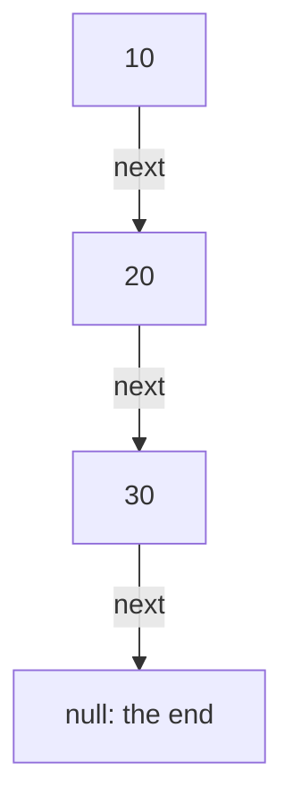

# 03. Arrays, linked lists, stacks and queues

> **Subject:** Problem solving · **Lesson:** 03 · **Made:** 2026-11-03 · **Status:** ready
>
> **You will be able to:** say what an array and a linked list look like in memory and what each is good at, reverse a linked list and find a cycle in it, use a stack for "last in, first out" problems, and build a fast queue in JavaScript.
>
> **Before this:** [Hash maps and sets](02-hash-maps-and-sets.md) · **Next:** [Trees and traversal](04-trees-and-traversal.md)
>
> **How to read it:** one card is one idea. Look at the picture, guess, then press the orange bar to check. The blue bars (📖 More detail) hold the longer explanation. Skip them on the first read, open them when you want more. About 25 minutes for the cards.

## 1. The idea: a row of lockers against a treasure hunt

An **array** is a row of numbered lockers side by side. To open locker 500, you walk straight to it.

| Index | 0 | 1 | 2 | 3 |
|---|---|---|---|---|
| Value | 10 | 20 | 30 | 40 |

A **linked list** is a treasure hunt. Each note holds a value and says where the next note is. To reach note 500, you must follow 500 notes.



<details class="guess"><summary>🤔 Guess: you want to put a new item at the very front. Which is easier, the lockers or the treasure hunt? Press to check.</summary>

The **treasure hunt** (linked list). You write a new note and point it at the old first note: one step. In the row of lockers, every item must move one place to the right to make room: n steps.

</details>

> **Remember:** array = jump to any position fast. Linked list = add or remove at a known spot fast, but you must walk to find it.

<details class="more"><summary>📖 More detail: new words</summary>

- **Index:** the number of a position in an array. It starts at 0.
- **Node:** one box of a linked list: a value, and `next`, the arrow to the next node.
- **Pointer (reference):** a variable that holds a node. In JavaScript, `node.next` is a reference to another object.
- **Head:** the first node. The last node has `next = null`.

</details>

## 2. What each one costs

| Action | Array | Linked list |
|---|---|---|
| Read item number i | O(1) | O(n), walk i notes |
| Add or remove at the **end** | O(1) | O(1) if you keep a pointer to the last node |
| Add or remove at the **front** | O(n) | O(1) |
| Insert in the middle | O(n), items must move | O(1) once you stand there, O(n) to get there |
| Search for a value | O(n) | O(n) |

These are the textbook costs. In JavaScript I measured the front of an array, since it surprises people:

| 100,000 items | `push` (end) | `unshift` (front) |
|---|---|---|
| Time for all of them | 0.65 ms | **1,035 ms** |

<details class="guess"><summary>🤔 Guess: in JavaScript, which do you use almost every day, arrays or linked lists? Press to check.</summary>

**Arrays.** They are simple, and the engine makes them fast. You almost never write a linked list at work. You write one in an interview, because it tests whether you can handle pointers. Linked lists also hide inside other things (a queue, a browser history, a cache that removes the oldest item).

</details>

> **Remember:** array = lockers. Front of an array is slow. Linked list = treasure hunt. Reading item i is slow.

<details class="more"><summary>📖 More detail: why the front of an array is slow</summary>

Items sit side by side in memory. To add one at the front, everything moves one place. `shift` does the same in the other direction. Small arrays look fine: removing all 10,000 items one by one took 1.2 ms. But 100,000 items took 1,049 ms, and 200,000 items took 4,597 ms on Node 26.12.1. The time grows like n², so test with a big input (measured once, one laptop). I did not look inside the engine to say why small arrays are faster.

</details>

## 3. A linked list in JavaScript, and reversing it

A node is just an object. A list is a head node that points to the next, and so on.

```js
const head = {
  val: 1,
  next: { val: 2, next: { val: 3, next: null } }
};
```

**Reverse a linked list** is one of the most asked interview questions. The trick is three pointers:

```js
function reverse(head) {
  let prev = null, curr = head;
  while (curr) {
    const next = curr.next;
    curr.next = prev;
    prev = curr;
    curr = next;
  }
  return prev;
}
```

I ran it on `1 -> 2 -> 3 -> 4`:

```text
1 -> 2 -> 3 -> 4 -> null
4 -> 3 -> 2 -> 1 -> null
```

<details class="guess"><summary>🤔 Guess: why do we save <code>curr.next</code> in <code>next</code> before we flip the arrow? Press to check.</summary>

The only way to reach the rest of the list is through `curr.next`. If we write `curr.next = prev` first, we lose the rest of the list. Save it, flip the arrow, then move on.

</details>

> **Remember:** save next, flip the arrow, move both forward. O(n) time, O(1) space.

<details class="more"><summary>📖 More detail: step by step</summary>

| Step | prev | curr | What changes |
|---|---|---|---|
| start | null | 1 | nothing |
| after node 1 | 1 | 2 | 1 now points to null |
| after node 2 | 2 | 3 | 2 now points to 1 |
| after node 3 | 3 | 4 | 3 now points to 2 |
| after node 4 | 4 | null | 4 now points to 3, loop ends |

At the end `prev` is node 4: the new head. **Step through it yourself:** [Lists and stacks stepper](visuals/03-arrays-linked-lists-stacks-and-queues.html). Tab 1 draws the arrows flipping. Also try the recursive version in the video in card 8.

</details>

## 4. A cycle: the slow and fast pointer

*A list may loop back on itself. How do you find out, without a Set?*

Walk with two pointers: **slow** moves 1 step, **fast** moves 2. If there is a loop, fast catches up with slow inside the loop (like a faster runner on a running track). If there is no loop, fast reaches the end.

```js
function hasCycle(head) {
  let slow = head, fast = head;
  while (fast && fast.next) {
    slow = slow.next;
    fast = fast.next.next;
    if (slow === fast) return true;
  }
  return false;
}
```

I ran it on `1 -> 2 -> 3 -> 4`. It printed `false`. Then I made node 4 point back to node 2 and it printed `true`.

<details class="guess"><summary>🤔 Guess: a Set of seen nodes also finds a cycle. Why is slow and fast better? Press to check.</summary>

The Set needs O(n) memory. Slow and fast needs **O(1)**: two variables. Both are O(n) in time. In an interview, say both: the Set is easier, and two pointers saves memory.

</details>

> **Remember:** slow moves 1, fast moves 2. They meet only if there is a loop.

<details class="more"><summary>📖 More detail: why they must meet</summary>

Once both are inside the loop, fast gains one step on slow each turn, so the gap shrinks by 1 every time and must reach 0. It cannot jump over slow, because the gap changes by exactly 1. Where the loop starts is a follow-up question: it uses the same two pointers, with one more step. I did not cover it here.

</details>

## 5. A stack: the last one in is the first one out

A **stack** is a pile of plates. You add to the top and take from the top. In JavaScript, an array with `push` and `pop` is a stack, and both are O(1).

```js
const stack = [];
stack.push('a');
stack.push('b');
stack.pop();   // 'b'
stack.pop();   // 'a'
stack.pop();   // undefined
```

Where stacks show up: the **undo** button, the browser **back** button, the **call stack** of your own functions, and matching brackets. For brackets: push every opening bracket. For every closing bracket, the top of the stack must be its partner.

```js
function isValid(s) {
  const stack = [];
  const pairs = { ')': '(', ']': '[', '}': '{' };
  for (const ch of s) {
    if (!pairs[ch]) stack.push(ch);
    else if (stack.pop() !== pairs[ch])
      return false;
  }
  return stack.length === 0;
}
```

I ran it: `isValid('({[]})')` gave `true`, `isValid('([)]')` gave `false`, `isValid('((')` gave `false`, `isValid('')` gave `true`.

<details class="guess"><summary>🤔 Guess: why does <code>'(('</code> need the last line <code>stack.length === 0</code>? Press to check.</summary>

Both brackets are opening ones, so nothing ever fails inside the loop. But two brackets are still open at the end. The last line catches "opened and never closed".

</details>

> **Remember:** a stack remembers "what is still open", and gives back the newest first.

<details class="more"><summary>📖 More detail: when you see a stack problem</summary>

Look for words like "matching", "nested", "undo", "most recent", or "the next bigger value on the right". The folder `04-stack` has *Valid Parentheses* and *Daily Temperatures*. The second one uses a stack of positions, not values. Step through the bracket check in the stepper (tabs 2 and 3).

</details>

## 6. A queue: first in, first out

A **queue** is a line at a shop. You join at the back and leave from the front. It is the tool for "do things in the order they arrived": jobs, messages, and BFS (lesson 05).

JavaScript has no Queue type. The easy way is `push` to join and `shift` to leave. It works, but `shift` is O(n) on a big array (card 2):

| 200,000 items, add all then remove all | Time |
|---|---|
| `push` and `shift` | **4,597 ms** |
| A `Queue` with a head number (card 6, with the clean-up from the practice answer) | **5.1 ms** |

The fix is to keep a number that says where the front is, and never move the items:

```js
class Queue {
  constructor() { this.items = []; this.head = 0; }
  enqueue(x) { this.items.push(x); }
  dequeue() {
    if (this.head >= this.items.length)
      return undefined;
    return this.items[this.head++];
  }
  size() { return this.items.length - this.head; }
}
```

This short version never frees the items it already gave out. The practice file asks you to clean those up too.

<details class="guess"><summary>🤔 Guess: what does <code>dequeue</code> cost in this class? Press to check.</summary>

**O(1).** It reads one slot and adds 1 to `head`. Nothing moves. The cost moved from "shift every item" to "keep a number".

</details>

> **Remember:** a queue is first in, first out. In JavaScript, do not use `shift` on a big array.

<details class="more"><summary>📖 More detail: other ways to build a queue</summary>

- A **linked list** with a head and a tail pointer: add at the tail, remove at the head, both O(1).
- **Two stacks:** push into one, and when you need to remove, pour it into the other (the order flips). A known interview puzzle: "make a queue out of two stacks".

</details>

## 7. Which one do I need?

| The problem says | Use |
|---|---|
| "by position", "the k-th item" | array |
| "add or remove at the front a lot" | linked list or a queue |
| "most recent first", "undo", "matching" | stack |
| "in order of arrival", "level by level" | queue |
| "have I seen it?" | Set (lesson 02) |

<details class="guess"><summary>🤔 Guess: "reverse a string" with a stack. How? Press to check.</summary>

Push every character, then pop them all. The last character pushed comes out first, so the string comes out backwards. (In real code, `[...s].reverse().join('')` is simpler. It is a good example to *explain* a stack.)

</details>

> **Remember:** pick the structure by the order you need things back: newest first (stack), oldest first (queue), by position (array).

<details class="more"><summary>📖 More detail: mistakes to avoid</summary>

1. **Losing the rest of the list.** Always save `next` before changing an arrow.
2. **Forgetting the empty list.** `reverse(null)` must return `null`, not crash. Test with `null` and one node.
3. **`while (fast.next.next)`** without checking `fast` and `fast.next` first. It crashes on short lists.

</details>

## 8. Why it matters and what it costs

Interview words: *linked list*, *node*, *pointer*, *stack*, *queue*, *LIFO*, *FIFO*, *two pointers*, *slow and fast pointer*.

- **Without it:** you pick an array for everything, and use `shift` in a loop.
- **With it:** you pick the shape that fits how the data is used.
- **The cost:** a linked list is O(n) to read item i and uses extra memory for every arrow. You do not use it often in real JavaScript, you use it to show you understand pointers.

## 9. Watch and play

Links checked on 2026-11-03. Each page loaded (HTTP 200). For each video, the title and channel were confirmed through YouTube's oEmbed data. The video lengths were not checked.

- **Play with it:** [The lists and stacks stepper](visuals/03-arrays-linked-lists-stacks-and-queues.html) in this folder. Guess first, then press Next.
- **Play with it:** [VisuAlgo: Linked List, Stack and Queue](https://visualgo.net/en/list). Add, remove and search, with the pointers drawn.
- **Video:** [Reverse a Linked List (Iterative) - Data Structures & Algorithms](https://www.youtube.com/watch?v=hc6gbOLKzsU) from the channel CodeLucky. Card 3.
- **Video:** [Coding Interview Tutorial 13: Reverse Linked List (Recursive) [LeetCode]](https://www.youtube.com/watch?v=Z--S2-RiS44) from the channel Amell Peralta. The recursive way.
- **Read:** [Array.prototype.shift()](https://developer.mozilla.org/en-US/docs/Web/JavaScript/Reference/Global_Objects/Array/shift) on MDN. What `shift` does.

## 10. Practice

**A. Predict the output** (write your answer first)

```js
const q = ['a', 'b'];
console.log(q.shift(), q.shift(), q.shift());
const s = ['a', 'b'];
console.log(s.pop(), s.pop(), s.pop());
```

<details class="guess"><summary>🤔 Press to see the answer</summary>

`a b undefined`, then `b a undefined`. The queue gives back the oldest first. The stack gives back the newest first. An empty array gives `undefined` for both.

</details>

**B. What would you check?** A job processor holds 500,000 waiting jobs in an array. It takes jobs with `jobs.shift()`. It is fast when the list is short and slow when the list is long. Why, and what do you change?

<details class="guess"><summary>🤔 Press to see the answer</summary>

`shift` moves every remaining item one place, so each call is O(n) on a long list, and the whole loop is O(n²). Replace the array with a queue that keeps a head index (card 6) or a linked list. In real production code you might also use a message queue (a service built for this).

</details>

**C. Write it yourself**

Open [`practice/03-lists-stacks-queues.js`](practice/03-lists-stacks-queues.js). It has `reverseList`, `hasCycle`, `mergeTwoLists` and a `Queue` class. Run:

```bash
cd learn/problem-solving
node --test practice/03-lists-stacks-queues.test.js
```

Then do the folder [`04-stack`](04-stack/) (Valid Parentheses and Daily Temperatures).

<details><summary>One possible answer</summary>

```js
function reverseList(head) {
  let prev = null, curr = head;
  while (curr) {
    const next = curr.next;
    curr.next = prev;
    prev = curr;
    curr = next;
  }
  return prev;
}

function hasCycle(head) {
  let slow = head, fast = head;
  while (fast && fast.next) {
    slow = slow.next;
    fast = fast.next.next;
    if (slow === fast) return true;
  }
  return false;
}

function mergeTwoLists(a, b) {
  const dummy = { val: 0, next: null };
  let tail = dummy;
  while (a && b) {
    if (a.val <= b.val) { tail.next = a; a = a.next; }
    else { tail.next = b; b = b.next; }
    tail = tail.next;
  }
  tail.next = a || b;
  return dummy.next;
}

class Queue {
  constructor() { this.items = []; this.head = 0; }
  enqueue(x) { this.items.push(x); }
  dequeue() {
    if (this.head >= this.items.length) return undefined;
    const x = this.items[this.head];
    this.items[this.head++] = undefined;
    if (this.head > 1024 && this.head * 2 > this.items.length) {
      this.items = this.items.slice(this.head);
      this.head = 0;
    }
    return x;
  }
  peek() { return this.items[this.head]; }
  size() { return this.items.length - this.head; }
}
```

All 8 tests pass with this code (checked on 2026-11-03), and all 8 fail with the empty file. `mergeTwoLists` uses a **dummy node** at the start, so you do not need a special case for the first node. The `Queue` frees the used part when more than half of the array has been taken out, so memory does not grow forever. Each step still costs O(1) on average.

</details>

## 11. Interview question

**Q:** "Reverse a linked list. Then: how do you detect a cycle? What is the time and space?"

<details><summary>A strong answer, in four parts</summary>

1. **Problem:** a list node only knows its next node, so I cannot go backwards. To reverse, I have to flip every arrow.
2. **How it works:** three pointers: `prev`, `curr`, `next`. Save `curr.next`, point `curr.next` at `prev`, then move `prev` and `curr` one step forward. When `curr` is null, `prev` is the new head. It is one pass: O(n) time, O(1) space. For a cycle: slow moves 1 and fast moves 2. If they meet, there is a cycle: O(n) time, O(1) space.
3. **Tradeoff:** a Set of seen nodes finds a cycle too, and it is easier to write, but it uses O(n) memory. The recursive reverse is shorter but uses O(n) call stack space and can overflow on a very long list.
4. **My example:** *This is an idea, not a fact. Replace it with a real story from DBO, Unloan, ZWS or Skyworx.* A job list that got slow because the code removed jobs from the front of an array. I changed it to a queue with a head index.

</details>

## 12. Explain it back

Close this file. Press the **Record my explanation** button under this heading and explain the difference between an array and a linked list, and how to reverse a list, to a new junior, in 4 parts: problem, how it works, tradeoff, my example. Use these numbers: 4,597 ms against 5 ms for 200,000 queue items.

### My explanation

<write here>

### Coach feedback

<the explain-coach agent writes here>

## 13. Review questions (day 1, 3, 7, 21)

1. What is stored in a linked list node? Why can we not read item 500 quickly?
2. What is slow at the front of a JavaScript array, and why?
3. Why do we save `curr.next` before changing it when we reverse a list?
4. How do slow and fast pointers find a cycle? What do they cost?
5. What does "last in, first out" mean? Name three places a stack shows up.
6. Why is `array.shift()` a bad queue on a big array? What do you use?
7. How do you check "valid brackets" and what does the last line check?

<details><summary>Answers</summary>

1. A value and a `next` reference. You must follow the arrows one by one, so reading item i is O(i).
2. `shift` and `unshift` move every other item, so each is O(n).
3. The only way to reach the rest of the list is `curr.next`. Flip it first and you lose the rest.
4. Slow moves 1 step and fast moves 2. If there is a loop fast catches slow. O(n) time, O(1) space.
5. The newest item comes out first. Undo, browser back, the call stack, matching brackets.
6. It is O(n) per call, so the whole loop is O(n²): 4,597 ms for 200,000 items. Keep a head index, or use a linked list.
7. Push the openers. On a closer, pop and compare with its partner. At the end the stack must be empty, or something was left open.

</details>

## 14. Go deeper (optional)

None of this is needed for the cards above.

<details><summary>Doubly linked lists</summary>

Each node has `next` **and** `prev`. You can remove a node in O(1) when you hold the node, because you can reach its neighbours. A famous interview design problem, the LRU cache, uses a doubly linked list plus a hash map. I did not build it here.

</details>

<details><summary>Typed arrays and real memory</summary>

A JavaScript array of numbers is flexible, but not always a flat row in memory. A `Float64Array` is a strict row of numbers. I did not measure the difference.

</details>

## Connected lessons

- [01. Big O](01-big-o-time-and-space.md): why `shift` in a loop is O(n²).
- [02. Hash maps and sets](02-hash-maps-and-sets.md): "seen before?" in one step.
- [04. Trees and traversal](04-trees-and-traversal.md): a tree is a linked list with two arrows. DFS uses a stack, BFS uses a queue.
- [05. Graphs](05-graphs-bfs-dfs-and-cycles.md): BFS needs a fast queue.
- [Folder 04-stack](04-stack/): Valid Parentheses and Daily Temperatures.
- [Folder 02-two-pointers](02-two-pointers/): the two pointer idea on arrays.
