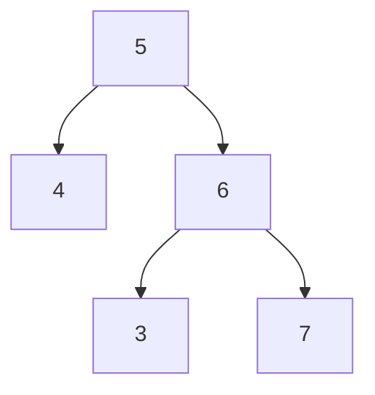

# 04. Trees and traversal

> **Subject:** Problem solving · **Lesson:** 04 · **Made:** 2026-11-03 · **Status:** ready
>
> **You will be able to:** draw a binary tree, visit every node in four orders (preorder, inorder, postorder, level by level), say why the inorder of a search tree is sorted, write the recursion for depth, and avoid the classic "validate a BST" trap.
>
> **Before this:** [Arrays, linked lists, stacks and queues](03-arrays-linked-lists-stacks-and-queues.md) · **Next:** [Graphs](05-graphs-bfs-dfs-and-cycles.md)
>
> **How to read it:** one card is one idea. Look at the picture, guess, then press the orange bar to check. The blue bars (📖 More detail) hold the longer explanation. Skip them on the first read, open them when you want more. About 30 minutes for the cards.

## 1. The idea: a family tree upside down

A **tree** is nodes joined by arrows that go down. The top node is the **root**. Each node has **children**. A node with no children is a **leaf**. In a **binary** tree, a node has at most two children: left and right.

```text
        4        <- the root
      /   \
     2     6
    / \   / \
   1   3 5   7   <- the leaves
```

In code, a node is an object:

```js
const node = (val, left = null, right = null) =>
  ({ val, left, right });

const tree = node(4,
  node(2, node(1), node(3)),
  node(6, node(5), node(7)));
```

<details class="guess"><summary>🤔 Guess: how many leaves does this tree have, and how many levels? Press to check.</summary>

**4 leaves** (1, 3, 5 and 7) and **3 levels** (4 / 2 6 / 1 3 5 7). The number of levels is called the **height** (or depth). Here it is 3.

</details>

> **Remember:** a tree is a linked list where each node can point to two next nodes.

<details class="more"><summary>📖 More detail: where trees live in your work</summary>

The **DOM** (the page in the browser) is a tree. Your React component tree is a tree. A folder on your disk is a tree. JSON with nested objects is a tree. The index of a database (a B-tree, [database lesson 09](../database/09-indexes-and-b-trees.md)) is a tree. When data has "parts inside parts", think tree.

</details>

## 2. Recursion: let each child do its own work

Trees are made of smaller trees: every child is the root of a smaller tree. So the natural code calls itself on the children. That is **recursion**.

*How deep is the tree?*

```js
function maxDepth(node) {
  if (!node) return 0;
  const left = maxDepth(node.left);
  const right = maxDepth(node.right);
  return 1 + Math.max(left, right);
}
```

The first line is the **base case**: an empty spot has depth 0. This stops the calls. The last line says: my depth is 1 (me) plus the deeper child. I ran it on the tree above and it printed `3`.

<details class="guess"><summary>🤔 Guess: what happens if we forget the <code>if (!node) return 0</code> line? Press to check.</summary>

A leaf has `left = null`. Without the base case, the code calls `maxDepth(null)` and then reads `null.left`, which crashes with a `TypeError`. The base case is what makes every recursive function stop. Always write it first.

</details>

> **Remember:** recursion on a tree = base case for null, then combine the answers of the left and the right.

<details class="more"><summary>📖 More detail: the cost</summary>

Each node is visited once, so it is **O(n)** time. The space is the call stack, as deep as the tree is high: **O(h)**, where h is the height. For a balanced tree h is about log n. For a tree that is one long chain, h is n (card 7).

</details>

## 3. Depth first (DFS): three orders

**Depth first** means: go down as far as you can, then come back. The only question is **when you visit the node** (add it to the output): before its children, between them, or after them.

```js
function dfs(node, out) {
  if (!node) return;
  // preorder: out.push(node.val) here
  dfs(node.left, out);
  // inorder: out.push(node.val) here
  dfs(node.right, out);
  // postorder: out.push(node.val) here
}
```

I ran the three versions on the tree from card 1:

| Order | Visit the node | Result |
|---|---|---|
| Preorder | before the children | 4 2 1 3 6 5 7 |
| Inorder | between left and right | **1 2 3 4 5 6 7** |
| Postorder | after the children | 1 3 2 5 7 6 4 |

<details class="guess"><summary>🤔 Guess: which order would you use to <b>delete</b> a whole tree (children before parents)? Press to check.</summary>

**Postorder.** Children are finished before their parent, so a parent is only deleted when nothing hangs below it. Preorder is for copying a tree (parent first). Inorder is for a search tree, where it gives sorted output.

</details>

> **Remember:** preorder = me first. Inorder = left, me, right. Postorder = me last.

<details class="more"><summary>📖 More detail: watch it run</summary>

**Step through it yourself:** [Tree traversal stepper](visuals/04-trees-and-traversal.html). Tabs 1 to 3 are the three orders. The blue node is the one being visited. The yellow nodes are the calls waiting on the stack. The stack is the thing that lets the code "come back" up.

</details>

## 4. Breadth first (BFS): level by level

**Breadth first** visits the whole first level, then the whole second level, and so on. It uses a **queue**: take one from the front, add its children to the back.

```js
function bfs(root) {
  const out = [], queue = [root];
  while (queue.length) {
    const node = queue.shift();
    out.push(node.val);
    if (node.left) queue.push(node.left);
    if (node.right) queue.push(node.right);
  }
  return out;
}
```

It printed `4 2 6 1 3 5 7`. To get the levels as separate groups (a common question, "level order"), take `queue.length` at the start of each round and process that many nodes. I ran that version too:

```text
[[4],[2,6],[1,3,5,7]]
```

<details class="guess"><summary>🤔 Guess: DFS uses a stack, BFS uses a queue. Where is the stack in the recursive DFS code? Press to check.</summary>

It is **hidden**. Each call to `dfs` waits on the **call stack** while its child runs. You can write DFS without recursion by using your own array as a stack (`push` and `pop`). The queue in BFS is the same shape of idea, but the order of taking items is the other way round.

</details>

> **Remember:** DFS = stack, goes deep first. BFS = queue, goes level by level.

<details class="more"><summary>📖 More detail: BFS space</summary>

BFS keeps a whole level in the queue, so its space is O(w), where w is the widest level. For a very wide tree that is large. DFS keeps one path, O(h). `queue.shift()` is the slow call from [lesson 03](03-arrays-linked-lists-stacks-and-queues.md): for big trees use a head index (the practice answer does).

</details>

## 5. A binary search tree (BST)

A **binary search tree** has one rule at **every** node: everything in the left side is **smaller**, everything in the right side is **bigger**. This makes searching fast: at each node you drop half of the tree (if the tree is balanced).

*Find 5 in the tree from card 1:*

```text
at 4:  5 > 4, go right
at 6:  5 < 6, go left
at 5:  found.   3 steps
```

I counted: finding 5 took 3 steps, and finding 8 (not in the tree) took 3 steps before it hit a `null`. For a tree of 1,000,000 nodes that is balanced, about 20 steps.

And the inorder walk of a BST gives the values **sorted** (card 3: 1 2 3 4 5 6 7).

<details class="guess"><summary>🤔 Guess: put 1, 2, 3, ..., 1000 into a BST in that order. How tall is the tree? Press to check.</summary>

**1000.** Each new number is bigger than all before it, so it always goes right. The tree is just a chain, like a linked list, and a search takes up to 1000 steps. I measured it. When I put the same 1000 numbers in a shuffled order, the height was only **25**. This is why real databases use trees that **balance** themselves.

</details>

> **Remember:** a BST is fast only if it stays balanced. Inorder of a BST is sorted.

<details class="more"><summary>📖 More detail: balanced trees</summary>

Trees that fix their shape on their own have names like AVL, red-black, and B-tree. Postgres indexes use a B-tree ([database lesson 09](../database/09-indexes-and-b-trees.md)). For interviews, you usually only need to say: "an unbalanced BST can become a chain, so search becomes O(n); a balanced one stays O(log n)". The shuffle I used was a simple seeded one, one run.

</details>

## 6. The classic trap: validate a BST

*Is this tree a valid binary search tree?*



Every node is fine **next to its parent**: 4 is smaller than 5, 6 is bigger than 5, 3 is smaller than 6, and 7 is bigger than 6. A check that only looks at the direct children says **valid**. I ran that check: it printed `true`. But the 3 is on the **right** of 5, and 3 is smaller than 5. The tree is **not** valid.

The rule is about **everything** on a side. So pass down the limits:

```js
function isValidBST(node, lo = -Infinity,
                    hi = Infinity) {
  if (!node) return true;
  if (node.val <= lo || node.val >= hi)
    return false;
  return isValidBST(node.left, lo, node.val)
      && isValidBST(node.right, node.val, hi);
}
```

Going left, the new upper limit is the parent. Going right, the new lower limit is the parent. I ran it on the tree above and it printed `false`, and on the tree from card 1 it printed `true`.

<details class="guess"><summary>🤔 Guess: why <code>&lt;=</code> and <code>&gt;=</code> (not just <code>&lt;</code> and <code>&gt;</code>) in the check? Press to check.</summary>

In the usual definition, equal values are **not allowed** (each value is strictly bigger or smaller). So a node equal to a limit is invalid. (Some versions of the problem allow duplicates on one side. Ask the interviewer.)

</details>

> **Remember:** a node must fit between the limits from **all** of its ancestors, not only its parent.

<details class="more"><summary>📖 More detail: another way to check</summary>

Walk the tree **inorder** and check that each value is bigger than the one before. If the walk is sorted, it is a valid BST. It is also O(n) time.

</details>

## 7. Mistakes

**1. Forgetting the null base case.** The crash is `Cannot read properties of null`.

**2. Recursion that is too deep.** I built a tree that is one long chain (every node has only a left child). Recursive `maxDepth` worked at 5,000 nodes and crashed with `RangeError: Maximum call stack size exceeded` at 20,000 nodes on Node 26.12.1. Balanced trees are shallow, so this only hits chain-shaped trees. For those, use your own stack (a loop with an array) instead of recursion.

**3. Returning the wrong thing.** In `maxDepth`, `Math.max(left, right)` must have the `+ 1`. In "invert tree", you must swap **both** children and return the root.

**4. Mixing up levels and depth.** A single node has depth 1 in the lesson (count nodes), and depth 0 in some books (count edges). Say which you use.

<details class="guess"><summary>🤔 Guess: invert a tree (swap left and right everywhere). Which order, preorder or postorder? Press to check.</summary>

**Either works.** Swapping before or after the recursive calls both give the same tree, as long as every node is swapped once. In the practice file the code saves `left`, sets `left = invert(right)` and `right = invert(saved left)`. I ran it on `1` with children `2` and `3`, and the levels went from `[[1],[2,3]]` to `[[1],[3,2]]`.

</details>

> **Remember:** every tree function = base case + combine the children.

<details class="more"><summary>📖 More detail: the usual interview list</summary>

Max depth, same tree, invert tree, level order, validate BST, lowest common ancestor, kth smallest in a BST (inorder), path sum, serialize a tree. Almost all are "DFS with a small twist" or "BFS". The practice folder for trees (pattern 7 in the [map](README.md)) is not written yet. The tasks in `practice/04-trees.js` cover the first four.

</details>

## 8. Why it matters and what it costs

Interview words: *binary tree*, *BST*, *DFS*, *BFS*, *preorder*, *inorder*, *postorder*, *level order*, *height*, *balanced*.

- **Without it:** nested data is a mess of loops, and you cannot say how long a search in a database index takes.
- **With it:** you can walk any "parts inside parts" data with a few lines.
- **The cost:** recursion uses stack space (O(h)), a BST can become a chain, and BFS needs memory for a whole level.

## 9. Watch and play

Links checked on 2026-11-03. Each page loaded (HTTP 200). For each video, the title and channel were confirmed through YouTube's oEmbed data. The video lengths were not checked.

- **Play with it:** [The tree traversal stepper](visuals/04-trees-and-traversal.html) in this folder. Guess first, then press Next.
- **Play with it:** [VisuAlgo: Binary Search Tree](https://visualgo.net/en/bst). Insert, search and traverse a BST, and watch the shape change.
- **Play with it:** [University of San Francisco BST visualizer](https://www.cs.usfca.edu/~galles/visualization/BST.html). Insert 1, 2, 3, 4, 5 in order and see the chain.
- **Video:** [Example Binary Tree Traversals - Preorder, Inorder, Postorder, & Level Order](https://www.youtube.com/watch?v=OXy4pLq_XZs) from the channel Logic Lambda. Cards 3 and 4.
- **Video:** [Binary Tree Level Order Traversal - BFS - Leetcode 102](https://www.youtube.com/watch?v=6ZnyEApgFYg) from the channel NeetCode. Card 4.

## 10. Practice

**A. Predict the output** (write your answer first)

```text
      10
     /  \
    5    15
   / \     \
  2   7     20
```

What does inorder print? What does level order print? What is the depth?

<details class="guess"><summary>🤔 Press to see the answer</summary>

Inorder (left, me, right): `2 5 7 10 15 20` (sorted, because it is a BST). Level order: `10 | 5 15 | 2 7 20`. Depth: **3**.

</details>

**B. What would you check?** A comment thread has replies inside replies, shown as nested objects. The page crashes with "Maximum call stack size exceeded" for one very long reply chain. Why, and what do you change?

<details class="guess"><summary>🤔 Press to see the answer</summary>

The code walks the thread with recursion, and a chain of thousands of replies is as deep as the tree (O(h) stack). Change to a loop that uses its own array as a stack, or limit the nesting depth in the data. (A reply chain of thousands is rare, but a bug or an attack can make one.)

</details>

**C. Write it yourself**

Open [`practice/04-trees.js`](practice/04-trees.js). It has `maxDepth`, `levelOrder`, `isValidBST` and `invertTree`. Run:

```bash
cd learn/problem-solving
node --test practice/04-trees.test.js
```

<details><summary>One possible answer</summary>

```js
function maxDepth(root) {
  if (!root) return 0;
  return 1 + Math.max(maxDepth(root.left),
                      maxDepth(root.right));
}

function levelOrder(root) {
  if (!root) return [];
  const result = [], queue = [root];
  for (let head = 0; head < queue.length;) {
    const end = queue.length, level = [];
    for (; head < end; head++) {
      const node = queue[head];
      level.push(node.val);
      if (node.left) queue.push(node.left);
      if (node.right) queue.push(node.right);
    }
    result.push(level);
  }
  return result;
}

function isValidBST(root, lo = -Infinity,
                    hi = Infinity) {
  if (!root) return true;
  if (root.val <= lo || root.val >= hi) return false;
  return isValidBST(root.left, lo, root.val)
      && isValidBST(root.right, root.val, hi);
}

function invertTree(root) {
  if (!root) return null;
  const left = root.left;
  root.left = invertTree(root.right);
  root.right = invertTree(left);
  return root;
}
```

All 6 tests pass with this code (checked on 2026-11-03), and all 6 fail with the empty file. `levelOrder` uses a head index instead of `shift`, and a `for` loop for each level: `end` fixes how many nodes belong to this level before we add children. All four are O(n) time. Space: O(h) for the recursive ones, O(w) for `levelOrder`.

</details>

## 11. Interview question

**Q:** "Walk me through the ways to traverse a binary tree. When do you use each? Then: how do you validate a BST?"

<details><summary>A strong answer, in four parts</summary>

1. **Problem:** a tree has no single "next" item like an array, so I need a rule for the order.
2. **How it works:** DFS goes deep first: preorder (node, left, right) to copy, inorder (left, node, right) which gives a BST in sorted order, postorder (left, right, node) to finish children first. BFS goes level by level with a queue. All are O(n) time. For validate BST, I pass down a lower and an upper limit, so each node is checked against all its ancestors, not only its parent.
3. **Tradeoff:** DFS space is O(h) (the height), BFS space is O(w) (the widest level). A very tall tree can overflow the recursion stack, and then I use my own stack in a loop.
4. **My example:** *This is an idea, not a fact. Replace it with a real story from DBO, Unloan, ZWS or Skyworx.* Walking a nested menu or category tree to build a breadcrumb or to count items under each node.

</details>

## 12. Explain it back

Close this file. Press the **Record my explanation** button under this heading and explain how DFS and BFS differ, to a new junior, in 4 parts: problem, how it works, tradeoff, my example. Use these: the tree of 7 nodes, `4 2 1 3 6 5 7` against `4 2 6 1 3 5 7`, and the BST chain of height 1000 against 25.

### My explanation

<write here>

### Coach feedback

<the explain-coach agent writes here>

## 13. Review questions (day 1, 3, 7, 21)

1. What is a root, a leaf, and the height of a tree?
2. What is the base case of tree recursion, and what happens without it?
3. What is the difference between preorder, inorder and postorder?
4. What does the inorder walk of a BST give?
5. What data structure does BFS use, and DFS?
6. Why is "every child is smaller or bigger than its parent" not enough to validate a BST?
7. When can a BST become slow, and how slow?

<details><summary>Answers</summary>

1. Root: the top node. Leaf: a node with no children. Height: the number of levels.
2. `if (!node) return ...` for an empty child. Without it, the code reads a property of `null` and crashes.
3. When you visit the node: before the children, between them, or after them.
4. The values in sorted order.
5. BFS uses a queue. DFS uses a stack (the call stack in recursion).
6. A value deep in the right side can be smaller than the root. The rule is about all ancestors, so pass down a lower and an upper limit.
7. When values are inserted in sorted order, the tree is a chain, so search is O(n) instead of O(log n). 1000 sorted inserts gave a height of 1000.

</details>

## 14. Go deeper (optional)

None of this is needed for the cards above.

<details><summary>Iterative inorder with a stack</summary>

Go left as far as you can, pushing every node. Pop one, visit it, then go to its right child and repeat. It gives the same sorted order without recursion, and it is the usual answer for "do it without recursion" and for "kth smallest in a BST" (stop at the k-th pop). I did not run it here.

</details>

<details><summary>Tries</summary>

A **trie** is a tree where each step is one letter of a word. It is used for autocomplete. Interviews ask for it sometimes. I did not cover it here.

</details>

<details><summary>Make the numbers yourself</summary>

Card 5: insert 1 to 1000 in order and walk the tree to find its height, then shuffle and do it again. Card 7: build a chain of nodes with only `left` children and call the recursive `maxDepth` on 5,000 and then 20,000 nodes.

</details>

## Connected lessons

- [03. Arrays, linked lists, stacks and queues](03-arrays-linked-lists-stacks-and-queues.md): the stack and queue that DFS and BFS use.
- [05. Graphs](05-graphs-bfs-dfs-and-cycles.md): a tree is a graph without loops. Same BFS and DFS, plus a `seen` Set.
- [06. Binary search and sorting](06-binary-search-and-sorting.md): a BST is binary search in a tree shape.
- [08. Recursion, backtracking and dynamic programming](08-recursion-backtracking-and-dynamic-programming.md): recursion in more depth.
- [Database lesson 09: Indexes and B-trees](../database/09-indexes-and-b-trees.md): the tree behind a database index.
- [Problem solving map](README.md): the practice folders.
