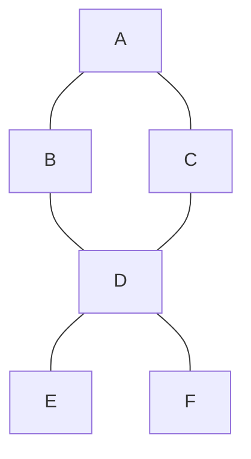

# 05. Graphs: BFS, DFS and cycles

> **Subject:** Problem solving · **Lesson:** 05 · **Made:** 2026-11-03 · **Status:** ready
>
> **You will be able to:** draw a graph and write it as an adjacency list, use BFS to find the fewest steps, use DFS to explore and count groups, solve "number of islands" on a grid, and use a counter of waiting tasks to order work and find a cycle.
>
> **Before this:** [Trees and traversal](04-trees-and-traversal.md) · **Next:** [Binary search and sorting](06-binary-search-and-sorting.md)
>
> **How to read it:** one card is one idea. Look at the picture, guess, then press the orange bar to check. The blue bars (📖 More detail) hold the longer explanation. Skip them on the first read, open them when you want more. About 30 minutes for the cards.

## 1. The idea: dots and lines

A **graph** is dots (**nodes**) joined by lines (**edges**). A map of cities and roads. Friends in a social app. Pages that link to each other. Tasks that must happen before others.



In code, the usual shape is an **adjacency list**: each node lists its neighbours. I built this one from a list of edges:

```js
const edges = [['A','B'], ['A','C'], ['B','D'],
  ['C','D'], ['D','E'], ['D','F']];
const graph = {};
for (const [a, b] of edges) {
  (graph[a] ??= []).push(b);
  (graph[b] ??= []).push(a);
}
// { A: [B, C], B: [A, D], C: [A, D],
//   D: [B, C, E, F], E: [D], F: [D] }
```

Each line is added **both ways**, because this graph has no direction. For a one-way graph (A can go to B, not back), add only one.

<details class="guess"><summary>🤔 Guess: a tree is a graph too. What does a tree not have that a general graph can have? Press to check.</summary>

**Loops (cycles).** In a tree there is exactly one path between two nodes. In a graph, there can be many paths, and a path that returns to where it started. In the picture, A, B, D, C is a loop. This is why graph code needs a `seen` set (card 2).

</details>

> **Remember:** a graph is nodes and edges. Write it as "each node lists its neighbours".

<details class="more"><summary>📖 More detail: new words</summary>

- **Node (vertex)** and **edge:** the dot and the line.
- **Neighbour:** a node you can reach with one edge.
- **Directed:** edges are one-way arrows (like "must be done before"). **Undirected:** two-way lines.
- **Cycle:** a path that comes back to where it started.
- **Cost of a graph walk:** O(V + E): every node once and every edge once (V is the number of nodes, E the number of edges).

</details>

## 2. BFS: spread out like a ripple, find the fewest steps

**Breadth first search (BFS)** starts at one node and visits its neighbours, then their neighbours, ring by ring, like a ripple on water. It uses a **queue**. The first time BFS reaches a node, it used the **fewest edges**.

```js
function bfs(graph, start) {
  const dist = { [start]: 0 };
  const queue = [start];
  for (let h = 0; h < queue.length; h++) {
    const node = queue[h];
    for (const nb of graph[node]) {
      if (nb in dist) continue; // seen
      dist[nb] = dist[node] + 1;
      queue.push(nb);
    }
  }
  return dist;
}
```

I ran it from `A`:

```text
{"A":0,"B":1,"C":1,"D":2,"E":3,"F":3}
```

So the shortest path from A to F is **3 edges**. (`dist` is also the `seen` list: a node in `dist` has been seen.)

<details class="guess"><summary>🤔 Guess: we mark a node as seen when we put it in the queue, not when we take it out. Does it matter? Press to check.</summary>

Yes. If you mark it when you **take it out**, a node can be put in the queue twice before the first copy is taken out. In my test graph, `D` is a neighbour of both `B` and `C`, so it went in twice (7 pushes instead of 6). On a big graph with many links, the queue grows a lot. Mark when you **add**.

</details>

> **Remember:** BFS = queue + seen. Mark seen when you add to the queue. First arrival = shortest path (when every edge counts as 1).

<details class="more"><summary>📖 More detail: watch it run</summary>

**Step through it yourself:** [Graph stepper](visuals/05-graphs-bfs-dfs-and-cycles.html). Tab 1 is this BFS. The yellow nodes are in the queue, the green are done, the label under each node is `dist`.

The "shortest path" idea only works when every edge costs the same. If edges have different costs (road lengths), you need Dijkstra's algorithm. I did not cover it here.

</details>

## 3. DFS: go as deep as you can, then back up

**Depth first search (DFS)** follows one path to its end, then comes back and tries the next. It uses a **stack** (usually the call stack, through recursion).

```js
function dfs(graph, node, seen = new Set()) {
  seen.add(node);
  for (const nb of graph[node])
    if (!seen.has(nb)) dfs(graph, nb, seen);
  return [...seen];
}
```

From `A` it printed `A B D C E F`. It dived `A, B, D` first, then came back for `C`, and then it went on to `E` and `F`.

| | BFS | DFS |
|---|---|---|
| Order | ring by ring | one path to the end first |
| Uses | queue | stack (recursion) |
| Good for | fewest steps | "can I reach it?", "count the groups", "try every path" |
| Memory | the widest ring | the longest path |

<details class="guess"><summary>🤔 Guess: "is there ANY path from A to F?" Which one do you pick? Press to check.</summary>

**Either one works.** Both visit everything reachable. DFS is shorter to write (recursion). BFS also gives the shortest path. If the question says "fewest" or "minimum number of steps", choose BFS.

</details>

> **Remember:** fewest steps = BFS. Explore, reach, count groups = DFS (or BFS).

<details class="more"><summary>📖 More detail: DFS on a very big graph</summary>

Recursive DFS goes as deep as the longest path. In card 4 I show a grid where it crashed. For huge graphs, use your own array as a stack in a loop.

</details>

## 4. A grid is a graph: number of islands

*A grid of land (1) and water (0). Count the islands: land that is joined up, down, left or right.*

```text
1 1 0 0 0
1 1 0 0 0
0 0 1 0 0
0 0 0 1 1
```

Each cell is a node. Its neighbours are the 4 cells around it. The plan: walk the grid, and when you find land that you have not seen, **count one island**, and then spread (DFS or BFS) over all the land joined to it, marking it as seen.

```js
function numIslands(grid) {
  const rows = grid.length;
  const cols = rows ? grid[0].length : 0;
  const seen = Array.from({ length: rows },
    () => Array(cols).fill(false));
  let count = 0;
  for (let r = 0; r < rows; r++)
    for (let c = 0; c < cols; c++) {
      if (grid[r][c] !== '1' || seen[r][c])
        continue;
      count++;
      seen[r][c] = true;
      const stack = [[r, c]];
      while (stack.length) {
        const [y, x] = stack.pop();
        for (const [dy, dx] of
             [[1,0], [-1,0], [0,1], [0,-1]]) {
          const ny = y + dy, nx = x + dx;
          if (ny < 0 || nx < 0 || ny >= rows
              || nx >= cols) continue;
          if (grid[ny][nx] !== '1'
              || seen[ny][nx]) continue;
          seen[ny][nx] = true;
          stack.push([ny, nx]);
        }
      }
    }
  return count;
}
```

On the grid above it printed `3`.

<details class="guess"><summary>🤔 Guess: the short recursive version of this crashed on a 300 × 300 grid of all land. Why? Press to check.</summary>

Recursion goes one cell deeper at each step, and on a full grid the path can wind through all 90,000 cells. The call stack holds about 10,000 calls here, so it ran out. I ran it: a 50 × 50 grid worked (it printed `1`), a 300 × 300 grid threw `RangeError: Maximum call stack size exceeded`. The version above uses its own `stack` array, so it works on any size.

</details>

> **Remember:** a grid is a graph. Neighbours are up, down, left, right. Find a new land cell, count 1, then spread and mark.

<details class="more"><summary>📖 More detail: the cost and a shortcut</summary>

Every cell is visited a few times at most: **O(rows × cols)** time and space. A shortcut people use: change the grid itself (set visited land to `'0'`) instead of a `seen` array. It saves memory, but it **changes the input**, so ask first. The practice tests check that your function does not change the grid.

</details>

## 5. A directed graph: ordering tasks and finding a cycle

*Courses: to take course 1 you need course 0 first. Can you finish all courses?* This is a **directed** graph: an arrow `0 → 1` means "0 comes before 1". If the arrows make a loop (1 needs 0, and 0 needs 1), nobody can start.

The idea (called **topological sort**, with a counter of waiting tasks, also known as Kahn's algorithm):

1. For each node count the arrows **pointing at it** (what it still waits for): `indegree`.
2. Put every node with **0** in a queue. They can go first.
3. Take one out, add it to the order, and take away its arrows: each neighbour waits for one less. A neighbour that reaches 0 joins the queue.
4. At the end, if the order has **fewer** nodes than the graph, there was a **cycle**.

```js
function canFinish(n, prerequisites) {
  const adj = Array.from({ length: n }, () => []);
  const indeg = Array(n).fill(0);
  for (const [a, b] of prerequisites) {
    adj[b].push(a); // b before a
    indeg[a]++;
  }
  const queue = [];
  for (let i = 0; i < n; i++)
    if (indeg[i] === 0) queue.push(i);
  let done = 0;
  for (let h = 0; h < queue.length; h++) {
    done++;
    for (const nb of adj[queue[h]])
      if (--indeg[nb] === 0) queue.push(nb);
  }
  return done === n;
}
```

I ran it:

```text
canFinish(4, [[1,0],[2,0],[3,1],[3,2]])  true
canFinish(2, [[1,0],[0,1]])              false
```

<details class="guess"><summary>🤔 Guess: in the second example, courses 0 and 1 need each other. What is the queue at the start? Press to check.</summary>

**Empty.** Both have one arrow pointing at them, so nobody has `indegree 0`. The loop never starts, `done` stays 0, and 0 is not 2, so it returns `false`. The stepper's last tab shows a similar case: the order stops at `A` and never gets `B` and `C`.

</details>

> **Remember:** nodes with nothing left to wait for go first. If some are never freed, there is a cycle.

<details class="more"><summary>📖 More detail: where this shows up</summary>

Build tools and package managers must install packages in an order where dependencies come first (a dependency graph). Spreadsheets update cells in order. A cycle ("A needs B, B needs A") is an error you may have seen as "circular dependency". Another way to find a cycle is DFS with three colours (not seen, in progress, done). I did not cover it.

</details>

## 6. Mistakes

**1. No `seen`.** On a graph with a loop, the code never stops. In my test, with no `seen` on the 6 node graph, the queue held **105** entries after only 40 steps, and kept growing.

**2. Only one direction.** For an undirected graph, add both `a → b` and `b → a`. If you add one, half of the graph looks unreachable.

**3. Marking seen too late** (card 2). The queue fills with duplicates.

**4. Too deep recursion** (card 4). Use your own stack for big inputs.

**5. Counting wrong in a grid.** Check the borders before reading `grid[ny][nx]`, or you read outside the array.

<details class="guess"><summary>🤔 Guess: the graph has two separate pieces that are not joined. How many times do you start the search, to visit all nodes? Press to check.</summary>

**Once for each piece.** A search from one node only reaches its own piece. So the usual loop is: "for every node, if it is not seen, start a search from it". The number of times you start is the number of pieces ("connected components"). This is exactly how the island count works.

</details>

> **Remember:** start from every unseen node, and always keep a `seen`.

<details class="more"><summary>📖 More detail: the usual interview list</summary>

Number of islands, clone a graph, course schedule (this lesson), shortest path in a grid, word ladder, rotting oranges, connected components, pacific atlantic water flow. Almost all are "BFS for fewest steps" or "DFS/BFS to explore with a seen set". Another tool, **union-find**, is also popular for groups. I did not cover it here.

</details>

## 7. Why it matters and what it costs

Interview words: *graph*, *adjacency list*, *BFS*, *DFS*, *shortest path*, *connected components*, *cycle*, *topological sort*, *indegree*.

- **Without it:** problems with "connections" feel impossible, and your loop never stops on a loop in the data.
- **With it:** a map, a network, a grid, and a dependency list all become the same two tools: BFS and DFS with a `seen` set.
- **The cost:** O(V + E) time and O(V) space for the `seen` set and the queue or stack. Plus the effort of turning the problem into a graph in your head: ask "what is a node? what is an edge?".

## 8. Watch and play

Links checked on 2026-11-03. Each page loaded (HTTP 200). For each video, the title and channel were confirmed through YouTube's oEmbed data. The video lengths were not checked.

- **Play with it:** [The graph stepper](visuals/05-graphs-bfs-dfs-and-cycles.html) in this folder. Guess first, then press Next. Four tabs: BFS, DFS, ordering, and a cycle.
- **Play with it:** [VisuAlgo: Graph Traversal (DFS/BFS)](https://visualgo.net/en/dfsbfs). Draw your own graph and run both.
- **Video:** [Number of Islands - Breadth-First Search (BFS) - Leetcode 200 (Python) - Blind 75](https://www.youtube.com/watch?v=81qgDPMgxpo) from the channel Matt Guest. Card 4 (the code is Python, the idea is the same).
- **Video:** [DFS vs BFS: The Easiest Trick You'll Never Forget](https://www.youtube.com/watch?v=wdjg-PlWpk8) from the channel Code Viento. Card 3.

## 9. Practice

**A. Predict the output** (write your answer first)

```js
const g = { A: ['B'], B: ['C'], C: ['A'] };
// BFS from A with a seen Set.
// In what order are the nodes visited?
// How many times does the loop run?
```

<details class="guess"><summary>🤔 Press to see the answer</summary>

Order: `A B C`. The loop runs 3 times. C points back to A, but A is already seen, so it is skipped. Without `seen`, A, B, C, A, B, C ... would never end.

</details>

**B. What would you check?** A "friends of friends" feature loops for ever on some users. The code follows `friends` lists with a recursive function. What do you suspect?

<details class="guess"><summary>🤔 Press to see the answer</summary>

Two users are friends of each other (a cycle: A lists B, B lists A) and the function has **no `seen` set**, so it goes A, B, A, B ... until the stack overflows, or loops for ever in a loop version. Add a `seen` Set of user ids. Also limit the depth (friends of friends only means 2 levels, so a BFS with a level limit is better).

</details>

**C. Write it yourself**

Open [`practice/05-graphs.js`](practice/05-graphs.js). It has `numIslands`, `canFinish` and `shortestPath`. Run:

```bash
cd learn/problem-solving
node --test practice/05-graphs.test.js
```

<details><summary>One possible answer</summary>

The code for `numIslands` and `canFinish` is in cards 4 and 5. The shortest path:

```js
function shortestPath(graph, from, to) {
  if (from === to) return 0;
  const dist = new Map([[from, 0]]);
  const queue = [from];
  for (let h = 0; h < queue.length; h++) {
    const node = queue[h];
    for (const nb of graph[node] || []) {
      if (dist.has(nb)) continue;
      dist.set(nb, dist.get(node) + 1);
      if (nb === to) return dist.get(nb);
      queue.push(nb);
    }
  }
  return -1;
}
```

All 7 tests pass with these three functions (checked on 2026-11-03), and all 7 fail with the empty file. `numIslands` and `canFinish` are O(V + E) time. `canFinish` also ran a chain of 50,000 courses within the time limit, because it uses a head index instead of `shift`.

</details>

## 10. Interview question

**Q:** "How do you find the shortest path in an unweighted graph? How do you count the islands in a grid? How do you know if courses can all be finished?"

<details><summary>A strong answer, in four parts</summary>

1. **Problem:** the data is "things and connections", and it can have loops, so a plain loop will never stop.
2. **How it works:** I write the graph as an adjacency list and keep a `seen` set. For the fewest steps, BFS with a queue: the first time I reach a node is the shortest path. For islands, I scan the grid, and for each new land cell I count 1 and spread over its land with DFS or BFS. For courses, I count the arrows pointing at each node and process nodes with 0 first. If the order has fewer nodes than the graph, there is a cycle. All are O(V + E).
3. **Tradeoff:** BFS keeps a whole ring in memory, DFS only one path, but recursive DFS can overflow the stack on big inputs, so I use my own stack. BFS only finds shortest paths when all edges cost the same. Otherwise I need Dijkstra.
4. **My example:** *This is an idea, not a fact. Replace it with a real story from DBO, Unloan, ZWS or Skyworx.* Following dependencies between database migrations or services in a deploy order.

</details>

## 11. Explain it back

Close this file. Press the **Record my explanation** button under this heading and explain BFS and DFS to a new junior, in 4 parts: problem, how it works, tradeoff, my example. Use these: the 6 node graph, A to F in 3 edges, and the 300 × 300 grid that crashed the recursive version.

### My explanation

<write here>

### Coach feedback

<the explain-coach agent writes here>

## 12. Review questions (day 1, 3, 7, 21)

1. What is an adjacency list?
2. Why does graph code need a `seen` set? What happens without it?
3. Which of BFS and DFS finds the fewest steps? Why?
4. When do you mark a node as seen in BFS, and why then?
5. How do you count the islands in a grid?
6. What does "indegree 0" mean in an ordering problem? How does the algorithm detect a cycle?
7. What is the time cost of walking a graph?

<details><summary>Answers</summary>

1. A table where each node lists the nodes it connects to.
2. A graph can have loops. Without `seen` the search goes round a loop for ever. (105 queue entries after 40 steps in my test.)
3. BFS. It visits the nodes closest to the start first, so the first arrival uses the fewest edges.
4. When you add it to the queue. If you wait until you take it out, it can be added twice.
5. Scan every cell. At a land cell not seen yet, count 1, then spread (DFS or BFS) over the joined land and mark it.
6. A node with nothing left to wait for. If the finished order has fewer nodes than the graph, some nodes wait for each other, so there is a cycle.
7. O(V + E): each node and each edge once.

</details>

## 13. Go deeper (optional)

None of this is needed for the cards above.

<details><summary>Weighted graphs and Dijkstra</summary>

When edges have costs, BFS does not give the cheapest path. **Dijkstra** uses a priority queue (a heap, [lesson 07](07-heaps-and-top-k.md)) to always take the cheapest unfinished node next. I did not run it here.

</details>

<details><summary>Union-find</summary>

A different tool for "are these two in the same group?" and "join two groups". It is often faster to write than a search for connected-components questions. I did not cover it here.

</details>

<details><summary>Make the numbers yourself</summary>

Card 2: run BFS twice, once marking on add and once marking on remove, and count the pushes. Card 4: run the recursive island count on a 50 × 50 and a 300 × 300 grid of `'1'`. Card 6: remove the `seen` check and print `queue.length` after 40 steps.

</details>

## Connected lessons

- [03. Arrays, linked lists, stacks and queues](03-arrays-linked-lists-stacks-and-queues.md): the queue (and why `shift` is slow) and the stack.
- [04. Trees and traversal](04-trees-and-traversal.md): a tree is a graph with no loops. DFS and BFS are the same.
- [07. Heaps and top k](07-heaps-and-top-k.md): the priority queue behind Dijkstra.
- [08. Recursion, backtracking and dynamic programming](08-recursion-backtracking-and-dynamic-programming.md): DFS is recursion on a graph.
- [Problem solving map](README.md): the practice folders.
