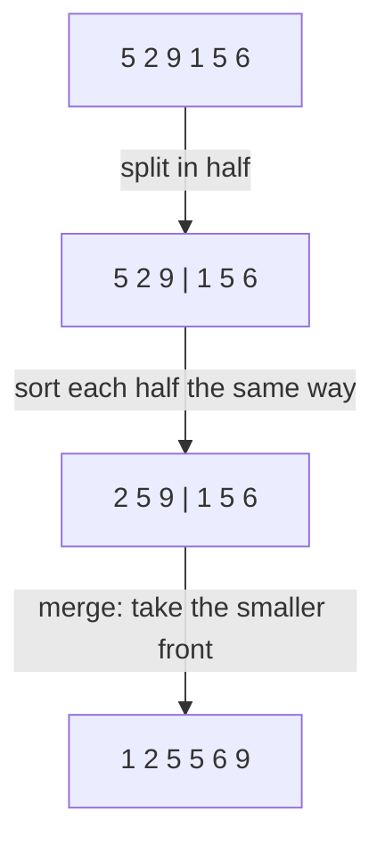

# 06. Binary search and sorting

> **Subject:** Problem solving · **Lesson:** 06 · **Made:** 2026-11-03 · **Status:** ready
>
> **You will be able to:** write binary search without off-by-one bugs, use it on a sorted list and on "find the smallest value that works", sort with `sort` in JavaScript without the number trap, and say how merge sort works and what it costs.
>
> **Before this:** [Graphs](05-graphs-bfs-dfs-and-cycles.md) · **Next:** [Heaps and top k](07-heaps-and-top-k.md)
>
> **How to read it:** one card is one idea. Look at the picture, guess, then press the orange bar to check. The blue bars (📖 More detail) hold the longer explanation. Skip them on the first read, open them when you want more. About 30 minutes for the cards.

## 1. The idea: the guessing game

*I think of a number from 1 to 1,000. You guess. I only say "higher" or "lower".* You do not guess 1, 2, 3. You guess **500**. Then 250 or 750. Each guess throws away **half** of the numbers. After about 10 guesses you win.

That is **binary search**. It needs one thing: the data is **sorted**, so one look tells you which half to drop.

I counted the looks for the worst case (the target is the last item):

| Items | Looks (binary search) | Looks (one by one) |
|---|---|---|
| 10 | 4 | 10 |
| 1,000 | 10 | 1,000 |
| 1,000,000 | **20** | 1,000,000 |

<details class="guess"><summary>🤔 Guess: the list doubles to 2,000,000 items. How many more looks does binary search need? Press to check.</summary>

**One more.** Doubling the list adds only one look (one more halving). That is O(log n). A search of 1,000,000 items costs 20 looks, and one of 2,000,000 items costs 21.

</details>

> **Remember:** on sorted data, look in the middle and throw away half. 1,000,000 items need about 20 looks.

<details class="more"><summary>📖 More detail: how big a difference</summary>

I searched a sorted list of 1,000,000 numbers 100 times for items near the end. A plain `indexOf` took 27 ms in total. Binary search took 0.26 ms. (One run on Node 26.12.1, your numbers will differ, the gap will not.)

</details>

## 2. The code, and the three places to be careful

```js
function search(nums, target) {
  let lo = 0, hi = nums.length - 1;
  while (lo <= hi) {
    const mid = Math.floor((lo + hi) / 2);
    if (nums[mid] === target) return mid;
    if (nums[mid] < target) lo = mid + 1;
    else hi = mid - 1;
  }
  return -1;
}
```

`lo` and `hi` are the two ends of the part we still need to look at. I ran it on `[2, 5, 8, 12, 16, 23, 38, 56, 72, 91]`: looking for `23` gave `5` (the index), looking for `40` gave `-1`.

Where bugs come from:

1. **`lo <= hi`** (not `<`): when `lo` and `hi` are the same, there is still one item to check.
2. **`mid + 1` and `mid - 1`**: we have just looked at `mid`, so we skip it.
3. **Not found** is when `lo` goes past `hi`.

<details class="guess"><summary>🤔 Guess: what if you write <code>lo = mid</code> (without the +1)? Press to check.</summary>

It can **loop for ever.** With `[1, 2]` and target `2`: `lo = 0`, `hi = 1`, `mid = 0`, `1 < 2`, so `lo = mid = 0`. Nothing changed. Same state again, for ever. I ran a version like that and stopped it myself at 50 turns. The rule: every turn must make the search area **smaller**.

</details>

> **Remember:** each turn, move `lo` up or `hi` down past `mid`. If the area does not shrink, the loop never ends.

<details class="more"><summary>📖 More detail: watch it run</summary>

**Step through it yourself:** [Binary search stepper](visuals/06-binary-search-and-sorting.html). Tabs 1 and 2 are the two searches above (found, not found). The grey boxes are the part already thrown away.

Computing the middle as `(lo + hi) / 2` is fine in JavaScript. In languages with fixed size integers (Java, C++), `lo + hi` can overflow, so people write `lo + (hi - lo) / 2`. That is general knowledge, I did not test it here.

</details>

## 3. A second shape: the first one that is big enough

Often you do not look for an exact value. You want **the first position where something becomes true**. Example: "the first index with a value >= target". This is called a **lower bound**, and it is also where a new item would be inserted in a sorted list.

```js
function lowerBound(nums, target) {
  let lo = 0, hi = nums.length;
  while (lo < hi) {
    const mid = Math.floor((lo + hi) / 2);
    if (nums[mid] < target) lo = mid + 1;
    else hi = mid;
  }
  return lo;
}
```

I ran it:

```text
lowerBound([1,2,2,2,5], 2)  ->  1
lowerBound([1,2,2,2,5], 3)  ->  4
lowerBound([1,2], 9)        ->  2   (the length: nothing is big enough)
```

This version is different on purpose: `hi = nums.length` (one past the end), the loop is `lo < hi`, and `hi = mid` (no minus 1), because `mid` might be the answer.

<details class="guess"><summary>🤔 Guess: <code>[1,2,2,2,5]</code> has three 2s. Normal binary search could return index 1, 2 or 3. What does the lower bound return? Press to check.</summary>

Always the **first** one: **1**. That is why this shape is so useful: "first", "last", "how many are smaller" and "where to insert" all come from it.

</details>

> **Remember:** two shapes. Exact match: `lo <= hi`, `mid ± 1`. First position that works: `lo < hi`, `hi = mid`.

<details class="more"><summary>📖 More detail: which shape to pick</summary>

If you are not sure, use the lower bound shape for everything: "find the first position where the answer is yes". An exact search is then "lower bound, then check the item is the target". Pick one shape and learn it by heart, then you will not mix them under stress.

</details>

## 4. Search the answer, not the list

The strongest trick: you can binary search even when there is **no list**. You need only a question with a yes or no answer that **flips just once**: no, no, no, yes, yes, yes.

*Koko has piles of bananas `[3, 6, 7, 11]` and 8 hours. Each hour she eats up to `k` bananas from one pile. What is the smallest `k` that finishes in time?*

For a given `k` we can count the hours: `⌈3/k⌉ + ⌈6/k⌉ + ⌈7/k⌉ + ⌈11/k⌉`. A bigger `k` never needs more hours, so "does speed k work?" is no, no, no, yes, yes, yes. The speeds are `1` to `11` (the biggest pile), so search those:

```js
function minSpeed(piles, h) {
  let lo = 1, hi = Math.max(...piles);
  while (lo < hi) {
    const mid = Math.floor((lo + hi) / 2);
    const hours = piles.reduce(
      (s, p) => s + Math.ceil(p / mid), 0);
    if (hours <= h) hi = mid;
    else lo = mid + 1;
  }
  return lo;
}
```

It printed `4`. At speed 4 the hours are 1 + 2 + 2 + 3 = 8. At speed 3 they are 1 + 2 + 3 + 4 = 10, too many. The search looked at only **4 speeds** out of 11.

<details class="guess"><summary>🤔 Guess: what is the cost? Say it in n and in the size of the biggest pile. Press to check.</summary>

Each check costs **O(n)** (one pass over the piles). We do about log of the biggest pile checks. So the cost is **O(n log m)**, where m is the biggest pile. For 1,000,000,000 as a pile size, that is only about 30 checks.

</details>

> **Remember:** "smallest value that works" with a monotonic yes/no check = binary search on the answer.

<details class="more"><summary>📖 More detail: how to spot it</summary>

The words: "minimum", "maximum", "smallest such that", "at most k", and a **check function** that is easy to write but a guess is hard. Examples: Koko eating bananas, ship packages within D days, split array largest sum, the square root of a number. First write `canDo(x)`. Then search for the first `x` where it is true.

</details>

## 5. Sorting in JavaScript, and the number trap

Most of the time you do not write a sort. You call `sort`. But it has a trap that catches many people:

```js
[10, 9, 1, 100].sort();
// [ 1, 10, 100, 9 ]    not what you wanted
[10, 9, 1, 100].sort((a, b) => a - b);
// [ 1, 9, 10, 100 ]
```

With no comparer, `sort` turns the items into **text** and sorts them like words: "10" comes before "9" because "1" comes before "9". The fix is the comparer `(a, b) => a - b`: a negative result means "a goes first".

More things I ran:

```js
const a = [3, 1, 2];
const b = a.sort();
a === b;                   // true: it changes a
[3, 1, 2].toSorted();      // [ 1, 2, 3 ]: a new array
['b', 'a', 'C'].sort();    // [ 'C', 'a', 'b' ]
```

- `sort` **changes the array** and returns the same array. `toSorted` makes a copy (new in JavaScript in 2023, it worked on Node 26.12.1).
- Capital letters come first in the default order. For words, use `a.localeCompare(b)`.
- `sort` is **stable**: items that compare equal keep their order. The V8 team says its `sort` uses Timsort since version 7.0 and that it is stable (checked on 2026-11-03). I ran a test: sorting `[a:1, b:0, c:1, d:0]` by the number gave `b d a c`, so `b` stayed before `d` and `a` before `c`.

<details class="guess"><summary>🤔 Guess: <code>[3, undefined, 1].sort()</code> gives what? Press to check.</summary>

`[ 1, 3, undefined ]`. `undefined` always goes to the **end**, and it is not passed to your comparer. (I ran it.)

</details>

> **Remember:** `sort()` with numbers needs `(a, b) => a - b`. It changes the array. Use `toSorted` for a copy.

<details class="more"><summary>📖 More detail: how long a sort takes</summary>

Sorting 1,000,000 numbers with `(a, b) => b - a` took 222 to 310 ms in three runs on Node 26.12.1. The cost is **O(n log n)**. This is why "sort first, then use two pointers or binary search" is a normal plan: the sort is the main cost, and the rest is cheap.

</details>

## 6. How a sort works: merge sort

You should be able to explain one sort. **Merge sort** is the easiest to explain: cut the list in half, sort each half the same way, then **merge** two sorted halves by always taking the smaller front item.



```js
function mergeSort(nums) {
  if (nums.length <= 1) return nums.slice();
  const mid = nums.length >> 1;
  const left = mergeSort(nums.slice(0, mid));
  const right = mergeSort(nums.slice(mid));
  const out = [];
  let i = 0, j = 0;
  while (i < left.length && j < right.length)
    out.push(left[i] <= right[j]
      ? left[i++] : right[j++]);
  while (i < left.length) out.push(left[i++]);
  while (j < right.length) out.push(right[j++]);
  return out;
}
```

I ran it on `[5, 2, 9, 1, 5, 6]` and got `[1, 2, 5, 5, 6, 9]`.

**Why O(n log n):** the list is cut in half about log n times (log n levels), and at each level all n items are merged once. n × log n. The cost is **O(n) extra space** for the merged lists.

<details class="guess"><summary>🤔 Guess: my merge sort sorted 100,000 numbers in 30 ms and the built-in sort in 18 ms. Why is the built-in one faster, if both are O(n log n)? Press to check.</summary>

Big O hides the **constants**: how much work each step really takes. The built-in sort is tuned and written for speed inside the engine, and mine copies many small arrays. Same shape of growth, a different multiplier. (One run each, on one laptop.)

</details>

> **Remember:** merge sort = split, sort the halves, merge. O(n log n) time, O(n) space, stable.

<details class="more"><summary>📖 More detail: quick sort and the other sorts</summary>

**Quick sort** picks a pivot, puts the smaller items on its left and the bigger on its right, then sorts both sides. On average it is O(n log n) and needs little extra space. In the worst case (a bad pivot, like an already sorted list with the first item as the pivot) it is O(n²). That is textbook knowledge, I did not run it. **Bubble sort** and **insertion sort** are O(n²). They show up in "explain why this is slow" questions. Insertion sort is good for nearly sorted small lists, and I believe Timsort uses that idea inside, but I did not check the V8 source.

</details>

## 7. When to sort first

Many problems get easy after a sort. The price is O(n log n), paid once.

| The problem | After sorting you can |
|---|---|
| Find duplicates | look at neighbours: O(n) |
| Two numbers that add up to a target | use two pointers from both ends: O(n) |
| Merge overlapping intervals | go left to right and merge: O(n) |
| Find a number | binary search: O(log n) per search |

<details class="guess"><summary>🤔 Guess: you need to search the same list 1,000 times. Sort once and binary search, or scan 1,000 times? Press to check.</summary>

**Sort once.** Scanning costs 1,000 × n. Sorting costs n log n once, then 1,000 × log n. For n = 1,000,000: scanning is about 1,000,000,000 steps. Sorting plus searching is about 20,000,000 + 20,000 steps. (For only one search, scanning is cheaper than sorting.)

</details>

> **Remember:** if the same list is searched many times, sort it once.

<details class="more"><summary>📖 More detail: mistakes to avoid</summary>

1. Sorting numbers without a comparer (card 5).
2. Sorting an array you must not change (it is sorted in place). Copy it first, or use `toSorted`.
3. Using binary search on data that is **not** sorted. The answer will be wrong with no error.
4. Searching a range where the yes/no check does not flip just once.

</details>

## 8. Why it matters and what it costs

Interview words: *binary search*, *O(log n)*, *sorted*, *lower bound*, *monotonic*, *merge sort*, *stable sort*, *in place*, *comparator*.

- **Without it:** you scan 1,000,000 items to find one, and you write `sort()` on numbers and get text order.
- **With it:** you cut the work to log n, and you can solve "smallest value that works" questions with a short loop.
- **The cost:** the data must be sorted (or the check must flip once), the bounds are easy to get wrong, and sorting costs O(n log n) first.

## 9. Watch and play

Links checked on 2026-11-03. Each page loaded (HTTP 200). For each video, the title and channel were confirmed through YouTube's oEmbed data. The video lengths were not checked.

- **Play with it:** [The binary search stepper](visuals/06-binary-search-and-sorting.html) in this folder. Guess first, then press Next. Tab 3 is "search the answer".
- **Play with it:** [VisuAlgo: Sorting](https://visualgo.net/en/sorting). Watch merge sort, quick sort and bubble sort race on the same list.
- **Video:** [Binary Search Algorithm in 100 Seconds](https://www.youtube.com/watch?v=MFhxShGxHWc) from the channel Fireship. Card 1, very short.
- **Video:** [Binary Search Algorithm - Computerphile](https://www.youtube.com/watch?v=hDn8iOc30Tk) from the channel Computerphile. Cards 1 and 2, with more depth.
- **Read:** [Array.prototype.sort()](https://developer.mozilla.org/en-US/docs/Web/JavaScript/Reference/Global_Objects/Array/sort) on MDN. The default order and the comparer.
- **Read:** [Getting things sorted in V8](https://v8.dev/blog/array-sort). Why `sort` is stable, and what V8 uses.

## 10. Practice

**A. Predict the output** (write your answer first)

```js
const nums = [1, 3, 5, 7, 9, 11];
// binary search for 7, with the code of card 2.
// What are lo, mid, hi on each turn?
```

<details class="guess"><summary>🤔 Press to see the answer</summary>

Turn 1: `lo = 0`, `hi = 5`, `mid = 2` (value 5). 5 < 7, so `lo = 3`. Turn 2: `lo = 3`, `hi = 5`, `mid = 4` (value 9). 9 > 7, so `hi = 3`. Turn 3: `lo = 3`, `hi = 3`, `mid = 3` (value 7). Found, return `3`. Three looks in six items.

</details>

**B. What would you check?** A product list is sorted with `prices.sort()`. The page shows `[100, 25, 5, 9]` in the wrong order. What is wrong?

<details class="guess"><summary>🤔 Press to see the answer</summary>

`sort()` without a comparer sorts as text, so `"100" < "25" < "5" < "9"`. Fix: `prices.sort((a, b) => a - b)`. Also check that `prices` may not be changed by anyone else (sort changes the original array), or use `toSorted`.

</details>

**C. Write it yourself**

Open [`practice/06-binary-search-and-sorting.js`](practice/06-binary-search-and-sorting.js). It has `binarySearch`, `lowerBound`, `minEatingSpeed` and `mergeSort`. The tests count how many items your search reads, so a slow search fails. They also block `Array.prototype.sort` while `mergeSort` runs. Run:

```bash
cd learn/problem-solving
node --test practice/06-binary-search-and-sorting.test.js
```

<details><summary>One possible answer</summary>

The code is in cards 2, 3, 4 and 6 (`search` is called `binarySearch` in the file). All 8 tests pass with it (checked on 2026-11-03), and all 8 fail with the empty file. Costs: `binarySearch` and `lowerBound` O(log n), `minEatingSpeed` O(n log m), `mergeSort` O(n log n) time and O(n) space.

</details>

## 11. Interview question

**Q:** "Explain binary search. What are the common mistakes? How else can you use it?"

<details><summary>A strong answer, in four parts</summary>

1. **Problem:** finding an item by looking at each one is O(n). On sorted data we can do better.
2. **How it works:** keep two ends, `lo` and `hi`. Look in the middle. If the target is bigger, drop the left half. If it is smaller, drop the right half. Each look halves the area, so 1,000,000 items need about 20 looks: O(log n).
3. **Tradeoff:** it needs sorted data, and sorting costs O(n log n) once. The bugs are in the bounds: `<=` against `<`, and `mid + 1` against `mid`. If the area does not shrink, the loop never ends. I can also use it on the answer: "smallest speed that finishes in time" works if the yes/no check flips just once.
4. **My example:** *This is an idea, not a fact. Replace it with a real story from DBO, Unloan, ZWS or Skyworx.* Finding the first log line after a given time in a sorted log, or why a database index keeps keys sorted (a tree makes it a search of this kind).

</details>

## 12. Explain it back

Close this file. Press the **Record my explanation** button under this heading and explain binary search to a new junior, in 4 parts: problem, how it works, tradeoff, my example. Use these: the guessing game, 20 looks for 1,000,000 items, and the `[10, 9, 1, 100].sort()` surprise.

### My explanation

<write here>

### Coach feedback

<the explain-coach agent writes here>

## 13. Review questions (day 1, 3, 7, 21)

1. What does binary search need, and how many looks for 1,000,000 items?
2. In the exact-match shape, why `lo <= hi` and `mid + 1`?
3. What does a lower bound return when there are many equal items?
4. What makes "search the answer" possible?
5. What does `[10, 9, 1, 100].sort()` return and why?
6. How does merge sort work? What does it cost in time and space?
7. When should you sort first?

<details><summary>Answers</summary>

1. Sorted data (or a yes/no check that flips once). About 20 looks.
2. `lo <= hi` so the last single item is still checked. `mid + 1` / `mid - 1` so the area always shrinks (we already looked at `mid`).
3. The first one.
4. A check function that is no, no, no, yes, yes, yes: it flips only once.
5. `[1, 10, 100, 9]`. With no comparer, items are sorted as text. Use `(a, b) => a - b`.
6. Split in half, sort each half the same way, merge by taking the smaller front item. O(n log n) time, O(n) space.
7. When you will search the same data many times, or when the problem gets easy with order (duplicates, two pointers, intervals).

</details>

## 14. Go deeper (optional)

None of this is needed for the cards above.

<details><summary>Binary search on rotated arrays</summary>

A classic: a sorted list that was rotated (`[4, 5, 6, 7, 0, 1, 2]`). One half of any middle is always sorted, so you can still drop half each time. I did not cover it here. It is in the NeetCode list.

</details>

<details><summary>Counting sort and typed arrays</summary>

When the numbers are small whole numbers, you can sort in O(n) by counting. And `Float64Array.prototype.sort` sorts numbers numerically without a comparer. I did not run either here.

</details>

<details><summary>Make the numbers yourself</summary>

Card 1: count the loop turns of `search` for lists of 10, 1,000 and 1,000,000, with the target at the end. Card 5: run the four sort lines. Card 6: time `mergeSort` against `arr.slice().sort((a, b) => a - b)` on 100,000 numbers.

</details>

## Connected lessons

- [01. Big O](01-big-o-time-and-space.md): O(log n) and O(n log n) in context.
- [04. Trees and traversal](04-trees-and-traversal.md): a BST is binary search in the shape of a tree.
- [07. Heaps and top k](07-heaps-and-top-k.md): when you only need the top few, a heap is cheaper than a full sort.
- [08. Recursion, backtracking and dynamic programming](08-recursion-backtracking-and-dynamic-programming.md): merge sort is recursion.
- [Database lesson 09: Indexes and B-trees](../database/09-indexes-and-b-trees.md): keys kept sorted so a search is O(log n).
- [Folder 02-two-pointers](02-two-pointers/): sorted data and two pointers.
