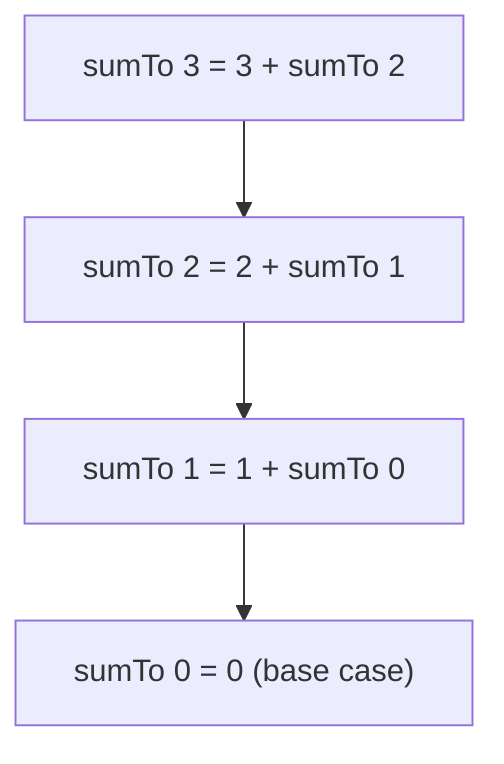

# 08. Recursion, backtracking and dynamic programming

> **Subject:** Problem solving · **Lesson:** 08 · **Made:** 2026-11-03 · **Status:** ready
>
> **You will be able to:** write a recursive function with a base case, say why plain recursion can be very slow and how remembering answers fixes it, solve a "fewest" or "most" problem with a table (dynamic programming), and list every subset or ordering with choose, explore, undo.
>
> **Before this:** [Heaps and top k](07-heaps-and-top-k.md) · **Next:** [Problem solving map](README.md)
>
> **How to read it:** one card is one idea. Look at the picture, guess, then press the orange bar to check. The blue bars (📖 More detail) hold the longer explanation. Skip them on the first read, open them when you want more. About 35 minutes for the cards.

## 1. The idea: Russian dolls

A **recursive** function solves a problem by solving a **smaller copy** of the same problem. Open a doll, and inside is a smaller doll, until the smallest one. The smallest doll is the **base case**: it stops the opening.

*Add the numbers from 1 to n.*

```js
function sumTo(n) {
  if (n === 0) return 0;
  return n + sumTo(n - 1);
}
sumTo(3);   // 6
```



Each call waits for the call below it. These waiting calls sit on the **call stack**. When the base case returns `0`, the answers come back up: `1 + 0`, `2 + 1`, `3 + 3`.

<details class="guess"><summary>🤔 Guess: what happens with <code>sumTo(9000)</code>? Press to check.</summary>

It crashes with `RangeError: Maximum call stack size exceeded`. Every waiting call takes a bit of memory, and the stack is limited. On Node 26.12.1 `sumTo(5000)` worked and `sumTo(9000)` crashed (the limit is about 8,900 for this function; it depends on the engine and on the function). Rule of thumb: if the depth can reach many thousands, use a loop.

</details>

> **Remember:** a recursive function needs a base case that stops it, and a call on something smaller.

<details class="more"><summary>📖 More detail: how to write one</summary>

Ask three questions: (1) What is the smallest case I can answer at once? (base case). (2) If someone gave me the answer for a smaller problem, how would I build my answer? (3) Does every call get closer to the base case? Write the base case first. Then write the one line that combines. Trust the smaller call: do not trace all the calls in your head.

</details>

## 2. When recursion is slow: the same work again and again

*The Fibonacci numbers: each is the sum of the two before it: 0, 1, 1, 2, 3, 5, 8 ...*

```js
function fib(n) {
  if (n < 2) return n;
  return fib(n - 1) + fib(n - 2);
}
```

It looks fine, but it solves the **same small problems over and over**. `fib(5)` calls `fib(3)` twice, `fib(2)` three times ... I counted the calls:

| Call | Number of calls | Time |
|---|---|---|
| `fib(30)` | **2,692,537** | 11 ms |
| `fib(35)` | about 30 million | 121 ms |
| `fib(40)` | about 330 million | **1,456 ms** |

Each step up by 5 makes it about 11 times slower. That is O(2ⁿ).

The fix is to **remember each answer** (this is called **memoization**):

```js
function fib(n, memo = new Map()) {
  if (n < 2) return n;
  if (memo.has(n)) return memo.get(n);
  const value =
    fib(n - 1, memo) + fib(n - 2, memo);
  memo.set(n, value);
  return value;
}
```

`fib(30)` now needs **59 calls**, and `fib(40)` took about half a millisecond (0.1 to 0.5 ms in my runs). The time went from O(2ⁿ) to O(n).

<details class="guess"><summary>🤔 Guess: why does the memo version make fewer calls? Press to check.</summary>

Each `fib(k)` is worked out **once**. The second time it is asked, the answer is in the Map and it returns at once. There are only n different questions, so about n real answers and a few extra calls (59 for n = 30).

</details>

> **Remember:** if the same sub-problem comes again and again, remember the answer. That is memoization.

<details class="more"><summary>📖 More detail: the call counts and the picture</summary>

The 35 and 40 counts come from the growth: each `fib(n)` makes about 1.6 times the calls of `fib(n - 1)`. I measured the exact count only for `fib(30)`. The call tree is drawn in the [problem solving map](README.md) ("Why Fibonacci is the best first problem"). Be careful with the default argument: `[0, 1, 2].map(fib)` passes the index as the second argument, so `memo` would be a number. Write `.map(n => fib(n))`. My own first test had this bug.

</details>

## 3. Dynamic programming: fill a table from small to big

**Dynamic programming (DP)** is memoization turned around: instead of asking from the top and remembering, you **build the answers from the smallest up**, in a table. The steps:

1. **State:** what does one table cell mean?
2. **Start:** the cell we know (the base case).
3. **Rule:** how a cell comes from smaller cells.
4. **Answer:** which cell is the answer.

**Coin change:** *coins `[1, 2, 5]`, make 11 with the fewest coins.*

- State: `dp[a]` = fewest coins to make amount `a`.
- Start: `dp[0] = 0`.
- Rule: `dp[a] = min over coins c of dp[a - c] + 1`.
- Answer: `dp[11]`.

```js
function coinChange(coins, amount) {
  const dp = Array(amount + 1).fill(Infinity);
  dp[0] = 0;
  for (let a = 1; a <= amount; a++)
    for (const c of coins)
      if (c <= a)
        dp[a] = Math.min(dp[a], dp[a - c] + 1);
  return dp[amount] === Infinity
    ? -1 : dp[amount];
}
```

I ran it. The table for amounts 0 to 11 was `0 1 1 2 2 1 2 2 3 3 2 3`, so the answer for 11 is **3** (5 + 5 + 1). The inner line ran **28 times**. Plain recursion for the same question made **527 calls**, and for amount 25 it made **924,876 calls**.

<details class="guess"><summary>🤔 Guess: coins <code>[1, 3, 4]</code> and amount 6. Taking the biggest coin first (greedy) gives 4 + 1 + 1 = 3 coins. What does DP give? Press to check.</summary>

**2** (3 + 3). I ran both: greedy gave 3, `coinChange` gave 2. Greedy only looks at the best choice *now*. DP tries **every** choice and keeps the best. This is why "fewest coins" is a DP question and not a greedy one.

</details>

> **Remember:** DP = a table. Say what a cell means, how it starts, and how it comes from smaller cells.

<details class="more"><summary>📖 More detail: watch it fill</summary>

**Step through it yourself:** [DP and backtracking stepper](visuals/08-recursion-backtracking-and-dynamic-programming.html). Tab 1 fills the table one amount at a time and shows which cells each step reads (the yellow ones). The cost: O(amount × number of coins) time and O(amount) space.

Another classic is **House Robber** (*take the most money, never from two houses in a row*): at each house you either skip it (keep the best so far) or take it (its money plus the best from two houses back). My loop gave `12` for `[2, 7, 9, 3, 1]` (2 + 9 + 1) and `4` for `[1, 2, 3, 1]`.

```js
function rob(nums) {
  let skip = 0, take = 0;
  for (const x of nums)
    [skip, take] = [Math.max(skip, take), skip + x];
  return Math.max(skip, take);
}
```

Only two numbers are kept, so the space is O(1).

</details>

## 4. Backtracking: choose, explore, undo

**Backtracking** is for "list **every** possibility": every subset, every ordering, every way to place things. Method: **choose** one option, **explore** what comes next (a recursive call), then **undo** the choice and try the next option.

*All subsets of `[1, 2, 3]`.*

```js
function subsets(nums) {
  const result = [], path = [];
  function go(start) {
    result.push([...path]);
    for (let i = start; i < nums.length; i++) {
      path.push(nums[i]);   // choose
      go(i + 1);            // explore
      path.pop();           // undo
    }
  }
  go(0);
  return result;
}
```

I ran it:

```text
[[],[1],[1,2],[1,2,3],[1,3],[2],[2,3],[3]]
```

`path` holds the choices made so far. Every call saves a copy of it. The **undo** (`path.pop()`) is what makes the next choice start from a clean state.

<details class="guess"><summary>🤔 Guess: what if we write <code>result.push(path)</code> and forget the copy <code>[...path]</code>? Press to check.</summary>

All results become the **same array**, which is empty at the end. I ran it on `[1, 2]` and got `[[],[],[],[]]`. `path` is one array that changes all the time, so you must save a **copy** of it at each result.

</details>

> **Remember:** choose, explore, undo. Save a copy of the path, not the path.

<details class="more"><summary>📖 More detail: permutations and watching it</summary>

For **orderings** (permutations) you pick from all the numbers that are not used yet, with a `used` array:

```js
function permutations(nums) {
  const result = [], path = [];
  const used = Array(nums.length).fill(false);
  function go() {
    if (path.length === nums.length) {
      result.push([...path]);
      return;
    }
    for (let i = 0; i < nums.length; i++) {
      if (used[i]) continue;
      used[i] = true; path.push(nums[i]);
      go();
      path.pop(); used[i] = false;
    }
  }
  go();
  return result;
}
```

For `[1, 2, 3]` it gave 6 lists: `[1,2,3] [1,3,2] [2,1,3] [2,3,1] [3,1,2] [3,2,1]`. **Step through it yourself:** the stepper's tab 2 does subsets of `[1, 2]` and shows the path growing and shrinking.

</details>

## 5. The cost: how big can the answer be?

Backtracking lists everything, so it is slow by nature. The number of results grows very fast:

| Problem | Results | Time I measured |
|---|---|---|
| subsets of n numbers | 2ⁿ | n = 10: 1,024 results, 0.3 ms. n = 15: 32,768 results, 4 ms. n = 20: **1,048,576** results, 177 ms |
| orderings of n numbers | n! | n = 8: 40,320 results, 7 ms. n = 9: **362,880** results, 46 ms |

Each step up multiplies the work. At n = 25 subsets would be about 33 million, and at n = 12 orderings would be about 479 million. (Those two are calculated, not run.)

<details class="guess"><summary>🤔 Guess: can you make "list all subsets" faster than O(2ⁿ)? Press to check.</summary>

**No.** The answer itself has 2ⁿ items, so just writing it takes that long. What you **can** do is **prune**: stop going down a path as soon as you know it cannot work (for example, a sum that is already too big). That cuts the search without changing the worst case.

</details>

> **Remember:** backtracking = O(2ⁿ) or O(n!) at worst. Prune early to survive.

<details class="more"><summary>📖 More detail: Combination Sum and pruning</summary>

*Find all combinations that add up to a target.* Same shape as subsets, plus: stop a path when the sum goes over the target. That one `if` removes huge parts of the search. I did not run this one here.

</details>

## 6. Which one do I need?

| The question says | Tool |
|---|---|
| "How many ways?", "fewest", "most", "is it possible?" and small answers overlap | **DP** (or memoization) |
| "List all", "every combination", "every ordering" | **Backtracking** |
| A problem made of a smaller copy of itself (trees, lists, divide and conquer) | **Recursion** |
| "Best choice right now is always right" and you can argue it | greedy (also ask: is it? coin change says not always) |

A test to tell DP from backtracking: *do I need the list of answers, or only one number?* A number: DP. The list: backtracking.

<details class="guess"><summary>🤔 Guess: "count the number of subsets with sum = 10". DP or backtracking? Press to check.</summary>

**DP** (it is only a number, and the same sub-problems repeat). Listing the subsets would be backtracking, and slow. This is the point of the test above. Only counting lets you skip the list.

</details>

> **Remember:** a number = DP. A list = backtracking. A smaller copy = recursion.

<details class="more"><summary>📖 More detail: mistakes to avoid</summary>

1. **No base case** or one that is never reached (stack overflow).
2. **No `undo`** in backtracking, or no copy of the path.
3. **DP with the wrong state.** If the table cell does not hold all you need, the rule fails. Write down what `dp[i]` means in words first.
4. **Using memoization with a changing argument.** The Map key must be what the answer depends on.
5. **Deep recursion on big input.** Cards 1 and 2: use a loop or a table (DP bottom up).

</details>

## 7. Why it matters and what it costs

Interview words: *recursion*, *base case*, *call stack*, *memoization*, *dynamic programming*, *overlapping sub-problems*, *backtracking*, *pruning*, *exponential*.

- **Without it:** `fib(40)` takes seconds, "fewest coins" gets a wrong greedy answer, and listing options is a pile of nested loops.
- **With it:** a hard-looking problem becomes: say the state, the start, and the rule.
- **The cost:** recursion uses stack space and can overflow, DP uses memory for the table, and backtracking is exponential by nature.

## 8. Watch and play

Links checked on 2026-11-03. Each page loaded (HTTP 200). For each video, the title and channel were confirmed through YouTube's oEmbed data. The video lengths were not checked.

- **Play with it:** [The DP and backtracking stepper](visuals/08-recursion-backtracking-and-dynamic-programming.html) in this folder. Guess first, then press Next.
- **Play with it:** [VisuAlgo: Recursion Tree / DAG](https://visualgo.net/en/recursion). Draw the call tree of `fib` and see where the same call repeats.
- **Video:** [Coin Change - LeetCode 322 - Python - Visually Explained](https://www.youtube.com/watch?v=Z6fauIHQiUk) from the channel Hello Byte. Card 3 (the code is Python, the idea is the same).
- **Read:** [Recursion](https://developer.mozilla.org/en-US/docs/Glossary/Recursion) in the MDN glossary. A short definition and an example.

## 9. Practice

**A. Predict the output** (write your answer first)

```js
function f(n) {
  if (n === 0) return 1;
  return 2 * f(n - 1);
}
console.log(f(4));
```

<details class="guess"><summary>🤔 Press to see the answer</summary>

`16`. `f(4) = 2 × f(3) = 2 × 2 × f(2) = ... = 2 × 2 × 2 × 2 × f(0) = 16`. It is 2 to the power n. The base case returns `1`.

</details>

**B. What would you check?** A function that counts the ways to climb n stairs (1 or 2 steps at a time) is written as `ways(n) = ways(n - 1) + ways(n - 2)`. It works for n = 10 and freezes for n = 45. Why, and what do you change?

<details class="guess"><summary>🤔 Press to see the answer</summary>

It is the Fibonacci shape, and without memory it solves the same sub-problems again and again: O(2ⁿ). Add a `Map` of answers (memoization), or use two variables in a loop (bottom up). The cost drops from O(2ⁿ) to O(n). The folder [`00-warmup`](00-warmup/) has this problem as *Climbing Stairs*.

</details>

**C. Write it yourself**

Open [`practice/08-recursion-backtracking-dp.js`](practice/08-recursion-backtracking-dp.js). It has `fib`, `coinChange`, `rob`, `subsets` and `permutations`. Run:

```bash
cd learn/problem-solving
node --test practice/08-recursion-backtracking-dp.test.js
```

<details><summary>One possible answer</summary>

The code is in cards 2, 3 and 4 (the `permutations` code is in the blue bar of card 4). All 10 tests pass with it (checked on 2026-11-03), and all 10 fail with the empty file. Costs: `fib` O(n) time and O(n) space. `coinChange` O(amount × coins) time and O(amount) space. `rob` O(n) time and O(1) space. `subsets` O(n · 2ⁿ) time (copying each result) and `permutations` O(n · n!) time.

</details>

## 10. Interview question

**Q:** "What is dynamic programming? How is it different from recursion and from backtracking? Show it on the coin change problem."

<details><summary>A strong answer, in four parts</summary>

1. **Problem:** a plain recursive solution to "fewest coins" tries every combination and solves the same smaller amounts again and again. For amount 25 it made 924,876 calls in my test.
2. **How it works:** dynamic programming keeps the answer of each smaller amount. I say what a cell means (`dp[a]` = fewest coins for amount `a`), what I know at the start (`dp[0] = 0`), and the rule (`dp[a]` = the best `dp[a - c] + 1` over the coins). Then I fill the table from small to big. It costs O(amount × coins) time and O(amount) space. For amount 11 the inner step ran 28 times.
3. **Tradeoff:** greedy ("take the biggest coin") is shorter, but it gave 3 coins for amount 6 with coins `[1, 3, 4]`, and the right answer is 2. Backtracking lists every answer, which is exponential, and I only need the number. DP uses memory for the table (O(amount)).
4. **My example:** *This is an idea, not a fact. Replace it with a real story from DBO, Unloan, ZWS or Skyworx.* Working out the cheapest way to split a payment, or caching the result of an expensive pure function so it never runs twice for the same input.

</details>

## 11. Explain it back

Close this file. Press the **Record my explanation** button under this heading and explain recursion, memoization and dynamic programming to a new junior, in 4 parts: problem, how it works, tradeoff, my example. Use these numbers: 2,692,537 calls against 59, and 3 coins against 2 for the greedy trap.

### My explanation

<write here>

### Coach feedback

<the explain-coach agent writes here>

## 12. Review questions (day 1, 3, 7, 21)

1. What are the two parts every recursive function needs?
2. Why is plain recursive `fib(40)` slow? What does memoization change?
3. What four things do you write down for a dynamic programming problem?
4. Why is greedy wrong for coin change with coins `[1, 3, 4]` and amount 6?
5. What do "choose, explore, undo" mean in backtracking?
6. Why must you save `[...path]` and not `path`?
7. A number or a list: which one is DP and which is backtracking?

<details><summary>Answers</summary>

1. A base case that stops, and a call on a smaller problem.
2. It solves the same sub-problems again and again (2,692,537 calls for `fib(30)`). Memoization remembers each answer, so each is worked out once (59 calls).
3. What a cell means (state), the start cell, the rule from smaller cells, and which cell is the answer.
4. Greedy takes 4 first and ends with 4 + 1 + 1 = 3 coins. The best is 3 + 3 = 2 coins. Only trying every choice finds it.
5. Pick one option, go deeper with a recursive call, then remove the option and try the next.
6. `path` is one array that keeps changing. Without a copy every result points at the same array (I got `[[],[],[],[]]`).
7. A number (count, fewest, most): DP. A list of all answers: backtracking.

</details>

## 13. Go deeper (optional)

None of this is needed for the cards above.

<details><summary>Top down and bottom up</summary>

*Top down* is recursion plus a memo (card 2): easy to write from the idea. *Bottom up* is the table (card 3): no recursion, no stack overflow, and often less memory. Both give the same answer. Interviewers like to hear you name both.

</details>

<details><summary>Longest common subsequence and the 2D table</summary>

Some DP problems need a table with two sides (for example two strings). The idea is the same: state, start, rule, answer. I did not cover it here. It is in the NeetCode list.

</details>

<details><summary>Make the numbers yourself</summary>

Card 2: count the calls of `fib(30)` with a counter variable, then time `fib(35)` and `fib(40)`. Card 3: count how many times the inner line runs for amount 11, and write the recursive version with a call counter. Card 5: time `subsets` for n = 10, 15 and 20.

</details>

## Connected lessons

- [01. Big O](01-big-o-time-and-space.md): O(2ⁿ) against O(n) with the same answer.
- [02. Hash maps and sets](02-hash-maps-and-sets.md): the `Map` that memoization uses.
- [04. Trees and traversal](04-trees-and-traversal.md): recursion on trees.
- [05. Graphs](05-graphs-bfs-dfs-and-cycles.md): DFS is recursion on a graph, with a `seen` set that works like a memo.
- [06. Binary search and sorting](06-binary-search-and-sorting.md): merge sort is recursion.
- [Folder 00-warmup](00-warmup/): Fibonacci and Climbing Stairs to write yourself.
- [Problem solving map](README.md): the roadmap and the practice folders.
