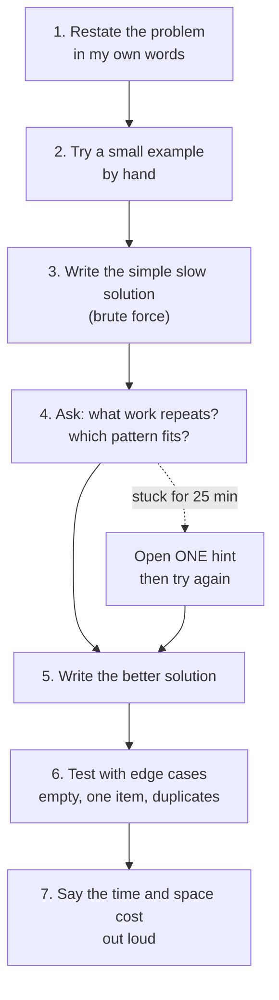
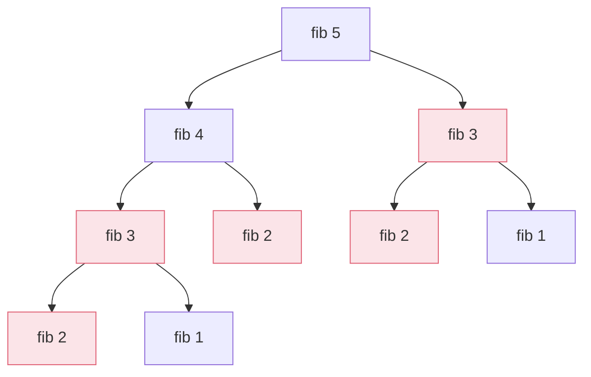

# Problem Solving Practice (JavaScript)

Pattern based coding practice. The goal is not to collect solved problems. The goal is to learn to see which pattern a new problem belongs to.

Part of the plan in [`my-learning/study-method-and-weekly-plan.md`](../../my-learning/study-method-and-weekly-plan.md).

## How to use it

1. Pick the next folder in order. Read the problem comment at the top of the file.
2. Write your solution in that file. Run the tests for that folder:

```bash
npm run test:warmup          # 00-warmup
npm run test:hash-map        # 01-hash-map
npm run test:two-pointers    # 02-two-pointers
npm run test:sliding-window  # 03-sliding-window
npm run test:stack           # 04-stack
npm test                     # everything
```

No install needed. It only uses Node's built-in test runner (Node 20 or newer).

3. Some tests check speed. If a speed test fails, your answer may be correct but too slow. Look for repeated work.
4. Fill in one row of `solve-log.md` for every problem. This is how you build memory.
5. Redo the problem from a blank file after 3 days and again after 7 days.

## The routine for every problem

Use the same steps every time. When I am stuck, the routine tells me what to do next.



A brute force answer is a good first step, not a failure. In an interview, saying "the simple way is O(n squared), here is why, and here is how I improve it" scores well.

## Why Fibonacci is the best first problem

The slow recursive version computes the same values again and again. This is the call tree for `fibonacci(5)`. The red boxes are repeated work:



Fix 1: remember each answer after the first time (memoization). Fix 2: notice you only need the last two numbers, so a loop with two variables is enough. This one idea, "do not repeat work," is the heart of dynamic programming.

## Pattern roadmap

Do them in this order. A new pattern builds on the ones before it. The first five folders are ready. Ask Claude to add the next folder when you finish the current one.

| # | Pattern | Use it when | Ready | Problems |
|---|---|---|---|---|
| 0 | Warm up (recursion, remembering results) | The same sub-problem appears again and again | Yes | Fibonacci, Climbing Stairs |
| 1 | Hash map | You keep asking "have I seen this before?" | Yes | Two Sum, Valid Anagram, Group Anagrams |
| 2 | Two pointers | Sorted data, or comparing from both ends | Yes | Valid Palindrome, Two Sum Sorted, Container With Most Water |
| 3 | Sliding window | Best sub-array or sub-string of consecutive items | Yes | Max Sum of k Numbers, Longest Substring Without Repeats |
| 4 | Stack | The most recent item must be handled first | Yes | Valid Parentheses, Daily Temperatures |
| 5 | Binary search | Sorted data, or "find the smallest value that works" | Next | Binary Search, Search Rotated Array, Koko Eating Bananas |
| 6 | Recursion and backtracking | Try every choice, undo, try the next | Next | Subsets, Permutations, Combination Sum |
| 7 | Trees (DFS and BFS) | Anything shaped like a tree or nested data | Next | Max Depth, Level Order, Validate BST |
| 8 | Graphs | Connections: maps, dependencies, networks | Next | Number of Islands, Course Schedule |
| 9 | Dynamic programming | Choices that overlap, "best" or "count the ways" | Next | House Robber, Coin Change, Longest Common Subsequence |
| 10 | Heap and intervals | "Top k" and scheduling | Next | Kth Largest, Merge Intervals |

For each pattern, finish the easy problems first. Move on when you can solve a new problem of that type in under 25 minutes without hints.

## Rules that keep this honest

- No looking at full solutions. Hints only, one at a time, after 25 minutes of real trying.
- Do not copy a solution you do not understand. If you used a hint, explain the final solution out loud without looking.
- Say the time and space cost of every solution. Interviewers always ask.
- You can ask Claude to be the interviewer: "Run `/live-coding` on the hash map problems." It will question your solution and try to break it.
