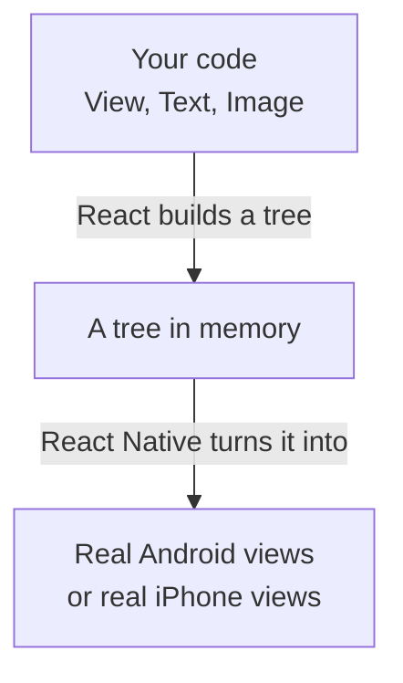
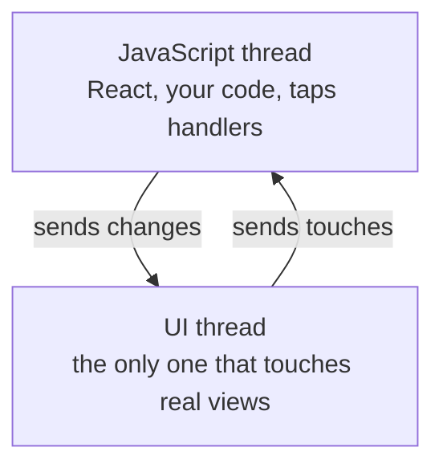
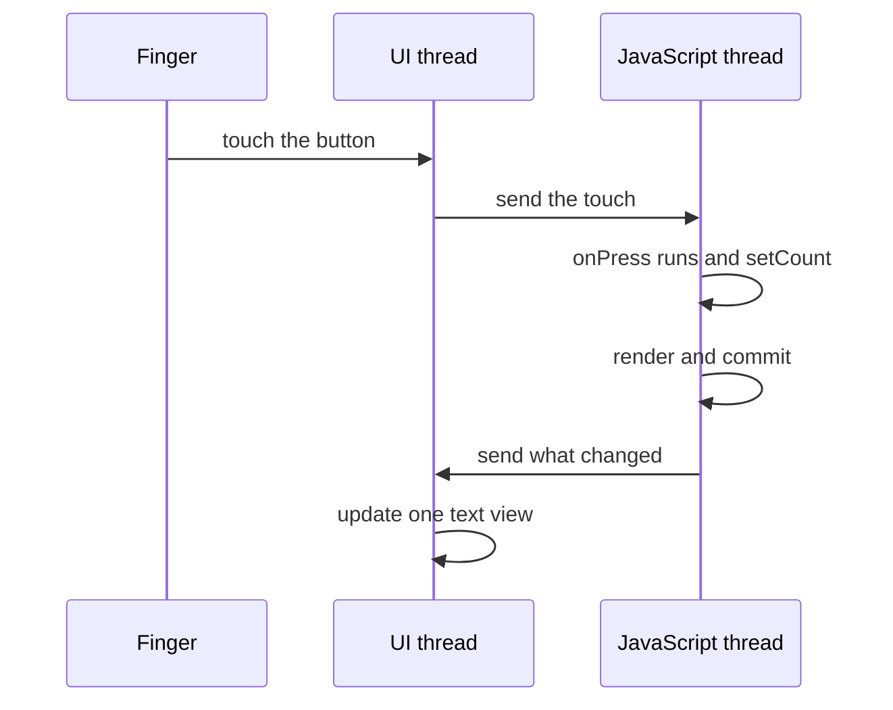

# 01. How React Native works

> **Subject:** React Native · **Lesson:** 01 · **Made:** 2026-11-27 · **Status:** ready
>
> **You will be able to:** say how a `<View>` in your code becomes a real native view, name the two threads, and explain why a busy JavaScript thread makes taps slow.
>
> **Before this:** [React Native lessons map](README.md) · **Next:** [Core components and styling](02-core-components-and-styling.md)
>
> **How to read it:** one card is one idea. Look at the picture, guess, then press the orange bar to check. The blue bars (📖 More detail) hold the longer explanation. Skip them on the first read, open them when you want more. About 20 minutes for the cards.

<!-- quick-summary:start -->
## Quick summary

> Short on time? Read only this. These are the "Remember" lines from the cards below, so you can read the whole lesson in one minute.

- You write React, and the phone shows real native views. No browser is inside.
- The UI thread draws and listens. The JavaScript thread runs your code. A busy JavaScript thread makes taps slow, but not scrolling.
- Render, commit, mount. The JavaScript thread does the first two. The UI thread does the last one.
- A tap goes UI thread, JavaScript thread, then back to the UI thread.
- The JavaScript thread has one line of work. A long job blocks everything behind it.
- Measure speed in a release build, never in development mode.
<!-- quick-summary:end -->

## 1. The idea: you write the order, the kitchen makes the food

At a restaurant you do not cook. You write an order, and the kitchen makes real food. React Native works the same way. You write **React code** (the order). The phone makes **real native views** (the food).



Notice: the screen is not a web page. React Native does not draw the pixels itself. It asks the phone to make its own buttons, labels and lists.

<details class="guess"><summary>🤔 Guess: is a React Native <code>&lt;Text&gt;</code> a piece of web text inside a hidden browser? Press to check.</summary>

No. There is no browser. On Android it becomes a native text view. On iPhone it becomes a native text view too. That is why the app looks and scrolls like a normal phone app.

</details>

> **Remember:** you write React, and the phone shows real native views. No browser is inside.

<details class="more"><summary>📖 More detail: which native view is each one?</summary>

This table comes from the React Native docs ("Core Components").

| You write | Android view | iPhone view | Web twin |
|---|---|---|---|
| `<View>` | view group | `UIView` | a `div` that does not scroll |
| `<Text>` | text view | `UITextView` | a `p` |
| `<Image>` | image view | `UIImageView` | an `img` |
| `<ScrollView>` | scroll view | `UIScrollView` | a `div` that scrolls |
| `<TextInput>` | edit text | `UITextField` | an `input` |

The word **host** means "the phone's own system". A **host view** is a real native view.

</details>

## 2. Two workers: the JavaScript thread and the UI thread

An app has more than one worker. Each worker is called a **thread** (a line of work that runs at the same time as the others). Two matter now.



The **JavaScript thread** runs your code and React. The **UI thread** (also called the main thread) draws the screen and listens to the finger. Only the UI thread may change a real native view.

<details class="guess"><summary>🤔 Guess: your JavaScript is stuck in a 3 second loop. Can the user still scroll a long <code>ScrollView</code>? Can they press a button? Press to check.</summary>

They can scroll, but the button feels dead. The `ScrollView` lives on the UI thread, so it scrolls without JavaScript. The button press must go to JavaScript, and JavaScript is busy. The React Native docs say the same: a `ScrollView` scrolls when the JavaScript thread is locked, but `TouchableOpacity` cannot react.

</details>

> **Remember:** the UI thread draws and listens. The JavaScript thread runs your code. A busy JavaScript thread makes taps slow, but not scrolling.

<details class="more"><summary>📖 More detail: why two frame rates</summary>

A phone draws at least 60 frames each second, so one frame has about 16 milliseconds. React Native has **two frame rates**: the JS frame rate (how often JavaScript finishes its work) and the UI frame rate (how often the screen is drawn). The Perf Monitor in the dev menu shows both.

Native stack navigators are smooth even when JavaScript is busy, because their transition runs on the UI thread. That idea comes back in [lesson 10](10-performance-on-mobile.md).

</details>

## 3. Three steps: render, commit, mount

When your screen changes, the work has three steps. This is the **render pipeline**, from the architecture pages of the docs.

| Step | What happens | Who works |
|---|---|---|
| 1. Render | React runs your components. The renderer makes a **shadow tree**, a copy of the screen in C++ memory | JavaScript thread |
| 2. Commit | The shadow tree is complete. The sizes and places of all boxes are worked out. It becomes the next tree to show | usually JavaScript thread |
| 3. Mount | The UI thread makes or updates the real native views | UI thread |

In memory, for `<View><Text>Hello</Text></View>`:

| Thing | After render | After mount |
|---|---|---|
| Shadow tree | View node, Text node | the same |
| Native views | none | a view group and a text view |
| Node for your own component `App` | **never** | never |

<details class="guess"><summary>🤔 Guess: your <code>App</code> component returns a <code>View</code>. How many shadow nodes does the tree have for App itself? Press to check.</summary>

Zero. React keeps running your own components until only host parts are left (`View`, `Text`). The docs say there is never a shadow node that represents your component, only its `View` and `Text`.

</details>

> **Remember:** render, commit, mount. The JavaScript thread does the first two. The UI thread does the last one.

<details class="more"><summary>📖 More detail: step by step, what the renderer does</summary>

| Step | What the engine does | State after |
|---|---|---|
| 1 | React runs `App()`. It returns a `View` that holds a `Text` | React elements exist, nothing on screen |
| 2 | The renderer makes a shadow node for `View` and one for `Text` | shadow tree has 2 nodes |
| 3 | Commit: the layout engine (Yoga) gives each node a size and place | shadow tree is the next tree |
| 4 | Mount: the UI thread makes a native view for each node | 2 native views |
| 5 | A state change: React copies only the changed path of the shadow tree and shares the rest | new tree, old tree untouched |
| 6 | The new tree is compared with the old one. Only changes are sent to the UI thread | one native view updated |

The shadow tree is **immutable** (it is never edited, only copied). That makes it safe for more than one thread to read.

**Step through it yourself:** [From your code to a native view](visuals/01-from-code-to-views.html). Press Next and watch the three steps, then try the tap tab.

</details>

## 4. What a tap really does

A tap is a round trip. Notice the two jumps between the threads.



If the JavaScript thread is free, this takes a few milliseconds. If it is busy, the touch waits in line.

<details class="guess"><summary>🤔 Guess: where does the number 1 appear on the screen first: when you call <code>setCount(1)</code>, or after mount? Press to check.</summary>

After mount. `setCount` only starts the render step. The native text view changes at the end of the pipeline.

</details>

> **Remember:** a tap goes UI thread, JavaScript thread, then back to the UI thread.

<details class="more"><summary>📖 More detail: what a touch handler on the UI thread means</summary>

The New Architecture can also run some work directly on the UI thread for urgent events, and it can interrupt a render for a higher priority one. The threading model page of the docs draws these cases. You do not need them for the first interviews. The simple story above is the main path.

</details>

## 5. Mistake 1: heavy work on the JavaScript thread

The problem: a button does a big loop, and the whole app feels frozen.

```jsx
function onPress() {
  // 3 seconds of work on the JavaScript thread
  const total = slowSum(bigList);
  setResult(total);
}
```

<details class="guess"><summary>🤔 Guess: what does the user see during those 3 seconds, and what can you do about it? Press to check.</summary>

Taps do nothing, animations driven by JavaScript stutter, and the new result appears late. Ways to fix it: do less work per call (cut the list into small pieces and handle one piece per frame), do the work earlier or in the background, move it to native code, or do it on the server. The best fix depends on the work. First find the slow part with the profiler.

</details>

> **Remember:** the JavaScript thread has one line of work. A long job blocks everything behind it.

<details class="more"><summary>📖 More detail: two small helps from the docs</summary>

- `requestAnimationFrame` can delay an expensive job until after the press effect is drawn, so the button reacts first.
- `requestIdleCallback` runs work when the thread is idle.

These make the app feel better, but the work still happens on the same thread. Real heavy work needs a real fix.

</details>

## 6. Mistake 2: judging speed in development mode

The problem: the app feels slow on your laptop, so you say React Native is slow.

<details class="guess"><summary>🤔 Guess: what is wrong with this test? Press to check.</summary>

Development mode does a lot of extra checking, so JavaScript speed "suffers greatly" (the docs' words). Always test speed in a **release build** (the version you ship). Remove `console.log` calls from release builds too, because they can slow the JavaScript thread.

</details>

> **Remember:** measure speed in a release build, never in development mode.

<details class="more"><summary>📖 More detail: how to run a release build</summary>

From the Hermes page of the docs: `npm run android -- --mode="release"` for Android, and `npm run ios -- --mode="Release"` for iPhone. With Expo you make a build from your project and compare it with the dev version.

</details>

## 7. Why it matters and what it costs

- **Without it:** you write the app twice, once for Android and once for iPhone. Or you ship a web page in a frame that feels slow.
- **With it:** one team writes React and TypeScript, and users get real native views.
- **The cost:** there are two worlds. A bug can be in your JavaScript, in a native library, or in the build. Native builds are slower than web reloads. A heavy screen can drop frames.

## 8. Watch and play

I opened every link below on 2026-11-27 and each one loaded. I found no video that I could open and check, so there is none here.

- **Step through it:** [From your code to a native view](visuals/01-from-code-to-views.html) - the three steps, and a tap.
- **Do:** [practice/01-from-code-to-views.mjs](practice/01-from-code-to-views.mjs) - turn your own components into a host tree.
- **Read:** [Core Components and Native Components](https://reactnative.dev/docs/intro-react-native-components) - the table of views.
- **Read:** [Render, Commit, and Mount](https://reactnative.dev/architecture/render-pipeline) - the three steps with pictures.
- **Read:** [Threading Model](https://reactnative.dev/architecture/threading-model) - the two threads.
- **Read:** [Performance Overview](https://reactnative.dev/docs/performance) - "What you need to know about frames".

## 9. Practice

**A. Predict**

A `ScrollView` shows 100 rows. A button above it runs a loop that takes 2 seconds on the JavaScript thread. During those 2 seconds you drag the list and you press the button. What happens to each?

<details><summary>Answer</summary>

The list still scrolls, because the `ScrollView` is on the UI thread. The press does not react until the loop ends, because the touch must reach JavaScript.

</details>

**B. Fix the bug**

```jsx
function SearchScreen() {
  console.log(bigObject);
  const sorted = [...items].sort(slowCompare);
  return <List data={sorted} />;
}
```

Users say typing in the search box is slow. Name two causes in this code.

<details><summary>Answer</summary>

1. The sort runs again on every render, on the JavaScript thread. Do it once with `useMemo`, or do it when the data arrives. 2. `console.log` of a big object in the render path can slow a release build. Remove it, or strip `console` calls in release builds.

</details>

**C. Write it yourself**

Open `practice/01-from-code-to-views.mjs` and write `reduceToHost` and `countHostNodes`, so that all 6 tests pass:

```bash
cd learn/react-native/practice
node --test 01-from-code-to-views.test.mjs
```

<details><summary>One possible answer</summary>

```js
export function reduceToHost(element) {
  if (typeof element === "string") return element;
  if (typeof element.type === "function") {
    return reduceToHost(element.type({ ...element.props, children: element.children }));
  }
  return {
    type: element.type,
    props: element.props,
    children: element.children.map(reduceToHost),
  };
}

export function countHostNodes(tree) {
  if (typeof tree === "string") return 0;
  return 1 + tree.children.reduce((sum, child) => sum + countHostNodes(child), 0);
}
```

Look at the pattern: a component is just a function that returns more elements. The function calls itself until only host elements are left. This is the same idea as the render step, in 10 lines. Real React is far bigger, but this is the core.

</details>

## 10. Interview question

**Q:** How does React Native work? What is the difference between the JavaScript thread and the UI thread?

<details><summary>A strong answer, in four parts</summary>

1. **Problem:** a team wants real native apps for Android and iPhone without writing the app twice, and without a slow web page inside the app.
2. **How it works:** your React code runs in a JavaScript engine on the JavaScript thread. React builds a tree of host parts. The renderer copies it into a shadow tree in C++, works out the layout, and the UI thread makes or updates the real native views. Render and commit mostly happen on the JavaScript thread. Mount happens on the UI thread.
3. **Tradeoff:** one codebase and real native views, but work on the JavaScript thread can make taps slow, and there are two worlds to debug (JavaScript and native). Test speed in a release build.
4. **My example:** I built the ZWS store app and the DBO mobile app with React Native. I will add one real moment where a screen felt slow, and what I found, only after I confirm the facts.

</details>

## 11. Explain it back

Close this file. Explain how React Native works to a new junior, in 4 parts (problem, how, tradeoff, my example). Then write your best version below and run `/explain-check how react native works` or ask the `explain-coach` agent to review it.

### My explanation

<write here>

### Coach feedback

<the explain-coach agent writes here>

## 12. Review questions (day 1, 3, 7, 21)

1. Name the two threads and say what each one does.
2. What are the three steps of the render pipeline, and who does each one?
3. Why does a `ScrollView` scroll when JavaScript is busy, but a button does not react?
4. Draw the picture from card 3 from memory: the shadow tree and the native views for `<View><Text>Hello</Text></View>`.

<details><summary>Answers</summary>

1. The JavaScript thread runs your code and React. The UI thread draws the screen, listens to touches, and is the only one that changes native views.
2. Render (JavaScript thread), commit (usually JavaScript thread), mount (UI thread).
3. The `ScrollView` lives on the UI thread. A button press has to travel to JavaScript, and JavaScript is busy.
4. Two shadow nodes (View, Text), none for your own component. After mount, two native views.

</details>

## 13. Go deeper (optional)

<details><summary>Versions, the layout engine, and extra links</summary>

- **Checked on 2026-11-27** against the React Native docs, the latest release page (0.88) and the architecture pages in the docs repository.
- Since React Native 0.82, the app runs only on the New Architecture. The older design is covered in [lesson 05](05-the-old-bridge-vs-the-new-architecture.md).
- **Yoga** is the layout engine. It follows flexbox rules with React Native defaults. [Lesson 11](11-flexbox-layout.md) uses Yoga in its exercises.
- **View flattening:** the renderer can merge views that only add margin or padding, so fewer native views are made. See [View Flattening](https://reactnative.dev/architecture/view-flattening).
- **Fabric** is the name of the new renderer. [Fabric](https://reactnative.dev/architecture/fabric-renderer) explains its goals.

</details>

## Connected lessons

- [Core components and styling](02-core-components-and-styling.md) - the parts you put in the tree.
- [The old bridge vs the new architecture](05-the-old-bridge-vs-the-new-architecture.md) - how JavaScript talks to the native side.
- [Performance on mobile](10-performance-on-mobile.md) - what to do when the JavaScript thread is the problem.
- [Flexbox layout](11-flexbox-layout.md) - the layout step in detail.
