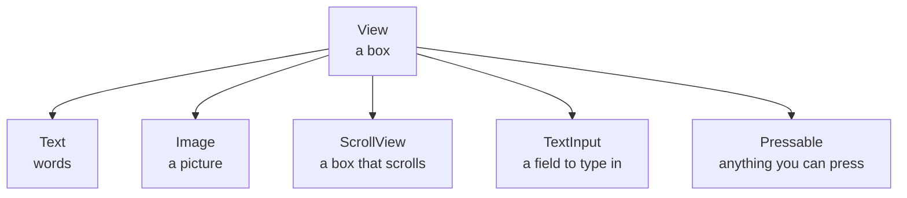
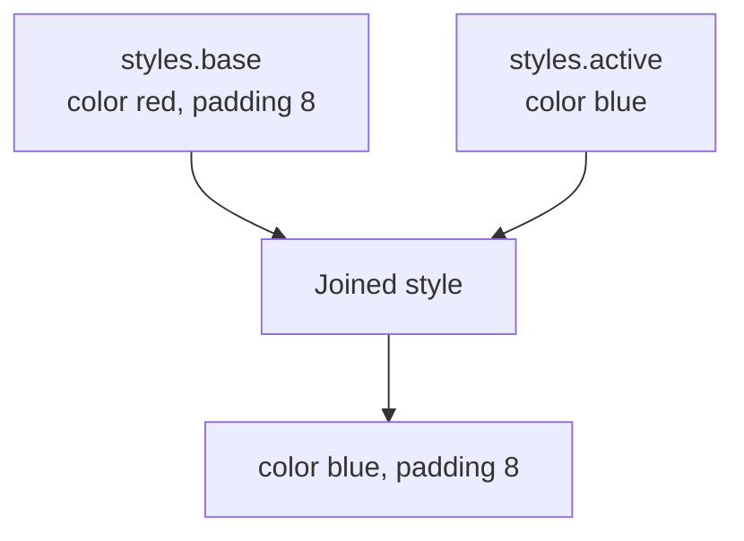
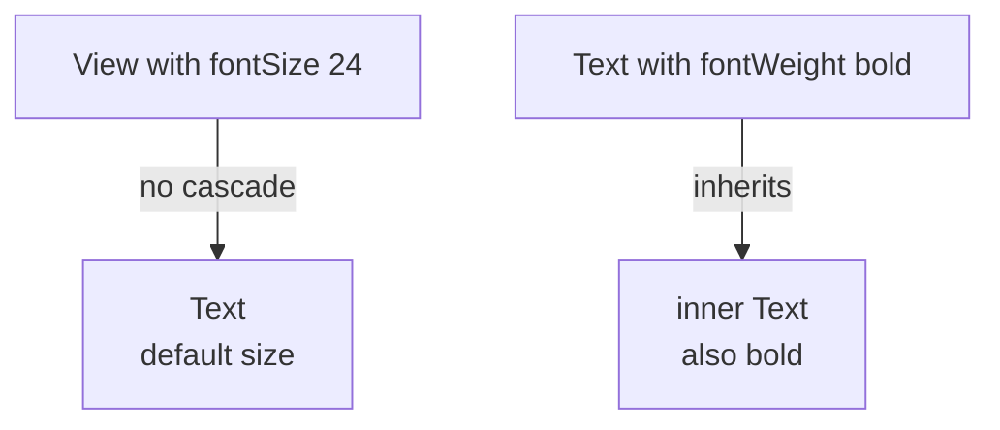

# 02. Core components and styling

> **Subject:** React Native · **Lesson:** 02 · **Made:** 2026-11-27 · **Status:** ready
>
> **You will be able to:** build a simple screen from `View`, `Text`, `Image`, `ScrollView`, `TextInput` and `Pressable`, and say which web habits do not work in React Native styling.
>
> **Before this:** [How React Native works](01-how-react-native-works.md) · **Next:** [Navigation](03-navigation.md)
>
> **How to read it:** one card is one idea. Look at the picture, guess, then press the orange bar to check. The blue bars (📖 More detail) hold the longer explanation. Skip them on the first read, open them when you want more. About 20 minutes for the cards.

## 1. The idea: a small box of building blocks

On the web you have hundreds of tags. In React Native you start with a small box of about six blocks. Almost every screen is made of them.



Notice: there is no `div`, no `p`, no `button` tag, and no HTML. Each block is a real native view (lesson 01).

<details class="guess"><summary>🤔 Guess: you want a button with an icon and a label inside. Which block do you reach for? Press to check.</summary>

`Pressable`. You wrap your own content (a `View` with an `Image` and a `Text`) and the wrapper detects the press. It does not draw anything by itself.

</details>

> **Remember:** a screen is made from about six blocks: `View`, `Text`, `Image`, `ScrollView`, `TextInput` and `Pressable`.

<details class="more"><summary>📖 More detail: what each block does</summary>

| Block | Use it for | Web twin |
|---|---|---|
| `View` | a box that holds other blocks and handles layout | a `div` |
| `Text` | every piece of text | a `p` or `span` |
| `Image` | pictures from files or the network | an `img` |
| `ScrollView` | a short list or a screen taller than the phone | a `div` that scrolls |
| `TextInput` | typing | an `input` |
| `Pressable` | detect presses on anything inside it | a clickable `div` |

The table of native views behind them is in [lesson 01](01-how-react-native-works.md). The docs list more blocks (switches, activity indicators, modals) on the "Components and APIs" page.

</details>

## 2. Text lives only inside Text

On the web you can put words anywhere. In React Native, **words must be inside a `<Text>`**. A `View` only holds other blocks.

| Code | Works? |
|---|---|
| `<Text>Hello</Text>` | yes |
| `<View><Text>Hello</Text></View>` | yes |
| `<View>Hello</View>` | no, React Native stops with an error |

The reason: a `View` is a layout box. Only a `Text` knows how to draw letters.

<details class="guess"><summary>🤔 Guess: you write <code>&lt;View&gt;{count}&lt;/View&gt;</code> where count is the number 3. Is that fine? Press to check.</summary>

No, for the same reason. A number is shown as text, so it also needs a `Text`: `<View><Text>{count}</Text></View>`.

</details>

> **Remember:** all words and numbers on screen must be inside a `Text`.

<details class="more"><summary>📖 More detail: nesting and the error</summary>

- A `Text` can hold another `Text`. The inner one can be bold or red while the outer one sets the font. Nested text becomes one flowing sentence.
- The error message says that text strings must be rendered within a `Text` component. I did not run an app here, so treat the exact wording as from memory.

</details>

## 3. Styles are plain JavaScript objects

There is no CSS file. You pass a `style` prop that is a normal JavaScript object. The names are like CSS, but written in camelCase.

| Web CSS | React Native style |
|---|---|
| `background-color: #fff` | `backgroundColor: "#fff"` |
| `margin-top: 8px` | `marginTop: 8` |
| `font-size: 16px` | `fontSize: 16` |
| `border-radius: 12px` | `borderRadius: 12` |

Numbers have **no unit**. `8` means 8 device independent pixels, so it looks about the same size on every phone.

```jsx
import { StyleSheet, View, Text } from "react-native";

export function Tag() {
  return (
    <View style={styles.box}>
      <Text style={styles.label}>New</Text>
    </View>
  );
}

const styles = StyleSheet.create({
  box: { padding: 8, borderRadius: 12 },
  label: { fontSize: 14, color: "teal" },
});
```

<details class="guess"><summary>🤔 Guess: what is wrong with <code>style=&#123;&#123; marginTop: "8px" &#125;&#125;</code>? Press to check.</summary>

It copies a web habit. React Native wants the number `8`, not the text `"8px"`. Write `marginTop: 8`. Percent values stay as text, like `width: "50%"`.

</details>

> **Remember:** styles are objects with camelCase names and plain numbers, no `px`.

<details class="more"><summary>📖 More detail: StyleSheet.create and the exercise</summary>

`StyleSheet.create` keeps several styles in one place and checks the names. A plain object also works. The docs say both are fine.

To feel the difference, do the exercise below. You turn CSS text into a React Native style object.

</details>

## 4. Many styles in an array, the last one wins

The `style` prop can also be an **array**. React Native joins the items. If two items set the same name, the **last** one wins.



A common pattern: add a style only when something is true.

```jsx
<Text style={[styles.base, isOn && styles.active]}>
  Switch
</Text>
```

When `isOn` is `false`, that item is `false`, and React Native skips it.

<details class="guess"><summary>🤔 Guess: <code>[styles.red, styles.bigBlue]</code> and <code>[styles.bigBlue, styles.red]</code>. Do they look the same? Press to check.</summary>

No. The last one wins when both set `color`. The first array is blue, the second is red. The docs show this exact example ("bigBlue, then red" and "red, then bigBlue").

</details>

> **Remember:** in a style array the last item wins, and `false`, `null` and `undefined` are skipped.

<details class="more"><summary>📖 More detail: how the join works, step by step</summary>

| Step | Code | What React Native does | Result so far |
|---|---|---|---|
| 1 | `styles.base` | takes the first object | `color red, padding 8` |
| 2 | `isOn && styles.active` | `isOn` is `true`, so this is the object | adds `color blue` over red |
| 3 | done | the final object | `color blue, padding 8` |

`StyleSheet.flatten` does the same join. Your exercise 2 writes a small version of it.

</details>

## 5. Mistake 1: expecting CSS to cascade

On the web, `font-family` on `body` reaches every child. In React Native it does not.

```jsx
// the font does NOT reach the Text
<View style={{ fontSize: 24 }}>
  <Text>Still the default size</Text>
</View>
```



<details class="guess"><summary>🤔 Guess: where does a style reach its children, and where does it not? Press to check.</summary>

It reaches children only **inside a `Text`**. The docs call this "limited style inheritance": text styles pass down from a `Text` to the text nested in it, and that is all. A `View` passes nothing to its children. To share a look, make a small component (`AppText`) or share a style object.

</details>

> **Remember:** there is no CSS cascade. Only text inside a `Text` inherits from its parent `Text`.

<details class="more"><summary>📖 More detail: why it was made this way</summary>

The docs give two reasons. For you, a component should look the same wherever you drop it, so styles should not leak in from far away. For the people who build React Native, it keeps the code simple, because only text needs to look up the tree.

</details>

## 6. Mistake 2: a network image with no size

The problem: you show a picture from a web address and see nothing.

```jsx
// shows nothing
<Image source={{ uri: "https://example.com/a.png" }} />

// shows the picture
<Image
  source={{ uri: "https://example.com/a.png" }}
  style={{ width: 200, height: 120 }}
/>
```

<details class="guess"><summary>🤔 Guess: why does the first one show nothing? Press to check.</summary>

React Native does not know the size of a picture before it downloads it. For network images (and `data:` images) the docs say you **must set the width and height yourself**. Pictures from your own app files have a known size, so they can work without it.

</details>

> **Remember:** give every network `Image` a width and a height.

<details class="more"><summary>📖 More detail: resizeMode</summary>

`resizeMode` says what to do when the picture and the frame have different shapes. The default is `cover`: the picture fills the frame, and some of it may be cut. `contain` shows the whole picture, with empty space if needed.

</details>

## 7. Press, type and scroll

Three blocks give the screen life.

| Block | Key props | What to remember |
|---|---|---|
| `Pressable` | `onPress` | wraps any content, has no look of its own |
| `TextInput` | `value`, `onChangeText` | you keep the text in state (a controlled field) |
| `ScrollView` | `contentContainerStyle` | renders all its children at once |

```jsx
function Search() {
  const [text, setText] = useState("");
  return (
    <TextInput
      value={text}
      onChangeText={setText}
      placeholder="Search"
    />
  );
}
```

<details class="guess"><summary>🤔 Guess: a <code>ScrollView</code> holds 5,000 rows. What is the risk? Press to check.</summary>

A `ScrollView` makes all its children at once, even those far off screen. With 5,000 rows it is slow and uses a lot of memory. The docs say `FlatList` makes items lazily, when they are about to appear. [Lesson 04](04-lists-and-flatlist.md) is about this.

</details>

> **Remember:** `ScrollView` is for short content. Use `FlatList` for long lists.

<details class="more"><summary>📖 More detail: layout is in another lesson</summary>

The three defaults that differ from the web (`flexDirection`, `flexShrink` and `alignContent`) are in [lesson 11](11-flexbox-layout.md), with a playground. This lesson is only about the blocks and the style rules.

</details>

## 8. Why it matters and what it costs

- **Without it:** you carry web habits into a phone app: `div` tags, `px` units, global CSS. The app shows errors or looks wrong.
- **With it:** a few blocks and plain objects build every screen, and it works the same on Android and iPhone.
- **The cost:** no CSS cascade, no CSS files, and a smaller set of style names. You share looks with components and shared style objects, not selectors.

## 9. Watch and play

I opened every link below on 2026-11-27 and each one loaded. I found no video that I could open and check, so there is none here.

- **Do:** [practice/02-web-to-native-style.mjs](practice/02-web-to-native-style.mjs) - turn CSS text into a style object and join a style array.
- **Read:** [Core Components and Native Components](https://reactnative.dev/docs/intro-react-native-components) - the table of blocks.
- **Read:** [Style](https://reactnative.dev/docs/style) - objects, arrays, `StyleSheet.create`.
- **Read:** [Text](https://reactnative.dev/docs/text) - "Limited Style Inheritance".
- **Read:** [Image](https://reactnative.dev/docs/image) - the note about sizes.
- **Read:** [Pressable](https://reactnative.dev/docs/pressable) - the press stages.

## 10. Practice

**A. Predict**

```jsx
<Text style={[{ color: "red" }, { color: "blue" }]}>Hi</Text>
```

What colour is the text?

<details><summary>Answer</summary>

Blue. The last item in the array wins.

</details>

**B. Fix the bug**

```jsx
<View style={{ marginTop: "8px", fontSize: 20 }}>
  Welcome
</View>
```

This screen shows an error. Find the problems.

<details><summary>Answer</summary>

1. The words are directly inside a `View`. Wrap them in `<Text>`. 2. `"8px"` should be the number `8`. 3. `fontSize` on a `View` does nothing for text, because styles do not cascade. Put `fontSize: 20` on the `Text`.

```jsx
<View style={{ marginTop: 8 }}>
  <Text style={{ fontSize: 20 }}>Welcome</Text>
</View>
```

</details>

**C. Write it yourself**

Open `practice/02-web-to-native-style.mjs` and write `toNativeStyle` and `flattenStyle`, so that all 10 tests pass:

```bash
cd learn/react-native/practice
node --test 02-web-to-native-style.test.mjs
```

<details><summary>One possible answer</summary>

```js
export function toNativeStyle(cssText) {
  const style = {};
  for (const part of cssText.split(";")) {
    const index = part.indexOf(":");
    if (index === -1) continue;
    const name = part.slice(0, index).trim();
    const raw = part.slice(index + 1).trim();
    if (!name || !raw) continue;
    const key = name.replace(/-([a-z])/g, (_, letter) => letter.toUpperCase());
    const numberLike = /^-?(\d+\.?\d*|\.\d+)(px)?$/.test(raw);
    style[key] = numberLike ? parseFloat(raw) : raw;
  }
  return style;
}

export function flattenStyle(style) {
  if (!style) return {};
  if (Array.isArray(style)) {
    return style.reduce((result, item) => ({ ...result, ...flattenStyle(item) }), {});
  }
  return { ...style };
}
```

Look at the pattern: `flattenStyle` calls itself for nested arrays, and spreading later items over earlier ones makes the last one win. Real `StyleSheet.flatten` returns `undefined` for no style. This version returns `{}` to keep the tests simple.

</details>

## 11. Interview question

**Q:** How is styling in React Native different from the web? What do you do about things like a global font?

<details><summary>A strong answer, in four parts</summary>

1. **Problem:** web habits (CSS files, `px` units, a cascade, any tag) do not fit a native view tree.
2. **How it works:** styles are JavaScript objects with camelCase names and unitless numbers. `StyleSheet.create` groups them. A `style` array joins objects and the last one wins. There is no cascade. Only text inside a `Text` inherits from its parent `Text`.
3. **Tradeoff:** it is simple and predictable, and a component looks the same wherever it sits. But you cannot set a global font once. You make shared components (`AppText`), a theme object or a shared style, and use them everywhere.
4. **My example:** I built the ZWS store app and the DBO mobile app. I will add how I kept fonts and colours the same across screens in those apps, only after I confirm the facts. An idea I could use: one `AppText` component that holds the font.

</details>

## 12. Explain it back

Close this file. Explain React Native styling to a new web developer, in 4 parts (problem, how, tradeoff, my example). Then write your best version below and run `/explain-check react native styling` or ask the `explain-coach` agent to review it.

### My explanation

<write here>

### Coach feedback

<the explain-coach agent writes here>

## 13. Review questions (day 1, 3, 7, 21)

1. Name the six core blocks and what each is for.
2. Why can you not write words directly inside a `View`?
3. In `style={[a, b]}`, which one wins when both set `color`? What is skipped?
4. Draw the picture from card 5 from memory: where a style reaches its children and where it does not.

<details><summary>Answers</summary>

1. `View` (box), `Text` (words), `Image` (pictures), `ScrollView` (short scrolling content), `TextInput` (typing), `Pressable` (detect presses).
2. A `View` is a layout box. Only a `Text` draws letters.
3. `b` wins. `false`, `null` and `undefined` are skipped.
4. A `View` passes nothing down. A `Text` passes its text style to the `Text` nested inside it.

</details>

## 14. Go deeper (optional)

<details><summary>Version notes and extra links</summary>

- **Checked on 2026-11-27** against the React Native docs pages for Core Components, Style, Text, Image, Pressable and ScrollView.
- `Pressable` wraps content and reports press stages (`onPressIn`, `onPress`, `onPressOut`). The docs show it as the way to make things pressable. Older code uses `TouchableOpacity`. I did not check whether the docs mark it as old, so I make no claim.
- `hitSlop` on a view makes the touch area bigger. The docs say typical guidelines suggest targets of at least 30 to 40 points.
- The docs' Style page lists a known issue: the touch area never extends past the parent view's bounds.
- Colours, shadows, dark mode and `Platform.select` are planned for lesson 12 (the styling toolkit).

</details>

## Connected lessons

- [How React Native works](01-how-react-native-works.md) - the native view behind each block.
- [Navigation](03-navigation.md) - putting screens together.
- [Lists and FlatList](04-lists-and-flatlist.md) - when `ScrollView` is not enough.
- [Flexbox layout](11-flexbox-layout.md) - the layout rules for `View`.
