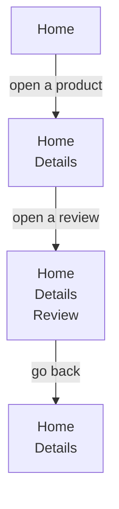
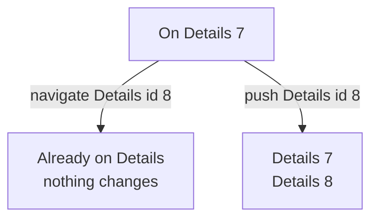
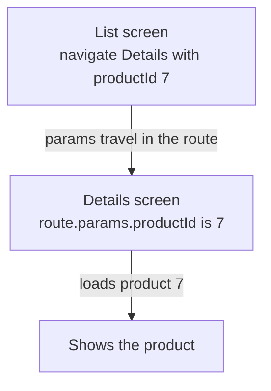
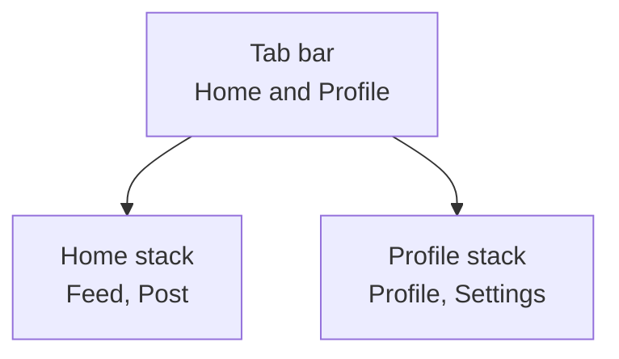

# 03. Navigation

> **Subject:** React Native · **Lesson:** 03 · **Made:** 2026-11-27 · **Status:** ready
>
> **You will be able to:** explain a navigation stack, choose between `navigate`, `push` and `goBack`, pass a small id to the next screen with params, and say how tabs keep their own stacks.
>
> **Before this:** [Core components and styling](02-core-components-and-styling.md) · **Next:** [Lists and FlatList](04-lists-and-flatlist.md)
>
> **How to read it:** one card is one idea. Look at the picture, guess, then press the orange bar to check. The blue bars (📖 More detail) hold the longer explanation. Skip them on the first read, open them when you want more. About 25 minutes for the cards.

## 1. The idea: a pile of cards

Imagine a pile of cards on a table. You only see the **top** card. To open a new screen, you put a new card on top. To go back, you take the top card off, and the card below shows again.

A **navigator** is the thing that keeps this pile. The pile is called a **stack**. Each card is a **route**: a screen name, plus the data you gave it.



Notice: a mobile app has no address bar and no back button of its own. The stack is what makes the back button, the back arrow and the back swipe know where to go.

<details class="guess"><summary>🤔 Guess: the stack is Home, Details, Review. The user swipes back once. Which screen do they see? Press to check.</summary>

Details. The top card (Review) is taken off, and the card under it shows again.

</details>

> **Remember:** a stack is a list of screens. The last one is the screen you see.

<details class="more"><summary>📖 More detail: the words, and where the picture stops</summary>

- **Navigator:** the part that holds the list of screens and the way to move between them.
- **Stack:** a list where you add and remove at the end only.
- **Route:** one item in the list. It has a `name` and `params`.

On the web, a link adds a page to the browser history, and the back button removes it. A phone app has no browser, so React Navigation keeps that history for you.

Where the picture stops: a stack is only one kind of navigator. A **tab bar** is another kind (card 5).

</details>

## 2. The moves: push, back, and the others

You move around the pile with a few calls. They are on `navigation`, the object that every screen receives.

| Call | What it does to the pile |
|---|---|
| `navigate('Details', params)` | adds Details on top, **if the top is not already Details** |
| `push('Details', params)` | adds Details on top, always |
| `goBack()` | removes the top card |
| `popTo('Home')` | removes cards until Home is on top |
| `popToTop()` | removes cards until only the first one is left |
| `replace('Home')` | swaps the top card for a new one |

In memory, after `Home`, `navigate('Details', {id: 7})`, `push('Details', {id: 8})`:

| Position | Route name | Params |
|---|---|---|
| 0 (bottom) | Home | none |
| 1 | Details | `{ id: 7 }` |
| 2 (top, shown) | Details | `{ id: 8 }` |

<details class="guess"><summary>🤔 Guess: from that pile, you call <code>popTo('Home')</code>. How many cards are left? Press to check.</summary>

One. Details 8 and Details 7 are both removed, and Home is on top.

</details>

> **Remember:** `push` adds, `goBack` removes, `popTo` and `popToTop` remove many at once.

<details class="more"><summary>📖 More detail: step by step, what the navigator does</summary>

| Step | Call | What the navigator does | State after |
|---|---|---|---|
| 1 | start | one route | Home |
| 2 | `navigate('Details', {id: 7})` | Home is on top, not Details, so it adds | Home, Details 7 |
| 3 | `push('Details', {id: 8})` | adds, always | Home, Details 7, Details 8 |
| 4 | `goBack()` | removes the top | Home, Details 7 |
| 5 | `popToTop()` | removes all but the first | Home |

**Step through it yourself:** [The navigation stack](visuals/03-navigation-stack.html). Press Next on each tab.

The hardware back button on Android and the back swipe on iPhone call `goBack` for you. The docs say the native stack header also shows a back button on its own when there is a screen to go back to.

</details>

## 3. navigate or push: the surprise

You are on the Details screen. A button says "Next product" and calls `navigate('Details', { id: 8 })`. You tap it. Nothing happens.



The React Navigation docs say it plainly: `navigate` means "go to this screen". If you are already there, it does nothing. `push` adds a new route every time.

<details class="guess"><summary>🤔 Guess: you are on Home. You call <code>navigate('Details')</code>, then <code>navigate('Details')</code> again. How many Details are in the stack? Press to check.</summary>

One. The first call adds it. The second call finds you already on Details and changes nothing. With `push` twice, there would be two.

</details>

> **Remember:** `navigate` adds only if you are not already on that route. `push` always adds.

<details class="more"><summary>📖 More detail: why it works this way, and a version warning</summary>

The docs say a second Details screen is common when you pass unique data to each route (for example one product per screen). That is when you use `push`.

This card follows the docs of React Navigation as I read them on 2026-11-27. Older tutorials may describe `navigate` differently from the current docs, so when you read one, check which version of the library it is about. In my practice file, `navigate` follows the rule above.

</details>

## 4. Params: sending data to the next screen

A Details screen must know **which** product to show. You send that in the second argument. The screen reads it from `route.params`.

```jsx
// sender
navigation.navigate('Details', { productId: 7 });

// receiver
function DetailsScreen({ route }) {
  const { productId } = route.params;
  return <Text>Product {productId}</Text>;
}
```



<details class="guess"><summary>🤔 Guess: Details is open with <code>{ productId: 7, tab: 'info' }</code>. You call <code>setParams({ tab: 'reviews' })</code>. What are the params now? Press to check.</summary>

`{ productId: 7, tab: 'reviews' }`. `setParams` merges. The old `productId` stays.

</details>

> **Remember:** params go in the second argument and come out of `route.params`. Keep them small and plain.

<details class="more"><summary>📖 More detail: initialParams, setParams, and plain data</summary>

- **`initialParams`:** default params for a screen. They are used when you open the screen without params, and they are merged with params you pass.
- **`setParams`:** changes the params of the current screen. It merges.
- **JSON-serializable:** the docs recommend that params are plain data (numbers, strings, true or false, lists, plain objects). Then you can use state persistence (save and restore where the user was) and deep links (a link that opens a screen with data in the address). A function or a class instance in params breaks both.

</details>

## 5. Tabs with a stack inside each tab

Many apps have a **tab bar** at the bottom: Home, Search, Profile. A tab navigator shows one tab at a time. A common setup is a **stack inside each tab**, so each tab has its own pile of screens.



Notice: this is the usual setup, not a rule. The docs describe nesting navigators, for example a tab navigator inside a stack.

<details class="guess"><summary>🤔 Guess: you open a Post in the Home tab, go to the Profile tab, then come back to Home. Which screen is shown? Press to check.</summary>

Post. Each tab keeps its own stack. The docs have a tab option `popToTopOnBlur` that resets the nested stack when you leave the tab, and its default is `false`.

</details>

> **Remember:** tabs switch between stacks. Each tab can keep its own pile of screens.

<details class="more"><summary>📖 More detail: the bottom tabs package</summary>

The tab navigator is a separate package: `@react-navigation/bottom-tabs`. You install it after the main package, as the docs say. The docs also list other kinds of tabs, such as material top tabs.

</details>

## 6. Setting it up

You need a few packages. This is from the React Native navigation page and the React Navigation docs.

```bash
npm install @react-navigation/native @react-navigation/native-stack
npx expo install react-native-screens react-native-safe-area-context
```

The **native stack** navigator uses real native screens. The docs say it gives you the header, the native gestures and the animations you expect from a phone app. It also keeps the history for you.

```jsx
const Stack = createNativeStackNavigator();

export default function App() {
  return (
    <NavigationContainer>
      <Stack.Navigator>
        <Stack.Screen name="Home" component={HomeScreen} />
        <Stack.Screen name="Details" component={DetailsScreen} />
      </Stack.Navigator>
    </NavigationContainer>
  );
}
```

<details class="guess"><summary>🤔 Guess: why is the native stack smooth even when your JavaScript is busy? Press to check.</summary>

Its transition animations run on the UI thread, not in JavaScript. The React Native performance page says that native stack navigators are smooth out of the box for this reason. This links to [lesson 01](01-how-react-native-works.md).

</details>

> **Remember:** use the native stack for real native transitions. Install the navigator package and its two helper packages.

<details class="more"><summary>📖 More detail: Expo Router, the file based option</summary>

**Expo Router** is another way. You do not write the navigator in code. Each file you add in the `app` folder becomes a route, like pages in Next.js. It is built for Expo apps and the web. Both ways are valid. React Navigation gives you more control in code. Expo Router gives you simple routes from file names and links by default.

The docs example code in this lesson uses the dynamic style. The React Navigation docs also have a static style, with the same ideas. I read both pages, and I did not run this code on a phone.

</details>

## 7. Mistake 1: a big object in params

The problem: the list has the whole product, so you send it all.

```jsx
// risky
navigation.navigate('Details', { product: bigProductObject });
```

<details class="guess"><summary>🤔 Guess: what can go wrong? Press to check.</summary>

The Details screen now holds a **copy**. If the product changes (a price update, an edit on another screen), this copy is old. The params also get big, and they can hold things that cannot be saved or put in a link. Send a small id, and let the Details screen read the product from your data layer or fetch it.

```jsx
navigation.navigate('Details', { productId: bigProductObject.id });
```

</details>

> **Remember:** send an id, not the whole object.

## 8. Mistake 2: going back to the login screen

The problem: after login you call `navigate('Home')`. The user presses back and sees Login again.

<details class="guess"><summary>🤔 Guess: why does it happen, and what do the docs suggest? Press to check.</summary>

Login is still in the stack under Home. The React Navigation auth flow guide says that after sign in, the login screens should be **removed**, so back does not return to them. The docs suggest one stack where the screens you can reach depend on the sign in state, and not calling `navigate` by hand when you switch. When the state changes, the right screens show. In my practice file, `replace` is the plain version of the idea: swap the top card instead of adding one.

</details>

> **Remember:** after login, remove the login screens from the pile. Do not leave them under Home.

## 9. Why it matters and what it costs

- **Without it:** you track the current screen with your own state, the back button does the wrong thing, and there is no native gesture or animation.
- **With it:** a tested library keeps the pile, the header, the back button, the gestures and deep links.
- **The cost:** one more library with its own versions. Old tutorials may not match the current docs. Params can hold stale data. Nested navigators can get hard to follow, so keep them shallow.

## 10. Watch and play

I opened every link below on 2026-11-27 and each one loaded. I found no video that I could open and check, so there is none here.

- **Step through it:** [The navigation stack](visuals/03-navigation-stack.html) - a stack, tabs with stacks, and params.
- **Do:** [practice/03-stack-navigator.mjs](practice/03-stack-navigator.mjs) - build a small stack navigator and run the tests.
- **Read:** [Navigating between screens, React Native docs](https://reactnative.dev/docs/navigation) - install steps.
- **Read:** [Moving between screens, React Navigation](https://reactnavigation.org/docs/navigating/) - `navigate`, `push`, `goBack`, `popTo`.
- **Read:** [Passing parameters to routes](https://reactnavigation.org/docs/params/) - params and `setParams`.
- **Read:** [Bottom tabs](https://reactnavigation.org/docs/bottom-tab-navigator/) - the tab navigator.
- **Read:** [Expo Router introduction](https://docs.expo.dev/router/introduction/) - the file based option.

## 11. Practice

**A. Predict**

```js
// start: Home
navigation.push('A');
navigation.navigate('A');
navigation.push('B');
navigation.goBack();
navigation.popToTop();
```

What is the stack after each line?

<details><summary>Answer</summary>

1. Home, A. 2. Home, A (navigate does nothing, you are already on A). 3. Home, A, B. 4. Home, A. 5. Home.

</details>

**B. Fix the bug**

A "Next product" button on the Details screen calls `navigation.navigate('Details', { id: id + 1 })` and nothing happens. Why? Give two fixes.

<details><summary>Answer</summary>

You are already on Details, so `navigate` does nothing. Fix 1: use `push('Details', { id: id + 1 })` to add a new Details. Fix 2: if you want the same screen to show the next product, use `setParams({ id: id + 1 })` and read `route.params.id`.

</details>

**C. Write it yourself**

Open `practice/03-stack-navigator.mjs` and write the navigator, so that all 12 tests pass:

```bash
cd learn/react-native/practice
node --test 03-stack-navigator.test.mjs
```

<details><summary>One possible answer</summary>

```js
export function createNavigator(initialName, initialParams = {}) {
  let routes = [{ name: initialName, params: initialParams }];
  const top = () => routes[routes.length - 1];
  return {
    push(name, params = {}) {
      routes = [...routes, { name, params }];
    },
    navigate(name, params = {}) {
      if (top().name === name) return;
      routes = [...routes, { name, params }];
    },
    goBack() {
      if (routes.length > 1) routes = routes.slice(0, -1);
    },
    popTo(name) {
      for (let i = routes.length - 1; i >= 0; i--) {
        if (routes[i].name === name) {
          routes = routes.slice(0, i + 1);
          return;
        }
      }
    },
    popToTop() {
      routes = routes.slice(0, 1);
    },
    replace(name, params = {}) {
      routes = [...routes.slice(0, -1), { name, params }];
    },
    setParams(partial) {
      routes = [...routes.slice(0, -1), { ...top(), params: { ...top().params, ...partial } }];
    },
    getState() {
      return {
        index: routes.length - 1,
        routes: routes.map((r) => ({ name: r.name, params: { ...r.params } })),
      };
    },
    getCurrent() {
      return { name: top().name, params: { ...top().params } };
    },
  };
}
```

Look at the pattern: every move makes a **new list** and does not edit the old one, like the renderer in [lesson 01](01-how-react-native-works.md). `getState` returns copies, so the caller cannot break the pile. The real library is much bigger, but this is the core idea.

</details>

## 12. Interview question

**Q:** How does navigation work in a React Native app? What is the difference between `navigate` and `push`, and how do you pass data to a screen?

<details><summary>A strong answer, in four parts</summary>

1. **Problem:** a phone app has many screens, and no browser history. The user needs a back button, back gestures and native transitions, and each screen needs to know which data to show.
2. **How it works:** a navigator keeps a stack of routes, each with a name and params. `push` adds a route, `goBack` removes the top one. `navigate` adds only if you are not already on that route. Params go in the second argument and come out of `route.params`. A tab navigator switches between tabs, and each tab can hold its own stack. The native stack uses real native screens, so transitions run on the UI thread.
3. **Tradeoff:** React Navigation gives control in code. Expo Router gives file based routes. Params should be small, plain data, such as an id, because a big object goes stale and breaks links. Old tutorials may describe `navigate` differently, so check the version.
4. **My example:** I used navigation in the DBO mobile app and in ZWS. I will add real screens and a real bug or choice from them, only after I confirm the facts. An idea, not a fact: pass a product id to a detail screen and load the product there.

</details>

## 13. Explain it back

Close this file. Explain navigation to a new junior, in 4 parts (problem, how, tradeoff, my example). Then write your best version below and run `/explain-check react native navigation` or ask the `explain-coach` agent to review it.

### My explanation

<write here>

### Coach feedback

<the explain-coach agent writes here>

## 14. Review questions (day 1, 3, 7, 21)

1. What is a stack, and which screen does the user see?
2. What is the difference between `navigate` and `push`?
3. How do you send a product id to a Details screen, and how do you read it?
4. Why should params be small, plain data?
5. Draw the picture from card 5 from memory: a tab bar with a stack in each tab.

<details><summary>Answers</summary>

1. A list of routes. The user sees the last (top) one.
2. `push` always adds a route. `navigate` adds only if you are not already on that route, otherwise it does nothing.
3. `navigate('Details', { productId: 7 })`, then `route.params.productId` in the screen.
4. A big object is a copy that goes stale, and params that are not plain data break saving state and deep links.
5. Tab bar on top. Home stack (Feed, Post) and Profile stack (Profile, Settings) below it. Each tab keeps its own pile.

</details>

## 15. Go deeper (optional)

<details><summary>Versions, other options, and extra links</summary>

- **Checked on 2026-11-27** against the React Navigation pages linked above and the React Native navigation page. I read them. I did not run React Navigation on a device or a simulator.
- The React Native docs also mention `react-native-navigation` (by Wix), which uses fully native navigation.
- The docs show a **static** and a **dynamic** way to set up navigators. They teach the same ideas.
- [Authentication flows, React Navigation](https://reactnavigation.org/docs/auth-flow/) - the guide behind Mistake 2.
- [Nesting navigators, React Navigation](https://reactnavigation.org/docs/nesting-navigators/) - a tab navigator inside a stack, and the other way round.

</details>

## Connected lessons

- [How React Native works](01-how-react-native-works.md) - why native transitions stay smooth.
- [Core components and styling](02-core-components-and-styling.md) - the screens you put in the stack.
- [Lists and FlatList](04-lists-and-flatlist.md) - the usual list that opens a Details screen.
