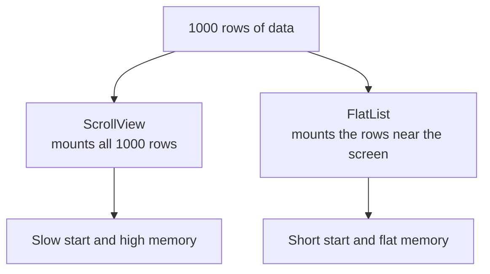
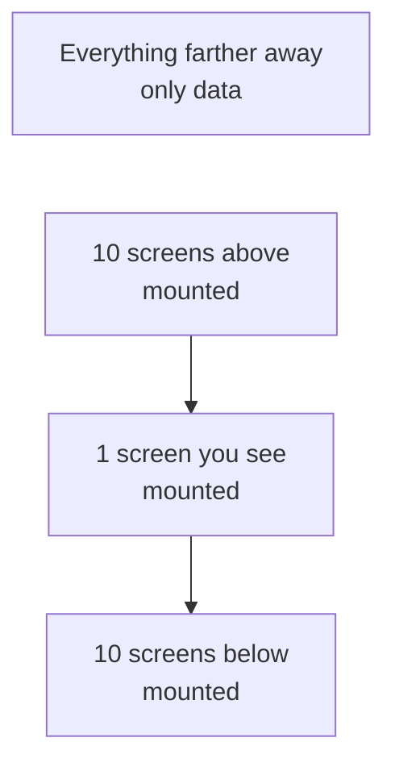
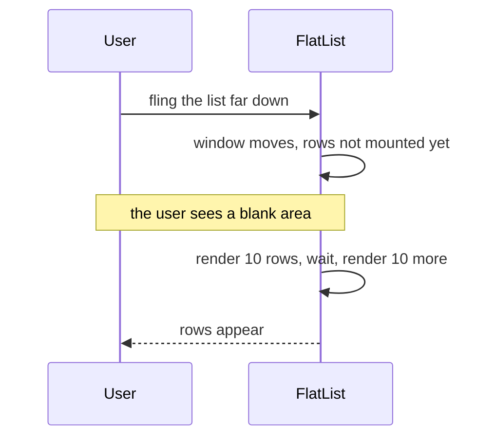

# 04. Lists and FlatList

> **Subject:** React Native · **Lesson:** 04 · **Made:** 2026-11-27 · **Status:** ready
>
> **You will be able to:** say why a `ScrollView` breaks with many rows, explain how a `FlatList` keeps only the rows near the screen, and name the props that fix a slow or blank list.
>
> **Before this:** [Navigation](03-navigation.md) · **Next:** [The old bridge vs the new architecture](05-the-old-bridge-vs-the-new-architecture.md)
>
> **How to read it:** one card is one idea. Look at the picture, guess, then press the orange bar to check. The blue bars (📖 More detail) hold the longer explanation. Skip them on the first read, open them when you want more. About 25 minutes for the cards.

## 1. The idea: a long scroll of paper, and a small window

Picture a roll of paper 50 metres long. You look at it through a small window. You do not need to unroll all 50 metres. You only need the part in the window, and a little more on each side.

A **`ScrollView`** unrolls everything. A **`FlatList`** unrolls only what is near the window.



Notice: **mounted** means the row really exists: React made the component and the phone made its native views. A row that is only data costs almost nothing.

<details class="guess"><summary>🤔 Guess: the data has 1000 rows and the screen shows 16. Roughly how many rows does a <code>FlatList</code> mount when you are in the middle: 16, about 350, or 1000? Press to check.</summary>

About 350. With the default settings, the list keeps 10 screens above, the screen you see, and 10 screens below. Step 2 of the [stepper](visuals/04-list-window.html) shows the numbers. It is far less than 1000, and more than 16, so scrolling stays smooth.

</details>

> **Remember:** a `ScrollView` mounts every row. A `FlatList` mounts only the rows near the screen.

<details class="more"><summary>📖 More detail: the words, and where the picture stops</summary>

- **Virtualized list:** a list that makes only the visible rows real. `FlatList` is built on `VirtualizedList`.
- **Mount:** make a component real (see [lesson 01](01-how-react-native-works.md)).
- **Viewport:** the part of the list you can see. **Window:** the larger part that is kept mounted around it.

The docs say a `FlatList` "renders items lazily, when they are about to appear, and removes items that scroll way off screen to save memory and processing time". The paper picture stops here: the window is not exactly centred, and rows are made in small batches, so it can lag (card 3).

</details>

## 2. The window and its size

The window is measured in screens. `windowSize` is the number of screens that stay mounted. The default is **21**: 10 screens above, the one you see, 10 below.



With rows 50 tall and a screen 800 tall, from the model in this lesson:

| Where you are | Rows in the window | How many |
|---|---|---|
| At the top (y = 0) | 0 to 175 | 176 |
| In the middle (y = 10000) | 40 to 375 | 336 |
| At the end (y = 49200) | 824 to 999 | 176 |

<details class="guess"><summary>🤔 Guess: you change <code>windowSize</code> from 21 to 5. What gets better, and what gets worse? Press to check.</summary>

Better: fewer rows are mounted, so memory is lower. Worse: there is a bigger chance of a blank area when you scroll fast. The docs say a smaller `windowSize` saves memory, and a bigger one means less blank space but more memory.

</details>

> **Remember:** `windowSize` is counted in screens. A bigger window means more memory and less blank. A smaller window means the opposite.

<details class="more"><summary>📖 More detail: step by step, what the list does</summary>

| Step | What the list does | State after |
|---|---|---|
| 1 | First render: only `initialNumToRender` rows (default 10) | 10 rows mounted |
| 2 | Add more rows in batches of `maxToRenderPerBatch` (default 10), about `updateCellsBatchingPeriod` ms apart (default 50) | the window fills |
| 3 | You scroll. The window moves with you | new rows mounted, far rows unmounted |
| 4 | The first `initialNumToRender` rows stay mounted, so "scroll to top" is quick | those 10 rows always exist |

The numbers in the table above come from a small model, in [`practice/04-list-window.mjs`](practice/04-list-window.mjs). The real list also keeps the first rows, so in the middle it holds about 346 rows. Real lists measure rows as they go. The model uses a fixed height to keep the idea clear.

**Step through it yourself:** [ScrollView or FlatList: who is mounted?](visuals/04-list-window.html). Press Next on each tab.

</details>

## 3. The blank area: scrolling faster than the list can fill

Rows are not made all at once. They are made in small batches, so one batch does not block taps. That has a price.



<details class="guess"><summary>🤔 Guess: is a blank area a bug in your code? Press to check.</summary>

Usually not. The docs call it a tradeoff: "it's possible to scroll faster than the fill rate and momentarily see blank content". You make it smaller with lighter rows, a known row height (`getItemLayout`), a bigger `windowSize` or a bigger `maxToRenderPerBatch`. Each of the last two costs something.

</details>

> **Remember:** blank areas come from scrolling faster than rows can be made. Lighter rows fix it for free. Bigger numbers fix it, but cost memory or JavaScript time.

<details class="more"><summary>📖 More detail: the props that move the tradeoff</summary>

| Prop | Default | A bigger number gives | The cost |
|---|---|---|---|
| `initialNumToRender` | 10 | a better first screen if it covers the screen | a slower start |
| `maxToRenderPerBatch` | 10 | less blank | longer JavaScript work, so taps can lag |
| `updateCellsBatchingPeriod` | 50 (ms) | batches farther apart, so less JavaScript work at once | more blank |
| `windowSize` | 21 | less blank | more memory |
| `removeClippedSubviews` | `true` on Android | less drawing work | can cause missing content, so test it |

Source: the "Optimizing FlatList Configuration" page of the docs, checked on 2026-11-27.

</details>

## 4. The props you must know

A good `FlatList` is mostly four props. Everything else is tuning.

```jsx
<FlatList
  data={products}
  renderItem={({ item }) => <Row item={item} />}
  keyExtractor={(item) => item.id}
  getItemLayout={(_, index) => ({
    length: 72,
    offset: 72 * index,
    index,
  })}
/>
```

| Prop | What it does |
|---|---|
| `data` | the array of rows |
| `renderItem` | makes one row from one item |
| `keyExtractor` | gives each row a stable key as text. Default: `item.key`, then `item.id`, then the index |
| `getItemLayout` | if every row has the same height, tells the list where each row is, so it can skip measuring |

<details class="guess"><summary>🤔 Guess: why does <code>getItemLayout</code> help? Press to check.</summary>

To place row 500 the list must know the height of rows 0 to 499. If every row is 72 tall, row 500 is at 72 × 500 = 36000. The list does not need to render or measure rows to know that. It can jump anywhere and keep its place. Without it, the list measures rows as they appear.

</details>

> **Remember:** give a stable key, and give `getItemLayout` when the rows have a fixed height.

<details class="more"><summary>📖 More detail: keep rows light, and the other lists</summary>

From the docs: use basic and light row components, use small thumbnails, and wrap the row in `React.memo()` so it only runs again when its props change. Avoid heavy logic and deep nesting in a row.

The performance page also names **FlashList** and **Legend List** as third party lists made for speed. I did not measure them, so I give no numbers. Try them when `FlatList` is still not enough after the steps above.

</details>

## 5. Mistake 1: a long list in a ScrollView

The problem: a screen shows 2000 products. The code maps over them inside a `ScrollView`.

```jsx
<ScrollView>
  {products.map((p) => (
    <Row key={p.id} item={p} />
  ))}
</ScrollView>
```

<details class="guess"><summary>🤔 Guess: what goes wrong, and what is the fix? Press to check.</summary>

All 2000 rows are mounted at once. The screen opens slowly and memory grows with the list. The fix is a `FlatList` with the same `renderItem`. A `ScrollView` is fine for a short, fixed amount of content, like a settings page.

```jsx
<FlatList
  data={products}
  keyExtractor={(p) => p.id}
  renderItem={({ item }) => <Row item={item} />}
/>
```

</details>

> **Remember:** `ScrollView` for a few things, `FlatList` for a long list.

<details class="more"><summary>📖 More detail: more things a FlatList gives you</summary>

The docs also list separators, many columns, pull to refresh and infinite scroll (`onEndReached`) as built in. A `ScrollView` needs a bounded height to work, so a parent chain with no `flex: 1` can make it look empty.

</details>

## 6. Mistake 2: the index as a key

The problem: rows have their own state (for example a checkbox inside the row). You use the index as the key, and then you delete the first item.

| Before | Key (index) | After deleting A | Key (index) |
|---|---|---|---|
| A (checked) | 0 | B | 0 |
| B | 1 | C | 1 |
| C | 2 | | |

<details class="guess"><summary>🤔 Guess: after deleting A, which row looks checked? Press to check.</summary>

Row B. React sees key 0 and thinks it is still the same row, so it keeps that row's state (checked) and only changes the data. The checkmark moves to the wrong item. The fix is a key that belongs to the item, like its id. The docs say the key is "used for caching and as the react key to track item re-ordering".

```jsx
keyExtractor={(item) => item.id}
```

</details>

> **Remember:** the key must follow the item, not the place. Use the id, not the index.

<details class="more"><summary>📖 More detail: the default key</summary>

If you give no `keyExtractor`, the list uses `item.key`, then `item.id`, then the index. So a list of items with an `id` is already safe, and a list of plain strings falls back to the index. For a list that never changes order, the index is fine. Read [Rendering Lists](https://react.dev/learn/rendering-lists) for the React side.

</details>

## 7. Mistake 3: the row does not update

The problem: you show a selected row in a different colour. You change `selectedId` in state, and nothing changes on screen.

```jsx
<FlatList
  data={items}
  renderItem={({ item }) => (
    <Row item={item} selected={item.id === selectedId} />
  )}
/>
```

<details class="guess"><summary>🤔 Guess: why does the colour not change, and what is the fix? Press to check.</summary>

`FlatList` is a `PureComponent`. It only runs again if its props change. `data` did not change, and `selectedId` is not a prop of the list, so it does not know the rows need new output. The fix is `extraData={selectedId}`. The docs say to put everything your `renderItem` depends on into `extraData`, and to treat it as immutable.

```jsx
<FlatList data={items} extraData={selectedId} renderItem={...} />
```

</details>

> **Remember:** if a row depends on something outside `data`, pass it as `extraData`.

<details class="more"><summary>📖 More detail: row state is lost when a row scrolls away</summary>

Another line from the docs: "Internal state is not preserved when content scrolls out of the render window." A row that is unmounted loses its own `useState`. Keep important values (a typed text, a checked box) in the item data or in a store, not inside the row.

</details>

## 8. Why it matters and what it costs

- **Without it:** a long list opens slowly and uses a lot of memory.
- **With it:** the number of mounted rows depends on the window, not on the length of the list. The data still sits in memory, but rows are the heavy part.
- **The cost:** blank areas on fast scrolls, rows lose their own state when unmounted, `extraData` must be right, and you tune numbers instead of just writing code.

## 9. Watch and play

I opened every link below on 2026-11-27 and each one loaded. I found no video that I could open and check, so there is none here.

- **Step through it:** [ScrollView or FlatList: who is mounted?](visuals/04-list-window.html) - three tabs, with real numbers from the model.
- **Do:** [practice/04-list-window.mjs](practice/04-list-window.mjs) - work out the window, the row place and the key.
- **Read:** [FlatList](https://reactnative.dev/docs/flatlist) - the caveats at the start of the page, and `extraData`.
- **Read:** [Optimizing FlatList Configuration](https://reactnative.dev/docs/optimizing-flatlist-configuration) - every prop above, with its pros and cons.
- **Read:** [ScrollView](https://reactnative.dev/docs/scrollview) - "ScrollView vs FlatList".
- **Read:** [Performance Overview](https://reactnative.dev/docs/performance) - the `FlatList` section and `getItemLayout`.

## 10. Practice

**A. Predict**

You have 5 rows and the default `windowSize` of 21. How many rows are mounted, and does the window change when you scroll?

<details><summary>Answer</summary>

All 5. The window is much bigger than the list, so everything is inside it. Scrolling does not change that. A `FlatList` does the same work as a `ScrollView` for a short list.

</details>

**B. Fix the bug**

```jsx
const [liked, setLiked] = useState({});
<FlatList
  data={posts}
  keyExtractor={(_, i) => String(i)}
  renderItem={({ item }) => (
    <Post post={item} liked={liked[item.id]} />
  )}
/>
```

Users like a post, but the heart does not change. Another user deletes a post at the top, and hearts jump to other posts. Name both problems and the fixes.

<details><summary>Answer</summary>

1. The list does not know that `liked` changed, because `FlatList` is a `PureComponent`. Add `extraData={liked}` and always make a new object when you update it. 2. The key is the index, so after a delete the keys point to different posts. Use `keyExtractor={(item) => item.id}`.

</details>

**C. Write it yourself**

Open `practice/04-list-window.mjs` and write `getItemLayout`, `windowRange` and `keyExtractor`, so that all 11 tests pass:

```bash
cd learn/react-native/practice
node --test 04-list-window.test.mjs
```

<details><summary>One possible answer</summary>

```js
export function getItemLayout(index, itemHeight) {
  return { length: itemHeight, offset: itemHeight * index, index };
}

export function windowRange({ scrollY, viewportHeight, itemHeight, itemCount, windowSize }) {
  if (itemCount <= 0) return { first: 0, last: -1 };
  // extra screens on each side: windowSize 21 gives 10
  const extra = ((windowSize - 1) / 2) * viewportHeight;
  const top = scrollY - extra;
  const bottom = scrollY + viewportHeight + extra;
  const first = Math.max(0, Math.floor(top / itemHeight));
  const last = Math.min(itemCount - 1, Math.ceil(bottom / itemHeight) - 1);
  return { first, last };
}

export function keyExtractor(item, index) {
  if (item.key != null) return String(item.key);
  if (item.id != null) return String(item.id);
  return String(index);
}
```

Look at the pattern: the window is a plain range of pixels, cut to the list. Rows are fixed height, so one division gives the row number. Use `!= null`, not a truthy check, so an id of `0` still counts.

</details>

## 11. Interview question

**Q:** Why should you use a `FlatList` instead of a `ScrollView` for a long list? What would you tune if the list is slow or shows blank areas?

<details><summary>A strong answer, in four parts</summary>

1. **Problem:** a `ScrollView` mounts every child at once. A long list then opens slowly and uses a lot of memory.
2. **How it works:** `FlatList` is virtualized. It mounts the rows near the screen (the window, 21 screens by default) and unmounts the far ones. It makes rows in small batches so taps stay responsive. I give it a stable `keyExtractor`, and `getItemLayout` when the row height is fixed.
3. **Tradeoff:** a fast fling can show blank areas. A bigger `windowSize` costs memory. A bigger batch costs JavaScript time. Rows lose their own state when unmounted, and `extraData` must list what the rows depend on. First I make the rows light and use `memo`. If it is still not enough, I measure, then try a list like FlashList.
4. **My example:** DBO and ZWS both have product style lists. I will add a real list screen I worked on, how many items it had, and what I changed, only after I confirm the facts. As an idea only: the first thing I would check is whether any list sits inside a `ScrollView`.

</details>

## 12. Explain it back

Close this file. Explain `ScrollView` and `FlatList` to a new junior, in 4 parts (problem, how, tradeoff, my example). Then write your best version below and run `/explain-check flatlist` or ask the `explain-coach` agent to review it.

### My explanation

<write here>

### Coach feedback

<the explain-coach agent writes here>

## 13. Review questions (day 1, 3, 7, 21)

1. What does a `ScrollView` mount, and what does a `FlatList` mount?
2. What does `windowSize` 21 mean?
3. A user sees an empty area while flinging a list. Why, and what can you change?
4. Draw the picture from card 2 from memory: the window with 10 screens above and below.

<details><summary>Answers</summary>

1. A `ScrollView` mounts all children at once. A `FlatList` mounts the rows near the screen and unmounts the far ones.
2. 21 screens stay mounted: 10 above, the one you see, 10 below.
3. The user scrolled faster than the list can fill, because rows are made in small batches. Make rows lighter, add `getItemLayout`, or raise `windowSize` or `maxToRenderPerBatch` (they cost memory or JavaScript time).
4. A tall bar with the middle screen marked as "you see", ten screens drawn above and below it, and the rest marked "only data".

</details>

## 14. Go deeper (optional)

<details><summary>Versions, and what I did not check</summary>

- **Checked on 2026-11-27** against the React Native docs for `FlatList`, `ScrollView`, "Optimizing FlatList Configuration" and "Performance Overview", and with the model in `practice/04-list-window.mjs` (11 tests).
- The model is simple on purpose: fixed row height, and a window that is exactly centred. The real `VirtualizedList` measures rows, works in batches and keeps the first rows, so real counts differ a little.
- I did not run a real phone here, so I give no frame rates or memory numbers.
- `SectionList` is the same idea for grouped rows. `VirtualizedList` is the base for both.

</details>

## Connected lessons

- [How React Native works](01-how-react-native-works.md) - mounting, and why JavaScript time matters.
- [Navigation](03-navigation.md) - a list row usually opens a screen with params.
- [Performance on mobile](10-performance-on-mobile.md) - `memo`, images, and finding the slow part.
