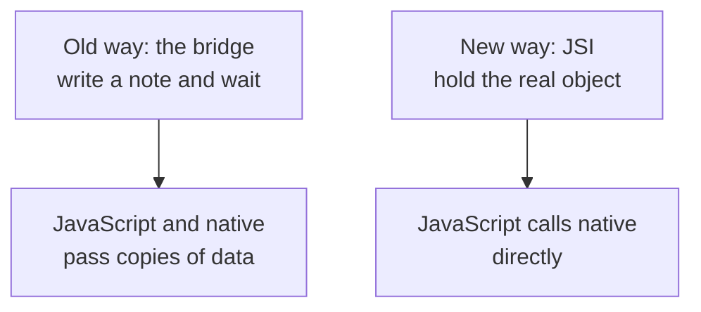
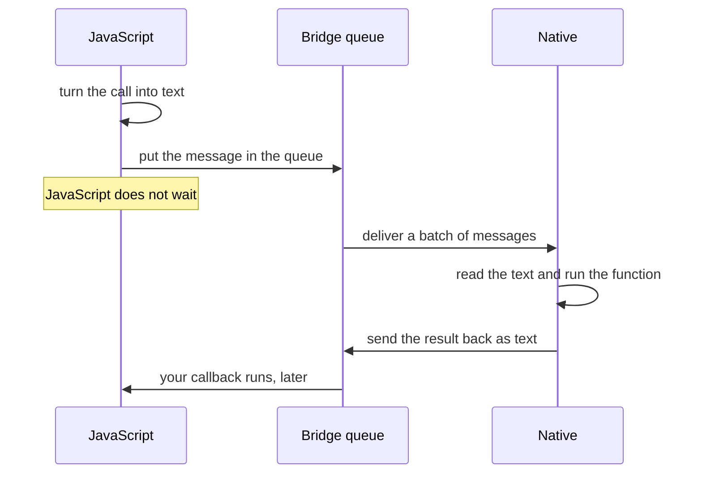

# 05. The old bridge vs the new architecture

> **Subject:** React Native · **Lesson:** 05 · **Made:** 2026-11-27 · **Status:** ready
>
> **You will be able to:** say why the old bridge was slow, say what JSI, Fabric, TurboModules and Codegen do, and say which React Native version removed the old way.
>
> **Before this:** [Lists and FlatList](04-lists-and-flatlist.md) · **Next:** [Hermes](06-hermes.md)
>
> **How to read it:** one card is one idea. Look at the picture, guess, then press the orange bar to check. The blue bars (📖 More detail) hold the longer explanation. Skip them on the first read, open them when you want more. About 25 minutes for the cards.

<!-- quick-summary:start -->
## Quick summary

> Short on time? Read only this. These are the "Remember" lines from the cards below, so you can read the whole lesson in one minute.

- The old bridge passed notes. The new way, JSI, holds the real object.
- On the old bridge every call was turned into text, queued, and answered later.
- The bridge costs time for every byte it copies. JSI copies nothing.
- JSI lets JavaScript and native code share objects, so calls are direct and can be synchronous.
- JSI is the link. Fabric is the renderer. TurboModules are the native modules. Codegen makes the typed glue.
- 0.76 made the New Architecture the default. 0.82 made it the only one.
- The New Architecture opens doors. You still have to walk through them.
- A synchronous call is direct, but JavaScript waits for it.
<!-- quick-summary:end -->

## 1. The idea: passing notes, or holding the remote control

Two people sit in two rooms. They speak different languages. In the **old way**, they pass **written notes** through a slot in the wall. Each note must be written, carried, and read. In the **new way**, one person **holds a remote control** of the other room. They press a button and the thing happens now.



Notice: the two rooms are **JavaScript** (your code) and **native** (the phone's own code). The wall between them was called **the bridge**.

<details class="guess"><summary>🤔 Guess: which way is faster for a call that happens 100 times each second? Press to check.</summary>

The remote control. Writing, carrying and reading a note 100 times a second costs a lot. The React Native team says the same: in the old design, the cost of turning calls into text "quickly became a bottleneck, especially for frequent updates or large objects".

</details>

> **Remember:** the old bridge passed notes. The new way, JSI, holds the real object.

<details class="more"><summary>📖 More detail: the words</summary>

- **Bridge:** the old link between JavaScript and native code. It sent messages, not objects.
- **Serialize:** turn data into text so it can travel. Reading it back is the other direction.
- **JSI** (JavaScript Interface): a link that lets JavaScript hold a reference to a C++ object, and C++ hold JavaScript objects.
- **Synchronous:** the answer comes back on the very next line. **Asynchronous:** the answer comes later.

</details>

## 2. The old bridge, step by step

This is what one call to a native function looked like in the old design. The React Native team describes it as: "serialize and enqueue native function calls with the bridge, which would be processed asynchronously".



<details class="guess"><summary>🤔 Guess: on the old bridge, can you write <code>const value = nativeModule.getValue()</code> and use value on the next line? Press to check.</summary>

No. The answer came later, so you had to pass a **callback**. In the React Native team's example, the old code was `nativeModule.getValue(value => { ... })`. The value also had to be something that can be turned into text. It could not be a reference to a native object.

</details>

> **Remember:** on the old bridge every call was turned into text, queued, and answered later.

<details class="more"><summary>📖 More detail: step by step, one old call</summary>

| Step | What happens | Who works | State after |
|---|---|---|---|
| 1 | Your code calls a native function with a list | JavaScript thread | a normal object in memory |
| 2 | The call is turned into text | JavaScript thread | a copy of the data as text |
| 3 | The message waits in a queue, sent in a batch with others | the bridge | your code keeps running |
| 4 | The native side reads the text and builds its own copy | native thread | a second copy of the data |
| 5 | The function runs, and its result is turned into text | native thread | a third copy, as text |
| 6 | The result comes back and your callback runs | JavaScript thread | you have the answer, later |

The steps 2 to 6 are the React Native team's description plus general knowledge about how the bridge sent messages. I did not find a docs page that lists the message format, so treat "JSON text" as general knowledge.

**Step through it yourself:** [The old bridge and JSI](visuals/05-bridge-vs-jsi.html). Press Next on tab 1, then tab 2.

</details>

## 3. What the notes cost: a model you can run

Notes are fine for small, rare messages. They hurt for big or frequent ones. Here is a **model** of the two ways (it is not the real bridge). I made it in `practice/05-bridge-vs-jsi.mjs` and ran it in Node.

| Test: send a list of 100,000 products | Bridge model | JSI model |
|---|---|---|
| Text made | about 4.8 million characters | none |
| Time for the call and its delivery | about 46 milliseconds | about 0.02 milliseconds |
| Can you read the answer on the next line | no, you wait for a flush | yes |

One frame on a phone has about 16 milliseconds (lesson 01). A 46 millisecond job on the JavaScript thread is about three frames.

<details class="guess"><summary>🤔 Guess: the same list is sent 3 times. What happens to the time and the text size in the bridge model? Press to check.</summary>

Both about triple. I measured 116 milliseconds and 14.4 million characters for 3 calls. The JSI model stayed near zero, because nothing is copied. The cost of the bridge grows with the size of the data and the number of calls. The cost of JSI does not.

</details>

> **Remember:** the bridge costs time for every byte it copies. JSI copies nothing.

<details class="more"><summary>📖 More detail: how to read these numbers</summary>

- **Checked on 2026-11-27** with Node 22.23.5 on a cloud machine, one run for each size. Your numbers will differ. The point is the shape: copy cost grows with size, reference cost does not.
- The real bridge was not this code. It sent messages in batches. This model sends text only to show the idea.
- Real apps rarely send 100,000 rows to native code in one call. A camera frame is a better real example: the React Native docs say a typical frame buffer is about 30 MB, which is roughly 2 GB of data each second, depending on the frame rate. JSI lets a library like VisionCamera handle that.

</details>

## 4. JSI: holding the real object

With JSI, JavaScript holds a **reference** to a native object. A reference is not a copy. It points at the real thing. So calls are direct and answers can come at once.

The React Native team shows the difference in code:

```js
// old: a callback, and the value must be plain data
nativeModule.getValue(value => {
  nativeModule.doSomething(value);
});

// new: the value comes back at once,
// and it can be a reference to a native object
const value = nativeModule.getValue();
nativeModule.doSomething(value);
```

<details class="guess"><summary>🤔 Guess: why does it matter that <code>value</code> can be a reference to a native object? Press to check.</summary>

You can pass it to the next native call **without copying** it. A big image, a database handle or a camera frame stays in native memory. JavaScript only holds the handle. Nothing big travels.

</details>

> **Remember:** JSI lets JavaScript and native code share objects, so calls are direct and can be synchronous.

<details class="more"><summary>📖 More detail: what JSI removed</summary>

The React Native team lists these gains from removing the bridge: faster startup (no bridge to start), direct communication, better error reports, and fewer crashes from undefined behavior. For example, in the old design a global function such as `setTimeout` needed a module to be set up in JavaScript at startup. That cost a small delay.

</details>

## 5. The four names: JSI, Fabric, TurboModules, Codegen

Interviewers like these four names. Each one has one job.

| Name | One job | What you get |
|---|---|---|
| **JSI** | the direct link between JavaScript and C++ | no copies, calls can be synchronous |
| **Fabric** | the new renderer (lesson 01) | layout can be read at once, React concurrent features work |
| **TurboModules** | the new native modules | loaded only when first needed, so startup is lighter |
| **Codegen** | makes native code from a typed description | a mismatch between JavaScript and native is a build error, not a crash |

<details class="guess"><summary>🤔 Guess: a TurboModule for the camera is in your app, but the user never opens the camera. When is it loaded? Press to check.</summary>

Never. TurboModules are **lazily loaded**: they load into memory only when they are needed, not at startup. In the old design, native modules were set up at startup.

</details>

> **Remember:** JSI is the link. Fabric is the renderer. TurboModules are the native modules. Codegen makes the typed glue.

<details class="more"><summary>📖 More detail: Codegen and a native module in four steps</summary>

From the "Native Modules: Introduction" page of the docs, writing a Turbo Native Module has four steps:

1. Write a typed spec in TypeScript or Flow.
2. Run Codegen, which turns the spec into native interfaces.
3. Use the spec in your JavaScript.
4. Write the native code against the generated interfaces.

Codegen also covers components: the JavaScript declaration of a component is the source of truth, and Codegen makes the C++ structs that hold its props. A mismatch gives a build error.

On Android the renderer still pays a cost for JNI (the link between Java and C++) in two cases: layout of complex views such as `Text`, and the mount step. The team described a plan to cut that cost. So "no cost" is not a true sentence. It is "much less copying".

</details>

## 6. When did the old way go away?

You do not choose between the two in a new app anymore. The timeline, from the release blog posts:

| Version | Date | What changed |
|---|---|---|
| 0.68 | 2022 | the New Architecture can be switched on (experimental) |
| 0.74 | April 2024 | Bridgeless mode is the default when the New Architecture is on |
| 0.76 | October 2024 | the New Architecture is on by default and "ready for production" |
| 0.81 | 2025 | the last version that allows the old architecture (and Expo SDK 54) |
| 0.82 | October 2025 | the first version that runs **only** on the New Architecture |
| 0.88 | October 2026 | the latest version at the time of this lesson, with Expo SDK 58 |

<details class="guess"><summary>🤔 Guess: you set <code>newArchEnabled=false</code> in a project on React Native 0.82. What happens? Press to check.</summary>

The setting is ignored. The 0.82 blog says it: on Android `newArchEnabled=false` is ignored, and on iOS `RCT_NEW_ARCH_ENABLED=0` is ignored. The app still runs on the New Architecture.

</details>

> **Remember:** 0.76 made the New Architecture the default. 0.82 made it the only one.

<details class="more"><summary>📖 More detail: what this means for old libraries</summary>

- When the New Architecture became the default (0.76), an **interop layer** let many old libraries keep working. The blog said that more than 850 libraries were already compatible, and it listed all libraries above 200,000 weekly downloads.
- The blog also said the interop layer does not support custom shadow nodes or concurrent features, so some libraries needed an update to get the full benefit.
- In the 0.82 post, the team said they would keep the interop layers "for the foreseeable future", and that libraries that work with both architectures keep working on 0.82.
- If a library blocks you, the 0.82 post says to reach out to its maintainers. I did not check the list of compatible libraries for any single package. Check a library yourself before you rely on it.
- The team also said the code of the old architecture would be removed in versions after 0.82. This reduces app size.

</details>

## 7. Mistake 1: "switching it on makes my app faster"

The problem: a team enables the New Architecture and expects every screen to be faster.

<details class="guess"><summary>🤔 Guess: what do the React Native docs say about this? Press to check.</summary>

The landing page says that enabling it "may not immediately improve performance or user experience". Your code may need changes to use new features such as synchronous layout effects or concurrent features. And JSI only helps if data copying was your bottleneck. If your slow part was a heavy render, JSI will not fix it. Measure first (lesson 10).

</details>

> **Remember:** the New Architecture opens doors. You still have to walk through them.

<details class="more"><summary>📖 More detail: what you can use now</summary>

With the New Architecture you can use React 18 and newer features such as transitions and Suspense for data, automatic batching, and `useLayoutEffect` to measure and place a view in one commit (no "jump"). The landing page has a tooltip example with moving pictures.

</details>

## 8. Mistake 2: "synchronous means free"

The problem: now that a native call can return at once, someone calls one inside a loop that runs on every scroll event.

<details class="guess"><summary>🤔 Guess: what is wrong? Press to check.</summary>

A synchronous call makes JavaScript **wait** until native finishes. If the native work takes 20 milliseconds, the JavaScript thread is blocked for 20 milliseconds, every time (lesson 01 showed what that does to taps). This is my reasoning from how threads work, not a sentence from the docs. Use a synchronous call for fast reads. Keep slow work asynchronous: return a promise.

</details>

> **Remember:** a synchronous call is direct, but JavaScript waits for it.

<details class="more"><summary>📖 More detail: choose sync or async</summary>

| Work | Good fit |
|---|---|
| read a small setting, get a value for the next line | synchronous |
| read a big file, call the network, open a database | asynchronous (a promise) |
| process a camera frame in real time | JSI with care, on a separate thread |

[Lesson 09](09-offline-storage.md) shows this in storage libraries, for example one that reads synchronously and others that use promises.

</details>

## 9. Why it matters and what it costs

- **Without it:** every call is turned into text, queued and answered later. Frequent calls and big data are slow, JavaScript and native can get out of step, and lists can show empty space for a moment.
- **With it:** direct calls, synchronous answers where you need them, lazy native modules, typed contracts, and the renderer features of lesson 01.
- **The cost:** native modules and libraries must be written or updated for it, and the old interop layer is not a long term plan. Debugging now crosses JavaScript, C++ and native code. And it is not a speed switch.

## 10. Watch and play

I opened every link below on 2026-11-27 and each one loaded. I found no video that I could open and check, so there is none here.

- **Step through it:** [The old bridge and JSI](visuals/05-bridge-vs-jsi.html) - three tabs: the old bridge, JSI, what changed.
- **Do:** [practice/05-bridge-vs-jsi.mjs](practice/05-bridge-vs-jsi.mjs) - build a bridge model and a JSI model and make the tests pass.
- **Read:** [The New Architecture is here](https://reactnative.dev/blog/2024/10/23/the-new-architecture-is-here) - the best single page: "Removing the Bridge" and the code example in card 4.
- **Read:** [About the New Architecture](https://reactnative.dev/architecture/landing-page) - why it exists, and what to expect.
- **Read:** [React Native 0.82 - New Architecture Only](https://reactnative.dev/blog/2025/10/08/react-native-0.82) - "How to migrate" and the interop layers.
- **Read:** [Native Modules: Introduction](https://reactnative.dev/docs/turbo-native-modules-introduction) - the four steps to write a Turbo Native Module.
- **Read:** [What is Codegen](https://reactnative.dev/docs/the-new-architecture/what-is-codegen) - what the typed spec makes.

## 11. Practice

**A. Predict**

```js
// old bridge
const result = nativeModule.getValue();
console.log(result);
```

What does it print on the old bridge, and why?

<details><summary>Answer</summary>

It would not work as written. On the old bridge `getValue` did not return the value. It took a callback, or returned a promise. The value arrived later. With JSI, a native module can return the value at once.

</details>

**B. Fix the bug**

A team enables the New Architecture and a screen that sends a huge object to a native module on every scroll event is still slow. They say "we turned on the new thing but nothing changed". Name two likely reasons.

<details><summary>Answer</summary>

1. The slow part may not be data copying at all. It may be heavy rendering or too many calls. Measure first. 2. The module may be an old one that runs through the interop layer, so it does not get the full benefit until it is migrated. Also, sending a huge object on every scroll event is a design problem on any architecture. Send less, send less often, or keep the data in native memory and pass a handle.

</details>

**C. Write it yourself**

Open `practice/05-bridge-vs-jsi.mjs` and write `createBridge` and `createJsi`, so that all 11 tests pass. Remember this is a model.

```bash
cd learn/react-native/practice
node --test 05-bridge-vs-jsi.test.mjs
```

<details><summary>One possible answer</summary>

```js
export function createBridge(nativeModules) {
  const queue = [];
  let messages = 0;
  let bytes = 0;

  return {
    call(module, method, ...args) {
      const text = JSON.stringify({ module, method, args });
      messages += 1;
      bytes += text.length;
      return new Promise((resolve, reject) => {
        queue.push({ text, resolve, reject });
      });
    },
    flush() {
      while (queue.length > 0) {
        const { text, resolve, reject } = queue.shift();
        try {
          const message = JSON.parse(text);
          const result = nativeModules[message.module][message.method](...message.args);
          const back = JSON.stringify(result);
          resolve(back === undefined ? undefined : JSON.parse(back));
        } catch (error) {
          reject(error);
        }
      }
    },
    stats() {
      return { messages, bytes };
    },
  };
}

export function createJsi(hostObjects) {
  return {
    call(module, method, ...args) {
      return hostObjects[module][method](...args);
    },
    stats() {
      return { messages: 0, bytes: 0 };
    },
  };
}
```

Look at the pattern: the bridge makes the text at **call time**, so a later change to your object does not reach native. A `Date` becomes a string and a function disappears, because JSON cannot hold them. JSI has no text step, so none of this happens. `JSON.stringify(undefined)` returns `undefined`, so the code checks for it before reading it back.

</details>

## 12. Interview question

**Q:** What was wrong with the old React Native bridge, and what replaced it?

<details><summary>A strong answer, in four parts</summary>

1. **Problem:** JavaScript and native code lived apart. Every call, and every render update, was serialized (turned into text), queued and answered asynchronously. Frequent updates and big objects became a bottleneck, and the two sides could get out of sync, so lists could show empty space.
2. **How it works now:** JSI lets JavaScript hold a reference to a C++ object, so calls are direct and can be synchronous. On top of JSI there is Fabric (the new renderer), TurboModules (native modules loaded when needed) and Codegen (typed contracts between JavaScript and native). It has been the default since 0.76 and the only option since 0.82.
3. **Tradeoff:** it is not an automatic speed up. Libraries have to support it, and a synchronous call blocks JavaScript until native finishes. Debugging crosses more layers.
4. **My example:** I built the ZWS store app and the DBO mobile app with React Native. I will add which React Native version each one used and whether I upgraded across 0.76 or 0.82, only after I confirm the facts. A real answer from my work beats a guess.

</details>

## 13. Explain it back

Close this file. Explain the old bridge and JSI to a new junior, in 4 parts (problem, how, tradeoff, my example). Then write your best version below and run `/explain-check old bridge vs new architecture` or ask the `explain-coach` agent to review it.

### My explanation

<write here>

### Coach feedback

<the explain-coach agent writes here>

## 14. Review questions (day 1, 3, 7, 21)

1. Why was the old bridge slow for big or frequent calls?
2. What do JSI, Fabric, TurboModules and Codegen each do, in one line?
3. Which React Native version made the New Architecture the default, and which made it the only one?
4. Draw the picture from card 2 from memory: the five steps of one old bridge call.

<details><summary>Answers</summary>

1. Every call was turned into text, queued, read again and answered later. The cost grew with the size of the data and the number of calls.
2. JSI: the direct link between JavaScript and C++. Fabric: the new renderer. TurboModules: native modules loaded when needed. Codegen: makes native code from a typed description.
3. 0.76 made it the default (October 2024). 0.82 made it the only one (October 2025).
4. Text made, message queued, batch delivered, native reads and runs, result sent back and the callback runs later.

</details>

## 15. Go deeper (optional)

<details><summary>Versions, interop and extra links</summary>

- **Checked on 2026-11-27** against the React Native release posts for 0.74, 0.76 and 0.82, the post "The New Architecture is here", the architecture pages in the docs repository, and the "Native Modules: Introduction" page.
- **Bridgeless mode** (0.74) is the default when the New Architecture is on. The 0.74 post says the interop layers were improved to cover it, so old libraries keep working. My short meaning, "the old bridge object is not created at all", is general knowledge, not a sentence from that post.
- **The old shadow tree was built once for each platform.** The new renderer shares one C++ core across platforms, so layout and view flattening behave the same on both. See [Cross Platform Implementation](https://reactnative.dev/architecture/xplat-implementation).
- The old architecture's native modules are called "legacy native modules" in the docs. The docs page for them carries a deprecation notice, and the current guide is the Turbo Native Modules one.
- **Fabric page:** [Fabric](https://reactnative.dev/architecture/fabric-renderer) lists the goals: type safety, a shared C++ core, better interop with host platforms, faster startup, and less serialization.

</details>

## Connected lessons

- [How React Native works](01-how-react-native-works.md) - the render, commit and mount steps that Fabric runs.
- [Hermes](06-hermes.md) - the engine that runs JavaScript, and the other half of "faster startup".
- [Offline storage](09-offline-storage.md) - storage libraries that use JSI, and the difference between sync and async reads.
- [Performance on mobile](10-performance-on-mobile.md) - how to find out whether copying was your problem at all.
