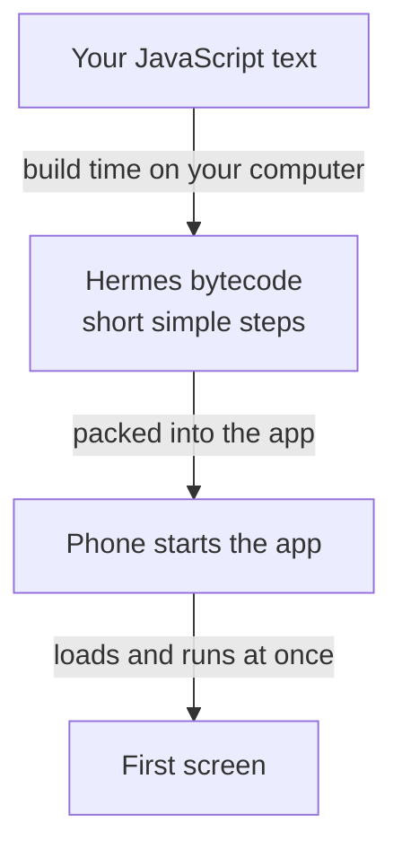
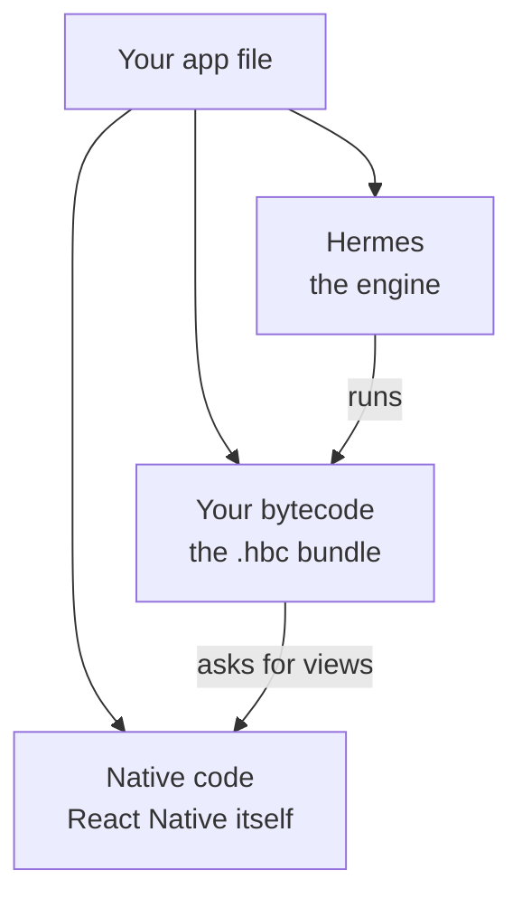
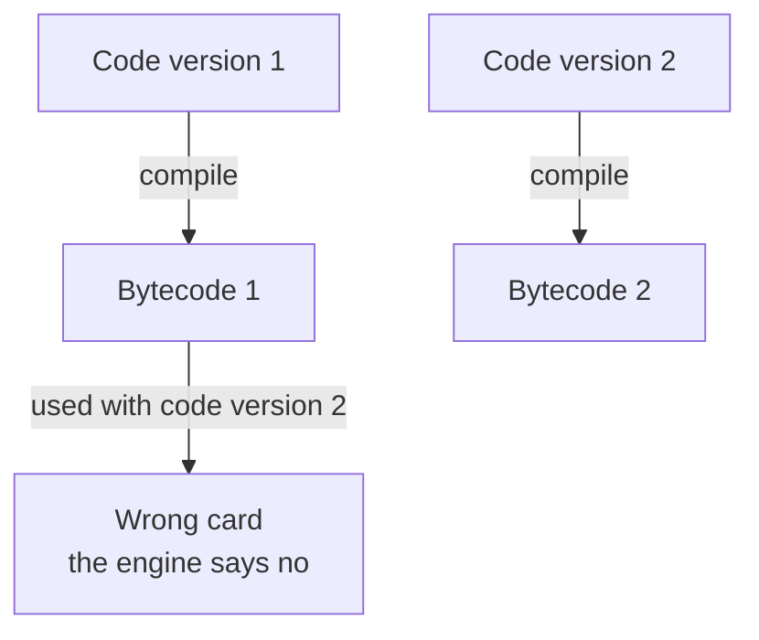

# 06. Hermes

> **Subject:** React Native · **Lesson:** 06 · **Made:** 2026-11-27 · **Status:** ready
>
> **You will be able to:** say what Hermes is, explain why it compiles your code at build time, check that an app uses it, and name the one mistake people make when they measure it.
>
> **Before this:** [The old bridge vs the new architecture](05-the-old-bridge-vs-the-new-architecture.md) · **Next:** [Expo vs bare](07-expo-vs-bare.md)
>
> **How to read it:** one card is one idea. Look at the picture, guess, then press the orange bar to check. The blue bars (📖 More detail) hold the longer explanation. Skip them on the first read, open them when you want more. About 20 minutes for the cards.

<!-- quick-summary:start -->
## Quick summary

> Short on time? Read only this. These are the "Remember" lines from the cards below, so you can read the whole lesson in one minute.

- Hermes turns your JavaScript into short steps at build time, so the phone has less to read at start.
- The reading step happens on your computer at build time. The phone loads and runs.
- Hermes is packed inside your app, and a matching Hermes is built for each React Native release.
- Bytecode fits one exact code and one exact engine. A wrong card is rejected, never trusted.
- Check with `global.HermesInternal`, and judge speed only in a release build.
- A dev build cannot tell you what Hermes does for start up.
- Hermes helps start up and memory. It does not fix slow code you wrote.
<!-- quick-summary:end -->

## 1. The idea: a printed recipe card

Your app code is JavaScript text. A phone cannot run text. A program called an **engine** must read the text and run it. Think of a cook who gets a recipe in long handwriting. Reading it takes time, and the cook does this reading **every time** the app starts.

Now imagine you had a printed recipe card with short, clear steps. The cook reads it in a blink. **Hermes** is the engine that React Native uses, and it works with the printed card. The card is made **once, when you build the app**, not on the phone.



Notice: the slow reading step moved from the phone to your computer. The phone only loads.

<details class="guess"><summary>🤔 Guess: who reads your JavaScript text with plain handwriting every time, the user's phone or your build computer? Press to check.</summary>

With Hermes, your build computer reads it, once. The phone gets the short steps. That saves start up time, and the docs say it often lowers memory use and app size too.

</details>

> **Remember:** Hermes turns your JavaScript into short steps at build time, so the phone has less to read at start.

<details class="more"><summary>📖 More detail: the words</summary>

- **Engine** (interview word: *JavaScript engine*): the program that runs JavaScript. Chrome has one. Node has one. Every React Native app has one.
- **Bytecode:** a compact list of simple steps, made from your code. It is smaller and quicker to load than text. Hermes bytecode files end in `.hbc`.
- **Hermes:** an open source engine made for React Native.

The picture stops here: the cook (engine) still has to follow the card and do the work. Hermes does not make your own code do less work. It only makes the loading and reading part cheaper.

</details>

## 2. Without it and with it

Here is the start of an app, step by step. The words in the middle are the only difference.

| Step | Plain engine (reads text at start) | Hermes (bytecode made at build) |
|---|---|---|
| Build time | pack the JavaScript text | read the text, make bytecode, pack it |
| App starts | read and compile the text on the phone | load the bytecode |
| Then | run | run |

In memory, at the moment the app starts:

| Thing | Plain engine | Hermes |
|---|---|---|
| What is in the app file | JavaScript text | bytecode (`.hbc`) |
| Work the phone does before running | read and compile | load |

<details class="guess"><summary>🤔 Guess: you make a typing mistake in one line of JavaScript, so the code is not valid. When do you hear about it with Hermes: at build time or when the user starts the app? Press to check.</summary>

Most likely at build time, because the text is read on your computer then (general knowledge, I did not test it here). The phone would never see a broken file. This is one more small gain of doing the reading early.

</details>

> **Remember:** the reading step happens on your computer at build time. The phone loads and runs.

<details class="more"><summary>📖 More detail: how this compares with a browser (general knowledge)</summary>

A browser usually gets JavaScript as text and compiles it on the user's device while the page runs, using a technique called a JIT. This is general knowledge, not something I checked in the React Native docs. The React Native docs only say that, for many apps, Hermes brings a better start up time, lower memory use and a smaller app than JavaScriptCore.

JavaScriptCore is the engine of Safari. On iPhone it does not use a JIT, because apps there have no writable executable memory (JavaScript Environment page of the docs).

</details>

## 3. What is inside your app

A React Native app is a bundle of three things. Notice that **Hermes ships inside your app**. The phone does not provide it.



React Native gets a new Hermes built for **every release**, and the docs say you consume a Hermes that is "fully compatible" with your React Native version. That is not a nice extra. It is needed. The next card shows why.

<details class="guess"><summary>🤔 Guess: why does React Native ship its own Hermes, and not use whatever engine the phone has? Press to check.</summary>

Because bytecode only fits the engine that made it. If the phone's engine changed in a different update, the old bytecode might not load. When the engine is packed inside your app, it always matches the bytecode packed next to it.

</details>

> **Remember:** Hermes is packed inside your app, and a matching Hermes is built for each React Native release.

<details class="more"><summary>📖 More detail: versions</summary>

- Hermes became the default engine in React Native **0.70**.
- **0.82** let you opt in to a newer Hermes called **Hermes V1**.
- **0.84** made Hermes V1 the default engine, on iOS and Android. If you already used Hermes, you got it without changing anything.

These come from the React Native release posts. The latest React Native on 2026-11-27 is 0.88.

</details>

## 4. Bytecode is tied to the exact code

A printed card is made for one recipe. If you change the recipe, the old card is wrong. The same is true for bytecode. It is made from **one exact version of your code**, and it is read by **one exact version of the engine**.



You can feel this idea with a small model. Node (the JavaScript engine of servers) can also save compiled code, called a **code cache**. It is not Hermes, but the idea is the same. Here is the model, in a few lines:

```js
const script = new vm.Script(source);
const cached = script.createCachedData(); // the "card"

const again = new vm.Script(source, { cachedData: cached });
console.log(again.cachedDataRejected);    // false: same code
```

<details class="guess"><summary>🤔 Guess: you use the card from code A with the text of code B (a different length). What does the engine do: crash, run A's steps, or say no and read B normally? Press to check.</summary>

It says no and reads B normally. The engine marks the cache as rejected (`cachedDataRejected` is `true`), and you still get B's right answer. In the exercise tests below, this was true 20 times out of 20 with brand new sources.

</details>

> **Remember:** bytecode fits one exact code and one exact engine. A wrong card is rejected, never trusted.

<details class="more"><summary>📖 More detail: what I checked, and what I did not</summary>

I ran the model on Node v22.23.5 on 2026-11-27. Three things came out stable:

- A cache for the same source was accepted.
- A cache for other code, with a different length, was rejected, 20 out of 20 times when each source was new to the process.
- Random bytes were rejected.

One thing was **not** stable, so I do not teach it: if the engine has already seen a source in the same process, it remembers it, and a mismatched cache can then look accepted. That is why every exercise test uses its own source text. Hermes works differently from V8, so do not take details of this model as facts about Hermes.

</details>

## 5. How to check that your app uses Hermes

Hermes is the default, so you usually do not have to do anything. To check, the docs give one line:

```js
const isHermes = () => !!global.HermesInternal;
```

The docs add a warning: if you load your JavaScript bundle in an unusual way, `HermesInternal` can be there while you still do not use the precompiled bytecode. Confirm that you load the `.hbc` file.

| Question | Where to look |
|---|---|
| Is Hermes the engine? | `global.HermesInternal` is not empty |
| Is the code precompiled? | you load an `.hbc` bundle (a release build) |
| Is it fast at start? | compare a release build with the same device, before and after |

<details class="guess"><summary>🤔 Guess: in a dev build, the app starts slowly and the loading bar is long. Is that a sign that Hermes does not help? Press to check.</summary>

No. A dev build does a lot of extra work, so it says little about the shipped app. See the mistakes below.

</details>

> **Remember:** check with `global.HermesInternal`, and judge speed only in a release build.

<details class="more"><summary>📖 More detail: build commands from the docs</summary>

To see the benefit, make a release build and compare:

```bash
# Android
npm run android -- --mode="release"
# iPhone
npm run ios -- --mode="Release"
```

This compiles your JavaScript to Hermes bytecode at build time, which the docs say improves start up speed on the device. With Expo, use a build of your project instead of Expo Go and compare.

</details>

## 6. Mistake 1: measuring start up in a dev build

The problem: a developer starts the app with the dev server, times the launch, and says "Hermes did not help".

<details class="guess"><summary>🤔 Guess: what is wrong with this test, and how do you fix it? Press to check.</summary>

In a dev build the app runs with extra checks, and the React Native docs say JavaScript speed "suffers greatly" in development mode. The Hermes page says the benefit shows in a release build, where your JavaScript is compiled to bytecode at build time. Fix: make a release build, use the same phone, and measure the time before and after.

</details>

> **Remember:** a dev build cannot tell you what Hermes does for start up.

<details class="more"><summary>📖 More detail: a small rule for fair tests</summary>

Change one thing, keep the phone, keep the app version, run the start a few times, and compare the same kind of start (a cold start, after the app was fully closed). I did not measure any app for this lesson, so I give no numbers of my own.

</details>

## 7. Mistake 2: "Hermes makes everything fast" and "Hermes is a different language"

Two wrong beliefs, one card.

| Belief | The truth |
|---|---|
| Hermes makes every screen fast | It helps loading and memory. A slow list or a loop in your code is still slow |
| Hermes is a new language | It runs normal JavaScript, after a compile step (Babel) that React Native already did before |

<details class="guess"><summary>🤔 Guess: a screen is slow because it sorts 50,000 items on every render. Does switching to Hermes V1 fix it? Press to check.</summary>

No. Your own work is still your own work. Fix the sort (do it once, or on the server). Hermes V1 can make the engine faster in general, but the React Native team itself says that gains "strongly depend on the details of your apps".

</details>

> **Remember:** Hermes helps start up and memory. It does not fix slow code you wrote.

<details class="more"><summary>📖 More detail: what the release post says about speed</summary>

The 0.82 release post gives one real app, Expensify, as an example of Hermes V1 against the Hermes before it:

| Metric | Android (low end device) | iOS |
|---|---|---|
| Bundle load time | 3.2% faster | 9% faster |
| Total time to interactive | 7.6% faster | 2.5% faster |

These are the post's numbers for one app, not a promise for yours. The post also says Hermes V1 does not yet include the JIT or the "Static Hermes" native compile.

</details>

## 8. Why it matters and what it costs

- **Without it:** every start, the phone reads and compiles your whole bundle, which is slow on a cheap phone.
- **With it:** the work is done at build time. For many apps that gives a faster start, less memory and a smaller app file (the docs' words).
- **The cost:** the engine is packed in your app, so the app file has the engine in it. A build step must make the bytecode. Some libraries or tools that expect a browser style engine can need care. If you must leave Hermes, you go through a community package for JavaScriptCore, and for Hermes V1 there are steps in the 0.84 release post.

## 9. Watch and play

I opened every link below on 2026-11-27 and each one loaded. I found no video that I could open and check, so there is none here.

- **Do:** [practice/06-precompiled-code.mjs](practice/06-precompiled-code.mjs) - make and use a code cache with `node:vm`, then run the tests.
- **Read:** [Using Hermes](https://reactnative.dev/docs/hermes) - the short official page: the default engine, `HermesInternal`, release builds.
- **Read:** [JavaScript Environment](https://reactnative.dev/docs/javascript-environment) - the three places your code can run, and the JavaScriptCore note.
- **Read:** [React Native 0.84, Hermes V1 by Default](https://reactnative.dev/blog/2026/02/11/react-native-0.84) - what changed and how to opt out.
- **Read:** [React Native 0.82, Experimental Hermes V1](https://reactnative.dev/blog/2025/10/08/react-native-0.82) - the Expensify numbers.
- **Read:** [Performance Overview](https://reactnative.dev/docs/performance) - why release builds matter.

## 10. Practice

**A. Predict**

You saved the compiled code (the cache) for code A. Then someone edits the file, so it is now code B with a different length, and your start up still passes the old cache. What happens?

<details><summary>Answer</summary>

The engine rejects the old cache and compiles B from the text. The app still runs the right code, only without the speed gain. In a real build the bytecode is made again at every build, so this does not happen.

</details>

**B. Fix the bug**

A team says, "We moved to Hermes and start up is the same." They timed the start with the dev server running on their laptop. Name two things to change in the test.

<details><summary>Answer</summary>

1. Use a release build, so the app loads the precompiled `.hbc` bundle. 2. Compare the same phone and the same kind of start (a cold start), before and after, a few times. Also check `global.HermesInternal` so you know Hermes is on.

</details>

**C. Write it yourself**

Open `practice/06-precompiled-code.mjs` and write the three small functions, so that all 6 tests pass. It uses Node's code cache as a stand-in for Hermes bytecode, so you can feel "compile once, load later":

```bash
cd learn/react-native/practice
node --test 06-precompiled-code.test.mjs
```

<details><summary>One possible answer</summary>

```js
import vm from "node:vm";

export function compileToCache(source) {
  const script = new vm.Script(source);
  return { cachedData: script.createCachedData() };
}

export function runFromSource(source) {
  const script = new vm.Script(source);
  return { result: script.runInNewContext({}), rejected: false };
}

export function runFromCache(source, cachedData) {
  const script = new vm.Script(source, { cachedData });
  return {
    result: script.runInNewContext({}),
    rejected: script.cachedDataRejected === true,
  };
}
```

Look at the pattern: the same `vm.Script` takes the text, and an optional cache. If the cache fits, the engine skips the compile work. If it does not fit, the engine ignores it. The tests use a new source text each time, because an engine can remember a source it has seen before.

</details>

## 11. Interview question

**Q:** What is Hermes, and why does React Native use it?

<details><summary>A strong answer, in four parts</summary>

1. **Problem:** a phone must read and compile a big JavaScript bundle at every app start, which is slow on cheap phones and uses memory. React Native also needs an engine that fits mobile limits (JavaScriptCore on iPhone does not use a JIT, for example).
2. **How it works:** Hermes is an open source engine made for React Native. At build time it compiles your JavaScript into bytecode (`.hbc`). The app has Hermes packed inside, and a matching Hermes is built for each React Native release. At start the phone loads bytecode instead of reading text. It has been the default since 0.70, and Hermes V1 since 0.84.
3. **Tradeoff:** better start up, lower memory and a smaller app for many apps, but not for every app, and it does not fix slow code. Test in a release build. The engine is part of the app file, and bytecode is tied to the exact engine version.
4. **My example:** my React Native apps (ZWS, and the DBO mobile app) ran on whatever engine the React Native version of that time used. I will add the real version and any start up change I saw, only after I confirm the facts.

</details>

## 12. Explain it back

Close this file. Explain Hermes to a new junior, in 4 parts (problem, how, tradeoff, my example). Then write your best version below and run `/explain-check hermes` or ask the `explain-coach` agent to review it.

### My explanation

<write here>

### Coach feedback

<the explain-coach agent writes here>

## 13. Review questions (day 1, 3, 7, 21)

1. What does Hermes do at build time, and what does the phone do at start?
2. Why does React Native pack its own Hermes inside the app?
3. How do you check that an app uses Hermes, and how do you test that it is fast?
4. Draw the picture from card 1 from memory: build time and phone start.

<details><summary>Answers</summary>

1. At build time it turns your JavaScript into bytecode. At start the phone loads and runs the bytecode, so it does not read and compile the text.
2. Bytecode only fits one exact engine version. A matching Hermes inside the app always fits the bytecode next to it.
3. `global.HermesInternal` is not empty, and you load the `.hbc` bundle. For speed, compare release builds on the same phone, before and after.
4. JavaScript text, then build time makes bytecode, then bytecode goes into the app, then the phone loads and runs it.

</details>

## 14. Go deeper (optional)

<details><summary>Versions, opting out, and what is not covered</summary>

- **Checked on 2026-11-27** against the Hermes and JavaScript Environment pages of the docs, the 0.82 and 0.84 release posts, and the Expo SDK docs. I ran the exercise model on Node v22.23.5.
- **Opting out of Hermes V1** (0.84 post): force the older `hermes-compiler` package with an override in `package.json` (the post shows version 0.15.0), and on iPhone pass `RCT_HERMES_V1_ENABLED=0` and `RCT_USE_PREBUILT_RNCORE=0` when installing pods. On Android add `hermesV1Enabled=false` to `android/gradle.properties` and build React Native from source. Read the post before you do this.
- **Hermes V1 and the JIT:** the 0.82 post says Hermes V1 does not yet have JIT compile or the native compile once called "Static Hermes".
- **Expo:** the Expo docs say `TextDecoder` is provided by Hermes starting with SDK 58 and React Native 0.88.
- **JavaScriptCore** is the older engine. The docs point to a community repository to opt out of Hermes.
- Not covered here: the Hermes debugger, the Hermes profiler, and the sampling profile. They fit lesson 10 (planned).

</details>

## Connected lessons

- [The old bridge vs the new architecture](05-the-old-bridge-vs-the-new-architecture.md) - how JavaScript talks to the native side. Hermes is the engine that runs the JavaScript side.
- [Expo vs bare](07-expo-vs-bare.md) - Expo builds use Hermes as well, and the Expo SDK follows a React Native version.
- Performance on mobile (planned) - what to do after start up, when the JavaScript thread is the problem.
- [How React Native works](01-how-react-native-works.md) - the JavaScript thread that Hermes runs on.
