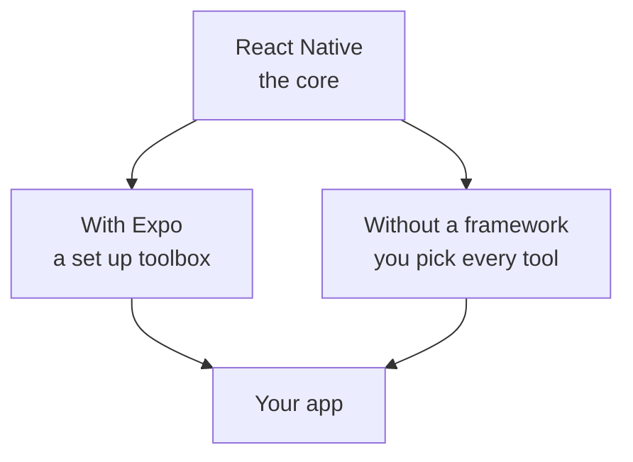
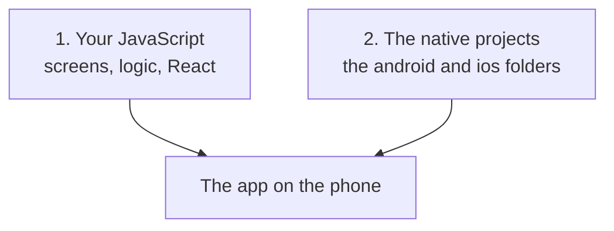
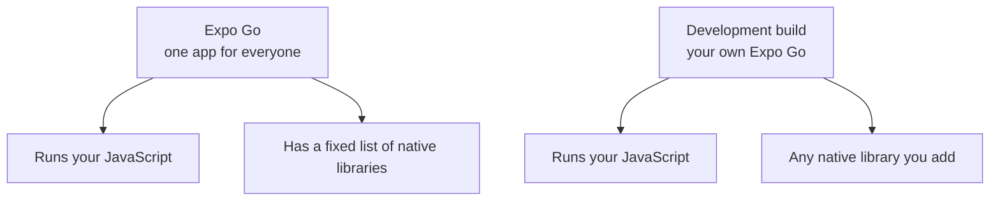
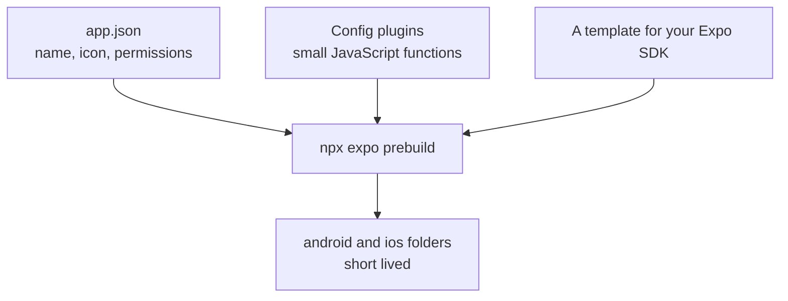

# 07. Expo vs bare

> **Subject:** React Native · **Lesson:** 07 · **Made:** 2026-11-27 · **Status:** ready
>
> **You will be able to:** say what Expo is, what "bare" means, why Expo Go is not for real apps, and pick one for a project with the tradeoffs.
>
> **Before this:** [Hermes](06-hermes.md) · **Next:** [Over the air updates](08-over-the-air-updates.md)
>
> **How to read it:** one card is one idea. Look at the picture, guess, then press the orange bar to check. The blue bars (📖 More detail) hold the longer explanation. Skip them on the first read, open them when you want more. About 20 minutes for the cards.

<!-- quick-summary:start -->
## Quick summary

> Short on time? Read only this. These are the "Remember" lines from the cards below, so you can read the whole lesson in one minute.

- Expo is a toolbox around React Native. The React Native docs recommend a framework for new apps.
- An app is your JavaScript plus the native projects. Expo vs bare is a question about who owns the native projects.
- Expo Go is for learning and quick tests. A real app uses a development build.
- In CNG, native folders are generated from app config and plugins. Change the config, not the generated folders.
- Bare means you own the native folders by hand. You can still use Expo tools inside a bare app.
- The choice is not "can we use native code" (you can). It is "who keeps the native folders working over time".
- Test with the same native code you ship, so use a development build.
- Pick one owner for the native folders: the config, or you. Never both.
<!-- quick-summary:end -->

## 1. The idea: a kitchen set up for you, or a kitchen you build

You want to cook for a restaurant. One way: rent a **kitchen that is already set up** with stove, tools and a delivery service. The other way: build **your own kitchen** and buy every tool yourself.

React Native is the same. You can start from a **framework** (a toolbox around React Native) or from **plain React Native** with only the basic parts.



Notice: both ways give you a real React Native app. The difference is who sets up and keeps the tools.

<details class="guess"><summary>🤔 Guess: the React Native docs say how a new app should start. Do they say "plain React Native" or "use a framework"? Press to check.</summary>

They say: if you are building a new app, **use a framework**, and they name Expo as the production ready one. You can still go without a framework if your app has unusual needs. (Getting Started page, checked on 2026-11-27.)

</details>

> **Remember:** Expo is a toolbox around React Native. The React Native docs recommend a framework for new apps.

<details class="more"><summary>📖 More detail: what is in the Expo toolbox</summary>

- **Expo CLI:** the commands you type (`npx expo start`).
- **Expo SDK:** a big set of ready libraries for camera, files, sensors and more.
- **Expo Router:** file based routing for screens ([lesson 03](03-navigation.md) mentions it).
- **Expo Services** (EAS): hosted services to build, send to the stores, and update your app. They need servers, so they are a separate, optional part.

The Expo docs say the open source tools are free and use the MIT license. Today's pair is React Native 0.88 with Expo SDK 58.

</details>

## 2. Two parts inside every mobile app

Every React Native app has two parts. This is the key to the whole lesson.



The **native projects** are real Android Studio and Xcode projects. They hold the app name, icon, permissions and every native library. Your JavaScript sits inside them.

The big question of Expo vs bare is: **who owns the `android` and `ios` folders?**

<details class="guess"><summary>🤔 Guess: you run <code>npx create-expo-app</code>. Do you see <code>android</code> and <code>ios</code> folders in the new project? Press to check.</summary>

No. The Expo docs say a new Expo project has no `android` or `ios` folder. They are made later, only when you need them, by a command called **prebuild** (card 4).

</details>

> **Remember:** an app is your JavaScript plus the native projects. Expo vs bare is a question about who owns the native projects.

<details class="more"><summary>📖 More detail: three ways to the same project</summary>

The Expo docs show that these three give "more or less the same project":

1. `npx create-expo-app@latest MyApp` and then `npx expo prebuild`
2. `npx create-expo-app --template bare-minimum`
3. `npx @react-native-community/cli@latest init MyApp` and then `npx install-expo-modules`

So Expo and plain React Native are not two worlds. They overlap.

</details>

## 3. Expo Go is a playground, not your app

**Expo Go** is a ready made app from the store. You scan a code and your JavaScript runs inside it at once. No Xcode, no Android Studio.



The Expo docs are direct about it: Expo Go is "a limited playground and not useful for building production-grade projects". A **development build** is "your own version of Expo Go" where you can use any native library and change any native setting.

<details class="guess"><summary>🤔 Guess: you add a library that needs its own native code. It works in Expo Go. Is that guaranteed? Press to check.</summary>

No. Expo Go has a fixed set of native code inside. A library with other native code will not work there, unless it has a JavaScript fallback. The Expo docs say Expo Go can load arbitrary React Native projects "only if they include JavaScript fallbacks for native code absent in the Expo Go runtime". A development build has your native code in it, so it works.

</details>

> **Remember:** Expo Go is for learning and quick tests. A real app uses a development build.

<details class="more"><summary>📖 More detail: how to make a development build</summary>

From the Expo docs, three ways, all giving the same build:

- **Build locally:** `npx expo install expo-dev-client`, then `npx expo run:android` or `npx expo run:ios`. You need Android Studio or Xcode on your machine.
- **Build with Expo Build** (the cloud): builds on Expo servers. No native tools needed, and you can make iOS builds from any computer.
- **Build locally with the EAS CLI.**

The `expo-dev-client` library adds a launcher screen and better tools to the normal React Native dev tools.

</details>

## 4. Continuous Native Generation: the folders are made, not kept

The Expo idea is called **Continuous Native Generation** (CNG). In plain words: **do not keep the `android` and `ios` folders in git. Make them fresh when you need them.**



You write settings in one file (`app.json`, the **app config**). For things the file cannot say, you add a **config plugin**: a JavaScript function that changes the native project while prebuild runs.

```json
{
  "expo": {
    "name": "Shop",
    "plugins": [
      ["expo-camera", { "cameraPermission": "Allow Shop to use the camera" }]
    ]
  }
}
```

This sets the iPhone camera message (`NSCameraUsageDescription`) without you opening Xcode.

<details class="guess"><summary>🤔 Guess: you open <code>ios/Shop/Info.plist</code> in a prebuild project and edit it by hand. What happens at the next <code>npx expo prebuild --clean</code>? Press to check.</summary>

Your edit can be lost. The Expo docs warn: if you change the generated folders by hand, "you risk losing your changes the next time you run `npx expo prebuild --clean`". Put the change in the app config or in a config plugin instead. Then it comes back every time.

</details>

> **Remember:** in CNG, native folders are generated from app config and plugins. Change the config, not the generated folders.

<details class="more"><summary>📖 More detail: why Expo does this</summary>

The Expo docs give these reasons:

- Upgrades are easier, because the folders come from a template that matches your Expo SDK.
- Removing a library cleans up after itself. A hand edited project can keep "orphaned code" that nobody can trace back to a library.
- You can share the same setup across several apps (for example, white label apps).

By default the `android` and `ios` folders go into `.gitignore`. Cloud builds run prebuild for you when the folders are not in the project.

In memory, for the model in the exercise below:

| Thing | Value |
|---|---|
| `app.json` name | `"Shop"` |
| iOS display name after prebuild | `"Shop"` |
| Android permissions after the camera plugin | internet and camera, camera once |
| Run prebuild again with the same config | the same result |

</details>

## 5. What "bare" means

**Bare** is the old word for the other way: the `android` and `ios` folders **live in git and you edit them by hand**. Most older React Native apps are like this.

| | Generated folders (CNG) | Folders kept by hand (bare) |
|---|---|---|
| Who owns `android` and `ios` | the config and the plugins | you |
| Native change | edit config or a plugin | edit the folder |
| Upgrade to a new React Native | change versions, run prebuild | merge changes into the folders |
| Freedom | high, through plugins | full, direct |
| Upkeep | lower | higher (the Expo glossary says "high maintenance overhead") |

Note a surprise: Expo now says the **words "managed" and "bare" are deprecated**. The Expo docs say all projects use CNG, and you run prebuild when you need native access. Interviewers still say "managed" and "bare", so you should know them. When someone says them, think: "folders generated, or folders kept by hand".

<details class="guess"><summary>🤔 Guess: you have an old bare React Native app. Can you still use Expo's tools, such as Expo Build or the Expo SDK libraries? Press to check.</summary>

Yes. The Expo docs say all their tools and services "work great in any React Native app". You add the `expo` package (the guide is called "Install Expo modules"), and you can switch the command line to Expo CLI. One warning: **do not run `npx expo prebuild` on a project whose folders you edit by hand**, because it may overwrite your changes.

</details>

> **Remember:** bare means you own the native folders by hand. You can still use Expo tools inside a bare app.

<details class="more"><summary>📖 More detail: you can still write native code with Expo</summary>

Expo does not mean "no native code". Config plugins change the native projects. The Expo Modules API lets you write native modules with Swift and Kotlin. And an Expo project can always be turned into folders you edit by hand: Expo says CNG is "fully optional" and you can stop using it at any time.

</details>

## 6. How to choose

This table is a guide. The facts come from the React Native and Expo docs. The "my view" column is **opinion**, not a rule.

| Situation | A good choice | Why |
|---|---|---|
| A new app, a small team | Expo with a development build | the docs recommend a framework, and you get routing, libraries, builds and updates |
| You need a library with native code | Expo with a development build | a development build holds any native library |
| You do not have a Mac and need iPhone builds | Expo Build in the cloud | the docs say iOS builds work from any computer |
| An old app with many hand made native changes | stay bare, add Expo tools step by step | prebuild could overwrite your edits |
| A team of native developers who want full control of the project files | bare, or Expo with config plugins | my view: both work, pick the one the team can keep up |
| Learning, a quick test, an interview demo | Expo Go and Snack | fast, but only a playground |

<details class="guess"><summary>🤔 Guess: a manager says "we cannot use Expo, we need a custom native SDK from a bank". Is that a good reason? Press to check. </summary>

Not by itself. A custom native SDK needs a development build, not Expo Go, and a config plugin or a native module can add it. Expo supports native code. The real questions are different: does the SDK need setup that a plugin cannot do, and can the team keep it working through upgrades? That is the tradeoff to discuss. (This is my reading of the docs, so check the SDK's own guide.)

</details>

> **Remember:** the choice is not "can we use native code" (you can). It is "who keeps the native folders working over time".

<details class="more"><summary>📖 More detail: the tradeoff in one line each</summary>

- **Expo with CNG:** less upkeep, easier upgrades. You must put native changes in config or plugins, which takes a little learning.
- **Bare:** full direct control, easy to follow any native guide step by step. You pay in upkeep and every upgrade.
- **Expo Services:** save you building your own build and update system. The docs say you can run builds on your own CI and even host updates yourself, so you are not locked in.

</details>

## 7. Mistake 1: "I tested in Expo Go, so it will work"

The problem: you add a library that has its own native code. In Expo Go it may fail or act differently, because Expo Go only has a fixed set of native code inside. Then the real build behaves another way.

<details class="guess"><summary>🤔 Guess: what should you do for any app that will go to the store? Press to check.</summary>

Test in a **development build** from the start. It has the same native code as the real app, so what works there works when you ship. Expo Go is for learning.

</details>

> **Remember:** test with the same native code you ship, so use a development build.

## 8. Mistake 2: editing the generated folders

The problem: a teammate fixes a permission in `ios/Shop/Info.plist` by hand, pushes, and a week later the fix is gone after someone ran `prebuild --clean`. Or the folders are in `.gitignore` and the fix never reached the repo.

<details class="guess"><summary>🤔 Guess: where should the fix have gone, and how do you check that it stays? Press to check.</summary>

Into the app config, or into a config plugin. Then run `npx expo prebuild --clean` on your machine. If the change is still there, it is safe. If you want to keep hand edits on purpose, you are in the "bare" way, and you should keep the folders in git and stop using prebuild on them.

</details>

> **Remember:** pick one owner for the native folders: the config, or you. Never both.

## 9. Why it matters and what it costs

- **Without a plan:** a team mixes both. Hand edits get overwritten, builds work on one laptop only, and upgrades turn into a week of merge pain.
- **With a plan:** the team knows who owns the native folders, builds the same way each time, and upgrades React Native on purpose.
- **The cost:** Expo adds tools and a way of working to learn. Bare keeps more freedom but more work on every upgrade. Both need a development build for real testing.

## 10. Watch and play

I opened every link below on 2026-11-27 and each one loaded. I found no video that I could open and check, so there is none here.

- **Do:** [practice/07-config-to-native.mjs](practice/07-config-to-native.mjs) - a small model of prebuild, then run the tests.
- **Read:** [Get Started with React Native](https://reactnative.dev/docs/getting-started) - why the docs recommend a framework.
- **Read:** [Develop an app with Expo](https://docs.expo.dev/workflow/overview/) - Expo Go, development builds, native projects.
- **Read:** [Continuous Native Generation](https://docs.expo.dev/workflow/continuous-native-generation/) - prebuild and the warning about hand edits.
- **Read:** [Introduction to development builds](https://docs.expo.dev/develop/development-builds/introduction/) - your own Expo Go.
- **Read:** [Config plugins](https://docs.expo.dev/config-plugins/introduction/) - how a plugin changes native code.
- **Read:** [Use Expo in an existing React Native app](https://docs.expo.dev/bare/overview/) - the bare way plus Expo tools.

## 11. Practice

**A. Predict**

You have an Expo project made by `create-expo-app`. You need to set the Android app permission for the camera. Where do you write it: in `android/app/src/main/AndroidManifest.xml`, or in the app config and plugins?

<details><summary>Answer</summary>

In the app config and plugins. The `android` folder is generated by prebuild. A hand edit there can be lost at the next `prebuild --clean`. A camera library's config plugin adds the permission each time.

</details>

**B. Fix the bug**

A teammate says: "We were bare, so I will run `npx expo prebuild` once to add Expo to our old app." The old app has 40 hand made changes in `ios/` and `android/`. What is the risk, and what is a safer first step?

<details><summary>Answer</summary>

The Expo docs say not to run prebuild on projects whose native folders are managed manually, because it may overwrite those changes. A safer first step is to add Expo step by step: install the `expo` package (Install Expo modules), move to Expo CLI, then add other tools one at a time. Later, you can move each hand made change into config plugins and then adopt prebuild.

</details>

**C. Write it yourself**

Open `practice/07-config-to-native.mjs` and write `prebuild` and `withCameraPermission`, so that all 10 tests pass. This is a **model** of what prebuild and a config plugin do. It is not the real Expo code.

```bash
cd learn/react-native/practice
node --test 07-config-to-native.test.mjs
```

<details><summary>One possible answer</summary>

```js
export function prebuild(appConfig, plugins = []) {
  const start = {
    ios: {
      bundleIdentifier: appConfig.ios.bundleIdentifier,
      infoPlist: { CFBundleDisplayName: appConfig.name },
    },
    android: {
      package: appConfig.android.package,
      appName: appConfig.name,
      permissions: [...(appConfig.permissions || [])],
    },
  };
  return plugins.reduce((config, plugin) => plugin(config), start);
}

export function withCameraPermission(text) {
  return (config) => {
    const camera = "android.permission.CAMERA";
    const { permissions } = config.android;
    return {
      ...config,
      ios: {
        ...config.ios,
        infoPlist: { ...config.ios.infoPlist, NSCameraUsageDescription: text },
      },
      android: {
        ...config.android,
        permissions: permissions.includes(camera) ? permissions : [...permissions, camera],
      },
    };
  };
}
```

Look at the pattern: the result depends only on the config and the plugins, so you can delete the folders and make them again. A plugin returns a new object and never edits the one it gets. That is why running prebuild twice gives the same result.

</details>

## 12. Interview question

**Q:** What is the difference between Expo and bare React Native? When would you choose each?

<details><summary>A strong answer, in four parts</summary>

1. **Problem:** every mobile app has JavaScript plus native projects (`android` and `ios`). Someone must set up, build, upgrade and keep those native projects working, and a team has to decide who does it.
2. **How it works:** Expo is a toolbox around React Native: CLI, SDK libraries, Router and hosted services. With Continuous Native Generation, the native folders are generated by `prebuild` from the app config and config plugins, so you do not keep them in git. In a bare project you keep the folders in git and edit them by hand. Expo Go is only a playground. A real app uses a development build, which holds your own native code. You can use Expo tools inside a bare app too.
3. **Tradeoff:** Expo with CNG means less upkeep and easier upgrades, but native changes go through config and plugins. Bare gives full direct control, but every upgrade and every new library is manual work. The React Native docs recommend a framework for new apps. I would say Expo for most new apps and bare only for a clear reason, and that last part is my opinion.
4. **My example:** I built the ZWS store app and the DBO mobile app with React Native. I do not know from this repo whether they used Expo or bare, so I must fill in the true answer here, and what it cost or saved us, before I use this in an interview.

</details>

## 13. Explain it back

Close this file. Explain Expo vs bare to a new junior, in 4 parts (problem, how, tradeoff, my example). Then write your best version below and run `/explain-check expo vs bare` or ask the `explain-coach` agent to review it.

### My explanation

<write here>

### Coach feedback

<the explain-coach agent writes here>

## 14. Review questions (day 1, 3, 7, 21)

1. What are the two parts of every mobile app, and which one is the Expo vs bare question about?
2. Why is Expo Go not for a real app, and what do you use instead?
3. What does `npx expo prebuild` do, and where should a permission change go?
4. Draw the picture from card 4 from memory: what goes into prebuild, and what comes out.

<details><summary>Answers</summary>

1. Your JavaScript and the native projects (`android` and `ios`). The question is who owns the native projects.
2. It has a fixed set of native code and is a playground. Use a development build, which has your own native code.
3. It generates the `android` and `ios` folders from the app config, config plugins and a template. Put the change in the app config or a config plugin, not in the generated folders.
4. In: app config, config plugins, a template for the Expo SDK. Out: short lived `android` and `ios` folders.

</details>

## 15. Go deeper (optional)

<details><summary>Version notes and the old words</summary>

- **Checked on 2026-11-27** against the React Native Getting Started page and these Expo docs pages: Develop an app with Expo, Continuous Native Generation, development builds, Config plugins, Existing React Native apps, and the glossary.
- The Expo docs say the "managed" and "bare" workflows are **deprecated** and all projects use CNG. The glossary still describes "bare workflow" as native projects kept in git and maintained by hand, typical for existing React Native apps.
- The Expo docs say Expo Go "can load arbitrary React Native projects only if they include JavaScript fallbacks".
- **Expo Update** and the older word "eject" are not covered here. Over the air updates are in [lesson 08](08-over-the-air-updates.md).
- Not checked here: how long a given Expo SDK is supported, and the price of Expo Services plans. Look at the Expo pages before you quote them.
- Today's versions: React Native 0.88 (released 2026-10-19) and Expo SDK 58.

</details>

## Connected lessons

- [Hermes](06-hermes.md) - the engine that comes with every React Native and Expo app.
- [Over the air updates](08-over-the-air-updates.md) - what you can change without a new store release, and how Expo Update fits.
- [Navigation](03-navigation.md) - Expo Router is the file based option.
- [How React Native works](01-how-react-native-works.md) - the JavaScript part and the native part.
