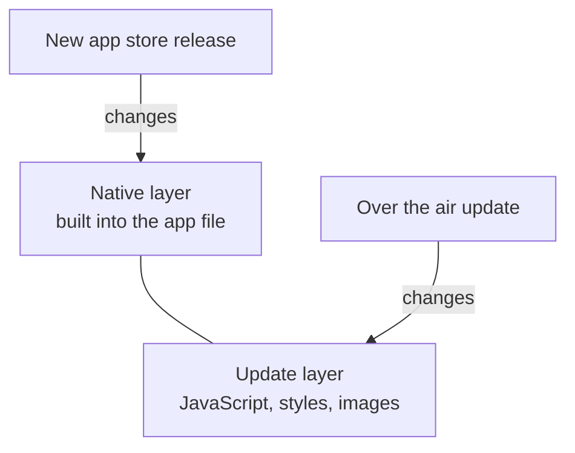
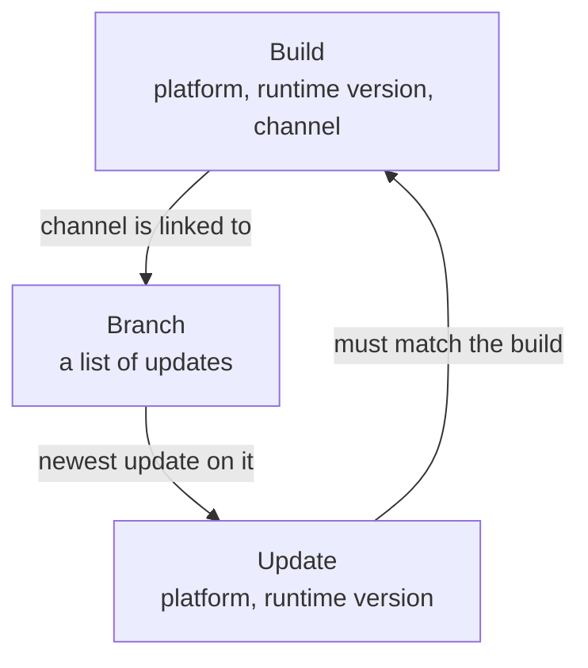
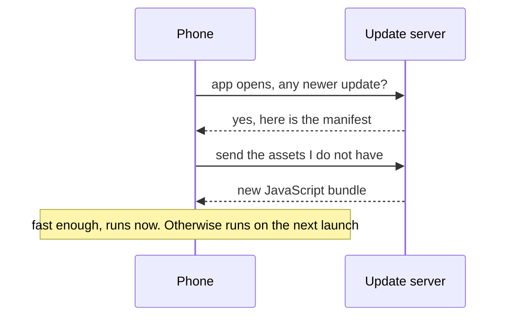
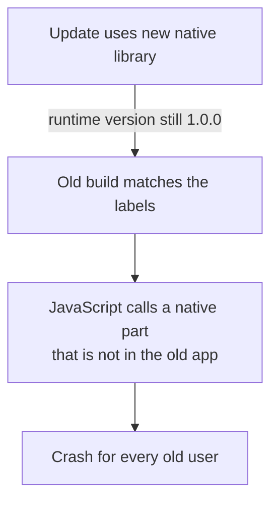

# 08. Over the air updates

> **Subject:** React Native · **Lesson:** 08 · **Made:** 2026-11-27 · **Status:** ready
>
> **You will be able to:** say what an over the air update can change and what it cannot, explain how a phone decides which update to take, and describe a safe rollout and rollback.
>
> **Before this:** [Expo vs bare](07-expo-vs-bare.md) · **Next:** [Offline storage](09-offline-storage.md)
>
> **How to read it:** one card is one idea. Look at the picture, guess, then press the orange bar to check. The blue bars (📖 More detail) hold the longer explanation. Skip them on the first read, open them when you want more. About 25 minutes for the cards.

<!-- quick-summary:start -->
## Quick summary

> Short on time? Read only this. These are the "Remember" lines from the cards below, so you can read the whole lesson in one minute.

- An update swaps the JavaScript layer only. Native code needs a new build.
- JavaScript, text, styles and images can go over the air. Native code, permissions and the SDK version cannot.
- A phone takes the newest update on its channel's branch, if the platform and the runtime version match exactly.
- Change the runtime version whenever native code changes. A policy such as `fingerprint` does it for you.
- The app asks for updates, usually when it opens. A user sees the new one on that launch or the next one.
- A wrong runtime version is how an update crashes old builds.
- Roll out to a small group first, and know the rollback command before you need it.
<!-- quick-summary:end -->

## 1. The idea: a phone with two layers

Think of a printed book with a loose page at the front. The **book** is the app you install from the store. To change the book you need a new copy, and the store checks every new copy. The **loose page** can be swapped any time, without a new book.

An app has the same two layers. The **native layer** (the real app file, built into the install) and the **update layer** (your JavaScript, styles and images). An **over the air update** (OTA) swaps only the update layer. It travels over the internet, so there is no new store release.



Notice: the update layer sits on top of the native layer. It can only use what the native layer already has.

<details class="guess"><summary>🤔 Guess: you want to add a new camera library that has native code. Can an over the air update bring it? Press to check.</summary>

No. Native code lives in the native layer, and an update cannot change that layer. You need a new build and a store release.

</details>

> **Remember:** an update swaps the JavaScript layer only. Native code needs a new build.

<details class="more"><summary>📖 More detail: the words</summary>

- **OTA update:** an update that your app downloads by itself, without the app store.
- **Build:** the installable app file, for one platform. It has a native layer and a first copy of your JavaScript inside.
- **Update:** a new copy of the JavaScript and assets. This lesson uses Expo's service, called **Expo Update**, and its library **expo-updates**. Other tools exist, but this is the usual one for Expo projects.

</details>

## 2. What an update can change, and what it cannot

This table comes from the Expo Update docs ("When to use Expo Update").

| Change | Over the air update? |
|---|---|
| Fix a bug or crash in JavaScript | yes |
| Change text, translations, styles or screen layouts | yes |
| Send to 10% of users first (a rollout) | yes |
| Change native code or add a native library | **no** |
| Change app permissions, such as camera or location | **no** |
| Upgrade the Expo SDK version | **no** |
| Anything that needs a new app file | **no** |

<details class="guess"><summary>🤔 Guess: the app needs a new screen with a new button and new words. Over the air, or store release? Press to check.</summary>

Over the air, if the screen uses only JavaScript and libraries that are already inside the build. A new screen is JavaScript and styles.

</details>

> **Remember:** JavaScript, text, styles and images can go over the air. Native code, permissions and the SDK version cannot.

<details class="more"><summary>📖 More detail: the store rules</summary>

The docs say you must follow the rules of the App Store and the Play Store when you publish updates. They add that changes to how the app behaves usually need review. So an update is a fast way to fix and improve, not a way to skip the stores. The docs also say that the store rules change often, so read them again before a big change.

</details>

## 3. How a phone picks an update

Every build carries three labels, set when you make it. Every update carries labels too. The phone takes an update only when the labels fit.



| Label | Where it comes from | Rule |
|---|---|---|
| **Platform** | the build (iOS or Android) | must be the same |
| **Runtime version** | your app config | must be the same, exactly |
| **Channel** | `eas.json` for the build | linked to a **branch**. By default a channel uses the branch with the same name |

A **branch** is a list of updates. The newest one is the active one.

<details class="guess"><summary>🤔 Guess: a phone has a build with runtime version 1.0.0. You publish an update with runtime version 2.0.0 to its branch. What does the phone get? Press to check.</summary>

Nothing. The runtime versions must match exactly, so the update is not sent to that build. The phone keeps running what it has, and nothing crashes.

</details>

> **Remember:** a phone takes the newest update on its channel's branch, if the platform and the runtime version match exactly.

<details class="more"><summary>📖 More detail: step by step, what the server checks</summary>

| Step | What happens | Result |
|---|---|---|
| 1 | The app opens and asks the server for an update | request has platform, runtime version, channel |
| 2 | The server finds the branch linked to the channel | for example branch `production` |
| 3 | It takes the newest update on that branch | the candidate |
| 4 | It checks the candidate's platform and runtime version | match, or not |
| 5 | If it matches, it sends a manifest. If not, it sends nothing new | the phone runs a fit update |

You can link a channel to any branch. The docs show a flow with branches named `version-1.0`, `version-2.0` and so on. You test a branch on `staging`, then run `eas channel:edit production --branch version-2.0` to point production at it.

**Step through it yourself:** [An update travels to a phone](visuals/08-ota-launch.html). Press Next and watch a normal launch, an update that does not fit, and a bad update.

</details>

## 4. Runtime version: the safety lock

The **runtime version** says: "the native layer in this build is this one." An update with the same runtime version can run on it. A different one cannot. You can set it by hand, or let a **policy** work it out.

| Setting | The runtime version is | Good for |
|---|---|---|
| a string, like `"1.0.0"` | exactly what you wrote | full control. You change it yourself |
| `appVersion` | the app `version`, like `"1.0.0"` | projects that raise the version at every public release |
| `nativeVersion` | version plus the native build number, like `"1.0.0(1)"` | projects that raise the build number at every build |
| `fingerprint` | a hash of your native parts, worked out for you | projects with or without custom native code. It also changes after an SDK upgrade |

With the string and `appVersion`, a person must remember to change the number when native code changes. With `fingerprint`, a tool does it.

<details class="guess"><summary>🤔 Guess: with a hand written runtime version, a teammate adds a native library and forgets to change the number. What can happen? Press to check.</summary>

The new update still says `1.0.0`, so it goes to old builds that do not have the library. The JavaScript then calls a native part that is not there, and the app can crash. This is the most important mistake in this lesson.

</details>

> **Remember:** change the runtime version whenever native code changes. A policy such as `fingerprint` does it for you.

<details class="more"><summary>📖 More detail: the policy names and what they use</summary>

The names `appVersion`, `nativeVersion` and `fingerprint` are from the expo-updates docs. `fingerprint` uses the `@expo/fingerprint` package to hash your project during builds and updates. The hash covers more than your dependency list. The exercise below only models the idea.

If you pick `nativeVersion`, iOS and Android can end up with different runtime versions when their build numbers differ. That is fine, but remember it when you read update lists.

</details>

## 5. When the user gets the update

An update does not push itself onto the phone. The **app asks**. By default `expo-updates` checks when the app opens.



The download has two parts. First the **manifest** (a list of what the update needs). Then only the **assets the phone does not already have**. If everything arrives before `fallbackToCacheTimeout`, the new update runs at once. If not, it keeps downloading in the background and runs on the next launch.

<details class="guess"><summary>🤔 Guess: you publish at 10:00. Is every user on the new version at 10:01? Press to check.</summary>

No. A user only gets it when their app opens and checks. People who have not opened the app yet stay on the old update. Treat an update as "soon", never "now".

</details>

> **Remember:** the app asks for updates, usually when it opens. A user sees the new one on that launch or the next one.

<details class="more"><summary>📖 More detail: control it from your code</summary>

The library gives you functions for when you want control. This is the manual check from the expo-updates docs:

```jsx
import * as Updates from "expo-updates";

async function onCheck() {
  const update = await Updates.checkForUpdateAsync();
  if (update.isAvailable) {
    await Updates.fetchUpdateAsync();
    await Updates.reloadAsync();
  }
}
```

There is also a hook, `useUpdates()`, that tells you when an update is available or already downloaded and waiting (`isUpdatePending`). You can then show a message such as "New version, restart now?" and call `Updates.reloadAsync()`. Set `checkAutomatically` to turn the default check at launch off, if you want to do it all yourself.

</details>

## 6. Mistake 1: an update that needs a native part the old build does not have

The problem: a developer adds a native library, forgets to change the runtime version, and publishes an update.



<details class="guess"><summary>🤔 Guess: how do you stop this, and how do you fix it after it happens? Press to check.</summary>

To stop it: change the runtime version when native code changes, or use the `fingerprint` policy. To fix it: roll back (card 7), then make a new build with the right runtime version and send it through the stores.

</details>

> **Remember:** a wrong runtime version is how an update crashes old builds.

<details class="more"><summary>📖 More detail: a small check before you publish</summary>

Ask two questions. Did anything in `package.json` change that has native code? Did you change app config that affects the native project, such as a permission or a plugin? If yes to either, you need a new build and a new runtime version. You can add a check like this to your publish steps in CI. That is my suggestion, not something the docs require.

</details>

## 7. Mistake 2: no plan for a bad update

The problem: you publish to everyone, and the update has a bug.

| Tool | What it does | Docs |
|---|---|---|
| **Rollout** | send the update to a percentage of users first, then raise it. `eas update --rollout-percentage=10` | per-update rollouts |
| **Rollback** | `eas update:rollback`. Go back to an earlier published update, or back to the update inside the build | rollbacks |
| **Republish** | `eas update:republish`. Puts an older good update on top, like a git revert | republish |

<details class="guess"><summary>🤔 Guess: after a rollback, is the bad update gone from the server? Press to check.</summary>

No. A rollback adds a new update on top that is a copy of the good one. The bad one stays in the history. Phones pick up the fix on their next check.

</details>

> **Remember:** roll out to a small group first, and know the rollback command before you need it.

<details class="more"><summary>📖 More detail: after a rollback</summary>

The rollbacks page says that when you publish again after a rollback, all clients receive the new update. So a rollback is not a freeze. It is a new newest update.

</details>

## 8. Why it matters and what it costs

- **Without it:** every small fix waits for a store review. A typo or a crash can live for days.
- **With it:** a JavaScript fix can reach users within minutes, to a small group first.
- **The cost:** more moving parts (channels, branches, runtime versions). A wrong runtime version can crash old builds. Users get the fix only when they open the app. You still must follow store rules. Native changes still need a store release. The docs say Expo Update is counted by monthly active users (an install that downloads at least one update in a billing cycle). Check the current plans before you promise a team it is free.

## 9. Watch and play

I opened every link below on 2026-11-27 and each one loaded. I found no video that I could open and check, so there is none here.

- **Step through it:** [An update travels to a phone](visuals/08-ota-launch.html) - a launch, a mismatch and a bad update.
- **Do:** [practice/08-pick-update.mjs](practice/08-pick-update.mjs) - pick the right update, work out runtime versions, republish.
- **Read:** [Expo Update introduction](https://docs.expo.dev/eas-update/introduction/) - the table of what you can and cannot update.
- **Read:** [How it works](https://docs.expo.dev/eas-update/how-it-works/) - builds, branches, channels and the matching rules.
- **Read:** [Runtime versions](https://docs.expo.dev/eas-update/runtime-versions/) - why the lock exists.
- **Read:** [Rollouts](https://docs.expo.dev/eas-update/rollouts/) and [Rollbacks](https://docs.expo.dev/eas-update/rollbacks/) - the safe way to ship.
- **Read:** [expo-updates library](https://docs.expo.dev/versions/latest/sdk/updates/) - the functions and the policies.

## 10. Practice

**A. Predict**

```js
const build = { runtimeVersion: "1.0.0", channel: "production", platform: "ios" };
const updates = [
  { id: "u1", runtimeVersion: "1.0.0", branch: "production", platform: "ios", createdAt: 10 },
  { id: "u2", runtimeVersion: "1.0.0", branch: "staging", platform: "ios", createdAt: 30 },
  { id: "u3", runtimeVersion: "1.1.0", branch: "production", platform: "ios", createdAt: 40 },
  { id: "u4", runtimeVersion: "1.0.0", branch: "production", platform: "android", createdAt: 50 },
  { id: "u5", runtimeVersion: "1.0.0", branch: "production", platform: "ios", createdAt: 20 },
];
```

Which update does the build get, if the channel `production` is linked to the branch `production`?

<details><summary>Answer</summary>

`u5`. `u2` is on the wrong branch. `u3` has another runtime version. `u4` is for Android. That leaves `u1` and `u5`, and `u5` is newer.

</details>

**B. Fix the bug**

A team uses the custom runtime version `"1.0.0"`. They add `expo-camera` and publish an update with the new camera screen. Old users start crashing. What went wrong, and what should they do now?

<details><summary>Answer</summary>

The update uses native code that the old builds do not have, but it still says runtime `1.0.0`, so it was sent to them. Now: roll back with `eas update:rollback`. Then make a new build with a new runtime version and release it through the stores. Later, use the `fingerprint` policy, or add a check that fails the publish when native dependencies changed.

</details>

**C. Write it yourself**

Open `practice/08-pick-update.mjs` and write `pickUpdate`, `runtimeVersionFor` and `republish`, so that all 11 tests pass. This is a model of the rules, not the real server.

```bash
cd learn/react-native/practice
node --test 08-pick-update.test.mjs
```

<details><summary>One possible answer</summary>

```js
export function pickUpdate(build, updates, channelToBranch) {
  const branch = channelToBranch[build.channel] ?? build.channel;
  const fits = updates.filter(
    (update) =>
      update.platform === build.platform &&
      update.runtimeVersion === build.runtimeVersion &&
      update.branch === branch
  );
  if (fits.length === 0) return null;
  return fits.reduce((newest, update) => (update.createdAt > newest.createdAt ? update : newest));
}

function shortHash(text) {
  let hash = 5381;
  for (let i = 0; i < text.length; i++) hash = ((hash * 33) ^ text.charCodeAt(i)) >>> 0;
  return hash.toString(16).padStart(8, "0");
}

export function runtimeVersionFor(setting, project, platform) {
  if (typeof setting === "string") return setting;
  if (setting.policy === "appVersion") return project.version;
  if (setting.policy === "nativeVersion") {
    const number = platform === "ios" ? project.ios.buildNumber : project.android.versionCode;
    return `${project.version}(${number})`;
  }
  if (setting.policy === "fingerprint") {
    const dependencies = Object.entries(project.nativeDependencies ?? {}).sort(([a], [b]) => (a < b ? -1 : 1));
    const permissions = [...(project.permissions ?? [])].sort();
    return "fp-" + shortHash(JSON.stringify({ dependencies, permissions }));
  }
  throw new Error("unknown runtime version setting");
}

export function republish(updates, id, newId, createdAt) {
  const old = updates.find((update) => update.id === id);
  if (!old) throw new Error("no update with id " + id);
  return [...updates, { ...old, id: newId, createdAt }];
}
```

Look at the pattern: the three labels are just three equality checks, and "newest" is a maximum. The fingerprint only reads the native parts, so a change in `jsHash` cannot change it. Republish adds a copy at the end, so nothing is deleted. A real fingerprint hashes more things than this.

</details>

## 11. Interview question

**Q:** How do over the air updates work in React Native, and what are the limits?

<details><summary>A strong answer, in four parts</summary>

1. **Problem:** store reviews take time, and a small JavaScript bug can hurt users for days. Teams want to fix JavaScript, text and images fast.
2. **How it works:** an app has a native layer inside the build and an update layer with JavaScript and assets. A build has a platform, a runtime version and a channel. The channel links to a branch of updates. On launch the app asks the server. The server sends the newest update on the branch if the platform and runtime version match exactly. The app downloads the manifest and the missing assets, and runs it on that launch or the next one.
3. **Tradeoff:** only the JavaScript layer can change. Native code, permissions and the SDK version need a new build and a store release. A wrong runtime version can crash old builds, and users only get the update when they open the app. Stores still have rules about what an update may change. So roll out to a small group first, and keep a rollback ready.
4. **My example:** I built the ZWS store app and the DBO mobile app. I will add whether we used over the air updates, how we picked the runtime version, and any bad update we had to roll back, only after I confirm the facts.

</details>

## 12. Explain it back

Close this file. Explain over the air updates to a new junior, in 4 parts (problem, how, tradeoff, my example). Then write your best version below and run `/explain-check over the air updates` or ask the `explain-coach` agent to review it.

### My explanation

<write here>

### Coach feedback

<the explain-coach agent writes here>

## 13. Review questions (day 1, 3, 7, 21)

1. What can an over the air update change, and what can it not change?
2. Name the three labels that decide whether a build gets an update.
3. Why can a wrong runtime version crash old users?
4. Draw the picture from card 3 from memory: build, channel, branch, update.

<details><summary>Answers</summary>

1. It can change JavaScript, text, styles and images. It cannot change native code, permissions or the SDK version.
2. Platform (same), runtime version (same, exactly) and the channel, which is linked to a branch.
3. The update says it fits the old build, but its JavaScript calls native code that the old build does not have.
4. Build (platform, runtime version, channel) -> channel linked to a branch -> newest update on the branch -> its platform and runtime version must match the build.

</details>

## 14. Go deeper (optional)

<details><summary>Versions, other tools, and what I could not confirm</summary>

- **Checked on 2026-11-27** against the Expo Update docs (introduction, how it works, runtime versions, rollouts, rollbacks, the migrate from CodePush guide) and the expo-updates library page. Expo SDK 58 goes with React Native 0.88.
- **CodePush.** The Expo docs have a guide for moving a project from CodePush to Expo Update, and it lists the differences, for example that CodePush has a `--mandatory` flag and Expo Update has no single flag for it. The pages I read do not say why people are moving, and they do not say that CodePush was shut down. So I do not claim that here. Check the current state before an interview.
- **Mandatory updates.** The docs say you can build this yourself with the library, but there is no single flag.
- **Code signing.** The docs say Expo Update supports end to end code signing, for Production and Enterprise plan subscribers.
- **Rollout kinds.** The rollouts page describes two: per-update (a percentage of users for one update) and branch-based.
- **Not covered.** Hosting your own update server, and using updates inside an existing native app. Both have pages in the Expo docs.

</details>

## Connected lessons

- [Expo vs bare](07-expo-vs-bare.md) - builds, development builds and prebuild. Updates need a build that already includes `expo-updates`.
- [How React Native works](01-how-react-native-works.md) - the JavaScript side and the native side. Updates swap the first one only.
- [Offline storage](09-offline-storage.md) - what the app keeps on the phone, and why a new update must still read old saved data.
