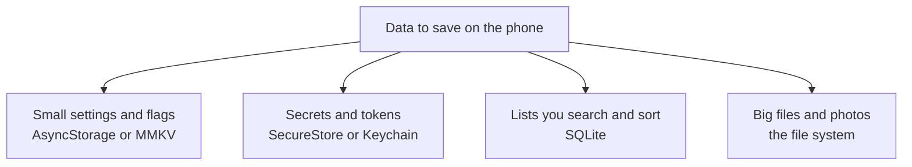
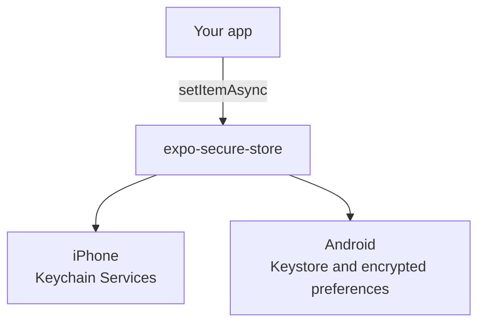
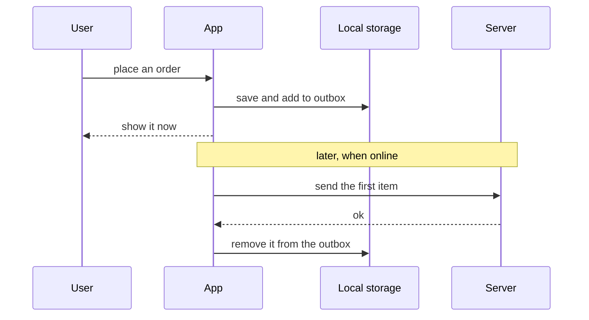
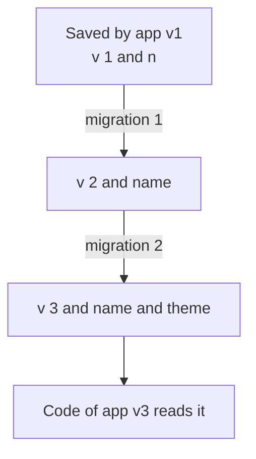

# 09. Offline storage

> **Subject:** React Native · **Lesson:** 09 · **Made:** 2026-11-27 · **Status:** ready
>
> **You will be able to:** pick the right place to save data on the phone (settings, tokens, lists), explain how an app keeps working offline, and keep old saved data working after an app update.
>
> **Before this:** [Over the air updates](08-over-the-air-updates.md) · **Next:** [Performance on mobile](10-performance-on-mobile.md)
>
> **How to read it:** one card is one idea. Look at the picture, guess, then press the orange bar to check. The blue bars (📖 More detail) hold the longer explanation. Skip them on the first read, open them when you want more. About 25 minutes for the cards.

<!-- quick-summary:start -->
## Quick summary

> Short on time? Read only this. These are the "Remember" lines from the cards below, so you can read the whole lesson in one minute.

- Choose the storage by the kind of data: settings, secrets, records, or files.
- Settings go in a key value store, secrets in a secure store, and searchable lists in SQLite.
- AsyncStorage is async and unencrypted. MMKV is synchronous, and encrypts only if you give it a key.
- Tokens and secrets go in Keychain or Keystore, through SecureStore or a library like it. Keep the values small.
- Use SQLite for lists you search. Pass values with `?`, never by joining text.
- Save locally first, send later from an outbox, and remove an item only after the server says ok.
- Save a version with the data, and migrate old data one step at a time on read.
- A token in AsyncStorage or plain MMKV is readable. Use a secure store.
- Do not write on every keystroke. Save after a pause, and save small pieces.
- Test an app update with old saved data, not only a fresh install.
<!-- quick-summary:end -->

## 1. The idea: a notebook, a safe and a filing cabinet

Your phone app needs to remember things. A **notebook** is for small notes (a dark mode switch). A **safe** is for secrets (a login token). A **filing cabinet** is for lots of records you search (a list of orders). You would not put your house key in the notebook.



Notice: the choice depends on **what the data is**, not on which library you know best.

<details class="guess"><summary>🤔 Guess: where should a login token go: the notebook (AsyncStorage) or the safe (SecureStore)? Press to check.</summary>

The safe. The React Native security guide says Async Storage is **unencrypted** and lists "token storage" and "secrets" under what you should not use it for. Tokens belong in Keychain on iPhone or in an encrypted store on Android. `expo-secure-store` wraps both.

</details>

> **Remember:** choose the storage by the kind of data: settings, secrets, records, or files.

<details class="more"><summary>📖 More detail: new words</summary>

- **Persisted:** written to the phone's disk, so it is still there after the app closes. The opposite is data that lives only in memory.
- **Key value storage:** you save a text under a name (a key) and read it back by the same name.
- **Sandbox:** each app has its own private area. Other apps cannot read it. This is why Async Storage is "not shared between apps" (security guide).
- The "files" row (photos, downloads) is general knowledge. It is not covered by the sources in this lesson.

</details>

## 2. Which one, and when: a decision table

Most apps use two or three of these together.

| Data | Use | Why |
|---|---|---|
| Theme, language, "seen the tour" | AsyncStorage or MMKV | Small, not secret, read often |
| Login token, refresh token | SecureStore or Keychain | Encrypted storage made for secrets |
| Orders, messages, a product list | SQLite | You can search, sort and join |
| Photos, PDFs | File system | Big files do not belong in a database row (general knowledge) |
| Server data that can be fetched again | A cache, not a store | If it is lost, you fetch it again |

<details class="guess"><summary>🤔 Guess: you have 5,000 products and the user filters them by price. Key value storage or SQLite? Press to check.</summary>

SQLite. With key value storage you would load all 5,000, turn the text into objects, and filter in JavaScript each time. SQLite filters inside the database: `SELECT * FROM products WHERE price < 50`.

</details>

> **Remember:** settings go in a key value store, secrets in a secure store, and searchable lists in SQLite.

<details class="more"><summary>📖 More detail: the opinion in this table</summary>

The first four rows follow the docs for each library. The last row ("a cache, not a store") is general design advice, not a quote. A rule that helps in interviews: ask "if this is lost, what happens?" If the answer is "the user logs in again" or "we fetch it again", a simple store is fine. If the answer is "the user loses work", you need a real database and a plan to sync.

</details>

## 3. The notebook: AsyncStorage and MMKV

Both save small things under a key. The big difference is **async against sync**.

| | AsyncStorage | MMKV (`react-native-mmkv`) |
|---|---|---|
| Calls | async: you `await` them | synchronous: the value is there at once |
| Talks to native through | native modules | JSI and Nitro Modules (V4) |
| Encrypted by default | no ("unencrypted" in its README) | no (plain text by default), but it can encrypt with a key |
| Stores | strings | strings, numbers, booleans, buffers |

```js
// AsyncStorage (from its README)
const storage = createAsyncStorage("appDB");
await storage.setItem("theme", "dark");
const theme = await storage.getItem("theme");

// MMKV (from its README, version 4)
const mmkv = createMMKV();
mmkv.set("theme", "dark");
const same = mmkv.getString("theme");
```

<details class="guess"><summary>🤔 Guess: why does the MMKV line <code>mmkv.getString("theme")</code> have no <code>await</code>? Press to check.</summary>

MMKV calls native code through JSI, which can answer at once, so the call is **synchronous**. Its README says "Fully synchronous calls, no async/await, no Promises, no Bridge". That is handy for the first screen: you can read the theme before you draw anything, with no loading step.

</details>

> **Remember:** AsyncStorage is async and unencrypted. MMKV is synchronous, and encrypts only if you give it a key.

<details class="more"><summary>📖 More detail: what the READMEs say, and what they do not</summary>

- **AsyncStorage** (README, checked 2026-11-27): "an asynchronous, unencrypted, persistent key-value storage solution". It uses SQLite under the hood on Android and iOS. The README lists React Native 0.76 as the minimum. The README does not give a size limit, so I do not state one. Older versions used a default export (`AsyncStorage.setItem`). The current README uses `createAsyncStorage`.
- **MMKV V4** (README): a Nitro Module. It requires react-native 0.76 or higher. By default it keeps values as plain text in a file and relies on the phone's sandbox. You can turn on encryption with `encryptionKey` (AES-128 by default, AES-256 if you choose). You can make separate instances with different ids, for example one for global settings and one for the logged in user.
- The README says MMKV is "~30x faster than AsyncStorage". That is **the library's own claim**. I did not measure it. Measure in your own app if speed matters.
- **A middle way:** `expo-sqlite/kv-store` has the same API as AsyncStorage and also has sync methods such as `getItemSync` (Expo docs).
- The README says remote debugging (for example with Chrome) is no longer possible, because MMKV uses JSI for synchronous calls (README, "Limitations").

</details>

## 4. The safe: SecureStore and Keychain

A token is a password in disguise. If someone gets it, they are the user. So it goes in a place the phone protects.



```js
import * as SecureStore from "expo-secure-store";

await SecureStore.setItemAsync("token", token);
const saved = await SecureStore.getItemAsync("token");
await SecureStore.deleteItemAsync("token");
```

<details class="guess"><summary>🤔 Guess: a user deletes the app and installs it again. Is the token on an iPhone gone? Press to check.</summary>

Not always. The Expo docs warn that on iOS, data saved with `expo-secure-store` **can stay after an uninstall** if the app is installed again with the same bundle ID, because of how the Keychain works. The docs say not to rely on it either way. So on first launch, think about what your app does if an old token is already there.

</details>

> **Remember:** tokens and secrets go in Keychain or Keystore, through SecureStore or a library like it. Keep the values small.

<details class="more"><summary>📖 More detail: size, and what the security guide adds</summary>

- Expo SecureStore (docs): on Android values go in `SharedPreferences` encrypted with the Android Keystore. On iPhone they go in the Keychain. Expo does not enforce a size limit, but "large payloads can be rejected by the underlying platform". Historically, some iOS releases refused values above about 2048 bytes. So store a token, not a big JSON object, and handle errors.
- Security guide: never put API keys in your app code, because anyone can read the bundle. If the app must use a secret key, put a small server in the middle (for example a serverless function) that adds the key. Also be careful not to save sensitive data by accident, for example by saving the whole Redux state in Async Storage, or by sending tokens to a crash report tool.
- A secure store is for **small** secrets. The 5,000 products still go in SQLite.

</details>

## 5. The filing cabinet: SQLite

When the data is a list with questions to ask, use a database. `expo-sqlite` gives a SQLite database that is "persisted across restarts of your app" (Expo docs).

```js
const db = await SQLite.openDatabaseAsync("shop");

await db.runAsync(
  "INSERT INTO orders (id, total) VALUES (?, ?)",
  [7, 250],
);
const big = await db.getAllAsync(
  "SELECT * FROM orders WHERE total > ?",
  [100],
);
```

Notice the `?` marks. The values are passed separately, so a value cannot change the SQL. The Expo docs warn that `execAsync` does not escape parameters and can lead to SQL injection.

<details class="guess"><summary>🤔 Guess: what is the risk of building the SQL by joining text, like <code>"... WHERE name = '" + name + "'"</code>? Press to check.</summary>

SQL injection. If `name` is `x' OR '1'='1`, the query now matches every row. With `?` and a values list, the database treats the value as data, never as SQL.

</details>

> **Remember:** use SQLite for lists you search. Pass values with `?`, never by joining text.

<details class="more"><summary>📖 More detail: where this connects to the server</summary>

SQLite on the phone is the same family as PostgreSQL on your server, just smaller and in one file. You already think in tables, rows and indexes, so this should feel familiar. The Expo docs also show `getFirstAsync` for one row, and a way to run several writes together as one transaction. Keep a local copy of server data only when you need it offline. If the server is the truth, treat the local copy as a cache.

</details>

## 6. Offline first: save here first, sync later

The idea (general design knowledge, not from one source): the app **writes to the phone first** and shows the result at once. A **sync job** sends it to the server when there is a connection. The list of things waiting to be sent is called an **outbox**.



The important rule: **remove an item only after the server said ok**. If you remove it first and the call fails, the order is lost.

When the same record was changed on the phone and on the server, you need a rule. These are the usual choices (general design knowledge):

| Rule | How it works | Good for | Cost |
|---|---|---|---|
| Last write wins | The newest change replaces the other | Simple settings | A change can be lost |
| Merge | Combine the two changes field by field | Different fields edited | More code, edge cases |
| Ask the user | Show both and let them choose | Important records | Slower, more screens |

<details class="guess"><summary>🤔 Guess: the user sends three orders offline. The second one fails when the phone comes back online. What should happen to orders 2 and 3? Press to check.</summary>

Keep both, in order, and try again later. Stop at the first failure, so order 3 is not sent before order 2. (Your exercise does exactly this.) Some systems skip a bad item and move on. That is a design choice. Say which one you chose and why.

</details>

> **Remember:** save locally first, send later from an outbox, and remove an item only after the server says ok.

<details class="more"><summary>📖 More detail: step by step, the outbox in the exercise</summary>

| Step | Code line | What happens | Queue in storage |
|---|---|---|---|
| 1 | `add({ id: 1 })` | the item is saved | `[1]` |
| 2 | `add({ id: 2 })`, `add({ id: 3 })` | two more are saved | `[1, 2, 3]` |
| 3 | `flush()` starts, `send(1)` works | item 1 is removed | `[2, 3]` |
| 4 | `send(2)` throws | stop here | `[2, 3]` |
| 5 | `flush()` returns | `{ sent: 1, left: 2 }` | `[2, 3]` |

Because the queue lives in **storage**, not in a variable, it survives a restart of the app. One thing this small model ignores: if `add` runs while `flush` is running, two writes can overlap. Real apps use a lock or a database transaction. Also, a retry can send an item twice, so the server should accept a repeated id safely (an "idempotent" call).

</details>

## 7. Versions: the update that breaks old data

Your app v1 saves `{ n: "Ana" }`. In v2 you rename the field to `name`. A user updates the app. The old saved data still says `n`. The new code reads `name` and finds nothing.



The fix is simple: **save a version number with the data**, and write one small **migration** function for each step. On read, if the saved version is older, run the steps one by one, and save the result back.

<details class="guess"><summary>🤔 Guess: the saved data says version 5, but the running code only knows version 3. What should the code do? Press to check.</summary>

Do not guess. Data from a newer version can have a shape that this code does not understand (for example after a user went back to an older app). Use the fallback, a default value, and do not crash.

</details>

> **Remember:** save a version with the data, and migrate old data one step at a time on read.

<details class="more"><summary>📖 More detail: the same idea in databases</summary>

A server database does this with **migrations** too (Prisma migrate, for example). The idea is the same: a numbered list of changes, applied in order. For SQLite the Expo docs show a migration function that reads `PRAGMA user_version`, runs the steps, and sets the new version. In a key value store you carry the version yourself, as in the exercise.

</details>

## 8. Mistake 1: a token in AsyncStorage

```js
// wrong
await AsyncStorage.setItem("token", token);
```

<details class="guess"><summary>🤔 Guess: what is wrong, and what is the right code? Press to check.</summary>

AsyncStorage is unencrypted, and the React Native security guide lists token storage as a thing **not** to do with it. Use a secure store:

```js
await SecureStore.setItemAsync("token", token);
```

Also check the quiet ways a secret gets into AsyncStorage: persisting a whole Redux or state tree that includes the token.

</details>

> **Remember:** a token in AsyncStorage or plain MMKV is readable. Use a secure store.

## 9. Mistake 2: saving a big blob on every keystroke

```js
function onChangeText(text) {
  setDraft(text);
  AsyncStorage.setItem("draft", JSON.stringify(allData));
}
```

<details class="guess"><summary>🤔 Guess: what goes wrong when the user types fast? Press to check.</summary>

This is general knowledge, not from one source. Each key press turns the whole data into text and writes it to disk. That is a lot of work for the JavaScript thread (lesson 01) and the disk. Writes can also finish in a different order than they started. Save **after the user pauses** (a debounce), or when the screen closes, and save only the part that changed.

</details>

> **Remember:** do not write on every keystroke. Save after a pause, and save small pieces.

## 10. Mistake 3: no version in the saved data

You ship a new app version that expects a new shape. Users with old data get a white screen.

<details class="guess"><summary>🤔 Guess: why is this hard to catch in testing? Press to check.</summary>

Your phone and your test devices were reset or reinstalled often, so they never hold old data. Real users keep data for months. Test an update from the **previous release** with real old data, or write a test with an old saved text, like the tests in this lesson's exercise.

</details>

> **Remember:** test an app update with old saved data, not only a fresh install.

## 11. Why it matters and what it costs

- **Without it:** data is lost when the app closes, secrets are readable, or an update breaks users who saved data last month.
- **With it:** the app opens fast with saved settings, keeps working with no network, and survives updates.
- **The cost:** more code (sync, outbox, conflicts, migrations), more states to test, and more ways to be wrong. Use the smallest storage that fits. A cache you can throw away is much cheaper than a database you must keep correct.

## 12. Watch and play

I opened every link below on 2026-11-27 and each one loaded. I found no video that I could open and check, so there is none here.

- **Do:** [practice/09-versioned-store.mjs](practice/09-versioned-store.mjs) - write a versioned store and an outbox, then run the tests.
- **Read:** [Security, React Native docs](https://reactnative.dev/docs/security) - "Storing Sensitive Info", with the do and don't table for Async Storage.
- **Read:** [SecureStore, Expo docs](https://docs.expo.dev/versions/latest/sdk/securestore/) - Keychain, Keystore and the size warning.
- **Read:** [SQLite, Expo docs](https://docs.expo.dev/versions/latest/sdk/sqlite/) - "Basic CRUD operations" and "Key-value storage".
- **Read:** [AsyncStorage README (raw text)](https://raw.githubusercontent.com/react-native-async-storage/async-storage/main/README.md) - the short usage page.
- **Read:** [react-native-mmkv README (raw text)](https://raw.githubusercontent.com/mrousavy/react-native-mmkv/main/README.md) - features, encryption and limits.

## 13. Practice

**A. Predict**

```js
const store = createJsonStore(storage, { version: 2 });
// the phone already holds: { v: 1, data: { n: "Ana" } }
const user = await store.get("user", "none");
```

There is no migration for version 1. What is `user`?

<details><summary>Answer</summary>

`"none"`. The saved data is older, but the step to bring it forward is missing, so the store gives the fallback instead of returning data in the wrong shape.

</details>

**B. Fix the bug**

```js
async function flush(queue, send) {
  for (const item of queue) {
    queue.shift();
    await send(item);
  }
}
```

A user goes offline in a lift and orders are lost. Why?

<details><summary>Answer</summary>

`queue.shift()` removes the item **before** `send` works. If `send` throws, the item is gone and the loop stops. Send first, and remove the item only after it worked (and save the new queue to storage after each success).

</details>

**C. Write it yourself**

Open `practice/09-versioned-store.mjs` and write `createJsonStore` and `createOutbox`, so that all 12 tests pass:

```bash
cd learn/react-native/practice
node --test 09-versioned-store.test.mjs
```

<details><summary>One possible answer</summary>

```js
export function createJsonStore(storage, { version, migrations = {} }) {
  async function set(key, value) {
    await storage.set(key, JSON.stringify({ v: version, data: value }));
  }
  async function get(key, fallback) {
    const text = await storage.get(key);
    if (text == null) return fallback;
    let saved;
    try {
      saved = JSON.parse(text);
    } catch {
      return fallback;
    }
    if (!saved || typeof saved !== "object" || !Number.isInteger(saved.v) || !("data" in saved)) return fallback;
    if (saved.v > version) return fallback;
    let data = saved.data;
    for (let v = saved.v; v < version; v++) {
      const step = migrations[v];
      if (typeof step !== "function") return fallback;
      data = step(data);
    }
    if (saved.v < version) await set(key, data);
    return data;
  }
  async function remove(key) {
    await storage.remove(key);
  }
  return { get, set, remove };
}

export function createOutbox(storage, key, send) {
  async function load() {
    const text = await storage.get(key);
    if (text == null) return [];
    try {
      const list = JSON.parse(text);
      return Array.isArray(list) ? list : [];
    } catch {
      return [];
    }
  }
  const save = (list) => storage.set(key, JSON.stringify(list));
  return {
    async add(item) {
      const list = await load();
      list.push(item);
      await save(list);
    },
    async flush() {
      let list = await load();
      let sent = 0;
      while (list.length > 0) {
        try {
          await send(list[0]);
        } catch {
          break;
        }
        list = list.slice(1);
        await save(list);
        sent++;
      }
      return { sent, left: list.length };
    },
  };
}
```

Look at the pattern: the store never trusts what it reads. Bad text, a missing wrapper, a newer version, or a missing step all give the fallback. And the outbox changes storage only **after** `send` worked.

</details>

## 14. Interview question

**Q:** How do you store data on the device in a React Native app? How would you make an app work offline?

<details><summary>A strong answer, in four parts</summary>

1. **Problem:** the app must remember things after it closes, keep secrets safe, work with no network, and keep working after an update.
2. **How it works:** I pick storage by the kind of data. Small settings go in AsyncStorage or MMKV. Tokens go in SecureStore or Keychain, because AsyncStorage is unencrypted. Lists I need to search go in SQLite. For offline, I write to the phone first, show the result, and send it later from an outbox. An item leaves the outbox only after the server confirms. I save a version number with the data and migrate old data one step at a time.
3. **Tradeoff:** MMKV is fast and synchronous, but I would not put secrets in it without encryption. SQLite is powerful but needs a schema and migrations. Offline first needs a conflict rule (last write wins, merge, or ask the user) and calls that are safe to repeat. A simple cache is much cheaper than a database I must keep correct.
4. **My example:** DBO and ZWS are React Native apps I worked on. I will fill in what each one really stored (for example how the login token was kept, and whether it worked offline) only after I confirm the facts. Until then, this part is an idea, not a claim.

</details>

## 15. Explain it back

Close this file. Explain how to store data and work offline to a new junior, in 4 parts (problem, how, tradeoff, my example). Then write your best version below and run `/explain-check offline storage` or ask the `explain-coach` agent to review it.

### My explanation

<write here>

### Coach feedback

<the explain-coach agent writes here>

## 16. Review questions (day 1, 3, 7, 21)

1. Which storage would you use for a theme setting, a login token and 5,000 products? Why each?
2. What is the difference between AsyncStorage and MMKV?
3. Why must an outbox remove an item only after the server said ok?
4. Draw the picture from card 7 from memory: the version steps.

<details><summary>Answers</summary>

1. Theme: AsyncStorage or MMKV (small, not secret). Token: SecureStore or Keychain (encrypted, made for secrets). Products: SQLite (searchable list).
2. AsyncStorage is async and unencrypted. MMKV is synchronous through JSI, and encrypts only if you give it a key.
3. If you remove it first and the call fails, the data is lost. After success it is safe to remove. If it fails, the item stays and is tried again.
4. Saved version 1, migration 1 to version 2, migration 2 to version 3, then the code reads version 3. Newer than the code knows: use the fallback.

</details>

## 17. Go deeper (optional)

<details><summary>Sources, versions, and the limits of this lesson</summary>

- **Checked on 2026-11-27** against the React Native security page, the Expo SecureStore and SQLite docs (SDK 58), and the README files of AsyncStorage and react-native-mmkv (V4) read from their raw text.
- **Not run on a phone.** The exercise runs in Node with a fake storage. It teaches the logic, not the speed or the real size limits of a device.
- **Opinion and general knowledge:** the conflict table, the "cache, not a store" row, the debounce advice, and the file system row.
- **Other tools you may hear about** (not covered here): `react-native-keychain` (named in the security guide), and sync engines and local first databases. Read their own docs before choosing.
- **Safe to repeat:** a retry can send the same item twice. A server that accepts a repeated id without doing the work twice is called idempotent.

</details>

## Connected lessons

- [Expo vs bare](07-expo-vs-bare.md) - `expo-sqlite` and `expo-secure-store` are Expo packages. In a bare project you use the community libraries.
- [Over the air updates](08-over-the-air-updates.md) - an update changes the code, and your saved data must still work with it.
- [Performance on mobile](10-performance-on-mobile.md) - big writes on the JavaScript thread, and why sync storage helps the first screen.
- [How React Native works](01-how-react-native-works.md) - why work on the JavaScript thread can slow taps.
