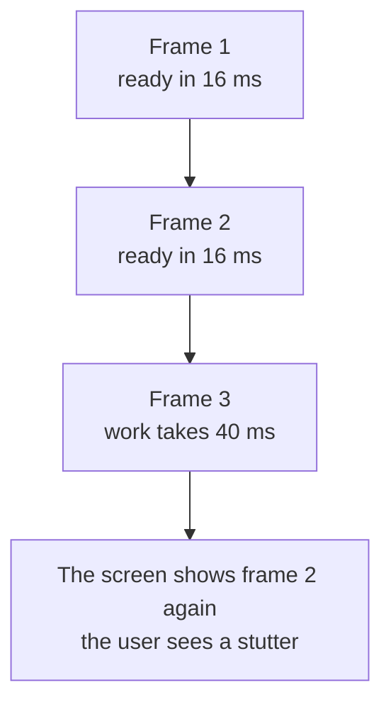
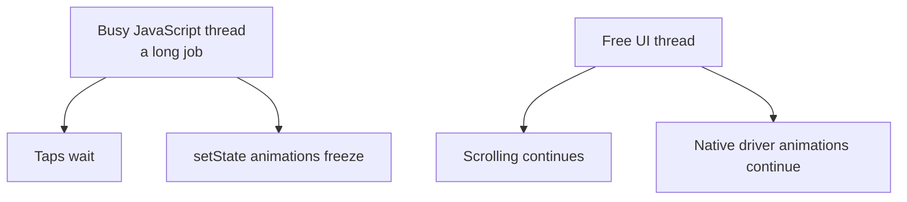
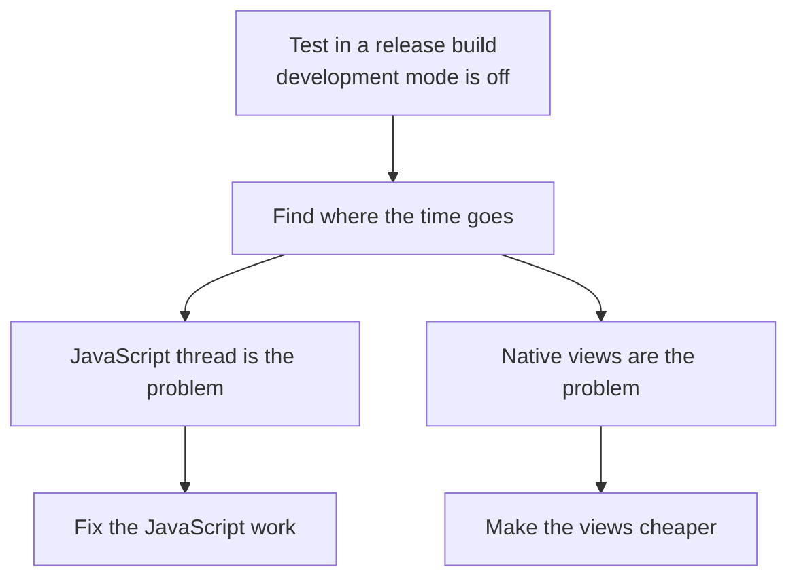
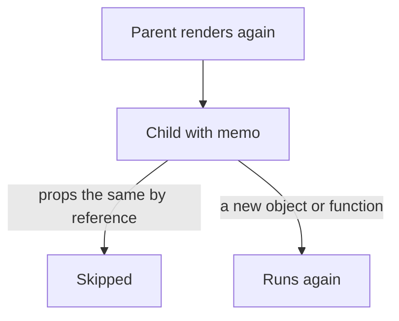

# 10. Performance on mobile

> **Subject:** React Native · **Lesson:** 10 · **Made:** 2026-11-27 · **Status:** ready
>
> **You will be able to:** say why an app drops frames, tell a JavaScript problem from a native view problem, and fix the common causes in the right order: measure first, then skip extra renders, then move work to the UI thread.
>
> **Before this:** [Offline storage](09-offline-storage.md) · **Next:** [Flexbox layout](11-flexbox-layout.md)
>
> **How to read it:** one card is one idea. Look at the picture, guess, then press the orange bar to check. The blue bars (📖 More detail) hold the longer explanation. Skip them on the first read, open them when you want more. About 25 minutes for the cards.

<!-- quick-summary:start -->
## Quick summary

> Short on time? Read only this. These are the "Remember" lines from the cards below, so you can read the whole lesson in one minute.

- At 60 frames each second, one frame has about 16 ms. A missed deadline is a stutter.
- A busy JavaScript thread freezes setState animations and delays taps. Scrolling and native driver animations keep going.
- Test in a release build, find the slow thread, and only then fix. Never guess.
- `memo` skips a render only if every prop is the same by reference. A new object or inline function breaks it.
- `memo` plus new objects is the same as no `memo`. Check that rows really skip.
- Optimize what you measured, not what you guessed.
- A stutter from native views needs cheaper views. A stutter from JavaScript needs less JavaScript.
<!-- quick-summary:end -->

## 1. The idea: a frame is a short deadline

A phone screen is like a flip book. It shows about **60 pictures each second**. Each picture is a **frame**. So each frame has about **16 milliseconds** to be ready. If the work is not done in time, the screen shows the old picture again, and the user sees a stutter. A stutter is also called **jank** or a **dropped frame**.



Notice: nothing breaks. The app just misses its deadline. Performance work is about doing less work before each deadline.

<details class="guess"><summary>🤔 Guess: at 60 frames each second, how many milliseconds does one frame have? Press to check.</summary>

About 16. One second is 1000 ms, and 1000 divided by 60 is about 16.7. The React Native docs say the same: all the UI work must be done by the end of the 16 ms period.

</details>

> **Remember:** at 60 frames each second, one frame has about 16 ms. A missed deadline is a stutter.

<details class="more"><summary>📖 More detail: faster screens</summary>

The docs say phones show at least 60 frames each second. Some screens are faster, so the budget is smaller. Your code does not need to know the number. The rule is the same: do less per frame.

</details>

## 2. Two frame rates: JavaScript and UI

An app has two clocks. The **JavaScript frame rate** says how fast your code finishes its work. The **UI frame rate** says how fast the screen is drawn. You learned the two threads in [lesson 01](01-how-react-native-works.md). Now see what each one keeps alive when the other is busy.

| When JavaScript is busy | Still smooth? | Why |
|---|---|---|
| Dragging a `ScrollView` | yes | it lives on the UI thread |
| A native stack screen transition | yes | its animation runs on the UI thread |
| An animation with `useNativeDriver: true` | yes | the UI thread works out each frame |
| An animation moved by `setState` | **no** | every frame needs JavaScript |
| Pressing a button | **late** | the tap must reach JavaScript |



<details class="guess"><summary>🤔 Guess: a 100 ms job blocks JavaScript. About how many frames does a <code>setState</code> animation miss? Press to check.</summary>

About 6. A frame is about 16 ms, and 100 divided by 16 is a little over 6. The picture on the screen does not change for that time, and then it jumps. This is arithmetic for an example, not a measurement.

</details>

> **Remember:** a busy JavaScript thread freezes setState animations and delays taps. Scrolling and native driver animations keep going.

<details class="more"><summary>📖 More detail: step by step, one busy moment</summary>

| Step | What happens | State after |
|---|---|---|
| 1 | A box moves because `setState` runs every frame | smooth, 2 frames on time |
| 2 | A 100 ms job starts on the JavaScript thread | the next tick waits |
| 3 | The UI thread has no new place, so it draws the old place | the box freezes |
| 4 | The job ends and the waiting tick runs | the box jumps |

**Step through it yourself:** [The frame budget stepper](visuals/10-frame-budget.html). Press Next in each of the three tabs, then compare them.

The docs give the same reasons. Updates to native views are sent at the end of each loop, before the frame deadline. If JavaScript cannot answer for a frame, that frame is dropped. The `Animated` API works out each frame in JavaScript unless you set `useNativeDriver: true`.

</details>

## 3. Measure first, then fix

The most common mistake in performance work is to guess. A guess can cost a week and change nothing. Use this order.



The docs name the tools. On Android, use the **Android Studio Profiler**. On iPhone, use **Instruments**. Both show what each thread does in every 16 ms frame. If the JavaScript thread is working across the frame lines, the problem is in JavaScript. If the UI thread and the render thread are, the problem is in the views.

A short checklist for the first look:

| What you see | Likely cause | First fix |
|---|---|---|
| Everything is slow on your laptop | development mode | test in a release build |
| Taps are late | a long job on the JavaScript thread | cut the job into small pieces, or do less |
| A long list stutters | big rows, no fixed height | `getItemLayout`, `memo` on rows, light rows ([lesson 04](04-lists-and-flatlist.md)) |
| A screen re-renders too often | new objects or functions as props | `memo` with stable props (card 4) |
| An animation stutters | it needs JavaScript on every frame | native driver or Reanimated ([lesson 14](14-animated-api.md), [lesson 15](15-reanimated.md)) |
| A zoom on a big image stutters (iPhone) | the image is cut and scaled again at each size | animate `transform: scale` |

<details class="guess"><summary>🤔 Guess: the app feels slow only when you run it from your laptop in development mode. What do you do first? Press to check.</summary>

Make a release build and test again. The docs say JavaScript speed "suffers greatly" in development mode, because the app does a lot of extra checking. The slow part may disappear.

</details>

> **Remember:** test in a release build, find the slow thread, and only then fix. Never guess.

<details class="more"><summary>📖 More detail: the tools, and what each one is good for</summary>

- **Perf Monitor** (in the Dev Menu): shows the JavaScript and the UI frame rates. The docs call it "a guide". For accurate numbers use the native tools in Android Studio and Xcode.
- **React Native DevTools:** has a Components panel and a **Profiler** panel. The Profiler shows how long components take to render and how many commits happen. A setting called "Highlight updates when components render" flashes each component that renders again. This helps you find too many renders.
- The docs also say DevTools and the Dev Menu are off in release builds. So use DevTools to find **what** renders too often, and use a release build with the native tools to measure **how long** things take. That last line is my reading of the docs, not a quote.
- **`console.log`:** calls can slow the JavaScript thread in a release build. The docs show a Babel plugin, `transform-remove-console`, that removes all `console.*` calls from production builds.

</details>

## 4. Skip the render: `memo` and stable props

When a parent renders again, all its children render again too, even if nothing changed for them. `memo` tells React: "if my props are the same, skip me." React compares the props **one level deep, by reference**.



Here is the trap. A new object or a new function is **never the same by reference**, even if it looks the same.

```jsx
const Row = memo(function Row({ title, style, onPress }) {
  return <Pressable onPress={onPress} style={style}><Text>{title}</Text></Pressable>;
});

function List({ items }) {
  return items.map((item) => (
    <Row
      key={item.id}
      title={item.title}
      // new object and new function on every render
      style={{ padding: 8 }}
      onPress={() => open(item.id)}
    />
  ));
}
```

<details class="guess"><summary>🤔 Guess: <code>List</code> renders 5 times. How many times does each <code>Row</code> render? Press to check.</summary>

5 times, as if there was no `memo`. Each render of `List` makes a new `{ padding: 8 }` and a new arrow function. They are not the same by reference, so `memo` sees changed props. The fix: put the style in `StyleSheet.create` outside the component, and give the function a stable identity (`useCallback`), or let the row call `open` with its own id.

</details>

> **Remember:** `memo` skips a render only if every prop is the same by reference. A new object or inline function breaks it.

<details class="more"><summary>📖 More detail: what the React docs say</summary>

- The `memo` page says React compares old and new props by shallow equality. If you make a new object, array or function in the parent on each render, React sees a change. It suggests simpler props or memoizing the props in the parent.
- It also says memoization is "a performance optimization, not a guarantee". React may still render again.
- `useCallback` and `useMemo` keep the same function or value between renders, as long as their dependency list does not change.
- **React Compiler** is a build-time tool that adds this memoization for you. The React docs say it can skip cascading re-renders and expensive calculations. React Native DevTools marks compiled components with a "Memo ✨" badge. I did not run the compiler here, so I make no claim about how much it helps your app.

Do the exercise in section 10 (Practice, part C) to model this yourself.

</details>

## 5. Mistake 1: `memo` that never works

The problem: a developer wraps every row in `memo`, sees no change in speed, and decides that `memo` is useless.

<details class="guess"><summary>🤔 Guess: why did it not help, and how do you check? Press to check.</summary>

The props were new on every render (card 4), so `memo` never skipped anything. To check, turn on "Highlight updates when components render" in React Native DevTools, and watch whether rows still flash when nothing changed for them. Then fix the props one by one.

</details>

> **Remember:** `memo` plus new objects is the same as no `memo`. Check that rows really skip.

<details class="more"><summary>📖 More detail: a custom compare function</summary>

`memo` takes a second argument, `arePropsEqual`. The React docs warn that you should use a profiler to make sure the compare is really faster than rendering again. A heavy compare can cost more than it saves.

</details>

## 6. Mistake 2: working on the wrong thing

Three habits that waste time:

| Habit | Why it hurts | Better |
|---|---|---|
| Judging speed in development mode | JavaScript is much slower with the extra checks | use a release build |
| Fixing before measuring | you fix a part that was never slow | profile first |
| Animating with `setState` | every frame needs JavaScript | native driver or Reanimated |

<details class="guess"><summary>🤔 Guess: a teammate wraps 40 components in <code>useMemo</code> "to be safe". What is the risk? Press to check.</summary>

More code to read, more places for a stale value, and often no gain. Memoizing has a cost too. Use it where the profiler shows a real problem, such as a heavy list row or an expensive calculation.

</details>

> **Remember:** optimize what you measured, not what you guessed.

<details class="more"><summary>📖 More detail: the `requestAnimationFrame` trick</summary>

From the docs: if a press does a heavy state change, the button can look dead until `onPress` returns. Wrapping the work in `requestAnimationFrame` lets the press effect draw first. It makes the app feel better, but the work still runs on the same thread.

</details>

## 7. Quick wins for views and animations

When the profiler says the **native views** are the problem, these are the first things in the docs to try.

| Problem | What the docs suggest |
|---|---|
| A long list is slow | `getItemLayout` for fixed height rows, light rows, `memo`. A third party list such as FlashList or Legend List is named as an option ([lesson 04](04-lists-and-flatlist.md)) |
| Animating the size of an image drops frames on iPhone | the image is cut and scaled again at each size, so use `transform: [{ scale }]` |
| Moving a view with transparent text on top of an image drops frames on Android | `renderToHardwareTextureAndroid` can help. Turn it off when the view stops moving, because it uses memory |
| Opening a modal while JavaScript loads data | `LayoutAnimation` uses native animation, so it is not hurt by JavaScript frame drops. It only suits fire-and-forget animations that cannot be interrupted |
| Slow screen transitions | use a native stack navigator, because its transition runs on the UI thread |

<details class="guess"><summary>🤔 Guess: you want a modal to slide in while three requests are still loading. Which tool do the docs name for this case? Press to check.</summary>

`LayoutAnimation`. It uses the phone's native animation, so the busy JavaScript thread does not stop it. The docs also say it only works for animations you start and forget. If the animation must be interruptible, use `Animated`.

</details>

> **Remember:** a stutter from native views needs cheaper views. A stutter from JavaScript needs less JavaScript.

<details class="more"><summary>📖 More detail: Android System Tracing, in short</summary>

The docs walk through a trace in Android Studio. Each colour change is one frame. In a good trace, no thread works across a frame line. If the JavaScript thread (`mqt_js`) works across the lines, the problem is in JavaScript. If the UI thread and the render thread do, the views are doing too much. In that second case there are usually two causes: too much work for the GPU, or new views being built during the animation.

</details>

## 8. Why it matters and what it costs

- **Without it:** the app feels cheap. Lists stutter, taps are late, and users leave bad reviews.
- **With it:** the app keeps its 16 ms deadline. Heavy work is cut up or moved, animations run on the UI thread, and rows skip renders they do not need.
- **The cost:** `memo`, `useCallback` and `useMemo` add code and can hide stale values. Native drivers limit what you can animate. Each fix should come after a measurement, so you do not pay for a problem you did not have.

## 9. Watch and play

I opened every link below on 2026-11-27 and each one loaded. I found no video that I could open and check, so there is none here.

- **Step through it:** [The frame budget stepper](visuals/10-frame-budget.html) - what stays smooth when JavaScript is busy.
- **Do:** [practice/10-skip-the-render.mjs](practice/10-skip-the-render.mjs) - build a small `memo` and `useCallback` model.
- **Read:** [Performance Overview](https://reactnative.dev/docs/performance) - frames, the two frame rates and the list of common causes.
- **Read:** [Profiling](https://reactnative.dev/docs/profiling) - how to read a trace in Android Studio.
- **Read:** [React Native DevTools](https://reactnative.dev/docs/react-native-devtools) - the Components and Profiler panels, and "Highlight updates".
- **Read:** [memo, react.dev](https://react.dev/reference/react/memo) - the section about skipping renders when props are the same.

## 10. Practice

**A. Predict**

```jsx
const Badge = memo(({ label, style }) => <Text style={style}>{label}</Text>);

function Header() {
  return <Badge label="New" style={{ color: "red" }} />;
}
```

`Header` renders 3 times. How many times does `Badge` render, and how do you fix it?

<details><summary>Answer</summary>

3 times. The `style` object is new on every render of `Header`, so `memo` sees a changed prop. Move the style out of the component (`StyleSheet.create`) or into a constant. Then `Badge` renders once.

</details>

**B. Fix the bug**

Users say the app freezes for about a second after they search, and then the list appears. The search runs a loop over 20,000 items on the JavaScript thread. Name three things you can try, in order.

<details><summary>Answer</summary>

1. Measure first, in a release build, to be sure the loop is the slow part. 2. Do less work: search on the server, or build a lookup once (an index) instead of scanning each time. 3. If the work is still big, cut it into small pieces (one piece each frame), or move it to native code or a background worker. The user should see a loading state while it runs.

</details>

**C. Write it yourself**

Open `practice/10-skip-the-render.mjs` and write `shallowEqual`, `createMemoComponent` and `createCallbackCache`, so that all 11 tests pass. This is a **model** of `memo` and `useCallback`, not the real code.

```bash
cd learn/react-native/practice
node --test 10-skip-the-render.test.mjs
```

<details><summary>One possible answer</summary>

```js
export function shallowEqual(a, b) {
  if (Object.is(a, b)) return true;
  const keysA = Object.keys(a);
  const keysB = Object.keys(b);
  if (keysA.length !== keysB.length) return false;
  return keysA.every((key) => Object.hasOwn(b, key) && Object.is(a[key], b[key]));
}

export function createMemoComponent(renderFn) {
  let lastProps;
  let lastOutput;
  let hasRendered = false;
  const component = {
    renderCount: 0,
    render(props) {
      if (!hasRendered || !shallowEqual(lastProps, props)) {
        lastOutput = renderFn(props);
        lastProps = props;
        hasRendered = true;
        component.renderCount += 1;
      }
      return lastOutput;
    },
  };
  return component;
}

export function createCallbackCache() {
  let keptFn;
  let keptDeps;
  return {
    get(fn, deps) {
      const same =
        keptDeps !== undefined &&
        keptDeps.length === deps.length &&
        deps.every((dep, i) => Object.is(dep, keptDeps[i]));
      if (!same) {
        keptFn = fn;
        keptDeps = deps;
      }
      return keptFn;
    },
  };
}
```

Look at the pattern: the component keeps the last props and the last output. If the new props are shallow equal, it returns the old output and does not count a render. `createCallbackCache` does the same for a function and its dependency list. A new object literal is a new reference, so the compare says "changed" and the model renders again, exactly like the real `memo`.

</details>

## 11. Interview question

**Q:** A screen in your React Native app is janky. How do you find the cause and fix it?

<details><summary>A strong answer, in four parts</summary>

1. **Problem:** the app misses the 16 ms frame deadline, so the user sees stutter or late taps.
2. **How it works:** first I use a release build, because development mode is much slower. I find which thread is the problem: the JavaScript thread or the native views. The Perf Monitor gives a first guide, the React Native DevTools Profiler and "Highlight updates" show extra renders, and Android Studio or Instruments show the exact frames. For JavaScript problems I cut long jobs, stop extra renders with `memo` and stable props, and move animations to the native driver or Reanimated. For view problems I use cheaper views, fixed height list rows, and `transform: scale` for image zoom.
3. **Tradeoff:** every fix adds code or limits something. `memo` can hide stale values, native drivers limit what can be animated. So I fix the part I measured, and I measure again after the change.
4. **My example:** I built the DBO mobile app and the ZWS store app. I will add one real slow screen I fixed, what I measured, and what changed, only after I confirm the facts. I will not invent numbers.

</details>

## 12. Explain it back

Close this file. Explain how you would fix a janky screen to a new junior, in 4 parts (problem, how, tradeoff, my example). Then write your best version below and run `/explain-check react native performance` or ask the `explain-coach` agent to review it.

### My explanation

<write here>

### Coach feedback

<the explain-coach agent writes here>

## 13. Review questions (day 1, 3, 7, 21)

1. How many milliseconds does a frame have at 60 frames each second, and what happens when you miss it?
2. Name two things that stay smooth when the JavaScript thread is busy, and one that does not.
3. Why does `memo` not help when you pass `style={{ padding: 8 }}`?
4. Draw the picture from card 2 from memory: the busy JavaScript thread and the free UI thread.

<details><summary>Answers</summary>

1. About 16 ms. The screen shows the old frame again, and the user sees a stutter.
2. Scrolling a `ScrollView` and an animation with the native driver stay smooth. A `setState` animation does not, and taps are late.
3. The object is new on every render. `memo` compares props by reference, so it sees a change and renders again.
4. A busy JavaScript thread blocks taps and `setState` animations. The UI thread keeps scrolling and native driver animations going.

</details>

## 14. Go deeper (optional)

<details><summary>Versions, tools and extra links</summary>

- **Checked on 2026-11-27** against the React Native docs (Performance Overview, Profiling, Debugging, React Native DevTools, Optimizing FlatList) and the React docs for `memo` and React Compiler. I did not run a phone or the compiler here, so there are no frame rates or timing numbers in this lesson. The 100 ms job is an example.
- **Hermes** helps start up time and memory. [Lesson 06](06-hermes.md) explains it. The speed of one screen is still mostly your own code.
- **Reanimated** runs animation code on the UI thread. [Lesson 15](15-reanimated.md) covers it.
- Saved data can slow a screen too. [Lesson 09](09-offline-storage.md) covers storage and what blocks the JavaScript thread.
- **Release updates:** a fix for a slow screen can sometimes ship as an over the air update. [Lesson 08](08-over-the-air-updates.md) says when.
- The [Optimizing FlatList Configuration](https://reactnative.dev/docs/optimizing-flatlist-configuration) page lists the list props and their pros and cons.

</details>

## Connected lessons

- [How React Native works](01-how-react-native-works.md) - the two threads, from the beginning.
- [Lists and FlatList](04-lists-and-flatlist.md) - windowing and the list props.
- [Hermes](06-hermes.md) - what the engine does for start up.
- [Offline storage](09-offline-storage.md) - what to keep on the phone and what blocks the thread.
- [Animation with the Animated API](14-animated-api.md) - the native driver in detail.
- [Reanimated](15-reanimated.md) - animation code on the UI thread.
