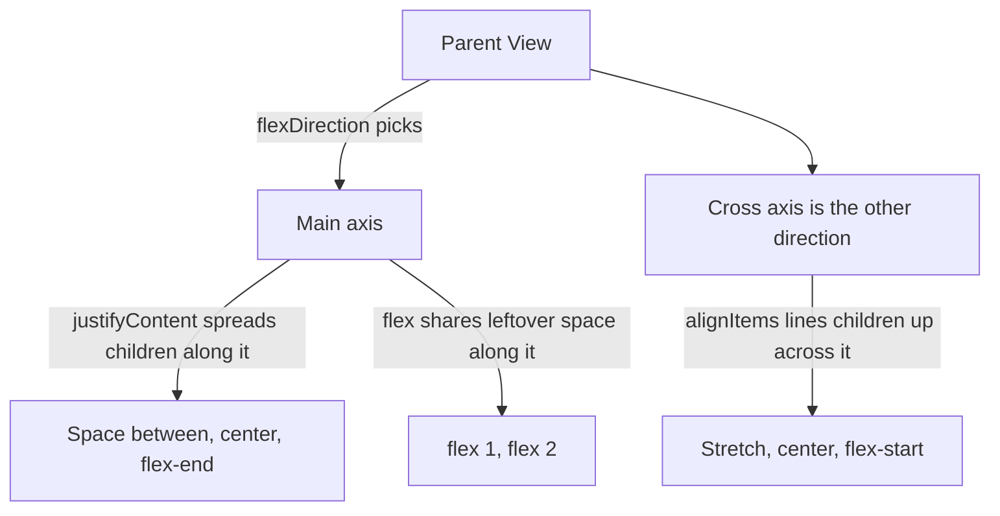
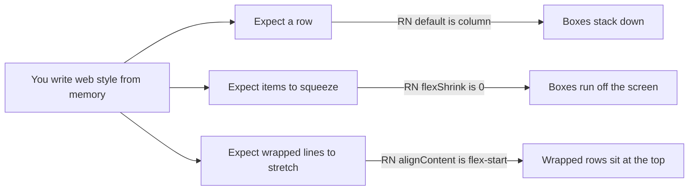
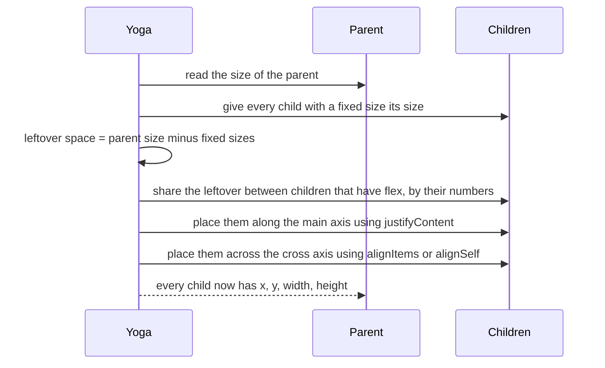
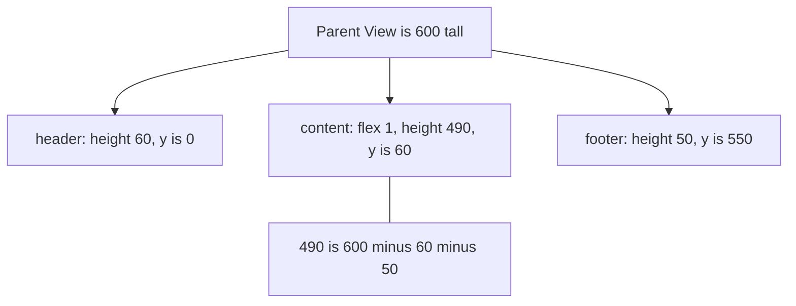
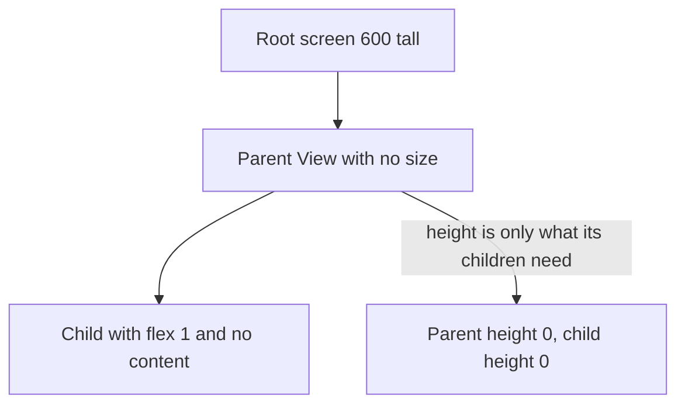
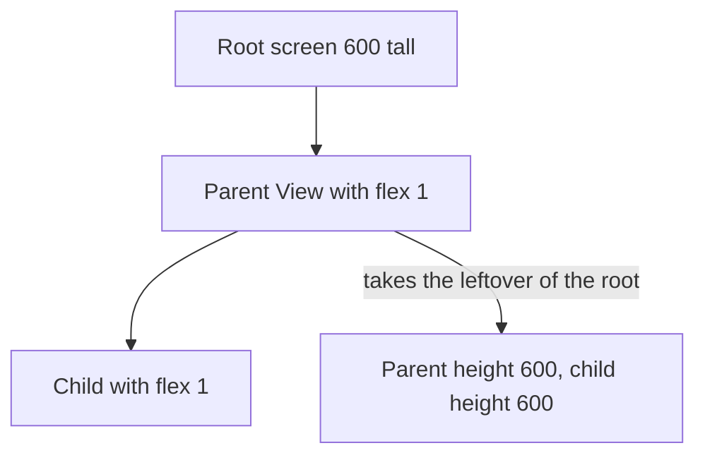

# 11. Flexbox layout in React Native

> **Subject:** React Native · **Lesson:** 11 · **Made:** 2026-10-25 · **Status:** ready
> **You will be able to:** build the common layouts from memory (center a box, header with content and footer, row of equal columns, wrapping grid, corner badge) and say which three defaults differ from the web.
> **Before this:** [React Native lessons](README.md) · **Next:** 12 The styling toolkit (planned)

## 1. The idea in one sentence

Every `View` is a box that decides how its children share its space, and you tell it with a few style words: which way to line up, how to spread, how to align.

New words:

- **Main axis:** the direction the children line up in. Default is top to bottom. (Interview word: *main axis*.)
- **Cross axis:** the other direction, across the line. Default is left to right.
- **Leftover space:** the room that is still free after every fixed-size child has taken its size.
- **Yoga:** the small engine inside React Native that does the maths for flexbox. (Same engine on iOS and Android, so layout is the same on both.)

The rule to remember: **`flexDirection` picks the main axis. `justifyContent` works on the main axis. `alignItems` works on the cross axis.**

## 2. The pictures

### 2a. The big picture

A parent View has two axes. Notice which style word controls which axis. This is the part people mix up.



Here is the default, a column. Main axis goes down. Cross axis goes across.

```
  flexDirection: 'column'  (default)       flexDirection: 'row'

   cross axis -->                           main axis -->
  +-----------------+  main               +-----------------------+
  | [ 1 ]           |  axis               | [1] [2] [3]           | cross
  | [ 2 ]           |  |                  |                       | axis
  | [ 3 ]           |  v                  |                       |  |
  |                 |                     |                       |  v
  +-----------------+                     +-----------------------+
```

And `justifyContent` on a row, with three boxes in a 300 wide parent:

```
  flex-start      [1][2][3]
  center                [1][2][3]
  flex-end                    [1][2][3]
  space-between   [1]        [2]        [3]
  space-around      [1]      [2]      [3]
  space-evenly       [1]     [2]     [3]
```

### 2b. The problem, drawn

You know flexbox from the web, so you write CSS from memory. Three defaults are different in React Native. Notice that each one gives a different picture than you expected.



| | Web (CSS) | React Native |
|---|---|---|
| `flexDirection` | `row` | **`column`** |
| `flexShrink` | `1` | **`0`** |
| `alignContent` | `stretch` | **`flex-start`** |

Source: the [React Native flexbox page](https://reactnative.dev/docs/flexbox). There is no stylesheet cascade either: styles are plain JavaScript objects, and a child does not inherit `flexDirection` from its parent.

### 2c. How it works over time

Yoga lays out one parent in the same order every time. Notice that `justifyContent` only runs **after** `flex` has used up the leftover space. That is why `justifyContent` does nothing when a child has `flex: 1`.



### 2d. What is in memory right now

The screen from section 4. The parent is 600 tall. Notice that the content never gets a number from you. Yoga works it out as `600 - 60 - 50`.



And `flex` as a share of the leftover. In a column 600 tall, with children `flex: 1`, `flex: 2`, `flex: 3`:

| Child | flex | Share of leftover | Height | y |
|---|---|---|---|---|
| A | 1 | 1 of 6 | 100 | 0 |
| B | 2 | 2 of 6 | 200 | 100 |
| C | 3 | 3 of 6 | 300 | 300 |

### 2e. Right against wrong

The classic bug: **"I set `flex: 1` on the child and nothing shows."** `flex: 1` means "take the leftover space of my parent". If the parent has no size, there is no leftover.

**Wrong:** the parent has no `flex: 1` and no height.



**Right:** every View on the way down has a size, or `flex: 1`.



## 3. Real life analogy

A bookshelf. The shelf (parent) has a length. Some books are fixed width (children with `width`). One thick elastic bookend (`flex: 1`) expands to fill the gap. `justifyContent` is how you spread the books. `alignItems` is whether they stand at the front or back of the shelf.

Where it stops being true: real books never get squeezed. On the web, flex children shrink by default. In React Native they do not, so they run off the end of the shelf.

## 4. The smallest code that shows it

```jsx
// Header, content, footer. The screen is 300 wide and 600 tall.
import { View } from 'react-native';

export default function Screen() {
  return (
    <View style={{ flex: 1 }}>
      <View style={{ height: 60, backgroundColor: 'steelblue' }} />
      <View style={{ flex: 1, backgroundColor: 'gold' }} />
      <View style={{ height: 50, backgroundColor: 'tomato' }} />
    </View>
  );
}
```

**Result** (computed with Yoga, 300 by 600):

```
header   x 0   y 0     300 x 60
content  x 0   y 60    300 x 490
footer   x 0   y 550   300 x 50
```

The children have no width, so `alignItems: 'stretch'` (the default) makes them 300 wide.

## 5. What really happens, step by step

For the code in section 4:

| Step | What Yoga does | State after |
|---|---|---|
| 1 | The root `View` has `flex: 1`, so it takes the whole screen | 300 x 600 |
| 2 | Direction is column, so the main axis is vertical | main axis = height |
| 3 | Header has `height: 60`, footer has `height: 50` | fixed total = 110 |
| 4 | Leftover = 600 minus 110 | 490 |
| 5 | Only the content has `flex`, so it gets all 490 | content height 490 |
| 6 | Place down the main axis: 0, then 60, then 550 | y = 0, 60, 550 |
| 7 | Cross axis: no width, `stretch` | every child is 300 wide, x = 0 |

**Step through it yourself:** open the [flexbox playground](visuals/11-flexbox-playground.html). Press the preset "Header, content, footer" and then change `alignItems`. Then press "Web habit: shrink" and see the boxes run off the phone.

## 6. Why it exists and what it costs

- **Problem without it:** you would give every box a fixed x, y, width and height. That breaks on a small phone, a big phone, a rotated phone, and a longer translated text.
- **How it solves it:** you describe the rules (line up, share, align). Yoga does the numbers for every screen size.
- **Cost or tradeoff:** the rules interact. `justifyContent` seems to do nothing when a child has `flex: 1`. A missing `flex: 1` high up in the tree makes everything below it collapse. Percent sizes and `flex` mix badly. When in doubt, add one rule at a time.

## 7. Common mistakes

**Wrong:** the Text overflows the row (the long text pushes the icon off the screen).

```jsx
<View style={{ flexDirection: 'row' }}>
  <Icon />
  <Text>A very long title that does not fit on one line at all</Text>
</View>
```

**Right:** let the Text shrink and wrap.

```jsx
<View style={{ flexDirection: 'row', alignItems: 'center', gap: 8 }}>
  <Icon />
  <Text style={{ flexShrink: 1 }}>A very long title that does not fit on one line at all</Text>
</View>
```

**Why:** `flexShrink` is `0` by default, so the Text keeps its full one-line width. `flexShrink: 1` (or `flex: 1`) lets it take only the room that is left and wrap. (The behaviour with real text depends on the text measuring on the device, so try it once in [Expo Snack](https://snack.expo.dev).)

**Wrong:** using `justifyContent` for left-right in a column.

```jsx
<View style={{ justifyContent: 'center' }}>  {/* column: this centers UP and DOWN */}
```

**Right:** `alignItems: 'center'` centers left-right in a column. For both directions you need both.

## 8. Watch and play

How these were checked on 2026-10-25: the page and pages from the docs were fetched, the two YouTube videos were checked for title and channel only (not watched in full). Every number in this lesson was computed with Yoga 3.2.1, and the playground matched Yoga on 40 random settings.

- **Play with it:** [Flexbox playground](visuals/11-flexbox-playground.html) - press the presets, then change one thing at a time.
- **Read:** [React Native flexbox](https://reactnative.dev/docs/flexbox) - the official page, about 3 minutes. Look for the three defaults.
- **Read:** [Layout props list](https://reactnative.dev/docs/layout-props) - every layout property in one place.
- **Run it:** [Expo Snack](https://snack.expo.dev) - paste the code from section 4 and see it on a real phone preview.
- **Video:** [React Native Flexbox Mastery for Beginners (2025)](https://www.youtube.com/watch?v=ak-NFDpEiW0) App Stack Engineer - a crash course on the same properties.
- **Video:** [Master React Native Layouts in 5 Minutes](https://www.youtube.com/watch?v=Al-f0mkKEsM) amplifyabhi coding - a short visual version.

<details><summary>Go deeper (optional)</summary>

- **`flex: 1` and `flexGrow`.** In a Yoga run, a row with one box `{ flexGrow: 1, width: 50 }` and one fixed 50 box gave widths 250 and 50: the first box starts at 50 and grows into the leftover. The flexbox page says `flex` takes a single number and describes `flexGrow` and `flexBasis` separately. It does not spell out whether `flex` is a shorthand for them, so do not claim that in an interview.
- **`gap`, `rowGap`, `columnGap`.** Works in current React Native. Percent values for `gap` need the New Architecture (layout props page).
- **`position: 'absolute'`.** The default is `relative`. An absolute child leaves the flow, so it takes no space. `StyleSheet.absoluteFill` is a ready style for `top/left/right/bottom: 0`.
- **`aspectRatio`.** Give one side, get the other. Width 300 with `aspectRatio: 16 / 9` gives height about 169 (Yoga run).
- **`boxSizing`.** Default is `border-box`, like most web resets. `display` supports only `flex`, `none` and `contents`.
- **Other defaults on the layout props page.** `position` default is `relative`, and `static` needs the New Architecture.
- **Verifying yourself.** `learn/react-native/practice/_yoga.mjs` turns style objects into a Yoga tree. You can check any layout in Node without a phone.

</details>

## 9. Practice

**A. Predict the layout** (write numbers before opening)

The parent is 300 wide and 600 tall. Each box is `{ width: 50, height: 50 }` unless stated.

1. `flexDirection: 'row', justifyContent: 'space-between'`, three boxes. What are the x values?
2. `flexDirection: 'row'`, two boxes, each `width: 200`. Where does the second box start, and how wide is it?
3. `alignItems: 'flex-start'`, three boxes. Box 2 has `alignSelf: 'flex-end'`, box 3 has `alignSelf: 'center'`. What are the x values?
4. The screen is a column. It holds two Views: first a parent with no size and no flex, which holds one child with `flex: 1`. Second a View with `height: 50`. How tall is the parent? Where does the second View start?
5. `flexDirection: 'row', gap: 10`, three boxes. What are the x values?

<details><summary>Answers (computed with Yoga)</summary>

1. x = 0, 125, 250. The free space is 300 - 150 = 150, split into 2 gaps of 75.
2. x = 200, width 200. It ends at 400, which is off the screen. Nothing shrinks. With `flexShrink: 1` on both, each would be 150 wide.
3. x = 0, 250, 125. (`flex-end` puts box 2 at 300 - 50.) Also y = 0, 50, 100 because it is still a column.
4. The parent is 0 tall (the child collapses too), so the second View starts at y 0. Give the parent `flex: 1` and it becomes 550 tall (600 minus the 50), with the second View at y 550.
5. x = 0, 60, 120. Each step is 50 + 10.

</details>

**B. Fix the bug**

```jsx
export default function Card() {
  return (
    <View>
      <View style={{ flex: 1, backgroundColor: 'gold' }}>
        <Text>Hello</Text>
      </View>
      <Text style={{ flexDirection: 'row' }}>Left</Text>
    </View>
  );
}
```

The card shows only a tiny strip. Two things are wrong. What?

<details><summary>Answer</summary>

1. The outer `View` has no `flex: 1` and no height, so there is no leftover space for `flex: 1` to use. The card is only as tall as its content. Add `style={{ flex: 1 }}` to the outer View.
2. `flexDirection: 'row'` is on a `Text`. It does nothing useful there. A row belongs on the **parent** that holds the children you want side by side.

</details>

**C. Write it yourself (runnable)**

Open `learn/react-native/practice/11-flexbox.mjs`. Six tasks: center a box, spread a row, build the app shell, two equal columns, a wrapping grid, a corner badge. The tests run your styles through Yoga.

```bash
cd learn/react-native/practice && npm install && npm run test:11
```

<details><summary>One possible answer</summary>

```js
export function centerOne() { return { flex: 1, justifyContent: "center", alignItems: "center" }; }
export function spreadRow() { return { flexDirection: "row", justifyContent: "space-between" }; }
export function appShell() { return { header: { height: 60 }, content: { flex: 1 }, footer: { height: 50 } }; }
export function twoEqualColumns() { return { container: { flexDirection: "row" }, child: { flex: 1, height: 50 } }; }
export function wrapGrid() { return { flexDirection: "row", flexWrap: "wrap" }; }
export function cornerBadge() { return { position: "absolute", top: 0, right: 0, width: 20, height: 20 }; }
```

In a real app the parent in task 1 also needs `flex: 1` (or a height) to fill the screen.

</details>

## 10. Interview question

**Q:** "Build this screen: a header, a scrolling area that fills the rest, and a footer. Then center a loading spinner in the middle of the scrolling area. How is flexbox in React Native different from the web?"

<details><summary>A strong answer, in four parts</summary>

1. **Problem:** I need a layout that works on every screen size without fixed numbers.
2. **How it works:** The outer View gets `flex: 1`. The header and footer have fixed heights. The middle gets `flex: 1`, so it takes the leftover. To center the spinner I give the middle `justifyContent: 'center'` and `alignItems: 'center'`, because a column's main axis is vertical. Three defaults differ from the web: `flexDirection` is `column`, `flexShrink` is `0`, and `alignContent` is `flex-start`.
3. **Tradeoff:** Layout is just JavaScript objects with no cascade, so repeated rules need a shared style or a component. If the parent has no size, `flex: 1` collapses to nothing, which is the most common bug.
4. **My example:** *Fill with a true story from DBO or ZWS, for example a screen with a sticky bottom button. Only say facts you remember.*

</details>

## 11. Explain it back

Close this file. Explain out loud to a new junior, in 4 parts (problem, how, tradeoff, my example): "Why does `justifyContent: 'center'` centre up and down in React Native by default, and what do I change to centre left and right?" Then write your best version below and run `/explain-check flexbox` or ask the `explain-coach` agent.

### My explanation

<write here>

### Coach feedback

<the explain-coach agent writes here>

## 12. Review questions (day 1, 3, 7, 21)

1. Name the three flexbox defaults that differ from the web.
2. What does `flex: 1` mean, and why does it show nothing when the parent has no size?
3. In a row, which style centres the boxes up and down? In a column, which one does it?
4. Draw the picture from section 2d from memory: 600 tall, header 60, footer 50.

<details><summary>Answers</summary>

1. `flexDirection` is `column`, `flexShrink` is `0`, `alignContent` is `flex-start`.
2. "Take the leftover space of my parent." No parent size means no leftover, so the child is 0.
3. Row: `alignItems: 'center'` (the cross axis is vertical). Column: `justifyContent: 'center'`.
4. Three boxes down the screen: 60, then 490 (the leftover), then 50. Content y = 60, footer y = 550.

</details>

## Connected lessons

- [React Native lessons](README.md) - the map of all lessons.
- 12 The styling toolkit (planned) - sizes, `Platform`, safe areas, shadows.
- 13 Layout recipes (planned) - cards, chat bubbles, sticky footers built from these rules.
- [JavaScript: reference vs copy](../javascript/03-reference-vs-copy.md) - style objects are plain objects, so spreading one into another makes a new copy.
