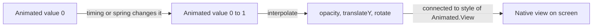
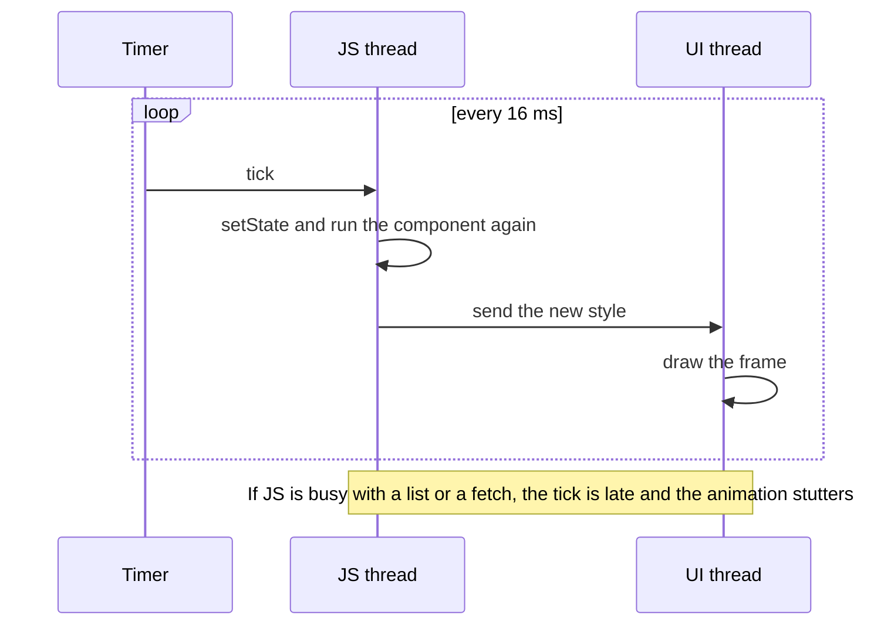
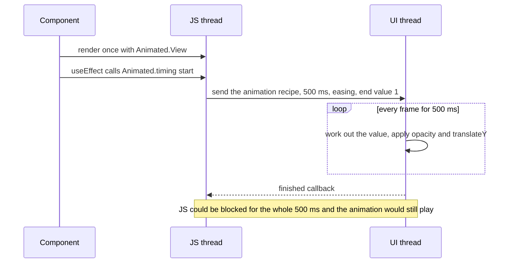
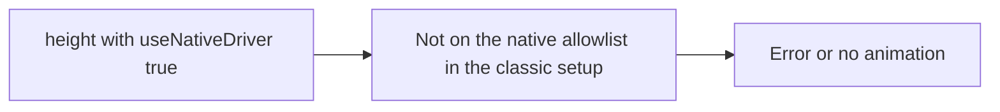
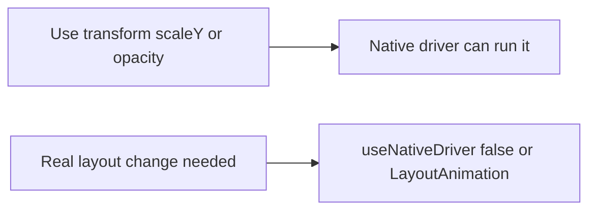
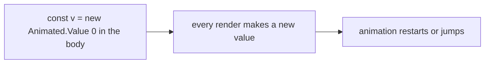

# 14. Animation with the Animated API

> **Subject:** React Native · **Lesson:** 14 · **Made:** 2026-10-25 · **Status:** ready
> **You will be able to:** write a fade and slide in from memory, explain what `useNativeDriver` does and what it cannot animate, and use `interpolate`, `sequence`, `parallel` and `loop`.
> **Before this:** [Flexbox layout](11-flexbox-layout.md) · **Next:** 15 Reanimated (planned)

## 1. The idea in one sentence

An animation in React Native is **one number that changes over time**, and you connect that number to a style, so the phone updates the view on every frame without running your component again.

New words:

- **Animated value:** the box that holds the moving number. (Interview word: *Animated.Value*.)
- **Interpolate:** turn the number (0 to 1) into another range, like 0 to 200 pixels or 0 to 360 degrees.
- **Native driver:** the animation runs on the phone's own UI thread, so a busy JavaScript thread cannot make it stutter.
- **Easing:** the speed curve. Slow start, fast middle, slow end, and so on.

The rule to remember: **animate `transform` and `opacity`, turn the native driver on, and keep the value in `useRef` or `useAnimatedValue`.**

## 2. The pictures

### 2a. The big picture

Notice that your component does not run again while the animation plays. The number flows straight to the view.



### 2b. The problem, drawn

The first idea is `setState` on every frame. Notice what the JavaScript thread has to do 60 times a second.



### 2c. How it works over time

A fade and slide in with the native driver on. Notice that after the start, the JS thread is not needed.



### 2d. What is in memory right now

The fade and slide from section 4, halfway through with a straight line speed (value 0.5). Notice that one number drives both styles.

| Thing | Value | How it is worked out |
|---|---|---|
| `progress` (the Animated value) | 0.5 | timing moves it from 0 to 1 |
| `opacity` | 0.5 | the value itself |
| `translateY` | 10 | `interpolate` maps 0 to 1 onto 20 to 0, so 0.5 is 10 |
| Component renders so far | 1 | it did not run again |

### 2e. Right against wrong

**Wrong picture 1:** animate `height` with the native driver and expect it to work.



**Right picture 1:** animate a style the native driver knows (`transform`, `opacity`), such as `scaleY` instead of `height`. If you must animate real layout, use `useNativeDriver: false` or `LayoutAnimation`.



**Wrong picture 2:** make the value inside the component body.



**Right picture 2:** keep the same value across renders with `useAnimatedValue(0)` or `useRef(new Animated.Value(0)).current`.

## 3. Real life analogy

A dimmer switch. You do not repaint the wall for every brightness. You turn one knob (the Animated value), and the light follows. `interpolate` is a dial that also changes the colour of the lamp as you turn the knob.

Where it stops being true: a real dimmer lives in the room. With the native driver, the "knob" is moved by the phone, not by JavaScript, so you cannot read the number in JavaScript on every frame without extra work.

## 4. The smallest code that shows it

```jsx
import { useEffect } from 'react';
import { Animated, Easing, useAnimatedValue } from 'react-native';

export function FadeSlideIn({ children }) {
  const progress = useAnimatedValue(0);          // stays the same across renders

  useEffect(() => {
    Animated.timing(progress, {
      toValue: 1,
      duration: 500,
      easing: Easing.out(Easing.cubic),
      useNativeDriver: true,                      // required
    }).start();
  }, [progress]);

  const translateY = progress.interpolate({ inputRange: [0, 1], outputRange: [20, 0] });

  return (
    <Animated.View style={{ opacity: progress, transform: [{ translateY }] }}>
      {children}
    </Animated.View>
  );
}
```

**What you see:** the content fades in while sliding up 20 points, over half a second.

Not run on a device in this session. The API names were checked against the React Native 0.88.0 source (`useAnimatedValue`, `Easing.out`, `Easing.cubic` all exist) and the docs. Paste it into [Expo Snack](https://snack.expo.dev) to see it.

The same pattern for other common tasks:

```jsx
// Pulse forever
Animated.loop(
  Animated.sequence([
    Animated.timing(scale, { toValue: 1.2, duration: 400, useNativeDriver: true }),
    Animated.timing(scale, { toValue: 1, duration: 400, useNativeDriver: true }),
  ]),
).start();

// Spin: 0 to 1 becomes 0 to 360 degrees
const rotate = spin.interpolate({ inputRange: [0, 1], outputRange: ['0deg', '360deg'] });

// Bounce into place
Animated.spring(scale, { toValue: 1, friction: 5, useNativeDriver: true }).start();

// Two things at once, or one after another
Animated.parallel([fadeIn, slideUp]).start();
Animated.sequence([fadeIn, wait, fadeOut]).start();
```

## 5. What really happens, step by step

For `interpolate({ inputRange: [0, 1], outputRange: [20, 0] })` as the value moves:

| Step | Value | Maths | `translateY` |
|---|---|---|---|
| 1 | 0 | start of the range | 20 |
| 2 | 0.25 | 20 + 0.25 x (0 - 20) | 15 |
| 3 | 0.5 | 20 + 0.5 x (0 - 20) | 10 |
| 4 | 1 | end of the range | 0 |
| 5 | 1.5 (outside) | **extend** keeps the same line | -10 |
| 6 | 1.5 (outside) with `extrapolate: 'clamp'` | stays at the end | 0 |

The default is `extend`, so a value outside the range keeps going along the same straight line. Add `extrapolate: 'clamp'` to stop at the ends. This is the most common interview trap with `interpolate`.

**Step through it yourself:** open the [Animated value lab](visuals/14-animated-lab.html). Drag the slider past 0 and past 1 and flip between extend and clamp. Press Play with different easings and watch the curve.

## 6. Why it exists and what it costs

- **Problem without it:** `setState` on every frame keeps the JS thread busy, so one slow task makes the animation stutter.
- **How it solves it:** you describe the animation once. With `useNativeDriver: true` the phone runs it without JS.
- **Cost or tradeoff:** the classic native driver only handles some styles (see Go deeper). You cannot read the live value easily. Gestures and animations that depend on JS logic each frame are awkward, which is the reason for the next lesson, Reanimated.

## 7. Common mistakes

**Wrong:**

```jsx
const opacity = new Animated.Value(0);   // new value every render
```

**Right:**

```jsx
const opacity = useAnimatedValue(0);
```

**Why:** a new value every render throws away the running animation.

**Wrong:** `Animated.timing(v, { toValue: 1 })` (no `useNativeDriver`). The docs say it is required, and leaving it out gives a warning and a TypeScript error.

**Right:** always pass `useNativeDriver: true` or `false` on purpose.

**Wrong:** mixing drivers on one value. An Animated value supports only one driver, so if one animation on it uses the native driver, all of them must.

**Right:** pick one setting per value.

## 8. Watch and play

How these were checked on 2026-10-25: React Native docs pages were fetched, API names and the allowlist were read in the react-native 0.88.0 package source, the page in `visuals/` was compared with the exercise answer on 340 inputs, and the video was checked for title and channel only (not watched).

- **Play with it:** [Animated value lab](visuals/14-animated-lab.html) - drag the value, change easing, compare extend and clamp.
- **Read:** [Animations in React Native](https://reactnative.dev/docs/animations) - official guide: the native driver rules and `LayoutAnimation`.
- **Read:** [Animated API reference](https://reactnative.dev/docs/animated) - config keys for timing, spring, loop.
- **Read:** [Easing](https://reactnative.dev/docs/easing) - the curves you can pass to timing.
- **Video:** [RNR 301 - RNR Explains: Using Native Driver for Animated](https://www.youtube.com/watch?v=bdln0pZv0Jk) Infinite Red - what the native driver changes.
- **Run it:** [Expo Snack](https://snack.expo.dev) - paste the code from section 4.

<details><summary>Go deeper (optional)</summary>

- **What the native driver can animate.** The docs say non-layout properties such as `transform` and `opacity`. In the react-native 0.88.0 source, the allowlist is wider: colours (`backgroundColor`, `borderColor`, `color`, `tintColor`), `borderRadius` variants, `opacity`, `transform`, `zIndex`, `elevation`, `filter`, and iOS `shadowOpacity` and `shadowRadius`. Layout properties (`width`, `height`, `top`, `flex`, margins and paddings) are only on that list when the experimental flag `useSharedAnimatedBackend` is on, and its default is `false` in the JS code. In an interview, say "transform and opacity" first, then mention it has grown.
- **Spring settings.** Pick one group: `friction` and `tension`, or `bounciness` and `speed`, or `stiffness`, `damping` and `mass`. Defaults from the docs: friction 7, tension 40, stiffness 100, damping 10, mass 1.
- **Timing defaults.** `duration` 500 ms, `delay` 0, easing `Easing.inOut(Easing.ease)`.
- **`Animated.loop`.** `iterations` default is -1, which means forever. Inside a long list set `isInteraction: false` so the loop does not block the list from rendering.
- **`Animated.diffClamp(value, min, max)`.** Adds the change since last time to its own value and keeps it between min and max. It hides a header when you scroll down and shows it when you scroll up. The exercise in `practice/14-animation-math.mjs` rebuilds it.
- **`Animated.event`.** Maps scroll position straight into a value with no JS: `Animated.event([{ nativeEvent: { contentOffset: { y: scrollY } } }], { useNativeDriver: true })`. It works with direct events such as `onScroll`, not with `PanResponder`.
- **Android 3D.** For `rotateX` or `rotateY` on Android, add `perspective` to the transform or the animation may not draw.
- **`LayoutAnimation`.** One call before a state change animates the next layout change (expand, reorder). Less control, no value to manage. On Android older setups needed `UIManager.setLayoutAnimationEnabledExperimental(true)`.

</details>

## 9. Practice

**A. Predict the output** (write your answer before opening)

```js
// progress goes from 0 to 1. What is each style when progress is 0.25 and when it is 2?
const rotate    = progress.interpolate({ inputRange: [0, 1], outputRange: ['0deg', '360deg'] });
const opacity   = progress.interpolate({ inputRange: [0, 1], outputRange: [0.2, 1], extrapolate: 'clamp' });
const translate = progress.interpolate({ inputRange: [0, 0.5, 1], outputRange: [0, 100, 100] });
```

<details><summary>Answer</summary>

At 0.25: rotate `90deg`, opacity `0.4`, translate `50`.

At 2: rotate `720deg` (extend keeps going along the line), opacity `1` (clamped at the end), translate `100` (the last segment is flat, from 100 to 100, so extending it stays at 100).

</details>

**B. Fix the bug**

```jsx
function Box() {
  const width = new Animated.Value(100);
  const grow = () => Animated.timing(width, { toValue: 200, duration: 300, useNativeDriver: true }).start();
  return <Animated.View style={{ width, height: 50 }} onTouchStart={grow} />;
}
```

Two problems. What are they?

<details><summary>Answer</summary>

1. `new Animated.Value(100)` runs on every render, so the value resets. Use `useAnimatedValue(100)`.
2. `width` is a layout property, and the classic native driver does not handle it. Either use `scaleX` with `transform` (changes how it looks but not the layout space), or use `useNativeDriver: false` (runs on the JS thread), or use `LayoutAnimation`, or use Reanimated, which can animate width on the UI thread.

</details>

**C. Write it yourself (runnable)**

**In the browser, no setup:** open the [code lab, Animation maths tasks](visuals/code-lab.html#anim-1). Edit, press Run tests, and use the Try it box to call your function. To see a real animation, build the two Animated tasks in [Snack](visuals/code-lab.html#snack) (fade and slide, and a pulse).

**Or in your editor:** open `learn/react-native/practice/14-animation-math.mjs`. Three tasks: `interpolate` (several segments, extend and clamp), `timingValue` (progress plus easing), and `makeDiffClamp` (hide header on scroll).

```bash
cd learn/react-native/practice && npm install && npm run test:14
```

<details><summary>One possible answer</summary>

```js
export function interpolate(value, inputRange, outputRange, options = {}) {
  const left = options.extrapolateLeft ?? options.extrapolate ?? "extend";
  const right = options.extrapolateRight ?? options.extrapolate ?? "extend";
  let i = 1;
  for (; i < inputRange.length - 1; i++) if (inputRange[i] >= value) break;
  const [inMin, inMax] = [inputRange[i - 1], inputRange[i]];
  const [outMin, outMax] = [outputRange[i - 1], outputRange[i]];
  let v = value;
  if (v < inMin && left === "clamp") v = inMin;
  if (v > inMax && right === "clamp") v = inMax;
  return outMin + ((v - inMin) / (inMax - inMin)) * (outMax - outMin);
}
export function timingValue({ from, to, elapsed, duration, easing = (t) => t }) {
  const progress = Math.min(Math.max(elapsed / duration, 0), 1);
  return from + (to - from) * easing(progress);
}
export function makeDiffClamp(min, max, start = 0) {
  let last = start;
  let value = start;
  return (a) => {
    value = Math.min(Math.max(value + (a - last), min), max);
    last = a;
    return value;
  };
}
```

</details>

## 10. Interview question

**Q:** "How do you animate a view in React Native, and what does `useNativeDriver` do? When would you not use `Animated`?"

<details><summary>A strong answer, in four parts</summary>

1. **Problem:** I want smooth 60 frames a second without re-rendering the component on every frame, and without a busy JS thread making it stutter.
2. **How it works:** I keep an `Animated.Value` in `useAnimatedValue` (or `useRef`), run `Animated.timing` or `spring` on it, and connect it to an `Animated.View` style, using `interpolate` to turn 0 to 1 into opacity, translate or rotate. With `useNativeDriver: true` the recipe is sent to the UI thread once and plays there.
3. **Tradeoff:** The classic native driver handles `transform`, `opacity` and a few more, not layout. It is awkward when the animation depends on gestures or on JS logic each frame. For that I move to Reanimated, which runs worklets on the UI thread. For a simple expand or collapse I might use `LayoutAnimation`.
4. **My example:** *Fill with a true example, for example a modal, a button press effect or a loading skeleton you built. Only say facts you remember.*

</details>

## 11. Explain it back

Close this file. Explain out loud to a new junior, in 4 parts (problem, how, tradeoff, my example): "Why is `setState` on every frame a bad way to animate, and what does the native driver change?" Then write your best version below and run `/explain-check animated` or ask the `explain-coach` agent.

### My explanation

<write here>

### Coach feedback

<the explain-coach agent writes here>

## 12. Review questions (day 1, 3, 7, 21)

1. What does `useNativeDriver: true` change, and which styles are the safe ones to animate with it?
2. What does `interpolate` do when the value is outside the input range, and how do you stop it?
3. Why must the Animated value live in `useRef` or `useAnimatedValue`?
4. Draw the picture from section 2c from memory.

<details><summary>Answers</summary>

1. The animation recipe is sent to the UI thread and plays without JS. Safe: `transform` and `opacity`.
2. By default it extends the line. Use `extrapolate: 'clamp'` to stop at the ends.
3. A new value on every render throws away the running animation.
4. Render once, call start, send the recipe to the UI thread, the UI thread updates every frame, a finished callback comes back.

</details>

## Connected lessons

- [Flexbox layout](11-flexbox-layout.md) - the layout properties the classic native driver cannot animate.
- 15 Reanimated (planned) - the tool for gesture driven and layout animation.
- [JavaScript: closures](../javascript/05-closures.md) - why a value made in the component body is a new box on every render.
