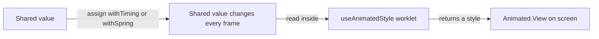
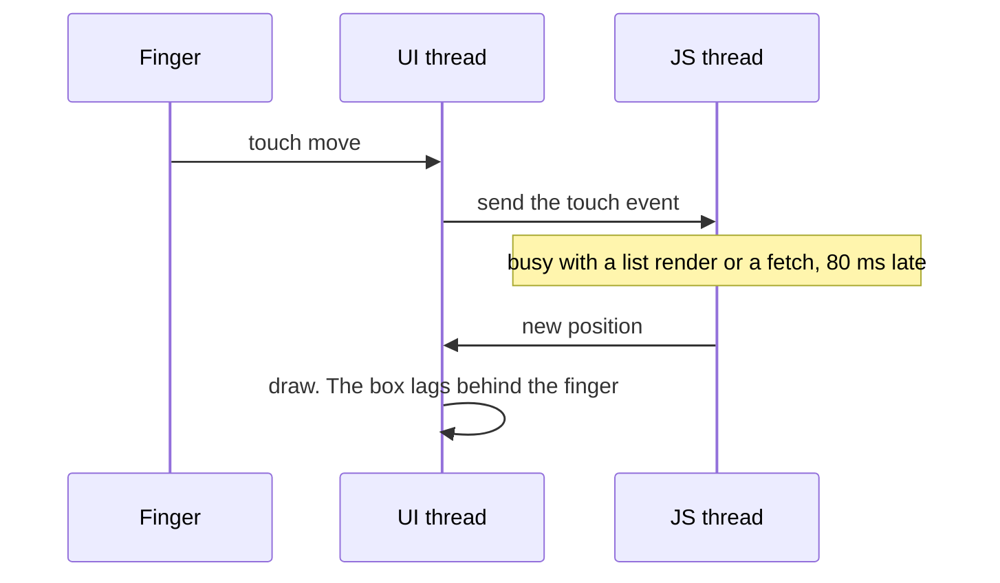
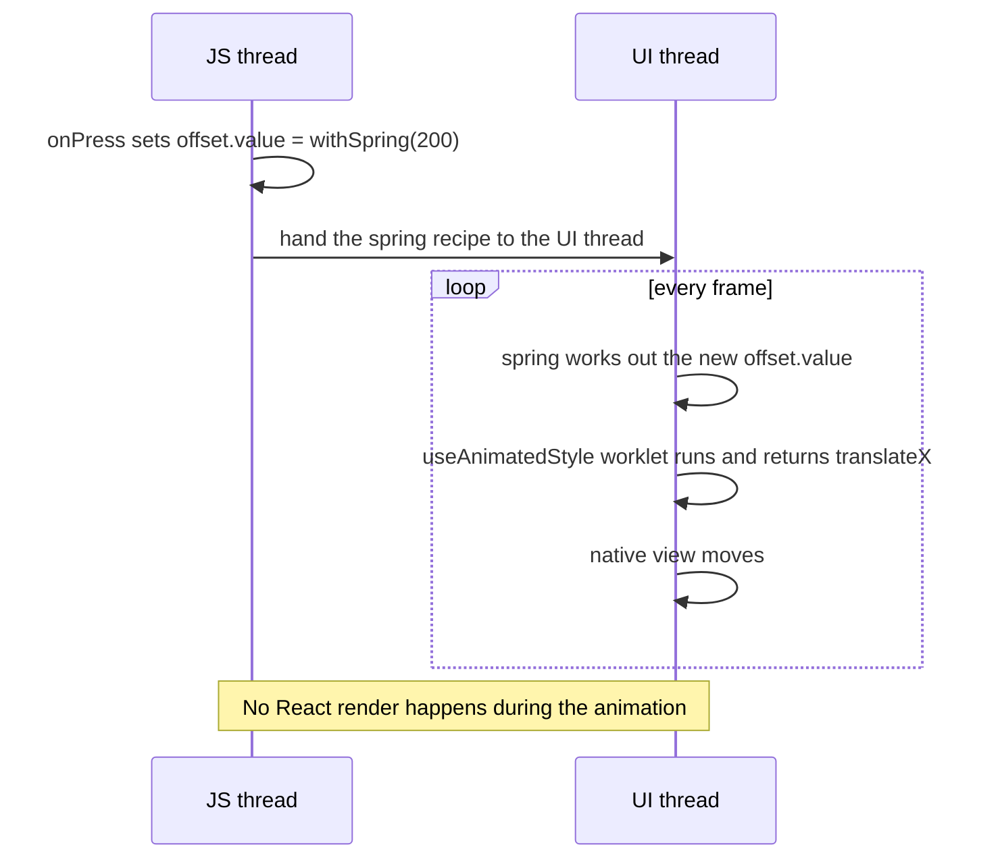
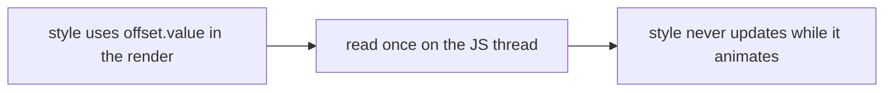
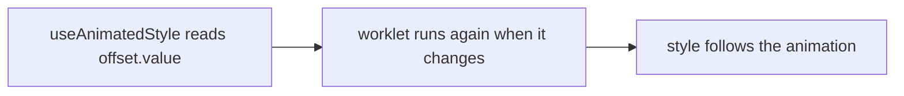
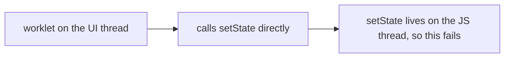

# 15. Reanimated: animations that run on the UI thread

> **Subject:** React Native · **Lesson:** 15 · **Made:** 2026-10-25 · **Status:** ready
> **You will be able to:** write a Reanimated animation from memory (`useSharedValue`, `useAnimatedStyle`, `withTiming`, `withSpring`), say what a worklet is, and choose between `Animated`, Reanimated, `LayoutAnimation` and CSS transitions in an interview.
> **Before this:** [Animation with the Animated API](14-animated-api.md) · **Next:** 16 Gestures (planned)

## 1. The idea in one sentence

Reanimated lets you write small functions that run on the phone's UI thread, so animations that react to a finger, a scroll or any logic stay smooth even when the JavaScript thread is busy.

New words:

- **Shared value:** a number you can read and write from both the JS thread and the UI thread. You touch it with `.value`.
- **Worklet:** a short function that is allowed to run on the UI thread. Reanimated marks it for you inside `useAnimatedStyle`.
- **UI thread:** the thread that draws the screen, 60 times a second or more.
- **JS thread:** the thread that runs your React code.

The rule to remember: **change a shared value with `.value = ...`, and read it only inside `useAnimatedStyle`, never directly in the render.**

## 2. The pictures

### 2a. The big picture

Notice that the style function runs on the UI thread. That is the difference from `Animated`.



### 2b. The problem, drawn

With the `Animated` API from lesson 14, the native driver can play a fixed recipe. But when the animation depends on logic (follow the finger, snap to the nearest side, different values for width and colour), the logic runs in JavaScript. Notice what happens when the JS thread is busy.



### 2c. How it works over time

A button press that moves a box with a spring. Notice that after the press, the JS thread is free.



### 2d. What is in memory right now

The box from section 4, halfway through the spring. Notice that the shared value lives where both threads can see it, and the component has not rendered again.

| Thing | Where it lives | Value now |
|---|---|---|
| `offset` (shared value) | shared by both threads | 120 |
| `animatedStyle` worklet | UI thread | returns `{ transform: [{ translateX: 120 }] }` |
| `Box` component function | JS thread | ran once, not again |
| Native view | UI thread | drawn at x = 120 |

### 2e. Right against wrong

**Wrong picture 1:** read the shared value in the render.



**Right picture 1:** read `.value` inside the `useAnimatedStyle` function. The docs say plain inline styles cannot read the value.



**Wrong picture 2:** call a React `setState` from inside a worklet.



**Right picture 2:** send the call back to the JS thread. In Reanimated 4 that is `scheduleOnRN(fn, arg)` from `react-native-worklets`. In Reanimated 3 it was `runOnJS(fn)(arg)`.

## 3. Real life analogy

A stage with two crews. The director (JS thread) writes the plan: "move the table to the left over two seconds". The stage crew (UI thread) moves the table frame by frame and does not ask the director each time. A shared whiteboard (the shared value) shows where the table is, and both crews can read it.

Where it stops being true: the director cannot shout a new instruction at every frame. A call from the crew back to the director (`scheduleOnRN`) is a message that takes a little time.

## 4. The smallest code that shows it

```jsx
import { Pressable, Text } from 'react-native';
import Animated, { useSharedValue, useAnimatedStyle, withSpring } from 'react-native-reanimated';

export function Box() {
  const offset = useSharedValue(0);

  const animatedStyle = useAnimatedStyle(() => ({
    transform: [{ translateX: offset.value }],     // read .value in here
  }));

  return (
    <>
      <Animated.View style={[{ width: 80, height: 80, backgroundColor: 'tomato' }, animatedStyle]} />
      <Pressable onPress={() => { offset.value = withSpring(offset.value === 0 ? 200 : 0); }}>
        <Text>Move</Text>
      </Pressable>
    </>
  );
}
```

**What you see:** the box springs 200 points to the right, then back on the next press.

Not run on a device in this session. The names and the shape of the code come from the Reanimated 4.x docs (fundamentals: `useSharedValue`, `useAnimatedStyle`, `withSpring`, `Animated.View`). Paste it into [Expo Snack](https://snack.expo.dev) to try it.

More patterns you will be asked for:

```jsx
// Pulse forever: -1 repeats without end, true plays it back and forth
scale.value = withRepeat(withTiming(1.2, { duration: 400 }), -1, true);

// One after another
x.value = withSequence(withTiming(50), withTiming(0));

// Fade as it moves, without going past 0 and 1
const style = useAnimatedStyle(() => ({
  opacity: interpolate(x.value, [0, 100], [0, 1], Extrapolation.CLAMP),
}));

// Appear and disappear with the component
<Animated.View entering={SlideInRight.duration(400)} exiting={FadeOut.duration(250)} />

// A CSS style transition (Reanimated 4): animate width when it changes
<Animated.View style={{ width, transitionProperty: 'width', transitionDuration: 300 }} />
```

## 5. What really happens, step by step

Pressing "Move" in section 4:

| Step | Thread | What happens | `offset.value` |
|---|---|---|---|
| 1 | JS | `onPress` runs and assigns `withSpring(200)` | still 0 |
| 2 | JS to UI | Reanimated hands the spring to the UI thread | 0 |
| 3 | UI | Frame 1: the spring works out a small step | about 3 |
| 4 | UI | The `useAnimatedStyle` worklet runs and returns `translateX` | about 3 |
| 5 | UI | The native view moves to that x | about 3 |
| 6 | UI | Repeat for each frame. The spring overshoots a little and settles | 0 to 200 and settles at 200 |
| 7 | JS | Nothing. The component never rendered again | 200 |

The numbers in steps 3 to 6 only show the shape. A real spring depends on its settings.

## 6. Why it exists and what it costs

- **Problem without it:** gesture and scroll driven animations wait for the JS thread, and the classic `Animated` native driver cannot run your own logic or most layout properties.
- **How it solves it:** your style logic runs on the UI thread as a worklet, and the value is shared.
- **Cost or tradeoff:** an extra package and setup. Reanimated 4.x works only with the New Architecture, and it needs the `react-native-worklets` package and its Babel plugin (Expo's starter template already includes the plugin). Crossing back to JS needs `scheduleOnRN`. Bugs in worklets can be harder to debug. For a simple fade, `Animated` is enough.

Which tool to pick (a good interview table):

| Need | Pick | Why |
|---|---|---|
| Simple fade, slide, scale, loop | `Animated` with native driver | built in, no setup |
| Follow the finger, drag, swipe, scroll linked effects | Reanimated | worklets on the UI thread |
| Expand or collapse that changes layout | `LayoutAnimation` or Reanimated layout animations or transitions | one line, layout changes |
| Animate a style when state changes (width, colour) | Reanimated CSS transition | declare the property and duration |
| Element enters or leaves the screen | Reanimated `entering` and `exiting` | presets built in |

## 7. Common mistakes

**Wrong:**

```jsx
<Animated.View style={{ width: width.value * 5 }} />   // inline style cannot read the shared value
```

**Right:**

```jsx
const style = useAnimatedStyle(() => ({ width: width.value * 5 }));
<Animated.View style={style} />
```

**Why:** only worklets such as `useAnimatedStyle` see the value change.

**Wrong:** using a normal `View` and expecting the animated style to apply.

```jsx
<View style={animatedStyle} />
```

**Right:** use `Animated.View` from `react-native-reanimated` (it is built in, with nothing to wrap). For a component from another library use `Animated.createAnimatedComponent`.

**Wrong:** animate `flexDirection` or `justifyContent` with a transition. The docs say these jump in steps instead of animating smoothly.

**Right:** use Layout Animations for those changes. Also avoid `transitionProperty: 'all'`, which the docs advise against for performance.

## 8. Watch and play

How these were checked on 2026-10-25: the Reanimated and Gesture Handler docs pages were fetched, the videos were checked for title and channel only (not watched), and the code was not run on a device. Check each snippet in a Snack before an interview.

- **Video:** [Introducing React Native Reanimated 4](https://www.youtube.com/watch?v=Wr2fOM_xD2I) Software Mansion - what changed in version 4, from the team that makes it.
- **Video:** [React Native Reanimated Basics - useSharedValue and useAnimatedStyle Explained](https://www.youtube.com/watch?v=rnK_03dyY0o) codeERAayush - the two core hooks. Check the code against the docs, since the video may use older versions.
- **Read:** [Reanimated: getting started](https://docs.swmansion.com/react-native-reanimated/docs/fundamentals/getting-started/) - installation, the worklets plugin, Expo steps.
- **Read:** [Animating styles and props](https://docs.swmansion.com/react-native-reanimated/docs/fundamentals/animating-styles-and-props) - the core idea with short examples.
- **Read:** [Migration from 3.x](https://docs.swmansion.com/react-native-reanimated/docs/guides/migration-from-3.x/) - good for knowing what changed.
- **Run it:** [Expo Snack](https://snack.expo.dev) - paste the code from section 4.

<details><summary>Go deeper (optional)</summary>

- **Version 4 facts from the docs.** Version 4.x works only with the New Architecture (Fabric). Apps on the old architecture stay on 3.x, which is no longer actively maintained. Install `react-native-reanimated` and `react-native-worklets`. In a plain React Native CLI project the Babel plugin is `'react-native-worklets/plugin'` and must be listed last. The old `react-native-reanimated/plugin` path still works but is deprecated.
- **Renamed or removed in 4.** `runOnJS` became `scheduleOnRN` and `runOnUI` became `scheduleOnUI`, with arguments passed directly. `useAnimatedGestureHandler` is removed in favour of the Gesture Handler 2 API. `useScrollViewOffset` is now `useScrollOffset`. `withSpring` defaults changed, and its `duration` is now perceptual (the real run takes about 1.5 times that).
- **Defaults.** `withTiming`: `duration` 300 ms and easing `Easing.inOut(Easing.quad)` (the `Animated` API defaults to 500 ms and `Easing.inOut(Easing.ease)`). `withRepeat(animation, numberOfReps = 2, reverse = false)`: a `numberOfReps` of 0 or -1 repeats forever. `reverse` works with `withSpring`, not with `withSequence`.
- **Callbacks.** `withTiming(100, config, (finished) => { ... })` runs on the UI thread. `finished` is false when the animation was cancelled. To call React state from there, use `scheduleOnRN`.
- **Interpolate.** `interpolate(value, input, output, Extrapolation.CLAMP)`. The default is `EXTEND`, the same trap as in lesson 14. `IDENTITY` returns the input when outside the range.
- **Gestures.** The current Gesture Handler 3.x docs show `usePanGesture({ onUpdate: (e) => { position.value = e.translationX } })` inside a `GestureDetector`, wrapped in `GestureHandlerRootView`. The older 2.x style is `Gesture.Pan().onUpdate(...).onEnd(...)`, and you will still see it in many codebases. Lesson 16 covers gestures.
- **Prop animations.** For non-style props such as SVG attributes, use `useAnimatedProps` and `animatedProps`.

</details>

## 9. Practice

**A. Predict what happens** (write your answer before opening)

```jsx
const x = useSharedValue(0);
const onPress = () => {
  x.value = withTiming(100);
  console.log(x.value);
};
```

What does the `console.log` print, and why?

<details><summary>Answer</summary>

It prints `0`. Assigning `withTiming(100)` starts an animation. It does not set the value to 100 right away. The value moves over time on the UI thread. To run code when it ends, use the callback: `withTiming(100, {}, (finished) => { ... })`.

</details>

**B. Fix the bug**

```jsx
function Card({ open }) {
  const height = useSharedValue(0);
  height.value = withTiming(open ? 200 : 0);
  return <View style={{ height: height.value }} />;
}
```

Three problems. What are they?

<details><summary>Answer</summary>

1. The shared value is assigned during render. Move it into `useEffect` (or the event handler).
2. `height.value` is read in the render with a plain `View`, so it never updates. Use `useAnimatedStyle(() => ({ height: height.value }))`.
3. It must be `Animated.View` from Reanimated, not `View`. (Alternative: a CSS transition, `style={{ height: open ? 200 : 0, transitionProperty: 'height', transitionDuration: 300 }}` on `Animated.View`.)

</details>

**C. Build it yourself** (in a Snack, not in Node)

Make these four, each in under 10 minutes. No answer file, because it needs a phone preview. Compare with the docs when stuck.

1. A box that toggles between left and right with a spring when you press it.
2. A heart that pulses forever (`withRepeat`).
3. A toast that slides in with `entering` and fades out with `exiting`.
4. A progress bar whose width animates from 0 to 100 percent using `withTiming` and `useAnimatedStyle`.

## 10. Interview question

**Q:** "What is the difference between `Animated` and Reanimated, and when would you pick Reanimated? What is a worklet?"

<details><summary>A strong answer, in four parts</summary>

1. **Problem:** I need smooth animations that follow gestures or run custom logic, even when the JS thread is busy.
2. **How it works:** With `Animated` and the native driver, a fixed recipe is sent to the UI thread. In Reanimated I keep a shared value, and `useAnimatedStyle` is a worklet, a small function that runs on the UI thread and reads that value each frame. Assigning `withSpring` or `withTiming` to `.value` starts the animation, and no React render happens while it plays.
3. **Tradeoff:** More setup. Version 4 needs the New Architecture and the worklets package. Calling back into JS needs `scheduleOnRN` (`runOnJS` in 3). For simple fades and loops, `Animated` is enough. For layout changes, `LayoutAnimation` or a CSS transition may be less code.
4. **My example:** *Fill with a true example, for example a swipe, a bottom sheet or a collapsing header you built. Only say facts you remember.*

</details>

## 11. Explain it back

Close this file. Explain out loud to a new junior, in 4 parts (problem, how, tradeoff, my example): "What is a worklet and why does a gesture driven animation need one?" Then write your best version below and run `/explain-check reanimated` or ask the `explain-coach` agent.

### My explanation

<write here>

### Coach feedback

<the explain-coach agent writes here>

## 12. Review questions (day 1, 3, 7, 21)

1. Where must you read `.value` to see an animation update, and why not in the render?
2. What does `x.value = withTiming(100)` do, and what does `console.log(x.value)` right after it print?
3. How do you call a React `setState` from a worklet in Reanimated 4, and what was it called in 3?
4. Draw the picture from section 2c from memory.

<details><summary>Answers</summary>

1. Inside `useAnimatedStyle` (a worklet). The render runs once on the JS thread, so it would only read the first value.
2. It starts an animation toward 100. The log prints the current value, which is still the old one.
3. `scheduleOnRN(fn, arg)` from `react-native-worklets`. In 3 it was `runOnJS(fn)(arg)`.
4. JS sets the value with a spring, hands the recipe to the UI thread, then each frame the UI thread runs the spring, runs the style worklet and moves the view. JS is idle.

</details>

## Connected lessons

- [Animation with the Animated API](14-animated-api.md) - the built in option, and the same `interpolate` trap.
- 16 Gestures (planned) - pan, swipe to delete and bottom sheet using shared values.
- [The event loop (JavaScript)](../javascript/11-the-event-loop.md) - why a busy thread makes everything late.
