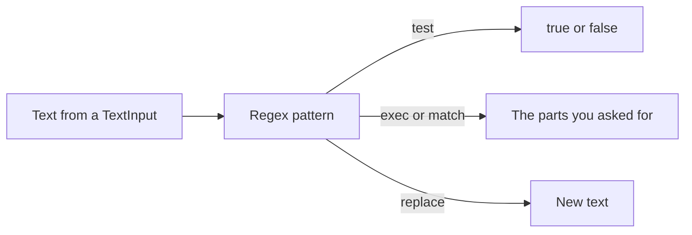
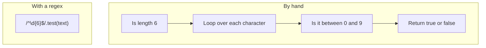
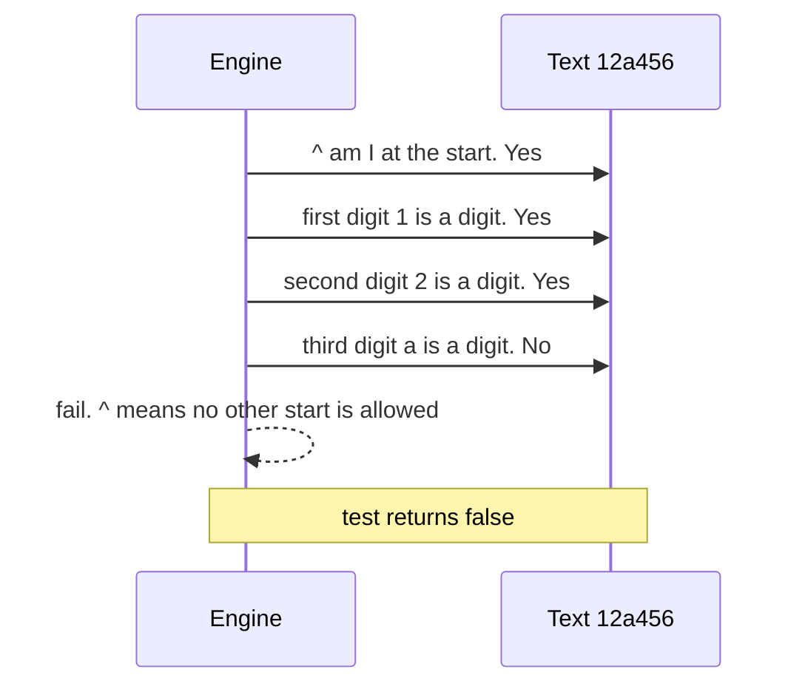
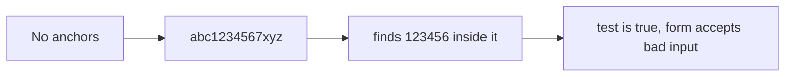
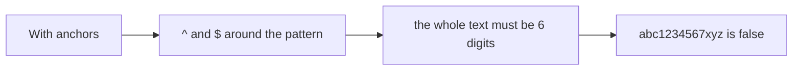
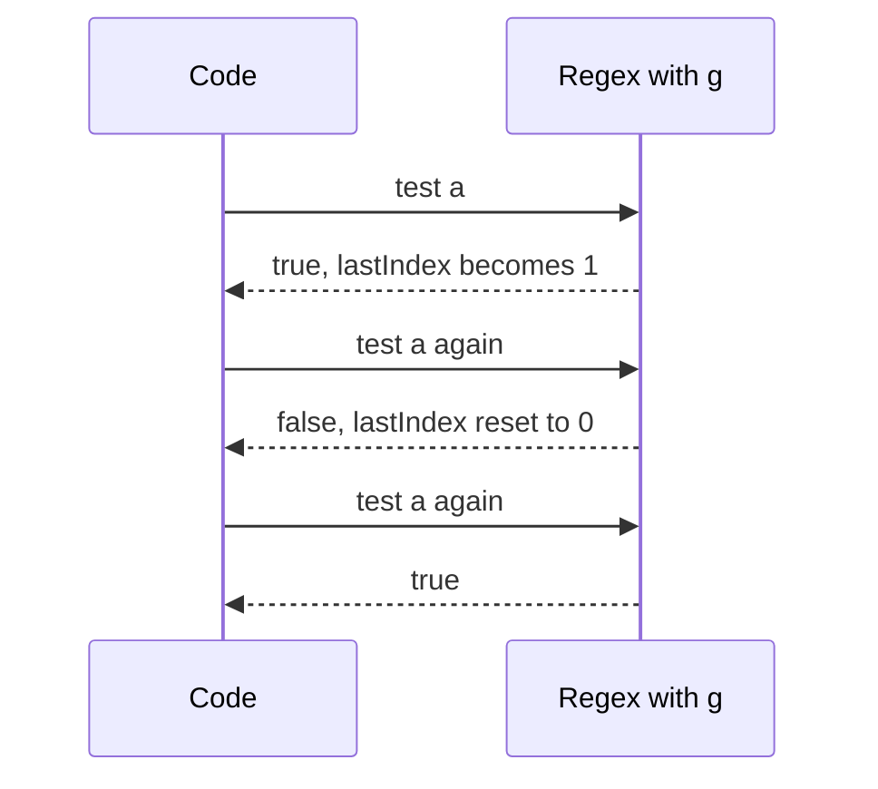

# 17. Regex for forms and text

> **Subject:** React Native · **Lesson:** 17 · **Made:** 2026-10-25 · **Status:** ready
> **You will be able to:** write the regex that interviews ask for (OTP, digits only, thousands separator, password rules, deep link, card mask), say what each part does, and avoid the two bugs people hit most (`g` with `.test`, and missing `^` `$`).
> **Before this:** [React Native lessons](README.md) · **Next:** 18 Forms and TextInput (planned)

## 1. The idea in one sentence

A **regex** (regular expression) is a short pattern that describes a piece of text, so one line of code can check it, pull parts out of it, or replace it.

New words:

- **Pattern:** the text between the two slashes, like `\d{6}`. It describes what to look for.
- **Anchor:** a mark that pins the pattern to the start `^` or end `$` of the whole text.
- **Group:** brackets `( )` that catch one part of the match so you can read it later. (Interview word: *capture group*.)
- **Lookahead:** a check that peeks forward and says "this must come later" without using up any text. `(?=...)`.

The rule to remember: **no `^` and `$` means "find it anywhere", so a validation regex without them is almost always wrong.**

## 2. The pictures

### 2a. The big picture

One regex can do three jobs. Notice that the job is chosen by the method you call, not by the pattern.



The pieces you will use 95 percent of the time:

| Piece | Means | Example | Matches |
|---|---|---|---|
| `\d` | one digit 0 to 9 | `\d` | `7` |
| `\D` | one character that is not a digit | `\D` | `a` |
| `\w` | letter, digit or underscore | `\w+` | `rn_2026` |
| `\s` | space, tab, newline | `\s*` | ` ` |
| `.` | any one character (not newline) | `a.c` | `abc` |
| `[abc]` | one of these | `[a-z]` | `q` |
| `[^abc]` | one that is not these | `[^@]` | `x` |
| `+` `*` `?` | one or more, zero or more, optional | `\d+` | `2026` |
| `{6}` `{2,4}` | exactly 6, 2 to 4 | `\d{6}` | `123456` |
| `^` `$` | start, end | `^\d$` | `5` |
| `( )` | group | `(\d{4})` | `2026` |
| `\|` | or | `cat\|dog` | `dog` |
| `\b` | edge of a word | `\bcat\b` | `a cat` |

### 2b. The problem, drawn

Checking text by hand is long and easy to get wrong. Compare the two ways to check a 6 digit code.



The cost: a regex is short but hard to read later, and a bad one can be slow or wrong in rare cases (see section 7).

### 2c. How it works over time

The engine tries the pattern from the left. This is `^\d{6}$` on the text `12a456`. Notice that it fails at `a` and, because of `^`, it does not try again from a later position.



### 2d. What is in memory right now

After `/(\d{4})-(\d{2})-(\d{2})/.exec("Due 2026-10-25 ok")`. Notice that the result is an array with the whole match first, then one entry per group, plus where it was found.

| Part of result | Value |
|---|---|
| `m[0]` the whole match | `2026-10-25` |
| `m[1]` first group | `2026` |
| `m[2]` second group | `10` |
| `m[3]` third group | `25` |
| `m.index` where it starts | `4` |

With names it is easier to read: `/(?<year>\d{4})-(?<month>\d{2})/.exec("2026-10")` gives `groups.year` = `2026` and `groups.month` = `10`.

### 2e. Right against wrong

**Wrong picture 1: no anchors.** `/\d{6}/.test("abc1234567xyz")` gives `true`. It found six digits inside the text.



**Right picture 1:** `^` and `$` pin the pattern to the start and end, so the whole text must match.



**Wrong picture 2: a shared regex with `g` and `.test`.** A regex with the `g` flag remembers where it stopped (`lastIndex`). The next `.test` starts from there.



**Right picture 2:** do not use `g` on a regex you only `.test`. Use `g` for `replace` and `matchAll`.

## 3. Real life analogy

A stencil with holes. You lay the stencil (the pattern) on the text. Only text that fits every hole passes. `^` and `$` mean the stencil must cover the whole page, not just a corner.

Where it stops being true: a stencil is flat. A regex can go back and try another way when one way fails (this is called backtracking, see section 7).

## 4. The smallest code that shows it

```js
const otp = /^\d{6}$/;
console.log(otp.test("123456"), otp.test("12345"), otp.test("12a456"), otp.test("1234567"));
console.log(/\d{6}/.test("abc1234567xyz")); // no anchors
```

**Output** (checked on Node 24.15.0, 2026-10-25):

```
true false false false
true
```

In a React Native screen it usually looks like this:

```jsx
const [code, setCode] = useState('');

<TextInput
  value={code}
  onChangeText={(t) => setCode(t.replace(/\D/g, ''))} // keep digits only
  keyboardType="number-pad"
  maxLength={6}
/>
<Button title="Verify" disabled={!/^\d{6}$/.test(code)} onPress={verify} />
```

## 5. What really happens, step by step

The thousands separator, the favourite interview regex: `"1234567".replace(/\B(?=(\d{3})+(?!\d))/g, ".")`.

Read it in English: "at every spot that is **not** at a word edge (`\B`), and that has groups of exactly three digits all the way to the end (`(?=(\d{3})+(?!\d))`), put a dot".

| Step | Where the engine stands in `1234567` | Does the spot match | Why |
|---|---|---|---|
| 1 | Before `1` | No | `\B` fails here, it is a word edge |
| 2 | Between `1` and `2` | Yes | `234567` is two groups of three, then end |
| 3 | Between `2` and `3` | No | `34567` is five digits, not a multiple of 3 |
| 4 | Between `3` and `4` | No | `4567` is four digits |
| 5 | Between `4` and `5` | Yes | `567` is one group of three, then end |
| 6 | Between `5`, `6` and `6`, `7` | No | not multiples of 3 |
| 7 | Put `.` at the two matching spots | | `1.234.567` |

Output: `1.234.567`. The lookahead only looks. It uses up no digits, so the replace puts the dot in without removing anything.

## 6. Why it exists and what it costs

- **Problem without it:** long loops and `if` chains for every check, and each one is a place for a bug.
- **How it solves it:** one pattern says what valid text looks like.
- **Cost or tradeoff:** hard to read. A pattern is rarely 100 percent correct for real life (emails, phone numbers, names). A bad pattern can freeze the app. Use a regex for **shape** (6 digits, has an @), and let the server check the **truth** (does this email exist).

## 7. Common mistakes

**Wrong:** trusting a regex to fully check an email.

```js
const email = /^[^\s@]+@[^\s@]+\.[^\s@]+$/;
email.test("a@b.c");     // true, but is it a real address? No way to tell
email.test("wing@gmail"); // false, even though some internal mail systems allow it
```

**Right:** use a simple "looks like an email" pattern to catch typos, then confirm with the server (send a verification email). Do not copy a 200 character "perfect email regex".

**Wrong:** a pattern with nested repeats on user input.

```js
/^(a+)+$/.test("a".repeat(26) + "b"); // takes about 0.6 seconds, and doubles with every extra "a"
```

**Why it is slow:** when the match fails, the engine goes back and tries every way to split the `a`s between the inner and outer `+`. This is **catastrophic backtracking** (interview word: *ReDoS* when an attacker uses it). Timings on Node 24.15.0: 20 letters 46 ms, 24 letters 143 ms, 26 letters 578 ms. Hermes will have different numbers, but the same shape.

**Right:** avoid a repeat inside a repeat, keep patterns simple, and put a `maxLength` on the input.

**Wrong:** `"a-b-c".replace("-", "+")` gives `a+b-c`. A string pattern replaces only the first match.

**Right:** `"a-b-c".replace(/-/g, "+")` gives `a+b+c`. `replaceAll("-", "+")` also does.

## 8. Watch and play

How these were checked on 2026-10-25: the Hermes page was fetched and read, the other sites were opened to confirm they exist, the video was checked for title and channel only (not watched), and every code output above was run in Node 24.15.0. Node uses V8, React Native uses Hermes, so run anything critical on a device too.

- **Video:** [Learn Regular Expressions Fast - JavaScript Regex Tutorial for Developers](https://www.youtube.com/watch?v=4awL2LjSpUs) logicBase Labs - patterns, flags, classes, quantifiers, groups and anchors in JavaScript.
- **Play with it:** [regex101](https://regex101.com) - pick the JavaScript flavour, paste `^\d{6}$` and some test text, and watch what matches.
- **Play with it:** [RegExr](https://regexr.com) - a second playground with live results.
- **Read:** [MDN Regular expressions guide](https://developer.mozilla.org/en-US/docs/Web/JavaScript/Guide/Regular_expressions) - the reference for every symbol.
- **Read:** [Hermes regex notes](https://github.com/facebook/hermes/blob/main/doc/RegExp.md) - what the React Native engine supports.
- **Practice:** [Regex Crossword](https://regexcrossword.com) - small puzzles that train reading patterns.

<details><summary>Go deeper (optional)</summary>

- **Hermes support.** The Hermes `RegExp.md` page lists all of ES6 (sticky included), lookbehind, named capture groups and Unicode property escapes as supported. It does not mention the `s` (dotAll), `d` (indices) or `v` flags. Do not rely on them in a React Native app without testing on a device.
- **`\d` is ASCII only.** In Node, `/^\d+$/.test("١٢٣")` (Arabic-Indic digits) is `false`, while `/^\p{Nd}+$/u.test("١٢٣")` is `true`. For a phone field you usually want only ASCII digits, so `\d` is right.
- **Money formatting.** The regex in section 5 is the classic interview answer. In an app, `Intl.NumberFormat` or `toLocaleString` is better. Sources I found say basic currency formatting works on Hermes, but older Android reports and advanced options (compact notation, some locales) may need a polyfill. I did not find an official statement for the current Hermes, so test on a real device.
- **Phone numbers.** A regex can check the shape, such as `^\+?\d{8,15}$`, but real validation (country rules) is best done with a library such as libphonenumber or on the server.
- **Greedy against lazy.** `.*` takes as much as it can: on `<b>x</b><b>y</b>`, `/<b>.*<\/b>/` matches the whole text, while `/<b>.*?<\/b>/` matches `<b>x</b>`. Do not parse HTML with a regex.
- **`matchAll`.** `[..."#a #b_1 #c".matchAll(/#(\w+)/g)].map(m => m[1])` gives `['a', 'b_1', 'c']`. It needs the `g` flag.

</details>

## 9. Practice

**A. Predict the output** (write your answer before opening)

```js
console.log(/^\d{3}$/.test("12a"));
console.log("a1b22c333".replace(/\d+/g, "#"));
console.log("2026-10".match(/(\d+)-(\d+)/)[2]);
const g = /x/g;
console.log(g.test("x"), g.test("x"));
console.log("Hello".match(/hello/i)[0]);
```

<details><summary>Answer</summary>

1. `false`. `a` is not a digit.
2. `a#b#c#`. `\d+` takes a whole run of digits each time, and `g` replaces every run.
3. `10`. `match` without `g` gives the whole match first, then the groups, so index 2 is the second group.
4. `true false`. The first test moves `lastIndex` to 1, so the second test looks after the `x` and fails.
5. `Hello`. The `i` flag ignores case, and the matched text keeps its original case.

</details>

**B. Fix the bug**

```js
const isOtp = (t) => /\d{6}/.test(t);          // accepts "ab123456cd"
const phoneRegex = /^08\d{8,11}/g;             // used with .test on every keystroke
```

Two bugs. What are they?

<details><summary>Answer</summary>

1. The OTP regex has no anchors. Use `/^\d{6}$/`.
2. The phone regex has the `g` flag and is shared, so `.test` alternates between true and false because of `lastIndex`. Remove `g`. It also has no `$` at the end, so it accepts too many digits.

</details>

**C. Write it yourself (runnable)**

**In the browser, no setup:** open the [code lab, Regex tasks](visuals/code-lab.html#rx-1). Edit, press Run tests, and use the Try it box to test your own inputs. To use a regex in a real screen, build the OTP input in [Snack](visuals/code-lab.html#snack).

**Or in your editor:** open `learn/react-native/practice/17-regex.mjs`. Seven tasks: OTP, digits only, thousands separator, deep link with named groups, password with lookaheads, card mask, hashtags.

```bash
cd learn/react-native/practice && npm install && npm run test:17
```

<details><summary>One possible answer</summary>

```js
export function isOtp(text) { return /^\d{6}$/.test(text); }
export function onlyDigits(text) { return text.replace(/\D/g, ""); }
export function formatThousands(number, separator = ".") { return String(number).replace(/\B(?=(\d{3})+(?!\d))/g, separator); }
export function parseDeepLink(url) {
  const m = /^myapp:\/\/(?<screen>[a-z]+)\/(?<id>\d+)(?:\?ref=(?<ref>[\w-]+))?$/.exec(url);
  return m ? { screen: m.groups.screen, id: m.groups.id, ref: m.groups.ref } : null;
}
export function isStrongPassword(password) { return /^(?=.*[a-z])(?=.*[A-Z])(?=.*\d).{8,}$/.test(password); }
export function maskCard(number) {
  const m = /^(\d{4})\d{8}(\d{4})$/.exec(number);
  return m ? `${m[1]} **** **** ${m[2]}` : null;
}
export function extractHashtags(text) { return [...text.matchAll(/#(\w+)/g)].map((m) => m[1]); }
```

</details>

## 10. Interview question

**Q:** "Write a function that formats `1234567` as `1.234.567`. Then tell me how you would validate an email and a password in a React Native sign-up form."

<details><summary>A strong answer, in four parts</summary>

1. **Problem:** I need to check or reshape what a user types, without long loops.
2. **How it works:** For the number, `replace(/\B(?=(\d{3})+(?!\d))/g, ".")`: put a dot at every spot where only groups of three digits follow to the end. For the email, a simple shape check `^[^\s@]+@[^\s@]+\.[^\s@]+$`. For the password, lookaheads for lowercase, uppercase and a digit, then `.{8,}`. I filter input in `onChangeText` and set `keyboardType` and `maxLength`.
3. **Tradeoff:** Regex checks shape, not truth. A perfect email regex does not exist, so I verify by sending an email. Nested repeats can cause catastrophic backtracking, so I keep patterns simple and limit the input length. For money display in the real app I would prefer `Intl.NumberFormat`, and I would test it on a real Android device.
4. **My example:** *Fill with a true story, for example validation on a login or sign-up form you built. Only say facts you remember.*

</details>

## 11. Explain it back

Close this file. Explain out loud to a new junior, in 4 parts (problem, how, tradeoff, my example): "Why must a validation regex have `^` and `$`, and why can a regex with the `g` flag give true and then false on the same text?" Then write your best version below and run `/explain-check regex` or ask the `explain-coach` agent.

### My explanation

<write here>

### Coach feedback

<the explain-coach agent writes here>

## 12. Review questions (day 1, 3, 7, 21)

1. What do `^` and `$` do, and what goes wrong without them?
2. Why does `g` with `.test` cause a bug when the regex is reused?
3. Write the regex for exactly 6 digits, and the one that removes everything that is not a digit.
4. Draw the picture from section 2c from memory: the engine failing at the letter `a`.

<details><summary>Answers</summary>

1. They pin the pattern to the start and end of the whole text. Without them the pattern can match a piece in the middle, so bad input passes.
2. A `g` regex remembers `lastIndex` after each match, so the next `.test` starts from there. Same text, different answer.
3. `/^\d{6}$/` and `text.replace(/\D/g, "")`.
4. Start anchor ok, digit 1 ok, digit 2 ok, `a` is not a digit, fail. No other start is tried because of `^`.

</details>

## Connected lessons

- [React Native lessons](README.md) - the map.
- 18 Forms and TextInput (planned) - where these regexes plug in with `onChangeText`.
- [JavaScript: values, types and coercion](../javascript/02-values-types-and-coercion.md) - `String(number)` and why input is always a string.
