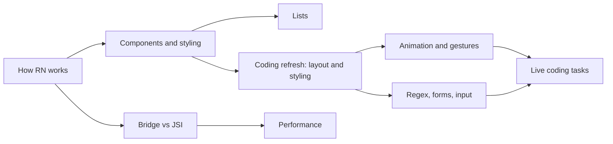

# React Native

How React code becomes a native app, and what is different from React on the web.

**Why it matters in interviews:** You built ZWS and the DBO mobile app. Interviews ask about the architecture (bridge vs JSI), list performance, and Expo vs bare.

## The map

How the lessons connect. Learn left to right.

## Lessons, one concept per file

Each lesson is one small file made from [the lesson template](../../templates/lesson-template.md): picture first, a code trace, practice, links to watch and play, and an explain it back section.

Status: `planned` (not written yet), `ready` (written, not studied), `learning`, `can explain` (passed explain-check).

### Basics

| # | Lesson | You will understand | Status |
|---|---|---|---|
| 01 | How React Native works `01-how-react-native-works.md` | JavaScript thread, native thread, how a View becomes a native view | planned |
| 02 | Core components and styling `02-core-components-and-styling.md` | View, Text, Flexbox defaults that differ from the web | planned |
| 03 | Navigation `03-navigation.md` | stack and tab navigation, passing params | planned |

### Core ideas

| # | Lesson | You will understand | Status |
|---|---|---|---|
| 04 | Lists and FlatList `04-lists-and-flatlist.md` | why ScrollView breaks with many items, virtualization, FlashList | planned |
| 05 | The old bridge vs the new architecture `05-the-old-bridge-vs-the-new-architecture.md` | JSI, Fabric, TurboModules | planned |
| 06 | Hermes `06-hermes.md` | what the engine changes for startup and memory | planned |
| 07 | Expo vs bare `07-expo-vs-bare.md` | what you gain and lose | planned |

### Senior level

| # | Lesson | You will understand | Status |
|---|---|---|---|
| 08 | Over the air updates `08-over-the-air-updates.md` | what OTA can and cannot change | planned |
| 09 | Offline storage `09-offline-storage.md` | AsyncStorage, MMKV, SQLite | planned |
| 10 | Performance on mobile `10-performance-on-mobile.md` | re-renders, images, animations on the UI thread | planned |

### Coding refresh: what interviews make you build

For when you have not written React Native for a while. These are the things a live coding round or take home test asks for. Each lesson has a runnable exercise or a Snack task. Made on 2026-10-25, checked against the React Native 0.88 source and the 0.87 docs.

**Layout and styling**

| # | Lesson | You will understand | Status |
|---|---|---|---|
| 11 | [Flexbox layout](11-flexbox-layout.md) | the three defaults that differ from the web, center a box, header with content and footer, rows, wrap, absolute | ready |
| 12 | The styling toolkit `12-the-styling-toolkit.md` | StyleSheet, `useWindowDimensions`, `Platform.select`, safe area, shadows vs elevation, dark mode | planned |
| 13 | Layout recipes `13-layout-recipes.md` | card, chat bubble, sticky bottom button, grid, avatar with badge, built from lesson 11 | planned |

**Animation and gestures**

| # | Lesson | You will understand | Status |
|---|---|---|---|
| 14 | [Animation with the Animated API](14-animated-api.md) | `Animated.Value`, timing, spring, interpolate, native driver and what it can animate | ready |
| 15 | [Reanimated](15-reanimated.md) | shared values, worklets, `useAnimatedStyle`, entering and exiting, CSS transitions, picking the right tool | ready |
| 16 | Gestures `16-gestures.md` | pan to drag, swipe to delete, bottom sheet with Gesture Handler | planned |

**Regex, forms and input**

| # | Lesson | You will understand | Status |
|---|---|---|---|
| 17 | [Regex for forms and text](17-regex-for-forms.md) | OTP, digits only, thousands separator, password rules, deep link, card mask, the two classic bugs | ready |
| 18 | Forms and TextInput `18-forms-and-textinput.md` | controlled input, keyboard avoiding, focus the next field, OTP boxes, validation on blur | planned |

**Live coding tasks**

| # | Lesson | You will understand | Status |
|---|---|---|---|
| 19 | Search list with debounce `19-search-list-with-debounce.md` | FlatList plus search, debounce, pull to refresh, infinite scroll | planned |
| 20 | Fetching data in a screen `20-fetching-data-in-a-screen.md` | loading, error and empty states, cancel with AbortController, race conditions | planned |
| 21 | Hook coding tasks `21-hook-coding-tasks.md` | useDebounce, useToggle, usePrevious, a stopwatch with useInterval | planned |
| 22 | Small UI components `22-small-ui-components.md` | accordion, star rating, tabs, toggle switch, modal, todo list | planned |
| 23 | Navigation tasks `23-navigation-tasks.md` | stack plus tabs, params, login flow, deep link | planned |
| 24 | State and saving data `24-state-and-saving-data.md` | Context or Zustand, saving with AsyncStorage or MMKV | planned |

**Quality**

| # | Lesson | You will understand | Status |
|---|---|---|---|
| 25 | Performance coding `25-performance-coding.md` | `memo`, `useCallback`, `keyExtractor`, `getItemLayout`, FlashList, images | planned |
| 26 | Testing React Native `26-testing-react-native.md` | Jest and React Native Testing Library | planned |
| 27 | Accessibility and platform `27-accessibility-and-platform.md` | accessibility props, permissions, dark mode, keyboard | planned |

Runnable exercises for these lessons are in [`practice/`](practice/) (`cd learn/react-native/practice && npm install`, then `npm run test:11`, `test:14` or `test:17`). The layout answers are checked with Yoga, the same layout engine React Native uses.

**To make the next lesson:** in a chat with this folder open, say `/learn react-native 01` to learn it live with Claude, or ask "make lesson react-native 01" and the `research-material` agent writes the file. When a lesson file exists, its row becomes a link and the status changes to `ready`.

## Guides already here

Longer guides that cover many concepts at once. Good for revision after the lessons.

- [React Native interview guide](react-native-interview-guide.md)

## Visual cheatsheets

Open in the browser. Everything visible on one page.

- [React Native visual cheatsheet](react-native-interview-guide-cheatsheet.html)

## Pages you can move

- [Flexbox playground](visuals/11-flexbox-playground.html) - change `flexDirection`, `justifyContent` and the rest, and watch the boxes. Starts with the React Native defaults.
- [Animated value lab](visuals/14-animated-lab.html) - drag the value, change the easing, compare `extend` and `clamp`.

## Watch and play

Trusted places to see the ideas, not only read them. Each lesson adds its own checked video and visualizer links.

- [React Native docs](https://reactnative.dev/docs/getting-started) - official docs
- [Expo docs](https://docs.expo.dev/) - Expo guides and tools
- [Expo Snack](https://snack.expo.dev) - run React Native code in the browser, good for trying the snippets in the coding lessons
- [Reanimated docs](https://docs.swmansion.com/react-native-reanimated/) - the animation library docs (4.x)
