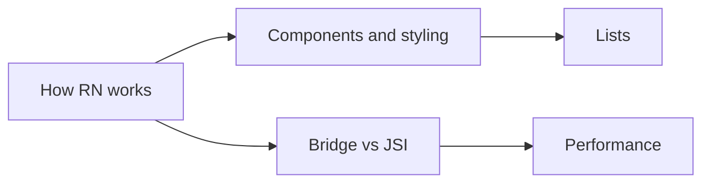

# React Native

How React code becomes a native app, and what is different from React on the web.

**Why it matters in interviews:** You built ZWS and the DBO mobile app. Interviews ask about the architecture (bridge vs JSI), list performance, and Expo vs bare.

## The map

How the lessons connect. Learn left to right.

## Lessons, one concept per file

Each lesson is one small file made from [the lesson template](../../templates/lesson-template.md): picture first, a code trace, practice, links to watch and play, and an explain it back section.

Status: `planned` (not written yet), `ready` (written, not studied), `learning`, `can explain` (passed explain-check).

### Basics

| # | Lesson | You will understand | Status |
|---|---|---|---|
| 01 | How React Native works `01-how-react-native-works.md` | JavaScript thread, native thread, how a View becomes a native view | planned |
| 02 | Core components and styling `02-core-components-and-styling.md` | View, Text, Flexbox defaults that differ from the web | planned |
| 03 | Navigation `03-navigation.md` | stack and tab navigation, passing params | planned |

### Core ideas

| # | Lesson | You will understand | Status |
|---|---|---|---|
| 04 | Lists and FlatList `04-lists-and-flatlist.md` | why ScrollView breaks with many items, virtualization, FlashList | planned |
| 05 | The old bridge vs the new architecture `05-the-old-bridge-vs-the-new-architecture.md` | JSI, Fabric, TurboModules | planned |
| 06 | Hermes `06-hermes.md` | what the engine changes for startup and memory | planned |
| 07 | Expo vs bare `07-expo-vs-bare.md` | what you gain and lose | planned |

### Senior level

| # | Lesson | You will understand | Status |
|---|---|---|---|
| 08 | Over the air updates `08-over-the-air-updates.md` | what OTA can and cannot change | planned |
| 09 | Offline storage `09-offline-storage.md` | AsyncStorage, MMKV, SQLite | planned |
| 10 | Performance on mobile `10-performance-on-mobile.md` | re-renders, images, animations on the UI thread | planned |

**To make the next lesson:** in a chat with this folder open, say `/learn react-native 01` to learn it live with Claude, or ask "make lesson react-native 01" and the `research-material` agent writes the file. When a lesson file exists, its row becomes a link and the status changes to `ready`.

## Guides already here

Longer guides that cover many concepts at once. Good for revision after the lessons.

- [React Native interview guide](react-native-interview-guide.md)

## Visual cheatsheets

Open in the browser. Everything visible on one page.

- [React Native visual cheatsheet](react-native-interview-guide-cheatsheet.html)

## Watch and play

Trusted places to see the ideas, not only read them. Each lesson adds its own checked video and visualizer links.

- [React Native docs](https://reactnative.dev/docs/getting-started) - official docs
- [Expo docs](https://docs.expo.dev/) - Expo guides and tools
