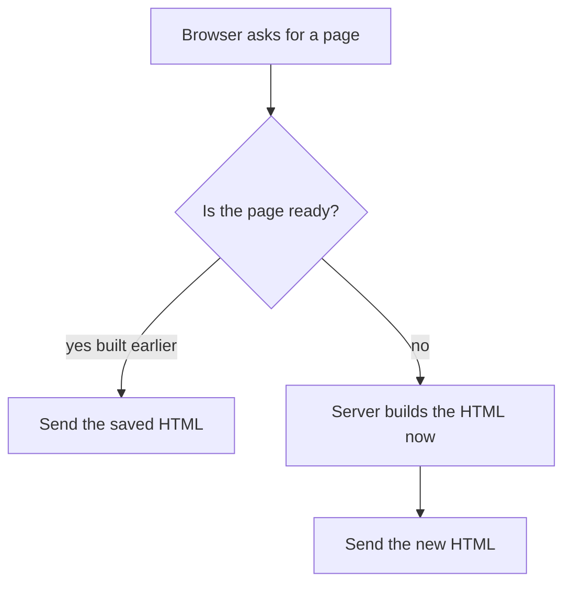
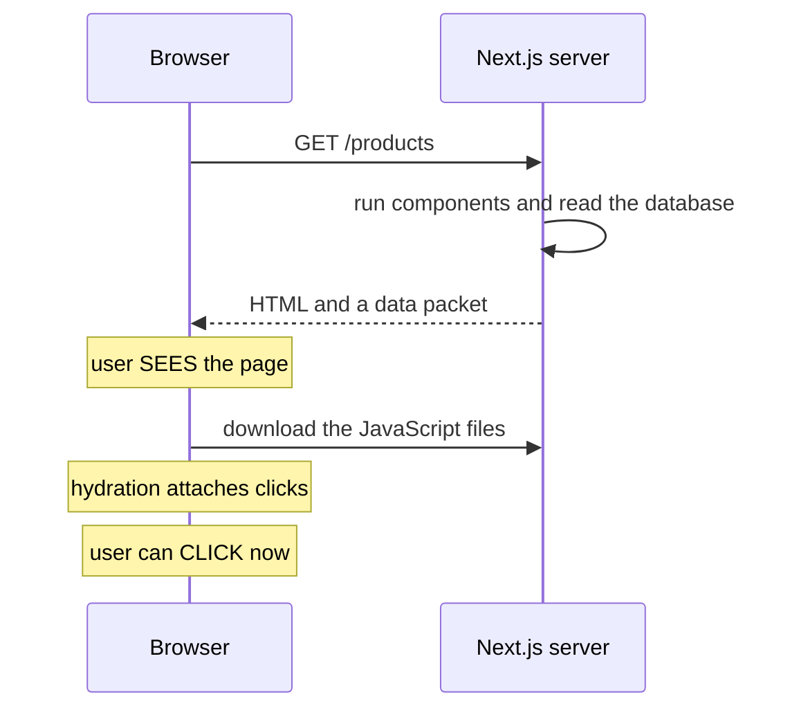
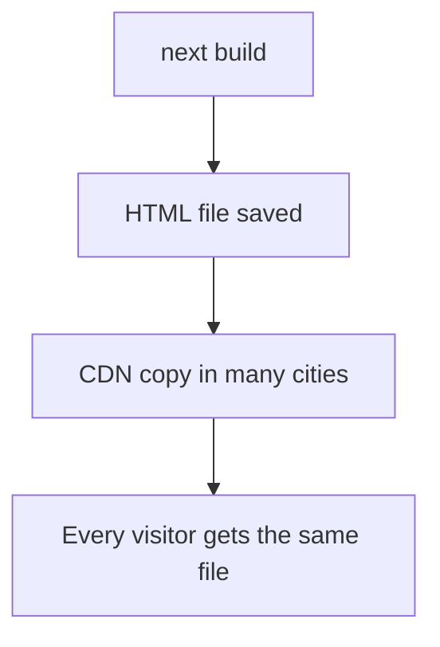
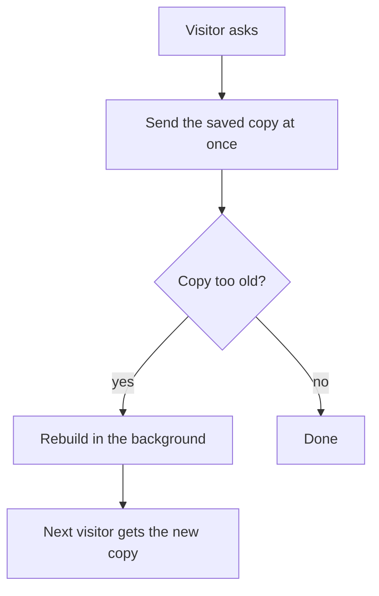
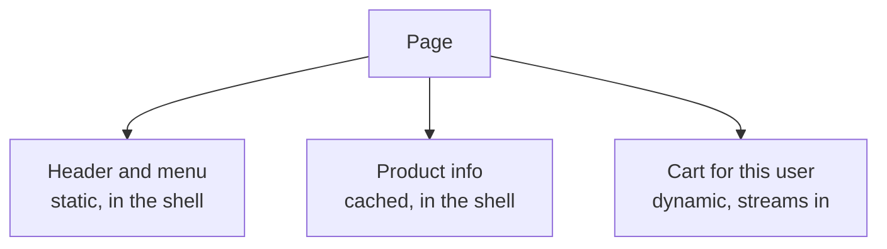

# 14. Next.js rendering: how a page request works

> **Subject:** React · **Lesson:** 14 · **Made:** 2026-11-27 · **Status:** ready
>
> **You will be able to:** follow one page request from the browser to the Next.js server and back, and explain SSR, static pages, ISR and streaming in four parts.
>
> **Before this:** [How a website works: server side and client side](19-how-a-website-works-server-vs-client.md) (read it first if "server side" and "client side" are still fuzzy) · **Next:** [Server and Client Components](16-server-and-client-components.md)
>
> **How to read it:** one card is one idea. Look at the picture, guess, then press the orange bar to check. The blue bars (📖 More detail) hold the longer explanation. Skip them on the first read, open them when you want more. About 20 minutes for the cards.

<!-- quick-summary:start -->
## Quick summary

> Short on time? Read only this. These are the "Remember" lines from the cards below, so you can read the whole lesson in one minute.

- Static means built before the visit, dynamic means built during the visit.
- SSR gives a page you can see fast. Hydration is what makes it clickable.
- Static is the fastest and cheapest, but every visitor sees the same thing.
- ISR is a saved page that refreshes itself, so nobody waits for the rebuild.
- Suspense draws the line. Everything outside is the shell. Everything inside streams in when ready.
- Read request data as deep in the tree as you can, and put Suspense around it.
<!-- quick-summary:end -->

## 1. The idea: a bakery and a restaurant

A bakery bakes bread **before** you arrive. You walk in and take it. A restaurant cooks **after** you order. The first is fast but the bread can be old. The second is fresh but you wait.

Web pages work the same way. Next.js can build a page **before** the visit (static) or **during** the visit (dynamic).



Notice: the saved page can sit on a CDN (a shop near the user), so it is very fast. The new page needs a server and a database trip.

<details class="guess"><summary>🤔 Guess: a blog post that changes once a week. Bakery or restaurant? Press to check.</summary>

Bakery. Build it once and keep it. A user's bank balance is the opposite: it must be cooked fresh for each person.

</details>

> **Remember:** static means built before the visit, dynamic means built during the visit.

<details class="more"><summary>📖 More detail: the four names interviewers use</summary>

Interviewers still use four short names. You should know them and know what they mean in Next.js 16.

| Name | Plain meaning | When the HTML is built |
|---|---|---|
| CSR (client side rendering) | the browser builds the page with JavaScript | in the browser, after load |
| SSR (server side rendering) | the server builds the HTML for each visit | on every request |
| SSG (static site generation) | the HTML is built once | at build time |
| ISR (incremental static regeneration) | static, but rebuilt later in the background | at build time, then on a timer or a signal |

Where the picture stops: in Next.js 16 the choice is **not** one answer per page any more. One page can mix both (card 5).

</details>

## 2. What "server side rendering" really does

SSR is not just "the server makes HTML". It has a second half that people forget: **hydration**. The HTML shows up fast, but it is only a picture. It does not react to clicks yet.



Notice: there are two moments. "I can see it" comes first. "I can use it" comes later.

<details class="guess"><summary>🤔 Guess: the HTML has arrived and the button is on screen. Does the click work? Press to check.</summary>

Not always. Until the JavaScript has loaded and hydration is done, the button is only a picture. A user who taps early sees nothing happen. This is why shipping less JavaScript matters.

</details>

> **Remember:** SSR gives a page you can see fast. Hydration is what makes it clickable.

<details class="more"><summary>📖 More detail: what hydration does, step by step</summary>

**Hydration** means React walks the HTML that is already on the page and attaches the click handlers to it. React does not rebuild the HTML. It reuses it.

| Step | Who | What happens |
|---|---|---|
| 1 | Browser | asks the server for `/products` |
| 2 | Server | runs your components, reads the database |
| 3 | Server | sends HTML plus a data packet (the RSC payload, lesson 16) |
| 4 | Browser | paints the HTML, the user sees the page |
| 5 | Browser | downloads the JavaScript for the interactive parts |
| 6 | Browser | hydrates: attaches the clicks, now the page works |

**Step through it yourself:** [Request journey stepper](visuals/14-request-journey.html). Press Next and watch the browser, the server and the database.

Source: [Server and Client Components, Next.js docs](https://nextjs.org/docs/app/getting-started/server-and-client-components) (page updated 2026-10-05).

</details>

## 3. Static pages: bake once, serve many

A static page is built when you run `next build`. After that, the server does no work for it. A CDN hands out the same file to everyone.



Notice: the cost is time. A page built on Monday still shows Monday's data on Friday, until you build again.

<details class="guess"><summary>🤔 Guess: a page that shows "Hello, Sam" with the visitor's name. Can it be fully static? Press to check.</summary>

No. The name belongs to one visitor, and a shared file cannot hold it. That part must be dynamic. The rest of the page can still be static (card 5).

</details>

> **Remember:** static is the fastest and cheapest, but every visitor sees the same thing.

<details class="more"><summary>📖 More detail: the pages that are static by default</summary>

In the App Router, a page that only uses things known at build time is built early. In Next.js 16 with Cache Components, the docs say module imports, synchronous work and pure computations "complete during prerender and are included in the static shell automatically".

For a page with a dynamic address like `/blog/[slug]`, `generateStaticParams` lists which slugs to build early. The others can be built on the first visit.

</details>

## 4. ISR: bread with a timer

A fully static page has one problem: it gets old. **ISR** fixes this. The page is still saved, but it gets rebuilt in the background, on a timer or when you say so.



Notice: the visitor who triggers the rebuild still gets the **old** copy. Nobody waits. This idea is called stale while revalidate: serve old, refresh later.

<details class="guess"><summary>🤔 Guess: a product page rebuilds every 10 minutes. You change the price now. What does the next visitor see? Press to check.</summary>

Probably the old price, until the next rebuild. To fix it faster, call an on-demand signal after you save the change, such as `revalidateTag` (lesson 17). That marks the copy as old right now.

</details>

> **Remember:** ISR is a saved page that refreshes itself, so nobody waits for the rebuild.

<details class="more"><summary>📖 More detail: ISR in the old and the new Next.js</summary>

- **Pages Router (older):** `getStaticProps` returns `props` and a `revalidate` number of seconds. This is the classic interview answer.
- **App Router before Next.js 16:** a `revalidate` setting on the route or on `fetch`.
- **Next.js 16 with Cache Components:** you cache a function with `use cache` and set its lifetime with `cacheLife`. Lesson 17 covers this. The docs also have a guide, [ISR with Cache Components](https://nextjs.org/docs/app/guides/incremental-static-regeneration-cache-components).

If an interviewer says "getStaticProps", they mean the older Pages Router. Say that you know the old name and the new way.

</details>

## 5. The new picture: a shell and streamed parts

Old Next.js asked you to pick **one** answer for the whole page. If one small part needed the visitor's cookie, the whole page became dynamic. That is a waste.

Next.js 16 picks **per piece**. The parts that are the same for everyone are built early and form the **static shell**. The parts that depend on the visitor **stream in** later. This is called Partial Prerendering (PPR).



Notice: the visitor sees the header and the product at once. A loading box shows where the cart will be. When the cart is ready, it replaces the loading box.

<details class="guess"><summary>🤔 Guess: what do you wrap around the cart so the rest of the page does not wait for it? Press to check.</summary>

`<Suspense fallback={<p>Loading cart...</p>}>`. The fallback is part of the shell. The cart streams in later in the same response.

</details>

> **Remember:** Suspense draws the line. Everything outside is the shell. Everything inside streams in when ready.

<details class="more"><summary>📖 More detail: what makes a part dynamic, and streaming in plain words</summary>

A part is dynamic when it needs something that only exists once a visitor arrives. The Next.js docs call these **runtime APIs**:

- `cookies()` and `headers()`
- `searchParams` (the `?q=shoes` part of the address)
- `params` that were not listed in `generateStaticParams`
- data from a database or API that you did not cache

**Streaming** means the server sends the page in pieces over one connection instead of waiting to finish everything. The shell goes first. Each Suspense box is sent when its data is ready. Each box is independent, so a slow one does not block a fast one.

Two streams travel together: the HTML (for the first paint) and the component payload (what React needs to hydrate and to update later).

`loading.js` is a shortcut. Next.js wraps your page in Suspense for you and uses that file as the fallback.

Sources: [Caching](https://nextjs.org/docs/app/getting-started/caching) (updated 2026-11-18), [Streaming](https://nextjs.org/docs/app/guides/streaming) (updated 2026-11-18), [Rendering philosophy](https://nextjs.org/docs/app/guides/rendering-philosophy) (updated 2026-03-30).

</details>

## 6. Mistake: reading the cookie at the top of the page

You read `cookies()` at the top of the page, with no Suspense around it. In the old model, this made the **whole page** dynamic, even the parts that never change. In Next.js 16 with Cache Components, it is worse: the build **stops** and tells you to fix it.

```tsx
// wrong: no Suspense around request data
export default async function Page() {
  const user = (await cookies()).get('user')
  return <Everything user={user} />
}
```

<details class="guess"><summary>🤔 Guess: how do you fix it without removing the cookie? Press to check.</summary>

Move the cookie read **down** into a small component and wrap that component in Suspense. The rest of the page goes back into the shell.

```tsx
export default function Page() {
  return (
    <>
      <Header />
      <Suspense fallback={<p>Loading...</p>}>
        <Greeting />   {/* reads cookies */}
      </Suspense>
    </>
  )
}
```

</details>

> **Remember:** read request data as deep in the tree as you can, and put Suspense around it.

<details class="more"><summary>📖 More detail: the real error, and the three fixes it offers</summary>

I tried this on Next.js 16.4.6 with `cacheComponents: true`. `next build` failed with:

```text
Error: Route "/": Next.js encountered uncached or
runtime data during prerendering. `fetch(...)`,
`cookies()`, `headers()`, `params`, `searchParams`,
or `connection()` accessed outside of <Suspense>
prevents the route from being prerendered...
```

It lists three ways out:

- **stream:** put `<Suspense fallback={...}>` around the data access.
- **cache:** for data that is not personal, use `"use cache"`.
- **block:** set `export const instant = false` to allow a blocking route. This is the "I accept a slow page" choice.

The docs call the skill of moving the read down "maximizing the static shell". See [Caching, Maximizing the static shell](https://nextjs.org/docs/app/getting-started/caching#maximizing-the-static-shell).

</details>

## 7. Why it matters and what it costs

- **Without a plan:** every page is built per visit. Servers cost more, pages are slower, and a database spike hits every visitor.
- **With static, ISR and streaming:** most of the page comes from a copy. Only the personal parts cost a server trip.
- **The cost:** more rules to learn, and a hosting plan that must support streaming. Self-hosting a plain Node server works, but a shared cache across servers needs extra setup (see the Rendering philosophy page).

| If the page is... | Use |
|---|---|
| the same for everyone, rarely changes | static |
| the same for everyone, changes often | cached with a timer or on-demand refresh (ISR) |
| personal, such as a cart or dashboard | dynamic inside Suspense |
| a mix | shell plus streamed parts (PPR) |

## 8. Watch and play

All links below were opened on 2026-11-27 and loaded. I did not find a video that I could open and check, so there is none here. The Caching docs page embeds a 10 minute video on Partial Prerendering.

- **Step through it:** [Request journey stepper](visuals/14-request-journey.html) - press Next and follow one request.
- **Read:** [Caching](https://nextjs.org/docs/app/getting-started/caching) - read "Static, cached, and streaming" and the picture of the shell.
- **Read:** [Streaming](https://nextjs.org/docs/app/guides/streaming) - the section "How the App Router delivers a page".
- **Read:** [Rendering philosophy](https://nextjs.org/docs/app/guides/rendering-philosophy) - why Next.js draws the line per component.
- **Read:** [Server Components, react.dev](https://react.dev/reference/rsc/server-components) - the React side of the idea.

## 9. Practice

**A. Predict**

A page has a static header, a cached list of products, and a cart that reads `cookies()` inside `<Suspense>`. What does the visitor see first, and what arrives later?

<details><summary>Answer</summary>

First: the header, the product list and the loading box for the cart (the shell). Later: the cart, streamed in when the cookie read is done.

</details>

**B. Fix the bug**

```tsx
export default async function Page() {
  const theme = (await cookies()).get('theme')
  const posts = await getPosts()   // cached
  return <Layout theme={theme}><Posts posts={posts} /></Layout>
}
```

Visitors complain that the page is slow even though posts are cached. Why?

<details><summary>Answer</summary>

The cookie read at the top makes the whole page wait for the request. Move `cookies()` into a small `ThemeProvider` or `Greeting` component and wrap it in Suspense. The posts then stay in the static shell.

</details>

**C. Write it yourself**

On paper, draw a product page. Mark each part: static, cached, or streamed. Then say which Next.js tool you used for each.

<details><summary>One possible answer</summary>

Header and menu: static. Product info: cached with `use cache`. Cart and recommendations: streamed inside Suspense because they depend on the user.

</details>

## 10. Interview question

**Q:** Explain SSR, SSG and ISR in Next.js. How does Next.js 16 change the picture?

<details><summary>A strong answer, in four parts</summary>

1. **Problem:** pages need to be fast and fresh. Building every page per visit is slow and costly. Building once makes data old.
2. **How it works:** SSR builds HTML per request and then hydrates. SSG builds at build time. ISR serves a saved copy and rebuilds in the background. In Next.js 16, the choice is per component: a static shell is sent first and dynamic parts stream in behind Suspense.
3. **Tradeoff:** static is fastest but old. Dynamic is fresh but costs a server trip. Streaming needs hosting that supports it.
4. **My example:** an idea, not a fact about my projects: on a product page, cache the product info and stream the personal cart. I can say where I used Next.js in DBO, Unloan or ZWS only after I add that fact myself.

</details>

## 11. Explain it back

Close this file. Explain a page request to a new junior in 4 parts (problem, how, tradeoff, my example). Then write your best version below and run `/explain-check next.js rendering` or ask the `explain-coach` agent to review it.

### My explanation

<write here>

### Coach feedback

<the explain-coach agent writes here>

## 12. Review questions (day 1, 3, 7, 21)

1. What is hydration, and why can a visible button still not work?
2. What does Suspense decide in a Next.js 16 page?
3. In ISR, what does the visitor who triggers the rebuild see?
4. Draw the picture from card 5 from memory: the shell and the streamed parts.

<details><summary>Answers</summary>

1. React attaches click handlers to HTML that is already there. Until the JavaScript has loaded, the button is only a picture.
2. It marks which parts are in the shell and which stream in later.
3. The old saved copy. The rebuild happens in the background.
4. Header and product info in the shell, a loading box where the cart goes, then the cart replaces it.

</details>

## 13. Go deeper (optional)

<details><summary>Version notes and the older names</summary>

- **I checked streaming for real (Next.js 16.4.6, 2026-11-27).** A page had a cached product list and a `<Suspense>` greeting that took 1.5 seconds. The first byte came after 0.06 seconds and the full page after 1.6 seconds. The loading box was in the first part of the HTML. "Hello, Sam" came at the end, inside a hidden `div`, and a tiny script moved it into the place of the loading box. `next build` marked the route `◐ Partial Prerender`.
- Next.js 16 (October 2025) made Cache Components and `use cache` the model where caching is chosen on purpose. Before that, the App Router cached some things by default, which surprised many people.
- New apps from `create-next-app` have Cache Components and Partial Prefetching on. For an existing app you set `cacheComponents: true` and `partialPrefetching: true` in `next.config.ts` (Caching docs, 2026-11-18).
- `getServerSideProps` (SSR), `getStaticProps` (SSG) and `getStaticProps` with `revalidate` (ISR) belong to the Pages Router. Many companies still run it.
- In Next.js 16 `params`, `cookies()` and `headers()` are async, so you write `await`.

</details>

## Connected lessons

- [Server and Client Components](16-server-and-client-components.md) - what is inside the data packet and where the JavaScript boundary sits.
- [Caching and revalidation](17-nextjs-caching-and-revalidation.md) - how the saved copies are kept and refreshed.
- [Server Actions](18-server-actions.md) - how a click sends data back to the server.
- [React guide, section 2.11](react-js-frontend-interview-guide.md) - the short version in the main guide.
