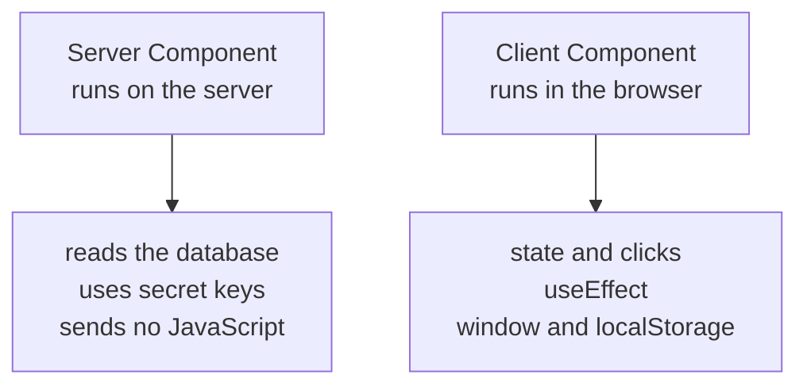
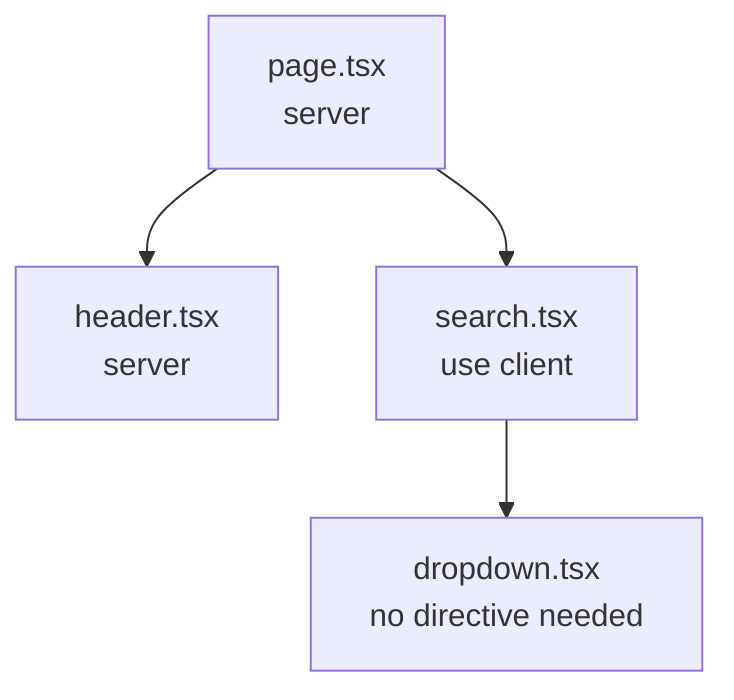
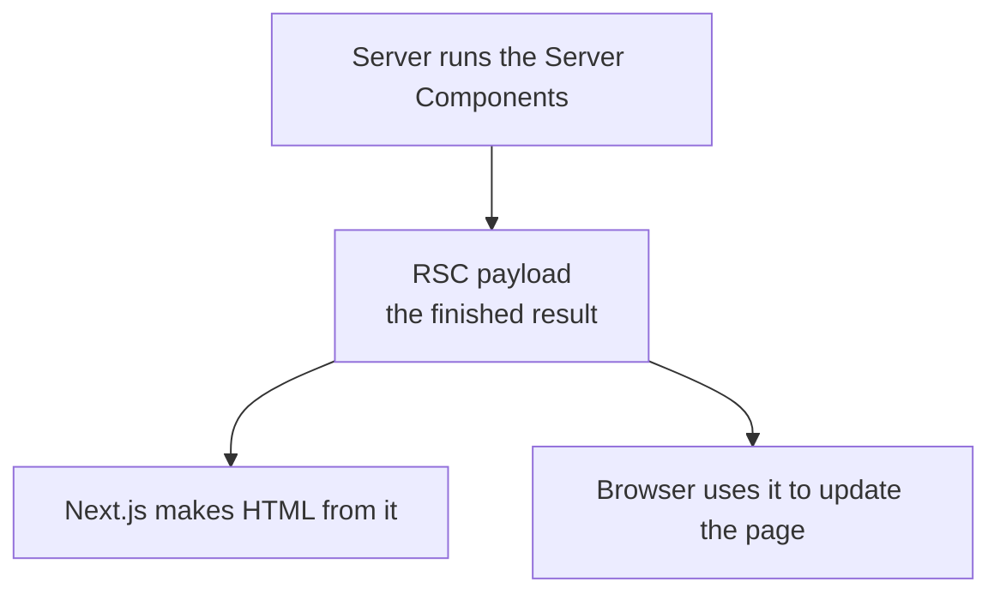
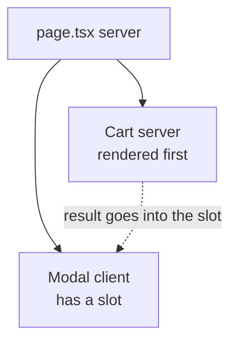

# 16. Server and Client Components

> **Subject:** React · **Lesson:** 16 · **Made:** 2026-11-27 · **Status:** ready
>
> **You will be able to:** say which code runs on the server and which in the browser, what `"use client"` really does, and what can cross between the two.
>
> **Before this:** [Next.js rendering](14-next-js-rendering.md) · **Next:** [Caching and revalidation](17-nextjs-caching-and-revalidation.md)
>
> **How to read it:** one card is one idea. Look at the picture, guess, then press the orange bar to check. The blue bars (📖 More detail) hold the longer explanation. Skip them on the first read, open them when you want more. About 20 minutes for the cards.

<!-- quick-summary:start -->
## Quick summary

> Short on time? Read only this. These are the "Remember" lines from the cards below, so you can read the whole lesson in one minute.

- Server components read data and ship no JavaScript. Client components handle clicks and state.
- `"use client"` marks the entry to the browser side. Everything below it in the import tree goes along.
- The browser receives the result of a Server Component, never its code.
- Props across the boundary must be serializable. Functions cannot cross, except Server Actions.
- To keep a server component inside a client one, pass it as children, do not import it.
- When you need state or clicks, extract a small client leaf. Do not turn the whole page into a client component.
- Secrets stay in files marked `server-only`. A build error is cheaper than a production bug.
<!-- quick-summary:end -->

## 1. The idea: the back kitchen and the dining room

A restaurant has a **back kitchen** and a **dining room**. The kitchen has the fridge, the keys and the recipes. Guests never go there. The dining room has the tables, the menus and the bell. Guests touch things there.

Next.js has the same two places. A **Server Component** runs in the kitchen (the server). A **Client Component** runs in the dining room (the browser).



Notice: the server side cannot hold a click or a state value. The browser side cannot hold a secret key.

<details class="guess"><summary>🤔 Guess: a page lists posts from the database and has a like button. How many of each kind? Press to check.</summary>

The page is a Server Component: it reads the database. The like button is a Client Component: it needs a click and state. One page, two kinds, side by side.

</details>

> **Remember:** server components read data and ship no JavaScript. Client components handle clicks and state.

<details class="more"><summary>📖 More detail: the four words, and where the kitchen picture stops</summary>

- **Server Component:** a React component that runs only on the server. In the Next.js App Router, every page and layout is one by default.
- **Client Component:** a component that also runs in the browser. You make one with `"use client"`.
- **Boundary:** the line between the two. `"use client"` draws it.
- **Serialize:** turn a value into plain text so it can travel over the network.

Use a Client Component for state, event handlers (`onClick`), `useEffect`, browser-only APIs (`localStorage`, `window`) and custom hooks. Use a Server Component to fetch data close to the source, use secrets safely, send less JavaScript and paint sooner.

A Client Component still runs on the server **once**, to make the first HTML (lesson 14). After that it lives in the browser.

Source: [Server and Client Components, Next.js docs](https://nextjs.org/docs/app/getting-started/server-and-client-components) (updated 2026-10-05).

</details>

## 2. `"use client"` draws a line, it does not tag one component

Many people think `"use client"` marks one component. It does not. It marks a **file** as the **entry to the browser side**. That file, everything it imports, and every component it renders directly go to the browser.



Notice: `dropdown.tsx` has no directive, but it is imported by a client file. So it goes to the browser too.

<details class="guess"><summary>🤔 Guess: every file imported by `search.tsx` needs its own `"use client"`. True or false? Press to check.</summary>

False. One directive at the top of `search.tsx` is enough. Its imports join the browser side automatically. Only the entry point needs the line.

</details>

> **Remember:** `"use client"` marks the entry to the browser side. Everything below it in the import tree goes along.

<details class="more"><summary>📖 More detail: what this means for bundle size</summary>

The Next.js docs say: "all of its imports and the components it directly renders are included in the client bundle."

So where you put `"use client"` matters. Put it at the **leaves** (the small interactive parts). If you put it on a big layout, the whole tree below it becomes browser code.

One exception is important: a Server Component that is **passed in as `children` or another prop** is not imported by the client file. It stays on the server (card 5).

```tsx
// app/layout.tsx  (server, the default)
import Logo from './logo'       // server
import Search from './search'   // client

export default function Layout({ children }) {
  return (
    <>
      <nav><Logo /><Search /></nav>
      <main>{children}</main>
    </>
  )
}
```

Only `Search` is in the bundle. The docs use this exact example for "reducing JS bundle size".

</details>

## 3. What really travels: the RSC payload

Here is the part most people skip. A Server Component does not send its code to the browser. It runs, and sends its **result**, as a compact packet called the **RSC payload**.



Notice: the payload holds the finished output, a spot for each Client Component, and the data you passed to it. No server code, no database call.

<details class="guess"><summary>🤔 Guess: you open the page source in the browser. Can you find the database query? Press to check.</summary>

No. The query ran on the server. The browser gets the answer, not the query. This is why secrets and heavy libraries can stay on the server.

</details>

> **Remember:** the browser receives the result of a Server Component, never its code.

<details class="more"><summary>📖 More detail: the three things inside the payload, and what happens on a second page</summary>

The Next.js docs say the RSC payload contains:

- the rendered result of the Server Components,
- a **placeholder** for each Client Component, with a link to its JavaScript file,
- any props you passed from a Server Component to a Client Component.

First visit, in the browser: HTML shows a fast preview. The payload lines up the server and client trees. JavaScript hydrates the Client Components.

Later navigations: the payload is fetched (and prefetched) and cached, so moving between pages is fast. Client Components render fully in the browser.

**Step through it yourself:** [Request journey stepper](visuals/14-request-journey.html) shows the payload step.

</details>

## 4. Passing props: only plain values cross

Props from a server component to a client component travel inside the payload. So they must be turned into text. Plain values work. Some things do not.

| Can cross | Cannot cross |
|---|---|
| strings, numbers, booleans | a normal function (like a click handler) |
| arrays and plain objects | a class instance |
| `Date`, `Map`, `Set`, promises | anything that is not serializable |
| Server Actions (special functions) | a live database connection |

Notice: a function is code. Code cannot be turned into plain text, so it cannot travel. A Server Action is the exception (lesson 18).

<details class="guess"><summary>🤔 Guess: a Server Component passes `onClick={() => save()}` to a Client Component. What happens? Press to check.</summary>

It fails. The function cannot be serialized. Keep the click handler **inside** the Client Component, or pass a Server Action.

</details>

> **Remember:** props across the boundary must be serializable. Functions cannot cross, except Server Actions.

<details class="more"><summary>📖 More detail: pass less, pass only what the screen needs</summary>

The docs say props "need to be serializable by React". There is also a safety side: whatever you pass is **visible in the page data**. If you fetch a user row with a password hash and pass the whole row, the hash is sent to the browser.

Pass only the fields the screen shows. For example, pass `likes={post.likes}`, not the whole `post`.

React's reference: [Serializable arguments and return values](https://react.dev/reference/react/use-server#serializable-parameters-and-return-values). Checked 2026-11-27: it lists strings, numbers, `Date`, `Map`, `Set`, `FormData`, plain objects, promises and Server Functions as allowed, and plain functions and class instances as not allowed.

</details>

## 5. Interleaving: a server component inside a client one

Sometimes you need a client wrapper with a server component inside. A modal is the usual case: the open and close state is client, but the content (a cart that reads the database) is server.

The trick: pass the server component as **children**.

```tsx
// ui/modal.tsx
'use client'
export default function Modal({ children }) {
  // open and close state lives here
  return <div>{children}</div>
}

// app/page.tsx  (server)
<Modal>
  <Cart />   {/* still a Server Component */}
</Modal>
```



Notice: `Cart` is **not** imported by `Modal`. The server renders it first, then drops the result into the slot.

<details class="guess"><summary>🤔 Guess: if `Modal` imports `Cart` directly instead, what changes? Press to check.</summary>

`Cart` is now inside the client import tree, so it becomes a Client Component. It would run in the browser and could not read the database directly. Pass it as children to keep it on the server.

</details>

> **Remember:** to keep a server component inside a client one, pass it as children, do not import it.

<details class="more"><summary>📖 More detail: context providers use the same trick</summary>

React context does not work in Server Components. You make a small client file that accepts `children`:

```tsx
'use client'
import { createContext } from 'react'
export const ThemeContext = createContext({})

export default function ThemeProvider({ children }) {
  return (
    <ThemeContext.Provider value="dark">
      {children}
    </ThemeContext.Provider>
  )
}
```

Then the server layout renders `<ThemeProvider>{children}</ThemeProvider>`. The pages inside are still Server Components. The docs say to put providers "as deep as possible", so more of the tree can stay static.

</details>

## 6. Mistake 1: a Server Component that uses a hook

You write a page with `useState` but forget `"use client"`. The build fails.

```tsx
// app/page.tsx  (no directive)
import { useState } from 'react'
export default function Page() {
  const [n, setN] = useState(0)
  return <button onClick={() => setN(n + 1)}>{n}</button>
}
```

<details class="guess"><summary>🤔 Guess: what is the best fix, and where do you put the directive? Press to check.</summary>

Move the button into its own small file with `"use client"` and import it into the page. The page stays a server component. Do not put the directive on the whole page just to silence the error.

</details>

> **Remember:** when you need state or clicks, extract a small client leaf. Do not turn the whole page into a client component.

<details class="more"><summary>📖 More detail: the real error message</summary>

I tried this on Next.js 16.4.6 (2026-11-27). The build stopped with:

```text
Error: You're importing a module that depends on
`useState` into a React Server Component module.
This API is only available in Client Components.
To fix, mark the file (or its parent) with the
`"use client"` directive.
```

It also points to the `use client` docs. The message is clear, so read it before you search.

</details>

## 7. Mistake 2: a secret that reaches the browser

You write `lib/data.ts` with an API key from `process.env.API_KEY`. Later a Client Component imports it by accident.

<details class="guess"><summary>🤔 Guess: does the key leak to the browser? Press to check. </summary>

Next.js protects you in one way: only variables that start with `NEXT_PUBLIC_` reach the client. Other variables become an empty string there, so the call **fails** instead of leaking. But a failing call is a bug you find late.

Better: add `import 'server-only'` at the top of the file. Then importing it from a Client Component stops the **build**, which is the earliest place to find the mistake.

</details>

> **Remember:** secrets stay in files marked `server-only`. A build error is cheaper than a production bug.

<details class="more"><summary>📖 More detail: server-only and client-only</summary>

```ts
// lib/data.ts
import 'server-only'

export async function getData() {
  const res = await fetch('https://example.com/data', {
    headers: { authorization: process.env.API_KEY! },
  })
  return res.json()
}
```

The docs call this "preventing environment poisoning". The `client-only` package is the opposite: it marks code that touches `window`. In Next.js, installing the packages is optional, because Next.js handles the imports itself.

Third-party components that use `useState` but have no `"use client"` need a small wrapper file with the directive. Library authors should add the directive to their entry points.

</details>

## 8. Why it matters and what it costs

- **Without the split:** every component ships its JavaScript. Bundles get big, secrets need an API layer, and data fetching waits for the browser.
- **With the split:** the browser gets less JavaScript, data is fetched next to the database, and secrets stay on the server.
- **The cost:** two worlds to keep in your head, a boundary where values must be serializable, and a framework tie-in. Some libraries still assume the client only.

| Need | Use |
|---|---|
| state, clicks, effects, `window` | Client Component |
| read the database, use a secret | Server Component |
| interactive wrapper with server content inside | client wrapper, server child passed as children |

## 9. Watch and play

All links were opened on 2026-11-27 and loaded. I found no video that I could open and check, so there is none here.

- **Read:** [Server and Client Components](https://nextjs.org/docs/app/getting-started/server-and-client-components) - the main page. Try the like button example.
- **Read:** [Server Components, react.dev](https://react.dev/reference/rsc/server-components) - the React view of the same idea.
- **Read:** [`use client`, react.dev](https://react.dev/reference/rsc/use-client) - what the directive does and what it cannot do.
- **Step through it:** [Request journey stepper](visuals/14-request-journey.html) - see where the payload goes.

## 10. Practice

**A. Predict**

```tsx
// ui/panel.tsx
'use client'
import Chart from './chart'   // no directive
export default function Panel() { return <Chart /> }
```

Is `Chart` a server or a client component?

<details><summary>Answer</summary>

Client. It is imported by a client file, so it joins the browser side. A directive on `Chart` itself is not needed.

</details>

**B. Fix the bug**

```tsx
// app/page.tsx  (server)
<Button onClick={() => console.log('hi')} />   // Button has "use client"
```

<details><summary>Answer</summary>

A normal function cannot cross the boundary. Move the `onClick` inside `Button`, or pass a Server Action.

</details>

**C. Write it yourself**

Draw a page with a header, a product list from the database, a search box and a theme switcher. Mark each part server or client, and say where each `"use client"` goes.

<details><summary>One possible answer</summary>

Header: server. Product list: server (reads the database). Search box: client leaf. Theme switcher: a client `ThemeProvider` that takes `children`, rendered by the server layout.

</details>

## 11. Interview question

**Q:** What is the difference between Server and Client Components in Next.js? What does `"use client"` do?

<details><summary>A strong answer, in four parts</summary>

1. **Problem:** sending all component code to the browser makes bundles big and puts data fetching in the browser.
2. **How it works:** Server Components run only on the server and send their result as an RSC payload. `"use client"` marks the entry point to the browser side, so that file and its imports ship as JavaScript. Props that cross must be serializable.
3. **Tradeoff:** less JavaScript and safer secrets, but two mental models, and props cannot hold functions. Keep the directive at the leaves.
4. **My example:** an idea, not a fact: a product page that reads Postgres through Prisma in a Server Component, with a small client `AddToCart` button. I will add where I used this in DBO, Unloan or ZWS only after I confirm it.

</details>

## 12. Explain it back

Close this file. Explain Server and Client Components to a new junior in 4 parts (problem, how, tradeoff, my example). Then write your best version below and run `/explain-check server components` or ask the `explain-coach` agent to review it.

### My explanation

<write here>

### Coach feedback

<the explain-coach agent writes here>

## 13. Review questions (day 1, 3, 7, 21)

1. What goes to the browser when a Server Component runs?
2. Does every file under a `"use client"` file need its own directive?
3. How do you keep a server component inside a client wrapper?
4. Draw the picture from card 1 from memory: the kitchen and the dining room.

<details><summary>Answers</summary>

1. The result (the RSC payload), not the code.
2. No. The entry file is enough. Its imports join the browser side.
3. Pass it as `children`. Do not import it into the client file.
4. Server: database, secrets, no JavaScript sent. Client: state, clicks, effects, `window`.

</details>

## 14. Go deeper (optional)

<details><summary>Extra reading and version notes</summary>

- [The Server and Client Boundary](https://nextjs.org/docs/app/guides/server-and-client-boundary) is linked from the main docs page. I did not open this one, so it is not in the main list.
- React Server Components are a React feature. Next.js is the main framework that uses them today, so in practice you meet them there.
- Interviewers sometimes ask "is an `async` Client Component allowed?" Not in the normal way. Only Server Components can be `async`. Check the current docs before you answer, because this area changes.

</details>

## Connected lessons

- [Next.js rendering](14-next-js-rendering.md) - the request journey and hydration.
- [Caching and revalidation](17-nextjs-caching-and-revalidation.md) - keeping server results.
- [Server Actions](18-server-actions.md) - the one kind of function that can cross the boundary.
- [React lessons map](README.md) - context and hooks, in plain React.
