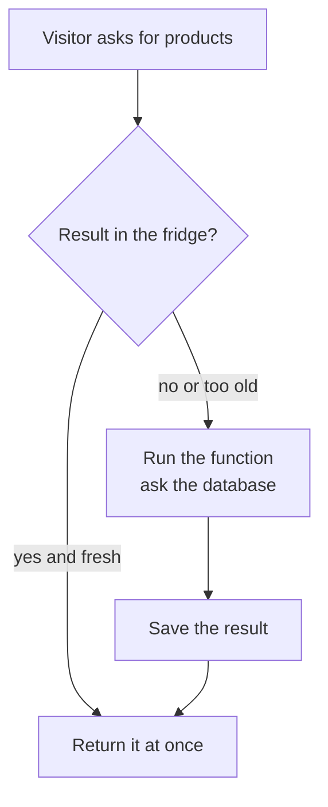
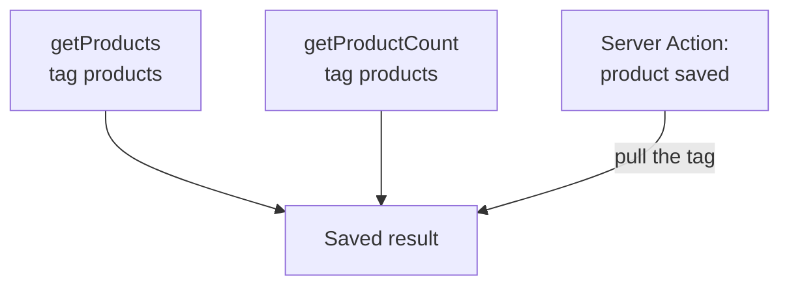

# 17. Caching and revalidation in Next.js 16

> **Subject:** React · **Lesson:** 17 · **Made:** 2026-11-27 · **Status:** ready
>
> **You will be able to:** cache a function with `use cache`, set how long it stays fresh, refresh it after a change, and say which of the three refresh tools to pick.
>
> **Before this:** [Server and Client Components](16-server-and-client-components.md) · **Next:** [Server Actions](18-server-actions.md)
>
> **How to read it:** one card is one idea. Look at the picture, guess, then press the orange bar to check. The blue bars (📖 More detail) hold the longer explanation. Skip them on the first read, open them when you want more. About 20 minutes for the cards.

<!-- quick-summary:start -->
## Quick summary

> Short on time? Read only this. These are the "Remember" lines from the cards below, so you can read the whole lesson in one minute.

- Cache what is the same for many visitors and slow to make. Never cache one person's data for everyone.
- `use cache` saves a function's result. The arguments are the key.
- `cacheLife` is a freshness timer. Pick the longest time your users can accept.
- `cacheTag` names the data. A refresh tool then pulls that name.
- `updateTag` for the writer, `revalidateTag` for everyone else, `revalidatePath` when you only know the address.
- Request data goes in as an argument. It never gets read inside the cached function.
- A cache has a place. Ask where it lives before you trust it.
<!-- quick-summary:end -->

## 1. The idea: cook once, keep it in the fridge

A cook makes a big pot of soup at noon. When guests order soup, the cook does **not** make a new pot each time. The cook serves from the fridge. After a few hours the soup is thrown away and a new pot is made.

A cache is the fridge. Next.js can keep the **result** of a slow function so the next visitor does not wait.



Notice: the first visitor pays the full cost. Everyone after that gets it fast.

<details class="guess"><summary>🤔 Guess: a function returns the logged-in user's name. Should you cache it for everyone? Press to check.</summary>

No. The result is different for each person. Saving one person's name and showing it to the next visitor is a bug. Cache only data that is the same for the people who read it.

</details>

> **Remember:** cache what is the same for many visitors and slow to make. Never cache one person's data for everyone.

<details class="more"><summary>📖 More detail: the new rule in Next.js 16</summary>

Before Next.js 16, the App Router cached some things by default. That surprised many people. In Next.js 16 with **Cache Components** turned on, nothing is kept unless **you** say so with `use cache`. New apps from `create-next-app` have it on. For an older app, you set this in `next.config.ts`:

```ts
const nextConfig = {
  cacheComponents: true,
  partialPrefetching: true,
}
```

The docs say to set `partialPrefetching` yourself, because leaving it unset logs a warning.

Source: [Caching](https://nextjs.org/docs/app/getting-started/caching) (updated 2026-11-18).

</details>

## 2. `use cache`: one line on top of a function

You write the words `'use cache'` as the first line of an async function. Next.js keeps its result. You can also put it on a whole component or page.

```ts
import { cacheLife } from 'next/cache'

export async function getProducts() {
  'use cache'
  cacheLife('hours')
  return db.query('SELECT * FROM products')
}
```

Notice: the arguments of the function are part of the **key**. `getUser(1)` and `getUser(2)` are two separate entries.

<details class="guess"><summary>🤔 Guess: you call `getUser(1)` and then `getUser(2)`. How many times does the database run? Press to check.</summary>

Two times. The arguments make two different keys. Calling `getUser(1)` again later runs it zero times, until it expires.

</details>

> **Remember:** `use cache` saves a function's result. The arguments are the key.

<details class="more"><summary>📖 More detail: data level and UI level</summary>

- **Data level:** cache a function that fetches data, for example `getProducts()`.
- **UI level:** cache a whole component or page that renders that data.
- At the top of a **file**, `'use cache'` caches every exported function in it.

The docs recommend you always pair it with `cacheLife`. Without it, a default profile applies (card 3).

Next.js checks this at build time. When your cached output is known early, it becomes part of the **static shell** from lesson 14.

</details>

## 3. `cacheLife`: how long the soup stays good

`cacheLife` sets three timers. Pick a ready-made profile by name, or write your own numbers.

| Profile | stale | revalidate | expire |
|---|---|---|---|
| `seconds` | 30 seconds | 1 second | 60 seconds |
| `minutes` | 5 minutes | 1 minute | 1 hour |
| `hours` | 5 minutes | 1 hour | 1 day |
| `days` | 5 minutes | 1 day | 1 week |
| `max` | 5 minutes | 30 days | 1 year |

Notice: `revalidate` is "after this, refresh in the background". `expire` is "after this, do not serve it at all". `stale` is how long the **browser** may reuse it without asking.

<details class="guess"><summary>🤔 Guess: a cached function uses `cacheLife('seconds')`. Will it be part of the static page built at deploy? Press to check.</summary>

No. The docs call this "short-lived" and say such a cache is left out of the prebuilt page and becomes a dynamic part instead. A cache that expires in seconds is not worth building early.

</details>

> **Remember:** `cacheLife` is a freshness timer. Pick the longest time your users can accept.

<details class="more"><summary>📖 More detail: what the three timers do</summary>

- **stale:** how long the client may use its own copy without checking the server.
- **revalidate:** after this time, the next visit still gets the saved copy, but Next.js refreshes it in the background.
- **expire:** after this time with no visit, the copy is not used. The next visitor waits for a fresh one.

A cache is "short-lived" when it uses the `seconds` profile, has `revalidate: 0`, or has `expire` under 5 minutes. Check the [`cacheLife` reference](https://nextjs.org/docs/app/api-reference/functions/cacheLife) for custom objects.

I checked on Next.js 16.4.6 (2026-11-27): a function with `cacheLife('hours')` showed `1h` and `1d` in the build table, matching the row above.

</details>

## 4. Tags: a sticky note you can pull

A timer is not enough. If an editor fixes a typo, waiting an hour is too slow. So you put a **tag** on cached data, and later you pull that tag to say "this is old now".



```ts
import { cacheTag } from 'next/cache'

export async function getProducts() {
  'use cache'
  cacheTag('products')
  return db.query('SELECT * FROM products')
}
```

Notice: one tag can cover many functions. Pulling the tag refreshes all of them.

<details class="guess"><summary>🤔 Guess: three cached functions all have the tag `products`. You pull `products` once. How many entries are refreshed? Press to check.</summary>

All three. That is the point of a tag: one change, one signal, and every piece of data that depends on it is refreshed.

</details>

> **Remember:** `cacheTag` names the data. A refresh tool then pulls that name.

<details class="more"><summary>📖 More detail: why not just refresh by page?</summary>

`revalidatePath('/profile')` refreshes everything for one address. That is easy, but coarse. Tags let you refresh by **meaning** ("all products") instead of by **place**. The docs say: cache a function, not a route. Revalidate a tag, not a deployment.

</details>

## 5. Three ways to pull the tag

After a change you have three tools. They behave differently. This is a very common interview question.

| Tool | What the next visitor gets | Where you can call it |
|---|---|---|
| `updateTag('posts')` | fresh data, they wait for it | only in a Server Action |
| `revalidateTag('posts', 'max')` | the **old** data now, new data next time | Server Actions and Route Handlers |
| `revalidatePath('/posts')` | fresh data for that address | Server Actions and Route Handlers |

Notice: `updateTag` is for "I just saved something, show it to me **now**". `revalidateTag` is for "it is fine if others see the old one for a moment".

<details class="guess"><summary>🤔 Guess: a user posts a comment and is sent back to the page. Which tool do you want? Press to check.</summary>

`updateTag`. The user must see their own comment at once. This is called "read your own writes". If you used `revalidateTag` with `max`, the user might still see the old list.

</details>

> **Remember:** `updateTag` for the writer, `revalidateTag` for everyone else, `revalidatePath` when you only know the address.

<details class="more"><summary>📖 More detail: what I saw when I ran them</summary>

I ran a small app on Next.js 16.4.6 (2026-11-27).

- A cached function returned a time stamp. Two visits gave the **same** stamp.
- I called `revalidateTag('stamp', 'max')` from a Route Handler. The very next visit still gave the **old** stamp. Two seconds later, the next visit gave a **new** stamp. This is stale while revalidate.
- I called `updateTag` inside a Route Handler. The build stopped with: *"updateTag can only be called from within a Server Action. To invalidate cache tags in Route Handlers or other contexts, use revalidateTag instead."*

The docs also list `refresh()`: it re-fetches the current page's data **without** touching the cache. Use it when the change happened outside the cache.

Sources: [Revalidating](https://nextjs.org/docs/app/getting-started/revalidating) (updated 2026-11-18), [Server Actions, "Choosing a cache update"](https://nextjs.org/docs/app/guides/server-actions).

</details>

## 6. Mistake 1: reading the cookie inside `use cache`

You cache a function that reads `cookies()`. The cache key does not include the cookie, so one user's result could be served to another. Next.js stops you.

```ts
async function getName() {
  'use cache'
  return (await cookies()).get('name')?.value  // not allowed
}
```

<details class="guess"><summary>🤔 Guess: what is the fix? Press to check.</summary>

Read the cookie **outside** the cached function and pass the value in as an argument. The argument becomes part of the key, so each value gets its own entry.

```ts
async function getName(name: string) {
  'use cache'
  return lookup(name)
}
// in a component wrapped by Suspense:
const name = (await cookies()).get('name')?.value
return getName(name)
```

</details>

> **Remember:** request data goes in as an argument. It never gets read inside the cached function.

<details class="more"><summary>📖 More detail: the real error, and two other tools</summary>

On Next.js 16.4.6 the build stopped with:

```text
Error: Route "/": `cookies()` can't be read inside
`"use cache"`. Read it outside the cached function
and pass what you need as an argument.
```

Two related tools from the docs:

- `"use cache: private"` caches per user, in the **browser** only.
- `"use cache: remote"` keeps entries in a shared store that many servers can read.

Random values and the time (`Math.random()`, `Date.now()`) are also flagged. Cache the result so all users see one value, or call `connection()` and use Suspense to get a new one per request.

</details>

## 7. Where the cache really lives

"The cache" is not one place. It is three. This is the part that surprises people in production.

| Place | What is kept | Survives a restart? |
|---|---|---|
| Build output | the static shell and prebuilt pages | yes, until the next deploy |
| Server memory (default) | results of `use cache` at runtime | no, and on serverless it may not even live between requests |
| Browser | the payload for pages you visited or prefetched | until its `stale` time |

Notice: with several servers, each one has its **own** memory cache. A tag pulled on one server does not reach the others unless you use a shared store.

<details class="guess"><summary>🤔 Guess: you deploy a new version. Do the old cached results carry over? Press to check.</summary>

No. The docs say cache entries are scoped to one deployment. The cache key includes the build id, so a new deploy starts empty, even for `use cache: remote`.

</details>

> **Remember:** a cache has a place. Ask where it lives before you trust it.

<details class="more"><summary>📖 More detail: running more than one server</summary>

The docs say that when several instances run, any cached content can be invalidated on demand, so the instances need to share a cache store, or they will show different data. The page [Rendering philosophy](https://nextjs.org/docs/app/guides/rendering-philosophy) lists this under "Infrastructure implications". On a hosting platform that is built for Next.js, this is handled for you. When you self-host (for example with Docker on CapRover), plan for it.

</details>

## 8. Why it matters and what it costs

- **Without a cache:** every visit asks the database. A traffic spike becomes a database spike.
- **With a cache:** most visits are served from a saved result, and the database sees far fewer calls.
- **The cost:** old data (decide how old is fine), more places to look when a bug shows old data, and extra setup when you run many servers.

| Data | Tool |
|---|---|
| a blog post that changes rarely | `use cache` with `cacheLife('days')` and a tag |
| a product price the editor changes | `use cache`, a tag, and `revalidateTag` from a webhook |
| the user's own comment list | `updateTag` in the Server Action |
| the logged-in user's data | not cached, or `use cache: private`, inside Suspense |

## 9. Watch and play

All links were opened on 2026-11-27 and loaded. I found no video that I could open and check. The Caching docs page embeds a 10 minute video on Partial Prerendering that you can try.

- **Do:** [practice/17-tiny-cache.js](practice/17-tiny-cache.js) - build a tiny cache with tags and stale while revalidate.
- **Read:** [Caching](https://nextjs.org/docs/app/getting-started/caching) - the whole model on one page.
- **Read:** [Revalidating](https://nextjs.org/docs/app/getting-started/revalidating) - cacheLife table and the three refresh tools.
- **Read:** [`use cache` reference](https://nextjs.org/docs/app/api-reference/directives/use-cache) - cache keys and what can be cached.
- **Read:** [`cacheLife` reference](https://nextjs.org/docs/app/api-reference/functions/cacheLife) - custom timers.

## 10. Practice

**A. Predict**

```ts
async function getPrice(id: string) {
  'use cache'
  cacheLife('hours')
  cacheTag('prices')
  return db.price.find(id)
}
```

You call `getPrice('a')`, then `getPrice('b')`, then `getPrice('a')`. How many database calls? Then a Server Action calls `updateTag('prices')` and you call `getPrice('a')` again. How many now?

<details><summary>Answer</summary>

First three calls: 2 database calls (the second `a` is cached). After `updateTag('prices')`: 1 more call, so 3 in total, and the user waits for fresh data.

</details>

**B. Fix the bug**

An editor changes a price. Customers see the old price for a whole day. The function uses `cacheLife('days')`. What is missing?

<details><summary>Answer</summary>

A tag and a refresh signal. Add `cacheTag('prices')` to the function and call `revalidateTag('prices', 'max')` after the editor saves (for example from a webhook). Without it, only the timer can refresh the data.

</details>

**C. Write it yourself**

Open `practice/17-tiny-cache.js` and build `createCache` so that all 8 tests pass:

```bash
node --test learn/react/practice/17-tiny-cache.test.js
```

<details><summary>One possible answer</summary>

```js
function createCache(now = Date.now) {
  const entries = new Map();
  function wrap(fn, { tag, revalidate }) {
    return async function (...args) {
      const key = tag + ":" + JSON.stringify(args);
      const hit = entries.get(key);
      const fresh = hit && now() - hit.savedAt < revalidate;
      if (hit && fresh && !hit.stale) return hit.value;
      if (hit && hit.stale && !hit.refreshing) {
        hit.refreshing = true;
        fn(...args).then((value) => {
          entries.set(key, { value, savedAt: now(), tag, stale: false });
        });
        return hit.value;
      }
      if (hit && hit.stale) return hit.value;
      const value = await fn(...args);
      entries.set(key, { value, savedAt: now(), tag, stale: false });
      return value;
    };
  }
  function updateTag(tag) {
    for (const [key, e] of entries) if (e.tag === tag) entries.delete(key);
  }
  function revalidateTag(tag) {
    for (const e of entries.values()) if (e.tag === tag) e.stale = true;
  }
  return { wrap, updateTag, revalidateTag };
}
```

Look at `revalidateTag`: it only marks the entry `stale`. The next call returns the old value and starts the refresh. `updateTag` deletes the entry, so the next call must wait.

</details>

## 11. Interview question

**Q:** How does caching work in Next.js 16, and how do you refresh cached data after a change?

<details><summary>A strong answer, in four parts</summary>

1. **Problem:** database calls and slow work run on every visit, and old data shows up when a page is built early.
2. **How it works:** with Cache Components on, nothing is cached unless you add `use cache`. The arguments are the key. `cacheLife` sets how fresh it stays. `cacheTag` names it. After a change you call `updateTag` (in a Server Action, the user sees fresh data at once), `revalidateTag` (others get the old value first, then the new one) or `revalidatePath`.
3. **Tradeoff:** old data for a short time, and the cache lives in memory per server unless you use a shared store. Request data like cookies cannot be read inside the cached function.
4. **My example:** an idea, not a fact: cache a product list with the tag `products`, and call `revalidateTag` from a webhook when the CMS changes. I will add a real example from my projects (for instance Hasura or Prisma queries) only after I confirm it.

</details>

## 12. Explain it back

Close this file. Explain caching in Next.js to a new junior in 4 parts (problem, how, tradeoff, my example). Then write your best version below and run `/explain-check next.js caching` or ask the `explain-coach` agent to review it.

### My explanation

<write here>

### Coach feedback

<the explain-coach agent writes here>

## 13. Review questions (day 1, 3, 7, 21)

1. What is the cache key of a `use cache` function?
2. What is the difference between `updateTag` and `revalidateTag`?
3. Why can you not read `cookies()` inside a cached function?
4. Draw the picture from card 1 from memory: the fridge and the three outcomes.

<details><summary>Answers</summary>

1. The arguments (and the values it uses from outside the function).
2. `updateTag` throws the entry away, so the next visitor waits for fresh data. It only works in a Server Action. `revalidateTag` marks it old, so the next visitor gets the old data and the one after gets the new data.
3. The key would not include the cookie, so one user's result could reach another. Read it outside and pass it in.
4. Ask, check the fridge, fresh: return. Missing or old: run the function, save, return.

</details>

## 14. Go deeper (optional)

<details><summary>Old model, serverless notes, extra reading</summary>

- **The old model:** before Cache Components, `fetch` had `cache` and `next.revalidate` options, there was `unstable_cache`, and route settings like `export const revalidate = 60`. The docs keep a page for projects that do not use Cache Components: [Caching and Revalidating (Previous Model)](https://nextjs.org/docs/app/guides/caching-without-cache-components) (listed on the docs; I did not open this one). You will meet this model in older codebases and in interviews.
- **Serverless:** the docs say in-memory entries may not persist across requests there, so use `use cache: remote` when the hit rate is high enough to pay for the network trip.
- **Partial prefetching:** a link can prefetch the page's App Shell. This costs a server call per prefetchable link.

</details>

## Connected lessons

- [Next.js rendering](14-next-js-rendering.md) - the static shell that cached data goes into.
- [Server and Client Components](16-server-and-client-components.md) - where cached functions run.
- [Server Actions](18-server-actions.md) - where `updateTag` is called.
- [Database lessons](../database/README.md) - what is behind the function you cache.
