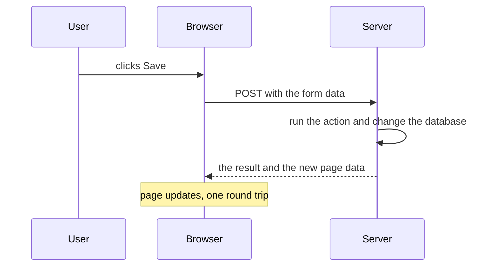
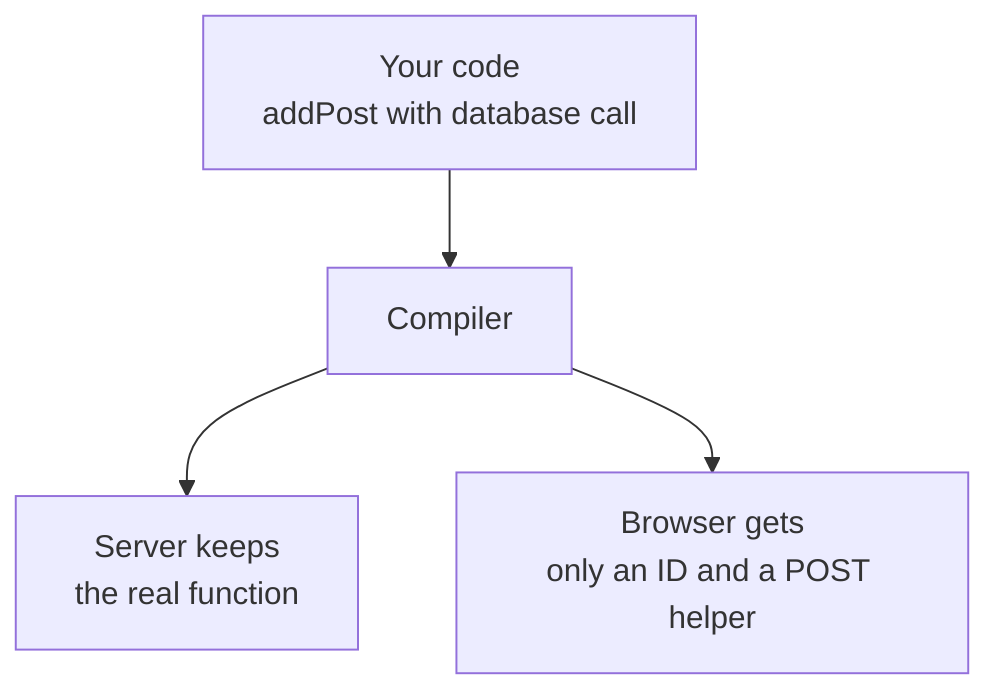
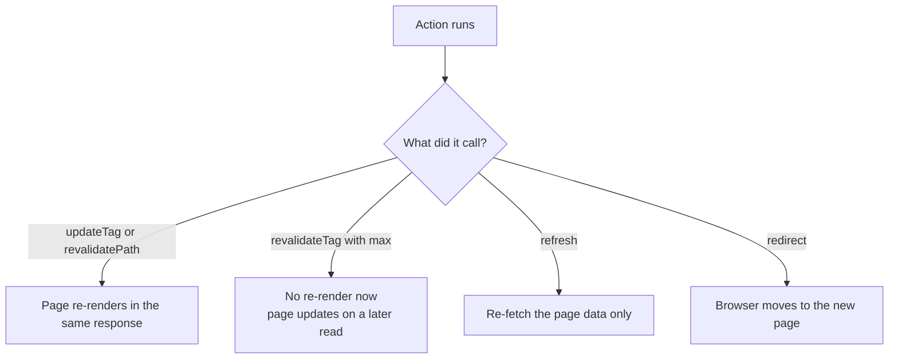

# 18. Server Actions

> **Subject:** React · **Lesson:** 18 · **Made:** 2026-11-27 · **Status:** ready
>
> **You will be able to:** explain how a form click reaches a function on the server, why that function is a public door, and what must be checked inside it.
>
> **Before this:** [Caching and revalidation](17-nextjs-caching-and-revalidation.md) · **Next:** [React lessons map](README.md)
>
> **How to read it:** one card is one idea. Look at the picture, guess, then press the orange bar to check. The blue bars (📖 More detail) hold the longer explanation. Skip them on the first read, open them when you want more. About 20 minutes for the cards.

<!-- quick-summary:start -->
## Quick summary

> Short on time? Read only this. These are the "Remember" lines from the cards below, so you can read the whole lesson in one minute.

- A Server Action is a function that runs on the server and is called from the browser. One trip saves the data and refreshes the page.
- The browser gets a reference, not your code. The reference is a public address.
- Inside every action: check who is calling, check what they may do, check the input.
- The framework checks where the request came from. You check who the person is and what they may do.
- Refresh first, then redirect. Code after `redirect` does not run.
- Who is acting comes from the session. What they want to change comes from the form.
- Whatever you return goes to the browser. Select the fields on purpose.
<!-- quick-summary:end -->

## 1. The idea: an order slip to the kitchen

Lessons 14, 16 and 17 were about the kitchen **sending food out**. Now the other way: a guest writes an order slip and the waiter carries it **into** the kitchen. The kitchen makes a change (cooks a dish, updates the stock) and sends back a fresh menu.

A **Server Action** is that order slip. It is a function that you write on the server. The browser calls it, usually from a form.



Notice: one trip does both jobs. The server changes the data **and** sends back the fresh page.

<details class="guess"><summary>🤔 Guess: before Server Actions, what did you write to save a form to the database? Press to check.</summary>

An API route (or a GraphQL mutation), plus a `fetch` call in the browser, plus code to refresh the page data afterward. A Server Action replaces those three pieces with one function.

</details>

> **Remember:** a Server Action is a function that runs on the server and is called from the browser. One trip saves the data and refreshes the page.

<details class="more"><summary>📖 More detail: the words, and how to write one</summary>

- **Server Function:** a function marked `'use server'` that the browser can call over the network.
- **Server Action:** a Server Function that is used through a form, a button, or a `startTransition`.
- **Directive:** the special line of text, like `'use server'`, that tells the compiler what to do.

```tsx
// app/actions.ts
'use server'
import { updateTag } from 'next/cache'

export async function addPost(formData: FormData) {
  await db.post.create({
    data: { title: String(formData.get('title')) },
  })
  updateTag('posts')
}

// app/page.tsx  (a Server Component)
import { addPost } from './actions'

export default function Page() {
  return (
    <form action={addPost}>
      <input name="title" />
      <button>Add</button>
    </form>
  )
}
```

Source: [Server Actions and Mutations](https://nextjs.org/docs/app/guides/server-actions) (updated 2026-11-18), [Server Functions, react.dev](https://react.dev/reference/rsc/server-functions).

</details>

## 2. What the browser really gets

You wrote `addPost` with a database call. Does the browser get that code? No. At build time, the compiler swaps the function for a small **reference**: an ID plus a helper that sends a POST to the server.



Notice: the server code stays on the server. But the ID is a door, and a door can be knocked on by anyone.

<details class="guess"><summary>🤔 Guess: the form in the browser has a hidden field with the action ID. Can someone send that POST without using your page? Press to check.</summary>

Yes. I tested it on Next.js 16.4.6. A plain `curl` request with the ID and **no cookies and no login** ran the action. See card 3.

</details>

> **Remember:** the browser gets a reference, not your code. The reference is a public address.

<details class="more"><summary>📖 More detail: how the form works before JavaScript loads</summary>

In my test, the page HTML had a normal form with `method="POST"` and a hidden field named `$ACTION_ID_...`. So the form can work **even before** the JavaScript has loaded (this is called progressive enhancement). After hydration, React sends the request without a full page reload.

Next.js dispatches actions from one client **one at a time**. If a user clicks three times fast, the second waits for the first. Do not use `Promise.all` to run actions in parallel from the client. For parallel work, do it inside **one** action.

</details>

## 3. The big warning: it is a public door

A Server Action is a **POST address**. Hiding the button, or showing the form only to admins, does not protect it. Anyone who can send a POST can call it.

Here is what I saw (Next.js 16.4.6, 2026-11-27). The page form only ever sends `id=1`.

| Request | Result |
|---|---|
| `curl` POST, same Origin, no login, `id=42` | status 200, the action ran with id **42** |
| `curl` POST, a different Origin | status 500, the action did **not** run |

Notice: the second row is the built-in protection (card 4). The first row is the part you must handle yourself.

<details class="guess"><summary>🤔 Guess: the delete button is only drawn for admins. Is `deletePost` safe? Press to check.</summary>

No. Drawing the button only decides what people **see**. The action itself must check the session and the role. A person can call it without the button.

</details>

> **Remember:** inside every action: check who is calling, check what they may do, check the input.

<details class="more"><summary>📖 More detail: the three checks, in plain words</summary>

The docs give three rules:

1. **Authenticate and authorize.** Check the session and the permission **inside** the action. Hiding a form is "not a security boundary".
2. **Validate inputs.** `FormData`, query parameters and headers come from outside. Treat them as untrusted.
3. **Constrain return values.** What you return is sent to the browser. Return what the screen needs, not a raw database row.

A subtle one: a client should tell the server **which** item (an ID). It should not tell the server the item's contents or owner. Send an ID, then load the row again and check that the session owns it. A well-formed object can still point to someone else's row. Schema checks (like Zod) only check the shape.

```ts
'use server'
export async function deletePost(formData: FormData) {
  const session = await getSession()
  if (!session) throw new Error('Not logged in')

  const id = String(formData.get('id'))
  const post = await db.post.findUnique({ where: { id } })
  if (post?.authorId !== session.userId) {
    throw new Error('Not allowed')
  }

  await db.post.delete({ where: { id } })
  updateTag('posts')
}
```

Related: [Data Security guide](https://nextjs.org/docs/app/guides/data-security).

</details>

## 4. What Next.js protects for you

Next.js adds some safety on top. It is a help, not a replacement for card 3.

| Built-in protection | What it does |
|---|---|
| Origin check | compares the `Origin` header to the `Host`. A mismatch is rejected. |
| Body size limit | action requests are capped at 1 MB by default |
| Encrypted action IDs | IDs are encrypted at build time. Unused actions are removed from the client bundle. |
| Encrypted closures | variables captured by an inline action are encrypted before they go to the browser |

Notice: the origin check is what stopped my `evil.example` request. It guards against a different website tricking the user's browser (CSRF).

<details class="guess"><summary>🤔 Guess: your site is behind a proxy with another domain name. Why might the origin check reject your own users? Press to check.</summary>

The `Origin` is the proxy's domain, but the `Host` the app sees is different. They do not match. You list the proxy domains in `experimental.serverActions.allowedOrigins`.

</details>

> **Remember:** the framework checks where the request came from. You check who the person is and what they may do.

<details class="more"><summary>📖 More detail: self-hosting notes</summary>

When you run more than one server (for example Docker on CapRover, or several containers), set `NEXT_SERVER_ACTIONS_ENCRYPTION_KEY` to **one stable key** shared by all instances. Otherwise each instance encrypts with its own key and the others cannot read it.

The docs also say that new deployments usually make new action IDs. A user with an old page open may call an ID that no longer exists. Prefer rolling deployments and show a "please refresh" message instead of a hard error.

The `experimental.serverActions` config names (`allowedOrigins`, `bodySizeLimit`) are still marked experimental in the docs, even though actions are stable.

</details>

## 5. After the change: refresh the page

The action changed the data. The page must show it. The action's response can carry the **new page** too. This is why one round trip is enough.



Notice: `revalidateTag(..., 'max')` is the one that does **not** re-render in the response. Lesson 17 explains why: it serves the old data first.

<details class="guess"><summary>🤔 Guess: an action calls `redirect('/posts')` and then `updateTag('posts')` on the next line. Does the tag get updated? Press to check.</summary>

No. `redirect` works by throwing an exception, so the next line never runs. Call `updateTag` **before** `redirect`.

```ts
updateTag('posts')
redirect(`/posts/${post.id}`)
```

</details>

> **Remember:** refresh first, then redirect. Code after `redirect` does not run.

<details class="more"><summary>📖 More detail: setting a cookie also re-renders</summary>

The docs list what makes the current page re-render inside the action response: `updateTag`, `revalidatePath`, `revalidateTag` with an `expire: 0` profile, `refresh()`, changing a cookie with `cookies()`, and `redirect()`. An action that does none of these returns only its return value, and the page does not re-render.

Unlike `redirect`, the refresh calls do not throw. So an action can call `updateTag` and still return a value, for example with `useActionState`.

</details>

## 6. Mistake 1: trusting the form

```ts
'use server'
export async function updateProfile(formData: FormData) {
  await db.user.update({
    where: { id: String(formData.get('userId')) },  // from the form!
    data: { name: String(formData.get('name')) },
  })
}
```

<details class="guess"><summary>🤔 Guess: what can an attacker do here? Press to check.</summary>

Send any `userId` they like and rename someone else's account. The ID came from the form, so it cannot be trusted. Take the user ID from the **session** on the server.

```ts
const session = await getSession()
await db.user.update({
  where: { id: session.userId },
  data: { name: String(formData.get('name')) },
})
```

</details>

> **Remember:** who is acting comes from the session. What they want to change comes from the form.

<details class="more"><summary>📖 More detail: keep the check in one place</summary>

Copying the session check into every action is easy to forget. Many teams make a small **data access layer**: functions like `deletePostAsUser(id)` that check the session inside, and then every action calls them. The Data Security guide shows this pattern, along with rate limiting.

</details>

## 7. Mistake 2: returning the whole row

```ts
'use server'
export async function getAccount(id: string) {
  return db.user.findUnique({ where: { id } })   // includes passwordHash
}
```

<details class="guess"><summary>🤔 Guess: what leaves the server? Press to check.</summary>

Everything in the row, including `passwordHash`, because return values are serialized and sent to the browser. Select only what the screen shows.

```ts
return db.user.findUnique({
  where: { id },
  select: { name: true, email: true },
})
```

</details>

> **Remember:** whatever you return goes to the browser. Select the fields on purpose.

<details class="more"><summary>📖 More detail: Prisma and Hasura notes</summary>

With Prisma, `select` (or building a small result object) keeps secret fields out. With Hasura the same idea is a permission on the **role**, so the column is not readable at all. That is a good "why" for interviews: do not rely on the front end to hide a field.

</details>

## 8. Why it matters and what it costs

- **Without Server Actions:** an API route, a `fetch` call, loading and error code in the browser, and a manual page refresh.
- **With Server Actions:** one function. The form can work before JavaScript loads. The page refreshes in the same trip.
- **The cost:** a public door that needs checks inside it, sequential dispatch (no parallel calls from the client), and a tie to Next.js. For a **public API** that other apps will call (a mobile app, a partner), use a Route Handler or a normal API. A Server Action is for your own UI.

| Need | Use |
|---|---|
| a form in your own Next.js app | Server Action |
| a mobile app or another service calls you | Route Handler or REST/GraphQL API |
| read data to render a page | Server Component, not an action |
| a webhook from outside | Route Handler |

## 9. Watch and play

All links were opened on 2026-11-27 and loaded. I found no video that I could open and check, so there is none here.

- **Read:** [Server Actions and Mutations](https://nextjs.org/docs/app/guides/server-actions) - read "Security" and "Choosing a cache update".
- **Read:** [Mutating data](https://nextjs.org/docs/app/getting-started/mutating-data) - the first steps, with forms.
- **Read:** [Data Security](https://nextjs.org/docs/app/guides/data-security) - the data access layer pattern.
- **Read:** [Server Functions, react.dev](https://react.dev/reference/rsc/server-functions) - the React side.
- **Try it:** run `curl -F '$ACTION_ID_...=' -F id=42 -H 'Origin: http://localhost:3000' http://localhost:3000/` against your own dev app (take the ID from the page HTML) and watch the action run without the UI.

## 10. Practice

**A. Predict**

An action has this body. What happens when a user who is **not** logged in sends a POST?

```ts
'use server'
export async function archive(formData: FormData) {
  await db.post.update({
    where: { id: String(formData.get('id')) },
    data: { archived: true },
  })
}
```

<details><summary>Answer</summary>

It archives the post. Nothing checks the session. Anyone who can send the POST can archive any post by ID.

</details>

**B. Fix the bug**

Write the missing three checks into `archive`: session, owner, input.

<details><summary>Answer</summary>

```ts
'use server'
export async function archive(formData: FormData) {
  const session = await getSession()
  if (!session) throw new Error('Not logged in')

  const id = String(formData.get('id'))
  if (!/^[0-9a-f-]{36}$/.test(id)) throw new Error('Bad id')

  const post = await db.post.findUnique({ where: { id } })
  if (post?.authorId !== session.userId) throw new Error('Not allowed')

  await db.post.update({ where: { id }, data: { archived: true } })
  updateTag('posts')
}
```

</details>

**C. Write it yourself**

Draw the picture from card 1 with your own project in it (for example an admin form in a CMS): the user, the browser, the server, the database, and where the three checks happen.

<details><summary>One possible answer</summary>

User clicks Save, browser POSTs, server action checks the session, checks the owner, validates input, writes to the database, calls `updateTag`, and returns the new page data in the same response.

</details>

## 11. Interview question

**Q:** What are Server Actions? What security risks do they have?

<details><summary>A strong answer, in four parts</summary>

1. **Problem:** a form needs a way to change data on the server. Writing an API route, a `fetch` and a manual refresh each time is slow and repetitive.
2. **How it works:** you mark an async function with `'use server'`. The compiler gives the browser only a reference. The browser sends a POST. The server runs the function and can send the changed data and the new page in one response.
3. **Tradeoff:** each action is a public POST endpoint. Next.js checks the origin and encrypts IDs, but you must check the session, the permission and the input inside every action, and return only the fields the screen needs. Client calls run one at a time. For an API used by other clients, use a Route Handler.
4. **My example:** an idea, not a fact: in a CMS like DBO's admin, a delete action that checks the role and the owner in a data access layer. I will add what I actually built only after I confirm it.

</details>

## 12. Explain it back

Close this file. Explain Server Actions to a new junior in 4 parts (problem, how, tradeoff, my example). Then write your best version below and run `/explain-check server actions` or ask the `explain-coach` agent to review it.

### My explanation

<write here>

### Coach feedback

<the explain-coach agent writes here>

## 13. Review questions (day 1, 3, 7, 21)

1. Why is a Server Action a public endpoint, even if the button is hidden?
2. Name the three checks you do inside every action.
3. Which refresh tool does not re-render the page in the action response?
4. Draw the picture from card 1 from memory: the round trip.

<details><summary>Answers</summary>

1. It is a POST address. Anyone who can send the request can call it. Hiding a button only changes what people see.
2. Authenticate and authorize (session, owner), validate the input, and shape the return value.
3. `revalidateTag` with the `max` profile. It serves old data first and refreshes in the background.
4. Click, POST with form data, server runs the action and changes the database, the response carries the result and the new page, the page updates.

</details>

## 14. Go deeper (optional)

<details><summary>More from the docs</summary>

- `useActionState` gives a form its pending state and the action's return value. `useFormStatus` reads the pending state in a child button. See [react.dev Server Functions](https://react.dev/reference/rsc/server-functions).
- A search found a July 2026 security release that reportedly fixed four Server Actions issues. I did not confirm that from the official release notes, so check the Next.js releases before you rely on it. The lesson to keep: update to the latest patch version.
- The OWASP Next.js cheat sheet makes the same point as card 3: page-level authentication does not cover Server Actions. I did not open that page.
- `unauthorized()` and `forbidden()` exist behind the experimental `authInterrupts` flag. They render a matching UI.

</details>

## Connected lessons

- [Caching and revalidation](17-nextjs-caching-and-revalidation.md) - the refresh tools you call inside an action.
- [Server and Client Components](16-server-and-client-components.md) - the only functions that can cross the boundary.
- [Authorization](../backend-api/08-authorization.md) - the same "who may do this" rules in Express and GraphQL.
- [Sessions vs JWT](../backend-api/06-authentication-sessions-vs-jwt.md) - how `getSession()` knows who you are.
