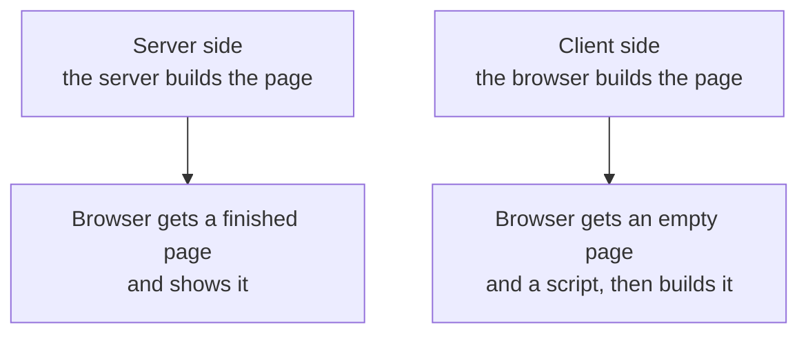
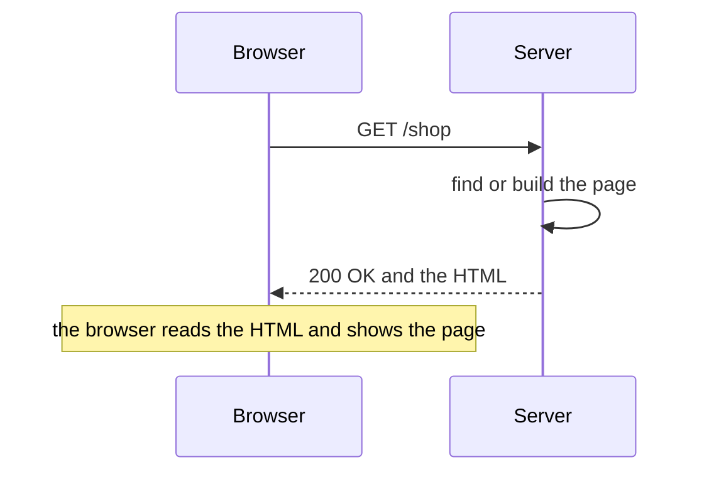
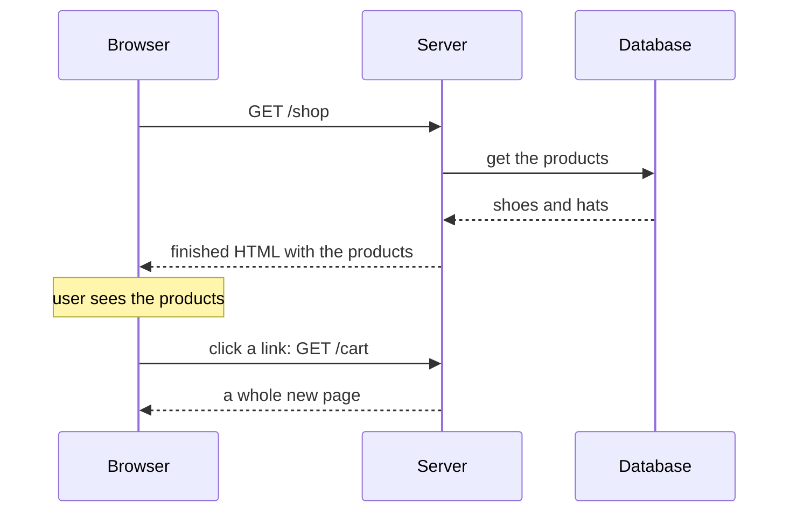
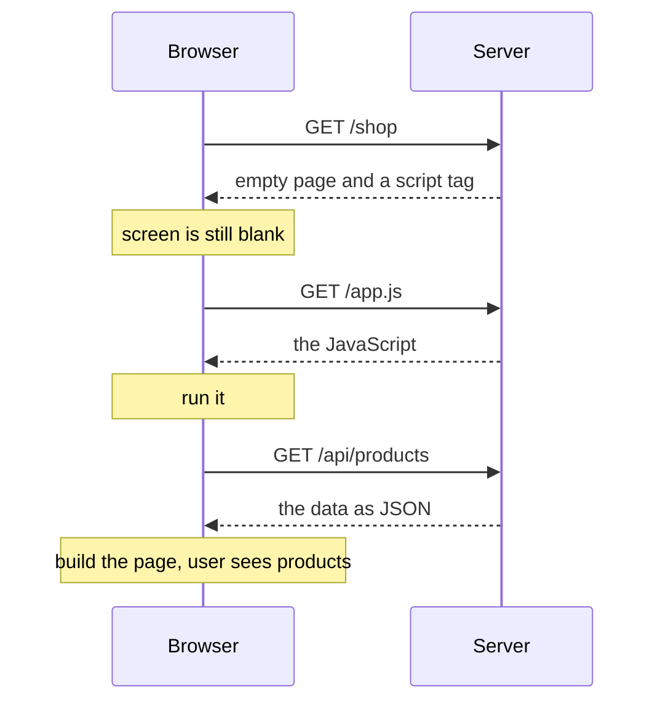
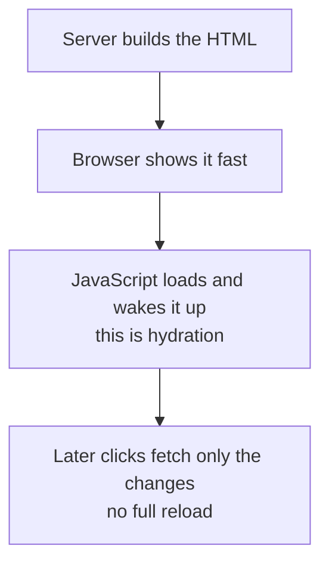

# 19. How a website works: server side and client side

> **Subject:** React · **Lesson:** 19 (read it first, before the other Next.js lessons) · **Made:** 2026-11-27 · **Status:** ready
>
> **You will be able to:** say what the server and the browser each do, explain the three ways to build a page, and say why Next.js mixes them.
>
> **Before this:** [React lessons map](README.md) · **Next:** [Next.js rendering](14-next-js-rendering.md)
>
> **How to read it:** one card is one idea. Look at the picture, guess, then press the orange bar to check. The blue bars (📖 More detail) hold the longer explanation. Skip them on the first read, open them when you want more. About 20 minutes for the cards.

<!-- quick-summary:start -->
## Quick summary

> Short on time? Read only this. These are the "Remember" lines from the cards below, so you can read the whole lesson in one minute.

- Server side means the server builds the page. Client side means the browser builds it.
- The browser asks, the server answers. What is inside the answer is the choice.
- Server side gives a fast first view and simple pages, but every click loads a whole new page.
- Client side gives smooth clicks after the first load, but the first view waits for the script and the data.
- Server side wins the first view. Client side wins the clicks after it.
- Next.js sends a finished first page, then wakes it up with JavaScript, then works like an app.
- Client side moves the page building, not the server and the database.
- Server side means the first page is built on the server. The page still needs JavaScript to be interactive.
<!-- quick-summary:end -->

## 1. The idea: a finished meal or a meal kit

You are hungry. A restaurant can bring you a **finished meal**: you eat at once. Or it can bring you a **meal kit**: a box of food and a recipe. You cook it yourself at the table.

A website can do the same. The **server** (a computer that holds the website) can send a **finished page**. Or it can send an **empty page and a recipe in JavaScript**, and the **browser** (your phone or laptop) builds the page.



Notice: the browser is called the **client**, because it is the one that asks. The word **render** only means "build the page".

<details class="guess"><summary>🤔 Guess: which way shows something on screen sooner, the finished meal or the meal kit? Press to check.</summary>

Usually the finished meal. The browser can show it the moment it arrives. With the kit, the browser must first download the script, run it, and often ask for data too. But once the kit is cooked, changing the page is quick (card 4).

</details>

> **Remember:** server side means the server builds the page. Client side means the browser builds it.

<details class="more"><summary>📖 More detail: the words, and where the picture stops</summary>

- **Server:** a computer that waits for requests and sends back answers.
- **Client:** the one that asks. For a website, it is the browser.
- **Render:** build the page, that is, make the HTML that the screen shows.
- **HTML:** the text file that describes the page. The browser turns it into what you see.

Where the meal picture stops: with a kit, the server still does work. It sends the files and answers data questions. "Client side" does not mean "no server".

</details>

## 2. Two sides and a short talk

Every page starts with the same short talk. The browser **asks** (a request). The server **answers** (a response). The answer is usually HTML.



Notice: the browser says **what** it wants (`/shop`). The server decides **how** to make the answer. That choice is the whole lesson.

<details class="guess"><summary>🤔 Guess: the response says 404. What does that mean? Press to check.</summary>

"Not found". The server has nothing for that address. A number starting with 2 means success. Numbers starting with 4 mean the browser asked for something wrong. Numbers starting with 5 mean the server failed.

</details>

> **Remember:** the browser asks, the server answers. What is inside the answer is the choice.

<details class="more"><summary>📖 More detail: what is in a request and an answer</summary>

| | Request (browser to server) | Response (server to browser) |
|---|---|---|
| First line | method and address: `GET /shop` | status: `200 OK` |
| Headers | small notes: which browser, which cookies | small notes: the kind of content, how long to keep it |
| Body | usually empty for GET | the HTML, or JSON data, or a script file |

The same server can answer different kinds of requests: a page (HTML), a script file (JavaScript), or data (JSON). Card 4 uses all three.

</details>

## 3. Way 1: the server builds the whole page

This is the oldest way and it is still good. The server runs code, reads the database, builds the HTML and sends it. The browser only has to show it.



Notice: each click asks the server for a **whole new page**. The old page is thrown away.

<details class="guess"><summary>🤔 Guess: in this way, you type text into a form, then click a link, then come back. Is your text still there? Press to check.</summary>

Usually not. The page was replaced, so the state of the old page is gone. This is why apps that feel like apps (chat, maps, editors) needed another way.

</details>

> **Remember:** server side gives a fast first view and simple pages, but every click loads a whole new page.

<details class="more"><summary>📖 More detail: what this is good at</summary>

- **Fast first view:** the answer already holds the content.
- **Works without JavaScript:** a link and a form still work.
- **Easy for search engines:** the content is in the HTML.
- **Cost:** the server does work for every visit, and each click makes a full trip.

Many older sites work like this. Frameworks like Express with a template, PHP, Rails and Django are examples.

</details>

## 4. Way 2: the browser builds the page

In this way the server sends an **empty page** and a **script**. The script runs in the browser, asks the server for data, and builds the page. This is what a plain React app does (a "single page app").



Notice: three trips before the user sees a product. After that, clicks do not need a whole new page. The script changes the page in place.

<details class="guess"><summary>🤔 Guess: you use "View page source" on this kind of page. What do you see? Press to check.</summary>

An empty `<div id="root"></div>` and a script tag. The products are not in the source, because the browser made them **after** the page loaded. I tested this (see the blue bar).

</details>

> **Remember:** client side gives smooth clicks after the first load, but the first view waits for the script and the data.

<details class="more"><summary>📖 More detail: what I measured</summary>

I ran a tiny Node server on 2026-11-27 with the same product list in both ways.

| | Server builds it | Browser builds it |
|---|---|---|
| Requests to see the products | 1 | 3 (page, script, data) |
| First HTML contains "shoes" | yes | **no** |
| First HTML | `<ul><li>shoes</li>...` | `<div id="root"></div><script src="/app.js">` |

Each trip also costs time, and a slow phone or network makes each trip slower. The Next.js docs say about strict single page apps: they "often require large amounts of JavaScript to load before the page can be interactive", and client data trips "can be challenging to manage" (waterfalls: one request waits for the one before it).

You can repeat the test yourself with the exercise in card 9.

Source: [Next.js, single page applications guide](https://nextjs.org/docs/app/guides/single-page-applications) (updated 2026-11-06).

</details>

## 5. Side by side

| | Server builds it | Browser builds it |
|---|---|---|
| First thing the user sees | fast | slower, blank until script and data arrive |
| Clicking to another page | a whole new page | quick, changed in place |
| Needs JavaScript to show content | no | yes |
| Content is in the HTML | yes | no |
| Where the work happens | on your server | on the user's device |
| Best for | content, shops, blogs | apps: dashboards, editors, chat |

Notice: neither is the winner. Each one is good at what the other is bad at. That is why people wanted both.

<details class="guess"><summary>🤔 Guess: a news site and a drawing app. Which way for each? Press to check.</summary>

News site: server side. People want to read at once, and search engines must see the text. Drawing app: client side. After the first load, everything is quick clicks and drawing, and the page should never reload.

</details>

> **Remember:** server side wins the first view. Client side wins the clicks after it.

<details class="more"><summary>📖 More detail: search engines and slow phones</summary>

- **Search engines and link previews:** a crawler that does not run your JavaScript may see an empty page on a client side app. Some crawlers do run it, but you should not depend on that. This is general knowledge, so check the crawler you care about.
- **Slow phones:** the user's device does the building work. A cheap phone takes longer than your laptop.
- **Server cost:** with the browser doing the building, your server mostly sends files and data. That is cheaper to run, and files can sit on a CDN (a shop near the user).

</details>

## 6. Way 3: both, in the right order

Next.js takes the good half of each. The **server builds the first page** (fast first view, content in the HTML). Then **JavaScript wakes the page up** so it works like an app. Later clicks only fetch what changed.



Notice: the first view is like Way 1. The clicks after that are like Way 2. This is the answer to "why Next.js?".

<details class="guess"><summary>🤔 Guess: in this way, when can the user click a button? Press to check.</summary>

Only after the JavaScript has loaded and woken the page up. They can **see** the page earlier than they can **use** it. Lesson 14 follows that gap step by step.

</details>

> **Remember:** Next.js sends a finished first page, then wakes it up with JavaScript, then works like an app.

<details class="more"><summary>📖 More detail: what the new Next.js adds</summary>

- **Hydration:** React reuses the HTML that is already there and attaches the click handlers to it.
- **Server Components (lesson 16):** some parts never need to go to the browser at all. They run on the server and only their result travels.
- **Streaming (lesson 14):** slow parts of the page arrive later, so they do not block the fast parts.
- **Static pages and caching (lessons 14 and 17):** parts that are the same for everyone can be built once and kept.

Source: [Server and Client Components](https://nextjs.org/docs/app/getting-started/server-and-client-components) (updated 2026-10-05), [hydrateRoot, react.dev](https://react.dev/reference/react-dom/client/hydrateRoot).

**Step through it yourself:** [Server side, client side and the mix](visuals/19-server-vs-client.html). Press Next and watch the same page built three ways.

</details>

## 7. Mistake 1: "client side means no server"

```text
"We use React, so we do not need a server."
```

<details class="guess"><summary>🤔 Guess: what is wrong with that sentence? Press to check.</summary>

The browser still needs somewhere to download the page and the script from. It also needs the data from somewhere, and that is a server with a database and a login check. A client side app moves the **building** to the browser. The server and the database stay.

</details>

> **Remember:** client side moves the page building, not the server and the database.

<details class="more"><summary>📖 More detail: what must never move to the browser</summary>

Anything secret must stay on the server: database passwords, API keys, and the checks for who may do what. Code in the browser can be read by anyone who opens the developer tools. This is the same idea as the auth lessons: the browser asks, the server decides.

</details>

## 8. Mistake 2: "server side means no JavaScript in the browser"

```text
"With Next.js everything runs on the server, so my page needs no JavaScript."
```

<details class="guess"><summary>🤔 Guess: what is wrong here? Press to check.</summary>

The page is **shown** from the server HTML, but anything with a click, a state or an effect still needs JavaScript in the browser. Next.js sends that JavaScript and wakes the page up (hydration). Only the parts that are Server Components can skip it (lesson 16).

</details>

> **Remember:** server side means the first page is built on the server. The page still needs JavaScript to be interactive.

<details class="more"><summary>📖 More detail: a mix inside one page</summary>

In a Next.js page, a header can be a Server Component (no JavaScript sent), and a like button can be a Client Component (its JavaScript is sent). One page, both sides. Lesson 16 shows how to draw that line.

</details>

## 9. Why it matters and what it costs

- **Without knowing this:** "SSR", "CSR" and "Server Components" sound like random letters. You pick a way by habit.
- **With it:** you can say why a page is slow or empty, and pick the way that fits the page.
- **The cost:** the mix is the most powerful and also the hardest. Two sides means more rules (what can cross, what runs where).

| Page | Good fit |
|---|---|
| blog, docs, marketing page | server side or static |
| shop product page | the mix: server builds it, JavaScript wakes the cart |
| dashboard behind a login | mostly client side, with data from the server |
| drawing app, chat | client side |

## 10. Watch and play

All links were opened on 2026-11-27 and loaded. I found no video that I could open and check, so there is none here.

- **Step through it:** [Server side, client side and the mix](visuals/19-server-vs-client.html) - the same page built three ways.
- **Do:** [practice/19-two-ways.js](practice/19-two-ways.js) - build the page on the server and in the browser, then run the tests.
- **Read:** [Single page applications, Next.js docs](https://nextjs.org/docs/app/guides/single-page-applications) - the first part defines a strict single page app.
- **Read:** [Server and Client Components](https://nextjs.org/docs/app/getting-started/server-and-client-components) - "How do Server and Client Components work".
- **Read:** [hydrateRoot, react.dev](https://react.dev/reference/react-dom/client/hydrateRoot) - the React function that wakes up server HTML.

## 11. Practice

**A. Predict**

You open a plain React app (made without a framework). You choose "View page source". Which of these do you see: the list of products, or an empty `<div id="root">`?

<details><summary>Answer</summary>

The empty `<div id="root">` and a script tag. The products are made by JavaScript after the page has loaded, so they are not in the source.

</details>

**B. Fix the bug**

Users on slow phones say your React app shows a white page for four seconds before the products appear. Name two ways to improve it.

<details><summary>Answer</summary>

1. Send the first page already built on the server (server side rendering, for example with Next.js), so there is something to see at once. 2. Send less JavaScript and avoid a chain of requests: split the code into smaller files and fetch the data on the server before the page is sent. A loading skeleton also helps the user while they wait.

</details>

**C. Write it yourself**

Open `practice/19-two-ways.js` and write the four small functions so that all 9 tests pass:

```bash
node --test learn/react/practice/19-two-ways.test.js
```

<details><summary>One possible answer</summary>

```js
function escapeHtml(text) {
  return String(text)
    .replace(/&/g, "&amp;")
    .replace(/</g, "&lt;")
    .replace(/>/g, "&gt;")
    .replace(/"/g, "&quot;")
    .replace(/'/g, "&#39;");
}
function list(products) {
  return "<ul>" + products.map((p) => "<li>" + escapeHtml(p) + "</li>").join("") + "</ul>";
}
function renderOnServer(products) {
  return "<html><body><h1>Shop</h1>" + list(products) + "</body></html>";
}
function renderShell() {
  return '<html><body><div id="root"></div><script src="/app.js"></script></body></html>';
}
function renderInBrowser(root, products) {
  root.innerHTML = "<h1>Shop</h1>" + list(products);
}
```

Look at the pattern: `renderOnServer` and `renderInBrowser` build the same list. Only **where** it is built is different. The `&` is changed first, so the `&` in `&lt;` is not changed again.

</details>

## 12. Interview question

**Q:** What is the difference between server side rendering and client side rendering? Why did Next.js come about?

<details><summary>A strong answer, in four parts</summary>

1. **Problem:** a page must show fast and also feel like an app. Server only pages are fast to show but reload on every click. Browser only apps click smoothly, but the first view waits for the script and the data, and the HTML is empty.
2. **How it works:** server side rendering builds the HTML on the server and sends it finished. Client side rendering sends an empty page and a script, and the browser builds the page after it fetches the data. Next.js builds the first page on the server, then hydrates it in the browser, and later navigation fetches only what changed.
3. **Tradeoff:** server side costs server work and a more complex setup. Client side puts work on the user's device and can hurt search and slow phones. The mix needs rules about what runs where.
4. **My example:** I can compare it with an app I built. Say what I know to be true about how DBO's admin site or ZWS loaded its first screen. I will add the real facts only after I confirm them.

</details>

## 13. Explain it back

Close this file. Explain the two sides to a new junior in 4 parts (problem, how, tradeoff, my example). Then write your best version below and run `/explain-check server side vs client side` or ask the `explain-coach` agent to review it.

### My explanation

<write here>

### Coach feedback

<the explain-coach agent writes here>

## 14. Review questions (day 1, 3, 7, 21)

1. Who is the "client" on a website, and what does "render" mean?
2. What do you see in "View page source" on a client side app, and why?
3. Why can the user see a Next.js page before they can click it?
4. Draw the picture from card 4 from memory: the three trips of a client side app.

<details><summary>Answers</summary>

1. The browser is the client. Render means build the page.
2. An empty root box and a script tag. The browser builds the content later, after it has run the script and fetched the data.
3. The server HTML shows at once. The click handlers are added later, when the JavaScript has loaded and hydration is done.
4. GET page (empty), GET script, GET data. Then the browser builds the page.

</details>

## 15. Go deeper (optional)

<details><summary>Other names you will hear</summary>

- **SPA** (single page application): a client side app that never loads a new page.
- **MPA** (multi page application): the server side way. Each page is a separate request.
- **SSG** (static site generation): the server side way, but done once at build time. Lesson 14 explains it.
- **Islands:** a mostly server side page with small interactive pieces. Server Components follow a similar idea.
- Next.js can also produce a strict SPA if you want one. The SPA guide says Next.js "can start as a static site or even a strict SPA" and add server features later.

</details>

## Connected lessons

- [Next.js rendering](14-next-js-rendering.md) - the same story, one step further: shell, streaming and hydration.
- [Server and Client Components](16-server-and-client-components.md) - the line between the two sides, inside one app.
- [HTTP basics](../backend-api/01-http-basics.md) - requests, responses and status codes in detail.
- [React lessons map](README.md) - where this lesson sits.
