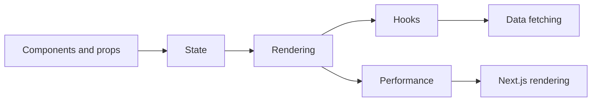

# React

How React turns state into UI, how rendering works, and the hooks you use every day.

**Why it matters in interviews:** React questions at senior level are about rendering: why a component re-renders, stale closures in hooks, and performance. Plus Next.js rendering choices.

## The map

How the lessons connect. Learn left to right.

## Lessons, one concept per file

Each lesson is one small file made from [the lesson template](../../templates/lesson-template.md): picture first, a code trace, practice, links to watch and play, and an explain it back section.

Status: `planned` (not written yet), `ready` (written, not studied), `learning`, `can explain` (passed explain-check).

### Basics

| # | Lesson | You will understand | Status |
|---|---|---|---|
| 01 | Components and JSX `01-components-and-jsx.md` | what JSX compiles to, components as functions | planned |
| 02 | Props and state `02-props-and-state.md` | data down, events up, when state lives where | planned |
| 03 | Rendering and reconciliation `03-rendering-and-reconciliation.md` | what a render is, the virtual DOM diff, why keys matter | planned |
| 04 | Lists and keys `04-lists-and-keys.md` | what goes wrong with index keys | planned |

### Hooks

| # | Lesson | You will understand | Status |
|---|---|---|---|
| 05 | useState `05-usestate.md` | batching, functional updates, why state is a snapshot | planned |
| 06 | useEffect `06-useeffect.md` | when it runs, cleanup, dependency array, stale closures | planned |
| 07 | useRef `07-useref.md` | values that survive renders without causing them, DOM refs | planned |
| 08 | useMemo and useCallback `08-usememo-and-usecallback.md` | what they cache, when they help, when they waste | planned |
| 09 | Custom hooks `09-custom-hooks.md` | pulling logic out of components | planned |
| 10 | Context `10-context.md` | sharing state without props, and its re-render cost | planned |

### Senior level

| # | Lesson | You will understand | Status |
|---|---|---|---|
| 11 | Data fetching `11-data-fetching.md` | loading and error states, race conditions, React Query | planned |
| 12 | State management choices `12-state-management-choices.md` | local, context, Redux, Zustand, server state | planned |
| 13 | Performance `13-performance.md` | React.memo, profiling, splitting code, virtualization | planned |
| 14 | Next.js rendering `14-next-js-rendering.md` | CSR, SSR, SSG, ISR and server components, when to pick each | planned |
| 15 | Testing React `15-testing-react.md` | React Testing Library, what to test | planned |

**To make the next lesson:** in a chat with this folder open, say `/learn react 01` to learn it live with Claude, or ask "make lesson react 01" and the `research-material` agent writes the file. When a lesson file exists, its row becomes a link and the status changes to `ready`.

## Guides already here

Longer guides that cover many concepts at once. Good for revision after the lessons.

- [React and JS frontend interview guide (the main guide)](react-js-frontend-interview-guide.md)
- [React hooks and fetching workbook (hands on)](react-hooks-fetching-practice.md)

## Visual cheatsheets

Open in the browser. Everything visible on one page.

- [React and JS visual cheatsheet](react-js-frontend-interview-guide-cheatsheet.html)

## Watch and play

Trusted places to see the ideas, not only read them. Each lesson adds its own checked video and visualizer links.

- [react.dev Learn](https://react.dev/learn) - the official docs, with interactive examples on every page
- [Thinking in React](https://react.dev/learn/thinking-in-react) - how to break a UI into components and state
- [roadmap.sh React](https://roadmap.sh/react) - visual map of the topics
