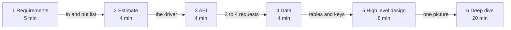
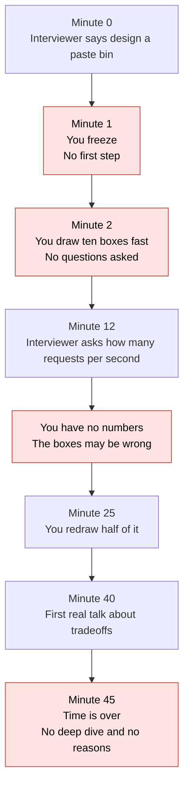
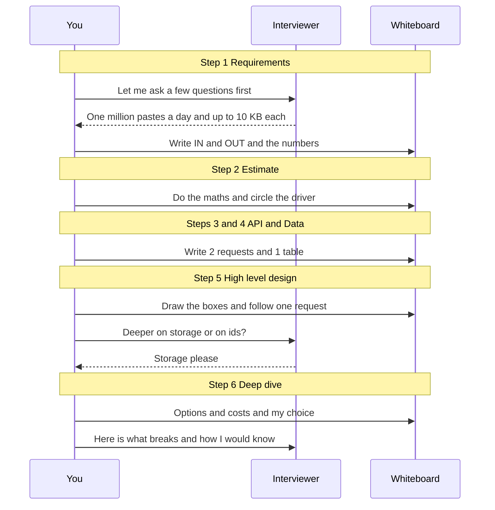
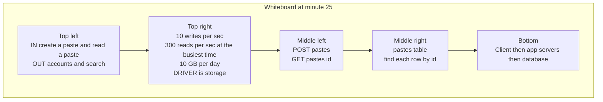
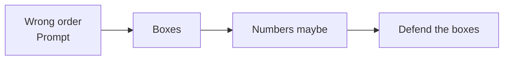
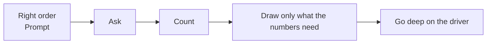
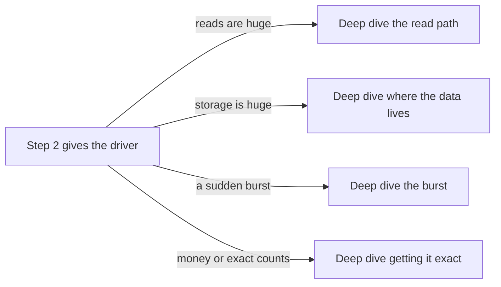

# 01. The interview framework

> **Subject:** System Design · **Lesson:** 01 · **Made:** 2026-10-16 · **Status:** ready
> **You will be able to:** name the six steps of a system design answer in order, give each one a time slot for a 45 minute round, and run all six on a small design (a paste bin) without drawing boxes first.
> **Before this:** none, this is the first lesson. The [roadmap](system-design-roadmap-beginner-to-senior.md) shows the whole path. · **Next:** [Scaling up vs out](02-scaling-up-vs-out.md)

## 1. The idea in one sentence

A design answer is six small jobs in a fixed order. Drawing the boxes is job five, not job one.

When you freeze, you do not need a good idea. You only need to know the next job.

New words (four):

- **Requirements:** what the system must do, and how well it must do it (interview words: functional and non-functional requirements).
- **Estimate:** quick rough maths with round numbers, to learn how big the system is (interview words: back of the envelope). The number that tells you where the hard part is, I call **the driver**.
- **API:** the short list of requests that a client can send to your system.
- **Deep dive:** the long part at the end, where you go deep on the two hardest parts.

Two more ideas appear once, and are explained where they appear: the tables for your data, and the picture with boxes.

## 2. The pictures

### 2a. The big picture

Notice that the picture with boxes is step five. The longest time slot is the last one.



### 2b. The problem, drawn

This is what happens when you freeze and then draw boxes at once. Notice that every box was drawn before anyone knew the size of the problem.



### 2c. How it works over time

This is the right order for the same paste bin. Notice who talks: you ask first, the board fills step by step, and you ask the interviewer where to go deep.



### 2d. What is on the whiteboard right now

A snapshot at minute 25, just after step five. Notice that each step left one clear thing on the board, and that you can read it in order.



### 2e. Right against wrong

The wrong order starts from the answer. The right order starts from the questions.





### 2f. The driver picks the deep dive

This is why step 2 exists. Notice that the same six steps lead to different deep dives. Later lessons teach the tools for each one.



## 3. Real life analogy

A builder does not start with bricks.

- First the builder asks the owner how many people will live there, and what the budget is. That is **requirements**.
- Then the builder measures the land and counts the people. That is the **estimate**.
- Then the builder lists how people move in the house: the doors and the stairs. That is the **API**.
- Then the builder lists the rooms and what goes in each. That is the **data**.
- Then the builder draws the floor plan. That is the **high level design**.
- Then the builder spends the most time on the hard parts, like the roof. That is the **deep dive**.

Where the analogy stops: a house owner is not the judge. In the interview, the interviewer is both. They watch how you ask, not only what you draw. Also, a whiteboard is easy to rub out. Changing the plan in the middle is fine if you say why.

## 4. The smallest code that shows it

This is step 2 for the paste bin. Pastes are text that people share by link. We make 1 million a day, each up to 10 KB, and people read 10 times more than they write. The busiest moment of the day (the peak) is about 3 times the average.

```js
const pastesPerDay = 1_000_000;
const secondsPerDay = 100_000;   // really 86,400. We round it to 100,000
const readsPerWrite = 10;
const kbPerPaste = 10;

const writesPerSec = pastesPerDay / secondsPerDay;
const peakReadsPerSec = writesPerSec * readsPerWrite * 3;
const gbPerDay = (pastesPerDay * kbPerPaste) / 1_000_000;
const tbPerYear = (gbPerDay * 365) / 1000;

console.log({ writesPerSec, peakReadsPerSec, gbPerDay, tbPerYear });
console.log(peakReadsPerSec < 1000 ? "Traffic is small. Storage is the driver." : "Traffic is the driver.");
```

**Output:**

```
{
  writesPerSec: 10,
  peakReadsPerSec: 300,
  gbPerDay: 10,
  tbPerYear: 3.65
}
Traffic is small. Storage is the driver.
```

Checked on 2026-10-16 with Node 22.

Why 1000? One simple server answers about 1,000 simple requests per second. 300 is far below that. So traffic is not the hard part here. The last line is the whole point of step 2: the numbers **say something**.

## 5. What really happens, step by step

The "machine" here is your 45 minutes. The state is what sits on the whiteboard. Read one row at a time.

| Step | Clock | What you do | Paste bin example | Whiteboard after |
|---|---|---|---|---|
| 1 Requirements | 0 to 5 min | Ask 3 or 4 questions. Write IN and OUT. Say out loud what you cut. If the interviewer gives no numbers, pick some and say "I assume". | IN: create a paste, read a paste by its link. OUT (said aloud): accounts, editing, search. Numbers: 1 million new pastes a day, up to 10 KB, reads 10 times writes, a read should feel instant, pastes are kept 1 year. | IN, OUT, and the numbers. |
| 2 Estimate | 5 to 9 min | Do the maths with round numbers. Say the driver out loud. | 1,000,000 / 100,000 = 10 writes per second. Reads: 100. Busiest time (peak) is about 3 times the average: 300. Size: 10 KB x 1M = 10 GB a day = 3.65 TB a year. **Driver: storage, not traffic.** | The numbers, with "storage" circled. |
| 3 API | 9 to 13 min | Write the 2 to 4 requests that serve the IN list. Say what each one returns. | `POST /pastes` with the text gives `201` and a link with an id. `GET /pastes/:id` gives `200` and the text, or `404` if it is gone. | Two requests. |
| 4 Data | 13 to 17 min | Write the tables. Circle the one column you find each row by, and say which request uses it. | `pastes`: id (circled, used by GET), text, created_at, expires_at. | One table. |
| 5 High level design | 17 to 25 min | Draw the fewest boxes that serve the requests. Follow one request from click to answer, out loud. Then ask where to go deeper. | Client, then app servers (copies of the same program, so any copy can answer), then the database. A GET arrives, any app server asks the database by id, and returns the text. | One picture, and an agreement on the deep dive. |
| 6a Deep dive | 25 to 40 min | Pick the 2 hardest parts, using the driver. For each: options, cost, choice, and what would change your mind. | Part 1: where do 3.65 TB of text live? Part 2: how do we make ids that nobody can guess? | The picture grows by one box. |
| 6b What breaks | 40 to 45 min | Say what breaks, how you would know, and what you would watch. | If file storage is slow, reads are slow. Watch the read time and the error rate. Delete expired pastes every night. | Two lines of "watch" notes. |

How to say a deep dive, in this order:

> "There are two ways. A: keep the text in the database. It is simple, but the database grows by 10 GB a day, and backups get slow. B: keep the text in file storage (a service made to keep big files cheaply) and keep only the id and the file name in the database. It adds one more part to run. The driver is storage, so I choose B. If pastes lived only 7 days, I would choose A."

That has four parts: options, cost, choice, and what would change the choice.

Step 2 as arithmetic, line by line (the code from section 4):

| Line | Value after it runs | What it means |
|---|---|---|
| `pastesPerDay` | 1,000,000 | The size of the problem. |
| `secondsPerDay` | 100,000 | A round number instead of 86,400. |
| `writesPerSec` | 10 | Average pastes created each second. |
| `peakReadsPerSec` | 300 | 10 x 10 reads x 3 for the busiest time. |
| `gbPerDay` | 10 | 1,000,000 x 10 KB, written in GB. |
| `tbPerYear` | 3.65 | 10 GB x 365 days, written in TB. |
| last `console.log` | "Storage is the driver" | The conclusion that picks the deep dive. |

No page to step through for this lesson, because nothing runs inside an engine. To practice the clock, use a timer and a drawing board (see section 8).

## 6. Why it exists and what it costs

- **Problem without it:** you freeze at the blank board. Then you draw boxes before you know the size, defend them for 40 minutes, and never reach the hard part (picture 2b).
- **How it solves it:** each step gives the next step its input. The estimate gives the driver. The driver gives the deep dive. When you are stuck, you only ask "which step am I on?".
- **Cost or tradeoff:**
  - The first 17 minutes have little drawing. It feels slow. Do not rush it.
  - The times are a guide, not a law. If the interviewer jumps ahead, follow them.
  - Do not ask 15 questions. Ask the 3 or 4 that change the design. Pick sensible numbers for the rest.
  - In a 30 minute round, make steps 1 to 4 shorter. Never cut the deep dive.

## 7. Common mistakes

**Wrong:** the first sentence is a list of tools.

```
"Design a paste bin? I will use ten small services and the newest tools."
```

**Right:** the first sentence is a question and a plan.

```
"I will start with requirements. Who writes a paste, who reads it, and how many a day?"
```

**Why:** tools come from the numbers. The numbers come from the questions.

**Wrong:** you do the maths, then ignore it.

```
"10 GB a day. OK. Now the load balancer."
```

**Right:** you say what the maths means.

```
"10 GB a day, but only 300 reads per second at the busiest time.
 So the driver is storage. I will spend my deep dive on it."
```

**Why:** an estimate that does not change what you say next wasted four minutes.

**Wrong:** the deep dive names a tool: "I would use S3."

**Right:** the deep dive names a way, its cost, your choice and what would change it (see the quote in section 5).

**Why:** the interviewer grades your reasons, not the tool names.

**If you freeze:**

1. Say "I will start with requirements." This is true, and it gives you time.
2. Write three headings on the board: IN, OUT, NUMBERS.
3. Ask the first question: "Who uses it, and how many of them?"
4. When you do not know what to draw, go back one step. Do not jump forward.

## 8. Watch and play

Links came from web search or from older notes in this folder, 2026-10-16. The build machine could not open pages, so open each one once. If one is broken, tell me and I will replace it.

- **Video:** [System Design Interview: A Step-By-Step Guide](https://yt.chop.dev/en/v/i7twT3x5yv8) by ByteByteGo, just under 10 minutes. This is a mirror page of the YouTube video. If it fails, search YouTube for the same title. I could not confirm which steps it names, so compare it with the six steps here.
- **Read:** [Hello Interview: the delivery framework](https://www.hellointerview.com/learn/system-design/in-a-hurry/delivery) - steps with times for a 45 minute round. Compare its clock with the table in section 5.
- **Read:** [ByteByteGo: a framework for system design interviews](https://bytebytego.com/courses/system-design-interview/a-framework-for-system-design-interviews) - a four step version of the same idea. Find where its steps match ours.
- **Read:** [Back-of-the-envelope calculation on DEV](https://dev.to/vladisov/back-of-the-envelope-calculation-4eal) - rough maths with round numbers. Redo one example and compare with section 4.
- **Play:** [Excalidraw](https://excalidraw.com/) - a free whiteboard. Set a timer for 20 minutes and do exercise 9C. Use the clock from section 5.
- No interactive visualizer for this topic was found. The timer and the board are the practice tool.

<details><summary>Go deeper (optional)</summary>

**Other versions of the steps.** Sources differ, and all are fine if you keep the order.

- The [step by step walkthrough](system-design-step-by-step-walkthrough.md) has seven steps. It makes "failure and operations" its own step and runs 48 minutes. This lesson puts that part at the end of step 6 so the total is 45. Read its "The clock" and "Step 2" parts, plus the full URL shortener and notification examples.
- The [basics guide](system-design-basics-senior-fullstack-interview.md) uses the Hello Interview flow, which adds a "core entities" step (the 3 to 5 nouns you store) before the API. Read "How the interview actually runs".
- A web search on 2026-10-16 found guides that give the deep dive between 10 and 20 minutes. One of them, [The 6-Step Interview Framework](https://akshit.ahuja.js.org/system-design/framework.html), uses the same six steps as this lesson and says to spend about 20 minutes on the first four before drawing. Mine is 17.
- For a 60 minute round, the walkthrough says to give the extra time to the deep dive, not to steps 1 to 5.

**Numbers worth remembering** (from the walkthrough, which lists many more):

- 86,400 seconds in a day. Round it to 100,000. The answer is about 14 percent too low (11.6 real against 10), which is fine for sizing.
- 1 million users doing 10 actions a day is about 100 requests per second on average. Requests per second is often written QPS (queries per second).
- Peak is 2 to 3 times the average. For traffic that comes in sudden bursts, use 10 times.

**Why random ids for the paste bin.** An id of 8 characters from 62 letters and digits has 62^8 = 218,340,105,584,896 values. A clash is very rare. The primary key (the column the table finds rows by, and refuses to repeat) rejects a clash, and you try again. A plain counter has no clashes, but anyone can read every paste by counting up. This is one of the two deep dive parts in section 5.

**What interviewers score.** The walkthrough's "Part 4" has a step by step table of what senior looks like against what gets marked down. The [question bank](senior-system-design-interview-questions.md) has the same question asked in many ways.

</details>

## 9. Practice

**A. Predict the output** (write your answer before opening)

Take the code from section 4. Change the first lines to this, and keep the rest as it is. What do the two `console.log` lines print?

```js
const pastesPerDay = 50_000_000;
const secondsPerDay = 100_000;
const readsPerWrite = 10;
const kbPerPaste = 2;
const writesPerSec = pastesPerDay / secondsPerDay;
const peakReadsPerSec = writesPerSec * readsPerWrite * 3;
const gbPerDay = (pastesPerDay * kbPerPaste) / 1_000_000;
console.log(writesPerSec, peakReadsPerSec, gbPerDay);
console.log(peakReadsPerSec < 1000 ? "storage" : "traffic");
```

<details><summary>Answer</summary>

```
500 15000 100
traffic
```

50 million / 100,000 is 500 writes per second. Times 10 reads times 3 for the peak is 15,000. That is far above 1,000, so the driver is now traffic. Storage is only 100 GB a day. Same six steps, a different deep dive (picture 2f).

</details>

**B. Fix the bad opening**

A candidate hears "Design a paste bin." The first thing they say is: "OK. I will use a load balancer, five app servers, a cache, a queue and a big cluster of databases. Let me draw." (You will learn these tools in later lessons.) What is wrong? What would you say in the first 30 seconds instead?

<details><summary>Answer</summary>

Three things are wrong:

1. There are no questions. They do not know who uses it or how big it is.
2. There are no numbers. Five servers and a cluster at 10 writes per second is far too much.
3. They name tools, not reasons. Nothing says why each box is there.

A better opening: "I will start with requirements. I think the core is: create a paste and read a paste by link. I will leave out accounts and search unless you want them. How many pastes a day should I plan for, and how big can one be?"

</details>

**C. Write it yourself**

Set a timer for 20 minutes. Open Excalidraw or take paper. Do steps 1 to 5 for this prompt: **"Design a poll. Someone creates a question with 4 options. Other people vote once each and see the counts."** Use the clock from section 5. Write IN and OUT, the numbers and the driver, 3 requests, the tables, and one picture. Say the driver out loud before you draw. There is no code to run.

<details><summary>One possible answer</summary>

- **1 Requirements:** IN: create a poll, vote once, see the counts. OUT: accounts, comments, charts. Numbers I assume: 1 million votes a day, results can be 5 seconds late, but one vote per person must be exact.
- **2 Estimate:** 1,000,000 / 100,000 = 10 votes per second. A famous poll can be 10 times busier: 100. Reads are 20 times writes: about 200 to 2,000 at peak. Storage is tiny. **Driver: one vote per person, and one very busy poll.**
- **3 API:** `POST /polls` gives `201` and a poll id. `POST /polls/:id/votes` gives `201`, or `409` if this person already voted. `GET /polls/:id/results` gives `200` and the counts.
- **4 Data:** `polls(id, question)`, `options(id, poll_id, text)`, `votes(poll_id, voter_id, option_id)` with the primary key on `(poll_id, voter_id)`. The key itself refuses a second vote.
- **5 High level design:** Client, then app servers, then the database. Results come from a stored count, not from counting all rows each time.
- **6 Deep dive:** (a) Two taps at the same moment: the primary key stops the second vote, even without a lock. (b) One very busy poll: many writers update one count. Options: count rows on read (slow when large), update one count row (a line of waiting writers), or keep the counts in small pieces and add them up every few seconds (more work, but fast). Choose the last one only if the poll gets really busy.

</details>

## 10. Interview question

**Q:** "Walk me through how you approach a system design question."

<details><summary>A strong answer, in four parts</summary>

1. **Problem:** a design prompt is short on purpose. If you draw at once, you design the wrong thing and run out of time before the hard part.
2. **How it works:** six steps in a fixed order, with a clock. Requirements (5 min): ask, write in and out, say what you cut. Estimate (4): round numbers, then name the driver. API (4): 2 to 4 requests. Data (4): tables, and the column each request finds rows by. High level design (8): fewest boxes, follow one request. Deep dive (20): two hard parts picked from the driver, with options, cost, choice and what would change it. The end of the deep dive says what breaks and what I watch.
3. **Tradeoff:** the order costs time before the first picture, and the times are a guide. If the interviewer jumps ahead, I follow. I ask 3 or 4 questions, not 15. In a short round I shrink steps 1 to 4 and keep the deep dive.
4. **My example:**
   - **Fact:** in DBO the users were store owners (a React Native app), content admins (a CMS) and verification admins. The backend was four Node and TypeScript services on Docker Swarm via CapRover: an API service, an Auth service, a Queue service with workers, and a Cron service. We split them by what each one needed to do, not by topic.
   - **Fact:** for a deep dive I can use a real problem. TADA sent the same refund event twice at almost the same moment, and both copies passed the "already done?" check, so stores got double points. We fixed it with a row lock (it makes the second copy wait until the first one is finished) inside one database transaction.
   - **Idea, not a fact:** when I tell the DBO story, I can use the same six steps as the order: users and numbers first, then requests, then data, then the picture, then the duplicate event as the deep dive.

</details>

## 11. Explain it back

Close this file. Explain the framework out loud like to a new junior, in 4 parts (problem, how, tradeoff, my example). Say the six steps and their minutes without looking. Then write your best version below and run `/explain-check the interview framework` or ask the `explain-coach` agent to review it.

### My explanation

<write here>

### Coach feedback

<the explain-coach agent writes here>

## 12. Review questions (day 1, 3, 7, 21)

1. Name the six steps in order, with the minutes for each in a 45 minute round.
2. Why does the estimate come before the picture with boxes? What does it give you?
3. It is minute 1 and you freeze. What do you say, what do you write, and which question do you ask first?
4. Draw the picture from section 2a from memory.

<details><summary>Answers</summary>

1. Requirements 5, Estimate 4, API 4, Data 4, High level design 8, Deep dive 20 (the last 5 of it say what breaks and what I watch). That is 45.
2. It gives the driver, the one number that shows where the hard part is. The driver picks the deep dive and tells you which boxes you really need.
3. Say "I will start with requirements." Write IN, OUT and NUMBERS on the board. Ask "Who uses it, and how many of them?"
4. Six boxes from left to right: 1 Requirements, 2 Estimate, 3 API, 4 Data, 5 High level design, 6 Deep dive. Minutes under each. What each step hands to the next one on the arrows.

</details>

## Connected lessons

- [Scaling up vs out](02-scaling-up-vs-out.md) - the next lesson. It starts the boxes you will draw in step 5.
- [Latency numbers and estimation](16-latency-numbers-and-estimation.md) - step 2 in full, with how slow each hop is.
- [Design a URL shortener](08-design-a-url-shortener.md) - the same six steps on a whole design, where the driver is reads.
- [Choosing tools and explaining why](15-choosing-tools-and-explaining-why.md) - how to say your reasons in the deep dive.
- [System design step by step, with two full designs](system-design-step-by-step-walkthrough.md) - the seven step version with two long worked examples.
- [System design basics for a senior full stack interview](system-design-basics-senior-fullstack-interview.md) - the concepts you will draw in step 5.
- [System design roadmap, beginner to senior](system-design-roadmap-beginner-to-senior.md) - where this lesson sits on the path.
- [Networking for system design](../networking/networking-for-system-design.md) - the latency numbers for step 2.
