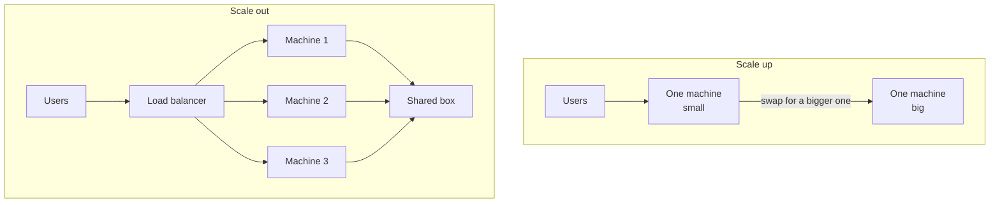
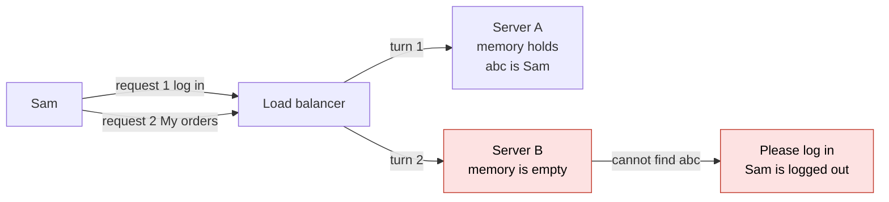
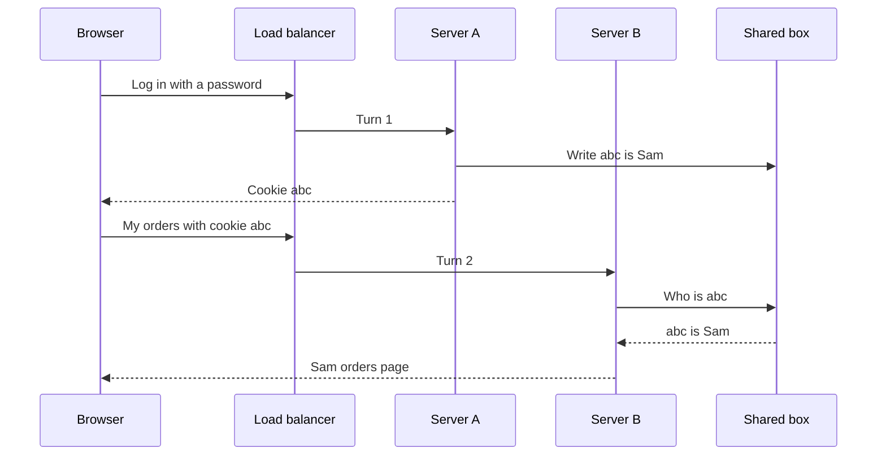
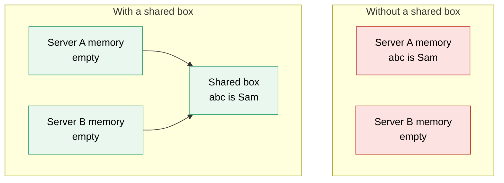
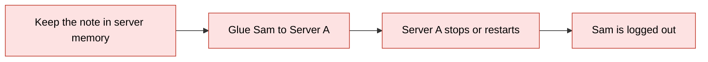
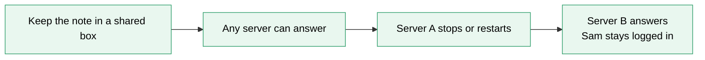
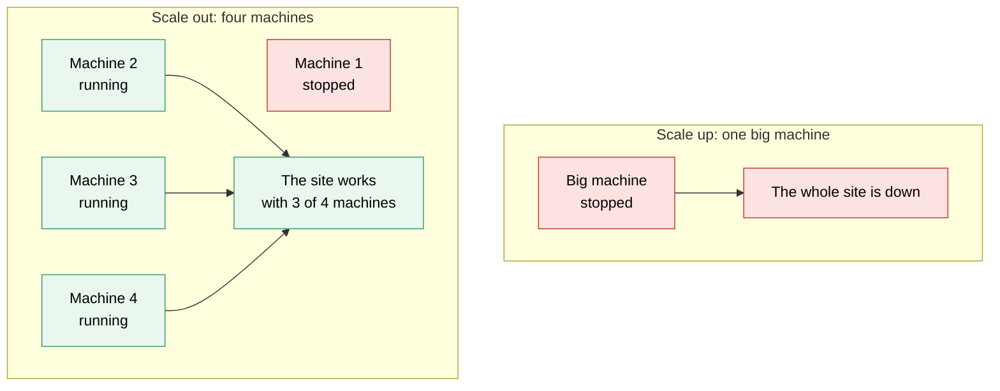
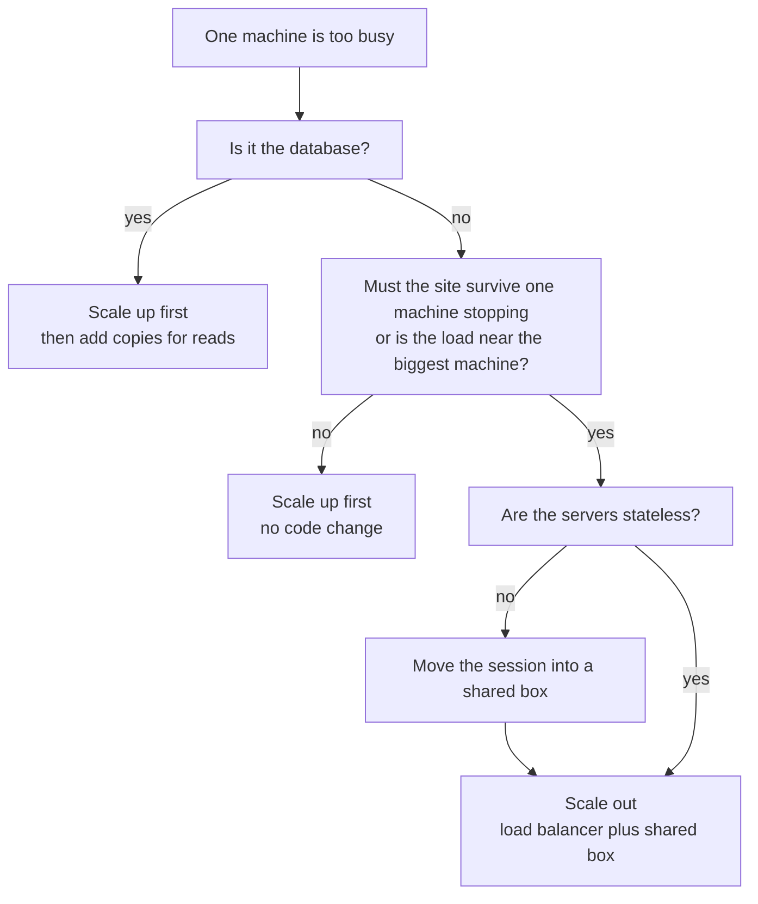

# 02. Scaling up vs out

> **Subject:** System Design · **Lesson:** 02 · **Made:** 2026-10-16 · **Status:** ready
> **You will be able to:** say the difference between a bigger machine and more machines, name what each one costs, and explain why your servers must keep no user data in their own memory before you add a second one.
> **Before this:** [The interview framework](01-the-interview-framework.md) · **Next:** [Load balancers](03-load-balancers.md)

## 1. The idea in one sentence

When one machine is too busy, you can buy a bigger one, or you can add more machines. Adding more machines only works if no machine keeps user data in its own memory.

New words (four):

- **Scale up and scale out:** two ways to grow. Up means one bigger machine. Out means more machines of the same kind (interview words: vertical scaling and horizontal scaling).
- **Stateless:** a server that keeps nothing about a user between two requests. Everything it needs comes with the request, or sits in a shared place.
- **Session:** the login note a server writes when you log in, so it knows who you are on your next click.
- **Load balancer:** one front door. It receives every request and passes each one to one of your machines. Lesson 03 teaches it in full.

Two plain ideas, explained now so the pictures make sense:

- **The cookie:** a small note that the browser keeps and sends back with every request. It holds an id, here `abc`, so the server can find the login note.
- **The shared box:** one place that every server can read and write. It can be your database, or Redis (a fast store that keeps data in memory). Interview word: shared store.

## 2. The pictures

### 2a. The big picture

Notice that scale up keeps one machine. Scale out has many machines and one shared box behind them.



### 2b. The problem, drawn

This is the bug you meet when you add the second machine. Notice that the login note sits in Server A only. Server B has nothing.



### 2c. How it works over time

This is the fix. Notice that Server B never saw the login. It asks the shared box, so it still knows Sam.



### 2d. What is in memory right now

This is a snapshot after Sam logged in on Server A. Notice where the note sits in each case. With the fix, both servers are empty and the box holds the note.



### 2e. Right against wrong

The wrong way glues Sam to one server (interview word: sticky session). The right way lets any server answer. Notice what happens when Server A stops.





### 2f. When a machine stops

Notice that one big machine stopping means the whole site is down. With four machines, three still answer.



### 2g. Which one first?

This is the choice you say out loud. Notice that scale up comes first in two of the three exits.



## 3. Real life analogy

A small shop has one cashier. The cashier knows every regular customer by name, because the cashier keeps all of it in their head.

- **Scale up:** buy the cashier a faster till and a bigger counter. There is still one cashier. If they get sick, the shop closes.
- **Scale out:** hire a second cashier, and put a person at the door who sends each customer to a free cashier. That person is the load balancer.
- **The bug:** a regular walks in and goes to cashier 2. Cashier 2 does not know them and asks them to start again.
- **The fix:** a notebook on the counter. Both cashiers write every regular in it, and both read it. Now it does not matter which cashier you meet.

Where the analogy stops: cashiers can talk to each other, but servers cannot read each other's memory at all. Also, reading the notebook takes a moment. A shared box takes a small trip over the network on every request. And if the notebook is lost, both cashiers are stuck.

## 4. The smallest code that shows it

Two servers take turns. Request 1 is a login and lands on A. Then four requests ask "who am I?" and land on A, B, A, B. The code runs twice. First each server has its own memory. Then both servers use the same `Map` (a list of key and value pairs).

```js
const server = (name, memory) => ({
  login: (user, id) => memory.set(id, user),
  whoAmI: (id) => name + " says " + (memory.get(id) ?? "please log in"),
});
function run(label, servers) {
  servers[0].login("Sam", "abc");                  // request 1: the login lands on A
  const turns = [0, 1, 0, 1];                      // requests 2 to 5 take turns: A, B, A, B
  console.log(label, turns.map((i) => servers[i].whoAmI("abc")).join(" | "));
}
run("own memory  :", [server("A", new Map()), server("B", new Map())]);
const shared = new Map();                          // one box that both servers use
run("shared store:", [server("A", shared), server("B", shared)]);
```

**Output:**

```
own memory  : A says Sam | B says please log in | A says Sam | B says please log in
shared store: A says Sam | B says Sam | A says Sam | B says Sam
```

Checked on 2026-10-16 with Node 22.

Only the `Map` changed between the two runs. The id `abc` plays the part of the cookie. The server uses it to find the login note.

## 5. What really happens, step by step

The "machine" here is your set of servers. The state is what each memory holds. Read one row at a time. The code prints one line at the end. The last column shows which piece of that line each request adds.

**Run 1: each server has its own memory**

| Step | Request lands on | What the server does | Memory of A | Memory of B | Printed |
|---|---|---|---|---|---|
| 1 | A (login) | A writes `abc is Sam` in its own memory | `abc is Sam` | empty | nothing yet |
| 2 | A | A finds `abc` in its own memory | `abc is Sam` | empty | `A says Sam` |
| 3 | B | B looks in its own memory and finds nothing | `abc is Sam` | empty | `B says please log in` |
| 4 | A | A finds `abc` again | `abc is Sam` | empty | `A says Sam` |
| 5 | B | B finds nothing again | `abc is Sam` | empty | `B says please log in` |

**Run 2: both servers share one box**

| Step | Request lands on | What the server does | Memory of A | Memory of B | Shared box | Printed |
|---|---|---|---|---|---|---|
| 1 | A (login) | A writes `abc is Sam` in the shared box | empty | empty | `abc is Sam` | nothing yet |
| 2 | A | A asks the box about `abc` | empty | empty | `abc is Sam` | `A says Sam` |
| 3 | B | B asks the box about `abc` | empty | empty | `abc is Sam` | `B says Sam` |
| 4 | A | A asks the box | empty | empty | `abc is Sam` | `A says Sam` |
| 5 | B | B asks the box | empty | empty | `abc is Sam` | `B says Sam` |

What to see: in run 1 the answer depends on which server gets the request. In run 2 it never does. That is what "stateless" buys you.

**Step through it yourself:** [open the stepper](visuals/02-scaling-up-vs-out.html). It has three stories: the bug, the fix, and adding a server and losing one. Guess first, then press Next. It shows the browser, the load balancer, each server's memory and the shared box.

## 6. Why it exists and what it costs

- **Problem without it:** one machine has a top limit, the biggest machine you can rent. It is also one part that stops everything when it stops (interview word: single point of failure). See picture 2f.
- **How it solves it:**
  - Scale up swaps the machine for a bigger one. You change no code.
  - Scale out adds machines. The load balancer shares the requests. This only works when the servers are stateless, so the next request can land anywhere (pictures 2b to 2d).
- **Cost or tradeoff:** each way costs something different.

| | Scale up (bigger machine) | Scale out (more machines) |
|---|---|---|
| Code change | None | Servers must be stateless. Sessions move to a shared box |
| New parts to run | None | A load balancer and a shared box |
| Top limit | The biggest machine you can rent | Very high. Keep adding machines |
| If one machine stops | The whole site stops | The rest keep answering, with less capacity |
| Growing | Usually a short stop to switch machines | Add a machine while the others keep running |
| Main danger | You hit the ceiling. Very big machines get expensive | Hidden state, a shared box that fails, harder debugging |

**The numbers, briefly.**

- One simple server answers about 1,000 simple requests per second (from lesson 01). If your busiest moment is 300, one machine is enough. You do not need to scale at all.
- Inside one cloud machine family, a machine twice as big costs about twice as much. So scaling out does not save money. You pay for a spare machine and a higher top limit, and you run more parts.
- With more than one machine, keep each one only partly busy. If one stops, the others must carry its work. The safe level is (N minus 1) divided by N.

| Machines | How busy each may be | Why |
|---|---|---|
| 1 | Not possible | There is no spare |
| 2 | 50 percent | The one left must do all the work |
| 3 | 67 percent | Two left do the work of three |
| 4 | 75 percent | Three left do the work of four |
| 10 | 90 percent | Nine left do the work of ten |

Two small machines at 50 percent busy are a worse deal than they look. You pay for two and use one. The more machines you have, the less you waste on spares.

**When scale up is the right first answer:**

- The load is small and a short stop is fine. This is the most common case.
- It is the database. A database is hard to split across machines. So buy a bigger machine first, then add copies for reading, and split the data last. The [basics guide](system-design-basics-senior-fullstack-interview.md) says "stop as early as possible".
- The team is small. A bigger machine means no code change and no new parts to run.

**When scale out is the right answer:**

- The site must keep working when one machine stops, or when you update the code.
- The load is close to the biggest machine you can rent.
- The load goes up and down, and you want to add machines for an hour and remove them after.
- Your servers are already stateless.

Most real systems use both. App servers scale out first. Databases scale up first. (The [question bank](senior-system-design-interview-questions.md) says the same in question 13.)

## 7. Common mistakes

**Wrong:**

```
"We need to scale, so I will add ten servers. Horizontal is more modern."
```

**Right:**

```
"The busiest moment is 300 requests per second. One machine handles that.
 I scale up first. I scale out when I need a spare machine or I hit the limit."
```

**Why:** scaling out adds a load balancer, a shared box and new ways to fail. Do it when the numbers ask for it.

**Wrong:** the fix for logged out users is "glue each user to one server".

```
"Turn on sticky sessions. The load balancer always sends Sam to Server A."
```

**Right:**

```
"Move the session into a shared box. Then any server can answer Sam."
```

**Why:** when Server A stops or updates, everyone glued to it is logged out. New machines only get new users, so adding machines helps less.

**Wrong:** a variable in the server holds data that a later request needs.

```js
// sketch, not run here
const carts = {};                                   // lives in this one server
app.post("/cart", (req, res) => {
  carts[req.userId] = req.body.items;
  res.sendStatus(204);
});
```

**Right:**

```js
// sketch, not run here
app.post("/cart", async (req, res) => {
  await redis.set("cart:" + req.userId, JSON.stringify(req.body.items));   // lives in the shared box
  res.sendStatus(204);
});
```

**Why:** the cart is another kind of session. Uploaded files saved on the server disk and counters kept in memory hide the same bug.

**Wrong:** "Redis holds the sessions, so we are done."

**Right:** "Redis is now the one part that stops everything. It needs a spare copy that takes over."

**Why:** you moved the single point of failure. You did not remove it.

**If you freeze:**

1. Say "First I check whether the servers keep anything in their own memory."
2. If yes: "I move it to a shared box. Then I can add machines."
3. Then say the numbers: "At 300 requests per second, one machine is enough for now."

## 8. Watch and play

Links came from web search or from older notes in this folder, 2026-10-16. The build machine could not open pages, so open each one once. If one is broken, tell me and I will replace it.

- **Video:** [Scalability Explained: Vertical vs Horizontal Scaling](https://www.youtube.com/watch?v=Tn5z9OZK2hU) - the title came from a search result. I could not see the channel or the length. Watch the first minutes and compare with picture 2a.
- **Read:** [ByteByteGo: scale from zero to millions of users](https://bytebytego.com/courses/system-design-interview/scale-from-zero-to-millions-of-users) - the part where the web tier becomes stateless, with pictures. Find where it moves the session out of the server.
- **Read:** [KodeKloud: Interview Byte, the random logout question](https://notes.kodekloud.com/docs/System-Design-For-Beginners/Foundations-One-Server/Interview-Byte-The-Random-Logout-Question/page.md) - the page name matches the bug in picture 2b. I could not read it, so check that it fits.
- **Read:** [NeetCode newsletter: system design concepts to know](https://blog.neetcode.io/p/system-design-concepts-know) - a search summary says it argues for a bigger machine as the simpler first step. Find that part.
- **Play with it:** [the stepper in this folder](visuals/02-scaling-up-vs-out.html) - guess first, then press Next. Try all three tabs. No outside interactive tool was found for this topic.
- **Play:** [Excalidraw](https://excalidraw.com/) - a free whiteboard. Draw picture 2a and 2c from memory, then compare.

<details><summary>Go deeper (optional)</summary>

**Node and a bigger machine.** One Node process runs your JavaScript on one core. A machine with 16 cores does not make one Node process 16 times faster. Run several processes or containers on the big machine, or the extra cores sit idle. The [basics guide](system-design-basics-senior-fullstack-interview.md) covers this under "Scaling the service tier". Lesson [The event loop](../javascript/11-the-event-loop.md) shows why one process does one thing at a time.

**Why 20 machines are not 20 times faster.** Some work cannot be shared, for example the one database every server talks to. The formula (Amdahl's law, from the [Aalto scalability page](https://fitech101.aalto.fi/designing-and-building-scalable-web-applications/dab-03-defining-scalability/2-scalability-laws)) is N divided by (1 plus p times (N minus 1)). Here p is the share that cannot be split. With p = 5 percent and N = 20 machines, you get 10.3 times, not 20. I worked that number out in Node on 2026-10-16.

**Price and ceiling numbers** (web search, 2026-10-16, from price sites and an AWS announcement, not from the AWS price page):

- In the x2gd family, the xlarge (4 vCPU, 64 GB) is listed at about $0.334 an hour and the 2xlarge (8 vCPU, 128 GB) at about $0.668 an hour, in us-east-1 on demand. The price doubles with the size. Sources: [devzero x2gd family](https://www.devzero.io/instances/aws/families/x2gd) and [holori x2gd.2xlarge](https://calculator.holori.com/aws/ec2/x2gd.2xlarge).
- The biggest machine that appeared in my search was AWS `u7in-24tb.224xlarge`: 24 TiB of memory and 896 vCPUs. Source: [AWS What's New, July 2026](https://aws.amazon.com/about-aws/whats-new/2026/07/amazon-ec2-high-memory-u7i/). I did not check that it is the biggest of all. The point stays the same: there is a top.
- On AWS, changing the machine type means stopping the machine and starting it again. A search found this in a [AWS Knowledge Center answer](https://www.repost.aws/knowledge-center/ec2-windows-resize-instance). I did not open the page.

**Other places state hides.**

- Files saved on the server disk. Use file storage that every server can reach.
- Counters for rate limits. A limit kept in one server's memory becomes the limit times the number of servers. Keep the counter in Redis. (From my [DBO case study](../../interview/my-projects/dbo-b2b-platform-system-design-case-study.md), section on rate limiting.)
- Scheduled jobs. A timer inside every copy runs the job once per copy. Run the schedule in one place.
- WebSocket connections. One connection stays on one machine for its whole life. This is real stickiness. Use Redis pub/sub to pass messages between machines. (From the [load balancer guide](load-balancers-microservices-online-shop.md).)

**A token instead of a shared box.** A signed token (JWT) holds the session inside the cookie. The server needs no lookup. The cost: you cannot cancel a token before it expires, unless you add a list of cancelled tokens. A shared box can cancel a session at once, but costs one lookup per request. The [load balancer guide](load-balancers-microservices-online-shop.md) compares both. More reading: [Sticky Sessions: Benefits and Drawbacks on DEV](https://dev.to/rahulvijayvergiya/sticky-sessions-benefits-and-drawbacks-68n) and [JWT vs sessions on jwtdecode.io](https://jwtdecode.io/jwt-vs-session). Both links come from the older notes in this folder.

**What breaks next when you add servers.** Every new server opens its own connections to the database. Many servers can run the database out of connections. My DBO case study names this as the first thing that breaks at 10 times the load in that stack. It is an answer in the case study, not something I measured.

**Autoscaling.** A cloud service can add and remove machines for you when the load changes. It needs stateless servers, because a machine may be removed at any moment.

</details>

## 9. Practice

**A. Predict the output** (write your answer before opening)

Three servers, each with its own memory. This time the login lands on server B. Then four requests take turns: A, B, C, A. What does the last line print?

```js
const server = (name, memory) => ({
  login: (user, id) => memory.set(id, user),
  whoAmI: (id) => name + " says " + (memory.get(id) ?? "please log in"),
});
const servers = ["A", "B", "C"].map((n) => server(n, new Map()));
servers[1].login("Mia", "xyz");          // this time the login lands on B
console.log([0, 1, 2, 0].map((i) => servers[i].whoAmI("xyz")).join(" | "));
```

Then answer: what one change makes all four answers say Mia?

<details><summary>Answer</summary>

```
A says please log in | B says Mia | C says please log in | A says please log in
```

Only Server B wrote the note, in its own memory. So only B knows Mia. With three servers, a request finds the right server one time in three. To fix it, give all three servers the same `Map`: create one `const shared = new Map()` and pass it to every `server(...)` call. (Checked on 2026-10-16 with Node 22.)

</details>

**B. Fix the bug**

A team moves from 1 container to 2. Now users say: "The site logs me out about every other click." Here is the code. Find the bug and fix it.

```js
// sketch, not run here
const sessions = {};                       // lives in this server's memory
app.post("/login", (req, res) => {
  const id = crypto.randomUUID();
  sessions[id] = req.body.user;
  res.cookie("sid", id).sendStatus(204);
});
app.get("/orders", (req, res) => {
  const user = sessions[req.cookies.sid];
  if (!user) return res.status(401).send("Please log in");
  res.json(ordersFor(user));
});
```

<details><summary>Answer</summary>

`sessions` is a variable inside one server. The login lands on one container and writes there. The next request may land on the other container, which has an empty `sessions`. That gives the 401, about half of the time with two containers.

Fix: keep the session in a shared box that both containers use, for example Redis (ioredis style):

```js
// sketch, not run here
app.post("/login", async (req, res) => {
  const id = crypto.randomUUID();
  await redis.set("session:" + id, req.body.user, "EX", 3600);   // forgets it after 1 hour
  res.cookie("sid", id).sendStatus(204);
});
app.get("/orders", async (req, res) => {
  const user = await redis.get("session:" + req.cookies.sid);
  if (!user) return res.status(401).send("Please log in");
  res.json(ordersFor(user));
});
```

A second fix: put the user in a signed token (JWT), so the server keeps nothing. Say the cost: you cannot cancel a token early.

</details>

**C. Write it yourself**

For each case, say "scale up" or "scale out" and give one reason with a number or a fact. Write your answer before you open.

1. An internal admin tool for 50 people. The database machine is at 85 percent busy at month end.
2. An online shop API. It runs on one machine at 70 percent busy. The shop wants to update the code without any error for customers.
3. A ticket sale. Traffic is 20 times normal for one hour, and normal the rest of the day.

<details><summary>One possible answer</summary>

1. **Scale up.** It is a database, which is hard to split, and 50 users is a small load. A bigger machine needs no code change. A short stop at night is fine.
2. **Scale out.** You need at least two machines, so one can take requests while the other is being updated. At 70 percent busy, two machines would each be about 35 percent busy. First make the servers stateless, with sessions in a shared box. (The [load balancer guide](load-balancers-microservices-online-shop.md) explains how to update one machine at a time.)
3. **Scale out.** Add machines for the hour and remove them after. A bigger machine would sit idle for 23 hours, and you pay for it all day. The servers must be stateless, because machines come and go.

</details>

## 10. Interview question

**Q:** "Our API is getting slow. Do you buy a bigger server or add more servers?"

<details><summary>A strong answer, in four parts</summary>

1. **Problem:** one machine is full, and requests get slow. One machine is also one part that stops everything when it stops.
2. **How it works:** scale up swaps the machine for a bigger one, with no code change. Scale out adds copies behind a load balancer. For scale out, the servers must be stateless. A request can then land on any copy, because the session and other user data sit in a shared box or travel in a token. Without that, the user is logged out when the next request lands on another copy.
3. **Tradeoff:** scale up is simple, but it has a top limit, and one failure stops the site. Scale out has a high limit and survives one failure, but needs a load balancer, a shared box, and spare room on each machine (N minus 1, divided by N). My answer: check the numbers first. Scale up first when the load is small. Scale out the app servers when I need a spare machine, or I am near the limit. The database usually scales up first.
4. **My example:**
   - **Fact:** in DBO, the Auth service owns login and issues JWTs. My case study says that this keeps the API tier stateless, because the API keeps no login in its own memory.
   - **Fact:** DBO runs as four Node and TypeScript services on Docker Swarm via CapRover. My case study says the services scale and deploy on their own.
   - **Fact:** DBO has one cron service on purpose. Scheduled jobs run in exactly one place. My case study says two copies could run the yearly points reset twice, and it also names the one copy as a single point of failure. So scaling out is not always right.
   - **Idea, not a fact:** my case study suggests, as the next step, to keep the API service fully stateless and run several copies behind the load balancer. I should not say that this is done. I can say it is what I would do next.

</details>

## 11. Explain it back

Close this file. Explain scaling up and out out loud like to a new junior, in 4 parts (problem, how, tradeoff, my example). Use the story of Sam being logged out. Then write your best version below and run `/explain-check scaling up vs out` or ask the `explain-coach` agent to review it.

### My explanation

<write here>

### Coach feedback

<the explain-coach agent writes here>

## 12. Review questions (day 1, 3, 7, 21)

1. What is the difference between scale up and scale out? Give one cost for each.
2. Sam logs in, and his next click makes the site ask him to log in again. There are two servers. Why does this happen, and what is the fix?
3. You run 3 machines. At most how busy can each one be if you want to survive losing one? Why?
4. Draw the picture from section 2c from memory.

<details><summary>Answers</summary>

1. Scale up is one bigger machine: no code change, but a top limit and one failure stops everything. Scale out is more machines: a high limit and it survives one failure, but it needs a load balancer, a shared box and stateless servers.
2. The login note was kept in the memory of one server. The next request landed on the other server, which had never seen the login. The fix is to keep the note in a shared box (or in a signed token), so any server can answer.
3. About 67 percent, which is (3 minus 1) divided by 3. If one stops, two machines must carry the work of three. Two machines at 67 percent each have exactly the room to do that.
4. Browser, load balancer, Server A, Server B and the shared box, left to right. The login goes to A, and A writes `abc is Sam` in the shared box. The next click goes to B, and B asks the box and gets `abc is Sam`.

</details>

## Connected lessons

- [The interview framework](01-the-interview-framework.md) - the six steps. Scaling is a choice you make in step 5 and explain in step 6.
- [Load balancers](03-load-balancers.md) - the next lesson. The front door in full: how it picks a machine, and how it knows a machine is dead.
- [Caching](04-caching.md) - Redis is often both the shared box and the cache.
- [Latency numbers and estimation](16-latency-numbers-and-estimation.md) - how slow the extra trip to the shared box is.
- [Replication and quorums](19-replication-and-quorums.md) - the spare copy of the shared box, and copies of a database for reading.
- [Safe deploys](27-safe-deploys.md) - updating the code with no errors needs more than one machine.
- [System design basics for a senior full stack interview](system-design-basics-senior-fullstack-interview.md) - "Scaling the service tier" and the Postgres ladder.
- [Load balancers and microservices for an online shop](load-balancers-microservices-online-shop.md) - sticky sessions, JWT against Redis, and why the balancer is also one point of failure.
- [System design interview questions, beginner to senior](senior-system-design-interview-questions.md) - questions 13, 14 and 15 ask this lesson in three ways.
- [Data storage choices for system design](data-storage-choices-for-system-design.md) - why databases scale up first, and what comes after.
