# 03. Load balancers

> **Subject:** System Design · **Lesson:** 03 · **Made:** 2026-10-16 · **Remade in short cards:** 2026-10-30 · **Status:** ready
>
> **You will be able to:** say what a load balancer does, tell layer 4 from layer 7, choose between round robin and least connections, explain how a dead server is removed and how it returns, and name three things a load balancer cannot fix.
>
> **Before this:** [Scaling up vs out](02-scaling-up-vs-out.md) · **Next:** [Caching](04-caching.md)
>
> **How to read it:** one card is one idea. Look at the picture, guess, then press the orange bar to check. The blue bars (📖 More detail) hold the longer explanation. Skip them on the first read, and open them when you want more. About 15 minutes for the cards.

## 1. The idea: one front door

A load balancer is one front door for many servers. It sends each request to a server that is alive, and it stops sending requests to a dead one. Like a host at a restaurant door: the host does not cook, the host only decides which waiter takes each guest.

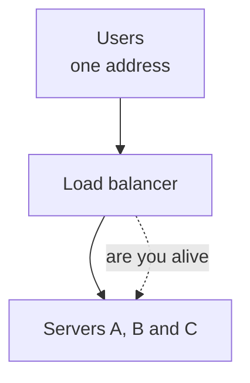

<details class="guess"><summary>🤔 Guess: with no front door, Mia calls Server B, which has stopped. Who tells her? Press to check.</summary>

**Nobody.** Without a front door every user picks a server alone. The work is not shared, and a dead server keeps getting users. A load balancer asks each server "are you alive?" on a timer and skips the dead ones.

</details>

> **Remember:** users know one address. The load balancer picks the server for each request.

<details class="more"><summary>📖 More detail: four new words, the big picture, the problem drawn, and the restaurant</summary>

In lesson 02 the front door was one small box in the picture. Here it is the whole lesson.

New words (four):

- **Health check:** a small question the load balancer asks every server on a timer: "are you alive?" A server that does not answer is taken out of the **pool** (the list of servers the load balancer may use).
- **Round robin:** take turns. Server A, then B, then C, then A again.
- **Least connections:** pick the server that has the fewest open requests right now.
- **Layer 4 and layer 7 (L4 and L7):** how much of the request the load balancer reads. Layer 4 reads only where the request goes: the machine's address and the door number on it (interview words: IP address and port). Layer 7 reads the whole web request: the path (like `/orders`), the headers (extra notes) and the cookie (the small note from lesson 02).

One plain idea first. A **connection** is one open line between a user and a server. While the line is open, the server is busy with that user. So the number of open connections tells you how busy a server is.

**The big picture.** Notice that users know one address only. The dotted lines go the other way: the load balancer keeps asking each server if it is alive.

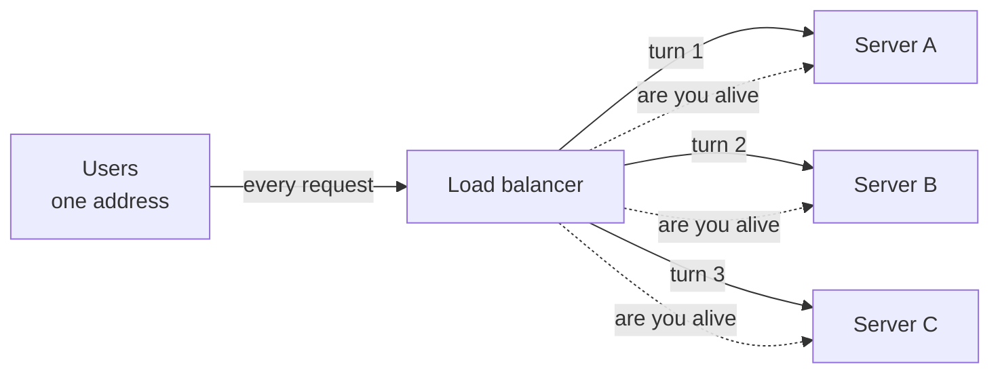

**The problem, drawn.** Without a front door, every user picks a server alone. Notice that the work is not shared, and nobody tells Mia that Server B is dead.

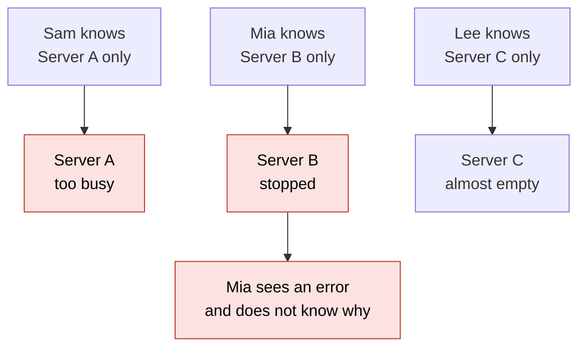

**The restaurant in full.**

A busy restaurant has one host at the door and three waiters. The host does not cook and does not serve. The host only decides which waiter takes each guest.

- **Round robin:** guest 1 goes to waiter 1, guest 2 to waiter 2, guest 3 to waiter 3, guest 4 to waiter 1 again.
- **Least connections:** the guest goes to the waiter with the fewest tables right now. This is better when one table orders slowly.
- **Health check:** every few minutes the host looks for each waiter. A waiter who went home gets no guests. When the waiter is back and the host sees them twice in a row, the host uses them again.
- **Layer 4 and layer 7:** a host who only counts the people in the party works at layer 4. A host who also reads the booking note works at layer 7.

Where the analogy stops: a host can see that a waiter looks tired. A load balancer sees only counts and answers. Also, if the host falls ill, nobody gets a table. The load balancer can fail too.

</details>

## 2. How to pick a server

| Way | How it picks | Use it when |
|---|---|---|
| Round robin | take turns | servers are equal and requests take about the same time |
| Least connections | the fewest open requests wins | some requests are slow, like a big report or an upload |
| Weighted | bigger servers get more turns | servers are not equal |
| Hash based | the same key always reaches the same server | the same user must reach the same server |

Think of three servers where B is slow: it keeps each request open for 8 ticks, A and C for 2 ticks. One new request arrives on every tick, 9 in all.

<details class="guess"><summary>🤔 Guess: round robin gives B a request on ticks 1, 4 and 7. After 9 requests, how many are still open on B, and how many on A? And with least connections? Press to check.</summary>

Round robin: **B holds 3, A holds 0.** It counts turns, not work. Least connections: **1 on each server.** (Real output, Node 26.12.1.)

</details>

> **Remember:** round robin counts turns, not work. Least connections looks at the work.

<details class="more"><summary>📖 More detail: the code, the ticks, the notebook, and which way to pick</summary>

**The smallest code that shows it.**

Three servers. B is slow. One **tick** is one step of time, and one new request arrives on each tick. A request on A or C stays open for 2 ticks. On B it stays open for 8 ticks. The code sends 9 requests, twice, with two ways to pick.

```js
const pool = ["A", "B", "C"], takes = { A: 2, B: 8, C: 2 };     // B is slow: it keeps a request open for 8 ticks
function run(label, pick) {
  const ends = { A: [], B: [], C: [] };                          // the tick when each open request will finish
  const picks = [];
  for (let t = 0; t < 9; t++) {                                  // one new request arrives on every tick
    for (const s of pool) ends[s] = ends[s].filter((e) => e > t);  // finished requests leave
    const s = pick(t, ends);
    ends[s].push(t + takes[s]);
    picks.push(s);
  }
  console.log(label, picks.join(" "), "| open now:", pool.map((s) => s + "=" + ends[s].length).join(" "));
}
run("round robin      :", (t) => pool[t % 3]);
run("least connections:", (t, e) => pool.reduce((a, b) => (e[b].length < e[a].length ? b : a)));
```

**Output:**

```
round robin      : A B C A B C A B C | open now: A=0 B=3 C=1
least connections: A B A C A C A C A | open now: A=1 B=1 C=1
```

Checked on 2026-10-16 with Node 22.

Round robin ends with 3 open requests on slow B and 0 on A. Least connections ends with 1 on each server.

Run again on 2026-10-30 with Node 26.12.1: the same output.

**What really happens, step by step.**

The machine here is the load balancer. The state is the number of open connections on each server. Read one row at a time. "Finished first" names the server that finished a request before this tick. Open counts are after the pick.

**Round robin: the pick only depends on the tick**

| Tick | Finished first | Whose turn | Open after (A B C) |
|---|---|---|---|
| 0 | none | A | 1 0 0 |
| 1 | none | B | 1 1 0 |
| 2 | A | C | 0 1 1 |
| 3 | none | A | 1 1 1 |
| 4 | C | B | 1 2 0 |
| 5 | A | C | 0 2 1 |
| 6 | none | A | 1 2 1 |
| 7 | C | B | 1 3 0 |
| 8 | A | C | 0 3 1 |

**Least connections: the pick depends on the counts**

| Tick | Finished first | Counts before the pick (A B C) | Pick and why | Open after (A B C) |
|---|---|---|---|---|
| 0 | none | 0 0 0 | A, three-way tie, first wins | 1 0 0 |
| 1 | none | 1 0 0 | B, ties with C, first wins | 1 1 0 |
| 2 | A | 0 1 0 | A, ties with C, first wins | 1 1 0 |
| 3 | none | 1 1 0 | C, fewest | 1 1 1 |
| 4 | A | 0 1 1 | A, fewest | 1 1 1 |
| 5 | C | 1 1 0 | C, fewest | 1 1 1 |
| 6 | A | 0 1 1 | A, fewest | 1 1 1 |
| 7 | C | 1 1 0 | C, fewest | 1 1 1 |
| 8 | A | 0 1 1 | A, fewest | 1 1 1 |

What to see: round robin gave B a new request on ticks 1, 4 and 7, because it was B's turn. B was still busy with the old ones. Least connections gave B one request. After tick 1, B never had the fewest.

**What is in memory right now.** This is the load balancer's notebook at one moment. Notice that C has the fewest connections, 0, but C is out of the pool. A dead server often shows 0 connections, so least connections would love it without a health check.

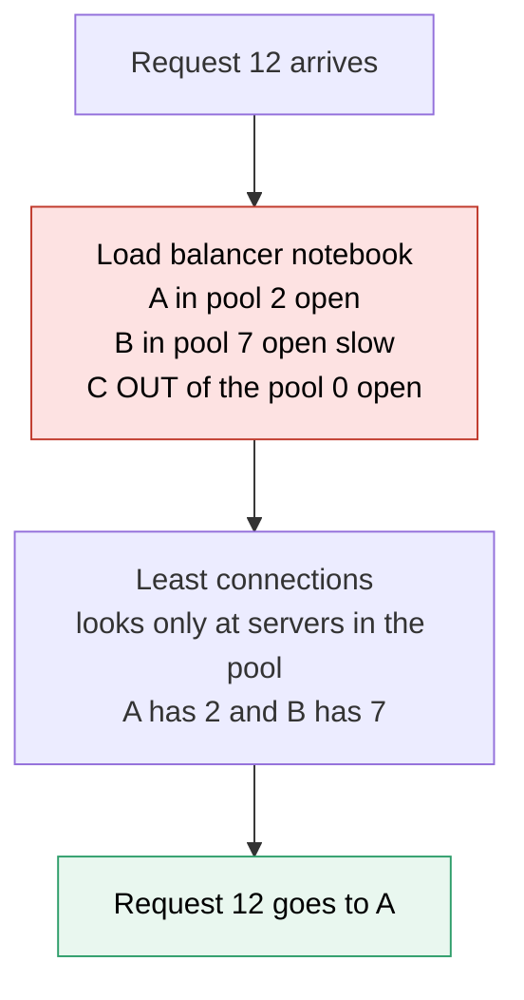

**Which way to pick a server?** This is the choice you say out loud. Notice that round robin is the answer when nothing special is true.

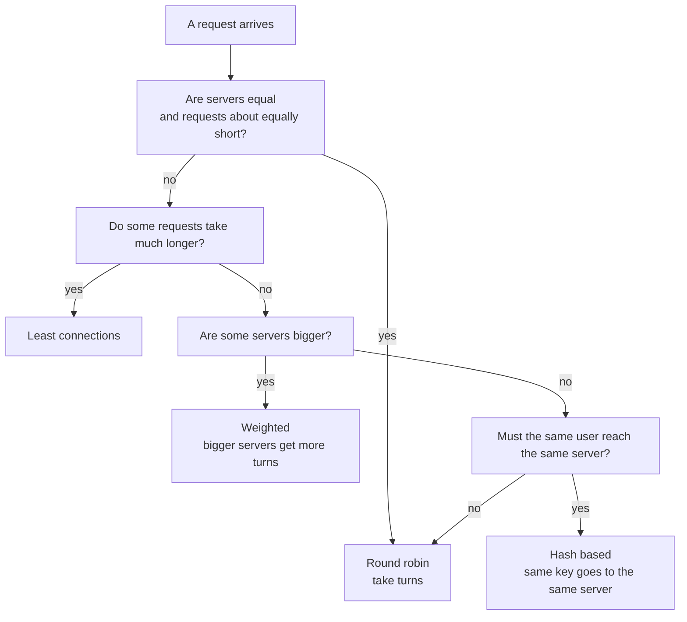

**The four ways, in words.**

**The ways to pick a server.**

- **Round robin:** take turns. Use it when servers are equal and requests take about the same time.
- **Least connections:** the fewest open requests wins. Use it when some requests are slow, like a big report or an upload.
- **Weighted:** bigger servers get more turns. It also sends, for example, 5 percent of users to a new version, to test it.
- **Hash based:** the same key, like a user id, always reaches the same server. The cost: when the pool changes, many keys move to another server (lesson 20 fixes this).

**Step through it yourself:** [open the stepper](visuals/03-load-balancers.html). It has three stories: round robin, least connections with a slow server, and a server that fails its health check. Guess first, then press Next. Every server shows how many connections it has open.

</details>

## 3. Health checks: how a dead server leaves and returns

The load balancer asks each server "are you alive?" on a timer. In this lesson, 2 failed checks in a row take a server out of the **pool** (the list it may use). 2 passed checks in a row put it back.

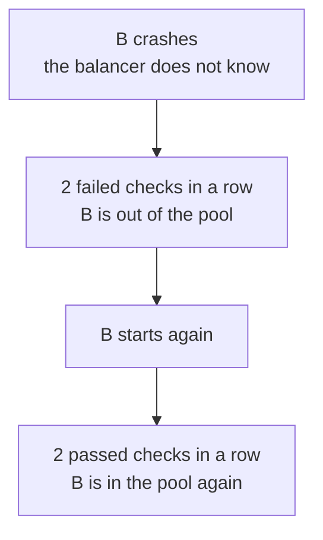

<details class="guess"><summary>🤔 Guess: a server crashes between two checks. Can a user still see an error? Press to check.</summary>

**Yes.** In the gap before the failed checks add up, the load balancer still sends B its turns. One request fails, and it is nobody's bug: the check is not instant.

</details>

> **Remember:** a health check always has a gap. Retry safe requests on another server to hide it.

<details class="more"><summary>📖 More detail: the checks over time, and the table step by step</summary>

**How it works over time.** This is story 3 of the stepper, with fewer requests. Notice the order: B stops, two failed checks remove B, then two passed checks bring B back. One request fails in the gap.

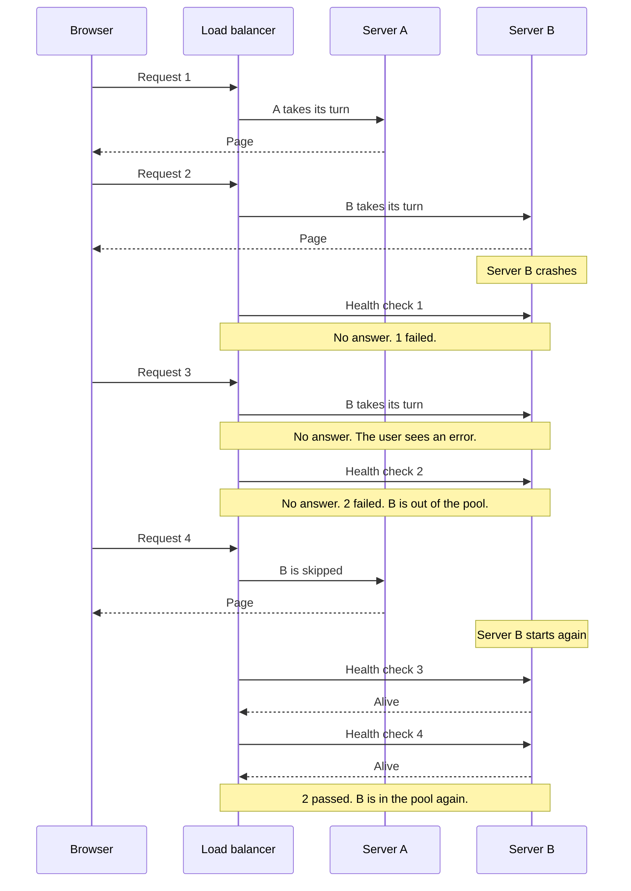

**Health checks, step by step** (rule: 2 failed checks in a row take a server out, 2 passed checks in a row put it in).

| Step | What happens | B in the pool? | B failed in a row | B passed in a row | What the user sees |
|---|---|---|---|---|---|
| 1 | Requests 1, 2, 3 go to A, B, C | yes | 0 | 0 | all answered |
| 2 | B crashes. The load balancer does not know | yes | 0 | 0 | nothing yet |
| 3 | Health check 1: B does not answer | yes | 1 | 0 | nothing yet |
| 4 | Request 4 goes to A | yes | 1 | 0 | answered |
| 5 | Request 5: B's turn, so it goes to B | yes | 1 | 0 | **an error** |
| 6 | Health check 2: B does not answer | **no** | 2 | 0 | nothing yet |
| 7 | Requests 6, 7, 8 go to C, A, C. B is skipped | no | 2 | 0 | all answered |
| 8 | B starts again. The load balancer does not know yet | no | 2 | 0 | nothing yet |
| 9 | Health check 3: B answers | no | 0 | 1 | nothing yet |
| 10 | Request 9 goes to A | no | 0 | 1 | answered |
| 11 | Health check 4: B answers | **yes** | 0 | 2 | nothing yet |
| 12 | Request 10: B's turn, and B answers | yes | 0 | 2 | answered |

**Step through it yourself:** [open the stepper](visuals/03-load-balancers.html). It has three stories: round robin, least connections with a slow server, and a server that fails its health check. Guess first, then press Next. Every server shows how many connections it has open.

</details>

## 4. Layer 4 against layer 7

How much of the request does the balancer read? **Layer 4** reads the outside of the envelope: the machine's address and the door number (IP address and port). **Layer 7** opens it: the path, the headers and the cookie.

| | Layer 4 | Layer 7 |
|---|---|---|
| Reads | the address and the door number | the path, headers, cookie |
| Can do | pass the connection on, very fast | send `/images` to file servers, check a login |
| Default for | traffic that is not web, or top speed | a normal web app |

<details class="guess"><summary>🤔 Guess: you want `/images` to go to file servers and `/orders` to app servers. Layer 4 or layer 7? Press to check.</summary>

**Layer 7.** Layer 4 cannot tell images from orders, because it never reads the path.

</details>

> **Remember:** layer 4 sees the outside of the envelope. Layer 7 opens it, and is the default for a web app.

<details class="more"><summary>📖 More detail: the two layers drawn, and the full table</summary>

**Layer 4 against layer 7.** Notice what each one can read.

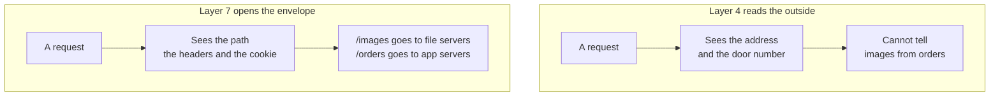

| | Layer 4 | Layer 7 |
|---|---|---|
| What it reads | The address and the door number | The whole web request: path, headers, cookie |
| What it can do | Pass the connection on, very fast | Send `/images` to file servers, check a login token, retry on another server |
| What it costs | It is blind to the content, so it cannot tell `/images` from `/orders` | More work per request, because it must read the request |
| Examples | AWS NLB, HAProxy in TCP mode | nginx, Traefik, AWS ALB |
| Pick it when | The traffic is not web traffic, or you need top speed | A normal web app. This is the default |

</details>

## 5. What a load balancer cannot fix

The front door is one part that can fail, so run two that share one address. It cannot fix sticky sessions (keep the login in a shared box), a slow database that every server waits for (caching helps), or jobs on a timer (it shares requests, not clocks).

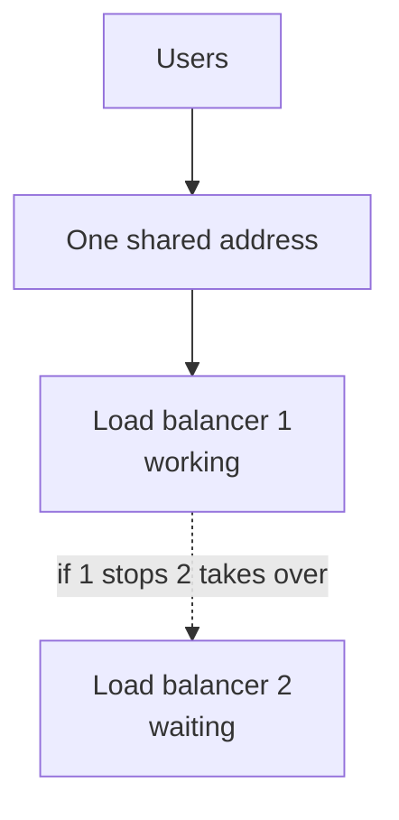

<details class="guess"><summary>🤔 Guess: the database is slow and every page waits for it. Does a better load balancer help? Press to check.</summary>

**No.** All the servers wait for the same database. Not the load balancer's job. Caching helps (lesson 04).

</details>

> **Remember:** the front door is one more part and one more step on every request. It can fail too.

<details class="more"><summary>📖 More detail: one against two front doors, and the five limits</summary>

**Right against wrong.** The wrong way has one load balancer. If it stops, the whole site is down, even when every server is fine. The right way has two that share one address.

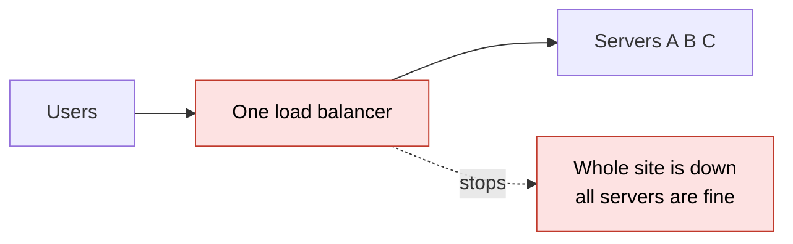

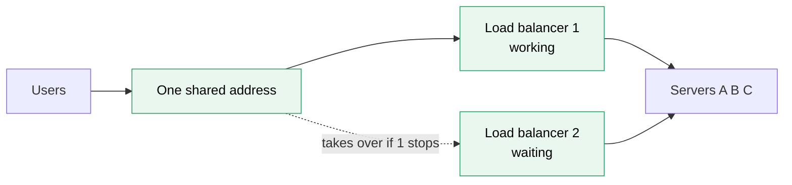

**What a load balancer cannot fix.**

| Limit | Why | What you do |
|---|---|---|
| It is one part that can fail (interview words: single point of failure) | Every request goes through it | Run two that share one address, or use a managed one (a cloud service that runs it for you, on several machines) |
| Sticky sessions | The load balancer glues a user to one server. If that server stops, the user loses the login | Keep the login in a shared box (lesson 02) |
| WebSockets | A WebSocket is a connection that stays open for a long time, like in a chat app. The load balancer picks the server once, at the start. Then the connection stays there until it ends | Use least connections for new ones. Pass messages between servers through a shared channel (lesson 10) |
| A slow database | All servers wait for the same database | Not the load balancer's job. Caching helps (lesson 04) |
| Jobs on a timer | The load balancer shares requests, not clocks | Run the schedule in one place |

**Why it exists and what it costs.**

- **Problem without it:** each user must know which server to call. One server is too busy while another is empty. A dead server keeps getting users (the problem picture in card 1).
- **How it solves it:** users know one address. The load balancer chooses a server for each request (card 2). Health checks remove dead servers and bring them back (card 3).
- **Cost or tradeoff:** one more part to run, and one more step on every request. The front door can also fail (card 5).

</details>

## 6. Two mistakes, and what to say if you freeze

- **Wrong:** "Round robin is the default, so I use it." **Right:** if request times differ a lot, use least connections.
- **Wrong:** a health route that always says yes. **Right:** a route that runs a real small check, like `SELECT 1`.

<details class="guess"><summary>🤔 Guess: the shared database is down for everyone, and every server's health check runs `SELECT 1`. What does the load balancer do? Press to check.</summary>

Every server fails the check, so the load balancer **removes all of them** and the whole site is down. Think about which things a check should look at.

</details>

> **Remember:** if you freeze, say "One front door, many servers. Users know one address."

<details class="more"><summary>📖 More detail: the two mistakes in full, and the freeze plan</summary>

**Wrong:**

```
"Round robin is the default, so I use it."
(Some requests take 10 seconds. Others take 10 milliseconds.)
```

**Right:**

```
"Request times differ a lot, so I use least connections.
 Round robin keeps handing slow servers new work."
```

**Why:** round robin counts turns, not work. The code in card 2 (blue bar) shows B holding 3 requests while A holds none.

**Wrong:** a health route that always says yes.

```js
// sketch, not run here
app.get("/health", (req, res) => res.sendStatus(200));   // the load balancer calls this every 10 seconds
```

**Right:**

```js
// sketch, not run here
app.get("/health", async (req, res) => {
  try { await db.query("SELECT 1"); res.sendStatus(200); }   // can this server do real work?
  catch { res.sendStatus(503); }                              // no: take me out
});
```

**Why:** a server can run and still be broken, for example when it lost its database. A route that always says yes keeps users on it. The cost: if the shared database is down for everyone, every server fails the check and the load balancer removes all of them. Think about which things a check should look at.

**If you freeze:**

1. Say "One front door, many servers. Users know one address."
2. Say "Equal requests: round robin. Slow requests mixed in: least connections."
3. Say "Health checks remove dead servers. I run the front door as a pair."

</details>

## 7. Watch and play

Links came from web search or from older notes in this folder, 2026-10-16. The build machine could not open pages, so open each one once. If one is broken, tell me and I will replace it.

- **Video:** no video link found. Two searches returned only written pages. Search for "load balancer explained" and pick one under 20 minutes. Compare it with the big picture in card 1.
- **Play with it:** [Sam Rose: Load Balancing](https://samwho.dev/load-balancing/) - an interactive essay. A search summary says it moves from round robin to least connections. Try it, then compare it with the stepper.
- **Play with it:** [System Design Space: load balancing algorithms](https://system-design.space/en/visuals/load-balancing-algorithms/) - a search result called it a playground that compares algorithms. Try a slow server.
- **Play with it:** [the stepper in this folder](visuals/03-load-balancers.html) - guess first, then press Next. Try all three tabs.
- **Read:** [ByteByteGo: What is a load balancer?](https://bytebytego.com/guides/what-is-a-load-balancer/) - a search summary says it covers layer 4, layer 7 and global balancers. Compare it with the layer pictures in card 4.
- **Read:** [HAProxy: layer 4 against layer 7](https://www.haproxy.com/blog/loadbalancing-faq/) - find what each one cannot do.
- **Read:** [Load balancers and microservices for an online shop](load-balancers-microservices-online-shop.md) - the deeper guide in this folder. Find the part on draining.

<details><summary>Go deeper (optional)</summary>

**Real health check numbers** (web search, 2026-10-16, from the AWS documentation page for Application Load Balancer health checks, which I did not open: [AWS docs](https://docs.aws.amazon.com/elasticloadbalancing/latest/application/target-group-health-checks.html)). The defaults are: a check every 30 seconds, 2 failed checks in a row to take a target out, 5 passed checks in a row to bring it in, and a 5 second wait for each answer. My arithmetic: a dead server is found after about 2 times 30 = 60 seconds, and it returns after about 5 times 30 = 150 seconds. During those 60 seconds, 1 request in 3 goes to a dead server when there are 3 servers and round robin. Shorter checks find it sooner and cost more check traffic.

**Retry in the gap.** A layer 7 balancer can send a failed request to another server (from the [older guide](load-balancers-microservices-online-shop.md)). Only do this for requests that are safe to repeat. Lesson 13 covers that.

**Active and passive checks** (older guide). An active check is the timer in this lesson. A passive check has no timer: the load balancer watches real answers, and removes a server that returns errors or times out. The older cheatsheet says ALB is active and nginx open source is passive. Many setups use both.

**Draining** (older guide). When you stop a server on purpose, for example in a deploy, the load balancer sends it no new requests but lets running ones finish. The older guide says AWS waits 300 seconds by default, and 30 to 60 seconds is the practical answer. Lesson 27 uses this.

**Layer 7 and HTTPS** (older guide). To read a web request, a layer 7 balancer must open the HTTPS wrapping. It holds the certificate, which is why you manage certificates in one place. Layer 4 can pass the wrapped traffic through unopened. Very big systems use both: layer 4 in front, layer 7 behind. The older guide cites GitHub and Cloudflare for this.

**A pair of load balancers.** Two machines share one floating address. If the working one stops, the waiting one takes the address in seconds. A common setup is HAProxy with keepalived (page from a search result, not opened: [Keepalived overview](https://docs.redhat.com/en/documentation/red_hat_enterprise_linux/7/html/load_balancer_administration/ch-keepalived-overview-vsa)). A managed balancer, like AWS ALB, already runs on several machines in different data centers (older guide).

**Tools** (older guide). nginx is a layer 7 balancer, and CapRover uses it. Traefik finds your Docker containers by itself. HAProxy does both layers. AWS ALB is layer 7 and AWS NLB is layer 4.

**WebSockets** (older guide). The balancer must allow the upgrade from a web request to a WebSocket, and it must allow long idle connections. To send a message to a user who sits on another server, servers pass messages through Redis pub/sub.

</details>

## 8. Practice

**A. Predict the output** (write your answer before opening)

Three servers have 2, 0 and 1 open connections. Nothing ever finishes. The code picks by least connections three times. What does it print?

```js
const pool = ["A", "B", "C"];
const open = { A: 2, B: 0, C: 1 };                          // open connections right now
const pick = () => pool.reduce((a, b) => (open[b] < open[a] ? b : a));
const out = [];
for (let i = 0; i < 3; i++) { const s = pick(); open[s]++; out.push(s); }   // nothing ever finishes
console.log(out.join(" "), JSON.stringify(open));
```

Then answer: what would round robin pick for the same three requests, if it starts at A?

<details><summary>Answer</summary>

```
B B C {"A":2,"B":2,"C":2}
```

Pick 1: B has 0, the fewest, so B gets 1. Pick 2: B and C both have 1. They tie, and the first one in the list wins, which is B. Now B has 2. Pick 3: C has 1, the fewest. Round robin would pick A, B, C and would ignore the counts. (Checked on 2026-10-16 with Node 22.)

</details>

**B. What breaks if**

A team uses least connections and has no health check. Server B has just crashed, so its connection count dropped to 0. B refuses every request at once. Four requests arrive. Which servers get them, and what do users see?

```js
const pool = ["A", "B", "C"];
const open = { A: 3, B: 0, C: 2 };                     // B has just crashed, so its count dropped to 0
const pick = () => pool.reduce((a, b) => (open[b] < open[a] ? b : a));
const out = [];
for (let i = 0; i < 4; i++) { const s = pick(); out.push(s); if (s !== "B") open[s]++; }   // B fails at once, so it never holds a request
console.log(out.join(" "));
```

<details><summary>Answer</summary>

```
B B B B
```

B has the fewest connections, 0, so least connections picks it every time. B fails each request at once, so its count never grows. All four users see an error, while A and C sit with spare room. A dead server looks like the best server. The fix is a health check: take B out of the pool, so the pick only looks at servers that are up. That is the `up` flag in part C. (Checked on 2026-10-16 with Node 22.)

</details>

**C. Write it yourself**

Open `learn/system-design/practice/03-load-balancers.js`. It has two empty functions. `createPicker(names)` is round robin with health checks: `pick()`, `markDown(name)` and `markUp(name)`. `leastConnections(servers)` picks the up server with the fewest open connections. Write both. Then run this from the repo root and make the tests pass:

```
node --test learn/system-design/practice/03-load-balancers.test.js
```

<details><summary>One possible answer</summary>

```js
function createPicker(names) {
  const up = new Set(names);                          // servers that pass their health check
  let turn = 0;                                       // index of the server whose turn it is
  return {
    pick() {
      for (let k = 0; k < names.length; k++) {
        const i = (turn + k) % names.length;
        if (up.has(names[i])) {
          turn = (i + 1) % names.length;              // the following server gets the following turn
          return names[i];
        }
      }
      return null;                                    // every server is down
    },
    markDown: (name) => up.delete(name),
    markUp: (name) => { if (names.includes(name)) up.add(name); },
  };
}

function leastConnections(servers) {
  let best = null;
  for (const s of servers) {
    if (s.up && (best === null || s.open < best.open)) best = s;   // "<" keeps the first one on a tie
  }
  return best ? best.name : null;
}

module.exports = { createPicker, leastConnections };
```

Checked on 2026-10-16 with Node 22: the tests fail on the empty stub and all 8 pass with this answer. In `pick()`, the loop starts at the server whose turn it is and walks forward until it finds one that is up. That is how a down server is skipped without losing the order.

</details>

## 9. Interview question

**Q:** "You have five copies of your API. Walk me through how a load balancer sits in front of them. How does it choose a server, and how does it know a server is dead?"

<details><summary>A strong answer, in four parts</summary>

1. **Problem:** users need one address. Without a front door, work is uneven and users reach dead servers.
2. **How it works:** a layer 7 load balancer receives every request, because this is a web app and I want routing by path. It picks a server by round robin when requests take about the same time, or by least connections when some are slow. It runs a health check on a timer, for example every 10 seconds. After 2 failed checks in a row it takes the server out. After 2 passed checks in a row it brings it back. A request that arrives in the gap can fail, so the balancer can retry it on another server, if the request is safe to repeat.
3. **Tradeoff:** the load balancer is one more part and one more step on every request, and it can fail, so I run two or use a managed one. Sticky sessions and WebSockets tie a user to one server, so I keep logins in a shared box. Fast checks find a dead server sooner but cost more traffic. A check that looks at the database can remove every server when the database is down.
4. **My example:**
   - **Fact:** my DBO case study says DBO runs as four Node and TypeScript services on Docker Swarm via CapRover.
   - **Fact:** the case study says the gateway "is likely just CapRover's bundled nginx doing routing + TLS". It says "likely", so I should check the CapRover setup before I say it is nginx in an interview.
   - **Fact:** the case study says the Auth service issues JWTs (signed login tokens), and that this keeps the API tier stateless. Stateless is what lets a load balancer send any request to any copy.
   - **Fact:** the case study says the cron service exists so that scheduled jobs run in exactly one place, not once per copy. A load balancer shares requests, not timers.
   - **Idea, not a fact:** the case study lists "health-check endpoints per service" as something to add, and "multiple replicas behind the load balancer" as a next step for the API service. I should not say they exist. I can say they are what I would check first.

</details>

## 10. Explain it back

Close this file. Explain load balancers out loud like to a new junior, in 4 parts (problem, how, tradeoff, my example). Use the story of Server B crashing: what does the user see, and when does the load balancer find out? Then write your best version below and run `/explain-check load balancers` or ask the `explain-coach` agent to review it.

### My explanation

<write here>

### Coach feedback

<the explain-coach agent writes here>

## 11. Review questions (day 1, 3, 7, 21)

1. What does a load balancer do, and what happens to a server that fails its health checks?
2. Some requests take 10 seconds and others take 10 milliseconds. Round robin or least connections? Why?
3. Name three things a load balancer cannot fix, and what you do about each one.
4. Draw the picture of the checks over time (card 3) from memory.

<details><summary>Answers</summary>

1. It is one front door. It sends each request to a server that is alive. When a server fails a few health checks in a row, the load balancer takes it out of the pool. When it passes a few checks in a row, the load balancer puts it in again.
2. Least connections. Round robin counts turns, not work, so it keeps giving new requests to a server that is stuck on slow ones. Least connections looks at how many requests each server holds now.
3. Any three of these. The load balancer is one part that can fail: run two, or use a managed one. Sticky sessions: keep the login in a shared box. WebSockets stay on one server: spread new ones with least connections and pass messages through a shared channel. A slow database: not its job, use caching. Jobs on a timer: run the schedule in one place.
4. Browser, load balancer, Server A, Server B, left to right. Requests 1 and 2 work. B crashes. Check 1 fails, request 3 goes to B and fails, check 2 fails and B is out. Request 4 goes to A. B starts, checks 3 and 4 pass, and B is in again.

</details>

## Connected lessons

- [Scaling up vs out](02-scaling-up-vs-out.md) - the lesson before. Stateless servers let a load balancer send any request anywhere.
- [Caching](04-caching.md) - the next lesson. It takes load off the database, which a load balancer cannot do.
- [Proxies and API gateways](17-proxies-and-api-gateways.md) - a gateway is a layer 7 load balancer with extra jobs.
- [Consistent hashing](20-consistent-hashing.md) - the hash based way to pick a server when servers come and go.
- [Timeouts, retries and circuit breakers](23-timeouts-retries-and-circuit-breakers.md) - what to do in the gap before a health check finds a dead server.
- [Safe deploys](27-safe-deploys.md) - a deploy uses health checks and draining.
- [Design a chat app](10-design-a-chat-app.md) - WebSockets behind a load balancer.
- [Load balancers and microservices for an online shop](load-balancers-microservices-online-shop.md) and its [visual cheatsheet](load-balancers-microservices-online-shop-cheatsheet.html) - the deeper guide.
- [Networking for system design](../networking/networking-for-system-design.md) - the network layers behind layer 4 and layer 7.
- [System design interview questions](senior-system-design-interview-questions.md) - question 7 asks layer 4 against layer 7, with the single point of failure follow-up.
