# 04. Caching

> **Subject:** System Design · **Lesson:** 04 · **Made:** 2026-10-16 · **Remade in short cards:** 2026-10-30 · **Status:** ready
>
> **You will be able to:** draw how a read and a write work with a cache (hit, miss, write), say why a copy goes old and what a TTL does about it, and explain a stampede with two fixes.
>
> **Before this:** [Load balancers](03-load-balancers.md) · **Next:** [CDN](05-cdn.md)
>
> **How to read it:** one card is one idea. Look at the picture, guess, then press the orange bar to check. The blue bars (📖 More detail) hold the longer explanation. Skip them on the first read, and open them when you want more. About 15 minutes for the cards.

## 1. The idea: a copy in a fast place

A cache keeps a copy of an answer in a fast place (usually memory), so the slow place does not do the same work again and again. A shop assistant keeps a sticky note on the till: "rice 100". Note found is a **hit**. No note is a **miss**, so the assistant makes the slow phone call.

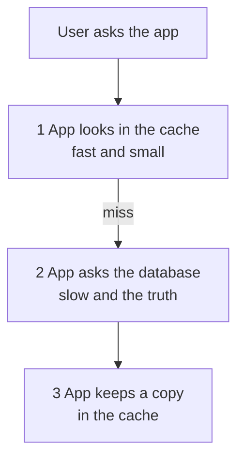

<details class="guess"><summary>🤔 Guess: Redis answers in about 1 ms, the database in about 50 ms. 90 of 100 reads are hits. What is the average read time, and how much less load does the database see? Press to check.</summary>

About **6 ms** (90 x 1 + 10 x 51, divided by 100), down from 50. The database sees 10 questions, not 100: **10 times less load**. The second number matters more. A cache mainly protects the database.

</details>

> **Remember:** a cache keeps a copy in a fast place. The price is that a copy can go old.

<details class="more"><summary>📖 More detail: four new words, the big picture, the problem drawn, and the shop</summary>

The price is that a copy can go old. This lesson shows how to keep copies fresh enough.

New words (four):

- **Cache:** a fast place, usually memory, that keeps copies of answers. Redis is the usual one: a fast store in memory that every server can reach (lesson 02 called it the shared box).
- **TTL:** time to live. It is how many seconds a copy may stay. When the time is over, the cache throws the copy away.
- **Invalidation:** clearing a copy because the real data changed. In plain words: delete the copy.
- **Stampede:** a busy copy ends, and many requests run to the database in the same moment (also called thundering herd).

Two small words: a **hit** means the cache had the copy. A **miss** means it did not. The way we use the cache here is called **cache aside**: the app looks after the cache itself.

**The big picture.** Notice that the app looks in the cache first. It asks the database only when there is no copy.

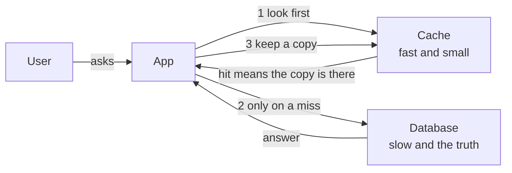

**The problem, drawn.** Notice that the database does the same work for one answer, again and again.

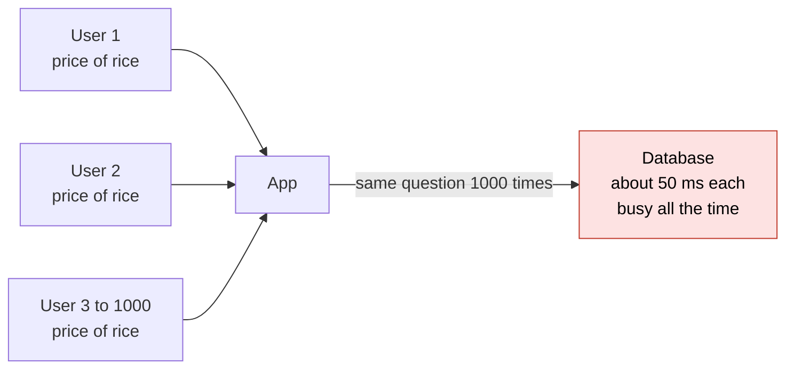

**The shop in full.**

A shop assistant is asked the price of rice all day. The price list is in the head office, so each check is a slow phone call.

- **The cache:** a sticky note on the till says "rice 100". The assistant reads the note instead of calling. Note found is a hit. No note is a miss, so the assistant calls.
- **The TTL:** every note says "good until 3 pm". At 3 pm the assistant throws it away.
- **An old copy:** at 1 pm head office changes the price, but nobody tells the till. The note still says 100.
- **Invalidation:** head office rings the shop, and the assistant tears up the note.
- **The stampede:** at 3 pm the busiest note is thrown away, and 30 customers are waiting. That is 30 phone calls at once. Fix 1: one assistant calls and the others wait for that answer. Fix 2: make a new note at 2:55 pm, before the old one ends.

Where the analogy stops: a sticky note sits at one till. A real cache is shared by many servers. It lives in memory, so a restart removes every copy at once. It also has limited space, so it must throw out copies when it is full.

</details>

## 2. Read and write: cache aside

On a **read**: look in the cache. On a miss, ask the database and keep a copy. On a **write**: change the database, then delete the copy. This way of using a cache is called **cache aside**: the app looks after the cache itself.

A fake database waits 50 ms. The app reads the price 3 times, the admin saves a new price, then the app reads 2 more times:

```
miss price 100
hit  price 100
hit  price 100
miss price 90
hit  price 90
database calls: 2
```

<details class="guess"><summary>🤔 Guess: on a write, should you put the new value into the cache, or delete the copy? Press to check.</summary>

**Delete the copy.** Two writers can finish in the wrong order, and then the older value wins. A delete has no value to get wrong. The next read is a miss and fills the cache with the truth.

</details>

> **Remember:** on a write, change the database first, then delete the copy. Keep a TTL too.

<details class="more"><summary>📖 More detail: the code, the run over time, step by step, and two other ways to write</summary>

**How it works over time.** This is cache aside. Notice that only read 1 goes to the database. The write changes the database and then deletes the copy.

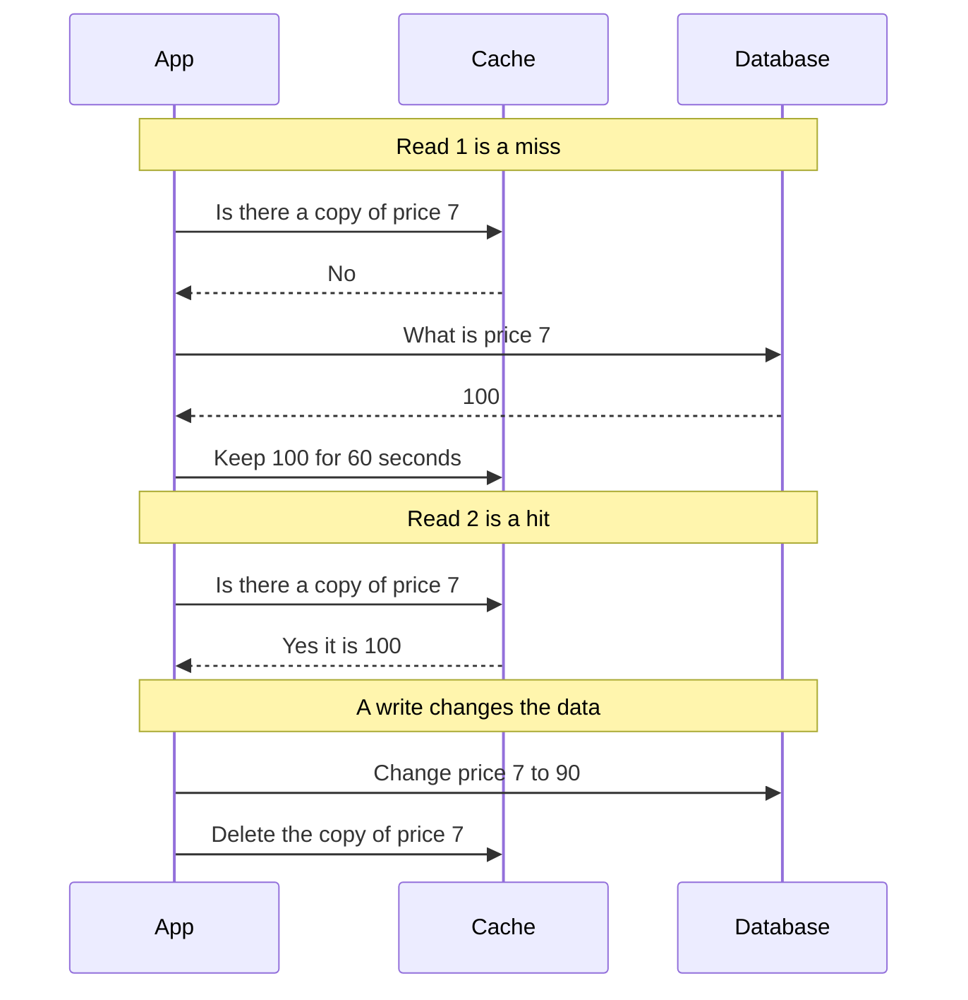

**The smallest code that shows it.** The code leaves out the TTL to stay small. Practice A adds it.

```js
const db = { 7: "price 100" }, cache = new Map(); let calls = 0;   // db is slow, cache is fast
const slowDb = async (id) => { calls++; await new Promise((r) => setTimeout(r, 50)); return db[id]; };
async function read(id) {
  if (cache.has(id)) return "hit  " + cache.get(id);   // found: answer at once
  const row = await slowDb(id);                         // not found: ask the slow database
  cache.set(id, row);                                   // keep a copy for the next read
  return "miss " + row;
}
const write = (id, row) => { db[id] = row; cache.delete(id); };   // change the database, delete the copy
const show = async () => console.log(await read(7));
(async () => {
  await show(); await show(); await show(); write(7, "price 90"); await show(); await show();
  console.log("database calls:", calls);
})();
```

Checked on 2026-10-16 with Node 22.

Five reads, but the database was asked only twice. `read` is cache aside. `write` changes the database first and then deletes the copy.

Run again on 2026-10-30 with Node 26.12.1: the same output as in the card.

**What really happens, step by step.**

The "machine" is the app, the cache and the database. The state is what the cache and the database hold, and how often the database was asked. Each `show()` call runs `read(7)` once.

| Step | Code | What the app does | Cache after | Database after | Database calls | Printed |
|---|---|---|---|---|---|---|
| 1 | `show()` read 1 | Looks in the cache: nothing, a **miss**. Asks the slow database. Keeps a copy. | `7 = price 100` | `7 = price 100` | 1 | `miss price 100` |
| 2 | `show()` read 2 | Looks in the cache: found, a **hit**. Does not ask the database. | `7 = price 100` | `7 = price 100` | 1 | `hit  price 100` |
| 3 | `show()` read 3 | Another **hit**. | `7 = price 100` | `7 = price 100` | 1 | `hit  price 100` |
| 4 | `write(7, "price 90")` | Changes the database. Then deletes the copy. | empty | `7 = price 90` | 1 | nothing |
| 5 | `show()` read 4 | Cache is empty, a **miss**. Asks the database. Keeps a copy of 90. | `7 = price 90` | `7 = price 90` | 2 | `miss price 90` |
| 6 | `show()` read 5 | A **hit**. | `7 = price 90` | `7 = price 90` | 2 | `hit  price 90` |
| 7 | last line | Prints the counter. | `7 = price 90` | `7 = price 90` | 2 | `database calls: 2` |

What to see: the database is asked only in steps 1 and 5. Those are the two misses.

**Right against wrong.** The wrong way changes only the database. The right way also deletes the copy. Notice that the right way keeps a TTL too, in case a delete is missed.

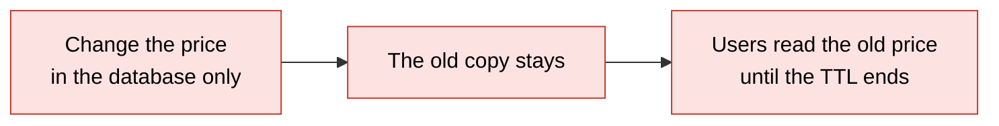

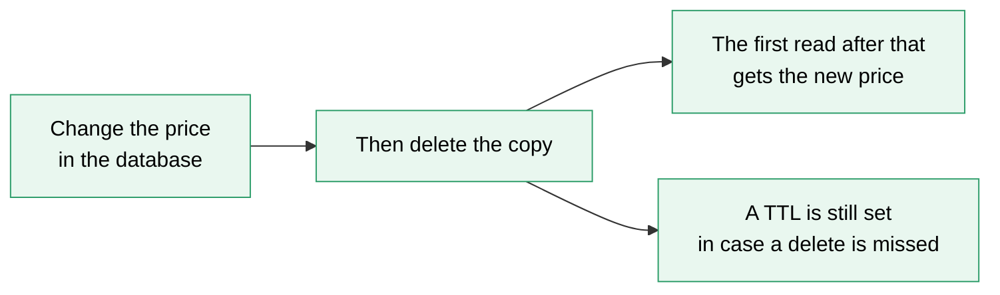

**Two other ways to write.** Cache aside is the default.

| Way | What happens on a write | Good for | Cost |
|---|---|---|---|
| Cache aside | Change the database, then delete the copy | Most reads. The default answer | The first read after a change is a miss |
| Write through | Write the database and the cache in the same step | Data read right after it is written | Each write is slower, and the cache fills with data nobody reads |
| Write back (also called write behind) | Write the cache only. A worker saves to the database a little later | View counters and likes | If the cache dies first, the data is lost. Never for money or orders |

**Step through it yourself:** [open the stepper](visuals/04-caching.html). It has three stories: a miss then hits, an old copy until the TTL ends, and the stampede with both fixes. Guess first, then use the buttons. The counters show hits, misses and database calls.

</details>

## 3. Why a copy goes old, and what a TTL does

A **TTL** (time to live) is how many seconds a copy may stay. When the time is over, the cache throws the copy away. If something changes the database and does not delete the copy, users see the old answer until the TTL ends.

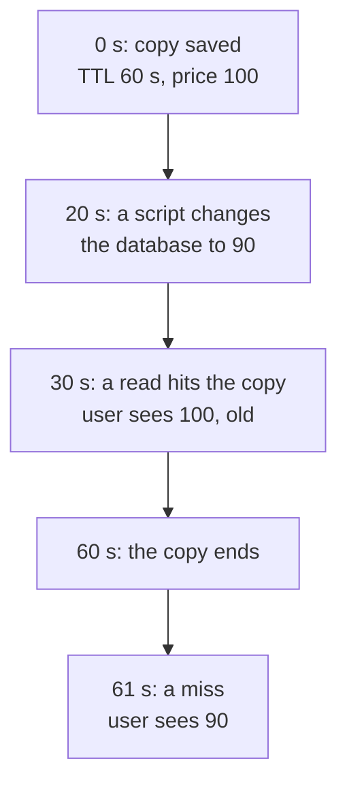

<details class="guess"><summary>🤔 Guess: the TTL is 10 minutes, and a script changes the price without deleting the copy. How old can the price be at worst? Press to check.</summary>

Up to **10 minutes**. The TTL does not make the copy fresh. It only limits how long it can stay old. Always set a TTL, even when you delete on write: it is the backup for a missed delete.

</details>

> **Remember:** the TTL does not make a copy fresh. It limits how long a copy can stay old.

<details class="more"><summary>📖 More detail: the TTL story, what is in each box, and why invalidation is hard</summary>

**Story 2: the TTL and an old copy.**

**Story 2: the TTL and an old copy.** The copy was saved at 0 s with a TTL of 60 seconds. At 20 s a script changes the database and does not delete the copy.

| Time | What happens | Database | Cache | The user sees |
|---|---|---|---|---|
| 0 s | The copy is saved. It ends at 60 s. | 100 | 100 | |
| 10 s | A read finds the copy (hit). | 100 | 100 | 100 |
| 20 s | A script changes the database. Nobody tells the cache. | 90 | 100 (old) | |
| 30 s | A read finds the copy (hit). | 90 | 100 (old) | 100, **old** |
| 45 s | A read finds the copy (hit). | 90 | 100 (old) | 100, **old** |
| 60 s | The time is over. The cache throws the copy away. | 90 | empty | |
| 61 s | A read misses. The app asks the database and saves a copy. | 90 | 90 | 90 |
| 70 s | A read finds the copy (hit). | 90 | 90 | 90 |

What to see: the answer was old for 40 seconds (20 s to 60 s). The TTL did not make it fresh. It only limited how long it could stay old.

**What is in each box right now.** A snapshot, 30 seconds into this story. A script changed the database at 20 seconds. Notice that the cache and the database disagree, and nobody told the cache.

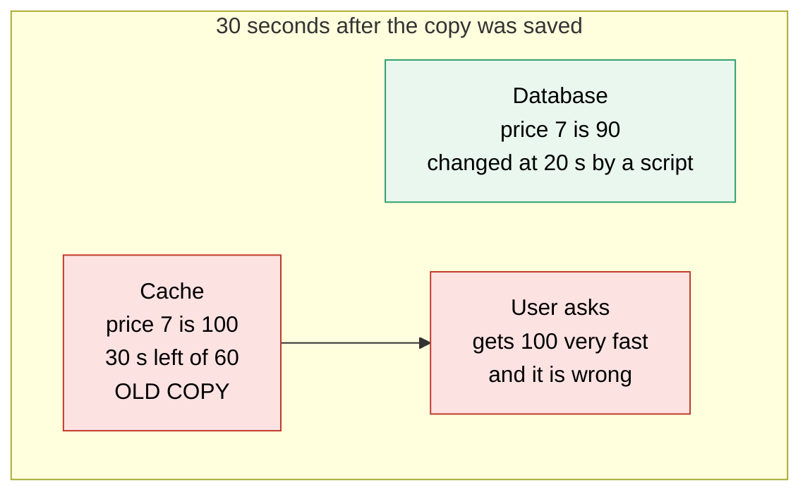

**Why invalidation is hard.**

- One answer can have copies in many places: the browser, a CDN (copy servers near the users, lesson 05), Redis, and each server's memory.
- A script or another service can change the data without your code knowing.
- A slow reader can read the old row, wait for your delete, then save the old row. A TTL limits the damage.
- On a write, delete the copy. Do not write the new value in. Two writers can finish in the wrong order, and the older value wins. A delete has no value to get wrong.

**The TTL.** Ask how old this answer may be before a user is hurt. A product list can be 5 to 15 minutes old. Always set a TTL, even when you also delete on write. It is the backup for a missed delete.

</details>

## 4. The stampede and two fixes

A **stampede** (also called thundering herd): a busy copy ends, and many requests run to the database in the same moment. Slow answers make users press reload, and the reloads add more load.

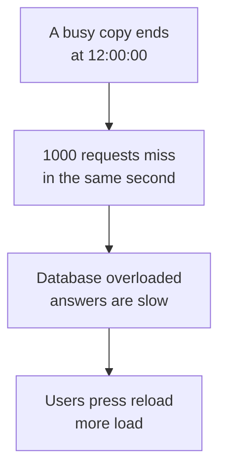

**Fix 1:** one request refills and the others wait. The lock is a note in the cache: "I am refilling this key". **Fix 2:** refresh the copy before it ends. In both fixes the database is asked once.

<details class="guess"><summary>🤔 Guess: 5 requests miss in the same moment. How many database calls with no protection, and how many when everyone shares one refill? Press to check.</summary>

**5** with no protection, **1** with one shared refill. (Real run, Node 26.12.1.)

</details>

> **Remember:** a stampede is many equal misses at once. Let the first miss refill and the rest wait, or refill before the copy ends.

<details class="more"><summary>📖 More detail: the two fixes drawn, the stampede story, and the fixes in plain words</summary>

**Two fixes for the stampede.** Fix 1: one request refills and the others wait. Fix 2: refresh the copy before it ends. Notice that in both fixes the database is asked once.

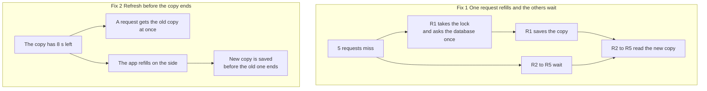

**The stampede, drawn.** Notice the loop at the end. Slow answers make users press reload, and the reloads add more load.

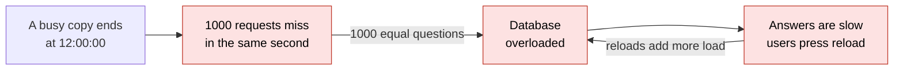

**Story 3: the stampede.** Three tries with the same busy key. In parts 1 and 2, 5 requests arrive in the same moment that the copy ends.

| Part | What happens | Database calls |
|---|---|---|
| 1. No protection | The copy ends. 5 requests miss. All 5 ask the database at once. It is overloaded. | **5** |
| 2. Fix 1, a lock | 5 requests miss. R1 gets the lock and asks the database once. R2 to R5 wait. R1 saves the copy and drops the lock. R2 to R5 read the new copy. | **1** |
| 3. Fix 2, refresh early | At 172 s a request finds a copy with 8 s left. It gets the old copy at once, and the app refills on the side. At 180 s, 5 requests all find the new copy. | **1** |

**The two stampede fixes, in plain words.**

1. **One request refills, the others wait** (interview words: lock, single flight). The lock is a note in the cache: "I am refilling this key". The first miss takes it. The others wait, then read the new copy.
2. **Refresh before the copy ends** (interview words: refresh ahead, stale while revalidate). A request that sees a copy almost over serves it and refills on the side.

</details>

## 5. What to cache, and what it costs

Cache answers that are asked again and again, change rarely, and may be a few seconds old: a product list, exchange rates. Do not cache what decides about money or stock, like a balance at the moment of a payment. Never cache secrets.

| Cache | Do not cache |
|---|---|
| asked again and again | used to decide about money or stock |
| changes rarely | secrets |
| a few seconds old is fine | one user's data under a key other users share |

The costs: copies can be old, the first read after a change is slow, it is one more part to run, and memory is limited (when it is full, the cache throws out some copies, called **eviction**).

<details class="guess"><summary>🤔 Guess: a payment page shows your balance. Do you cache it for 5 minutes? Press to check.</summary>

**No.** A balance used to decide about money is read from the database. A copy could be old, and the person could pay with money they no longer have.

</details>

> **Remember:** cache what is read often, changes rarely and can be a few seconds old.

<details class="more"><summary>📖 More detail: the three questions drawn, the cost list, and what to cache</summary>

**What to cache.** Notice the three questions. A "no" on the first two is a reason to read the database.

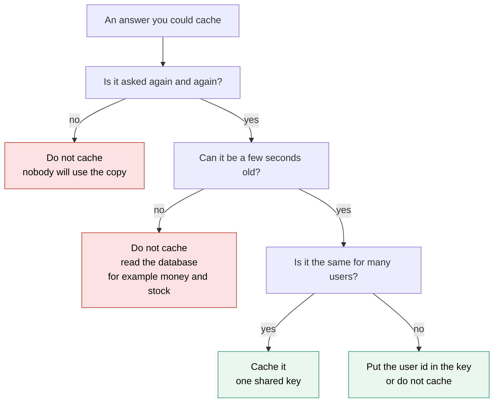

**Why it exists and what it costs.**

- **Problem without it:** the database does the same slow work for the same answer, thousands of times (the problem picture in card 1). It is also the hardest part to make bigger (lesson 02). So it is often the first thing to break.
- **How it solves it:** the app keeps a copy in a fast place and asks the database only on a miss. Rough numbers: Redis about 1 ms, a slow database question about 50 ms. Say 90 of 100 reads are hits (interview word: hit ratio).
  - The average read is (90 x 1 + 10 x 51) / 100 = **6 ms**, down from 50 ms.
  - The database sees 10 questions, not 100: **10 times less load**. This matters more. A cache mainly protects the database.
- **Cost or tradeoff:**
  - Copies can be old. A TTL limits it, and deleting the copy on a write fixes most of it.
  - The first read after a change is a miss, so it is slow.
  - It is one more part to run. If it stops, the app must still work by reading the database.
  - Memory is limited. When it is full, the cache throws out some copies (interview word: eviction).
  - A busy copy that ends can cause a stampede.

**What to cache.**

- **Cache:** answers asked again and again, that change rarely and may be a few seconds old. For example a product list or exchange rates.
- **Do not cache:** answers used to decide about money or stock, like a balance at the moment of a payment. Read those from the database. Never cache secrets. Never put one user's data under a key that other users share.

</details>

## 6. Two mistakes, and what to say if you freeze

- **Wrong:** the price changes in the database and the copy stays. **Right:** change the database, then delete the copy, and keep a TTL as a backup.
- **Wrong:** many requests miss at the same moment, and each one asks the database. **Right:** the first miss starts one refill, and the others wait for that same refill.

<details class="guess"><summary>🤔 Guess: you delete the copy before the database change is saved. What can go wrong? Press to check.</summary>

A reader can read the old price in the gap and save it as a new copy, and nothing will delete it. **Delete after the change is saved, not before.**

</details>

> **Remember:** if you freeze, say "I cache answers that are read often and change rarely."

<details class="more"><summary>📖 More detail: the two mistakes in full, with code you can run</summary>

**Wrong:** the price changes in the database, and the copy stays.

```js
// sketch, not run here
await db.query("UPDATE products SET price = $1 WHERE id = $2", [90, 7]);   // the cache still says 100
```

**Right:** change the database, then delete the copy, and keep a TTL as a backup.

```js
// sketch, not run here
await db.query("UPDATE products SET price = $1 WHERE id = $2", [90, 7]);
await redis.del("product:7");                                  // delete the copy after the change is saved
// later, on a miss, the app keeps a new copy with a TTL:
await redis.set("product:7", JSON.stringify(row), "EX", 600);  // 10 minutes
```

**Why:** without the delete, users see the old price until the TTL ends. Delete after the change is saved, not before. Before it, a reader could save the old price in the gap, and nothing would delete it.

**Wrong:** many requests miss at the same moment, and each one asks the database.

```js
async function wrong(id) {
  if (!cache.has(id)) cache.set(id, await slowDb(id));   // all 5 see "no copy" before any answer arrives
  return cache.get(id);
}
```

**Right:** the first miss starts one refill. The others wait for that same refill.

```js
function right(id) {
  if (cache.has(id)) return cache.get(id);
  if (!inFlight.has(id)) inFlight.set(id, slowDb(id).then((row) => { cache.set(id, row); inFlight.delete(id); return row; }));
  return inFlight.get(id);                                // inFlight holds the refill that is running now
}
```

Run both with 5 requests in the same moment. This is the whole script:

```js
let calls = 0;
const slowDb = async () => { calls++; await new Promise((r) => setTimeout(r, 50)); return "price 100"; };
const cache = new Map(), inFlight = new Map();
const burst = (fn) => Promise.all([1, 2, 3, 4, 5].map(() => fn(7)));   // 5 requests in the same moment

async function wrong(id) {
  if (!cache.has(id)) cache.set(id, await slowDb(id));    // all 5 see "no copy" before any answer arrives
  return cache.get(id);
}
function right(id) {
  if (cache.has(id)) return cache.get(id);
  if (!inFlight.has(id)) inFlight.set(id, slowDb(id).then((row) => { cache.set(id, row); inFlight.delete(id); return row; }));
  return inFlight.get(id);                                // everyone who misses waits for the same refill
}
(async () => {
  await burst(wrong); console.log("wrong: database calls", calls);
  cache.clear(); calls = 0;
  await burst(right); console.log("right: database calls", calls);
})();
```

```
wrong: database calls 5
right: database calls 1
```

Checked on 2026-10-16 with Node 22.

**Why:** this shares one refill inside one server. With 10 servers you still get 10 calls. A lock in Redis brings it down to 1 (see Go deeper).

**If you freeze:**

1. Say "I cache answers that are read often and change rarely."
2. Say "On a read I look in the cache. On a miss I ask the database and keep a copy with a TTL. On a write I change the database and delete the copy."
3. Say "The risks are old copies and a stampede on a busy key. I handle them with the delete, the TTL, and a lock or an early refresh."

</details>

## 7. Watch and play

Links came from web search or from older notes in this folder, 2026-10-16. The build machine could not open pages, so open each one once. If one is broken, tell me and I will replace it.

- **Video:** [Caching Strategies Made Easy (Cache-Aside, Read-Through, Write-Behind)](https://www.youtube.com/watch?v=XgYGXq4O_6s) - title from a search result, channel and length unknown. Compare its cache aside picture with the over-time picture in card 2.
- **Video:** [Cache Concepts: Cache Eviction vs. Cache Expiration](https://www.youtube.com/watch?v=76qpwvn262g) - title from a search result, channel and length unknown. Expiration is the TTL. Eviction is practice C.
- **Play with it:** [the stepper in this folder](visuals/04-caching.html) - guess first, then try all three stories.
- **Play with it:** [Ravensmove LRU cache visualizer](https://ravensmove.com/tools/lru-cache-visualizer) - a search summary says it shows hits, misses and what is thrown out. Try it before practice C.
- **Read:** [Hello Interview: caching](https://hellointerview.com/learn/system-design/core-concepts/caching) - a search summary says it makes cache aside the default. Compare with the over-time picture in card 2.
- **Read:** [ByteByteGo: top caching strategies](https://blog.bytebytego.com/p/top-caching-strategies) - pictures of the read and write ways. Find write through and write back.
- **Read:** [Redis blog: how to tame the thundering herd problem](https://redis.io/en/blog/how-to-tame-the-thundering-herd-problem/) - a search summary says copies that end together are a cause. Compare with the stampede picture in card 4.
- No outside visualizer for the stampede was found.

<details><summary>Go deeper (optional)</summary>

**A lock across many servers.** In Redis, `SET lock:banner 1 NX EX 5` means: set it only if it does not exist (NX), and delete it after 5 seconds (EX). The 5 seconds stop a crashed server from holding the lock forever. Only the server that gets the lock refills. This lock is fine for "only one refills". It is not safe for money.

**Many keys that end together.** If you save 50,000 keys at 09:00 with a TTL of one hour, they all end at 10:00. This is called an avalanche. The fix is jitter: add a random number of seconds to each TTL, for example 3600 plus 0 to 300.

**The race, in short.** A slow reader reads the old row, the writer commits and deletes the copy, and then the reader saves the old row. Fixes, simplest first: a short TTL, delete after the commit, delete again about one second later, store a version number in the copy, or use a lease (a ticket the cache gives on a miss, which a delete cancels). The [guide](caching-and-cdn-in-depth.md), Part 5, draws it. More: [MIT 6.824 notes on Facebook memcache](https://people.csail.mit.edu/alinush/6.824-spring-2015/l16-memcached.html) and [Instagram: thundering herds and promises](https://instagram-engineering.com/thundering-herds-promises-82191c8af57d). Both links come from the older notes in this folder.

**When Redis is full.** The setting is `maxmemory-policy`. On 2026-10-16 a search found that open source Redis defaults to `noeviction`, so writes fail when memory is full, and that Google Memorystore defaults to `volatile-lru`. For a pure cache, `allkeys-lru` is a common choice. Check your provider's page. LRU is explained in practice C.

**More.** The [guide](caching-and-cdn-in-depth.md) covers every place a copy can live and how to watch the hit ratio (Redis `INFO stats` shows `keyspace_hits` and `keyspace_misses`). The [System Design Primer](https://github.com/donnemartin/system-design-primer#cache) has pictures of the write patterns (link from the older notes).

**Idea, not a fact, for DBO.** DBO already runs Redis for its queue. If I add a cache there, I would use a separate Redis database number or instance for the cache, so a full cache can never throw out queue jobs. The tip is from the [guide](caching-and-cdn-in-depth.md), question 10.

</details>

## 8. Practice

**A. Predict the output** (write your answer before opening)

This cache has a TTL of 60 seconds. A fake clock, `now`, lets us move time. What do the three lines print?

```js
let now = 0;                                   // a fake clock in seconds
const db = { price: 100 };
const cache = new Map();                       // key -> { value, expires }
function read() {
  const c = cache.get("price");
  if (c && now < c.expires) return c.value + " from cache";
  cache.set("price", { value: db.price, expires: now + 60 });
  return db.price + " from database";
}
console.log(read());
db.price = 90; now = 30;
console.log(read());
now = 61;
console.log(read());
```

Then answer: which one line of code makes the second line print `90 from database`?

<details><summary>Answer</summary>

```
100 from database
100 from cache
90 from database
```

The first read fills the cache with 100, which ends at 60. At 30 the copy is alive, so the read gives the old 100. At 61 the time is over, so the app reads the database and gets 90. The fix: delete the copy when the database changes. Add `cache.delete("price")` right after `db.price = 90`. Then the output is `100 from database`, `90 from database`, `90 from cache`. (Checked on 2026-10-16 with Node 22.)

</details>

**B. Fix the bug**

A user says: "I saved a new price, but the page showed the old price for 10 minutes." The TTL is 10 minutes. The new price is in the database. Find the bug.

```js
// sketch, not run here
async function updatePrice(id, price) {
  await redis.del("product:" + id);
  await db.query("UPDATE products SET price = $1 WHERE id = $2", [price, id]);
}
```

<details><summary>Answer</summary>

The code deletes the copy before it changes the database. In the gap, a reader misses, reads the old price, and saves it in the cache. Nothing deletes it again, so it stays until the TTL ends.

Fix: change the database first, wait until it is saved, then delete the copy.

```js
// sketch, not run here
async function updatePrice(id, price) {
  await db.query("UPDATE products SET price = $1 WHERE id = $2", [price, id]);
  await redis.del("product:" + id);
}
```

A rare race is still possible (see Go deeper). The TTL limits it.

</details>

**C. Write it yourself**

A cache has limited memory. When it is full, it must throw out one copy. A common rule is LRU (least recently used): throw out the copy that was used longest ago. Build a small cache with a TTL and the LRU rule. Open [the stub](practice/04-caching.js), write `createCache`, and run this from the repo root:

```
node --test learn/system-design/practice/04-caching.test.js
```

The tests give the cache a fake clock through `now`, so no test waits for real time. Start with `set`, `get` and the TTL. Then `size`. Then the rule for a full cache: drop copies whose time is over first, and only then the one used longest ago.

<details><summary>One possible answer</summary>

```js
function createCache({ capacity, ttlMs, now = Date.now }) {
  const items = new Map();                       // key -> { value, expires }. The first key was used longest ago.
  const alive = (item) => now() < item.expires;
  const dropOver = () => { for (const [key, item] of items) if (!alive(item)) items.delete(key); };
  return {
    set(key, value) {
      items.delete(key);                         // a new set starts fresh and goes to the end
      if (items.size >= capacity) dropOver();    // 1. drop copies whose time is over
      if (items.size >= capacity) items.delete(items.keys().next().value);   // 2. drop the one used longest ago
      items.set(key, { value, expires: now() + ttlMs });
    },
    get(key) {
      const item = items.get(key);
      if (!item) return undefined;
      if (!alive(item)) { items.delete(key); return undefined; }
      items.delete(key); items.set(key, item);   // move to the end: used just now
      return item.value;
    },
    size() { dropOver(); return items.size; },
  };
}

module.exports = { createCache };
```

A `Map` remembers the order in which keys were added. So the first key was used longest ago, and "delete then set again" moves a key to the end. Checked on 2026-10-16 with Node 22: all 10 tests pass on this answer and fail on the empty stub.

</details>

## 9. Interview question

**Q:** "Our product page is slow because every request hits the database. How would you add caching, and what can go wrong?"

<details><summary>A strong answer, in four parts</summary>

1. **Problem:** the same answer is asked for again and again, so the database repeats the same work. The database is also the hardest part to make bigger.
2. **How it works:** cache aside, in Redis. On a read, look in the cache. On a miss, ask the database, keep a copy with a TTL, and answer. On a write, change the database, then delete the key. The TTL is the backup.
3. **Tradeoff:** copies can be old, and the TTL and the delete limit that. The first read after a change is slow. If the cache stops, the app reads the database. A busy key that ends can cause a stampede, so I use one refill with a lock, or refresh before the end. I do not cache decisions about money or stock. I check indexes first, because a cache hides a slow question and does not fix it.
4. **My example:**
   - **Fact:** DBO already runs Redis for its job queue (BullMQ). My case study says the API request path keeps working when Redis dies, because the core buying flow is backed by the database. A cache should follow the same rule.
   - **Fact:** in my DBO case study, the answer for "what breaks first at 10 times the load" puts the read load on the product database under indexes first (lookup tables that make a question fast), then a read replica (a copy of the database that only answers reads). It lists caching under OTP and outside service costs and limits. So for database reads I would try indexes before a cache.
   - **Idea, not a fact:** cache the product list that store owners see in the app, with cache aside, a TTL of a few minutes, and a separate Redis database number from the queue. Keep the points balance out of the cache when a redeem is approved, and read it from the database.

</details>

## 10. Explain it back

Close this file. Explain caching out loud like to a new junior, in 4 parts (problem, how, tradeoff, my example). Use the story of the price of rice: a miss, a hit, an old copy, and a busy copy that ends. Then write your best version below and run `/explain-check caching` or ask the `explain-coach` agent to review it.

### My explanation

<write here>

### Coach feedback

<the explain-coach agent writes here>

## 11. Review questions (day 1, 3, 7, 21)

1. A read arrives. Say what happens on a hit, on a miss, and on a write.
2. The price changed in the database at 20 seconds. At 30 seconds a user still sees the old price. Why? Name the two things that fix or limit it.
3. A very busy copy ends, and the database breaks down. What is this called? Give two fixes in plain words.
4. Draw the cache aside picture (card 2, blue bar) from memory.

<details><summary>Answers</summary>

1. Hit: the app answers from the copy and does not ask the database. Miss: the app asks the database, keeps a copy with a TTL, and answers. Write: change the database first, then delete the copy.
2. The cache did not know about the change, so it kept giving its copy. Delete the copy whenever the data changes, and set a TTL so an old copy cannot live forever.
3. A stampede. Fix 1: one request refills while the others wait. Fix 2: refresh the copy before it ends.
4. Three boxes: App, Cache, Database. Read 1: the cache says no, the database says 100, the app keeps a copy. Read 2: the cache says 100. Write: the app changes the database, then deletes the copy.

</details>

## Connected lessons

- [Load balancers](03-load-balancers.md) - the lesson before. The front door sends requests to many servers. All of them read the same cache.
- [CDN](05-cdn.md) - the next lesson. A cache near the user, with the same ideas: hit, miss, TTL and clearing a copy.
- [Scaling up vs out](02-scaling-up-vs-out.md) - the shared box is often the same Redis that holds the cache.
- [Consistency and CAP](07-consistency-and-cap.md) - a cache is a copy, so it is only eventually the same as the database.
- [Latency numbers and estimation](16-latency-numbers-and-estimation.md) - how slow each hop is.
- [Design a URL shortener](08-design-a-url-shortener.md) - reads are huge there, so a cache sits in front.
- [Caching and CDN in depth](caching-and-cdn-in-depth.md) - the long guide. Its [cheatsheet](caching-and-cdn-in-depth-cheatsheet.html) shows it on one page.
- [Database scaling and correctness](../database/database-scaling-and-correctness.md) - where a cache sits on the ladder of ways to scale a database.
- [System design interview questions](senior-system-design-interview-questions.md) - questions 17, 18 and 19 ask this lesson in three ways.
- [DBO case study](../../interview/my-projects/dbo-b2b-platform-system-design-case-study.md) - where Redis runs today and what breaks first at 10 times the load.
