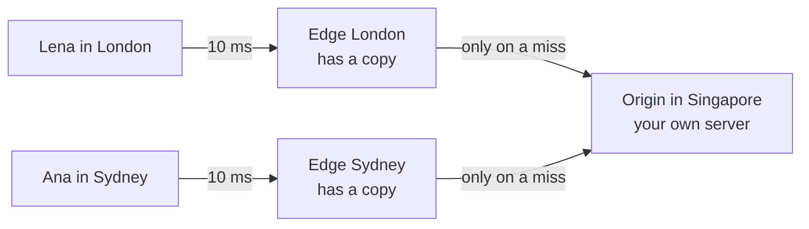
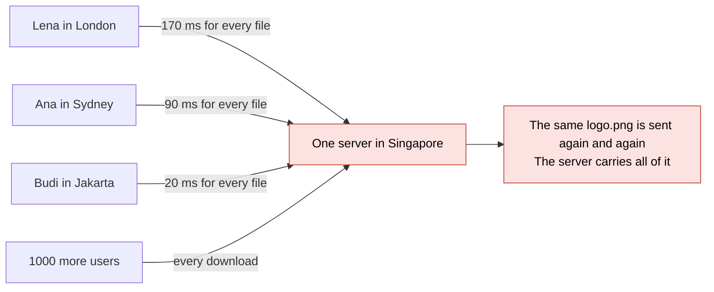
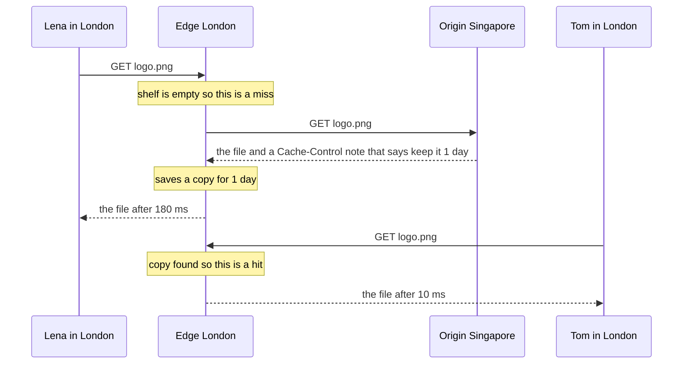
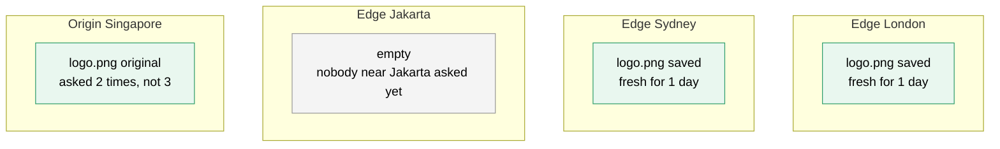
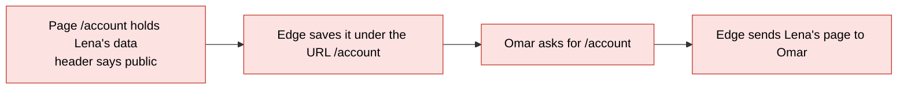
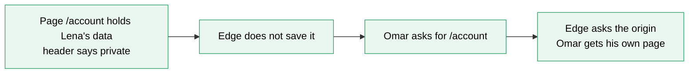
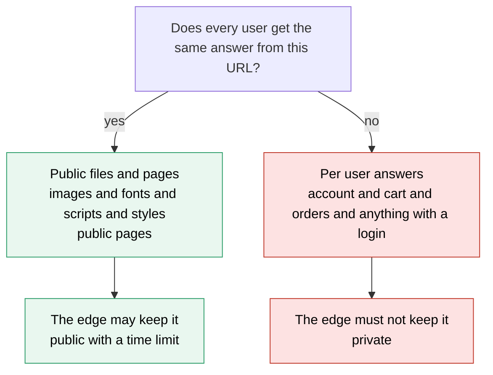
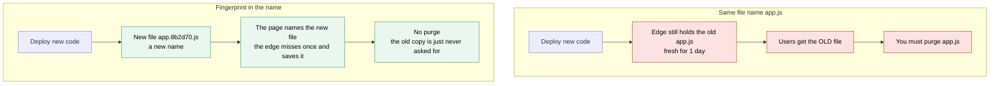
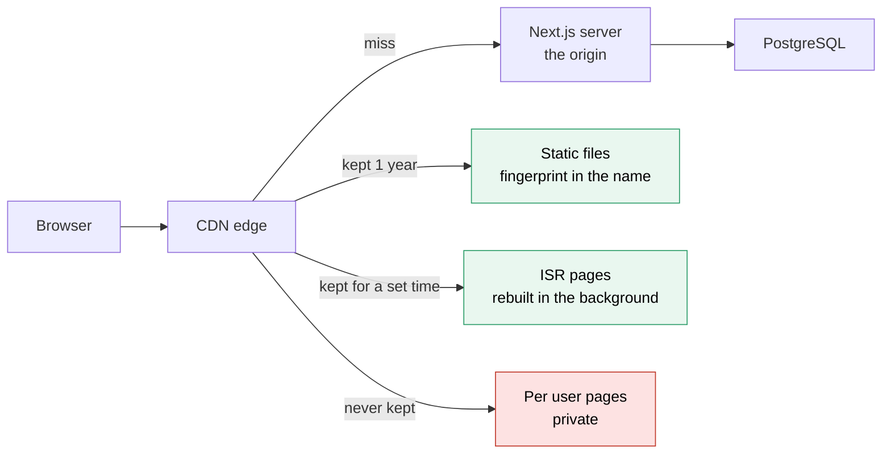

# 05. CDN

> **Subject:** System Design · **Lesson:** 05 · **Made:** 2026-10-16 · **Status:** ready
> **You will be able to:** say what a CDN keeps and where, follow a first request (a miss) and a second request (a hit) with the time each user waits, tell what a CDN may keep and what it must never keep, and explain why a file named `app.3f9a1c.js` never needs a purge.
> **Before this:** [Caching](04-caching.md) · **Next:** [Message queues](06-message-queues.md)

## 1. The idea in one sentence

A CDN keeps copies of your public files on servers around the world. Each user gets a file from a server close to them, and your own server is asked far less often.

New words (four):

- **CDN:** many servers around the world that keep copies of your files. The name means content delivery network.
- **Origin and edge:** the origin is your own server, where the real files live. An edge is a CDN server close to the user, where the copies live.
- **Hit and miss:** a hit means the edge has a fresh copy (one that is still inside its time limit, the TTL of lesson 04) and answers at once. A miss means it does not, so it asks the origin.
- **Purge:** to throw away a saved copy before its time is up.

Two plain ideas, explained now so the pictures make sense:

- **A cache** is a saved copy kept close to the reader. [Caching](04-caching.md) teaches it in full. A CDN is a cache with many servers around the world.
- **A header** is a short note that travels with a request or an answer. Your server writes the notes on answers, and the CDN reads them. The one that matters here is called `Cache-Control`. It says who may keep the answer, and for how long. The browser also sends a note called a **cookie** with every request. It holds an id, so the server knows who is asking.

Times are in ms (1 ms is one thousandth of a second). They are example numbers, not measured.

## 2. The pictures

### 2a. The big picture

Notice that each user talks to an edge that is close. Only a miss travels to the origin.



### 2b. The problem, drawn

This is a site with no CDN. Notice that every file from every user travels to one server, and London waits the longest.



### 2c. How it works over time

Notice that Lena makes the long trip and Tom does not. Lena was first, so she filled the shelf.



### 2d. What is on each shelf right now

This is a snapshot after Lena, Tom and Ana. Notice that each edge has its own shelf. The Jakarta edge is empty, because nobody near Jakarta has asked.



### 2e. Right against wrong

The shelf is shared, and the edge finds a copy by the URL. It does not look at the cookie. Public means any shared cache may keep the page. Private means only the user's own browser may. Notice what Omar gets.





### 2f. What may an edge keep?

Notice that one question decides it: does every user get exactly the same page from this URL?



### 2g. A new deploy: same name against a fingerprint name

Notice that the second way needs no purge. A new name is a new key on the shelf.



### 2h. Where the CDN sits in a Next.js app

Notice that the edge keeps two kinds of things and skips one. ISR pages are pages that Next.js builds ahead of time and rebuilds in the background. Everything else is a miss that goes to Next.js.



## 3. Real life analogy

A bakery chain has one big bakery in Singapore. Far away customers would wait a long time for each loaf. So the chain opens small shops in many cities. Each shop keeps a few loaves on a shelf.

- **First customer in London:** the shop has no loaf. It phones Singapore, waits, and keeps a spare on the shelf. That is a **miss**.
- **Second customer:** gets a loaf from the shelf at once. That is a **hit**.
- **A label on each box** says how long the loaf stays good. That is the `Cache-Control` header.
- **A cake with one customer's name on it** never goes on the shelf. That is a private page.
- **A new recipe:** the shop sells the old loaf until the label runs out. Head office can phone every shop to remove it (a **purge**). Or it gives the new bread a new name, so nobody asks for the old one.

Where the analogy stops: bread goes bad by itself, but a file copy never changes. It is only out of date when the original changes.

## 4. The smallest code that shows it

The origin is a real server on localhost. The edge is a `Map` that obeys the header. We ask for `/logo.png` twice and for `/account` twice. The origin says `private` for `/account`.

```js
const origin = require("http").createServer((req, res) => {   // your server
  res.setHeader("Cache-Control", req.url === "/account" ? "private" : "public, max-age=60");
  res.end("body of " + req.url);
}).listen(0, async () => {
  const shelf = new Map();                                      // the edge shelf: url -> saved body
  for (const url of ["/logo.png", "/logo.png", "/account", "/account"]) {
    if (shelf.has(url)) { console.log("HIT ", url); continue; } // the edge answers alone
    const r = await fetch("http://localhost:" + origin.address().port + url);   // a miss: ask the origin
    if (!/private|no-store/.test(r.headers.get("cache-control"))) shelf.set(url, await r.text());
    console.log("MISS", url, "| header:", r.headers.get("cache-control"));
  }
  origin.close();
});
```

**Output:**

```
MISS /logo.png | header: public, max-age=60
HIT  /logo.png
MISS /account | header: private
MISS /account | header: private
```

Checked on 2026-10-16 with Node 22.

The `Map` is the shelf. The `fetch` call is the edge asking the origin. The edge saves the body unless the header says `private` or `no-store`. This edge keeps a copy for ever. A real edge also forgets it after `max-age` seconds.

## 5. What really happens, step by step

The "machine" here is the edge shelf. The state is what sits on it, and how many times the origin is asked. Read one row at a time.

| Step | Code | What the edge does | Shelf after | Origin asked | Printed |
|---|---|---|---|---|---|
| 1 | `url` is `/logo.png` | `shelf.has` is false. The edge asks the origin with `fetch`. The header is `public, max-age=60`. It does not say private or no-store, so the edge saves the body. | `/logo.png` | 1 time | MISS `/logo.png` |
| 2 | `url` is `/logo.png` again | `shelf.has` is true. The edge prints HIT and goes on. It does not call `fetch`. | `/logo.png` | still 1 time | HIT `/logo.png` |
| 3 | `url` is `/account` | No copy, so the edge asks the origin. The header is `private`. The test finds "private", so nothing is saved. | `/logo.png` only | 2 times | MISS `/account` |
| 4 | `url` is `/account` again | Nothing was saved, so there is still no copy. The edge asks the origin again. | `/logo.png` only | 3 times | MISS `/account` |
| 5 | the loop ends | `origin.close()` stops the server. 4 requests came in. The origin saw 3 of them. | `/logo.png` only | 3 times | nothing |

The same idea with real distances. The numbers match the stepper page and picture 2c.

| User | With no CDN | With a CDN | Why |
|---|---|---|---|
| Lena in London, first | 170 ms | 180 ms | Miss. The short trip to the edge, then the long trip to the origin. |
| Tom in London, second | 170 ms | 10 ms | Hit. The copy is on the London shelf. |
| Ana in Sydney, first in Sydney | 90 ms | 100 ms | Miss. The Sydney shelf was empty. |
| Times the origin was asked | 3 | 2 | One miss for each edge, not one for each user. |

What to see: the first user at an edge pays a little more than with no CDN. Everyone after that pays almost nothing.

**Step through it yourself:** [open the stepper](visuals/05-cdn.html). It has three stories: first misses and second hits with the wait times, a private page cached by mistake, and a new deploy with the same name against a fingerprint name. Guess first, then press Next.

## 6. Why it exists and what it costs

- **Problem without it:** far users wait for every file, and a page needs dozens of files. Your own server also sends every download.
- **How it solves it:** the edge keeps copies near users. A hit costs one short trip and never reaches your server (pictures 2a to 2d).
- **Cost or tradeoff:**
  - The first user at each edge waits a little more than with no CDN.
  - A copy can be out of date until its time is up, or until you purge it.
  - It is one more part to pay for, and one more place to look when a user sees the wrong thing.
  - The shelf is shared, so private data on it can reach the wrong user (picture 2e).

### 6a. What may an edge keep?

Ask one question: will every user get exactly the same page from this URL? If yes, the edge may keep it. If no, it must not. By default the edge finds a copy by the URL only.

| Keep at the edge | Do not keep at the edge |
|---|---|
| Images, fonts and video | A user's account, cart or orders |
| JavaScript and CSS files that have a fingerprint in the name | Any answer that changes with the login |
| Public pages that look the same for everyone | A balance or a stock count that must be exact right now |
| Public API answers, with a short time | Anything with a secret in it |

### 6b. The notes that control it

Your origin writes these notes. The edge and the browser obey them. If a response has no note, the CDN guesses, so always write the note on purpose.

| Note | What it says in plain words |
|---|---|
| `Cache-Control: max-age=60` | Any cache, including the browser, may use this copy for 60 seconds without asking. |
| `s-maxage=300` | The same, but only for a shared cache such as a CDN. The "s" is for shared. The browser ignores it. |
| `private` | Only the user's own browser may keep it. A CDN must not. |
| `no-store` | Nobody keeps it, anywhere. |
| `no-cache` | You may keep it, but ask the origin before you use it each time. It does not mean "do not keep". |
| `immutable` | This file never changes. Do not even check. |
| `ETag: "abc"` | A fingerprint of the answer. After the time is up, the edge asks "is abc still the latest?". The origin can say "yes" with no file. |

### 6c. Purge, and file names that never need one

The problem: you deploy new code, but the edge keeps giving out the old file until its time is up. There are two fixes.

1. **Purge.** You tell the CDN to throw the copy away. It works, but:
   - It takes a few seconds to reach every edge, and it never reaches browsers that already hold the file.
   - Someone must remember it on every deploy.
   - A purge of everything empties every edge. All of them miss at once, and your origin gets a rush.
2. **A fingerprint in the file name.** The build tool makes a short code from the file content (interview word: a hash). It puts the code in the name: `app.3f9a1c.js`. If one letter changes, the code changes, and so does the name: `app.8b2d70.js`.
   - One name never holds two contents, so a copy under that name is never out of date. Keep it for a year with `immutable`. No purge.
   - The page (HTML) holds the names, so the page gets a short time, such as 60 seconds.

Rule: give a long life only to a name that changes when the content changes.

### 6d. Where the CDN sits in a Next.js app

Picture 2h shows it.

- Next.js puts a fingerprint in the names of its build files and sends them with a one year `immutable` note. They never need a purge.
- A page built ahead of time can be kept too. ISR (incremental static regeneration) means: Next.js builds the page once, keeps it, and rebuilds it in the background after a set number of seconds. It sends `s-maxage` with that time.
- A page that depends on the user is built on each request and is not kept.
- The catch: when you refresh a page on purpose, only Next.js forgets its copy. Purge the CDN at the same moment.

## 7. Common mistakes

**Wrong:** a per user page gets a public note.

```
GET /account      (shows "Hi Lena, 1,200 points")
Cache-Control: public, s-maxage=300
```

**Right:**

```
GET /account
Cache-Control: private
```

**Why:** the edge finds a copy by the URL, and the URL is the same for every user. Lena's page then goes to Omar. Nothing crashes, so you may not notice for a long time.

**Wrong:** a long life on a name that does not change.

```
GET /app.js
Cache-Control: public, max-age=31536000, immutable
```

**Right:**

```
GET /app.3f9a1c.js
Cache-Control: public, max-age=31536000, immutable
```

**Why:** a purge cannot reach a browser that already holds the file. With `immutable`, that browser will not ask again for a year.

**If you freeze:**

1. Say "I ask one question: does every user get the same answer from this URL?"
2. If yes, the CDN keeps it. Files get a fingerprint name and a long time. The page gets a short time.
3. If no, it is `private`. Say the numbers: "A hit costs about 10 ms. A far miss costs about 170 ms."

## 8. Watch and play

Links came from web search or from older notes in this folder, 2026-10-16. The build machine could not open pages, so open each one once. If one is broken, tell me and I will replace it.

- **Video:** [CDN - Content Delivery Network - Explained](https://www.youtube.com/watch?v=nhhfSBm6v4A) - the title came from a search result. I could not see the channel or the length. Watch for "files closer to users" and compare with picture 2a.
- **Play with it:** [Engineers Universe: Content Delivery Network Simulator](https://engineersuniverse.com/labs/ai-computing/cloud-computing/content-delivery-network) - a search summary says you can pick an edge, set the time limit, publish a new version at the origin and take the origin offline. Try: set a long time limit, publish a new version, and watch an edge give the old one.
- **Play with it:** [the stepper in this folder](visuals/05-cdn.html) - guess first, then press Next. Try all three tabs.
- **Read:** [Next.js: CDN caching](https://nextjs.org/docs/app/guides/cdn-caching) - the notes Next.js sends for static files, ISR pages and per user pages. Compare with picture 2h.
- **Read:** [MDN: Cache-Control](https://developer.mozilla.org/docs/Web/HTTP/Reference/Headers/Cache-Control) - find `s-maxage`, `private` and `immutable`. Compare with the table in 6b.
- **Read:** [Cloudflare: default cache behavior](https://developers.cloudflare.com/cache/concepts/default-cache-behavior) - what one real CDN keeps and skips when you set no note.
- **Read (pictures):** [System Design Primer](https://github.com/donnemartin/system-design-primer) - find the CDN part. This link came from older notes in this folder.

<details><summary>Go deeper (optional)</summary>

**Origin shield.** Without it, three edges that miss make three requests to your origin. With one middle layer (an origin shield), they make one. Cloudflare calls this Tiered Cache. See Part 6 of the [in-depth guide](caching-and-cdn-in-depth.md).

**The shelf key.** By default it is the URL. A CDN setting or a `Vary` header can add one more input, such as the language. Add only what changes the answer. A tracking parameter such as `utm_source` makes a new key each time and lowers the hit ratio.

**Why the origin is protected.** Say a page loads 30 files and 1,000 users open it. That is 30,000 requests. With 95 percent hits, your origin sees 1,500. I worked this out by hand from example numbers.

**Seeing hit or miss.** Many CDNs add a header that says it. Cloudflare uses `cf-cache-status` (values include HIT and MISS). Others use `x-cache`, and its values differ by provider. Source: web search results, 2026-10-16, pages not opened. To try it: open the browser DevTools, go to the Network tab, click a file and read the response headers.

**What Cloudflare does with no note.** From a search summary of its default cache page, 2026-10-16, page not opened: it caches by file type. It does not cache HTML or JSON by default. It skips a response when `Cache-Control` says `private`, `no-store`, `no-cache` or `max-age=0`, or when the response sets a cookie. Other CDNs differ, so do not rely on defaults.

**Next.js notes, in detail.** From a search summary of the Next.js CDN caching guide, 2026-10-16, page not opened: files in `/_next/static/` get `public, max-age=31536000, immutable`. Static pages get a one year `s-maxage`. ISR pages get an `s-maxage` equal to the revalidate time, plus `stale-while-revalidate`. Pages that depend on the request get no-cache notes. `revalidateTag` and `revalidatePath` clear only the Next.js copy, so purge the CDN yourself.

**Private files.** Do not put them on a public shelf. The API checks who is asking and returns a link with a signature that expires in minutes. The CDN or the file store checks the signature and sends the file. See the [in-depth guide](caching-and-cdn-in-depth.md) and the [cheatsheet](caching-and-cdn-in-depth-cheatsheet.html).

</details>

## 9. Practice

**A. Predict the output** (write your answer before opening)

Take the code from section 4. Change line 2 to this, and use this list in the `for` line:

```js
res.setHeader("Cache-Control", req.url === "/home" ? "no-store" : "public, max-age=60");
// for (const url of ["/logo.png", "/home", "/home", "/logo.png"])
```

What prints? How many times is the origin asked?

<details><summary>Answer</summary>

```
MISS /logo.png | header: public, max-age=60
MISS /home | header: no-store
MISS /home | header: no-store
HIT  /logo.png
```

The origin is asked 3 times for 4 requests. `no-store` matches the test, so `/home` is never saved, and both asks go to the origin. `/logo.png` was saved on the first line, so the last line is a hit. (Checked on 2026-10-16 with Node 22.)

</details>

**B. Fix the bug**

A team serves the whole `dist` folder with a one year `immutable` note. The folder holds `index.html` and `app.js`, and their names stay the same on every deploy. After a deploy, many users still see the old site. The team purges the CDN, and many users still see the old site. Why? What do you change?

```js
// sketch, not run here
app.use(express.static("dist", { maxAge: "365d", immutable: true }));
```

<details><summary>Answer</summary>

Every file gets a one year life, including `index.html` and `app.js`. Their names do not change, so nothing tells a browser that there is a new version. The purge cleared the edge. It cannot reach browsers that already hold the old files, and with `immutable` they do not ask again for a year.

Fix: put a fingerprint in the names of the JavaScript and CSS files (build tools do this). Give only those files the long life. Give `index.html` a short life or a check each time.

```js
// sketch, not run here
app.use("/assets", express.static("dist/assets", { maxAge: "365d", immutable: true }));   // names have a fingerprint
app.use(express.static("dist", { maxAge: 0 }));                                           // index.html is checked every time
```

Honest note: users who already hold the old `index.html` with a one year life are stuck until they clear their data. A long life on a name that can change is a mistake you cannot undo.

</details>

**C. Write it yourself**

Read these six responses. For each one, write: may the CDN keep it, for how long, and is there a risk? Write your answer before you open.

```
1. GET /_next/static/chunks/main-4f1a9c.js
   Cache-Control: public, max-age=31536000, immutable

2. GET /
   Cache-Control: public, s-maxage=60

3. GET /api/me
   Cache-Control: private, no-store

4. GET /account            (the page shows "Hi Lena, 1,200 points")
   Cache-Control: public, max-age=300

5. GET /logo.png
   ETag: "abc"             (there is no Cache-Control)

6. GET /app.js
   Cache-Control: no-cache
   ETag: "v7"
```

<details><summary>One possible answer</summary>

1. **Keep for 1 year.** Safe, because the fingerprint in the name changes with the content.
2. **Keep for 60 seconds** at the CDN (`s-maxage`). The note says nothing for the browser. Fine for a public page.
3. **Do not keep.** It is per user data, and the note says so. Correct.
4. **A bug.** `public` with `max-age=300` lets the edge keep Lena's page for 5 minutes, and other users get it. Change it to `private`.
5. **Unclear.** With no note, the CDN guesses. A changed logo may stay old, or the origin may be asked more than it needs to be. Write the note on purpose, for example `public, max-age=86400`.
6. **Keep, but ask first.** `no-cache` means the edge asks the origin before each use. The `ETag` lets the origin answer "still v7" with no file. It is safe for a file with no fingerprint, but each request still travels to the origin.

</details>

## 10. Interview question

**Q:** "Users far from our server say the site is slow, and our server is busy sending images and scripts. How would you use a CDN, and what would you keep off it?"

<details><summary>A strong answer, in four parts</summary>

1. **Problem:** a far user waits for every file, because each file crosses the world. Your one server also sends every download itself.
2. **How it works:** edge servers near users keep copies. On a hit the edge answers at once, about 10 ms in my example. On a miss it asks the origin once, saves the copy and answers, about 170 ms for a far user. The origin writes `Cache-Control`: `max-age` for browsers and `s-maxage` for the CDN. JavaScript and CSS get a fingerprint in the name and a one year `immutable` note. The page gets a short time.
3. **Tradeoff:** the first user at each edge waits a little more than with no CDN. Copies can be out of date until their time is up or I purge. A purge does not reach browsers. The big risk is a per user page on the shared shelf, so anything per user is `private`. It is also one more part to pay for and to debug.
4. **My example:**
   - **Fact:** DBO has a React Native app for store owners, a CMS for admins, and a verification admin UI where admins check store identity documents (KTP).
   - **Fact:** my case study says the KTP photo upload goes from the API to storage, and an admin approves it.
   - **Fact:** my case study does not mention a CDN. It says the gateway is likely CapRover's bundled nginx doing routing and TLS. It lists Cloudflare in front as an option and calls it "cheap DDoS insurance". That is a suggestion, not something DBO runs.
   - **Idea, not a fact:** put app images, such as brand pictures and banners, behind a CDN with fingerprint names or a long `max-age`. KTP photos are private and must never sit on a public shelf. Serve them to admins through the API, or through a link that expires.

</details>

## 11. Explain it back

Close this file. Explain the CDN out loud like to a new junior, in 4 parts (problem, how, tradeoff, my example). Use the story of Lena, Tom and Omar. Then write your best version below and run `/explain-check cdn` or ask the `explain-coach` agent to review it.

### My explanation

<write here>

### Coach feedback

<the explain-coach agent writes here>

## 12. Review questions (day 1, 3, 7, 21)

1. Lena and then Tom, both in London, ask for the same file. The London edge is empty. What happens each time, and how long does each user wait (use the example numbers)?
2. The page `/account` shows "Hi Lena, 1,200 points". Which note keeps it safe, and what goes wrong with `public`?
3. Why does `app.3f9a1c.js` never need a purge, but `/app.js` with a one day life does?
4. Draw the picture from section 2c from memory.

<details><summary>Answers</summary>

1. Lena: a miss. The edge asks the origin, saves the copy and answers. She waits about 180 ms (10 ms short trip plus 170 ms long trip). Tom: a hit. The edge sends the saved copy and the origin is not asked. He waits about 10 ms.
2. `private`. With `public`, the edge saves Lena's page under the URL `/account`. The edge finds copies by URL and not by cookie, so Omar gets Lena's page.
3. The name changes when the content changes, so a deploy makes a new name. The edge has never seen it, so it misses once and fetches the new file. Nobody asks for the old name any more. `/app.js` keeps its name, so the edge keeps giving the old copy until its time ends or you purge it.
4. Four boxes: Lena, Edge London, Origin Singapore, Tom. Lena asks the edge: miss. The edge asks the origin, saves the copy and answers Lena after 180 ms. Tom asks the edge: hit, answer after 10 ms.

</details>

## Connected lessons

- [Caching](04-caching.md) - the lesson before this one. A CDN is the cache closest to the user. Hit, miss and time limit mean the same thing there.
- [Message queues](06-message-queues.md) - the next lesson. It moves slow work out of the request.
- [Load balancers](03-load-balancers.md) - the origin sits behind one. A CDN means fewer requests reach it.
- [Latency numbers and estimation](16-latency-numbers-and-estimation.md) - where the 10 ms and 170 ms come from.
- [Object storage and presigned uploads](18-object-storage-and-presigned-uploads.md) - files in a bucket, often with a CDN in front, and links that expire.
- [Safe deploys](27-safe-deploys.md) - fingerprint names keep old pages working during a deploy.
- [Caching and CDN in depth](caching-and-cdn-in-depth.md) - HTTP caching, purge by tag, signed URLs, origin shield, Next.js 16 caching.
- [Caching cheatsheet](caching-and-cdn-in-depth-cheatsheet.html) - one visual page.
- [Networking for system design](../networking/networking-for-system-design.md) - why distance costs time.
