# 06. Message queues

> **Subject:** System Design · **Lesson:** 06 · **Made:** 2026-10-16 · **Remade in short cards:** 2026-10-30 · **Status:** ready
>
> **You will be able to:** say why slow work goes into a queue, follow one job from the producer to the worker and its ack, explain why a job can run twice and what that asks of your code, and say what happens to a job that fails again and again.
>
> **Before this:** [CDN](05-cdn.md) · **Next:** [Consistency and CAP](07-consistency-and-cap.md)
>
> **How to read it:** one card is one idea. Look at the picture, guess, then press the orange bar to check. The blue bars (📖 More detail) hold the longer explanation. Skip them on the first read, and open them when you want more. About 15 minutes for the cards.

## 1. The idea: a waiting line for slow work

A message queue is a waiting line between two programs. The **producer** (your API) drops a job in the line and moves on. A **worker** takes jobs from the line and does the slow work later. Like a phone repair shop: the clerk pins a ticket on the board and says "we will call you", and technicians take tickets one at a time.

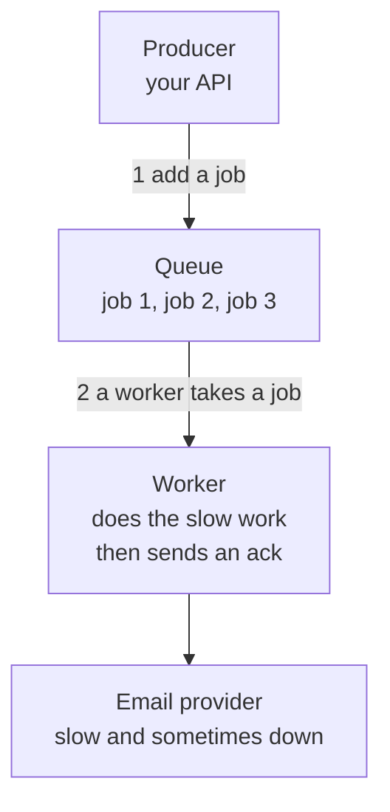

<details class="guess"><summary>🤔 Guess: a customer places an order, and the email provider is slow today (5 seconds). With a queue, how long does the customer wait? Press to check.</summary>

About **60 ms**. The API saves the order, adds the job "send receipt 42" and answers at once. The worker sends the email later. Without a queue, the customer waits the 5 seconds, sees an error, and taps again.

</details>

> **Remember:** the producer adds a job and moves on. A worker does the slow work later.

<details class="more"><summary>📖 More detail: new words, the problem drawn, the run over time, and the repair shop</summary>

Lessons 02 to 05 made answers faster. This lesson is about work the user does not need to wait for, like a receipt email.

New words (four):

- **Producer and worker:** the producer is the program that adds jobs to the line. The worker is the program that takes a job and does it (interview words: producer and consumer).
- **Ack:** a short message from the worker to the queue: "I finished this job, you can delete it." It is short for acknowledgement.
- **At least once:** the queue's promise. Every job is delivered one time or more. Never zero times. Sometimes two times.
- **Dead letter queue:** a side shelf for jobs that failed again and again. They wait there until a person looks at them (short name: DLQ).

Three plain ideas, explained now so the pictures make sense:

- **A job** is a small note that says "please do this". For example `{ orderId: 42, task: "send receipt" }`. Interview word: message.
- **The hiding timer:** when a worker takes a job, the queue hides it from all other workers for a set time, for example 30 seconds. If the ack arrives in time, the queue deletes the job. If the timer ends first, the queue shows the job again. Interview word: visibility timeout.
- **Queue length** is the number of jobs waiting in the line right now. It is the number you watch.

Times in the pictures are example numbers, not measured. 1 ms is one thousandth of a second.

**The big picture.** Notice that the producer never talks to the worker. The queue sits between them, and the worker sends an ack when it is done.

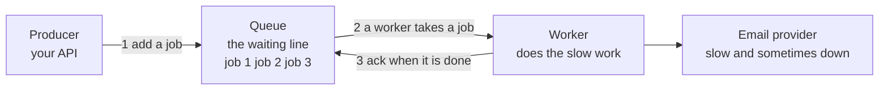

**The problem, drawn.** This is checkout with no queue. Notice that the customer waits for the email. When the email provider is slow, the whole order looks broken.

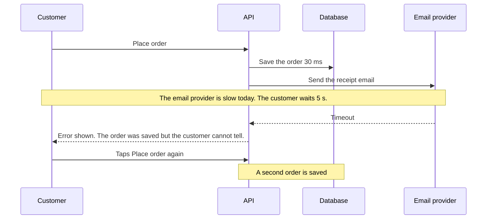

**How it works over time.** This is story 1 of the stepper. Notice that the customer gets an answer before the email is sent.

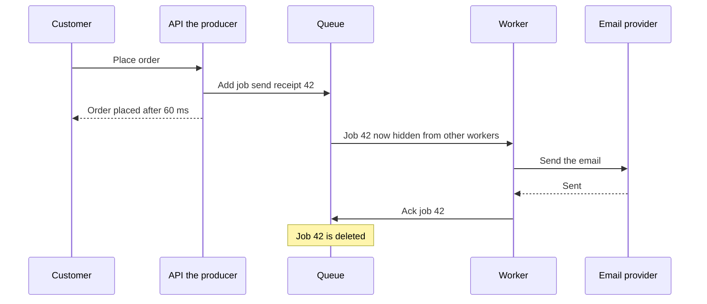

**The repair shop in full.**

A phone repair shop. You hand over your phone. The clerk writes a ticket, pins it on a board, and says "we will call you". You leave at once. The clerk is the producer and the board is the queue. Technicians take tickets from the board, one at a time. They are the workers.

- **The hiding timer:** a ticket a technician took is off the board. If the technician goes home sick, the manager pins the ticket on the board again that evening.
- **Ack:** the technician signs the ticket "done". Only then does it go in the finished box.
- **Running twice:** a technician fixes your phone, takes your payment, and falls sick before signing. The next technician takes the payment again. So the shop needs a rule: "check first if this phone is paid".
- **Dead letter queue:** a phone nobody can fix. After three tries the ticket goes in a "problem" box on the manager's desk.

Where the analogy stops: a technician would tell the next one "I took the payment". A crashed worker says nothing. Also a ticket board hangs on a wall, so everyone sees it fill up. A queue lives inside a computer, so nobody sees it grow unless someone watches the queue length.

</details>

## 2. The ack, and why a job can run twice

The worker sends an **ack** ("I finished this job, delete it") only after the work. When a worker takes a job, the queue hides it for a set time (the hiding timer). If no ack comes before the timer ends, the queue shows the job again. The queue cannot see inside the worker, so a crash after the email means the email goes out twice. This promise is called **at least once**: one time or more, never zero.

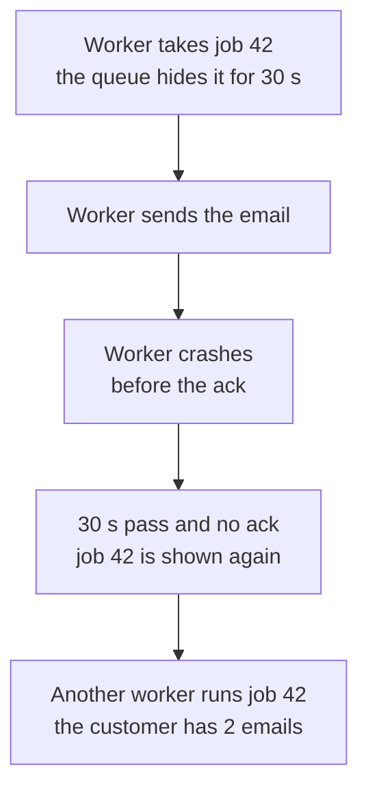

<details class="guess"><summary>🤔 Guess: a worker acks first, then crashes before it does the work. Is the job run twice, or lost? Press to check.</summary>

**Lost.** The queue already deleted the job, and nobody knows. An ack before the work means "at most once". Ack after the work, and make the work safe to repeat.

</details>

> **Remember:** ack after the work. A crash means the job runs again, so the worker must be safe to repeat.

<details class="more"><summary>📖 More detail: the crash drawn, the notebook, ack first against ack last, and the promises</summary>

**When a worker crashes.** This is story 2. Notice that the queue cannot see the email went out. It only sees that no ack came.

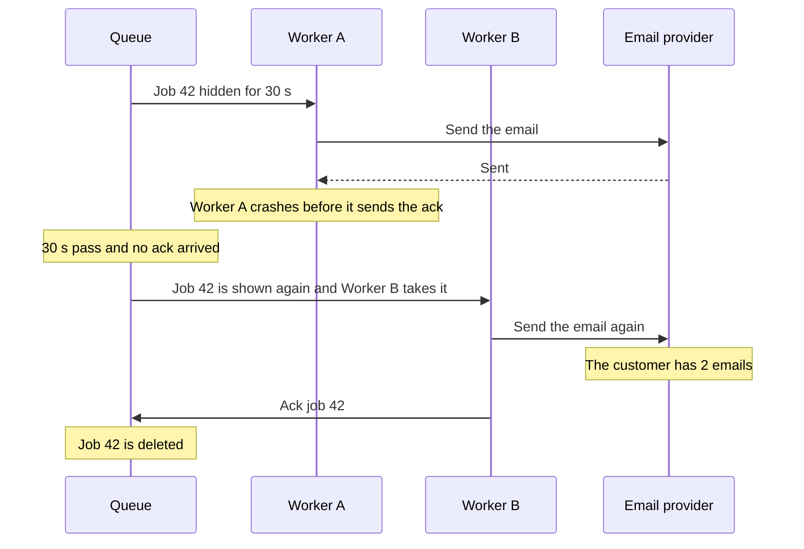

**What is in the queue's notebook right now.** This is one moment. Notice that every job sits in exactly one place. Only an ack deletes a job. The arrows show how a job moves.

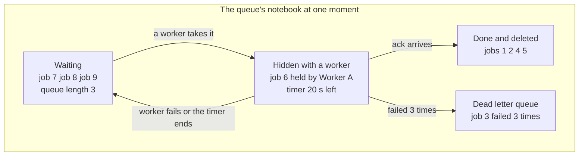

**Right against wrong.** Both ways can meet a crash. Notice what the crash costs: a lost job on the wrong way, a repeated job on the right way.

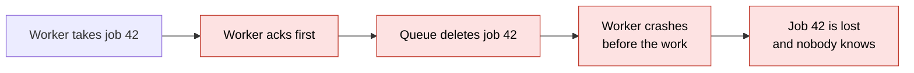

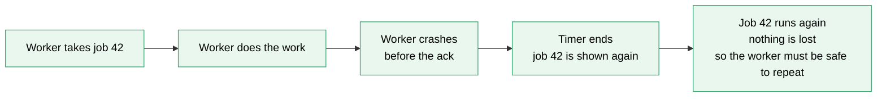

**Why a job can run twice.** This is the part interviewers ask about.

1. A worker takes a job. The queue hides it and starts the hiding timer.
2. The worker does the work, then crashes before the ack. Or it is only slow, and the timer ends first.
3. The queue cannot look inside the worker. It only knows that no ack arrived.
4. So the queue must choose. It can show the job again, and the job may run twice. Or it can delete the job, and the job may run zero times. Most queues show it again, because a lost job is usually worse than a repeated one. That choice is called at least once.

| Promise | The worker acks | A crash means | Use it for |
|---|---|---|---|
| At most once | before the work | the job is lost and runs 0 times | a "user is typing" signal |
| At least once | after the work | the job runs again, so 2 times | almost everything: emails, orders, points |
| "Exactly once" | after the work, and the worker is safe to repeat | the job may run twice, but the result is the same as once | money, points, stock |

Nobody can promise one single delivery over a network, because a message or an ack can always get lost. What you can build is one single effect: at least once delivery plus a worker that is safe to repeat.

</details>

## 3. Make the worker safe to repeat

**Safe to repeat** (interview word: idempotent) means that running a job twice gives the same result as running it once.

| Job | Safe to run twice? |
|---|---|
| Set the order 42 status to SENT | Yes: it sets the same value |
| Delete the temp file | Yes: it is already gone |
| Add 10 points to a store | **No**: the store gets 20 |
| Send the receipt email | **No**: two emails |

The usual fix for the last two: give every job a unique id. The worker saves that id in a table with a unique rule, in the same database transaction as the work. A second run finds the id and skips the job.

<details class="guess"><summary>🤔 Guess: a job "add 10 points" runs twice. How many points does the store get? What stops it? Press to check.</summary>

**20 points.** Stop it with the job id: save it in a table with a unique rule, in the same transaction as the points. The second run finds the id and skips the job. Both happen or neither happens.

</details>

> **Remember:** nobody can promise one single delivery. You build one single effect: at least once, plus a worker that is safe to repeat.

<details class="more"><summary>📖 More detail: why "exactly once" is built, and the full table</summary>

Nobody can promise one single delivery over a network, because a message or an ack can always get lost. What you can build is one single effect: at least once delivery plus a worker that is safe to repeat.

**Safe to repeat** (interview word: idempotent) means that running a job twice gives the same result as running it once. Lesson [13](13-idempotency-and-retries.md) teaches how.

| Job | Safe to run twice? | Why |
|---|---|---|
| Set the order 42 status to SENT | Yes | The second run sets the same value |
| Delete the temp file | Yes | It is already gone, so there is nothing to do |
| Add 10 points to a store | No | The store gets 20 points |
| Send the receipt email | No | The customer gets two emails |

The usual fix for the last two: give every job a unique id. The worker saves that id in a table with a unique rule, in the same database transaction as the work. A second run finds the id and skips the job.

</details>

## 4. A job that keeps failing: retries and the dead letter queue

A failed job goes back in the line, with three rules. **Wait longer** after each failure (1 s, 2 s, 4 s: exponential backoff). Add a small **random part** to each wait so 5,000 failed jobs do not return at the same second (jitter). **Stop after a few tries** (3 to 5). Then the job goes to the **dead letter queue**, a side shelf where it waits for a person.

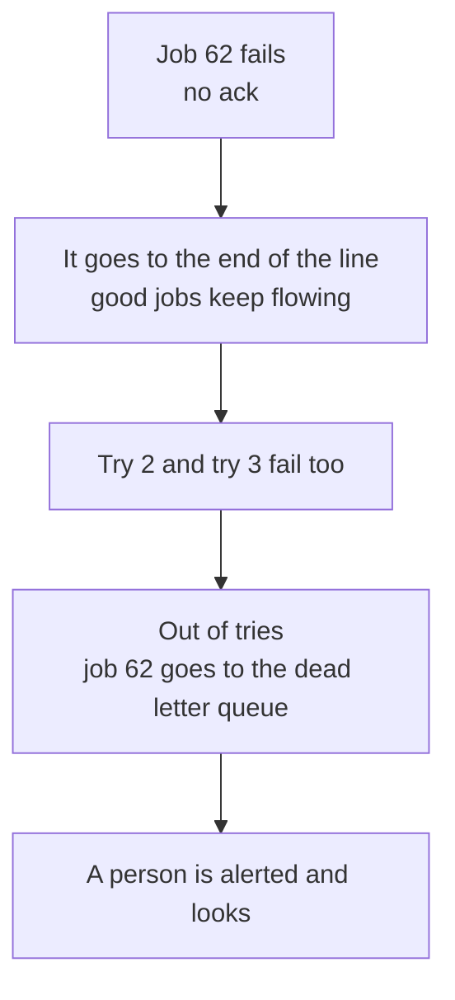

<details class="guess"><summary>🤔 Guess: three jobs: `a` (sends its email, then crashes the first time), `b`, and `bad` (always fails, 3 tries then dead). What does the last line print? Press to check.</summary>

`sent: a b a dead: bad`. Job `a` ran twice. Job `bad` never sent anything and ended in `dead`. (Real run, Node 26.12.1.)

</details>

> **Remember:** one bad job cannot stop the others. Alert when the dead letter queue holds anything.

<details class="more"><summary>📖 More detail: the code, the real output, step by step, a bad job over time, and the retry rules</summary>

**The smallest code that shows it.**

One file plays both the queue and the worker. There are three jobs: `a`, `b` and `bad`. Job `a` sends its email and then crashes the first time. Job `bad` always fails. An error means no ack arrived. A job that has failed fewer than 3 times goes to the end of the line. The third failure moves it to `dead`.

```js
let waiting = ["a", "b", "bad"], dead = [], tries = {}, sent = [];
function work(job) {                           // returns an error text, or nothing when it worked
  if (job === "bad") return "bad data";
  sent.push(job);                              // the visible effect, like an email
  if (job === "a" && !tries.a) return "crash before ack";   // a crashes the first time only
}
while (waiting.length) {
  const job = waiting.shift(), err = work(job);   // take: the job leaves the line
  if (!err) { console.log("ack", job, "queue length", waiting.length); continue; }
  tries[job] = (tries[job] || 0) + 1;
  console.log("no ack", job, "try", tries[job], err);
  (tries[job] < 3 ? waiting : dead).push(job);    // under 3 tries: back in the line
}
console.log("sent:", sent.join(" "), "dead:", dead.join(" "));
```

**Output:**

```
no ack a try 1 crash before ack
ack b queue length 2
no ack bad try 1 bad data
ack a queue length 1
no ack bad try 2 bad data
no ack bad try 3 bad data
sent: a b a dead: bad
```

Checked on 2026-10-16 with Node 22.

Look at the last line. `sent: a b a` means job `a` ran twice. Job `bad` never sent anything and ended in `dead`. In a real system the queue and the worker are two programs. Here one loop plays both.

Run again on 2026-10-30 with Node 26.12.1: the same output.

**What really happens, step by step.**

The machine here is the queue. The state is where each job sits: waiting, hidden with a worker, done, or dead. One row is one pass of the loop in card 4. The line after a pass is what is left waiting.

| Step | Job taken (now hidden) | What happens | Printed | Waiting line after (queue length) | Sent so far | Dead letters |
|---|---|---|---|---|---|---|
| 1 | `a` | The worker sends the email. Then it crashes before the ack | `no ack a try 1 crash before ack` | b, bad, a (3) | a | none |
| 2 | `b` | The worker sends the email and acks. Job `b` is deleted | `ack b queue length 2` | bad, a (2) | a b | none |
| 3 | `bad` | It fails at once. Failed 1 time, so it goes to the end of the line | `no ack bad try 1 bad data` | a, bad (2) | a b | none |
| 4 | `a` | The worker sends the email a second time. It does not crash now, so it acks | `ack a queue length 1` | bad (1) | a b a | none |
| 5 | `bad` | It fails. Failed 2 times, so it goes to the end of the line | `no ack bad try 2 bad data` | bad (1) | a b a | none |
| 6 | `bad` | It fails. Failed 3 times. That is not fewer than 3, so the job is parked | `no ack bad try 3 bad data` | empty (0) | a b a | bad |

What to see:

- Steps 1 and 4 are the same job `a`. The email went out in both. That is the repeat.
- The bad job failed in step 3. The worker did not wait for it. In step 4 it went on to job `a`.
- The queue length went 3, 2, 2, 1, 1, 0. You can chart that number.

**Step through it yourself:** [open the stepper](visuals/06-message-queues.html). It has three stories: the happy path, a worker that crashes before the ack, and a bad job that fails 3 times. Guess first, then press Next. Every story shows the queue length, the hidden jobs, the dead letter queue and what the customers really received.

**A bad job, over time.** This is story 3. Notice the two things at once: the bad job uses up its 3 tries, and the good jobs keep flowing.

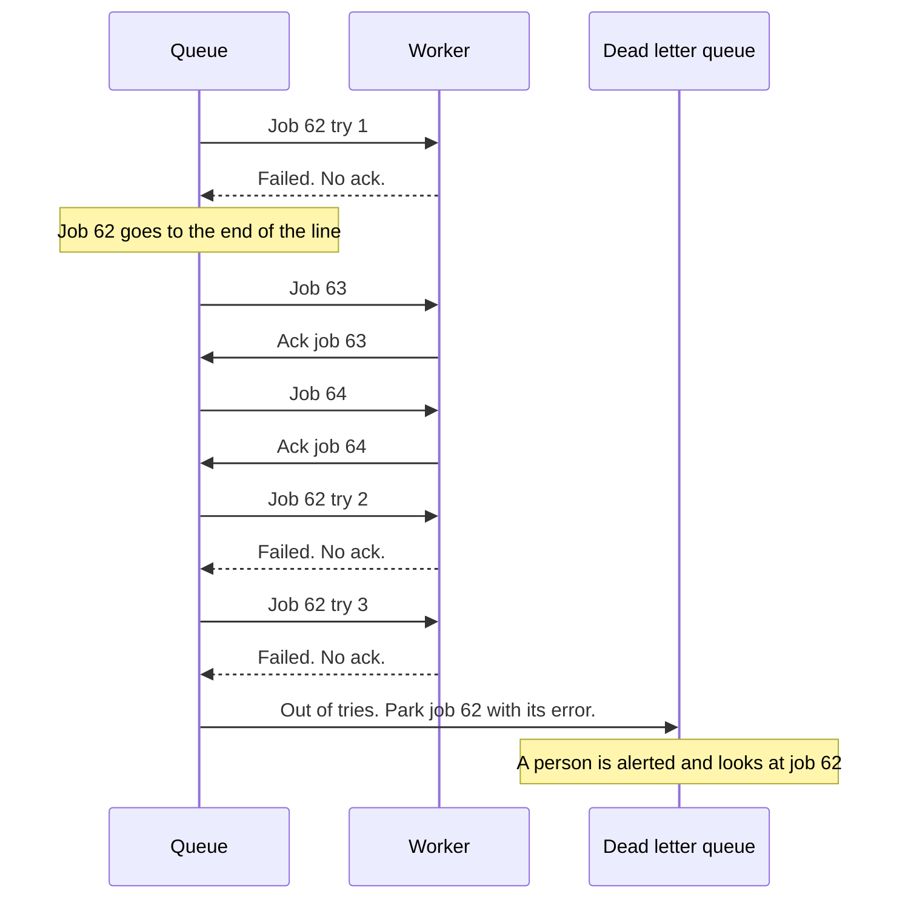

**Retries and the dead letter queue in full.**

**Retries.** A failed job is tried again, with three rules:

- Wait longer after each failure, for example 1 s, then 2 s, then 4 s. A helper that is down needs time to recover (interview word: exponential backoff).
- Add a small random part to each wait. Then 5,000 failed jobs do not all return at the same second (interview word: jitter).
- Stop after a few tries, for example 3 to 5. A job that can never work, like one with bad data, goes straight to the dead letter queue.

**The dead letter queue.** After the last try, the queue moves the job there and keeps the error. One bad job cannot stop the others (card 4), and the job is not lost. A person fixes the cause and replays it. Two cautions: alert when the dead letter queue holds anything, because a shelf nobody reads is a slow way to lose data. And replay only if the worker is safe to repeat, because some dead jobs half worked.

</details>

## 5. A burst of orders, and what a queue costs

A burst: 600 orders arrive in 1 minute, and the email provider allows 100 a minute. With no queue, 500 calls are refused. With a queue, the queue length rises to 500 and then falls to 0, and all 600 emails go out in 6 minutes. The price:

| Cost | What you do |
|---|---|
| results come later | show a status, or send a message when done |
| a job can run twice | make the worker safe to repeat |
| order is not promised | keep order per key, or let a status only move forward |
| it grows without noise | alert on the queue length and the age of the oldest job |

<details class="guess"><summary>🤔 Guess: jobs arrive faster than the workers finish. Does anything show an error? Press to check.</summary>

**No.** The queue length just climbs, and nobody sees an error unless you watch it. Alert on the queue length and on the age of the oldest job.

</details>

> **Remember:** if the user is waiting for the answer, call it directly. A login check cannot wait in a line.

<details class="more"><summary>📖 More detail: the burst drawn, the full cost table, and why it exists</summary>

**A burst of orders.** Notice that without the queue the email provider refuses most calls. With the queue every job still works, only later.

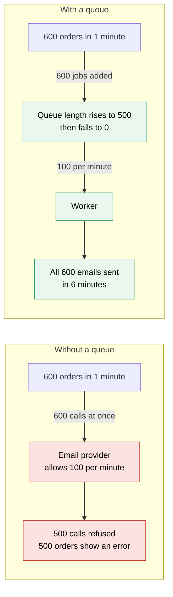

**What a queue costs.**

| Cost | What it means | What you do about it |
|---|---|---|
| More parts to run | The queue itself (Redis, SQS or another tool) and the workers can stop | Use a queue you already run, or a managed one. Save the queue to disk |
| Results come later | The customer sees "processing", not "done" (interview word: eventual consistency, see lesson [07](07-consistency-and-cap.md)) | Show a status, or send a message when the job is done |
| A job can run twice | At least once delivery | Make the worker safe to repeat |
| Order is not promised | With 2 workers and retries, job 2 can finish before job 1 | If order matters, keep it per key, for example per order id (lesson [21](21-streams-vs-queues.md)). Or let a status only move forward |
| It grows without noise | If jobs arrive faster than workers finish, the queue length climbs and nobody sees an error | Alert on the queue length and on the age of the oldest job |
| Harder to debug | One click now crosses the API, the queue and a worker | Put a request id inside every job and log it |

**When not to use a queue.** If the user is waiting for the answer, call it directly. A login check or "show my orders" cannot wait in a line.

**Why it exists and what it costs.**

- **Problem without it:** the API does the slow work itself. The customer waits (card 1). A burst of orders floods the slow helper (card 5). A crash in the middle loses the work and nobody knows (card 2, the wrong way).
- **How it solves it:** the API adds a job and answers at once (card 1). The queue holds the extra jobs, and workers take them at a steady speed (card 5). The queue keeps each job until the ack, so a crash loses nothing (card 2). A failed job is tried again, and a job that keeps failing is parked (card 4).
- **Cost or tradeoff:** more parts, a delay, and a job that can run twice. The table at the end of this section has the full list.

</details>

## 6. Three mistakes, and what to say if you freeze

- **Wrong:** the worker acks first, to keep the queue short. **Right:** ack after the work.
- **Wrong:** the worker trusts "once". **Right:** a unique job id in a table, in the same transaction.
- **Wrong:** "Retry until it works." **Right:** 3 tries with growing waits, then the dead letter queue, and an alert.

<details class="guess"><summary>🤔 Guess: why not "retry until it works"? Press to check.</summary>

A job with bad data **never works**. Retrying for ever wastes the worker and hides the problem. An error that will pass later (a timeout, a 503) gets a retry. An error that will never pass (bad data, a 400) goes straight to the dead letter queue.

</details>

> **Remember:** if you freeze, say "Slow work that nobody waits for goes in a queue. The API adds a job and answers at once."

<details class="more"><summary>📖 More detail: the three mistakes in full, and the freeze plan</summary>

**Wrong:** the worker acks first, to keep the queue short.

```js
// sketch, not run here
const job = queue.take();
queue.ack(job.id);                          // the queue deletes the job now
await chargeCard(job.payload.orderId);      // a crash here loses the job for good
```

**Right:**

```js
// sketch, not run here
const job = queue.take();
try {
  await chargeCard(job.payload.orderId, { key: "order-" + job.payload.orderId });   // the key lets the provider ignore a second charge
  queue.ack(job.id);                        // ack after the work
} catch { queue.fail(job.id); }             // no ack: the job returns
```

**Why:** an ack before the work means at most once. A crash loses the job. Ack after the work, and make the work safe to repeat.

**Wrong:** the worker trusts "once".

```js
// sketch, not run here
await addPoints(job.payload.storeId, 10);   // a second run adds 10 more
```

**Right:**

```js
// sketch, not run here
await db.transaction(async (tx) => {
  const first = await tx.insertIfNew("done_jobs", job.id);    // a table with a unique rule on the job id
  if (first) await tx.addPoints(job.payload.storeId, 10);     // both happen or neither happens
});
```

**Why:** the queue promises at least once, not exactly once. The check and the work must be one step, or two copies can both pass the check.

**Wrong:** "Retry until it works."

**Right:** "3 tries with growing waits, then the dead letter queue, and an alert."

**Why:** a job with bad data never works. Retries for ever waste the worker, and they hide the problem.

**If you freeze:**

1. Say "Slow work that nobody waits for goes in a queue. The API adds a job and answers at once."
2. Say "The worker acks after the work. A crash means the job runs again, so workers must be safe to repeat."
3. Say "A bad job goes to a dead letter queue after a few tries, and I watch the queue length."

</details>

## 7. Watch and play

Links came from web search or from older notes in this folder, 2026-10-16. The build machine could not open pages, so open each one once. If one is broken, tell me and I will replace it.

- **Video:** no video link found. My searches returned only written pages. Search for "message queue explained" and pick one under 20 minutes. Compare it with the big picture in card 1.
- **Play with it:** [Engineer's Universe: Message Queues and Pub/Sub simulator](https://engineersuniverse.com/labs/ai-computing/cloud-computing/message-queues-pubsub) - a search summary says you can lose an ack and watch the redelivery repeat the effect. Try it, then compare it with story 2.
- **Play with it:** [the stepper in this folder](visuals/06-message-queues.html) - guess first, then press Next. Try all three tabs.
- **Read:** [Amazon SQS: visibility timeout](https://docs.aws.amazon.com/AWSSimpleQueueService/latest/SQSDeveloperGuide/AboutVT.html) - the hiding timer in a real product. A search summary says the default is 30 seconds. Find what happens when the timer is too short.
- **Read:** [RabbitMQ tutorial: work queues](https://www.rabbitmq.com/tutorials/tutorial-two-go) - a search summary says it covers acks and a worker that dies in the middle. The search gave me the Go page. The same tutorial exists in other languages. Find what happens to a message when no ack arrives.
- **Read:** [BullMQ: retrying failing jobs](https://docs.bullmq.io/guide/retrying-failing-jobs) - `attempts` and `backoff` in the tool DBO uses. Find the formula for the exponential wait.
- **Read:** [System Design Primer: Asynchronism](https://github.com/donnemartin/system-design-primer#asynchronism) - a short page with a diagram of queues. It came from an older note in this folder.

<details><summary>Go deeper (optional)</summary>

**Real names for the hiding timer** (from the [queues guide](queues-streams-and-event-driven-design.md), Part 3, dated 2026-10-16). Amazon SQS calls it the visibility timeout. The default is 30 seconds and the most is 12 hours. BullMQ uses a lock and a check for stalled jobs. RabbitMQ has no timer by default. It returns an unacked message when the worker's connection closes.

**A timer that is too short.** If the timer ends while a slow worker is still working, the queue shows the job again. Now two workers run the same job. Set the timer longer than your slowest normal job. (The queues guide, Part 3, says the same. A search summary on 2026-10-16 agreed. I did not open the pages.)

**Where a returned job sits in the line** depends on the tool. Do not build on it. If order matters, see lesson [21](21-streams-vs-queues.md).

**BullMQ retries.** You set `attempts` (how many tries) and `backoff` (how long to wait). For the exponential type, the wait is 2 to the power of (attempts made minus 1), times the delay (BullMQ docs page above, from a search summary). The queues guide shows a run where the waits were about 0.8 s and 1.2 s with jitter.

**Dead letter queue in real tools** (web search, 2026-10-16, summaries only, pages not opened):

- SQS moves a message to the dead letter queue when its receive count passes `maxReceiveCount`. A search summary of AWS guidance says to set it high enough to allow retries. With the value 1, one failed receive moves the message ([AWS re:Post](https://repost.aws/knowledge-center/sqs-dead-letter-queue)).
- BullMQ keeps a job that used all its tries in its failed list. A January 2026 tutorial says BullMQ has no built in dead letter queue. The usual pattern copies the job to a second queue when it fails for the last time ([OneUptime](https://oneuptime.com/blog/post/2026-01-21-bullmq-dead-letter-queue/view) and [Railway](https://docs.railway.com/guides/bullmq-jobs-retry-dlq)). The `failed` event fires on every failed try, so the code must check the number of tries.
- Interview guides in the search results agree on the operating rules. Keep the job id, the error and the number of tries. Replay slowly, with the same job id, so a recovering helper is not flooded. A dead letter queue may not keep the old order. One such guide: [Message queue interview questions on PracHub](https://prachub.com/resources/message-queue-interview-questions-ordering-retries-delivery-semantics-and-dlqs).

**Two kinds of errors.** An error that will pass later (a timeout, a 503) gets a retry with a wait. An error that will never pass (bad data, a 400) goes straight to the dead letter queue. The queues guide, Part 4, has the picture.

**How many workers?** Divide the jobs that arrive per minute by the jobs one worker finishes per minute. For example 600 arrive and one worker does 30, so you need 20 workers, plus some room. The queues guide, Part 7, adds the case where a helper limits calls per second, so more workers do not help.

**A job added after the save can be lost.** If the API saves the order and then dies before it adds the job, the job never exists. The fix is to save the job in the same database transaction as the order and send it later (an outbox). The queues guide, Part 9, and the [database guide](../database/database-scaling-and-correctness.md) cover it.

**Queue, stream and pub/sub are different shapes.** A queue gives each job to one worker and deletes it after the ack. A stream, like Kafka, keeps messages in a log, so many readers can read them again. Lesson [21](21-streams-vs-queues.md) is the next step for a log that keeps messages. The queues guide, Part 5, compares all three.

**Picking a tool** (queues guide, Part 6, 2026-10-16): BullMQ for a Node app that already runs Redis, SQS on AWS when you want no servers to run, a Postgres queue for small volume, Kafka when you need replay or many readers.

**Redis keeps BullMQ jobs.** If Redis stops, the queue stops. The queues guide lists the safe settings: no eviction, saving to disk, and closing workers cleanly so jobs do not stall.

</details>

## 8. Practice

**A. Predict the output** (write your answer before opening)

Two jobs, `a` and `b`. The worker sends the email first. Then job `b` crashes the first time, before the ack, so the job returns to the line. What does the last line print?

```js
const waiting = ["a", "b"], sent = [];
let crashed = false;
while (waiting.length) {
  const job = waiting.shift();                 // take
  sent.push(job);                              // the email goes out
  if (job === "b" && !crashed) { crashed = true; waiting.push(job); continue; }   // crash before the ack: the job returns
}
console.log(sent.join(" "), "waiting:", waiting.length);
```

Then answer: how many emails does the customer of job `b` get? Name one change that makes the second run harmless.

<details><summary>Answer</summary>

```
a b b waiting: 0
```

The customer of `b` gets 2 emails. The email went out before the crash, and the job returned, so it went out again. To make the second run harmless, make the worker safe to repeat: check a list of finished work before you send. For example, change the middle line to `if (!sent.includes(job)) sent.push(job);` and the output becomes `a b waiting: 0`. In a real system the "already done" note must be saved in the same step as the work (lesson 13). (Checked on 2026-10-16 with Node 22.)

</details>

**B. Fix the bug**

This worker acks first. Job `b` crashes before it sends its email. Run it in your head: which customer gets no email? Then fix it so that a crash cannot lose a job.

```js
const waiting = ["a", "b", "c"], sent = [];
let crashed = false;
while (waiting.length) {
  const job = waiting.shift();                 // take the job and ack at once: the queue deletes it now
  if (job === "b" && !crashed) { crashed = true; continue; }   // the worker crashes before it sends. Nobody returns b to the line
  sent.push(job);
}
console.log("sent:", sent.join(" "));
```

<details><summary>Answer</summary>

It prints `sent: a c`. The customer of `b` never gets an email. The job was deleted before the work, so the crash lost it (at most once).

Fix: delete the job only after the work is done. If the work fails, the job returns to the line.

```js
const waiting = ["a", "b", "c"], sent = [];
let crashed = false;
while (waiting.length) {
  const job = waiting.shift();                 // take: the job is hidden, not deleted
  try {
    if (job === "b" && !crashed) { crashed = true; throw new Error("crash"); }
    sent.push(job);                            // the work is done, so the ack comes now
  } catch { waiting.push(job); }               // no ack: the job returns to the line
}
console.log("sent:", sent.join(" "));          // sent: a c b
```

Now every customer gets an email. Job `b` finishes last, because it waited at the end of the line. That is also why a queue does not promise order. (Checked on 2026-10-16 with Node 22.)

</details>

**C. Write it yourself**

Open `learn/system-design/practice/06-message-queues.js`. It has one empty function, `createQueue`. It makes a small queue in memory with `push`, `take`, `ack`, `fail`, `length`, `heldCount` and `deadLetters`. A job that is taken is hidden. A job that fails goes to the end of the line, until it has used all its tries. Then it goes to the dead letters. Write it, then run this from the repo root and make all the tests pass:

```
node --test learn/system-design/practice/06-message-queues.test.js
```

<details><summary>One possible answer</summary>

```js
function createQueue({ maxTries = 3 } = {}) {
  let nextId = 1;
  const waiting = [];                  // jobs any worker may take, front first
  const held = new Map();              // jobs a worker holds: hidden from every other take()
  const dead = [];                     // jobs that used all their tries
  return {
    push(payload) {
      const job = { id: nextId++, payload, tries: 0 };
      waiting.push(job);
      return job.id;
    },
    take() {
      const job = waiting.shift();
      if (!job) return null;
      job.tries += 1;                  // count every time the job is handed out
      held.set(job.id, job);
      return { id: job.id, payload: job.payload, tries: job.tries };
    },
    ack: (id) => held.delete(id),      // true when a hidden job was deleted, false otherwise
    fail(id) {
      const job = held.get(id);
      if (!job) return false;
      held.delete(id);
      if (job.tries >= maxTries) { dead.push(job); return "dead"; }
      waiting.push(job);               // end of the line: the other jobs go first
      return "retry";
    },
    length: () => waiting.length,
    heldCount: () => held.size,
    deadLetters: () => dead.map((j) => ({ id: j.id, payload: j.payload, tries: j.tries })),
  };
}

module.exports = { createQueue };
```

Checked on 2026-10-16 with Node 22: the tests fail on the empty stub and all 14 pass with this answer. The `held` map is the hiding. A job in `held` is in nobody's line, so `take()` cannot return it. In a real queue, the hiding timer would call `fail(id)` for you when it ends.

</details>

## 9. Interview question

**Q:** "Checkout sends an email and builds a PDF inside the request. It is slow and sometimes fails. How would you fix it, and what can go wrong with your fix?"

A common follow-up, from interview guides in the search results: "A worker finishes the job and crashes before the ack. What happens next?" The crash picture in card 2 (blue bar) is the answer.

<details><summary>A strong answer, in four parts</summary>

1. **Problem:** slow work inside the request makes the customer wait. A failure in the helper looks like a failure of the whole order. A burst of orders hits the helper all at once.
2. **How it works:** the API saves the order, adds a job to a queue, and answers at once. A worker takes the job, which is now hidden from other workers. It does the slow work and sends an ack. If no ack arrives before the timer ends, the queue shows the job again. Failed jobs are tried again with growing waits. After the last try, the job goes to a dead letter queue.
3. **Tradeoff:** there is one more part to run, and the result comes later, so I show a status. The queue delivers at least once, so a job can run twice. My workers must be safe to repeat, for example with a unique job id checked in the same transaction as the work. Order is not promised. The line can grow without any error, so I alert on the queue length and the age of the oldest job, and on anything in the dead letter queue. If the user is waiting for the answer, I do not use a queue.
4. **My example:**
   - **Fact:** my DBO case study shows a Queue service that uses BullMQ on Redis, with separate workers for email, points and webhooks.
   - **Fact:** the case study splits the queue and workers out "because background load shouldn't compete with request traffic". It says retries and backoff "come free" with BullMQ.
   - **Fact:** the case study says that if Redis dies, queue jobs stop but the core buying flow still works, because it is backed by the database. It says "that separation was the point of the queue".
   - **Fact:** in DBO, TADA sent the same refund event more than once, almost at the same moment, and stores got double points. The fix we shipped was a row lock (`SELECT ... FOR UPDATE`) in the transaction, so the second copy waits and then sees the first result. The case study does not say this duplicate came through my queue. It came from TADA's webhook. The lesson is the same: delivery can repeat, so the handler must be safe to repeat.
   - **Idea, not a fact:** the case study suggests a table with a unique event id, and a points ledger with a unique reference, as the next layers. It also suggests queue depth and job age as the first things to watch. I should not say DBO has those alerts. The webhook picture in the case study ends with "retry with backoff" and then a dead letter queue. It is a design picture, so I should check the real setup before I say DBO has a dead letter queue.

</details>

## 10. Explain it back

Close this file. Explain message queues out loud like to a new junior, in 4 parts (problem, how, tradeoff, my example). Use the story of order 71: the worker sends the email, crashes before the ack, and the customer gets two emails. Then write your best version below and run `/explain-check message queues` or ask the `explain-coach` agent to review it.

### My explanation

<write here>

### Coach feedback

<the explain-coach agent writes here>

## 11. Review questions (day 1, 3, 7, 21)

1. Name three reasons to put slow work in a queue instead of doing it inside the request.
2. A worker sends the email and crashes before the ack. What does the queue do, what does the customer see, and what must your worker be?
3. A job fails every time because its data is bad. What should happen to it, and what should a person do?
4. Draw the crash picture (card 2, blue bar) from memory.

<details><summary>Answers</summary>

1. The customer does not wait for slow work. A burst of jobs waits in the line, so the slow helper is not flooded. A crashed worker does not lose the job, because the queue keeps it until the ack.
2. No ack arrives, so when the hiding timer ends, the queue shows the job again and another worker runs it. The customer gets two emails. The worker must be safe to repeat (idempotent): a unique job id checked in the same transaction as the work.
3. After a few tries with growing waits, the queue moves the job to the dead letter queue and keeps the error. The good jobs keep flowing. A person gets an alert, fixes the cause (for example the empty email address), and replays the job. The worker must be safe to repeat, because the job may have half worked.
4. Queue, Worker A, Worker B and the email provider, left to right. The queue hands job 42 to A, hidden for 30 s. A sends the email and crashes before the ack. 30 s pass. The queue shows job 42 again and hands it to B. B sends the email again, so the customer has 2 emails. B acks and the job is deleted.

</details>

## Connected lessons

- [CDN](05-cdn.md) - the lesson before. A CDN makes reading public files fast. A queue is for slow work that nobody waits for.
- [Consistency and CAP](07-consistency-and-cap.md) - the next lesson. A job that runs later means data is correct a little later. That is eventual consistency.
- [Idempotency and retries](13-idempotency-and-retries.md) - how to make a worker safe to repeat. This is the fix for at least once delivery.
- [Design a notification system](11-design-a-notification-system.md) - queues, retries and user preferences in a full design.
- [Design an online shop checkout](12-design-an-online-shop-checkout.md) - webhooks, payments and what to do when a step fails.
- [Streams vs queues](21-streams-vs-queues.md) - the next step for a log that keeps messages, so many readers can read them again.
- [Timeouts, retries and circuit breakers](23-timeouts-retries-and-circuit-breakers.md) - backoff with jitter, and retry storms, in full.
- [Observability](14-observability.md) - the queue length and the age of the oldest job are two numbers to chart and alert on.
- [Scaling up vs out](02-scaling-up-vs-out.md) - workers keep nothing in their own memory, so you can add more of them.
- [Queues, streams and event-driven design](queues-streams-and-event-driven-design.md) and its [visual cheatsheet](queues-streams-and-event-driven-design-cheatsheet.html) - the deeper guide. Parts 1 to 4 match this lesson.
- [System design interview questions](senior-system-design-interview-questions.md) - questions 30 to 33 ask this lesson in four ways: why a queue, queue against stream, running twice, and the dead letter queue.
