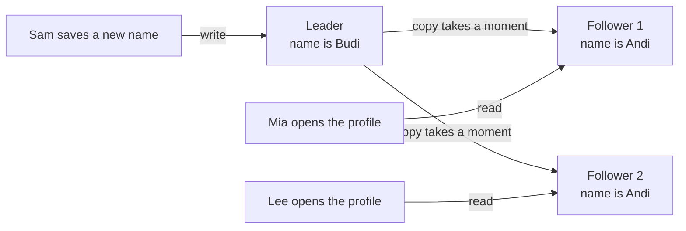
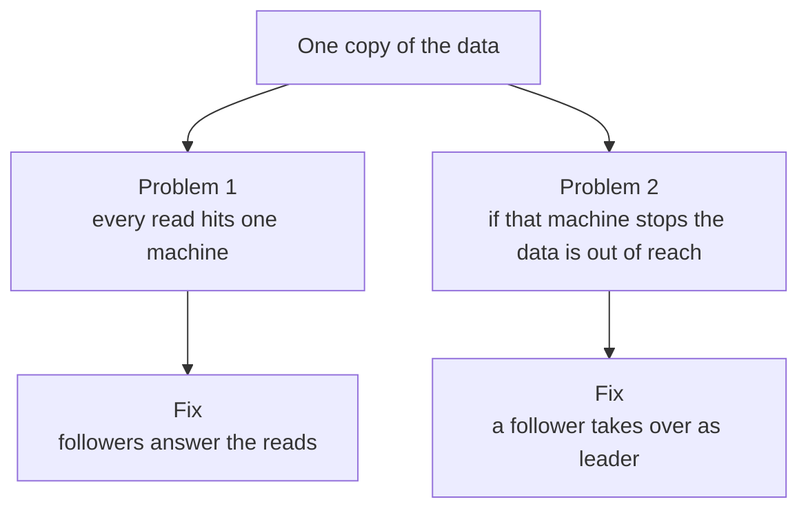
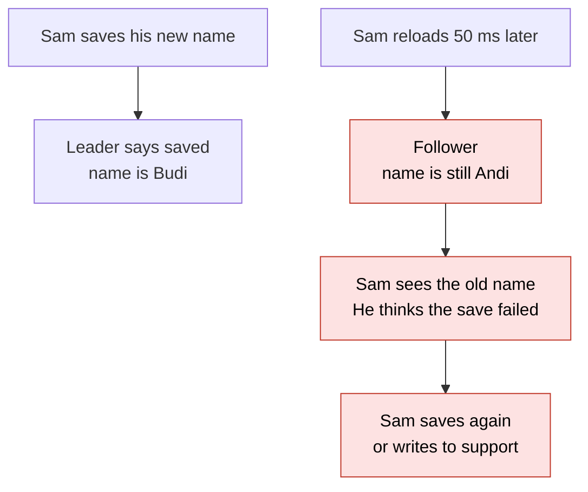
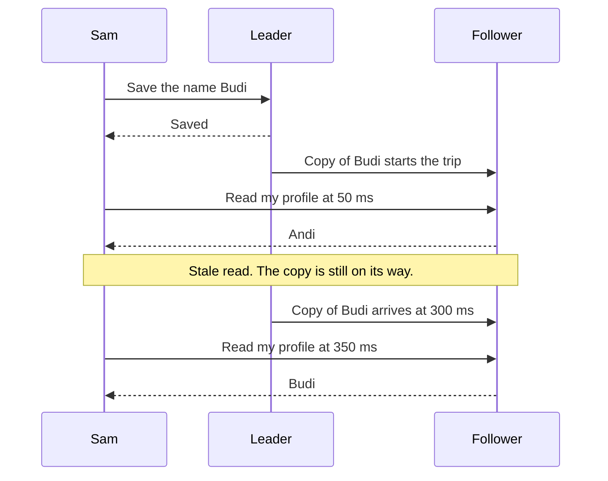
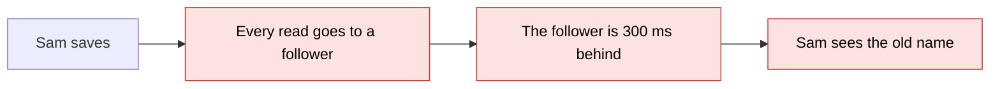
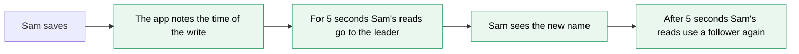
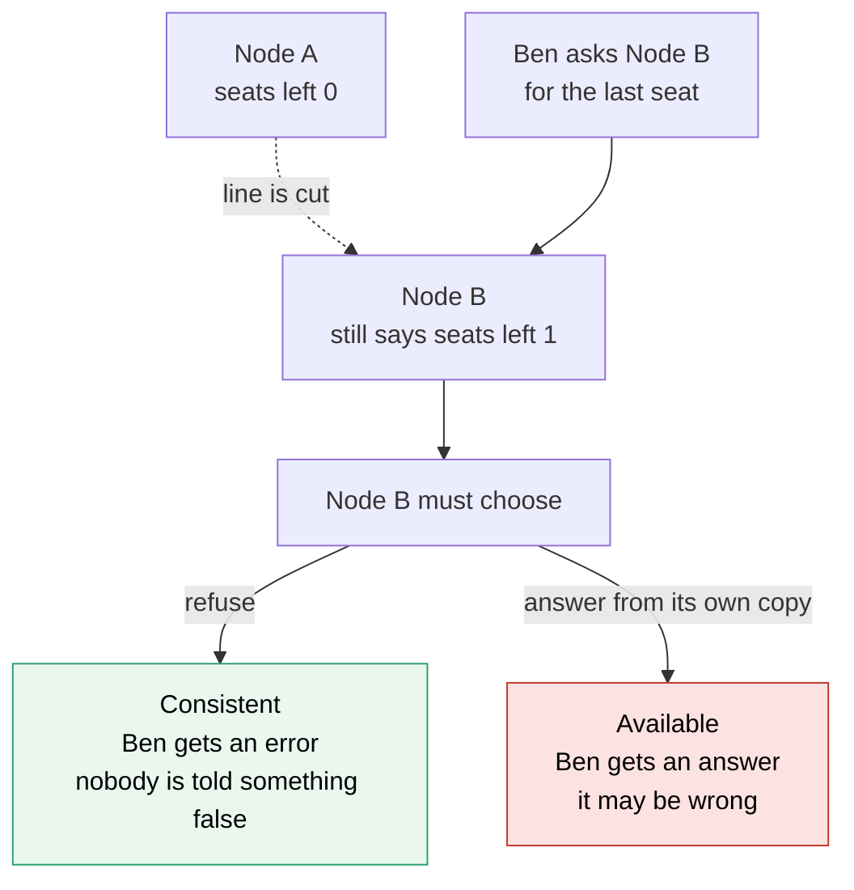
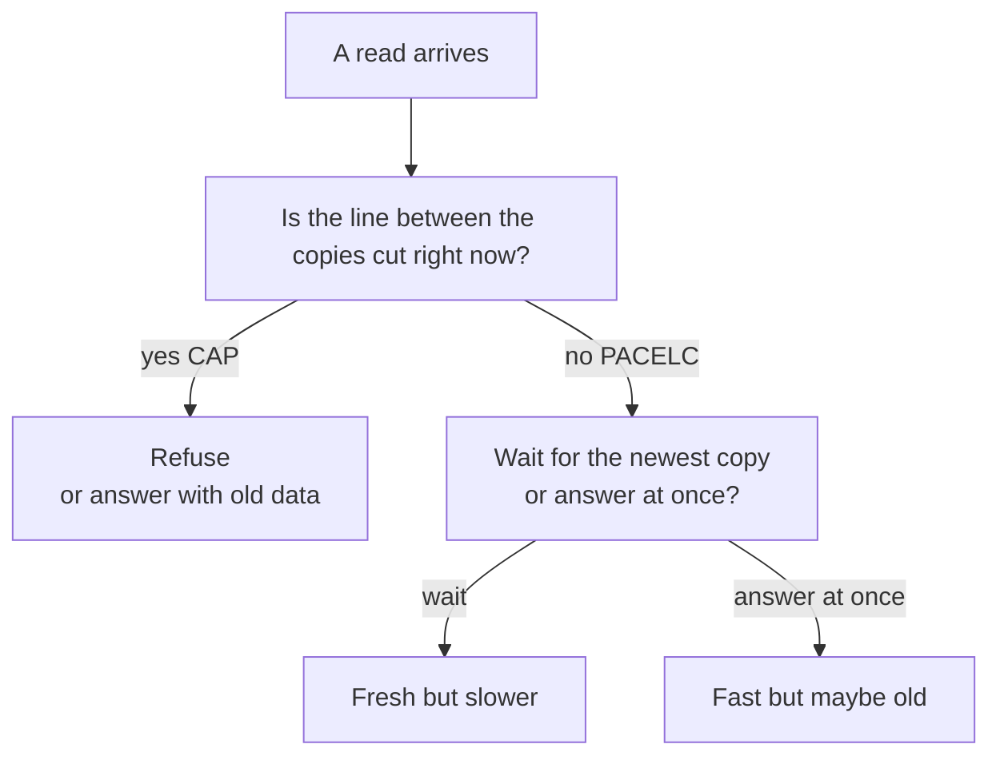
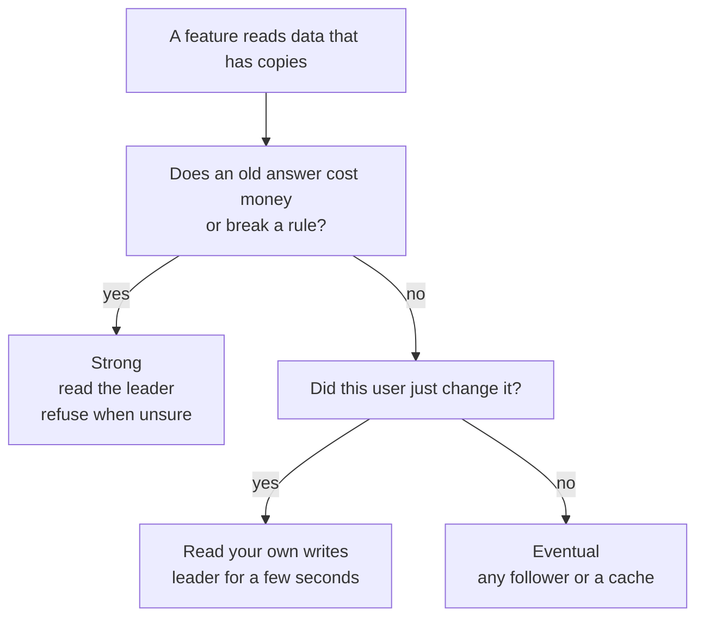

# 07. Consistency and CAP

> **Subject:** System Design · **Lesson:** 07 · **Made:** 2026-10-16 · **Status:** ready
> **You will be able to:** say why data has copies, why a copy can give an old answer, how to fix the part users feel, and what CAP really says (and three things it does not say).
> **Before this:** [Message queues](06-message-queues.md) · **Next:** [Design a URL shortener](08-design-a-url-shortener.md)

## 1. The idea in one sentence

Data often lives in more than one place, and a copy can be a little behind. So you choose, feature by feature, whether to wait for the newest value or to answer at once with a value that may be old.

Lesson 06 showed work that happens later. This lesson is about data that arrives later.

New words (four):

- **Leader and follower:** the leader takes every write. A follower holds a copy of the data and answers reads (interview words: primary and replica).
- **Stale read:** a read that returns a value older than the latest write.
- **Strong and eventual consistency:** with strong, a finished write is seen by every reader at once. With eventual, readers may see old data for a short time, and then every copy agrees. "Consistency" only asks one thing: do the copies agree?
- **Network split:** the line between two machines breaks. Both machines still run, but they cannot talk (interview word: partition). In the pictures, one machine in a group is called a **node**.

Two names come later, after the plain idea: **CAP** and **PACELC**.

## 2. The pictures

### 2a. The big picture

Notice that every write goes to one place. The copy to each follower is the slow arrow.



Why copies exist at all. Notice that each problem has its own fix, and both fixes are copies.



### 2b. The problem, drawn

Notice that nothing crashed. The new name is just not at the follower yet.



### 2c. How it works over time

Notice the two reads by Sam. The code is the same. Only the time is different.



### 2d. What is in each box right now

Three snapshots of the same boxes. Notice that the follower is wrong only in the middle one.

```mermaid
graph LR
    subgraph T0["At 0 ms: Sam just saved"]
        A0["Leader holds Budi"]
        B0["Follower holds Andi"]
        C0["Copy of Budi is on the way"]
    end
    subgraph T1["At 50 ms: Sam reads"]
        A1["Leader holds Budi"]
        B1["Follower holds Andi<br/>this read is stale"]
        C1["Copy of Budi is on the way"]
    end
    subgraph T2["At 350 ms: Sam reads again"]
        A2["Leader holds Budi"]
        B2["Follower holds Budi"]
        C2["Nothing on the way"]
    end
    T0 --> T1
    T1 --> T2
    classDef bad fill:#fde2e2,stroke:#c0392b,color:#000
    classDef good fill:#e9f7ef,stroke:#2f9e6b,color:#000
    class B1 bad
    class B2 good
```



### 2e. Right against wrong

The wrong way sends every read to a follower. The right way (interview words: read your own writes) sends the writer's reads to the leader for a few seconds. Notice what Sam sees at the end.





### 2f. The network split, drawn (this is CAP)

The line between the two nodes is cut. Ann already bought the last seat on Node A. Ben now asks Node B. Notice that Node B has only two choices, and each one costs something. **Consistent** means: refuse rather than be wrong. **Available** means: answer, even if the answer may be wrong.



### 2g. The everyday choice (this is PACELC)

CAP only speaks when the line is cut. Notice that the "no" side is the one you live in every day.



### 2h. Which promise does this feature need?

This is the choice you say out loud. Notice that most features end in the right-hand boxes.



## 3. Real life analogy

A company has a head office and two branch shops. Only the head office changes the price list.

- **Leader and followers:** the head office is the leader. Each branch keeps a copy of the list.
- **The copy trip:** after a change, a courier carries the new list to each branch. It takes an hour.
- **Stale read:** a customer phones a branch in that hour and hears the old price.
- **Strong:** the branch phones the head office before every answer. Always right, but slower.
- **Eventual:** the branch answers from its own list. Fast, but sometimes old.
- **Read your own writes:** the manager who just changed a price phones the head office for the rest of the day.
- **Network split:** the phone line to the head office is cut. The branch can say "I cannot tell you today" (consistent), or it can quote its own list (available).

Where the analogy stops: a courier takes an hour, but servers copy in milliseconds. So you rarely see a stale read on a quiet day. Also, when the line is cut, real branches may take orders on their own. Later they must merge two lists, and sometimes one change is thrown away.

## 4. The smallest code that shows it

A leader and a follower. One **tick** is one step of time. A copy needs 3 ticks to travel. Sam saves at tick 0. For 4 ticks after his own write, Sam's reads go to the leader. The code prints one line per tick.

```js
const leader = { name: "Andi" }, follower = { name: "Andi" }, onTheWay = [];
const DELAY = 3, SAFE = 4;                   // a copy needs 3 ticks. Sam's reads use the leader for 4 ticks after his write
const write = (t, v) => { leader.name = v; onTheWay.push({ lands: t + DELAY, v }); };
const read = (t, box) => {
  while (onTheWay.length && onTheWay[0].lands <= t) follower.name = onTheWay.shift().v;   // copies that arrived are applied
  return box.name;
};
write(0, "Budi");                            // Sam saves his new name at tick 0
for (let t = 0; t <= 5; t++) {
  const sam = read(t, t < SAFE ? leader : follower);   // read your own writes
  console.log("tick " + t + " | leader " + read(t, leader) + " | follower " + read(t, follower) + " | Sam " + sam);
}
```

**Output:**

```
tick 0 | leader Budi | follower Andi | Sam Budi
tick 1 | leader Budi | follower Andi | Sam Budi
tick 2 | leader Budi | follower Andi | Sam Budi
tick 3 | leader Budi | follower Budi | Sam Budi
tick 4 | leader Budi | follower Budi | Sam Budi
tick 5 | leader Budi | follower Budi | Sam Budi
```

Checked on 2026-10-16 with Node 22.

The follower column says `Andi` on ticks 0, 1 and 2. Those are the stale reads. The Sam column never says `Andi`, because his reads go to the leader until tick 4. By then the copy has landed.

## 5. What really happens, step by step

### Part 1: the code above

The "machine" here is two boxes and a copy on the way. Read one row at a time. The `read` function does one extra job: before it answers, it applies every copy that is due.

| Tick | What the code does | Leader | Copy on the way | Follower | Sam reads from | Follower column prints |
|---|---|---|---|---|---|---|
| 0 | `write(0, "Budi")` changes the leader. A copy is put on the way, due at tick 3 | Budi | Budi, due at 3 | Andi | leader, because 0 is less than 4 | Andi (stale) |
| 1 | No copy is due yet | Budi | Budi, due at 3 | Andi | leader | Andi (stale) |
| 2 | No copy is due yet | Budi | Budi, due at 3 | Andi | leader | Andi (stale) |
| 3 | The copy is due. The first `read` of this tick applies it to the follower | Budi | none | Budi | leader | Budi |
| 4 | Sam's 4 ticks are over. His read goes to the follower, which holds Budi | Budi | none | Budi | follower | Budi |
| 5 | Nothing changes | Budi | none | Budi | follower | Budi |

What to see: the follower is wrong for exactly 3 ticks, the copy delay. Nothing was lost. Time fixed it.

### Part 2: a network split, with two different choices

Two nodes, A (the leader) and B. Both hold "1 seat left". The line between them is cut. The same events happen in both tables. Only the rule for Node B is different.

**Choice 1: consistent (Node B refuses when it cannot reach the leader)**

| Step | What happens | Node A | Node B | What the user gets |
|---|---|---|---|---|
| 1 | The line works. Both hold 1 seat | 1 | 1 | nothing yet |
| 2 | The line is cut. Both nodes still run | 1 | 1 | nothing yet |
| 3 | Ann asks A. A sells the last seat. It cannot copy the sale | 0 | 1 | Ann: bought it |
| 4 | Ben asks B. B cannot reach the leader, so it refuses | 0 | 1 | **Ben: an error** |
| 5 | The line works. B receives Ann's sale | 0 | 0 | nothing yet |

**Choice 2: available (every node answers from its own copy)**

| Step | What happens | Node A | Node B | What the user gets |
|---|---|---|---|---|
| 1 | The line works. Both hold 1 seat | 1 | 1 | nothing yet |
| 2 | The line is cut. Both nodes still run | 1 | 1 | nothing yet |
| 3 | Ann asks A. A sells the last seat. It cannot copy the sale | 0 | 1 | Ann: bought it |
| 4 | Ben asks B. B answers from its own copy and sells the seat | 0 | 0 | **Ben: bought it** |
| 5 | The line works. The nodes compare and find two sales for 1 seat | -1 | -1 | one buyer must get a refund |

What to see: in choice 1 nobody is told something false, but Ben gets an error. In choice 2 nobody gets an error, but the system sold a seat twice. Neither choice is free.

**Step through it yourself:** [open the stepper](visuals/07-consistency-and-cap.html). It has three stories: a stale read, read your own writes, and a network split with both choices side by side. Guess first, then press the buttons. It shows the leader, the follower, and the copy that is still on its way.

## 6. Why it exists and what it costs

### Why copies exist

- **Problem without copies:** every read hits one machine. If that machine stops, the data is out of reach (interview words: single point of failure, from lesson 02).
- **How copies solve it:** copies do two jobs. Followers answer reads, so the leader has less to do. And if the leader stops, a follower can take over (picture 2a).
- **Cost:** a copy needs time to arrive. So a follower can return a stale read, even when nothing is broken.

### Three promises you can make

| Promise | In plain words | How you build it | What it costs |
|---|---|---|---|
| **Strong** | Every reader sees a finished write at once | Read the leader. Or wait until enough copies confirm | Slower, and sometimes an error |
| **Read your own writes** | You see your own change at once. Others may see it a moment later | For a few seconds after you write, send your reads to the leader | The leader does a bit more work. The app must remember when you wrote |
| **Eventual** | Every copy agrees after a short delay | Nothing special. Copies catch up | Users may see old data for a moment |

Read your own writes is the one users feel. Nobody minds that a stranger sees the old name for a moment. Everybody minds when their own change disappears.

### Where the stale read shows up in tools you know

| Tool | The copy | When it is old | The usual fix |
|---|---|---|---|
| PostgreSQL with a read replica | The replica | It gets changes a moment after the primary. Usually milliseconds, longer under heavy load | Read the primary for a few seconds after the user writes |
| Redis in front of PostgreSQL | The cached value. Redis is a fast store that keeps data in memory, and a cache is a fast copy kept close to the app | Until someone deletes the key, or the timer on it ends | Delete the key after a write. Keep a short timer. See lesson 04 |
| DynamoDB or Cassandra style stores (idea only) | Copies on several nodes | It depends on the setting. You can choose per request | Ask for a strong read when the feature needs it. See lesson 19 |

A queue (lesson 06) is the same idea inside your own app. The user sees "order received" now, and the points arrive a little later. That is eventual consistency, on purpose.

### What CAP says

The three letters, in plain words:

- **C, consistency:** every read sees the latest write (the strong kind).
- **A, availability:** every machine that is running answers every request with a real answer, not an error.
- **P, partition tolerance:** the system keeps working when the network splits.

The story is picture 2f:

1. A network split happens. Two groups of machines cannot talk.
2. A request arrives at a machine that cannot reach the leader.
3. That machine must choose. **Refuse** (consistent), or **answer with maybe old data** (available).

The letter P is not a choice. Networks do break, so a system with many machines must live with splits. So CAP really says: **during a split, choose C or A.**

### What CAP does not say

| People say | The truth |
|---|---|
| "Pick any 2 of 3, always." | You cannot drop P. And the choice only exists during a split |
| "I must give up one of them all the time." | With no split, you can have both |
| "My database is CP, or it is AP, for good." | Settings and each request can change it. Choose per feature |
| "CAP explains why my page is slow today." | A slow page on a normal day is a different tradeoff. It is PACELC |

### The everyday cost (PACELC)

Most days there is no split, and you still pay. A strong answer must wait for other copies. A copy in another city adds tens of milliseconds or more, because the message goes there and back (from the older guide).

PACELC says it in one line. **If** there is a split (P), choose availability or consistency (A or C). **Else** (E), choose waiting time or consistency (L or C). Waiting time is called latency.

- **Wait for the newest copy:** fresh, but slower.
- **Answer at once from a nearby copy:** fast, but maybe old.

Some stores let you set how many copies must answer before they say "done". Lesson 19 (replication and quorums) teaches how to choose that number.

### Choose per feature

| Feature | Promise | Why |
|---|---|---|
| A points balance before a redeem | Strong | A wrong balance means a wrong spend |
| A profile name the user just saved | Read your own writes | The user must see their own change |
| An order list, right after placing an order | Read your own writes | The new order must be there |
| A product list or search results | Eventual | A few seconds old does no harm |
| A page view counter | Eventual | Nobody checks the last digit |

## 7. Common mistakes

**Wrong:**

```
"CAP says I can only keep two of: consistency, availability, partition tolerance."
```

**Right:**

```
"Splits happen. During a split I choose: refuse, or answer with maybe old data.
 With no split I can have both, and my everyday choice is speed against freshness."
```

**Why:** you cannot drop P. The choice only exists during a split.

**Wrong:**

```
"I added a read replica, so all reads go to the replica."
```

**Right:**

```
"Reads go to the replica, except the reads of a user who wrote in the last few seconds.
 Those go to the primary."
```

**Why:** without the exception, users see their own change disappear. Practice B fixes this in code.

**Wrong:**

```
"Strong consistency is safest, so I use it everywhere."
```

**Right:**

```
"Money and the last item need strong reads. Likes and feeds can be eventual.
 I choose per feature."
```

**Why:** strong costs waiting and sometimes an error. A like counter gains nothing from it.

**Wrong:**

```
"The data is in Redis, so it is always the newest."
```

**Right:**

```
"A cache is a copy. It is old until the key is deleted or its timer ends.
 I decide per screen how old is fine."
```

**Why:** the cache and the database disagree for a moment after every write (lesson 04, picture 2d).

**Wrong:**

```
"Postgres is CA. MongoDB is CP. Cassandra is AP. Done."
```

**Right:**

```
"One Postgres on one machine has no split, so CAP does not apply to it.
 Add a replica and the question starts. Many stores let me choose for each request."
```

**Why:** one label per database hides the real answer. Say what each feature needs.

**If you freeze:**

1. Say "A copy can be old for a moment. That is a stale read."
2. Say "During a network split I choose: refuse, or answer with maybe old data. With no split I choose speed against freshness."
3. Say "I choose per feature. Money is strong. Likes are eventual. A user's own change must be visible to that user."

## 8. Watch and play

Links came from web search or from older notes in this folder, 2026-10-16. The build machine could not open pages, so open each one once. If one is broken, tell me and I will replace it.

- **Video:** [System Design: Consistency And Availability Patterns](https://www.youtube.com/watch?v=J1crAAjuQyA) - the title came from a search result. I could not see the channel or the length. A search said it is about six years old. Watch for the words weak, eventual and strong, and compare them with the table in section 6.
- **Play with it:** [the stepper in this folder](visuals/07-consistency-and-cap.html) - guess first, then press the buttons. Try all three tabs.
- **Play with it:** [CRDT Chaos Visualizer, project page](https://awesome.ecosyste.ms/projects/github.com%2Fbatmac%2Fcrdt) - a search summary says it is a counter on 3 nodes with controls for delay and for network splits, and a graph that shows the copies agreeing again. This is a catalog page about the project. Find the link to the tool itself.
- **Read:** [KodeKloud: CAP Theorem Without the Math](https://notes.kodekloud.com/docs/System-Design-For-Beginners/Failure-Protection-and-Operations/CAP-Theorem-Without-the-Math/page) - the page name matches this lesson. I could not read it, so check that it fits. Compare it with picture 2f.
- **Read:** [Codemia: Read After Write, when your own update vanishes on refresh](https://codemia.io/archive/read-after-write-consistency) - a search summary says it covers the fix of reading the leader for the user who wrote. Compare it with picture 2e.
- **Read:** [dev.to: Explaining the PACELC theorem to new hires](https://dev.to/fahimulhaq/explaining-the-pacelc-theorem-to-new-hires-2de2) - the everyday tradeoff in plain words. Compare it with picture 2g.
- **Read:** [Distributed systems and reliability patterns, Part 3](distributed-systems-and-reliability-patterns.md) - the deeper guide in this folder. Find the table of four promises, and the table of wrong answers about CAP.

<details><summary>Go deeper (optional)</summary>

**Going back in time (monotonic reads).** Two reads can land on two followers that are behind by different amounts. The second read then shows older data than the first, and a comment appears and then disappears. The fix is to keep one user on one follower, for example by picking the follower from a number made from the user id (a hash). The cost: if one user does very many reads, their follower cannot share that load, and if that follower stops, the user must move to another one. (From the [older guide](distributed-systems-and-reliability-patterns.md), Part 3. A search summary of a [monotonic reads post](https://arpit.substack.com/p/monotonic-reads-preventing-wormholes) says the same. I did not open it.)

**How big is the delay in PostgreSQL?** The [database scaling guide](../database/database-scaling-and-correctness.md) says replicas are usually milliseconds behind, and seconds or more under heavy write load or a long query on the replica. A search summary (2026-10-16) says `pg_stat_replication` has `write_lag`, `flush_lag` and `replay_lag` columns, and that for an async standby `replay_lag` approximates the delay before recent changes can be read on it. I did not open the current docs. The same older guide says `synchronous_commit = remote_apply` makes each commit wait for the replica. That is the strong choice, and the price is the wait on every write. The [PostgreSQL standby docs](https://www.postgresql.org/docs/current/warm-standby.html) are in the older notes.

**Redis.** A search summary of the [Redis page for the `WAIT` command](https://redis.io/docs/latest/commands/wait/) (2026-10-16, not opened) says `WAIT` makes it less likely to lose a write, but does not make Redis a strongly consistent store, because a failover can still lose a write. Use Redis for what it is good at, a fast copy and a shared box (lesson 02).

**DynamoDB, as an idea.** A search summary of the AWS page [DynamoDB read consistency](https://docs.aws.amazon.com/amazondynamodb/latest/developerguide/HowItWorks.ReadConsistency.html) (2026-10-16, not opened) says eventually consistent reads are the default. A read can set `ConsistentRead` to true to get the latest write. This is a choice per request. It does not work on global secondary indexes or streams, and a strong read costs twice as much as an eventual read.

**Cassandra, as an idea.** A search summary of the [DataStax docs on consistency levels](https://docs.datastax.com/en/cassandra/3.0/cassandra/dml/dmlConfigConsistency.html) (2026-10-16, not opened, check your version) says the level is set for each read or write, the default is ONE, QUORUM means a majority of the copies, and ALL is the strongest and the least available. Lesson 19 shows why a majority on reads and writes gives fresh reads.

**After the split: merging.** When both sides took writes, they must merge. "Last write wins" is simple, but it can silently drop the newer write (older guide, Part 6). Counters can use a data type that merges by itself (interview word: CRDT, from the older guide). For a shopping cart, a search result of the [MIT lecture notes on Dynamo](https://people.csail.mit.edu/alinush/6.824-spring-2015/l18-dynamo.html) says that merging two carts by taking all items can bring back an item the user deleted. I did not open the page.

**Why real clusters use three or five nodes.** With two nodes and a cut line, neither side can tell if it is the one that lost contact. A group of three or five can say "the side with more than half is right". That is lesson 24 (consensus and Raft). The older guide says: when most nodes are gone, a cluster stops taking writes, and that is choosing C in CAP.

**Words people mix up.**

- **The C in ACID.** ACID is the list of promises of a database transaction (a group of changes that all succeed or all fail). Its C means your rules still hold, for example "a balance is never below 0". CAP's C means every read sees the latest write. They are different things.
- **Linearizable.** The interview word for the strong kind in CAP: the system behaves as if there is one copy.
- **A in CAP against uptime.** CAP's A is stricter than "99.9 percent up". It says every running machine must answer every request.

**PACELC labels.** A search summary (2026-10-16) says the idea comes from Daniel Abadi of Yale, in a 2010 blog post and a 2012 paper (sources differ on dates). It also says the default settings of DynamoDB, Cassandra, Riak and Cosmos DB are often called PA/EL, and Spanner is called PC/EC. Do not memorize labels. Settings change them. Say what each feature needs.

**More tools to play with.** A search found two more simulators, not opened: [CloudScope](https://awesome.ecosyste.ms/projects/github.com%2Fbbengfort%2Fcloudscope), a research tool for replicas and stale reads, and a post on [replication lag](https://algomaster.io/learn/system-design/replication-lag).

</details>

## 9. Practice

**A. Predict the output** (write your answer before opening)

The copy now needs 2 ticks. Sam saves "Budi" at tick 0, then saves "Citra" at tick 1. The code reads the follower on ticks 0 to 4. What does it print?

```js
const leader = { name: "Andi" }, follower = { name: "Andi" }, onTheWay = [];
const DELAY = 2;                             // a copy needs 2 ticks
const write = (t, v) => { leader.name = v; onTheWay.push({ lands: t + DELAY, v }); };
const read = (t, box) => {
  while (onTheWay.length && onTheWay[0].lands <= t) follower.name = onTheWay.shift().v;
  return box.name;
};
write(0, "Budi");
write(1, "Citra");
const seen = [];
for (let t = 0; t <= 4; t++) seen.push(read(t, follower));
console.log(seen.join(" "));
console.log(leader.name);
```

Then answer: at which tick does a read from the follower first show the newest name? And what does Sam see at tick 2, if he reads the follower?

<details><summary>Answer</summary>

```
Andi Andi Budi Citra Citra
Citra
```

Copy 1 (Budi) is due at tick 2. Copy 2 (Citra) is due at tick 3. So the follower shows Andi on ticks 0 and 1, then Budi on tick 2, then Citra on ticks 3 and 4. The first tick with the newest name is **tick 3**. At tick 2, Sam would see `Budi`. That is his own earlier save, not his newest one. A follower can be behind by more than one change. (Checked on 2026-10-16 with Node 22.)

</details>

**B. Fix the bug**

A shop uses one primary database and one read replica. Users say: "I change my shop name, the page reloads, and the old name is back for a few seconds." Here is the code. Find the cause and fix it.

```js
// sketch, not run here
app.post("/shop-name", async (req, res) => {
  await primary.shop.update({ where: { id: req.shopId }, data: { name: req.body.name } });
  res.redirect("/shop");
});
app.get("/shop", async (req, res) => {
  const shop = await replica.shop.findUnique({ where: { id: req.shopId } });   // always the replica
  res.render("shop", { shop });
});
```

<details><summary>Answer</summary>

The write goes to the primary. The page that loads right after the redirect reads from the replica. The replica has not received the change yet, so it returns the old name. That is a stale read.

Fix 1, read your own writes. Remember when this user wrote. For 5 seconds after that, read the primary:

```js
// sketch, not run here
app.post("/shop-name", async (req, res) => {
  await primary.shop.update({ where: { id: req.shopId }, data: { name: req.body.name } });
  res.cookie("wroteAt", Date.now());                                   // a small note in the browser
  res.redirect("/shop");
});
app.get("/shop", async (req, res) => {
  const justWrote = Date.now() - Number(req.cookies.wroteAt ?? 0) < 5000;   // inside the 5 second window?
  const db = justWrote ? primary : replica;
  res.render("shop", { shop: await db.shop.findUnique({ where: { id: req.shopId } }) });
});
```

The note lives in the browser, so the servers keep nothing (lesson 02). The window must be longer than the usual copy delay.

Fix 2: use the row that the write already returned. `update` gives the new row, so render it and skip the read. This works when the next page needs only that row.

</details>

**C. Write it yourself**

For each feature, say "strong" or "eventual", and give one reason. Write your answer before you open.

1. A bank balance, shown before the user sends money.
2. The like counter under a photo.
3. A shopping cart.
4. The stock count of the last item in a shop, at the moment of paying.

<details><summary>One possible answer</summary>

1. **Strong.** An old balance lets the user spend money twice. Read the leader, and refuse if you cannot confirm.
2. **Eventual.** Being off by a few for a few seconds hurts nobody. It is cheaper, and a split does not need to block a like. The merge is easy: add both sides.
3. **Eventual, with read your own writes.** The owner must see the item they just added, so read the leader for a few seconds after a change. Other readers do not matter. Many stores prefer to always accept the add and to merge two carts later.
4. **Strong, at the moment of paying.** Two buyers must not both get the last item. The check and the change must happen on the leader, inside one database transaction (a group of changes that all succeed or all fail). The "only 1 left" label on the product page can be eventual. It is a hint. The real check happens when the user pays. (This is the last seat in the stepper.)

</details>

## 10. Interview question

**Q:** "What does the CAP theorem say? Then: a user saves their profile, reloads the page, and sees the old data. What is going on, and how do you fix it?"

<details><summary>A strong answer, in four parts</summary>

1. **Problem:** data has copies, for reading and for survival. A copy can be behind the leader. A read from it is a stale read, even when nothing has crashed.
2. **How it works:** every write goes to the leader. The leader sends the change to the followers, which takes a moment. If the user reloads and the read goes to a follower, they see the old value. The fix is read your own writes: for a few seconds after a user writes, send that user's reads to the leader. CAP is the big version of the same problem. During a network split, a machine that cannot reach the leader must choose. It can refuse (consistent) or answer with maybe old data (available). It is not "pick 2 of 3". The choice only exists during a split. With no split, the everyday choice is waiting time against freshness (PACELC).
3. **Tradeoff:** strong answers cost waiting and sometimes an error. Eventual answers cost old data for a moment. So I choose per feature: money and the last item are strong. Likes and feeds are eventual. A user's own change must be visible to that user. Read your own writes costs a little extra work on the leader, and the app must remember when each user wrote.
4. **My example:**
   - **Fact:** my DBO case study tells the points redeem flow in two steps. We decrease the store's points in our database. Then we call the TADA API to redeem the item and decrease points on their side. TADA reports the result back to us as webhook events (messages TADA sends to our server). So two systems hold a points number, and they agree only when the result arrives. My reading: that is eventual consistency between two systems.
   - **Fact:** the case study tells a real incident. TADA sent the same event more than once, almost at the same time. Two handlers (the code that handles one event) both checked "already processed?" before either had written, and both passed. Stores got double points. We fixed it with a row lock (`SELECT ... FOR UPDATE`, a lock on one row so that the second handler waits) inside a transaction. The second handler then reads the result of the first. This was not replica lag. It is a close cousin: a check that did not see a write that was in progress. The fix paid with waiting to get the newest value. The case study calls point redemption a "money-like flow", which is why it fits the strong side.
   - **Idea, not a fact:** the case study suggests read replicas for heavy reads, such as CMS reports and order history, as a later step. It does not say they exist. If DBO added one, a store owner who just placed an order must still see it in the order history. I would send that user's reads to the primary for a few seconds. Reports can read the replica, because a few seconds old is fine.

</details>

## 11. Explain it back

Close this file. Explain consistency and CAP out loud like to a new junior, in 4 parts (problem, how, tradeoff, my example). Use Sam and his old name, then the last seat during a network split. Then write your best version below and run `/explain-check consistency and cap` or ask the `explain-coach` agent to review it.

### My explanation

<write here>

### Coach feedback

<the explain-coach agent writes here>

## 12. Review questions (day 1, 3, 7, 21)

1. Nothing crashed, but a user saves a change and sees the old value. Why does this happen? Name the fix, and say why it lasts a few seconds.
2. What does CAP say? Name two things it does not say.
3. There is no network split. What choice do you still make on every read, and what does each side cost?
4. Draw the picture from section 2c from memory.

<details><summary>Answers</summary>

1. The write went to the leader. The read went to a follower, which did not have the copy yet, so it returned an old value (a stale read). The fix is read your own writes: for a few seconds after a user writes, send that user's reads to the leader. It lasts a few seconds because that is longer than the usual copy delay. After that, the follower has the change.
2. During a network split, a machine that cannot reach the leader must choose: refuse (consistent) or answer with maybe old data (available). It does not say "pick any 2 of 3 always": you cannot drop P, and the choice only exists during a split. It also does not say you must give up one of them with no split, and it does not say a database is CP or AP for good.
3. You choose between waiting for the newest copy (fresh but slower) and answering at once from a nearby copy (fast but maybe old). This is PACELC. A copy in another city adds tens of milliseconds or more to wait for it.
4. Sam, Leader and Follower, left to right. Sam saves Budi on the leader, and gets "Saved". The leader starts a copy trip. At 50 ms Sam reads the follower and gets Andi (stale). The copy arrives at 300 ms. At 350 ms Sam reads the follower and gets Budi.

</details>

## Connected lessons

- [Message queues](06-message-queues.md) - the lesson before. A queue makes work happen later, and so the data it changes is eventually consistent too.
- [Design a URL shortener](08-design-a-url-shortener.md) - the next lesson. Reads are far more common than writes, so followers and caches serve most reads, and a slightly old answer is fine.
- [Scaling up vs out](02-scaling-up-vs-out.md) - a database scales up first, then gets copies for reading. Those copies bring the stale read.
- [Caching](04-caching.md) - a cache is a copy, so it is only eventually the same as the database.
- [Latency numbers and estimation](16-latency-numbers-and-estimation.md) - how much waiting for another copy costs.
- [Replication and quorums](19-replication-and-quorums.md) - goes deeper on how many copies must answer, and the rule that tells you when a read is sure to see the latest write.
- [Consensus and Raft](24-consensus-and-raft.md) - how machines agree on one leader, and why a majority matters during a split.
- [Design an online shop checkout](12-design-an-online-shop-checkout.md) - the last item and the payment are the strong side of this lesson.
- [Distributed systems and reliability patterns](distributed-systems-and-reliability-patterns.md) and its [visual cheatsheet](distributed-systems-and-reliability-patterns-cheatsheet.html) - Part 3 is the deeper guide on consistency, CAP and PACELC.
- [Data storage choices for system design](data-storage-choices-for-system-design.md) - Part 6 covers leader and followers, no-leader stores, and what lag does to users.
- [Scaling a database and keeping data correct](../database/database-scaling-and-correctness.md) - step 4, read replicas, for PostgreSQL.
- [System design interview questions](senior-system-design-interview-questions.md) - questions 37 and 38 ask this lesson in two ways.
