# 08. Design a URL shortener

> **Subject:** System Design · **Lesson:** 08 · **Made:** 2026-10-17 · **Remade in short cards:** 2026-10-30 · **Status:** ready
>
> **You will be able to:** draw how a short link is made and how a click is answered, compare three ways to make the code (hash, counter, random), explain why two links can get the same code and how the table stops it, and say what 301 and 302 do to caching and click counts.
>
> **Before this:** [Consistency and CAP](07-consistency-and-cap.md) · **Next:** [Design a rate limiter](09-design-a-rate-limiter.md)
>
> **How to read it:** one card is one idea. Look at the picture, guess, then press the orange bar to check. The blue bars (📖 More detail) hold the longer explanation. Skip them on the first read, and open them when you want more. About 15 minutes for the cards.

## 1. The idea: a table from a short code to a long link

A URL shortener is a table that maps a short code to a long link. Making a link adds one row. A click finds the row and tells the browser to go to the long link. Like numbered post office boxes: each box holds a note, "forward this mail to this long address". The table is easy. The two hard parts are a code that never repeats, and about 100 clicks for every new link.

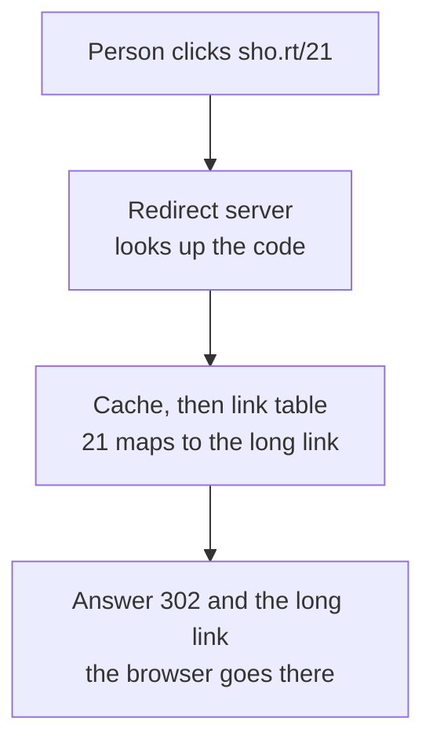

<details class="guess"><summary>🤔 Guess: 10 million new links a day, and each link gets about 100 clicks. How many clicks a second at the busiest time (about 3 times the average)? Press to check.</summary>

**About 30,000 a second.** 10 million divided by 100,000 seconds (rounded) is 100 new links a second. Times 100 clicks is 10,000. Times 3 for the busiest time is 30,000. The click rate is the driver of this design.

</details>

> **Remember:** a short code is a key in a table. A click is a read. Reads are about 100 times more than writes.

<details class="more"><summary>📖 More detail: new words, the big picture, the two problems, the post office, and the numbers</summary>

Lessons 02 to 07 gave you the parts: many servers, a cache, copies and queues. This lesson uses them in one small design. The table is easy. The two hard parts are a code that never repeats, and about 100 clicks for every new link.

New words (four):

- **Base62:** counting with 62 symbols (`0-9`, `a-z`, `A-Z`), so a big number becomes a short text. The number 1,000,000,000 becomes `15FTGg`.
- **Hash:** a function that turns any text into a scrambled number of fixed size. The same text always gives the same number.
- **Collision:** two different long links get the same short code.
- **Redirect (301 and 302):** the server does not send a page. It sends a number and a new address, in a header called `Location`. The browser goes there. 301 means "moved for good". 302 means "moved for now".

Three plain ideas, explained now so the pictures make sense:

- **The short code** is the few letters at the end of a short link, like `aB3dY7z` in `sho.rt/aB3dY7z`. Interview word: slug.
- **A unique rule** says that no two rows may have the same code. The table refuses the second one. Interview word: unique constraint.
- **Read-heavy** means far more reads than writes. A click is a read. A new link is a write. For a shortener it is about 100 reads for each write.

From lessons 04, 06 and 07:

- A cache is a fast copy kept near the app. A TTL is a timer on that copy.
- A leader takes the writes. A follower is a copy that answers reads. A stale read is an answer older than the latest write.
- A queue is a waiting line for jobs. A worker takes jobs from it and does them later.

Times in the pictures are example numbers, not measured.

**The big picture.** Notice that there are two paths. Making a link writes one row. A click reads one row, and the cache answers most clicks.

Notice that there are two paths. Making a link writes one row. A click reads one row, and the cache answers most clicks.

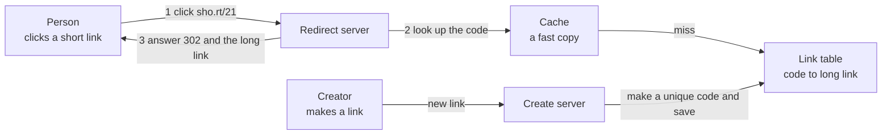

**The problem, drawn.** This is a collision with no unique rule. Notice that nothing crashed and nobody saw an error. Ann's readers just land on the wrong site.

This is a collision with no unique rule. Notice that nothing crashed and nobody saw an error. Ann's readers just land on the wrong site.

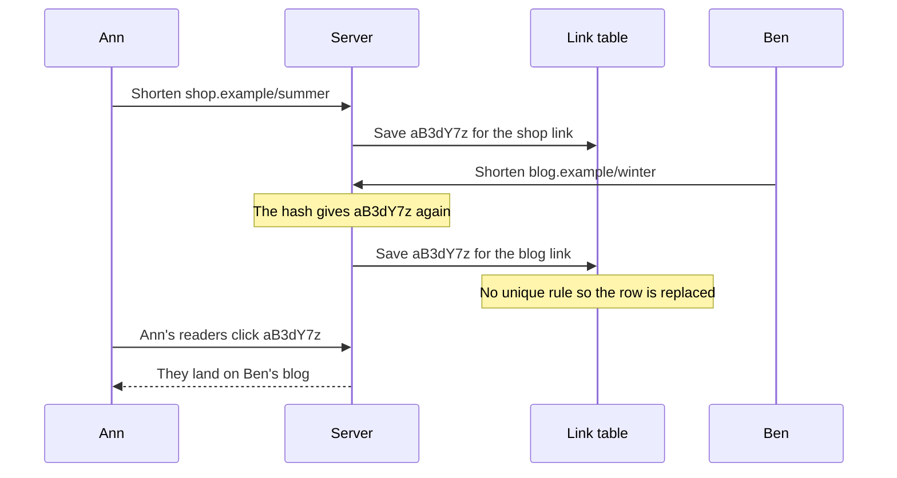

The second problem is size. Notice that every click would reach the table if there were no cache.

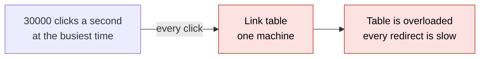

**The post office in full.**

A post office with numbered boxes. Each box has a number on the door. Inside the box is a note: "forward this mail to this long address."

- **Making a link:** the clerk takes the next free box number and writes the note.
- **A click:** a person says the box number. The clerk reads the note and points them to the address.
- **A collision:** the clerk gives box 21 to two people. The second note replaces the first. Now the first person's mail goes to the wrong house.
- **The unique rule:** the box register will not accept a second note for a box that has one.
- **301 and 302:** with a 301 the person writes the address on their hand and never asks again. With a 302 they ask the clerk every time.

Where the analogy stops: a post office has a few hundred boxes. A shortener has billions, and 30,000 people may ask in one second. So the clerk needs a fast copy of the notes nearby, which is the cache.

**Why it exists and what it costs.**

- **Problem without it:** a long link is hard to type and hard to print. And when you share it, you lose all control. You cannot count clicks, change the target or turn it off.
- **How it solves it:** a short code in a table gives you a small link that you own. Every click passes through your server, so you can count it, change it or stop it.
- **Cost or tradeoff:** every click now depends on your service. A dead redirect breaks someone else's page. So reading must be fast and always up. Making a link can wait for a moment if it must.

**The numbers.**

A rough estimate with round numbers (interview words: back of the envelope). These are assumptions. Say them out loud in the interview.

| Question | The math | Answer |
|---|---|---|
| New links per second | 10 million a day, divided by 100,000 (seconds in a day, rounded) | 100 per second |
| Clicks per second | 100 clicks for each new link, so 100 times 100 | 10,000 per second |
| Clicks at the busiest time | 10,000 times 3 | 30,000 per second |
| Storage in one year | 10 million times 365 times 500 bytes a row | about 1.8 TB |
| Links in 5 years | 10 million times 365 times 5 | 18 billion |
| Codes with 6 letters | 62 to the power of 6 | 56.8 billion, enough for 5 years |
| Codes with 7 letters | 62 to the power of 7 | 3.5 trillion, about 960 years at this rate |
| Cache size | the busy 20 percent of one day's links: 2 million times 500 bytes | about 1 GB |
| Reads that reach the table | 30,000 times 10 percent misses (a 90 percent hit rate is an assumption) | 3,000 per second |

The driver is the click rate, 30,000 a second. Storage is not the problem in year one. Take 7 letters, so you never run out.

</details>

## 2. Making the code: a counter plus base62

A counter hands out the next number. **Base62** counts with 62 symbols (`0-9`, `a-z`, `A-Z`), so a big number becomes short text: 125 becomes `21`. Then the code is saved with "insert only if the code is new". The table, not the server, has the last word on whether a code is free.

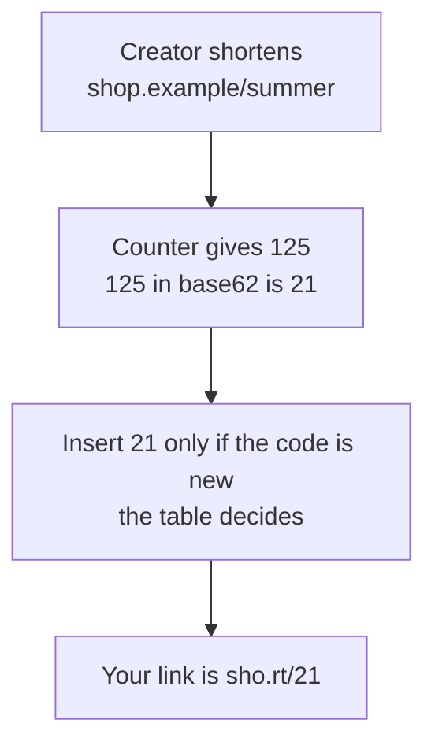

<details class="guess"><summary>🤔 Guess: 18 billion links in 5 years. Do 6 letters of base62 hold enough, and how many letters do you take? Press to check.</summary>

6 letters hold 56.8 billion, enough for 5 years. But take **7 letters** (3.5 trillion, about 960 years at this rate), so you never run out.

</details>

> **Remember:** the counter never gives a code twice. A collision can come only from a custom alias.

<details class="more"><summary>📖 More detail: making a link over time, the code, the real output, and step by step</summary>

**How it works over time: making a link.** This uses a counter. Notice that the table, not the server, has the last word on whether a code is free.

This uses a counter. Notice that the table, not the server, has the last word on whether a code is free.

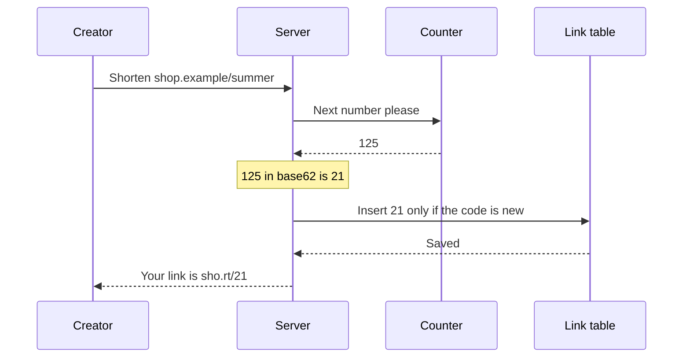

**What is in memory right now.** This is one moment. Notice that the counter is always ahead of the table by one, and the cache holds only links that were clicked.

This is one moment. Notice that the counter is always ahead of the table by one, and the cache holds only links that were clicked.

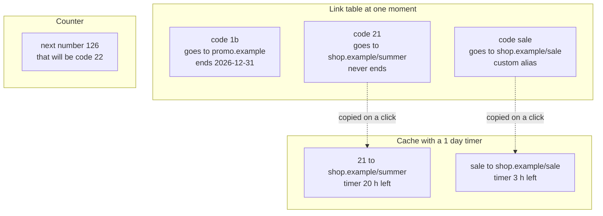

**The smallest code that shows it.**

A counter hands out numbers. Base62 turns each number into a code. The table check keeps a code from being used twice. Someone already chose the alias `b`, so the counter will meet a collision.

```js
const A = "0123456789abcdefghijklmnopqrstuvwxyzABCDEFGHIJKLMNOPQRSTUVWXYZ";
const toBase62 = (n) => { let s = ""; do { s = A[n % 62] + s; n = Math.floor(n / 62); } while (n > 0); return s; };
const table = new Map([["b", "https://old.example/page"]]);   // someone already chose the alias "b"
let counter = 10;                                             // the next number to hand out
function create(longUrl) {
  for (;;) {
    const code = toBase62(counter++);                          // 10 -> "a", 11 -> "b", 12 -> "c"
    if (!table.has(code)) { table.set(code, longUrl); return code; }   // the unique check
    console.log("taken:", code, "so try the next number");
  }
}
console.log(create("https://shop.example/1"), create("https://shop.example/2"), create("https://shop.example/3"));
console.log(toBase62(125), toBase62(62 ** 7 - 1));
```

**Output:**

```
taken: b so try the next number
a c d
21 ZZZZZZZ
```

Checked on 2026-10-17 with Node 24.

The first line prints before `a c d` because `console.log` runs all three `create` calls first. Look at `a c d`. The code `b` is missing. The counter gave out 11, the table said "taken", and the loop moved on to 12. The last line shows that 7 letters hold numbers up to 3.5 trillion.

Run again on 2026-10-30 with Node 26.12.1: the same output.

**What really happens, step by step.**

The machine here is the counter, the table and the check. One row is one thing the code does.

| Step | Code | What happens | Counter after | Table after | Printed |
|---|---|---|---|---|---|
| 1 | `create(".../1")` | The counter gives 10. The number 10 is the letter `a`. The table has no `a`, so it saves the row | 11 | b, a | nothing yet |
| 2 | `create(".../2")` | The counter gives 11. The number 11 is `b`. The table has `b`, so the code is thrown away | 12 | b, a | `taken: b so try the next number` |
| 3 | same call | The counter gives 12. That is `c`. The table has no `c`, so it saves the row | 13 | b, a, c | nothing yet |
| 4 | `create(".../3")` | The counter gives 13. That is `d`. The table has no `d`, so it saves the row | 14 | b, a, c, d | nothing yet |
| 5 | first `console.log` | It prints the three codes the calls returned | 14 | b, a, c, d | `a c d` |
| 6 | `toBase62(125)` | 125 is 2 times 62, plus 1. The digits are 2 and 1 | 14 | b, a, c, d | `21` (part of the last line) |
| 7 | `toBase62(62 ** 7 - 1)` | Seven digits, each one the largest digit, 61 | 14 | b, a, c, d | `ZZZZZZZ` |

What to see:

- Steps 2 and 3 are one call of `create`. The loop made the collision invisible to the caller.
- The counter never gave out a number twice. The collision came from a custom alias, not from the counter.
- Real shorteners add the same loop to the hash way and the random way. There, collisions come from the method itself.

**Step through it yourself:** [open the stepper](visuals/08-design-a-url-shortener.html). It has three stories. Story 1 is the counter above, step by step. Story 2 is a collision, with and without a unique rule. Story 3 is one browser that clicks a 301 link, a 301 link with a 90 second timer, and a 302 link. Guess first, then press Next.

</details>

## 3. Two links, one code: the unique rule

A **collision** is two different long links getting the same short code. With a hash, cut to 7 letters, collisions are certain over the years. With random codes they get likelier as the table fills. The fix is a **unique rule** in the table: no two rows may have the same code, and the table refuses the second one. Do not check first and then save: the gap between them is where two requests both pass.

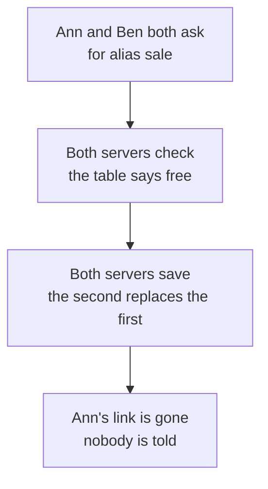

<details class="guess"><summary>🤔 Guess: 3.5 trillion codes, and 1 billion links already stored. How likely is a new random code to be taken already? Press to check.</summary>

About **3 in 10,000**. At 18 billion links it is about 5 in 1,000. So collisions are a normal event, not a rare error. Each create must check anyway, so a retry costs almost nothing.

</details>

> **Remember:** let the table decide, in one step. The unique rule refuses the second one.

<details class="more"><summary>📖 More detail: right against wrong, the three ways to make a code, and custom aliases</summary>

**Right against wrong.** Both ways meet the same two people who want the alias `sale` at the same moment. Notice who decides: on the wrong way two servers decide. On the right way the table decides.

Both ways meet the same two people who want the alias `sale` at the same moment. Notice who decides: on the wrong way two servers decide. On the right way the table decides.

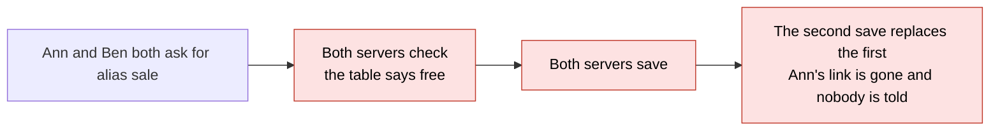

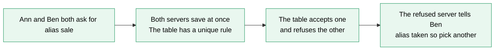

**Three ways to make the code.**

| Way | How | Collisions | Same long link gives the same code? | Guessable? | You must add |
|---|---|---|---|---|---|
| **Hash and cut** | Hash the long link, turn it into base62, keep the first 7 letters | Yes. Certain over the years, because cutting throws information away | Yes, for free | No | A unique rule and a retry with a small extra word (a salt) |
| **Counter plus base62** | Take the next number, turn it into base62 | Never from the counter. Only from custom aliases | No | Yes. Codes run in order, and show how many links you made | One shared counter, or a block of numbers for each server |
| **Random** | 7 random base62 letters | Yes. Rare at first, and more likely as the table fills | No | Hard, but not impossible | A unique rule and a retry |

Why collisions are a normal event, not a rare error. There are 3.5 trillion codes. When the table holds 1 billion links, one new random code is taken about 3 times in 10,000. When it holds 18 billion, it is about 5 times in 1,000. Each create must check anyway, so a retry costs almost nothing.

The counter is the usual choice. 100 creates a second is tiny for one counter. If one call for each create is too much, give each server a block of 1,000 numbers. The server hands them out by itself. The cost is gaps in the numbers when a server stops.

**Custom aliases and expiry.**

- **A custom alias** goes in the same table. The unique rule decides who gets it. A taken alias returns 409 (conflict). The counter must skip any code that a custom alias already took, as in card 2 (blue bar).
- **Expiry** is a column `expires_at`. A click checks it. A link past its end date gets 410 (gone). A cleanup job deletes old rows later. Keep the code reserved, so nobody else can use it.

</details>

## 4. A click: cache first

The server asks the cache first, then the table, then keeps the answer with a timer that is shorter than the link's end date. A row never changes after it is made, so a slightly old copy is fine. The exceptions are a link that was turned off or has expired. One trap: the creator clicks the new link at once, and a follower has not got the row yet, so they see a 404. The fix is to put the row in the cache when you make it.

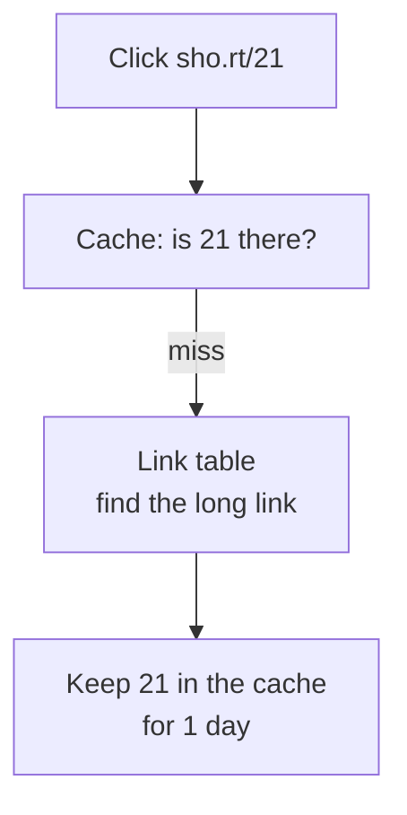

<details class="guess"><summary>🤔 Guess: the busiest time is 30,000 clicks a second, and 90 percent are cache hits. How many reach the table? And if the cache stops? Press to check.</summary>

**3,000 a second** with the cache. If the cache stops, all **30,000** reach the table. So keep a small copy in each server's memory, and limit the table connections.

</details>

> **Remember:** a row never changes, so a cache is safe. Delete the cache key when you turn a link off.

<details class="more"><summary>📖 More detail: a click over time, reading fast, and what it costs</summary>

**How it works over time: a click.** This is the read path. Notice that the second click never touches the table.

This is the read path. Notice that the second click never touches the table.

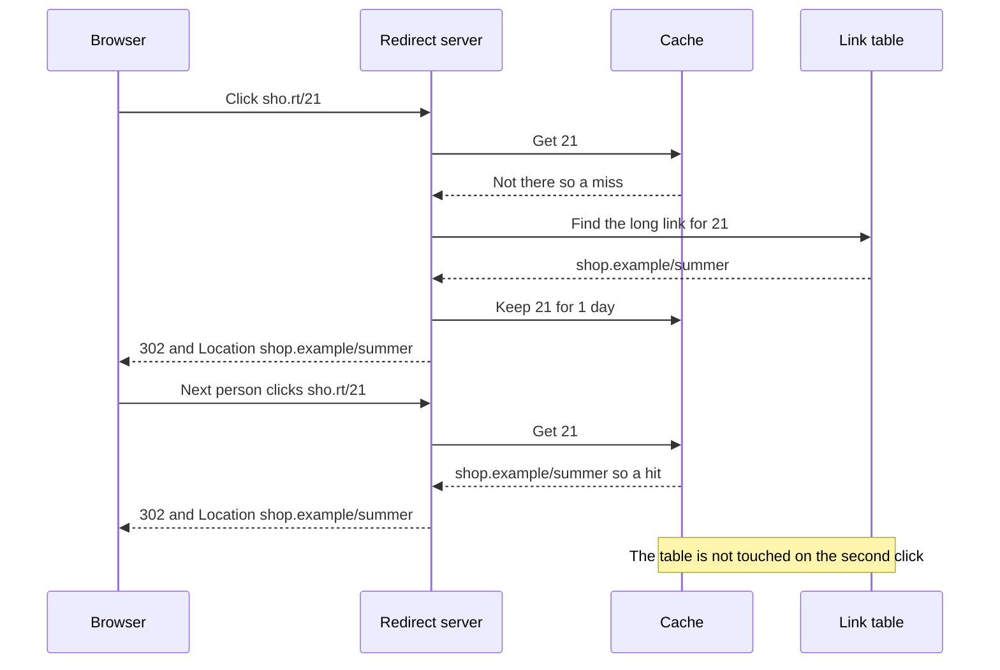

**Reading fast.**

- **Use a cache** (lesson 04). The server asks the cache first, then the table, then keeps the answer with a timer. Make the timer shorter than the link's end date.
- **A slightly old answer is fine here** (lesson 07). A row never changes after it is made, so a copy cannot be wrong. Followers and the cache are safe. The exceptions are a link that was turned off or has expired.
- **One trap:** the creator clicks the new link at once, and a follower has not got the row yet. The creator sees a 404. The fix is read your own writes: put the row in the cache when you make it.

**What it costs.**

| Cost | What it means | What you do |
|---|---|---|
| The cache is critical | If it stops, 30,000 reads a second reach the table | Keep a small copy in each server's memory. Limit the table connections |
| The cache may hold a dead link | After you turn a link off, the cache still answers until its timer ends | Delete the cache key when you turn a link off |
| In order codes are guessable | Anyone can walk through the codes | Shuffle the number first, or use random codes |
| Hash and random collide | It is certain over the years | A unique rule and a retry |
| 301 loses clicks | The counts are too low | Use 302, or 301 with a short `max-age` |
| Abuse | People hide bad links behind short ones | Limit how fast one user can make links. That is lesson 09 |

</details>

## 5. 301 against 302

A redirect is not a page. The server sends a number and a new address in a header called `Location`. **301** means "moved for good", so the browser may keep it for a very long time. **302** means "moved for now".

| | 301 | 302 |
|---|---|---|
| Clicks that reach you | the first click from each browser | every click |
| Click counts | too low | right |
| You turn a link off | old browsers still go to the old site | works at once |

<details class="guess"><summary>🤔 Guess: the product shows click counts, and owners can turn links off. 301 or 302? Press to check.</summary>

**302**, or 301 with a short `max-age`. If a link never changes and nobody counts clicks, 301 saves the most load. Do not write the click into the table inside the redirect: answer first, then add a click event to a queue.

</details>

> **Remember:** the status number is a hint. The `Cache-Control` header decides how long the browser keeps the answer.

<details class="more"><summary>📖 More detail: 301 against 302 drawn, the full table, and which way to make the code</summary>

**301 against 302.** The same person clicks twice. Notice who hears about click 2: on the 301 side nobody, on the 302 side your server.

The same person clicks twice. Notice who hears about click 2: on the 301 side nobody, on the 302 side your server.

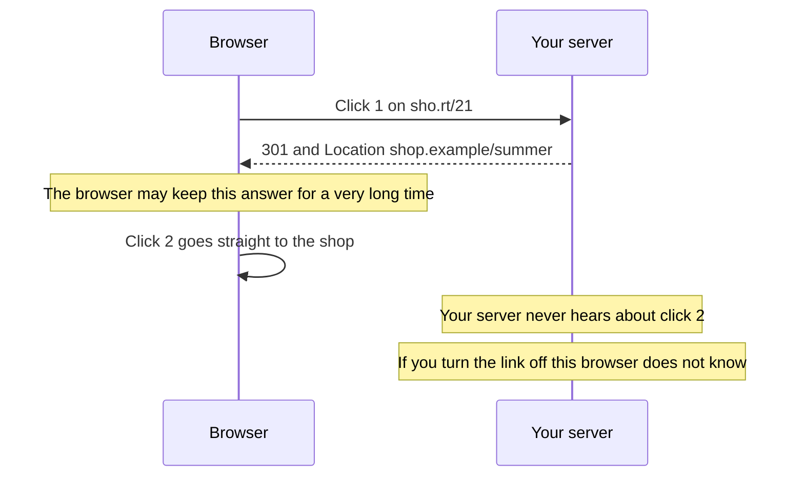

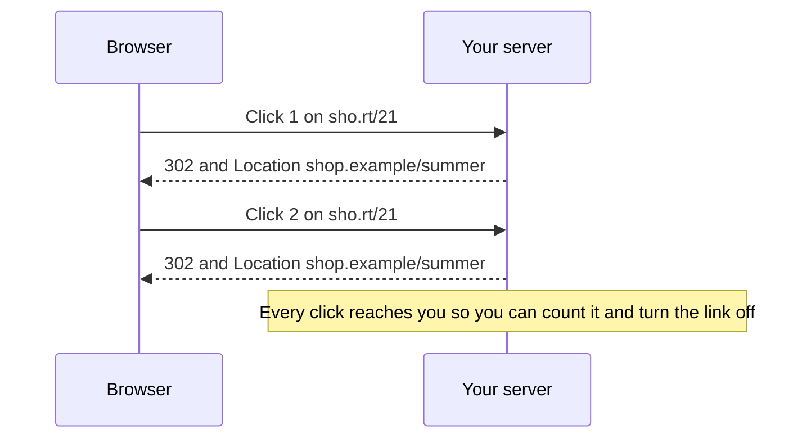

**301 or 302.**

| | 301 | 302 |
|---|---|---|
| Meaning | Moved for good | Moved for now |
| Does the browser keep the answer? | It may, for a very long time | Not unless you say so |
| Clicks that reach you | The first click from each browser | Every click |
| Click counts | Too low | Right |
| You turn a link off or change it | Old browsers still go to the old site | It works at once |
| Load on your servers | Low | High |

The status number is a hint. The header `Cache-Control` decides how long the browser keeps the answer. Real services mix the two. bit.ly answers `301` with `cache-control: private, max-age=90` (checked with `curl -sI` on 2026-10-21). So a repeat click within 90 seconds skips the server. A later click comes back.

Your choice depends on the product. If owners see click counts or can turn links off, use 302. Or use 301 with a short `max-age`. If a link never changes and nobody counts clicks, 301 saves the most load.

Do not write the click into the table inside the redirect. Answer first. Then add a click event to a queue (lesson 06), and let a worker count it.

**Which way to make the code?** This is the choice you say out loud. Notice that the default is the counter, and the other two need a retry loop.

This is the choice you say out loud. Notice that the default is the counter, and the other two need a retry loop.

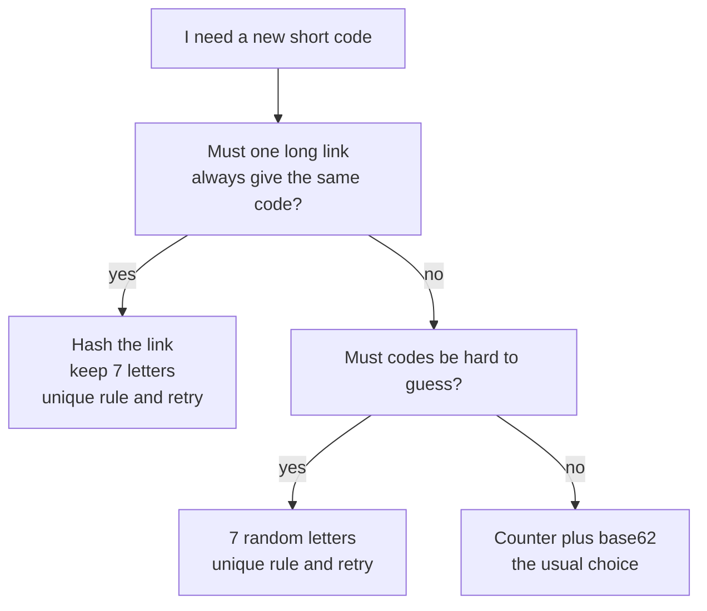

</details>

## 6. Three mistakes, and what to say if you freeze

- **Wrong:** check first, then save. **Right:** save, and let the table's unique rule refuse the second one.
- **Wrong:** "Hash the link, keep 7 letters, done." **Right:** also a unique rule, and a retry with a salt when the table refuses.
- **Wrong:** "301 is faster, so I use 301." **Right:** if the product counts clicks or turns links off, use 302.

<details class="guess"><summary>🤔 Guess: you hash the link and keep 7 letters, with no unique rule. Over billions of rows, what happens? Press to check.</summary>

Two links **will meet**. Cutting a hash throws information away, so the same code appears for two links, and the second row replaces the first with no error.

</details>

> **Remember:** if you freeze, say "A short code is a key in a table. A click reads the row and answers with a redirect."

<details class="more"><summary>📖 More detail: the three mistakes in full, and the freeze plan</summary>

**Wrong:** check first, then save.

```js
// sketch, not run here
const taken = await db.link.findUnique({ where: { code: alias } });   // 1. ask
if (taken) return res.status(409).send("alias taken");
await db.link.create({ data: { code: alias, longUrl } });             // 2. save. Another request may have saved in between
```

**Right:**

```js
// sketch, not run here
try {
  await db.link.create({ data: { code: alias, longUrl } });           // the table has a unique rule on code
} catch (e) {
  if (e.code === "P2002") return res.status(409).send("alias taken"); // Prisma's error for a broken unique rule
  throw e;
}
```

**Why:** the gap between the check and the save is where two requests both pass. Let the table decide, in one step. Practice B shows the race in code.

**Wrong:** "Hash the link, keep 7 letters, done."

**Right:** "Hash it, keep 7 letters, save with a unique rule, and retry with a salt when the table refuses."

**Why:** cutting a hash throws information away. Two links will meet over billions of rows.

**Wrong:** "301 is faster, so I use 301."

**Right:** "If the product shows click counts or can turn links off, I use 302, or 301 with a short `max-age`."

**Why:** a 301 may be kept by the browser for a very long time. Those clicks never reach you.

**If you freeze:**

1. Say "A short code is a key in a table. A click reads the row and answers with a redirect."
2. Say "I make the code with a counter and base62, and the table has a unique rule, so a collision is refused and retried."
3. Say "Reads are 100 times more than writes, so a cache answers most clicks. A row never changes, so a slightly old copy is fine. I use 302 when I must count clicks."

</details>

## 7. Watch and play

Every link below was opened and checked on 2026-10-21. For the videos, the title, channel and length come from YouTube's own data. If one breaks later, say so and it will be replaced.

- **Video:** [How Does a URL Shortener Work?](https://www.youtube.com/watch?v=HHUi8F_qAXM) ByteByteGo, 6 min 44 s - the same design in short. Compare it with the big picture in card 1.
- **Play with it:** [the stepper in this folder](visuals/08-design-a-url-shortener.html) - guess first, then press Next. Try all three tabs.
- **Play with it:** in a terminal, run `curl -sI https://bit.ly/3`. Look at the first line, and at the `location` and `cache-control` lines. That is a real 301 and its timer. The server may change what it sends.
- **Play with it:** [httpstatus.io](https://httpstatus.io/) - paste a short link and see each redirect step with its status code and headers.
- **Read:** [Hello Interview: Design Bitly](https://www.hellointerview.com/learn/system-design/problem-breakdowns/bitly) - the hash, counter and cache choices, with numbers. Find the part on 301 against 302.
- **Read:** [MDN: Redirections in HTTP](https://developer.mozilla.org/en-US/docs/Web/HTTP/Guides/Redirections) - the table of 301, 302, 307 and 308. Find which ones keep the request method.
- **Read:** [RFC 9110](https://www.rfc-editor.org/rfc/rfc9110.html) - go to section 15.4.2. It says a 301 response is "heuristically cacheable". The section on 302 has no such line.

<details><summary>Go deeper (optional)</summary>

**The collision math.** With N possible codes and n codes already stored, one new random code is taken with chance n divided by N. For N = 62 to the power of 7 (3.5 trillion) and n = 1 billion, that is 0.03 percent. For n = 18 billion it is 0.5 percent. If you made all 1 billion codes at random with no check, about n times n divided by 2N pairs would collide, which is about 142,000. This is the birthday problem. The numbers were checked in Node on 2026-10-21. The [Wikipedia page on the birthday problem](https://en.wikipedia.org/wiki/Birthday_problem) has the proof and the n times n divided by 2N shortcut.

**Hash details.** Make the link the same before you hash it (for example lowercase the host name). Then hash it, turn the result into base62 and keep the first N letters. The Hello Interview page above says to add a unique rule on the code and retry a few times, about 3 to 5. It also says a salt helps when codes must not be guessable.

**Hide the order of a counter.** Shuffle the number before base62 with a rule that never gives two numbers the same result. One idea: multiply by a big odd number that is not a multiple of 31, and keep the remainder after dividing by 62 to the power of 7. Each input then gives a different output. The shuffle is not safe against an attacker, but it hides the pace of your growth. Checked on a small size in Node. The older [data storage guide, Part 8](data-storage-choices-for-system-design.md) covers Snowflake style ids, which are another way to avoid one shared counter.

**Where the table grows.** About 1.8 TB a year fits one large PostgreSQL machine in year one. After that, split the table by a hash of the code (lesson 20). A lookup by one code is the easiest kind to split. Or use a key-value store. The [data storage guide, Part 10](data-storage-choices-for-system-design.md) covers that.

**307 and 308.** They act like 302 and 301, but they keep the request method. A browser opening a link uses GET, so for a shortener the difference rarely matters. The MDN page above shows the table.

**The edge.** A CDN can answer hot redirects close to the user (lesson 05). Give the redirect a short `s-maxage` so you can still turn links off. The Hello Interview page above mentions edge caching, for example with Cloudflare Workers.

**Cache misses for codes that do not exist.** People guessing codes will always miss. Keep a "not found" answer in the cache for about a minute, so these requests do not reach the table.

**If the cache stops.** The older [step by step walkthrough, Part 2](system-design-step-by-step-walkthrough.md) has a worked version of this design. It uses a small cache inside each server for the hottest links, and a limited number of table connections, so the service slows down but does not fall over.

**Other videos.** [Hello Interview: Design Bitly](https://www.youtube.com/watch?v=iUU4O1sWtJA) is 59 min 30 s, so it is long. Watch it after the short ByteByteGo video.

**Checked on:** 2026-10-21. The `curl` result (bit.ly 301 with `max-age=90`) is from that day. Websites change.

</details>

## 8. Practice

**A. Predict the output** (write your answer before opening)

```js
const A = "0123456789abcdefghijklmnopqrstuvwxyzABCDEFGHIJKLMNOPQRSTUVWXYZ";
let n = 3843, s = "";
do { s = A[n % 62] + s; n = Math.floor(n / 62); } while (n > 0);
console.log(s, s.length);
```

Then answer: what code does 3844 make, and why?

<details><summary>Answer</summary>

```
ZZ 2
```

3843 is 61 times 62, plus 61. Both digits are 61, which is `Z`. So it is the largest 2 letter code. The number 3844 is 62 times 62. It needs a third digit, so its code is `100`, like 99 to 100 in base 10. (Checked on 2026-10-17 with Node 24.)

</details>

**B. Fix the bug**

Two people ask for the alias `sale` at the same moment. Both are told "got it". Run it in your head, then fix it.

```js
const table = new Map();
const wait = () => new Promise((r) => setTimeout(r, 10));     // a database round trip
async function takeAlias(alias, owner) {
  if (table.has(alias)) return owner + ": taken";             // 1. check
  await wait();                                               // 2. the slow database call
  table.set(alias, owner);                                    // 3. save
  return owner + ": got it";
}
Promise.all([takeAlias("sale", "Ann"), takeAlias("sale", "Ben")]).then((r) => console.log(r, "owner:", table.get("sale")));
```

<details><summary>Answer</summary>

It prints:

```
[ 'Ann: got it', 'Ben: got it' ] owner: Ben
```

Both calls run the check before either one saves, because `await wait()` lets the other call run. Both see "free". Ben's save replaces Ann's. This is a check then save race (also called time of check to time of use).

Fix: make the check and the save one step, with nothing that waits in between.

```js
async function takeAlias(alias, owner) {
  if (table.has(alias)) return owner + ": taken";
  table.set(alias, owner);                                    // check and save with no wait between them
  await wait();                                               // the slow work comes after
  return owner + ": got it";
}
```

It now prints `[ 'Ann: got it', 'Ben: taken' ] owner: Ann`. In JavaScript, code with no `await` between two lines cannot be cut in half. A real database needs the same idea. That is the unique rule: `INSERT` and let the table refuse the second one (card 3). (Both outputs checked on 2026-10-17 with Node 24.)

</details>

**C. Write it yourself**

Open `learn/system-design/practice/08-design-a-url-shortener.js`. It has three empty functions: `toBase62`, `fromBase62` and `createShortener`. The shortener must skip a code that is already taken and give up after a few tries. It must accept custom aliases and answer 302, 404 or 410. The expiry uses a clock that the test passes in. Write it, then run this from the repo root and make all the tests pass:

```
node --test learn/system-design/practice/08-design-a-url-shortener.test.js
```

<details><summary>One possible answer</summary>

```js
const ALPHABET = "0123456789abcdefghijklmnopqrstuvwxyzABCDEFGHIJKLMNOPQRSTUVWXYZ";

function toBase62(n) {
  if (!Number.isInteger(n) || n < 0) throw new RangeError("n must be a whole number, 0 or more");
  let s = "";
  do {
    s = ALPHABET[n % 62] + s;
    n = Math.floor(n / 62);
  } while (n > 0);
  return s;
}

function fromBase62(code) {
  if (typeof code !== "string" || code.length === 0) throw new Error("code must be a non-empty string");
  let n = 0;
  for (const ch of code) {
    const digit = ALPHABET.indexOf(ch);
    if (digit === -1) throw new Error("not a base62 letter: " + ch);
    n = n * 62 + digit;
  }
  return n;
}

function createShortener({ nextCode, now = Date.now, maxTries = 5 }) {
  const rows = new Map();                                  // code -> { longUrl, expiresAt }
  const save = (code, longUrl, ttlSeconds) =>
    rows.set(code, { longUrl, expiresAt: ttlSeconds === undefined ? Infinity : now() + ttlSeconds * 1000 });
  return {
    create(longUrl, { alias, ttlSeconds } = {}) {
      if (alias !== undefined) {
        if (rows.has(alias)) throw new Error("alias taken");
        save(alias, longUrl, ttlSeconds);
        return alias;
      }
      for (let i = 0; i < maxTries; i++) {
        const code = nextCode();
        if (rows.has(code)) continue;                      // a collision: ask for another code
        save(code, longUrl, ttlSeconds);
        return code;
      }
      throw new Error("no free code");
    },
    resolve(code) {
      const row = rows.get(code);
      if (!row) return { status: 404 };
      if (now() >= row.expiresAt) return { status: 410 };
      return { status: 302, location: row.longUrl };
    },
    size: () => rows.size,
  };
}

module.exports = { toBase62, fromBase62, createShortener };
```

Checked on 2026-10-17 with Node 24: the 15 tests fail on the empty stub and all 15 pass with this answer. A `Map` plays the table, and `rows.has` plays the unique rule. In a real database, the check and the save are one `INSERT`, and the unique rule refuses the second one. An expired row stays in the map, so its code stays taken. The injected `now` is why the tests can move time without waiting.

</details>

## 9. Interview question

**Q:** "Design a URL shortener. How do you make the short code? What happens when two links get the same code? And do you answer with a 301 or a 302?"

A common follow-up: "The service gets 100 clicks for every new link. What do you do about it?" Card 4 (the click path) and card 5 (301 against 302) are the answer.

<details><summary>A strong answer, in four parts</summary>

1. **Problem:** a short code must be unique, and a dead redirect breaks someone else's page. About 100 clicks come for every new link, so the click path is the hard part. I estimate 10 million new links a day. That is 100 new links and 10,000 clicks a second, and 30,000 clicks at the busiest time. Storage is not the problem. It is about 1.8 TB a year.
2. **How it works:** a table maps code to long link, with a unique rule on the code. I make the code with a counter and base62. Seven letters give 3.5 trillion codes. A custom alias goes in the same table, and the counter skips any code that an alias took. A click asks the cache first, then the table, then keeps the answer with a timer shorter than the link's end date. A row never changes, so a slightly old copy is fine. I put a new row in the cache when it is made, so the creator's first click works. I answer 302 and add a click event to a queue. A worker counts it.
3. **Tradeoff:** hash and cut gives the same code for the same link, but it collides, so I need the unique rule and a retry. Random codes are harder to guess, but they also need the retry. The counter never collides on its own, but its codes run in order, and it is one shared part, so I would give each server a block of numbers. A 301 saves load, but the browser may keep it, so my click counts are too low and a turned off link keeps working in old browsers. I choose 302, or 301 with a short `max-age`, when the product counts clicks. Reads depend on the cache. So each server keeps a small copy of the hottest links, in case the cache stops.
4. **My example:**
   - **Fact:** I have not built a shortener in my projects. I do not claim one.
   - **Fact:** the DBO case study tells an incident with the same shape as the alias race. Two copies of one TADA event both ran "has this been processed?" before either wrote, and stores got double points. We fixed it with a row lock (`SELECT ... FOR UPDATE`) inside a transaction, which is a group of changes that all succeed or all fail. The lesson is the same: check then save is not safe, so let the table decide.
   - **Fact:** the case study lists, as the next step beyond the lock, a table with a primary key on the event id and an insert that does nothing if the row exists. That is the unique rule. The case study does not say it is built, so I should not say DBO has it.
   - **Fact:** DBO runs PostgreSQL and a BullMQ queue on Redis, and the case study says an inbound webhook should save the event, add a job and answer fast. A click event could use the same shape.
   - **Idea, not a fact:** DBO sends login codes by WhatsApp through Jatis. If DBO sent promotion messages, a short link with click counts would show which message works. I would use 302 there, so the counts are right.

</details>

## 10. Explain it back

Close this file. Explain a URL shortener out loud like to a new junior, in 4 parts (problem, how, tradeoff, my example). Use the story of two people who get the code `aB3dY7z`, and then one person who clicks a 301 link twice. Then write your best version below and run `/explain-check design a url shortener` or ask the `explain-coach` agent to review it.

### My explanation

<write here>

### Coach feedback

<the explain-coach agent writes here>

## 11. Review questions (day 1, 3, 7, 21)

1. Two different long links get the same 7 letter code. What goes wrong with no unique rule, and what do you do about it?
2. The product shows click counts and lets owners turn links off. Do you answer 301 or 302? Why? What is the middle way?
3. You expect 100 clicks for every new link. Name three things this changes in your design.
4. Draw the click picture (card 4, blue bar) from memory.

<details><summary>Answers</summary>

1. The second save replaces the first row without any error, and the first link's readers land on the wrong site. Put a unique rule on the code, so the table refuses the second row. The server then catches the refusal and tries another code, for example with a salt. Collisions are certain over billions of rows, so the retry is normal.
2. 302, because every click then reaches your server, so the counts are right and turning a link off works at once. The middle way is a 301 with a short `Cache-Control: max-age`, such as 90 seconds. A repeat click in that time skips you, and a later click comes back. A plain 301 may be kept by the browser for a very long time.
3. Reads must be fast and always up, so use a cache and a small copy in each server. A slightly old answer is fine, because a row does not change, so followers are safe. Click counting must not slow the redirect, so add a click event to a queue after you answer. (Also: the estimate is driven by clicks, not by storage.)
4. Browser, redirect server, cache and link table, left to right. The browser clicks. The server asks the cache and gets a miss. It asks the table and gets the long link. It saves the answer in the cache for 1 day and answers 302 with the Location. The next click asks the cache, gets a hit and answers at once. The table is not touched.

</details>

## Connected lessons

- [Consistency and CAP](07-consistency-and-cap.md) - the lesson before. A slightly old answer is fine here, and read your own writes fixes the creator's first click.
- [Design a rate limiter](09-design-a-rate-limiter.md) - the next lesson. A shortener needs a limit on how fast one user can make links.
- [Caching](04-caching.md) - the read path of this lesson is cache aside. The stampede on a viral link is in that lesson.
- [CDN](05-cdn.md) - a CDN can answer hot redirects at the edge.
- [Message queues](06-message-queues.md) - click events go to a queue, so the redirect does not wait.
- [Latency numbers and estimation](16-latency-numbers-and-estimation.md) - the numbers table in card 1 (blue bar) uses the method in that lesson.
- [Consistent hashing](20-consistent-hashing.md) - how to split the table by a hash of the code when one machine is not enough.
- [Idempotency and retries](13-idempotency-and-retries.md) - the same idea as the unique rule: a repeated request must be safe.
- [System design step by step, Part 2](system-design-step-by-step-walkthrough.md) - a full worked answer to this design, with more on the read path.
- [Design workbook part 1](design-workbook-part-1-classic-designs.md) - the next classic designs, a rate limiter and a chat app, with hidden answers.
- [System design interview questions](senior-system-design-interview-questions.md) - question 1 asks where to start with this design.
