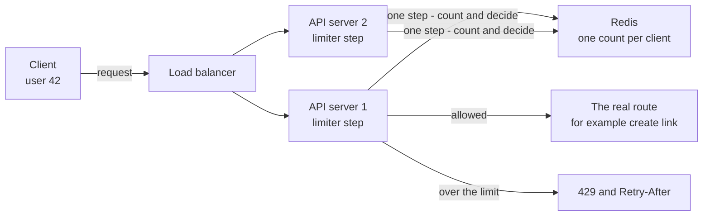
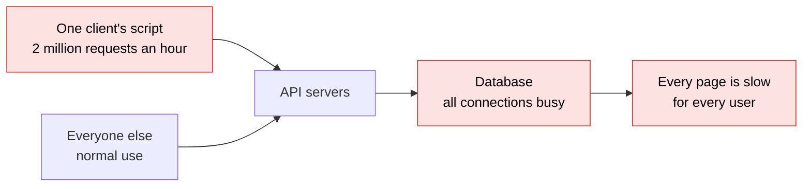
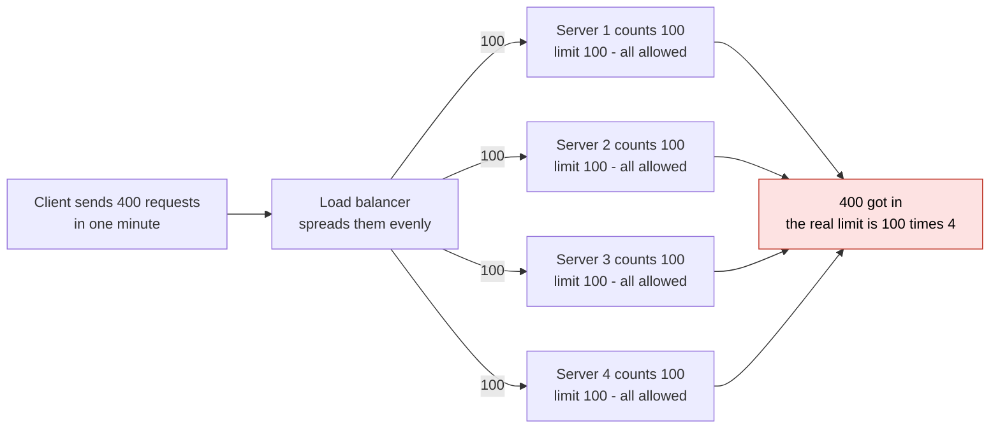
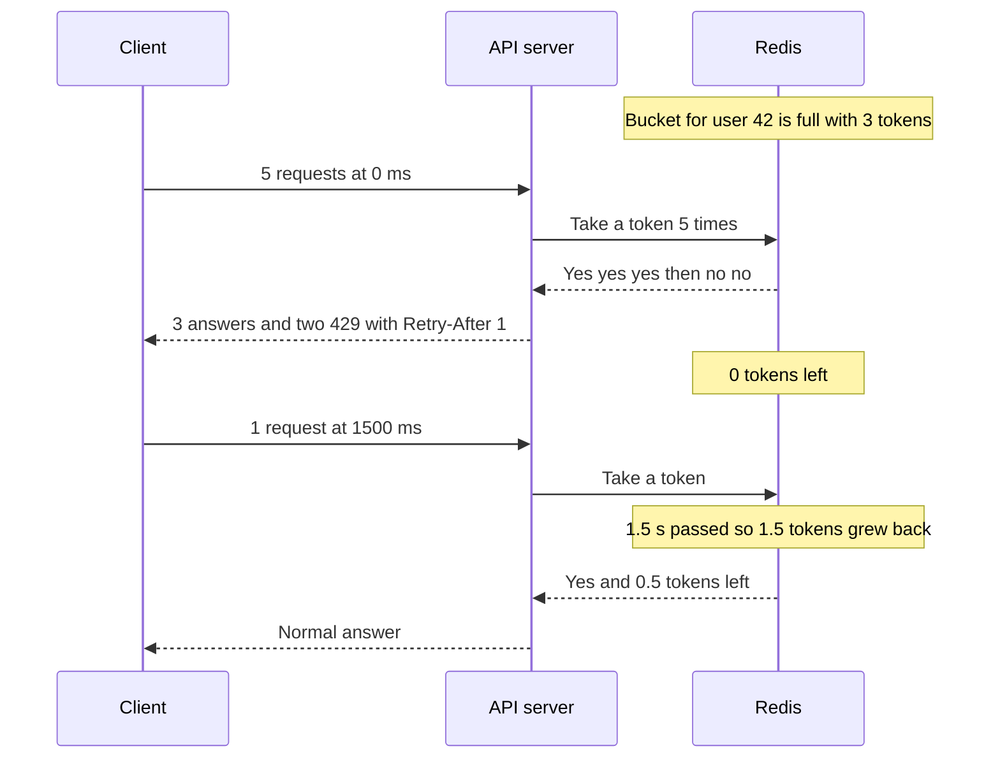
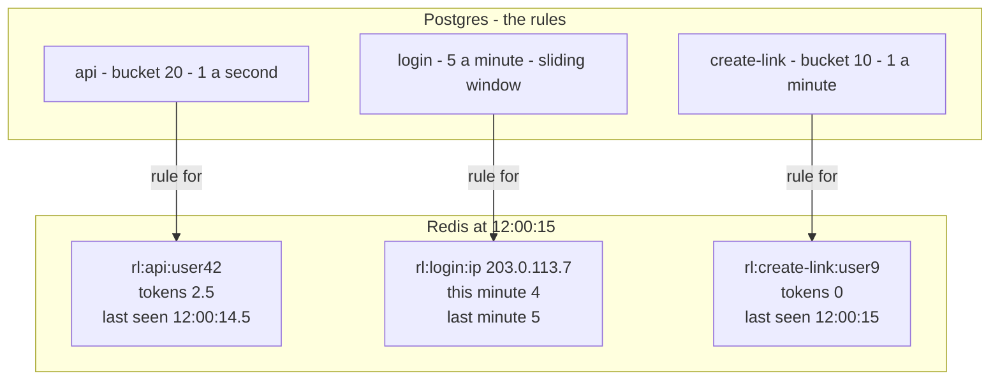
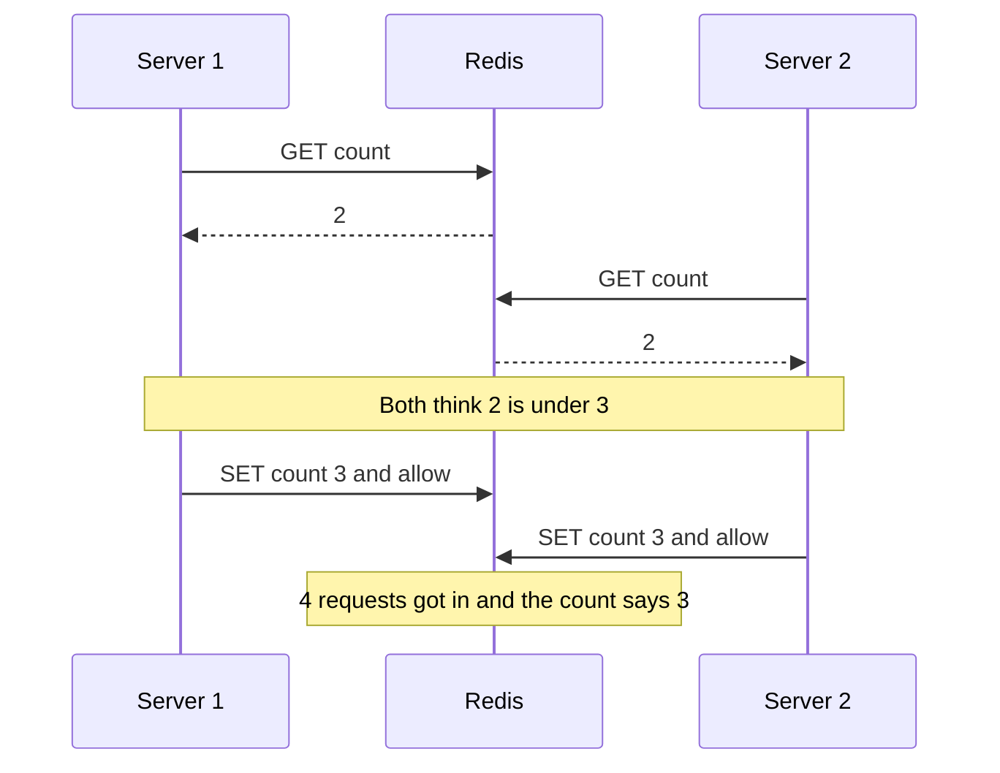
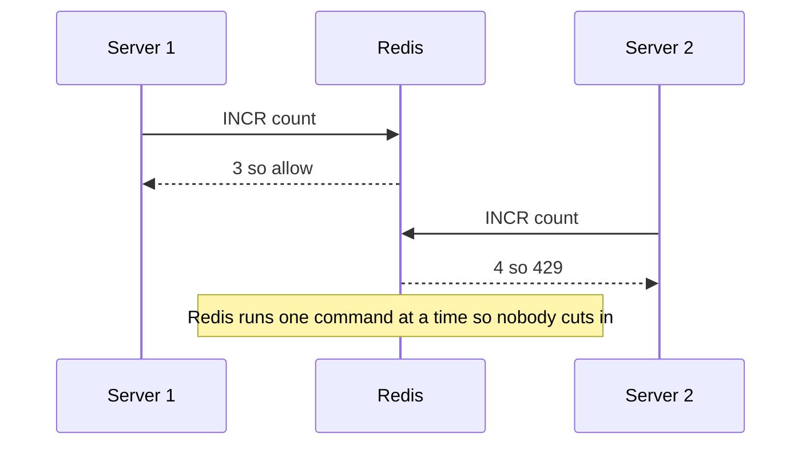
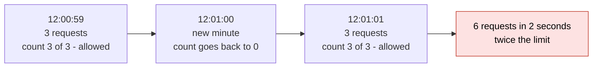
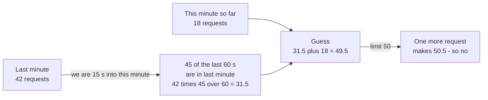
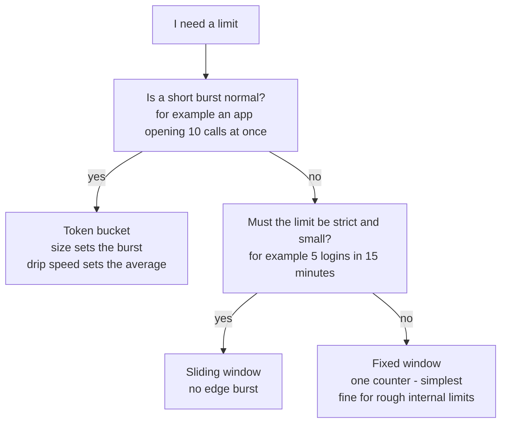

# 09. Design a rate limiter

> **Subject:** System Design · **Lesson:** 09 · **Made:** 2026-10-21 · **Status:** ready
> **You will be able to:** draw where a rate limiter sits and where its count lives, compare fixed window, sliding window and token bucket with one picture each, explain why two servers can both let the last request in and how one step in Redis stops it, and say what happens when Redis is down.
> **Before this:** [Design a URL shortener](08-design-a-url-shortener.md) · **Next:** [Design a chat app](10-design-a-chat-app.md)

## 1. The idea in one sentence

A rate limiter counts each client's requests and says "no, wait" after a limit.

Lesson 08 ended with a problem: one script can make millions of links. This lesson builds the guard. Two parts are hard:

- **How to count**, so nobody gets twice the limit.
- **Where the count lives**, so ten servers share one number.

| Plain idea | Meaning |
|---|---|
| Client key | Who you count: a user id, an API key or an IP address |
| Window | A stretch of time you count inside, like one minute |
| Burst | Many requests at almost the same moment |

New words (four):

- **Token bucket:** each client has a bucket of tickets (tokens). Each request takes one. New ones drip in slowly. Empty means "no".
- **Sliding window:** count requests in "the last 60 seconds", not "this clock minute". (Interview word: sliding window counter.)
- **One step:** the read, the math and the write happen together. Nobody can cut in. (Interview word: atomic.)
- **429 and Retry-After:** `429 Too Many Requests` means "over the limit". `Retry-After: 12` means "try again in 12 seconds".

From earlier lessons: a load balancer sends each request to any server (lesson 03). Redis is a fast shared store in memory (lesson 04). "Check, then save" breaks when two requests run at once (lesson 08).

Times in the pictures are examples, not measured.

## 2. The pictures

### 2a. The big picture

Notice that every server asks the same Redis.



### 2b. The problem, drawn

No limiter. Notice that the other users did nothing wrong.



Each server counts alone. Notice that 400 get in, not 100.



### 2c. How it works over time: a token bucket

3 tokens, refilled at 1 a second. Notice the burst of 3, then the wait.



### 2d. What is in memory right now

Notice: one Redis key per client and rule, each with two small numbers.



Each key has an end time. Redis deletes a quiet client's key by itself.

### 2e. Right against wrong

The client has used 2 of a limit of 3. Two servers check at once.

Wrong. Notice that both servers read 2, so both say yes.



Right. `INCR` means "add 1 and give me the new number". Notice that Redis decides, one at a time.



### 2f. The edge problem of a fixed window

A fixed window counts per clock minute. Notice: the limit is 3, but 6 get in within 2 seconds.



### 2g. How a sliding window guesses

Notice that it uses only the part of last minute still inside the last 60 seconds.



### 2h. Which way to count?

Notice that the default is the token bucket.



## 3. Real life analogy

A museum where each visitor has their own ticket machine.

| Idea | At the museum |
|---|---|
| Token bucket | Your machine holds up to 3 tickets and prints 1 new ticket a minute. You walk in 3 times fast, then wait. |
| Fixed window | The guard lets you in 3 times per clock hour. Come at 1:59 and 2:01, and you get in 6 times. |
| A count in each server | 4 doors, and each guard keeps a separate list. You use each door 3 times and get in 12 times. |
| One shared count | All 4 guards look at one board. Only one guard writes on it at a time. |

Where the analogy stops: an API checks 15,000 requests a second. The board must answer in about 1 ms. And a broken board must not close the museum.

## 4. The smallest code that shows it

A token bucket with a fake clock. It holds 3 tokens and grows 1 a second.

```js
function makeBucket(capacity, perSecond) {
  let tokens = capacity, last = 0;                                    // the bucket starts full
  return function allow(nowMs) {
    tokens = Math.min(capacity, tokens + (nowMs - last) / 1000 * perSecond);   // add tokens for the time that passed
    last = nowMs;
    if (tokens >= 1) { tokens -= 1; return true; }                    // take one token
    return false;                                                     // empty, so answer 429
  };
}
const allow = makeBucket(3, 1);                                       // holds 3 tokens, 1 new token each second
console.log([0, 0, 0, 0, 0].map((t) => allow(t)).join(" "));
console.log(allow(1500), allow(1600), allow(10000));
```

**Output:**

```
true true true false false
true false true
```

Checked on 2026-10-21 with Node 24.

No timer adds tokens. On each request, the code adds tokens for the time that passed. So each client needs two numbers: tokens and the last time.

## 5. What really happens, step by step

One row is one call to `allow`.

| Step | Call | Time passed | Tokens after the drip | Decision | Tokens after | Answer |
|---|---|---|---|---|---|---|
| 1 | `allow(0)` | 0 ms | 3 (full) | 1 or more, take one | 2 | `true` |
| 2 | `allow(0)` | 0 ms | 2 | take one | 1 | `true` |
| 3 | `allow(0)` | 0 ms | 1 | take one | 0 | `true` |
| 4 | `allow(0)` | 0 ms | 0 | less than 1, refuse | 0 | `false` |
| 5 | `allow(0)` | 0 ms | 0 | refuse | 0 | `false` |
| 6 | `allow(1500)` | 1,500 ms, so 1.5 tokens grow | 1.5 | take one | 0.5 | `true` |
| 7 | `allow(1600)` | 100 ms, so 0.1 grows | 0.6 | less than 1, refuse | 0.6 | `false` |
| 8 | `allow(10000)` | 8,400 ms, so 8.4 would grow | 3 (the cap) | take one | 2 | `true` |

What to see:

- Steps 1 to 3 are the burst. The bucket size is the biggest burst.
- Step 6: nobody added tokens at 1,000 ms. The code added 1.5 at 1,500 ms.
- Step 7: 0.6 is not enough. The answer is `Retry-After: 1` (0.4 s, rounded up).
- Step 8: 8 quiet seconds do not give 9 tokens. The cap is 3.

In a real system, Redis runs this math as a tiny program (a Lua script). Redis runs one script at a time, so nobody cuts in. The script is in section 8's Go deeper box.

**Step through it yourself:** [open the stepper](visuals/09-design-a-rate-limiter.html). Story 1 is this bucket. Story 2 is fixed against sliding window. Story 3 is the race. Guess first, then press Next.

## 6. Why it exists and what it costs

- **Problem:** one client can use up your servers or your money. Bots guess passwords. Bots also ask for thousands of paid one-time codes (OTP).
- **Fix:** each client gets a fair share. Past it, the server answers `429` at once, before any real work.
- **Cost:** see the last table in this section.

### The numbers

A rough estimate with round numbers (interview words: back of the envelope).

| Question | The math | Answer |
|---|---|---|
| Requests a day | 10 million daily users times 50 calls | 500 million |
| Requests a second | 500 million divided by 100,000 (seconds in a day, rounded) | 5,000 |
| At the busiest time | 5,000 times 3 | 15,000 a second |
| Redis calls a second | one call for each request | 15,000 |
| Can one Redis keep up? | a rough number for one Redis is about 100,000 simple commands a second | yes, about 15 percent busy |
| Memory | 10 million clients times about 100 bytes a key | about 1 GB |

Size is easy. The hard part: every request pays, and servers share one count.

### Three ways to count

| Way | What it stores per client | Edge burst? | Allows a short burst? | Best for |
|---|---|---|---|---|
| **Fixed window** | 1 counter | Yes, up to 2 times the limit | Yes, by accident | Rough internal limits. Easiest: `INCR` and an end time |
| **Sliding window counter** | 2 counters | Almost none. It is a guess | A little | "N per minute" on public routes and login |
| **Token bucket** | 2 numbers: tokens and last time | No | Yes, on purpose. The bucket size sets it | Most API routes. Stripe uses it |

### Where the limiter lives

| Place | What it is | What it knows |
|---|---|---|
| The edge | A service like Cloudflare, in front of your servers. It stops huge floods early | Only the IP address |
| The gateway (lesson 17) | One front door for all routes | The user, if it checks the login token |
| The app, as middleware | A step that runs before every route | The user, the route and the plan |

Use two layers: a rough IP limit at the edge, and a per-user limit behind it. Never limit in the browser. The client controls that code.

### Where the count lives

Keep it in one shared Redis, changed in one step: `INCR` or a Lua script. Never keep it in each server's memory (picture 2b).

### The answer the client sees

```http
HTTP/1.1 429 Too Many Requests
Retry-After: 12
```

A good client waits that many seconds.

### When Redis is down

**Fail open** means you let everyone in. **Fail closed** means you say no to everyone.

| Route | Choice | Why |
|---|---|---|
| Reading products, most API routes | **Fail open**: let requests in, and alert loudly | A broken limiter should not take the whole app down |
| Login, OTP, money transfers | **Fail closed**: say no | Here the limiter protects accounts and money |

Give the Redis call a short timeout, about 5 ms. Then a slow Redis acts like a down one.

### What it costs

| Cost | What it means | What you do |
|---|---|---|
| About 1 ms on every request | One Redis call each time | Keep Redis close. One step per check, never two |
| Redis is critical | If it stops, the limiter stops | Fail open on most routes, closed on login and OTP. A short timeout |
| Limits block real people | An office of 200 people shares one IP | Limit by user id after login. Use IP only for logged out routes |
| A guess is not exact | The sliding window can be off a little | Fine for traffic. For "5 tries", use a log (see Go deeper) |

<details><summary>Go deeper (optional)</summary>

**Sliding window log.** A fourth way keeps the time of every request. It is exact, but it stores one entry per request. Use it only for tiny limits, like 5 tries.

**How good is the sliding window guess?** Cloudflare checked it on 400 million requests from 270,000 sources. Only 0.003 percent of requests were wrongly allowed or wrongly limited.

**A few Redis machines.** Put the client key in the key name. Each client then always lands on the same Redis machine, so no count is split.

**Many regions.** Each region counts by itself. A true world-wide count needs calls between regions, which is slow. Say "the limit is per region" out loud.

**More headers.** Many APIs also send their own headers, like `X-RateLimit-Remaining`. A shared standard, the IETF `RateLimit` header draft, is still a draft (draft 11, May 2026), not an RFC. The section 8 Go deeper box has the details.

**A softer fallback.** When Redis is down, each server can keep a rough local limit: "the limit divided by the number of servers". The short timeout also stops requests from piling up while Redis is slow.

**Clocks differ between servers.** The bucket math uses the time. So use Redis's own clock, the `TIME` command, inside the script.

</details>

## 7. Common mistakes

**Wrong:** read the count, decide, then write it back.

```js
// sketch, not run here
const used = Number(await redis.get(key)) || 0;   // 1. read
if (used >= limit) return res.status(429).end();  // 2. decide
await redis.set(key, used + 1, "EX", 60);         // 3. write. Another server may have read the same number in between
```

**Right:** one step, with `INCR`.

```js
// sketch, not run here
const used = await redis.incr(key);               // add 1 and get the new number, in one step
if (used === 1) await redis.expire(key, 60);      // the first request of the window sets the end time
if (used > limit) return res.status(429).set("Retry-After", "60").end();
```

**Why:** two servers can both pass between the read and the write. Practice B shows it.

**Wrong:** "I keep a counter in a JavaScript `Map` in the Express app."

**Right:** "I keep the count in Redis, because a request can land on any server."

**Why:** with 4 servers, each `Map` counts alone. So 4 times the limit gets through.

**Wrong:** "I limit everyone by IP address."

**Right:** "I limit by user id after login, by API key for servers, and by IP only before login."

**Why:** a whole office can share one IP. And one attacker can use many IPs.

<details><summary>Go deeper (optional)</summary>

Even the right way above has a small gap. If the server stops between `INCR` and `EXPIRE`, the key never ends. A Lua script that does both closes that gap. For a bucket, put the whole math in one Lua script (section 8 Go deeper box).

</details>

**If you get stuck,** say these three lines:

1. "It counts each client's requests and answers 429 past the limit."
2. "I use a token bucket, because short bursts are fine. Login gets a sliding window."
3. "The count lives in Redis, changed in one step. If Redis is down, I fail open, except on login."

## 8. Watch and play

All links were opened and checked on 2026-10-21. Video details come from YouTube.

- **Video:** [Rate Limiter System Design: Token Bucket, Leaky Bucket, Scaling](https://www.youtube.com/watch?v=YXkOdWBwqaA) ByteByteGo, 7 min 46 s. Compare it with pictures 2c, 2f and 2g.
- **Play with it:** [the stepper in this folder](visuals/09-design-a-rate-limiter.html). Try all three tabs.
- **Play with it:** [Rate limiting playground](https://system-design.space/en/visuals/rate-limiting/) on System Design Space. Send a burst to a token bucket.
- **Read:** [Cloudflare: How we built rate limiting capable of scaling to millions of domains](https://blog.cloudflare.com/counting-things-a-lot-of-different-things/). It has the numbers from picture 2g.
- **Read:** [MDN: 429 Too Many Requests](https://developer.mozilla.org/en-US/docs/Web/HTTP/Reference/Status/429). The `429` answer and `Retry-After`, with an example.

<details><summary>Go deeper (optional)</summary>

**More reading.**

- [Hello Interview: Design a Distributed Rate Limiter](https://www.hellointerview.com/learn/system-design/problem-breakdowns/distributed-rate-limiter) - the full interview answer: the algorithms, Redis with Lua, and failure. Find the part on fail open and fail closed.
- [Stripe: Scaling your API with rate limiters](https://stripe.com/blog/rate-limiters) - four kinds of limiter in a real company, with a token bucket in Redis. Read the tip about turning a new limiter on in "watch only" mode first.
- The Cloudflare article above also has the 0.003 percent result for the sliding window guess.

**The token bucket as a Redis Lua script.** Redis runs a script from start to end with no other command in between. That makes the whole read, math and write one step.

```lua
-- KEYS[1] = bucket key. ARGV = capacity, tokens per second, now in ms
local cap, rate, now = tonumber(ARGV[1]), tonumber(ARGV[2]), tonumber(ARGV[3])
local b = redis.call('HMGET', KEYS[1], 'tokens', 'ts')
local tokens = tonumber(b[1]) or cap
local ts = tonumber(b[2]) or now
tokens = math.min(cap, tokens + (now - ts) / 1000 * rate)
local ok = 0
if tokens >= 1 then tokens = tokens - 1; ok = 1 end
redis.call('HSET', KEYS[1], 'tokens', tokens, 'ts', now)
redis.call('PEXPIRE', KEYS[1], math.ceil(cap / rate * 1000))
return {ok, math.floor(tokens)}
```

The end time is "how long a full refill takes". After that, a missing key and a full bucket mean the same thing, so Redis can forget it. The [design workbook part 1](design-workbook-part-1-classic-designs.md) has this script checked against a local Redis on 2026-10-16. The [Redis docs for INCR](https://redis.io/docs/latest/commands/incr/) have a section called "Pattern: Rate limiter" with the simple counter way.

**Leaky bucket.** The video above also shows a leaky bucket. Requests wait in a line and leave at a fixed speed. It makes the output perfectly smooth, but a burst waits instead of being refused. nginx's `limit_req` works this way. The Cloudflare article explains why they did not use it.

**Limiter against load shedder.** Stripe's article names four limiters. Two of them are not per client. They drop low priority traffic when the whole system is overloaded (interview word: load shedding). A rate limiter protects you from one client. A load shedder protects you from everyone at once.

**Concurrency limit.** Stripe also limits how many requests one client may have running at the same moment. This protects slow, heavy routes, where the number per second is small but each one holds a database connection for a long time.

**GraphQL.** One GraphQL query can ask for a thousand things. So a GraphQL API also needs a depth limit and a cost limit inside the API, because a gateway cannot see inside the query. The [production readiness guide](production-readiness-observability-security.md) covers this.

**Faster checks.** Cloudflare counts in the background and only checks one flag per request: "is this client blocked right now?" Once a client is blocked, each server keeps that answer in its own memory until the block ends. So a big attack costs almost no Redis calls.

**The standard headers.** The [IETF draft "RateLimit header fields for HTTP"](https://datatracker.ietf.org/doc/draft-ietf-httpapi-ratelimit-headers/) is at draft 11 (2026-05-23), still not an RFC. It defines `RateLimit-Policy: "default";q=100;w=10` (100 requests each 10 seconds) and `RateLimit: "default";r=50;t=30` (50 left, back to full in 30 seconds).

**Other videos.** [Hello Interview: Design a Distributed Rate Limiter](https://www.youtube.com/watch?v=MIJFyUPG4Z4) is 55 min 57 s, so it is long. Watch it after the short ByteByteGo video.

**Checked on:** 2026-10-21.

</details>

## 9. Practice

**A. Predict the output** (write your answer before opening)

A fixed window: 3 requests per clock minute. The numbers are seconds.

```js
const LIMIT = 3, WINDOW = 60;                     // 3 requests each clock minute
const counts = new Map();
function allow(sec) {
  const minute = Math.floor(sec / WINDOW);        // which clock minute is it?
  const used = counts.get(minute) ?? 0;
  if (used >= LIMIT) return false;
  counts.set(minute, used + 1);
  return true;
}
console.log([59, 59, 59, 61, 61, 61, 80].map(allow).join(" "));
```

Then: what would a sliding window do?

<details><summary>Answer</summary>

```
true true true true true true false
```

59 is in minute 0, and 61 is in minute 1. Each minute has its own count, so all 6 pass in 2 seconds. That is twice the limit. The request at 80 s is the 4th in minute 1, so it is refused. (Checked on 2026-10-21 with Node 24.)

A sliding window would refuse all three at 61 s. At 61 s, 59 of the last 60 seconds are in minute 0, so the guess is 3 times 59/60 = 2.95. One more makes 3.95, over 3. At 80 s the guess is 3 times 40/60 = 2. One more makes exactly 3, so it is allowed. The stepper's story 2 shows this.

</details>

**B. Fix the bug**

The client has used 2 of a limit of 3. Two servers check at once. Run it in your head, then fix it.

```js
const store = new Map([["user42", 2]]);                       // 2 requests used, the limit is 3
const wait = () => new Promise((r) => setTimeout(r, 10));     // a network trip to Redis
async function allow(key) {
  const used = store.get(key) ?? 0;                           // 1. read
  await wait();
  if (used >= 3) return false;                                // 2. decide
  store.set(key, used + 1);                                   // 3. write
  return true;
}
Promise.all([allow("user42"), allow("user42")]).then((r) => console.log(r, "count:", store.get("user42")));
```

<details><summary>Answer</summary>

It prints:

```
[ true, true ] count: 3
```

Both calls read 2 before either one writes, because `await wait()` lets the other call run. Both allow. Four requests got in, but the count says 3. This is the same "check, then save" race as lesson 08.

Fix: add 1 and read the new number in one step, like Redis `INCR`. Then decide.

```js
async function allow(key) {
  const used = (store.get(key) ?? 0) + 1;                     // add 1 and read the new number
  store.set(key, used);                                       // in one step, like Redis INCR
  await wait();
  return used <= 3;
}
```

It now prints `[ true, false ] count: 4`. The count is 4 because the refused request was counted too. That is fine. It is how the `INCR` way works, and the client really did send 4. (Both outputs checked on 2026-10-21 with Node 24.)

</details>

**C. Write it yourself**

Open `learn/system-design/practice/09-design-a-rate-limiter.js`. Fill in its four empty functions. The comments say what each must return. Run this from the repo root until all tests pass:

```
node --test learn/system-design/practice/09-design-a-rate-limiter.test.js
```

<details><summary>One possible answer</summary>

```js
function createFixedWindow({ limit, windowMs, now = Date.now }) {
  const counts = new Map();                                   // key -> { start, used }
  return {
    check(key) {
      const t = now();
      const start = Math.floor(t / windowMs) * windowMs;      // the clock window we are in
      let c = counts.get(key);
      if (!c || c.start !== start) { c = { start, used: 0 }; counts.set(key, c); }
      if (c.used >= limit) {
        return { allowed: false, remaining: 0, retryAfterSeconds: Math.ceil((start + windowMs - t) / 1000) };
      }
      c.used += 1;
      return { allowed: true, remaining: limit - c.used, retryAfterSeconds: 0 };
    },
  };
}

function createSlidingWindow({ limit, windowMs, now = Date.now }) {
  const counts = new Map();                                   // key -> { start, previous, current }
  return {
    check(key) {
      const t = now();
      const start = Math.floor(t / windowMs) * windowMs;
      let c = counts.get(key);
      if (!c) c = { start, previous: 0, current: 0 };
      else if (c.start === start - windowMs) c = { start, previous: c.current, current: 0 };
      else if (c.start !== start) c = { start, previous: 0, current: 0 };
      counts.set(key, c);
      const guess = (c.previous * (windowMs - (t - start))) / windowMs + c.current;
      if (guess + 1 > limit) return { allowed: false };
      c.current += 1;
      return { allowed: true };
    },
  };
}

function createTokenBucket({ capacity, refillPerSecond, now = Date.now }) {
  const buckets = new Map();                                  // key -> { tokens, last }
  return {
    check(key) {
      const t = now();
      const b = buckets.get(key) || { tokens: capacity, last: t };
      b.tokens = Math.min(capacity, b.tokens + ((t - b.last) / 1000) * refillPerSecond);
      b.last = t;
      buckets.set(key, b);
      if (b.tokens >= 1) {
        b.tokens -= 1;
        return { allowed: true, remaining: Math.floor(b.tokens), retryAfterSeconds: 0 };
      }
      return { allowed: false, remaining: 0, retryAfterSeconds: Math.ceil((1 - b.tokens) / refillPerSecond) };
    },
  };
}

function withFallback(limiter, { failOpen }) {
  return {
    check(key) {
      try {
        return limiter.check(key);
      } catch {
        return { allowed: failOpen, limiterDown: true };
      }
    },
  };
}

module.exports = { createFixedWindow, createSlidingWindow, createTokenBucket, withFallback };
```

Checked on 2026-10-21 with Node 24: the 18 tests fail on the empty stub and all 18 pass with this answer. A `Map` plays Redis here. In one Node process, nothing can cut in between the read and the write, because there is no `await` in `check`. In Redis, the same math must go in one Lua script for the same reason. The fixed window test called "the edge problem" passes on purpose: it proves the 2 times burst is real.

</details>

## 10. Interview question

**Q:** "Our public API gets far too many requests. One customer's script sent 2 million requests in an hour and slowed everyone down. Design a rate limiter. We run 20 API servers."

A common follow-up: "What happens if Redis goes down?" The table in section 6 is the answer.

<details><summary>A strong answer, in four parts</summary>

1. **Problem:** one client can use up the servers and the database for everyone. I want each client to get a fair share, and the check must add very little time, about 1 ms. I estimate 10 million daily users at 50 calls each. That is 5,000 requests a second, and 15,000 at the busiest time. Every one of them pays the check, and 20 servers must share one count. First I ask: do we limit by user, API key or IP? Is login stricter than reading? And if the limiter breaks, do we let people in?
2. **How it works:** a limiter step runs in the gateway or as middleware, before the real route. It builds a key from the rule and the client, like `rl:api:user42`, and makes one call to Redis. A Lua script does the token bucket math in one step and answers yes or no. On no, the client gets `429` with `Retry-After`. The rules live in Postgres, and each server keeps a copy in memory. Redis keys have an end time, so quiet clients disappear. In front of everything, a rough IP limit at the edge stops big floods.
3. **Tradeoff:** a token bucket allows honest bursts and has no edge problem, with two numbers per client. A fixed window is simpler but lets 2 times the limit through at the minute edge. A sliding window is a close guess, which is good for strict routes like login. A shared Redis gives one true count but adds a network call, and Redis must stay up. So I give it a 5 ms timeout. I fail open on normal routes with a loud alert, and fail closed on login and OTP. With many regions, I would accept a limit per region.
4. **My example:**
   - **Fact:** I have not built a rate limiter in my projects. I do not claim one.
   - **Fact:** DBO logs users in with OTP codes sent by WhatsApp through Jatis, and runs BullMQ on Redis. The DBO case study notes that each OTP message costs money, so the OTP route is a target for bots that send many messages.
   - **Idea, not a fact:** the case study suggests a token bucket in the Redis that DBO already runs for BullMQ. It suggests a very strict limit on OTP, per phone number and per IP, and failing closed on OTP but open elsewhere. The case study does not say this is built, so I should not say DBO has it.
   - **Fact:** lesson 08's DBO story is the same race. Two copies of one TADA event both checked "processed?" before either wrote. Read, decide, write is not safe. Do it in one step.

</details>

## 11. Explain it back

Close this file. Explain a rate limiter out loud in 4 parts: problem, how, tradeoff (what it costs), my example. Use two stories: 3 requests at 12:00:59 and 3 at 12:01:01, and two servers that both read 2. Write it below. Then run `/explain-check design a rate limiter` or ask the `explain-coach` agent.

### My explanation

<write here>

### Coach feedback

<the explain-coach agent writes here>

## 12. Review questions (day 1, 3, 7, 21)

1. 4 servers each count alone, with a limit of 100 a minute. How many get in? What is the fix?
2. Draw the edge problem of a fixed window. How do the other two ways avoid it?
3. Redis is down. What happens on the products route, and on OTP? Why?
4. Draw both pictures from section 2e from memory.

<details><summary>Answers</summary>

1. Up to 400, because the load balancer spreads requests and each server allows 100. The fix is one shared count in Redis, changed in one step with `INCR` or a Lua script.
2. A client sends the limit at 12:00:59, the count goes back to 0 at 12:01:00, and the client sends the limit again at 12:01:01. That is 2 times the limit in 2 seconds. A token bucket has no clock edge: tokens drip in slowly, so after a burst the client must wait. A sliding window counts part of last minute too, so at 12:01:01 almost all of last minute still counts.
3. Products: fail open. Let requests in and alert, because a broken limiter should not take the app down. OTP: fail closed. Say no, because each OTP costs money and is a target for bots. In both cases, give the Redis call a short timeout so a slow Redis acts like a down one.
4. Wrong: server 1 and server 2 both GET the count and get 2. Both decide "under 3". Both SET 3 and allow. Four got in, and the count says 3. Right: server 1 sends INCR and gets 3, so it allows. Server 2 sends INCR and gets 4, so it answers 429. Redis runs one command at a time.

</details>

## Connected lessons

- [Design a URL shortener](08-design-a-url-shortener.md) - the lesson before.
- [Design a chat app](10-design-a-chat-app.md) - the next lesson.

<details><summary>Go deeper (optional)</summary>

- [Scaling up vs out](02-scaling-up-vs-out.md) - why a count in each server breaks with many servers.
- [Load balancers](03-load-balancers.md) - why a request can land on any server.
- [Caching](04-caching.md) - Redis again, and what to do when it is down.
- [Idempotency and retries](13-idempotency-and-retries.md) - what a good client does after a 429.
- [Proxies and API gateways](17-proxies-and-api-gateways.md) - one place a limiter lives.
- [Timeouts, retries and circuit breakers](23-timeouts-retries-and-circuit-breakers.md) - the short timeout on the Redis call.
- [Design workbook part 1, Part 1](design-workbook-part-1-classic-designs.md) - the same design as a full answer, with the Lua script tested on Redis.
- [Distributed systems and reliability patterns, section 5.3](distributed-systems-and-reliability-patterns.md) - rate limiting next to load shedding.

</details>
